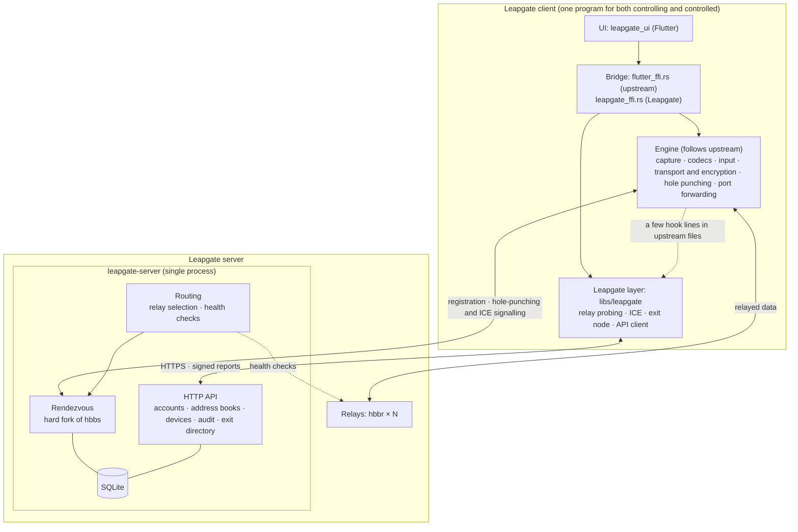

<div align="center">


<h1>Leapgate</h1>

<p>A self-hosted remote desktop built on RustDesk. The server has its own accounts and address books, relays are picked by measured latency to both ends, connections go direct whenever they can, and a controlled device can act as a network exit.</p>

<p>
<a href="#highlights">Highlights</a> ·
<a href="#features">Features</a> ·
<a href="#architecture">Architecture</a> ·
<a href="#build-from-source">Try it from source</a> ·
<a href="#roadmap">Roadmap</a> ·
<a href="#docs">Docs</a> ·
<a href="README.md">中文</a>
</p>

[](LICENSE)
[](#platforms)
[](#roadmap)
[](https://github.com/rustdesk/rustdesk)
[](https://github.com/Ogannesson/leapgate/commits/main)
[](https://www.rust-lang.org/)
[](https://flutter.dev/)

</div>

<!-- UI preview: add screenshots here once there are some that can be published -->

<a id="highlights"></a>

## Highlights

<table>
<tr>
<td width="50%" valign="top">
<b>Accounts and address books built in</b><br>
The server handles login, personal and shared address books, user groups, the device list and audit logs. The third-party rustdesk-api is no longer needed. Stock RustDesk clients 1.4.x to 1.5.x can connect too.
</td>
<td width="50%" valign="top">
<b>Latency-based relay selection</b><br>
Open-source hbbs rotates through its relays round-robin, and the client takes a single relay address. Leapgate weighs each relay by the latency from both ends (estimated from IP data, plus client measurements) and picks the cheapest.
</td>
</tr>
<tr>
<td width="50%" valign="top">
<b>Its own ICE for direct connections</b><br>
Both ends exchange candidate addresses from their physical network adapters, check pairs with STUN and connect over the pair that works, racing the existing hole-punching and relay paths. LAN connections work even with a TUN-mode proxy running. End-to-end acceptance in progress.
</td>
<td width="50%" valign="top">
<b>Application-level exit node</b><br>
Once the controlled device turns on "Allow as exit node", the controlling side gets a local SOCKS5 / HTTP CONNECT proxy, and TCP connections through it leave from the controlled device's physical adapter. Its LAN is off limits by default. Acceptance partly done.
</td>
</tr>
<tr>
<td width="50%" valign="top">
<b>Signed device reports</b><br>
Heartbeat, system-info and audit requests are signed with the device key. The server pins that key on first successful verification and signs its own responses. In open-source RustDesk these endpoints identify a device only by the ID and UUID in the request body.
</td>
<td width="50%" valign="top">
<b>Redesigned UI</b><br>
A separate Flutter project with one main window and in-app tabs. It covers the home window, remote sessions, file transfer, settings, the exit page and the install page. TCP tunnels, the terminal and the camera viewer are still in development.
</td>
</tr>
</table>

> [!WARNING]
> Leapgate is in early development. There is no release and no installer; the only way to try it is to build from source. Only Windows 10 and later is supported for now, on both the controlling and the controlled side, and builds are not code-signed. It is not ready for production use. The design documents and implementation notes are in Chinese only.

## About

Leapgate keeps RustDesk's engine (screen capture, codecs, input, transport and encryption) and reworks the server, the connection path and the client UI. It is meant for people who run their own server. The name is *leap* + *gate*: a gate you cross in one step, as with a direct connection or an exit node. The Chinese name is 跃门.

The client is a fork of rustdesk/rustdesk. Upstream releases will be brought in with `git merge`; none has been merged yet. The server is a hard fork of rustdesk-server: upstream changes are not merged, and security fixes are picked by hand.

<a id="features"></a>

## Features

Each group ends with a status, using the four terms defined in the [roadmap](#roadmap).

### Server and accounts

- `leapgate-server` is a single process forked from hbbs, with rendezvous, an HTTP API, relay routing and a SQLite database built in.
- The HTTP API covers login, address books, user groups, the device list and audit logs. Each user has one personal address book and can be granted shared ones at three levels: read-only, read-write and full control. Grants can go to users or to user groups.
- Device passwords and password hashes stored in address books are encrypted by the server before they are written to disk. This protects database files and backups; the server operator can still decrypt them.
- Users, groups, shared address books and devices are managed from the command line (`leapgate-server user ...`, `group ...`, `ab ...`, `device ...`, `relay status`, `stats` and so on). There is no web admin panel. Users, groups and address books can be imported once from a rustdesk-api database.
- The rendezvous port does a TCP key exchange, and IPv6 addresses in hole-punching messages are forwarded.
- Stock RustDesk clients (1.4.x to 1.5.x) are supported, but only for the first few Leapgate versions. To use IPv6 hole punching, a stock client has to tick "Enable IPv6 P2P connection" in the controlling side's settings.
- The server records whether each connection ended up direct, relayed or failed; `stats` shows the relay fallback rate.

Status: in acceptance.

### Relay selection

- The server looks up the location and carrier of both ends and of each relay in an IP database (DB-IP Lite, downloaded automatically by default, or MaxMind GeoLite) and estimates latency from them.
- Leapgate clients measure the round trip to each relay every 5 minutes and report it with their heartbeat. Where one end has measurements, they replace the estimate.
- A relay's cost is (latency from the initiator + latency from the controlled device) × the relay's weight, and the cheapest healthy relay wins. Weights are set by hand, so a relay with expensive traffic can be given a higher one. A device can also be pinned to a relay on the server (`device pin-relay`).
- A Leapgate controlled device connected to leapgate-server uses the relay the server picks. A relay hard-coded in a stock controlled device's local settings is cleared by the server through the heartbeat policy.

Status: in acceptance.

### Direct connections

- **ICE of its own.** Both sides gather candidate addresses on their physical network adapters, including the public mapping that leapgate-server sees, and exchange them through the server (the offer forwarded to the controlled side is signed and encrypted). Candidate pairs are checked with STUN, and the existing KCP transport runs over the selected pair. It races the upstream connection path and is used only between two Leapgate clients on leapgate-server, currently on Windows only. End-to-end acceptance is not finished.
- **LAN connections under a TUN-mode proxy.** The controlled side reports the addresses of its physical network adapters and the controlling side tries them in parallel. This applies when both ends reach the server from the same public address (the proxy sends rendezvous traffic out directly rather than through a remote exit) and both ends run Leapgate. End-to-end testing of this feature is not finished.
- Leapgate clients turn on IPv6 hole punching by default when using a self-hosted server.

Status: in acceptance.

### Exit node

- Once the controlled device turns on "Allow as exit node", the controlling side opens a SOCKS5 and HTTP CONNECT proxy on 127.0.0.1. Each TCP connection made through it becomes a channel in a multiplexed tunnel, and the controlled device makes the actual connection. Domain names are resolved on the controlled device.
- Exit traffic always leaves through the controlled device's physical network adapter, not through a proxy, TUN or VPN running on it.
- By default the controlled device refuses its own LAN and local addresses. Private ranges can be allowed by CIDR; loopback, the device's own addresses, link-local and cloud metadata addresses cannot be opened by any rule.
- The server lists exit devices only to their owners and to users granted access from the command line (`exit grant`). Whether a connection is accepted is still up to the controlled device's authentication (password, click to accept, two-factor).
- Relays are allowed, and the UI shows whether an exit runs direct or through a relay. Only TCP is supported.

Status: in acceptance, with part of the acceptance testing still to do.

### Security

- Signed device reports: Leapgate clients send heartbeat, system-info and audit requests to `/api/leapgate/v1/` and sign them with the device key. The server pins that key on the first successful verification and from then on rejects unsigned reports from the device. The server signs its responses with the rendezvous key, and a client configured with a key requires the signature. This path ignores the "accept invalid certificates" option.
- A Leapgate controlled device refuses the old raw-pipe port forwarding, which sends data in plain text after login, and accepts only multiplexed tunnels. As a result, stock controlling clients older than 1.5.0, or ones with multiplexing turned off, cannot set up port forwarding to it.
- Default servers are injected at build time; a build without them never connects to RustDesk's public servers. The official update check and the background auto-update are both disabled, so nothing is downloaded from RustDesk.

Status: in acceptance.

### New UI

- The new UI is a separate Flutter project in `leapgate_ui/` (packages `core` and `app`) that shares the Rust core with upstream's UI. The build script builds it by default.
- One main window with in-app tabs; within a session tab you can switch between views such as remote desktop and file transfer.
- Available now: the home window (your ID and password, recent, favourites, LAN, address books, group devices), remote sessions (multiple monitors, toolbar, chat and voice, recording, connection details), the connection manager on the controlled side, accounts, the exit page, settings, file transfer (including pause, retry from the failed file and skipping single files), the install page, and the "Install" and "Upgrade" cards on the home window.
- HTTP requests for accounts and address books are made in Rust (`libs/leapgate`), and the login token is only read and written there; the UI only displays the results.
- UI languages: Simplified Chinese and English.
- Not yet available: TCP tunnels (port forwarding and RDP), the terminal and the camera viewer. Until they are, `build-client.ps1 -Ui upstream` builds upstream's UI as a portable copy for these. The two UIs cannot run at the same time: quit the new UI before starting upstream's, and if it is installed, stop its tray and service too.

Status: milestones M0 to M8, M7b and M9a are done; the terminal and camera viewer (M9b) and TCP tunnels (M9c) are in progress.

### Side by side with stock RustDesk

- The program (`leapgate.exe`, `libleapgate.dll`), the Windows service, the configuration directory and the URL scheme (`leapgate://`) are all renamed, so Leapgate can be installed on the same machine as RustDesk.
- Upstream derives the default ID from the MAC address of the first network adapter, so RustDesk and Leapgate on one machine would get the same ID. Leapgate salts the ID when it first generates one; the result is always 9 digits.

Status: in acceptance. Installing next to upstream 1.4.9 on the same machine was tested during the UI switch (M8); end-to-end acceptance that the two get different IDs on the same server has not been done.

## How it differs from open-source RustDesk

| Area | Open-source RustDesk (self-hosted hbbs and hbbr) | Leapgate |
|---|---|---|
| Accounts, address books, device list, audit | Not provided by the open-source server; needs the third-party rustdesk-api (no updates since 2025-09) | Built into leapgate-server |
| Choosing among several relays | hbbs rotates round-robin, ignoring where the two ends are | Latency from both ends to each relay, times a weight |
| Client relay setting | A single address; the controlled side's local setting overrides the server | A Leapgate controlled device uses the relay the server picks |
| TCP key exchange on the rendezvous port | None; a client logged in to the API with a key configured fails to connect after 18 seconds | Yes |
| IPv6 addresses in hole-punching messages | Dropped by hbbs, so IPv6 hole punching never happens | Forwarded |
| Direct UDP connections across networks | The open-source server never answers NAT tests over UDP, so UDP hole punching never runs; the WebRTC path is off by default on self-hosted servers and the open-source server does not relay its signalling | Its own ICE (host and srflx candidates, STUN on the server) |
| LAN connections with a TUN-mode proxy running | The two ends exchange virtual adapter addresses and the direct connection fails | Physical adapter addresses only |
| Heartbeat, system-info and audit reports | Not authenticated; identified only by the ID and UUID in the request body | Signed with the device key, key pinned on first verification |
| Port forwarding target | Only the one fixed at login | In exit mode, set per connection |
| Old raw-pipe port forwarding | Plain text after login, readable by the relay when relayed | Refused by the controlled side |
| No server configured | Connects to RustDesk's public servers | Connects to no public server |
| Multiple windows in the UI | One Flutter engine per window | One main window with in-app tabs |
| Platforms | Several desktop and mobile platforms, back to Windows 7 on Windows | Windows 10 and later only, for now |

The left column describes upstream as read in October 2026 (client `rustdesk@bd92623`, server `rustdesk-server@873230e`); later upstream versions may differ. Upstream switched port forwarding to multiplexed tunnels by default in 1.5.0. The basis for each cell is in sections 1 and 3 of [docs/architecture.md](docs/architecture.md) and in the code-reading notes under [docs/research/](docs/research/).

<a id="platforms"></a>

## Platform support

| Platform | Role | Status |
|---|---|---|
| Windows 10, 11 (x64) | Controlling and controlled | Supported |
| Linux | Server (leapgate-server, hbbr) | Supported |
| Android | Controlling | Planned |
| iOS | Controlling | Planned |
| macOS, Linux desktop | Client | Not for now |
| Windows before 10 | Client | Not supported |

The Android client comes after the desktop UI, and iOS after Android. The upstream engine supports more platforms, but the first Leapgate phases are built and tested on Windows only. Client builds are not code-signed, so UAC shows "Unknown publisher".

<a id="architecture"></a>

## Architecture



- The engine and the platform-native parts follow upstream. Leapgate's own logic lives in `libs/leapgate`, new exported functions go in `leapgate_ffi.rs`, and upstream's frequently changed files only get a few lines of hooks.
- On the server side, `leapgate-server` is the control plane and one or more hbbr instances are the data plane. hbbr keeps upstream's code and runs with `-k` so it checks the key.
- Session data goes either directly between the two ends or through an hbbr relay; leapgate-server handles device registration, hole-punching and ICE signalling, relay selection and the HTTP API.

### Repositories

| Repository | Path in this repository | Origin | Branches used |
|---|---|---|---|
| [leapgate](https://github.com/Ogannesson/leapgate) | This repository | New | `main` |
| [leapgate-client](https://github.com/Ogannesson/leapgate-client) | `client/` | Fork of [rustdesk/rustdesk](https://github.com/rustdesk/rustdesk), from `bd92623` | `main` |
| [leapgate-server](https://github.com/Ogannesson/leapgate-server) | `server/` | Hard fork of [rustdesk/rustdesk-server](https://github.com/rustdesk/rustdesk-server), from `873230e` | `main` |
| [leapgate-cardo](https://github.com/Ogannesson/leapgate-cardo) | `client/libs/hbb_common`, `server/libs/hbb_common` | Fork of [rustdesk/hbb_common](https://github.com/rustdesk/hbb_common) | `leapgate/client`, `leapgate/server` |

This repository holds the documentation and build scripts, and pins `client/` to leapgate-client and `server/` to leapgate-server as submodules, so each commit records which client goes with which server. leapgate-cardo is the protocol and configuration library both sides share; the name is Latin for the pivot a door turns on. The client and the server each use their own branch of it, and the crate is still called `hbb_common`.

### Layout of this repository

```
leapgate/
├── client/              submodule leapgate-client
├── server/              submodule leapgate-server
├── docs/
│   ├── architecture.md  overall design and decision record
│   ├── research/        research notes (upstream code reading, technology choices, measurements)
│   ├── 第三期实施契约/   phase 3 implementation contracts
│   ├── 第四期实施契约/   phase 4 implementation contracts
│   └── 新界面/          new UI: content spec, implementation plan, per-milestone plans
└── scripts/
    ├── windows/         client build scripts and Flutter engine patches
    ├── linux/           netns NAT test for the ICE implementation
    └── e2e/             Windows end-to-end test scripts
```

<a id="build-from-source"></a>

## Try it from source

There is no installer, so trying Leapgate means building the server on Linux and the client on Windows yourself. The four steps below set up a minimal environment; the options for each step are under "Build details" further down.

**1. Clone.** On both the Linux and the Windows machine, clone with submodules:

```
git clone --recurse-submodules https://github.com/Ogannesson/leapgate.git
```

**2. Build and run the server on Linux.**

```
cd leapgate/server
cargo build --release
```

This produces `leapgate-server` and `hbbr` in `target/release/`. When running them:

- `leapgate-server` takes the same options as hbbs. Leapgate's own settings go in `leapgate.toml` in the working directory. List the relays under `[[relay]]`; without it, the `-r` list is used.
- `leapgate-server` must hold the rendezvous private key, or clients that have logged in cannot connect. By default it creates `id_ed25519` in the working directory, and the public key the clients need is in `id_ed25519.pub` next to it. Do not pass only the public key with `-k`.
- Run `hbbr` with `-k` so it checks the key.
- To try login and address books, create an account with `leapgate-server user add <name>`; the password is read from standard input.

All options, settings and deployment requirements are in sections 5, 6 and 14 of the [server LEAPGATE.md](https://github.com/Ogannesson/leapgate-server/blob/main/LEAPGATE.md).

**3. Build the client on Windows with your server injected.** You need PowerShell 7, Visual Studio 2022 Build Tools (C++ and CMake components; building the engine also needs the C++ ATL component and a Windows SDK with Debugging Tools), Developer Mode, long path support, rustup, Git for Windows, Python 3.10 or later, and 7-Zip or Bandizip. In PowerShell 7:

```
cd leapgate
pwsh -File scripts\windows\setup-toolchain.ps1
pwsh -File scripts\windows\build-engine.ps1 -Install
$env:LEAPGATE_RENDEZVOUS_SERVER = 'rendezvous.example.com'
$env:LEAPGATE_RS_PUB_KEY = '<server public key>'
pwsh -File scripts\windows\build-client.ps1 -Source client
```

`build-engine.ps1` builds the patched Flutter engine and installs it into the SDK cache. It needs tens of gigabytes of disk and takes an hour or two for a full build; as long as the patches do not change, later client builds do not need to run it again. The portable single-file build ends up at `client\leapgate_ui\app\build\windows\x64\runner\leapgate-0.4.0-x86_64.exe`, with a zip of the same name next to it.

**4. Connect two Windows machines.** Copy the portable file to two Windows machines and run it; no installation is needed. On the machine to be controlled, read your ID and password from the home window. On the other, type that ID into the connection box, then the password. If the build has no server injected, first enter the server address and key under Settings › General › Network and server.

## Build details

### Server

- Build on Linux with `cargo build --release`. You can also clone [leapgate-server](https://github.com/Ogannesson/leapgate-server) on its own; its `libs/hbb_common` is the `leapgate/server` branch of leapgate-cardo.
- The hbbs options (`-p`, `-k`, `-r`, `DB_URL` and the rest) work as before. `leapgate.toml` is read from the working directory by default, or from the path given by `--leapgate-config`. It has `[api]`, `[geo]`, `[routing]` and `[[relay]]` sections; if the file is missing, defaults are used throughout.
- The HTTP API listens on port 21114 by default; put a reverse proxy in front of it for HTTPS. A reverse proxy on the same machine that forwards to 21114 or 21118 must overwrite `X-Real-IP` with the client's real address.
- Set `[api] source_url` to the public URL of the source code you are running; see [License and credits](#license) for why.
- `leapgate_secret.key` in the working directory is the key that encrypts address-book passwords. Back it up together with the database; without it, those passwords cannot be decrypted.

### Client

- `setup-toolchain.ps1` installs pinned versions of Rust, LLVM, Flutter, vcpkg and the flutter_rust_bridge code generator into `C:\leapgate-build`, or into `LEAPGATE_BUILD_ROOT` if set. System setup that needs administrator rights (Visual Studio, Developer Mode, long paths) is only checked, and anything missing is listed.
- `build-engine.ps1 -Install` builds the Windows engine of Flutter 3.44.9 with the three patches in `scripts/windows/engine-patches/` and installs it into the SDK cache. They fix three problems: after a failed semantics update, the official engine's accessibility bridge points at freed nodes, so any screen-reader query crashes the process; a crash with multiple windows (flutter#155685); and orphan semantics nodes emitted by the framework, which make the whole semantics tree get rejected so screen readers see no controls at all. The patches only touch the engine's C++.
- `build-client.ps1` builds the new UI by default. It checks that the engine in the SDK cache was built with the current patches and stops if not; to build with the official engine anyway, add `-AllowOfficialEngine`, and the output will not have these fixes.
- Three environment variables are read at build time. `LEAPGATE_RENDEZVOUS_SERVER` and `LEAPGATE_RS_PUB_KEY` set the default server and its public key. `LEAPGATE_API_SERVER` is optional; without it, the API address is derived from the rendezvous server. If no server is injected, the client waits for the user to enter one.
- `build-client.ps1` modifies tracked files in the `-Source` tree, so if you plan to commit, point `-Source` at a worktree used only for building.
- The new UI's release folder is `leapgate_ui\app\build\windows\x64\runner\Release\`. Next to it, in `runner\`, are the portable single-file `leapgate-<version>-x86_64.exe` and a zip of the release folder. The version comes from `libs/leapgate`, currently 0.4.0; it is only a version stamped on build output and does not correspond to a release.
- Other options:

| Option | Effect |
|---|---|
| `-Ui upstream` | Builds upstream's UI as a portable copy in `flutter\build\windows\x64\runner\Release\`, without the single-file exe or zip |
| `-Steps` | Runs only some of `vcpkg`, `patch`, `bridge` and `build` |
| `-ForceBridge` | Regenerates the flutter_rust_bridge code |
| `-NoVram` | Turns off zero-copy D3D11 texture rendering |
| `-PrinterDriver` | Downloads the printer driver and adapter from upstream's release page, checks their sha256 and adds them to the output |
| `-FlutterRoot` | Uses a different Flutter SDK |

To pass several values to `-Steps`, call the script directly from pwsh (`scripts\windows\build-client.ps1 -Source client -Steps bridge,build`); with `pwsh -File`, `bridge,build` arrives as a single string.

<a id="roadmap"></a>

## Roadmap

| Stage | Scope | Status |
|---|---|---|
| Phase 1: server | Rendezvous, HTTP API, first-level routing, TCP key exchange, IPv6 signalling, connection outcome records, rustdesk-api import | In acceptance |
| Phase 2: client groundwork | Renaming, Windows build chain, `libs/leapgate` skeleton, coexistence with stock RustDesk | In acceptance |
| Phase 3: routing and direct connections | Signed device reports, second-level routing, LAN connections under TUN, ICE, salted default ID | In acceptance |
| Phase 4: exit node | Exit directory and grants, exit on the controlled side, local proxy on the controlling side | In acceptance |
| New UI M0–M8 | Home window, remote sessions, connection manager, accounts and address books, exit page, settings, file transfer; from M8 the build uses the new UI by default | Done |
| New UI M7b | Pause, retry from the failed file and skipping single files in file transfer | Done |
| New UI M9a | Install page | Done |
| New UI M9b | Terminal, camera viewer | In progress |
| New UI M9c | TCP tunnels (port forwarding, RDP) | In progress |
| New UI M10 | Flutter upgrade | Planned |
| New UI M11 | Android controlling client | Planned |
| iOS controlling client | After Android | Planned |
| Per-segment relay latency | Connection details show the latency from this device to the relay and from the relay to the remote device separately; needs hbbr to echo probe frames | Planned |
| End of compatibility | The server accepts only Leapgate clients, and the code kept for stock clients is removed | Planned |
| Code signing | Decide on signing before builds are given to others | Planned |

What the four statuses mean:

- Done: merged into main and accepted for that milestone.
- In acceptance: development merged into main, end-to-end acceptance not finished. Stress tests and repeated comparison runs are done together once all development is finished.
- In progress: being developed or accepted on a branch, not yet merged into main.
- Planned: not started.

Later, with no schedule yet: a global exit node (orchestrating Tailscale/Headscale exit nodes) and UDP support for the exit node.

### Not planned

- No web client. The official Web Client is closed source, and writing one from scratch costs too much.
- No connecting to RustDesk's public servers.
- No Windows 7 support.
- No home-grown virtual-adapter VPN, and no embedding of tsnet or wireguard-go.
- Upstream's WebRTC path is not the main path. Leapgate's ICE does no TURN; relays are still hbbr.
- An established connection does not switch relays midway or use several relays at once.
- No copy of rustdesk-api's web admin panel.

<a id="docs"></a>

## Documentation

The documentation is in Chinese.

- [docs/architecture.md](docs/architecture.md): overall design, key decisions and the alternatives not chosen, what is out of scope, and the phases.
- [docs/research/](docs/research/): research notes on upstream code, UI technology choices, WebRTC measurements and the ICE design.
- [docs/第三期实施契约/](docs/第三期实施契约/README.md), [docs/第四期实施契约/](docs/第四期实施契约/README.md): implementation contracts for routing and direct connections, and for the exit node.
- [docs/新界面/](docs/新界面/): the new UI's content and logic specs, [implementation plan](docs/新界面/03-实施方案.md), per-milestone plans and smoke checklist.
- [server LEAPGATE.md](https://github.com/Ogannesson/leapgate-server/blob/main/LEAPGATE.md): scope, configuration, storage, command line and behaviour of every server module.
- [client LEAPGATE.md](https://github.com/Ogannesson/leapgate-client/blob/main/LEAPGATE.md): every change made on top of upstream, the hooks and known limitations, and the new UI's acceptance records.

## Contributing and feedback

Please file issues and suggestions in the main repository's [Issues](https://github.com/Ogannesson/leapgate/issues). For larger changes, open an issue to discuss them first. Issues are turned off in the three code repositories, leapgate-client, leapgate-server and leapgate-cardo.

<a id="license"></a>

## License and credits

Leapgate is licensed under [AGPL-3.0](LICENSE), inherited from rustdesk/rustdesk and rustdesk/rustdesk-server. It is derived from [rustdesk/rustdesk](https://github.com/rustdesk/rustdesk), [rustdesk/rustdesk-server](https://github.com/rustdesk/rustdesk-server) and [rustdesk/hbb_common](https://github.com/rustdesk/hbb_common), and thanks their authors.

Leapgate is not affiliated with or endorsed by the RustDesk project; the RustDesk name belongs to its owners.

If you run a modified leapgate-server for other people, AGPL-3.0 section 13 requires you to offer the source to users who interact with it over a network. Set `[api] source_url` in `leapgate.toml` to the public URL of the source you are running; the page at `/` on the API port shows this link.
