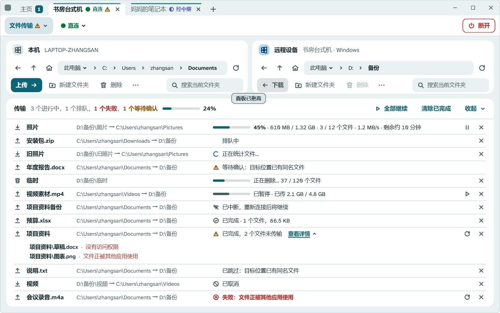
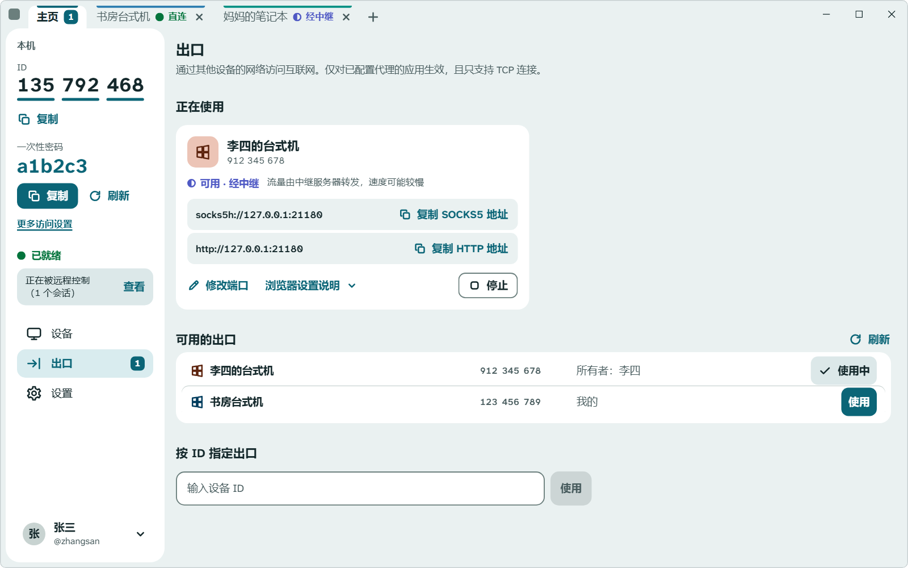
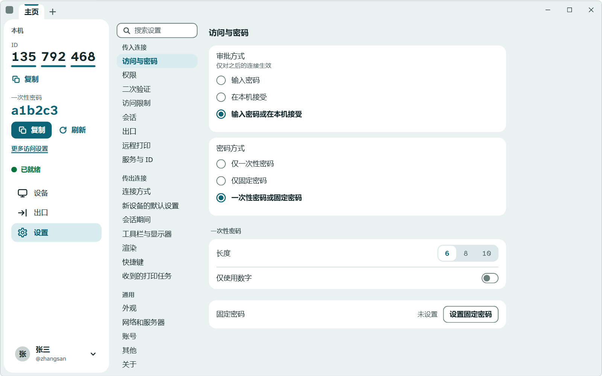
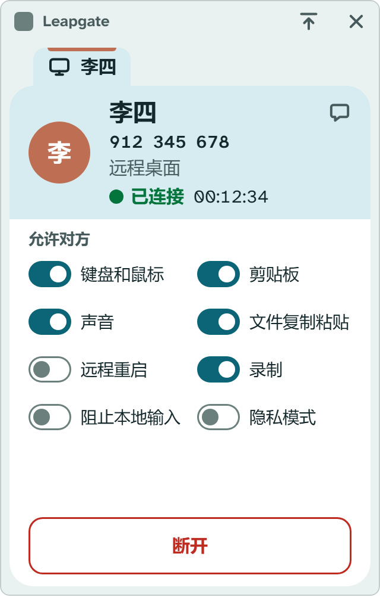
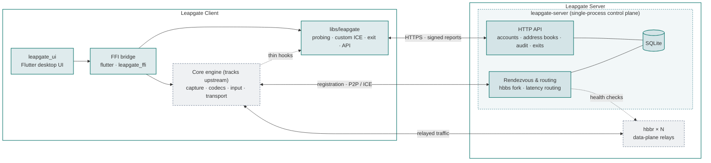

<div align="center">


<h1>Leapgate</h1>

<p>Self-hosted remote desktop built on the RustDesk engine<br>Built-in accounts &amp; address books · Latency-weighted relays · Custom ICE · App-level exit nodes</p>

<p>
  <a href="#features">Features</a> ·
  <a href="#preview">Preview</a> ·
  <a href="#build-from-source">Build from Source</a> ·
  <a href="#architecture">Architecture</a> ·
  <a href="#roadmap">Roadmap</a> ·
  <a href="#docs">Docs</a> &nbsp;|&nbsp;
  <a href="README.md"><b>中文</b></a>
</p>

[](LICENSE)
[-0F766E?style=flat-square&labelColor=14282B)](#platforms)
[](#platforms)
[](https://github.com/rustdesk/rustdesk)

</div>

<br>

<p align="center">
  <picture>
    <source media="(prefers-color-scheme: dark)" srcset="docs/assets/ui/home-dark.png">
    <source media="(prefers-color-scheme: light)" srcset="docs/assets/ui/home-light.png">
    
  </picture>
</p>
<p align="center">
  <sub>Main window preview (design mockup, in Chinese)</sub>
</p>

> [!NOTE]
> Leapgate is in early development and does not yet ship prebuilt installers; build from source to try it. The client currently supports Windows 10/11 (x64) without code signing and is not yet recommended for production use.

<a id="features"></a>

## Features

- **Single-Process Server (`leapgate-server`)**
  Combines rendezvous, HTTP API, relay routing, and SQLite storage into a single process. Includes user accounts, personal and shared address books (per-user and per-group permissions), device inventory, and audit logs, with stored device passwords encrypted at rest. Managed via CLI, supports one-time import from a third-party `rustdesk-api` database, and is currently compatible with stock RustDesk 1.4.x–1.5.x clients.

- **Latency-Weighted Relay Routing**
  Estimates latency via an IP geolocation database (downloads DB-IP Lite automatically at runtime by default, or use MaxMind GeoLite), overridden by client-side relay latency probes reported every 5 minutes by Leapgate clients. Picks the healthy relay with the lowest weighted two-way latency, and supports pinning individual devices to a specific relay.

- **Custom ICE & LAN Direct Connections**
  Runs a custom ICE implementation (physical adapter candidates, server STUN reflexive addresses, and KCP transport) alongside the upstream connection path, letting whichever connects first win. Supports LAN direct connections over physical adapters even under a TUN proxy or virtual adapter, and enables IPv6 hole punching by default.

- **Application-Level Exit Node**
  When a controlled device enables **Allow as exit node**, the controlling client opens a local SOCKS5 / HTTP CONNECT proxy on `127.0.0.1`. TCP connections are multiplexed over the session and leave through the controlled device's physical adapter, with DNS resolved remotely. The controlled device's LAN is blocked by default (configurable per subnet), while host-local, loopback, link-local, and cloud metadata addresses are always blocked. Exit directory access can be granted per user or group via CLI.

- **Device Signing & Side-by-Side Coexistence**
  Leapgate clients sign heartbeat, system-info, and audit reports with the device's private key (pinned on first verification), and the server signs its responses in return. Legacy unencrypted port forwarding is refused on the controlled side. Builds without an injected server never contact public servers, and upstream auto-update checks are disabled. Renamed binaries, Windows service, config directory, `leapgate://` URL scheme, and salted 9-digit IDs allow side-by-side installation with stock RustDesk.

- **Rewritten Desktop UI**
  A standalone Flutter app (`leapgate_ui/`) using a single main window with in-app tabs, keeping all account and address-book HTTP requests inside Rust. Covers home, remote sessions, file transfer (pause, retry on failure, per-file skip), TCP / RDP tunnels, remote terminal, camera viewer, exit management, settings, and installation.

<a id="preview"></a>

## Preview

The redesigned UI supports light and dark themes, compact and detailed densities, and Simplified Chinese / English (design mockups shown below, in Chinese).

<p align="center">
  <picture>
    <source media="(prefers-color-scheme: dark)" srcset="docs/assets/ui/session-dark.png">
    <source media="(prefers-color-scheme: light)" srcset="docs/assets/ui/session-light.png">
    
  </picture>&nbsp;&nbsp;
  <picture>
    <source media="(prefers-color-scheme: dark)" srcset="docs/assets/ui/file-transfer-dark.png">
    <source media="(prefers-color-scheme: light)" srcset="docs/assets/ui/file-transfer-light.png">
    
  </picture>
  <br>
  <sub><b>Left: Remote session</b> (tabbed sessions with direct / relay indicator on the floating toolbar) · <b>Right: File transfer</b> (dual-pane browser and queue with pause, retry, and skip)</sub>
</p>

<p align="center">
  <picture>
    <source media="(prefers-color-scheme: dark)" srcset="docs/assets/ui/exit-dark.png">
    <source media="(prefers-color-scheme: light)" srcset="docs/assets/ui/exit-light.png">
    
  </picture>&nbsp;&nbsp;
  <picture>
    <source media="(prefers-color-scheme: dark)" srcset="docs/assets/ui/settings-dark.png">
    <source media="(prefers-color-scheme: light)" srcset="docs/assets/ui/settings-light.png">
    
  </picture>
  <br>
  <sub><b>Left: Exit node</b> (pick an authorized exit and copy the local SOCKS5 / HTTP proxy) · <b>Right: Settings</b> (grouped into incoming, outgoing, and general with search)</sub>
</p>

<p align="center">
  <picture>
    <source media="(prefers-color-scheme: dark)" srcset="docs/assets/ui/cm-dark.png">
    <source media="(prefers-color-scheme: light)" srcset="docs/assets/ui/cm-light.png">
    
  </picture>
  <br>
  <sub><b>Controlled-side connection manager</b> · Inspect incoming sessions, revoke permissions, or disconnect</sub>
</p>

## Comparison with Stock Self-Hosted RustDesk

| Area | Open-Source RustDesk (self-hosted `hbbs` + `hbbr`) | Leapgate |
|---|---|---|
| Accounts, address books & audit | Requires a separate third-party API server | **Built into** the single-process `leapgate-server` |
| Multi-relay selection | Round-robin across `hbbr` list; client local setting overrides | **Latency-weighted** selection with per-device pinning; server choice wins |
| Direct connections & IPv6 | Relies on stock hole punching; IPv6 P2P is opt-in | **Custom ICE in parallel** (STUN + KCP); server forwards IPv6 signalling, client enables IPv6 P2P by default |
| LAN direct under TUN / virtual adapters | Exchanges default socket address, often hitting virtual adapters | Gathers and probes **physical adapter candidates** |
| Exit node & port forwarding | Fixed destination per port-forward session | **Dynamic-target** local SOCKS5 / HTTP CONNECT proxy (TCP exit) |
| Device report authentication | Identifies devices by request-body ID and UUID | **Device private-key signing**, first-use key pinning, and signed server responses (Leapgate clients) |
| Desktop UI architecture | Separate Flutter engine per window | **Single main window with in-app tabs** (`leapgate_ui`) |
| Default servers | Connects to official public servers when unconfigured | **Never contacts public servers**; uses injected or configured server only |
| Platforms | Multiple desktop and mobile platforms | Windows 10/11 client and Linux server for now |

<sub>Comparison reflects open-source RustDesk as of the fork baseline; newer upstream releases may differ. See <a href="docs/architecture.md">Architecture</a> and <a href="docs/research/">Research Notes</a> (in Chinese) for details.</sub>

<a id="platforms"></a>

## Platform Support

| Platform | Role | Status |
| :--- | :--- | :---: |
| Windows 10 / 11 (x64) | Controlling & controlled | Supported |
| Linux | Server (`leapgate-server`, `hbbr`) | Supported |
| Android / iOS | Controlling | Planned |
| macOS / Linux desktop | Client | Not planned for now |

<a id="build-from-source"></a>

## Build from Source

### 1. Clone

Clone with submodules on both Linux (server) and Windows (client), forcing LF line endings so Windows checkouts do not break `sqlx` migration checksums:

```bash
git clone -c core.autocrlf=false -c core.eol=lf --recurse-submodules https://github.com/Ogannesson/leapgate.git
```

### 2. Build and Run the Server (Linux)

**Prerequisites**: Rust toolchain plus `gcc`, `make`, and `pkg-config` for C dependencies.

```bash
cd leapgate/server
cargo build --release
```

Binaries `leapgate-server` and `hbbr` are produced in `target/release/`:

- `leapgate-server` accepts standard `hbbs` flags alongside `leapgate.toml` in the working directory (or `--leapgate-config`), falling back to built-in defaults if absent.
- First startup generates `id_ed25519` and `id_ed25519.pub` in the working directory (give the public key to clients; do not pass a public-only `-k` to `leapgate-server`). Start `hbbr -k _` (or `-k <server-public-key>` on a separate host) to enforce key verification, and specify relays via `-r <relay-addr>` or `[[relay]]` in `leapgate.toml`.
- The HTTP API listens on port `21114` by default; place it behind an HTTPS reverse proxy. When proxying `21114` (API) or `21118` (WebSocket) locally, overwrite `X-Real-IP` with the real client address.
- Create an account with `leapgate-server user add <username>` (reads password from stdin) to log in and use address books.

See [server LEAPGATE.md](https://github.com/Ogannesson/leapgate-server/blob/main/LEAPGATE.md) for full configuration, CLI commands, reverse proxy setup, and key backup notes (`leapgate_secret.key`).

### 3. Build the Client (Windows 10/11 x64)

**Prerequisites**: PowerShell 7, Visual Studio 2022 Build Tools (C++, CMake, ATL, and Windows SDK with Debugging Tools), Developer Mode and long paths enabled, rustup, Git for Windows, Python 3.10+, and 7-Zip or Bandizip. **Neither the repository path nor `CARGO_HOME` may contain spaces.**

Run in PowerShell 7:

```powershell
cd leapgate
pwsh -File scripts\windows\setup-toolchain.ps1

# Full build (patched Flutter engine with accessibility & multi-window fixes;
# needs tens of GB and 1–2 hours on first run, skipped on later builds while patches stay unchanged):
pwsh -File scripts\windows\build-engine.ps1 -Install
# For a quick trial, skip the line above and append -AllowOfficialEngine to build-client.ps1 below.

$env:LEAPGATE_RENDEZVOUS_SERVER = 'rendezvous.example.com'
$env:LEAPGATE_RS_PUB_KEY = '<server-public-key>'
pwsh -File scripts\windows\build-client.ps1 -Source client
```

- `setup-toolchain.ps1` installs pinned versions of Rust, LLVM, Flutter, vcpkg, and codegen tools under `C:\leapgate-build` (override with `LEAPGATE_BUILD_ROOT`).
- Optionally set `LEAPGATE_API_SERVER` (otherwise derived from the rendezvous address). Builds without an injected server let you configure one under **Settings › General › Network and server**.
- The portable single-file executable (`leapgate-<version>-x86_64.exe`) and `.zip` archive land in `client\leapgate_ui\app\build\windows\x64\runner\` and can be copied directly to two Windows machines to connect.

<details>
<summary><b>Common build options (<code>build-client.ps1</code>)</b></summary>

| Option | Description |
|---|---|
| `-Ui upstream` | Build the upstream UI as a portable folder (`client\flutter\build\windows\x64\runner\Release\`) |
| `-Steps` | Run a subset of `vcpkg`, `patch`, `bridge`, `build` (invoke the script directly without `pwsh -File` when passing comma-separated values) |
| `-ForceBridge` | Force regenerating `flutter_rust_bridge` bindings |
| `-NoVram` | Disable D3D11 zero-copy texture rendering |
| `-PrinterDriver` | Download, verify, and bundle the upstream printer driver and adapter |
| `-AllowOfficialEngine` | Bypass the patched-engine check and build with the official cached engine |
| `-FlutterRoot` | Use a different Flutter SDK installation |

</details>

<a id="architecture"></a>

## Architecture



- **Data path**: When a direct connection succeeds (upstream P2P or `libs/leapgate` custom ICE), video and control traffic flows directly between peers; `hbbr` relays are used only as fallback.
- **Client**: Tracks upstream releases via `git merge`. Leapgate code lives in `libs/leapgate`, `leapgate_ffi.rs`, and `leapgate_ui/`, keeping hooks in upstream files minimal.
- **Server**: Separates the control plane (`leapgate-server`, a standalone hard fork) from the data plane (stock `hbbr` relays run with `-k` key enforcement).

### Repositories

| Repository | Path | Description | Branch |
|---|---|---|---|
| [leapgate](https://github.com/Ogannesson/leapgate) | This repo | Documentation, build scripts, and submodule pins | `main` |
| [leapgate-client](https://github.com/Ogannesson/leapgate-client) | `client/` | Fork of [rustdesk/rustdesk](https://github.com/rustdesk/rustdesk) | `main` |
| [leapgate-server](https://github.com/Ogannesson/leapgate-server) | `server/` | Hard fork of [rustdesk/rustdesk-server](https://github.com/rustdesk/rustdesk-server) | `main` |
| [leapgate-cardo](https://github.com/Ogannesson/leapgate-cardo) | `*/libs/hbb_common` | Shared protocol & config crate, fork of [rustdesk/hbb_common](https://github.com/rustdesk/hbb_common) | `leapgate/client`, `leapgate/server` |

This repository also contains `docs/` (architecture, research notes, and implementation docs) and `scripts/{windows,linux,e2e}/` (Windows build toolchain and engine patches, Linux network-namespace ICE tests, and end-to-end test scripts).

<a id="roadmap"></a>

## Roadmap

The single-process server, latency-weighted relay routing, custom ICE, TCP application exit node, side-by-side coexistence, and the new Windows desktop UI are implemented and usable from source. Upcoming work:

- [ ] Mobile controlling clients (Android first, then iOS)
- [ ] Routing, exit & security follow-ups: per-segment relay latency display, UDP and global exit node, code signing, and phasing out stock-client compatibility

See [Architecture](docs/architecture.md) for design boundaries and explicit non-goals (web client, public servers, Windows 7, etc.).

<a id="docs"></a>

## Documentation & Feedback

Detailed documentation is currently written in Chinese:

- [Architecture](docs/architecture.md): overall design, key trade-offs, and project scope
- [Research Notes](docs/research/): upstream code analysis, routing, custom ICE, and UI selection
- [server LEAPGATE.md](https://github.com/Ogannesson/leapgate-server/blob/main/LEAPGATE.md): module breakdown, configuration, CLI, and deployment requirements
- [client LEAPGATE.md](https://github.com/Ogannesson/leapgate-client/blob/main/LEAPGATE.md): client changes on top of upstream and known limitations

Please file bug reports and proposals in this repository's [Issues](https://github.com/Ogannesson/leapgate/issues) (issues are disabled in the three code submodules). For larger changes, open an issue to discuss before sending a PR.

<a id="license"></a>

## License & Acknowledgements

Leapgate is licensed under [AGPL-3.0](LICENSE) and derived from [rustdesk/rustdesk](https://github.com/rustdesk/rustdesk), [rustdesk/rustdesk-server](https://github.com/rustdesk/rustdesk-server), and [rustdesk/hbb_common](https://github.com/rustdesk/hbb_common). Thanks to the upstream authors and community. Default server IP geolocation data is downloaded at runtime from [DB-IP Lite](https://db-ip.com) (CC BY 4.0).

Leapgate is not affiliated with or endorsed by the RustDesk project; the RustDesk name and logo belong to their owner.

Under AGPL-3.0 section 13, if you host a modified `leapgate-server` for others over a network, you must offer them the corresponding source code: set `[api] source_url` in `leapgate.toml` to your public source repository URL, which is displayed at `/` on the API port.
