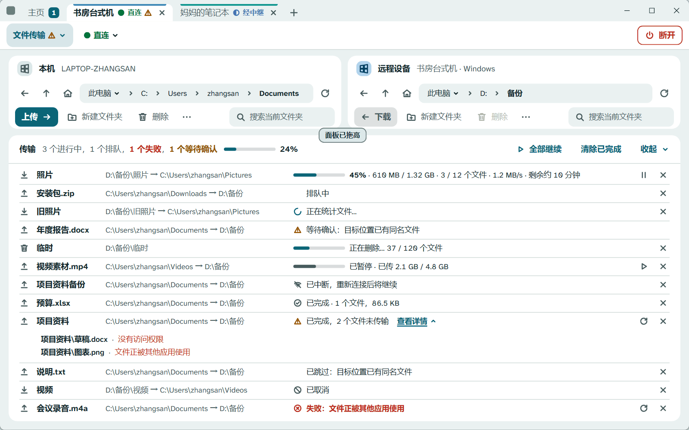
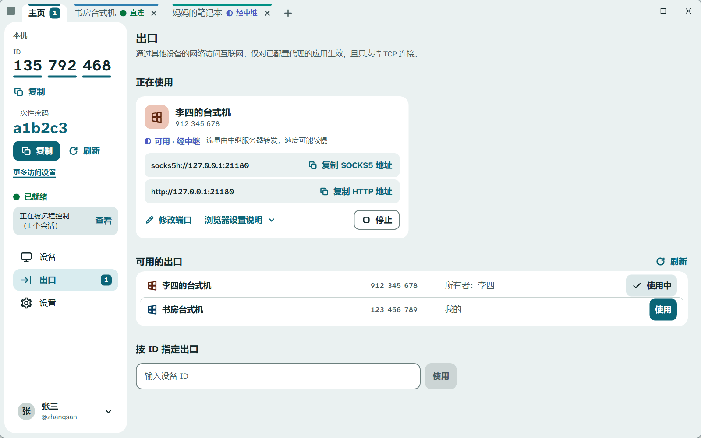
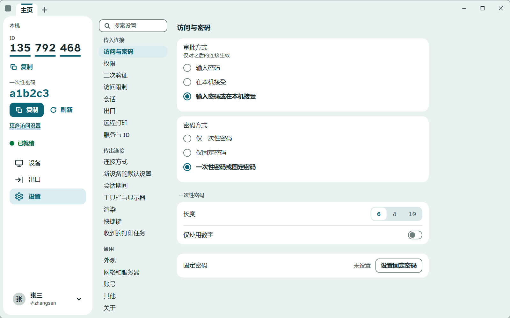
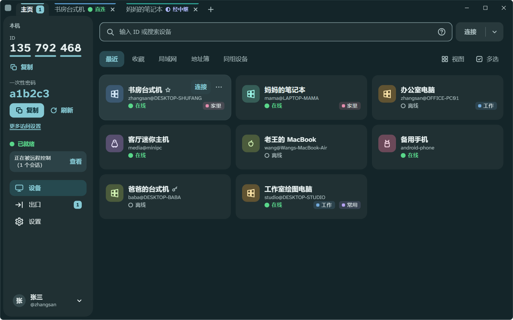
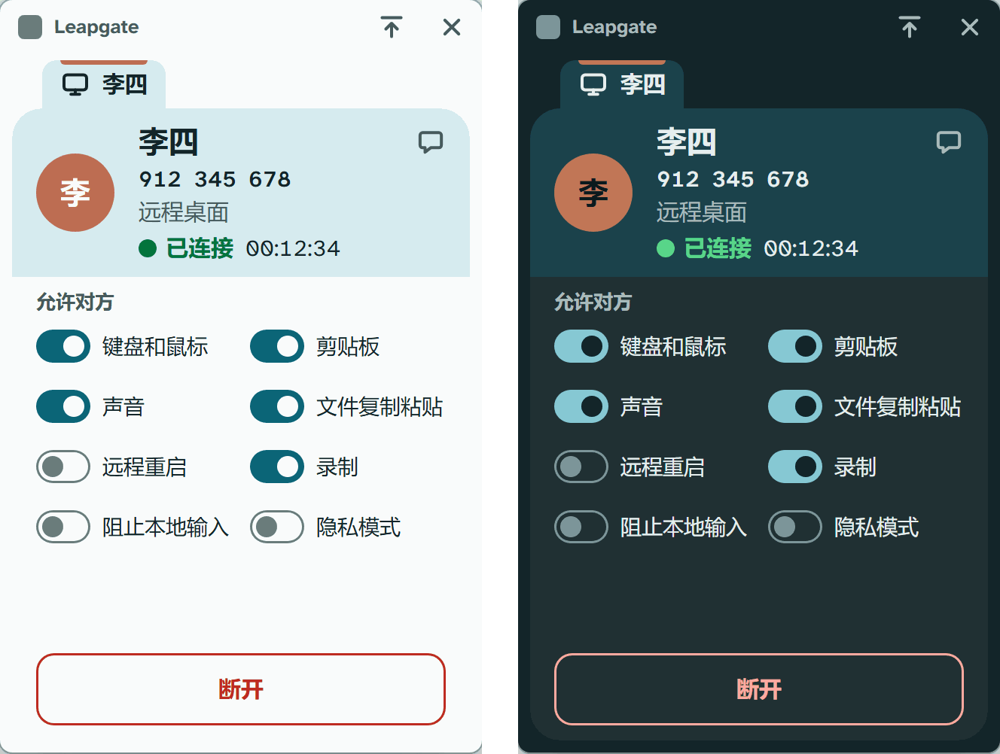
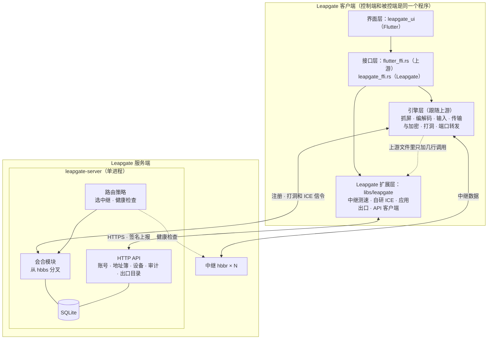

<div align="center">


<h1>Leapgate · 跃门</h1>

<p>基于 RustDesk 的自建远程桌面：服务端自带账号和地址簿，按两端到各中继的延迟选中继，能直连就直连，还能把被控设备当成网络出口。</p>

<p>
<a href="#highlights">亮点</a> ·
<a href="#preview">界面预览</a> ·
<a href="#features">功能</a> ·
<a href="#architecture">架构</a> ·
<a href="#build-from-source">从源码构建试用</a> ·
<a href="#roadmap">路线图</a> ·
<a href="#docs">文档</a> ·
<a href="README.en.md">English</a>
</p>

[](LICENSE)
[](#platforms)
[](#roadmap)
[](https://github.com/rustdesk/rustdesk)
[](https://github.com/Ogannesson/leapgate/commits/main)
[](https://www.rust-lang.org/)
[](https://flutter.dev/)

</div>

<p align="center">

<br>
<sub>主窗口（设计稿，设备和人名都是虚构的）</sub>
</p>

<a id="highlights"></a>

## 亮点

<table>
<tr>
<td width="50%" valign="top">
<b>自带账号和地址簿服务</b><br>
服务端内置登录、个人和共享地址簿、用户组、设备列表和审计日志，不用再另装第三方的 rustdesk-api。原版 RustDesk 1.4.x 到 1.5.x 客户端也能连。
</td>
<td width="50%" valign="top">
<b>按延迟选中继</b><br>
开源版 RustDesk 的服务端 hbbs 在多台中继服务器（hbbr）之间只轮询，客户端也只能填一个中继。Leapgate 按两端到各中继的延迟（IP 地理库估算，加客户端实测）乘以权重，选代价最小的一台。
</td>
</tr>
<tr>
<td width="50%" valign="top">
<b>自研 ICE 直连</b><br>
参照 ICE（WebRTC 建立直连的标准做法）自己实现：两端交换候选地址（物理网卡上的地址和服务端看到的公网映射地址），逐对发 STUN 探测包，在能通的那一对上建立连接；它和原有的打洞、中继同时尝试，先通的胜出。本机开着 TUN 模式代理（用虚拟网卡接管全部流量的代理）也能局域网直连。
</td>
<td width="50%" valign="top">
<b>应用出口</b><br>
被控端打开"允许作为出口"后，控制端本机多出一个 SOCKS5 / HTTP CONNECT 代理，经它发出的 TCP 连接从被控端的物理网卡出去，默认不许访问被控端的局域网。
</td>
</tr>
<tr>
<td width="50%" valign="top">
<b>设备签名上报</b><br>
心跳、系统信息和审计请求用设备私钥签名，服务端首次验签通过后锁定这把公钥，自己的响应也签名。开源版的这几个接口只靠请求体里的 ID 和 UUID 认设备。
</td>
<td width="50%" valign="top">
<b>重新设计的界面</b><br>
独立的 Flutter 工程，一个主窗口加应用内标签，已覆盖主页、远程会话、文件传输、设置、出口页和安装页。TCP 隧道、终端和摄像头查看还在开发。
</td>
</tr>
</table>

> [!WARNING]
> Leapgate 处在早期开发阶段，没有发布，也没有可下载的安装包，想试用只能从源码构建。服务端和 Windows 客户端的主要功能已经可用，新客户端界面还有几项在开发，移动端控制端在计划中。目前只支持 Windows 10 及以上（控制端和被控端），构建产物没有代码签名。不建议用于生产环境。设计文档和实施说明只有中文。

<a id="preview"></a>

## 界面预览

新界面有简洁和详细两种显示密度、浅色和深色两套主题，界面语言有简体中文和英文。下面是它的设计稿，图里的设备、人名和数据都是虚构的。实现出来的界面会对照设计稿检查外观。

<table>
<tr>
<td width="50%" valign="top">

<br><b>远程会话</b>：一个窗口里用标签切换多个会话，浮动工具栏上标着这条连接是直连还是经中继。
</td>
<td width="50%" valign="top">

<br><b>文件传输</b>：本机和远程设备两栏；传输队列里的任务可以暂停、继续、从失败处重试，也可以跳过个别文件。
</td>
</tr>
<tr>
<td width="50%" valign="top">

<br><b>应用出口</b>：选一台允许作为出口的设备，把本机的 SOCKS5 或 HTTP 代理地址填给要用它的应用。
</td>
<td width="50%" valign="top">

<br><b>设置</b>：按传入连接、传出连接和通用分组，可以搜索。
</td>
</tr>
<tr>
<td width="50%" valign="top">

<br><b>深色主题</b>
</td>
<td width="50%" valign="top">

<br><b>被控端的连接管理小窗</b>：显示谁连了进来，可以随时收回键盘鼠标、剪贴板等权限，或者断开。
</td>
</tr>
</table>

## 简介

Leapgate 沿用 RustDesk 的引擎（抓屏、编解码、输入、传输与加密），重做服务端、连接路径和客户端界面，面向自己运行服务端的用户。名字取 leap（一跃）加 gate（门）：一步跨过去的门，对应打洞直连，也对应出口。

客户端从 rustdesk/rustdesk 分叉，继续跟随上游，以后用 `git merge` 合并上游的正式版本（目前还没有合并过）。服务端从 rustdesk-server 分叉后独立发展，不再合并上游，安全修复手工摘取。

<a id="features"></a>

## 主要功能

### 服务端和账号

- `leapgate-server` 是从 hbbs（RustDesk 的会合服务器，设备在这里登记、交换建立连接所需的信息）分叉出来的单个进程，内置会合服务、HTTP API、路由策略和 SQLite 数据库。
- HTTP API 提供登录、地址簿、用户组、设备列表和审计日志。地址簿是一本个人簿加多本共享簿，共享簿按只读、读写、完全控制三级授权，可以授权给用户，也可以授权给用户组。
- 地址簿里保存的设备密码和密码哈希由服务端加密后落盘，防的是数据库文件和备份泄露；服务端的运维者本人仍能解开。
- 用命令行管理用户、用户组、共享簿和设备（`leapgate-server user ...`、`group ...`、`ab ...`、`device ...`、`relay status`、`stats` 等），没有网页后台。可以从 rustdesk-api 的数据库一次性导入用户、用户组和地址簿。
- 会合端口上做 TCP 密钥交换，并转发打洞信令里的 IPv6 地址。
- 兼容原版 RustDesk 客户端（1.4.x 到 1.5.x），这份兼容只保留在最初几个版本。原版客户端要用 IPv6 打洞，需要在控制端的设置里手动勾选"Enable IPv6 P2P connection"。
- 记录每次连接最后是直连、经中继还是失败，用 `stats` 查看中继回落率（没能直连、改走中继的比例）。

### 选中继

- 服务端用 IP 地理库（默认自动下载 DB-IP Lite，也可以换成 MaxMind GeoLite）查出两端和各中继的位置与运营商，估算延迟。
- Leapgate 客户端每 5 分钟测一次到各中继的往返，随心跳上报；某一端有实测时，用实测代替估算。
- 中继的代价是（发起方到中继的延迟 + 被控端到中继的延迟）× 中继权重，在健康检查通过的中继里选代价最小的。权重手工配置，流量贵的中继可以调高；也可以在服务端把某台设备固定到某台中继（`device pin-relay`）。
- Leapgate 被控端连 leapgate-server 时以服务端选的中继为准；原版被控端本地写死的中继，由服务端经心跳下发的策略清掉。

### 直连

- **自研 ICE。** 两端在物理网卡上收集候选地址，包括 leapgate-server 看到的公网映射地址，经服务端交换（转给被控端的那份既签名又加密），逐对发 STUN 探测包，选中一对后在上面跑 RustDesk 原有的 KCP 传输（基于 UDP 的可靠传输）。它和上游原有的连接路径同时尝试、先通的胜出，只在两端都是 Leapgate 客户端、服务端是 leapgate-server 时使用，目前只在 Windows 上。
- **开 TUN 模式代理时的局域网直连。** 开着 TUN 模式代理时，上游交换的是虚拟网卡地址，直连会失败。Leapgate 被控端上报自己物理网卡的地址，控制端并发尝试。前提是两端到服务端的公网地址相同（代理对会合服务器的流量走直连、不经远端出口），且两端都是 Leapgate 客户端。
- Leapgate 客户端连自建服务器时默认打开 IPv6 打洞。

### 应用出口

- 被控端在设置里打开"允许作为出口"后，控制端在本机 127.0.0.1 上开一个 SOCKS5 和 HTTP CONNECT 代理，经它发出的每条 TCP 连接成为远程连接里的一个独立通道（一条连接里同时承载多个通道，即多路复用），由被控端代为连接。域名交给被控端解析。
- 出口流量一律从被控端的物理网卡出去，不经被控端本机的代理、TUN 或 VPN。
- 被控端默认拒绝访问自己的局域网和本机地址，私网地址可以按网段放行；回环、本机地址、链路本地和云主机元数据地址任何规则都放不开。
- 服务端只把开着出口的设备列给设备主人和用命令行授权过的用户（`exit grant`）。能不能连上仍由被控端的认证决定（密码、点击确认、二次验证）。
- 允许走中继，界面上标明这条出口是直连还是经中继。只支持 TCP。

### 安全

- 设备签名上报：Leapgate 客户端的心跳、系统信息和审计请求改走 `/api/leapgate/v1/`，用设备私钥签名；服务端首次验签通过后锁定这把公钥，之后同一台设备不签名的上报一律拒收；服务端用会合私钥给响应签名，客户端配了服务端公钥（Key）就强制验签。这条路径不理会"接受无效证书"选项。
- Leapgate 被控端拒绝不走多路复用的旧式端口转发（登录后数据明文传输），只接受多路复用模式。代价是 1.5.0 以前的原版控制端和关掉了多路复用的控制端不能对它做端口转发。
- 默认服务器在构建时注入，没有注入的构建不会连 RustDesk 的公共服务器。官方的更新检查和后台自动更新都已关闭，不会从 RustDesk 官方下载安装包。

### 新界面

- 新界面是独立的 Flutter 工程 `leapgate_ui/`（`core`、`app` 两个包），和上游界面共用 Rust 核心，构建脚本默认编它。
- 一个主窗口加应用内标签，同一个会话标签里可以在远程桌面、文件传输等视图之间切换。
- 已经有的：主页（本机 ID 和密码、最近、收藏、局域网、地址簿、同组设备）、远程会话（多显示器、工具栏、聊天和语音、录制、连接方式详情）、被控端的连接管理小窗、账号、出口页、设置、文件传输（含暂停、从失败处重试、跳过个别文件），以及安装页和主页的"安装""升级"卡片。
- 账号和地址簿的 HTTP 请求在 Rust（`libs/leapgate`）里发，登录令牌只在 Rust 里读写，界面只管显示。
- 界面语言有简体中文和英文。
- 还没有的：TCP 隧道（端口转发和 RDP）、终端、摄像头查看。补上之前，可以用 `build-client.ps1 -Ui upstream` 把上游界面编成便携版来用这几项。两个界面不能同时运行，用上游界面前先退出新界面，装了的连托盘和服务一起停。

### 和原版 RustDesk 共存

- 程序名（`leapgate.exe`、`libleapgate.dll`）、Windows 服务名、配置目录和链接协议（`leapgate://`）都改了名，可以和原版 RustDesk 装在同一台机器上。
- 上游按第一块网卡的 MAC 地址算默认 ID，同一台机器上的原版和 Leapgate 会算出同一个 ID。Leapgate 第一次生成 ID 时加盐，结果固定为 9 位。

## 和开源版 RustDesk 的区别

| 项目 | 开源版 RustDesk（自建 hbbs、hbbr） | Leapgate |
|---|---|---|
| 账号、地址簿、设备列表、审计 | 开源服务端不提供，要另跑第三方的 rustdesk-api（2025-09 以后没有更新） | leapgate-server 内置 |
| 多台中继之间怎么选 | hbbs 轮询，不看两端在哪 | 按两端到各中继的延迟乘以权重选 |
| 客户端的中继设置 | 只能填一个地址；被控端的本地设置优先于服务端 | Leapgate 被控端以服务端选的中继为准 |
| 会合端口的 TCP 密钥交换 | 没有；登录过 API、配了 Key 的客户端连接时等 18 秒后失败 | 有 |
| 打洞信令里的 IPv6 地址 | hbbs 不转发，IPv6 打洞不会发生 | 转发 |
| 跨网 UDP 直连 | 开源服务端不在 UDP 上回 NAT 测试，UDP 打洞从没运行过；WebRTC 路径在自建服务器下默认关闭，开源服务端也不转发它的信令 | 自研 ICE：试本机网卡地址和公网映射地址，服务端兼做 STUN 服务器（告诉客户端它的公网映射地址） |
| 本机开 TUN 模式代理时的局域网直连 | 两端交换的是虚拟网卡地址，直连失败 | 只用物理网卡地址 |
| 心跳、系统信息、审计上报 | 不认证，只靠请求体里的 ID 和 UUID | 设备私钥签名，首次验签后锁定公钥 |
| 端口转发的目标 | 只能是登录时指定的那一个 | 出口模式下由每条连接各自指定 |
| 不走多路复用的旧式端口转发 | 登录后明文，经中继时中继能看到原文 | 被控端拒绝 |
| 没配服务器时 | 默认连 RustDesk 官方服务器 | 不连任何公共服务器 |
| 界面的多窗口 | 每个窗口一个 Flutter engine | 一个主窗口加应用内标签 |
| 支持的平台 | 多个桌面和移动平台，Windows 上支持到 Windows 7 | 目前只有 Windows 10 及以上 |

左列描述的是 Leapgate 分叉时的上游版本（客户端 `rustdesk@bd92623`、服务端 `rustdesk-server@873230e`），上游以后的版本可能改变；上游从 1.5.0 起端口转发默认改用多路复用。每一格的依据见 [docs/architecture.md](docs/architecture.md) 和 [docs/research/](docs/research/) 下的调研笔记。

<a id="platforms"></a>

## 平台支持

| 平台 | 角色 | 状态 |
|---|---|---|
| Windows 10、11（x64） | 控制端、被控端 | 支持 |
| Linux | 服务端（leapgate-server、hbbr） | 支持 |
| Android | 控制端 | 计划中 |
| iOS | 控制端 | 计划中 |
| macOS、Linux 桌面 | 客户端 | 暂不做 |
| Windows 10 以前的版本 | 客户端 | 不支持 |

上游引擎本身支持更多平台，Leapgate 目前只在 Windows 上构建和测试。客户端构建没有代码签名，UAC 会显示"未知发布者"。

<a id="architecture"></a>

## 架构



- 引擎层和平台原生部分跟随上游，Leapgate 自己的逻辑放在扩展层 `libs/leapgate`，新的导出函数放在 `leapgate_ffi.rs`。上游改动频繁的文件里只加几行调用，把逻辑引到扩展层，减少合并上游时的冲突。
- 服务端的控制面是 `leapgate-server` 一个进程，数据面是多台 hbbr。hbbr 沿用上游代码，运行时统一配 `-k` 校验 Key。
- 会话数据要么在两端之间直连传输，要么经 hbbr 中继；leapgate-server 负责设备注册、打洞和 ICE 信令、选中继和 HTTP API。

### 仓库

| 仓库 | 在本仓库里的路径 | 来源 | 用到的分支 |
|---|---|---|---|
| [leapgate](https://github.com/Ogannesson/leapgate) | 本仓库 | 新建 | `main` |
| [leapgate-client](https://github.com/Ogannesson/leapgate-client) | `client/` | [rustdesk/rustdesk](https://github.com/rustdesk/rustdesk) 的 fork，起点 `bd92623` | `main` |
| [leapgate-server](https://github.com/Ogannesson/leapgate-server) | `server/` | [rustdesk/rustdesk-server](https://github.com/rustdesk/rustdesk-server) 的分叉（不再合并上游），起点 `873230e` | `main` |
| [leapgate-cardo](https://github.com/Ogannesson/leapgate-cardo) | `client/libs/hbb_common`、`server/libs/hbb_common` | [rustdesk/hbb_common](https://github.com/rustdesk/hbb_common) 的 fork | `leapgate/client`、`leapgate/server` |

本仓库放文档和构建脚本，用子模块把 `client/` 挂到 leapgate-client、`server/` 挂到 leapgate-server，一次提交就记下了哪个客户端版本配哪个服务端版本。leapgate-cardo 是两边共用的协议和配置库，名字取自拉丁语的"门枢"，客户端和服务端各用一条分支；crate 名仍是 `hbb_common`。

### 本仓库的目录

```
leapgate/
├── client/              子模块 leapgate-client
├── server/              子模块 leapgate-server
├── docs/                设计文档、调研笔记和更细的实施文档（中文）
└── scripts/
    ├── windows/         客户端构建脚本和 Flutter 引擎补丁
    ├── linux/           在 Linux 网络命名空间里模拟 NAT、测试自研 ICE 的脚本
    └── e2e/             Windows 端到端测试脚本
```

<a id="build-from-source"></a>

## 从源码构建试用

没有安装包，试用要自己构建服务端和客户端：服务端在 Linux 上，客户端在 Windows 上。下面四步走通一个最小环境，各步的参数和选项见下一节"构建详解"。

**1. 克隆。** 在 Linux 和 Windows 上各克隆一份，连同子模块：

```
git clone --recurse-submodules https://github.com/Ogannesson/leapgate.git
```

**2. 在 Linux 上构建并运行服务端。**

```
cd leapgate/server
cargo build --release
```

产物 `leapgate-server` 和 `hbbr` 在 `target/release/` 下。运行时注意：

- `leapgate-server` 沿用 hbbs 的参数，Leapgate 自己的配置写在工作目录下的 `leapgate.toml`。中继列表写进 `[[relay]]`，没写时用 `-r` 的列表。
- `leapgate-server` 必须持有会合私钥，否则登录过的客户端连不上。默认会在工作目录生成 `id_ed25519`，客户端要用的公钥在同目录的 `id_ed25519.pub`；不要用 `-k` 只传公钥。
- `hbbr` 运行时加 `-k`，让它校验 Key。
- 要试登录和地址簿，用 `leapgate-server user add <用户名>` 建一个账号，密码从标准输入读入。

完整的参数、配置项和部署要求见 [server LEAPGATE.md](https://github.com/Ogannesson/leapgate-server/blob/main/LEAPGATE.md) 第 5、6、14 节。

**3. 在 Windows 上构建客户端，并注入服务器。** 需要 PowerShell 7、Visual Studio 2022 Build Tools（C++ 和 CMake 组件，编引擎还要 C++ ATL 组件和带 Debugging Tools 的 Windows SDK）、开发者模式、长路径支持、rustup、Git for Windows、Python 3.10 及以上，以及 7-Zip 或 Bandizip。在 PowerShell 7 里执行：

```
cd leapgate
pwsh -File scripts\windows\setup-toolchain.ps1
pwsh -File scripts\windows\build-engine.ps1 -Install
$env:LEAPGATE_RENDEZVOUS_SERVER = 'rendezvous.example.com'
$env:LEAPGATE_RS_PUB_KEY = '<服务端公钥>'
pwsh -File scripts\windows\build-client.ps1 -Source client
```

`build-engine.ps1` 编打过补丁的 Flutter 引擎并装进 SDK 缓存，要几十 GB 磁盘，完整构建一两个小时；补丁不变时，之后编客户端不用重跑它。产物里的便携单文件是 `client\leapgate_ui\app\build\windows\x64\runner\leapgate-0.4.0-x86_64.exe`，旁边有同名的 zip。

**4. 两台 Windows 互连。** 把便携单文件拷到两台 Windows 上直接运行，不用安装。在被控的那台主页上读出本机 ID 和密码，在另一台的连接框里输入 ID、再输入密码。构建时没有注入服务器的话，先在"设置 › 通用 › 网络和服务器"里填好服务器地址和公钥。

## 构建详解

### 服务端

- 在 Linux 上用 `cargo build --release` 构建，也可以单独克隆 [leapgate-server](https://github.com/Ogannesson/leapgate-server)。`libs/hbb_common` 是 leapgate-cardo 的 `leapgate/server` 分支。
- hbbs 原有的参数（`-p`、`-k`、`-r`、`DB_URL` 等）照旧可用。`leapgate.toml` 的路径默认是工作目录，也可以用 `--leapgate-config` 指定；里面有 `[api]`、`[geo]`、`[routing]`、`[[relay]]` 几节，文件不存在时全用默认值。
- HTTP API 默认监听 21114 端口，HTTPS 交给前面的反向代理。同机反向代理转发 21114 和 21118 时，必须用客户端的真实地址覆盖 `X-Real-IP`。
- `[api] source_url` 要填你所运行代码的公开源码地址，原因见[许可证与致谢](#license)。
- 工作目录下的 `leapgate_secret.key` 是地址簿密码的加密密钥，备份数据库时要连它一起备份，丢了它地址簿里的密码就解不开了。

### 客户端

- `setup-toolchain.ps1` 把钉住版本的 Rust、LLVM、Flutter、vcpkg 和 flutter_rust_bridge 代码生成器装到 `C:\leapgate-build`；设置了 `LEAPGATE_BUILD_ROOT` 时装到它指定的目录。需要管理员权限的系统准备（VS、开发者模式、长路径）只检查不做，缺了会列出来。
- `build-engine.ps1 -Install` 自编 Flutter 3.44.9 的 Windows 引擎，打上 `scripts/windows/engine-patches/` 里的三份补丁，装进 SDK 缓存。三份补丁修的是：官方引擎的无障碍桥在语义树更新失败后指向已释放的节点，读屏软件一查询就让进程崩溃；多窗口时的崩溃（flutter#155685）；框架发出的孤儿语义节点让整棵语义树被拒收，读屏软件看不到任何控件。补丁只改引擎的 C++。
- `build-client.ps1` 默认编新界面。它会核对 SDK 缓存里的引擎是不是用当前补丁编的，不是就停下；确实要用官方引擎可以加 `-AllowOfficialEngine`，产物里就没有这几处修复。
- 构建时读三个环境变量：`LEAPGATE_RENDEZVOUS_SERVER` 和 `LEAPGATE_RS_PUB_KEY` 指定默认服务器和它的公钥；`LEAPGATE_API_SERVER` 可选，不设时由会合服务器地址推出 API 地址。没有注入服务器时，客户端会等用户填好再连接。
- `build-client.ps1` 会改动 `-Source` 里被跟踪的文件，打算提交代码的话，`-Source` 应指向专门用来构建的 worktree。
- 新界面的发布目录是 `leapgate_ui\app\build\windows\x64\runner\Release\`，旁边（`runner\` 下）有便携单文件 `leapgate-<版本>-x86_64.exe` 和发布目录的 zip。版本取 `libs/leapgate` 的版本号，现在是 0.4.0，只是构建产物上的版本，不对应任何发布。
- 其他参数：

| 参数 | 作用 |
|---|---|
| `-Ui upstream` | 把上游界面编成便携版，产物在 `flutter\build\windows\x64\runner\Release\`，不出单文件和 zip |
| `-Steps` | 只跑 `vcpkg`、`patch`、`bridge`、`build` 中的几步 |
| `-ForceBridge` | 强制重新生成 flutter_rust_bridge 桥接代码 |
| `-NoVram` | 关掉 D3D11 纹理零拷贝上屏 |
| `-PrinterDriver` | 从上游发布页下载打印机驱动和适配器，核对 sha256 后放进产物 |
| `-FlutterRoot` | 换用另一套 Flutter SDK |

`-Steps` 要传多个值时，在 pwsh 里直接调用脚本（`scripts\windows\build-client.ps1 -Source client -Steps bridge,build`）；用 `pwsh -File` 调用时，`bridge,build` 会被当成一个字符串。

<a id="roadmap"></a>

## 路线图

| 方向 | 内容 | 状态 |
|---|---|---|
| 服务端和账号 | 内置账号、地址簿、设备列表和审计，设备上报带签名 | 已完成 |
| 直连与路由 | 按延迟选中继、自研 ICE、开 TUN 模式代理时的局域网直连 | 已完成 |
| 应用出口 | 把被控设备当成 TCP 出口，控制端本机提供 SOCKS5 / HTTP CONNECT 代理 | 已完成 |
| 和原版 RustDesk 共存 | 改名后可以和原版装在同一台机器上，默认 ID 不重复 | 已完成 |
| 新客户端界面（Windows） | 日常功能已经可用，终端、摄像头查看和 TCP 隧道还在开发 | 进行中 |
| 移动端控制端 | 先 Android、后 iOS，排在桌面新界面之后 | 计划中 |
| 其他计划 | 连接详情分段显示中继两侧的延迟、结束对原版客户端的兼容、代码签名、全局出口、出口支持 UDP | 计划中 |

三个状态的含义：

- 已完成：功能已实现，可以从源码构建使用。
- 进行中：一部分已经可用，其余还在开发。
- 计划中：还没开工。

### 不做什么

- 不做 Web 客户端。官方的 Web Client 是闭源的，自己写成本太高。
- 不支持连接 RustDesk 官方的公共服务器。
- 不支持 Windows 7。
- 不自研虚拟网卡 VPN，也不嵌入 tsnet 或 wireguard-go（Tailscale 和 WireGuard 的 Go 实现）。
- 不把上游的 WebRTC 路径当主路径。自研 ICE 不做 TURN（ICE 里经第三方服务器转发数据的那一步），中继仍是 hbbr。
- 已建立的连接不中途换中继，也不同时走多台中继。
- 不复刻 rustdesk-api 的网页管理后台。

<a id="docs"></a>

## 文档

文档都是中文。

- [docs/architecture.md](docs/architecture.md)：设计文档，包括总体方案、关键决策和没选的备选、明确不做的事。
- [docs/research/](docs/research/)：调研笔记，包括上游代码分析、界面选型、WebRTC 实测、自研 ICE 设计。
- [server LEAPGATE.md](https://github.com/Ogannesson/leapgate-server/blob/main/LEAPGATE.md)：服务端的改动说明，包括各模块的范围、配置、存储、命令行和行为。
- [client LEAPGATE.md](https://github.com/Ogannesson/leapgate-client/blob/main/LEAPGATE.md)：客户端的改动说明，包括在上游之上的全部改动和已知限制。

[docs/](docs/) 下还有更细的设计和实施文档。

## 参与和反馈

问题和建议请提到总仓库的 [Issues](https://github.com/Ogannesson/leapgate/issues)。较大的改动请先开 issue 讨论再动手。leapgate-client、leapgate-server、leapgate-cardo 三个代码仓库关闭了 Issues。

<a id="license"></a>

## 许可证与致谢

Leapgate 采用 [AGPL-3.0](LICENSE)，继承自 rustdesk/rustdesk 和 rustdesk/rustdesk-server。它衍生自 [rustdesk/rustdesk](https://github.com/rustdesk/rustdesk)、[rustdesk/rustdesk-server](https://github.com/rustdesk/rustdesk-server) 和 [rustdesk/hbb_common](https://github.com/rustdesk/hbb_common)，感谢上游作者。

Leapgate 与 RustDesk 项目没有关联，也未获其认可；RustDesk 这个名字归其所有者。

运行修改过的 leapgate-server 给别人用时，AGPL-3.0 第 13 条要求向通过网络使用它的用户提供源码。请在 `leapgate.toml` 的 `[api] source_url` 里填你所运行代码的公开源码地址，API 端口根路径 `/` 的页面会显示这个链接。
