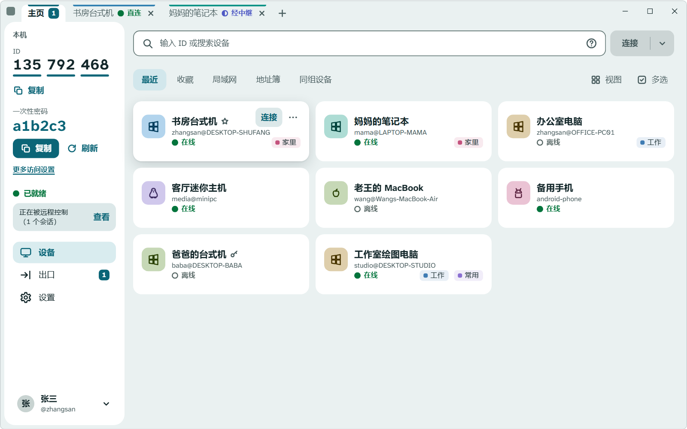
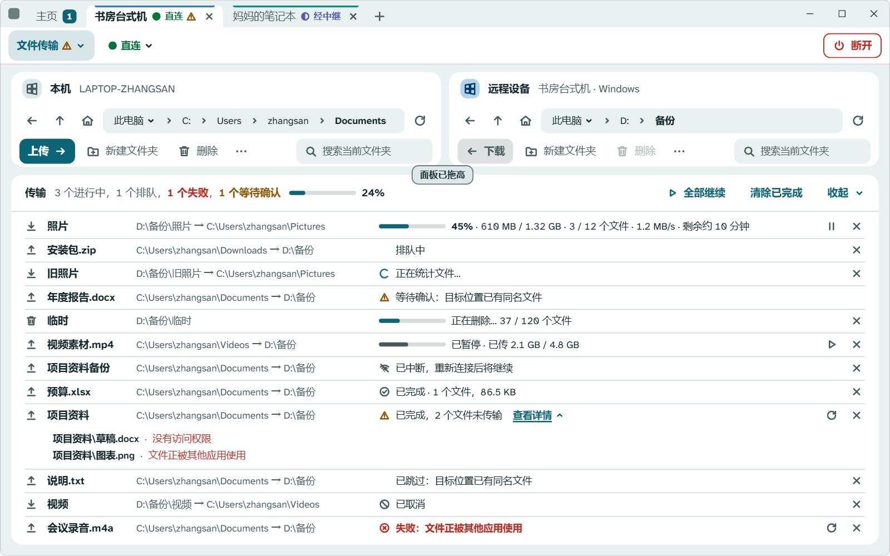
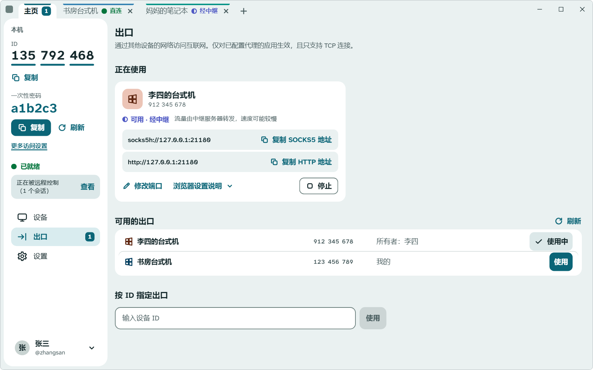
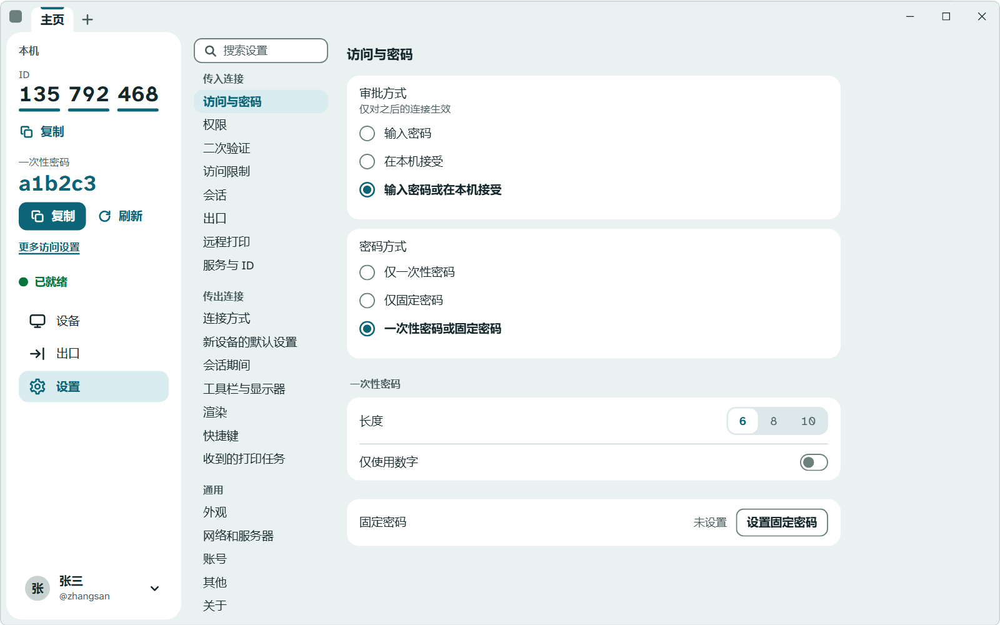
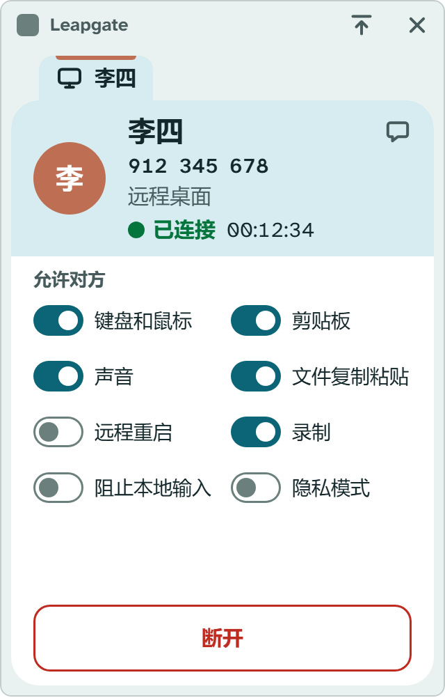
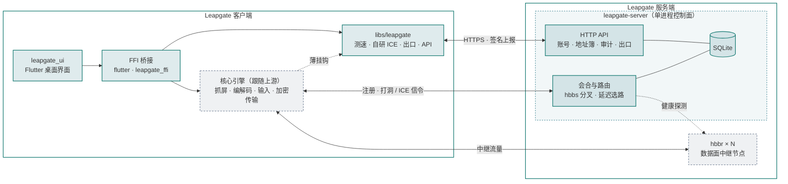

<div align="center">


<h1>Leapgate · 跃门</h1>

<p>基于 RustDesk 核心引擎的自建远程桌面<br>内置账号与地址簿 · 按双端延迟选中继 · 自研 ICE 直连 · 应用级出口</p>

<p>
  <a href="#features">核心特性</a> ·
  <a href="#preview">界面预览</a> ·
  <a href="#build-from-source">从源码构建</a> ·
  <a href="#architecture">架构</a> ·
  <a href="#roadmap">路线图</a> ·
  <a href="#docs">文档</a> &nbsp;｜&nbsp;
  <a href="README.en.md"><b>English</b></a>
</p>

[](LICENSE)
[-0F766E?style=flat-square&labelColor=14282B)](#platforms)
[](#platforms)
[](https://github.com/rustdesk/rustdesk)

</div>

<br>

<p align="center">
  <picture>
    <source media="(prefers-color-scheme: dark)" srcset="docs/assets/ui/home-dark.png">
    <source media="(prefers-color-scheme: light)" srcset="docs/assets/ui/home-light.png">
    
  </picture>
</p>
<p align="center">
  <sub>主窗口预览（设计稿）</sub>
</p>

> [!NOTE]
> Leapgate 处于早期开发阶段，暂未提供预编译安装包，需从源码构建。客户端当前仅支持 Windows 10/11（x64），产物未经代码签名，不建议直接用于生产环境。

<a id="features"></a>

## 核心特性

- **单进程服务端（`leapgate-server`）**
  会合服务、HTTP API、中继选路与 SQLite 合为单进程。内置账号、个人与共享地址簿（支持按用户或用户组设读写权限）、设备列表与审计日志，保存的设备密码加密落盘；通过命令行管理，支持从第三方 `rustdesk-api` 数据库导入，现阶段兼容原版 RustDesk 1.4.x–1.5.x 客户端。

- **按延迟加权选中继**
  默认通过 IP 地理库（运行时自动下载 DB-IP Lite，可换用 MaxMind GeoLite）估算延迟，Leapgate 客户端每 5 分钟实测中继延迟并随心跳上报；服务端在可用中继中按双端加权延迟选取最优节点，也支持按设备固定中继。

- **自研 ICE 与局域网直连**
  与原有连接路径并行运行自研 ICE（物理网卡候选 + 服务端 STUN 映射地址 + KCP 传输），先连通者胜出；开着 TUN 代理或虚拟网卡时仍能经物理网卡局域网直连，并默认开启 IPv6 打洞。

- **应用级出口（Exit Node）**
  被控端开启 **允许作为出口** 后，控制端在 `127.0.0.1` 提供本地 SOCKS5 / HTTP CONNECT 代理，TCP 连接经多路复用隧道从被控端物理网卡发出，域名由被控端解析。默认禁止访问被控端局域网（可按网段放行），本机、回环、链路本地与云元数据地址始终禁止访问；可通过命令行按用户或组授权出口目录可见范围。

- **设备签名与独立共存**
  Leapgate 客户端的心跳、系统信息与审计上报改用设备私钥签名，服务端首次验签后锁定公钥并对响应签名；被控端拒绝登录后明文传输的旧式端口转发；未配置服务器时不连任何公共服务器，且已关闭上游自动更新。程序名、Windows 服务、配置目录、`leapgate://` 协议与加盐 9 位 ID 均独立于原版，可同机共存。

- **重写的桌面界面**
  独立 Flutter 工程 `leapgate_ui/`，单主窗口 + 应用内标签布局，账号与地址簿请求全部收归 Rust 层处理。已覆盖主页、远程会话、文件传输（支持暂停、失败重试与跳过单文件）、TCP / RDP 隧道、远程终端、摄像头查看、出口管理、设置与安装页。

<a id="preview"></a>

## 界面预览

新界面支持浅色 / 深色主题、简洁 / 详细两种显示密度及简体中文 / 英文（以下为设计稿）。

<p align="center">
  <picture>
    <source media="(prefers-color-scheme: dark)" srcset="docs/assets/ui/session-dark.png">
    <source media="(prefers-color-scheme: light)" srcset="docs/assets/ui/session-light.png">
    
  </picture>&nbsp;&nbsp;
  <picture>
    <source media="(prefers-color-scheme: dark)" srcset="docs/assets/ui/file-transfer-dark.png">
    <source media="(prefers-color-scheme: light)" srcset="docs/assets/ui/file-transfer-light.png">
    
  </picture>
  <br>
  <sub><b>左：远程会话</b>（单窗口多标签，浮动工具栏显示直连 / 中继状态） · <b>右：文件传输</b>（双栏浏览与传输队列，支持暂停、重试与跳过）</sub>
</p>

<p align="center">
  <picture>
    <source media="(prefers-color-scheme: dark)" srcset="docs/assets/ui/exit-dark.png">
    <source media="(prefers-color-scheme: light)" srcset="docs/assets/ui/exit-light.png">
    
  </picture>&nbsp;&nbsp;
  <picture>
    <source media="(prefers-color-scheme: dark)" srcset="docs/assets/ui/settings-dark.png">
    <source media="(prefers-color-scheme: light)" srcset="docs/assets/ui/settings-light.png">
    
  </picture>
  <br>
  <sub><b>左：应用出口</b>（选择授权出口，复制本机 SOCKS5 / HTTP 代理） · <b>右：设置</b>（按传入、传出与通用分组，支持搜索设置项）</sub>
</p>

<p align="center">
  <picture>
    <source media="(prefers-color-scheme: dark)" srcset="docs/assets/ui/cm-dark.png">
    <source media="(prefers-color-scheme: light)" srcset="docs/assets/ui/cm-light.png">
    
  </picture>
  <br>
  <sub><b>被控端连接管理小窗</b> · 查看当前传入连接、收回权限或断开会话</sub>
</p>

## 与原版自建方案的对比

| 对比项 | 开源版 RustDesk（自建 `hbbs` + `hbbr`） | Leapgate |
|---|---|---|
| 账号、地址簿与审计 | 需额外搭配第三方 API 服务 | `leapgate-server` **单进程内置** |
| 多中继调度 | `hbbr` 列表轮询；被控端本地设置优先 | **双端延迟加权**选路，支持按设备固定，以服务端为准 |
| 跨网直连与 IPv6 | 依赖原有打洞路径；需手动开启 IPv6 P2P | **并行自研 ICE**（STUN + KCP）；服务端转发 IPv6 信令，客户端默认开启 IPv6 打洞 |
| TUN / 虚拟网卡下局域网直连 | 交换默认 socket 地址，易落到虚拟网卡 | 枚举并并发探测**物理网卡候选** |
| 出口与端口转发 | 端口转发目标固定 | **动态目标** SOCKS5 / HTTP CONNECT 本地代理（TCP 出口） |
| 设备上报认证 | 依赖请求体中的 ID 与 UUID | **设备私钥签名**、首次锁定公钥，服务端响应同样签名（Leapgate 客户端） |
| 客户端界面架构 | 多窗口独立 Flutter 引擎 | **单主窗口 + 应用内标签**（独立 `leapgate_ui` 工程） |
| 默认服务器 | 未配置时连接官方公共服务器 | **不连公共服务器**，仅使用注入或手动配置的服务端 |
| 平台覆盖 | 多桌面及移动端 | 当前仅 Windows 10/11 客户端与 Linux 服务端 |

<sub>上表基于 Leapgate 分叉时的开源版本，上游后续演进可能有所不同；详细依据见 <a href="docs/architecture.md">架构设计</a> 与 <a href="docs/research/">调研笔记</a>。</sub>

<a id="platforms"></a>

## 平台支持

| 平台 | 角色 | 状态 |
| :--- | :--- | :---: |
| Windows 10 / 11（x64） | 控制端、被控端 | 支持 |
| Linux | 服务端（`leapgate-server`、`hbbr`） | 支持 |
| Android / iOS | 控制端 | 计划中 |
| macOS / Linux 桌面 | 客户端 | 暂不计划 |

<a id="build-from-source"></a>

## 从源码构建

### 1. 克隆代码

在 Linux（服务端）和 Windows（客户端）上连同子模块一起克隆（强制 LF 换行以避免 Windows 检出破坏 `sqlx` 迁移校验和）：

```bash
git clone -c core.autocrlf=false -c core.eol=lf --recurse-submodules https://github.com/Ogannesson/leapgate.git
```

### 2. 构建并运行服务端（Linux）

**前置环境**：Rust 工具链，以及编译 C 依赖所需的 `gcc`、`make`、`pkg-config`。

```bash
cd leapgate/server
cargo build --release
```

产物 `leapgate-server` 与 `hbbr` 位于 `target/release/`：

- `leapgate-server` 兼容 `hbbs` 启动参数，扩展配置写在工作目录的 `leapgate.toml`（可用 `--leapgate-config` 指定），缺省时全部使用默认值。
- 首次运行会在工作目录生成 `id_ed25519` 私钥与 `id_ed25519.pub` 公钥（切勿给 `leapgate-server` 传仅含公钥的 `-k`；客户端填写公钥内容）。同目录启动 `hbbr -k _`（异机部署传 `-k <服务端公钥>`）强制校验 Key，并通过 `-r <中继地址>` 或 `leapgate.toml` 的 `[[relay]]` 指定中继。
- HTTP API 默认监听 `21114` 端口，建议前置反向代理提供 HTTPS；同机反向代理转发 `21114`（API）或 `21118`（WebSocket）时，必须用客户端真实地址覆盖 `X-Real-IP`。
- 使用 `leapgate-server user add <用户名>` 创建账号（密码从标准输入读入），即可登录并使用地址簿。

完整配置、CLI 命令、反代要求与密钥备份说明（`leapgate_secret.key`）见 [服务端文档](https://github.com/Ogannesson/leapgate-server/blob/main/LEAPGATE.md)。

### 3. 构建客户端（Windows 10/11 x64）

**前置环境**：PowerShell 7、Visual Studio 2022 Build Tools（含 C++、CMake、ATL 及带 Debugging Tools 的 Windows SDK）、开启开发者模式与长路径支持、rustup、Git for Windows、Python 3.10+、7-Zip 或 Bandizip。**仓库路径与 `CARGO_HOME` 不能含空格。**

在 PowerShell 7 中执行：

```powershell
cd leapgate
pwsh -File scripts\windows\setup-toolchain.ps1

# 完整构建（含无障碍与多窗口修复补丁，首次需数十 GB 磁盘与 1–2 小时，补丁未变时后续无需重跑）：
pwsh -File scripts\windows\build-engine.ps1 -Install
# 若仅快速验证，可跳过上一行，并在下方 build-client.ps1 末尾追加 -AllowOfficialEngine

$env:LEAPGATE_RENDEZVOUS_SERVER = 'rendezvous.example.com'
$env:LEAPGATE_RS_PUB_KEY = '<服务端公钥>'
pwsh -File scripts\windows\build-client.ps1 -Source client
```

- `setup-toolchain.ps1` 会将固定版本的 Rust、LLVM、Flutter、vcpkg 与代码生成器安装至 `C:\leapgate-build`（可通过 `LEAPGATE_BUILD_ROOT` 修改）。
- 可额外通过 `LEAPGATE_API_SERVER` 指定 API 地址（未设时由会合地址推导）；未注入服务器时，客户端启动后可在 **设置 › 通用 › 网络和服务器** 中手动填写。
- 便携单文件（`leapgate-<版本>-x86_64.exe`）与压缩包输出在 `client\leapgate_ui\app\build\windows\x64\runner\`，复制到两台 Windows 即可直接运行互连。

<details>
<summary><b>常用构建参数（<code>build-client.ps1</code>）</b></summary>

| 参数 | 说明 |
|---|---|
| `-Ui upstream` | 构建上游界面便携版（输出至 `client\flutter\build\windows\x64\runner\Release\` 目录） |
| `-Steps` | 仅执行 `vcpkg`、`patch`、`bridge`、`build` 中的指定步骤（传多个逗号分隔值时去掉 `pwsh -File` 直接运行脚本） |
| `-ForceBridge` | 强制重新生成 `flutter_rust_bridge` 桥接代码 |
| `-NoVram` | 禁用 D3D11 纹理零拷贝上屏 |
| `-PrinterDriver` | 下载并校验上游打印机驱动与适配器，打包进产物 |
| `-AllowOfficialEngine` | 跳过自编引擎校验，使用官方缓存引擎构建 |
| `-FlutterRoot` | 指定其他 Flutter SDK 路径 |

</details>

<a id="architecture"></a>

## 架构



- **数据路径**：直连成功时音视频与控制流直接在两端之间传输（上游 P2P 或 `libs/leapgate` 自研 ICE），仅直连不可达时经 `hbbr` 转发。
- **客户端**：跟随上游正式版本，以 `git merge` 同步核心引擎；Leapgate 逻辑集中在 `libs/leapgate`、`leapgate_ffi.rs` 与 `leapgate_ui/`，上游热点文件仅保留少量挂钩以控制合并冲突。
- **服务端**：控制面为硬分叉的 `leapgate-server` 单进程，数据面沿用上游 `hbbr`（统一以 `-k` 强制校验 Key）。

### 仓库组成

| 仓库 | 路径 | 说明 | 分支 |
|---|---|---|---|
| [leapgate](https://github.com/Ogannesson/leapgate) | 本仓库 | 文档、构建脚本与子模块版本对齐 | `main` |
| [leapgate-client](https://github.com/Ogannesson/leapgate-client) | `client/` | Fork 自 [rustdesk/rustdesk](https://github.com/rustdesk/rustdesk) | `main` |
| [leapgate-server](https://github.com/Ogannesson/leapgate-server) | `server/` | 硬分叉自 [rustdesk/rustdesk-server](https://github.com/rustdesk/rustdesk-server) | `main` |
| [leapgate-cardo](https://github.com/Ogannesson/leapgate-cardo) | `*/libs/hbb_common` | 共用协议与配置库，fork 自 [rustdesk/hbb_common](https://github.com/rustdesk/hbb_common) | `leapgate/client`、`leapgate/server` |

本仓库另含 `docs/`（架构设计、调研笔记与实施文档）及 `scripts/{windows,linux,e2e}/`（Windows 构建链与引擎补丁、Linux 网络命名空间 ICE 测试脚本、端到端测试脚本）。

<a id="roadmap"></a>

## 路线图

单进程服务端、按延迟选中继、自研 ICE、TCP 应用出口、同机共存与新版 Windows 桌面界面均已可用（源码构建）；后续计划如下：

- [ ] 移动端控制端（先 Android、后 iOS）
- [ ] 路由、出口与安全后续项：分段显示中继两侧延迟、出口 UDP 与全局出口、代码签名、逐步结束原版客户端兼容

关于架构边界与明确不做的事项（如 Web 客户端、公共服务器、Windows 7 等），见 [架构设计](docs/architecture.md)。

<a id="docs"></a>

## 文档与反馈

项目文档目前以中文为主：

- [架构设计](docs/architecture.md)：总体方案、关键技术取舍与项目边界
- [调研笔记](docs/research/)：上游代码分析、路由、自研 ICE 与界面选型记录
- [服务端文档](https://github.com/Ogannesson/leapgate-server/blob/main/LEAPGATE.md)：模块说明、配置项、命令行与部署要求
- [客户端文档](https://github.com/Ogannesson/leapgate-client/blob/main/LEAPGATE.md)：客户端改动清单与已知限制

问题反馈与功能建议请统一提交至本仓库的 [Issues](https://github.com/Ogannesson/leapgate/issues)（三个代码子仓库已关闭 Issues）。较大改动建议先开 Issue 讨论再提交 PR。

<a id="license"></a>

## 许可证与致谢

Leapgate 采用 [AGPL-3.0](LICENSE) 许可证发布，衍生自 [rustdesk/rustdesk](https://github.com/rustdesk/rustdesk)、[rustdesk/rustdesk-server](https://github.com/rustdesk/rustdesk-server) 与 [rustdesk/hbb_common](https://github.com/rustdesk/hbb_common)，感谢上游社区的贡献。服务端默认地理定位数据在运行时下载自 [DB-IP Lite](https://db-ip.com)（CC BY 4.0）。

Leapgate 与 RustDesk 官方无关联，亦未获其认可；RustDesk 名称与标志归其所有者所有。

根据 AGPL-3.0 第 13 条，若你对外提供修改版 `leapgate-server` 服务，需向网络用户提供对应源码：请在 `leapgate.toml` 中将 `[api] source_url` 设为你所运行代码的公开源码地址，该链接会展示在 API 端口根路径 `/` 页面上。
