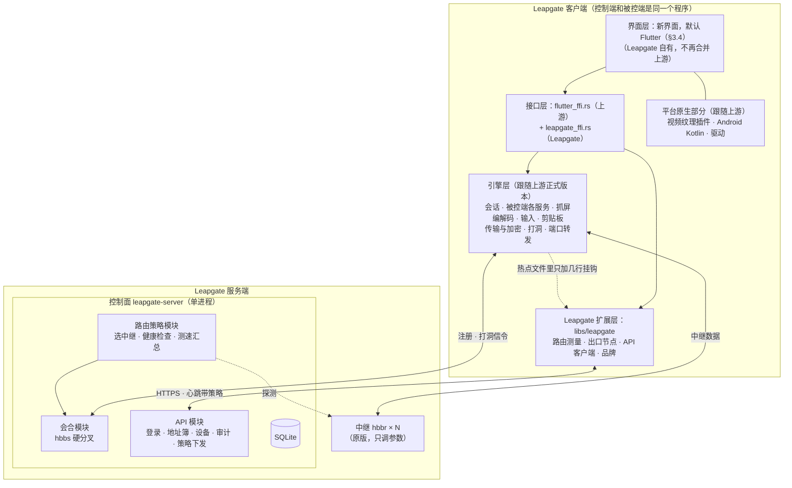

# Leapgate 架构方案

> **名字**：Leapgate，中文名跃门，原工作名 Porta（2026-10-24 改名）。
> **状态：已确认**。2026-10-22 和维护者逐条确认，确认结果汇总在第 7 节；开工按第 5 节分期进行。
> **范围**：只谈抽象分层和关键取舍，不涉及部署选址。维护者 2026-10-22 定：服务端放在哪台机器以后再说，需要时另加机器。
> **依据**：`docs/research/` 下的 7 份调研笔记，其中 01~05 读上游代码，06、07 做界面选型。文中用标注说明结论的来源：【读码】表示读代码确认，【推测】表示推断或估算，【统计】是对上游提交记录的计数，【一手来源】指官方文档和官方仓库，【旁证】指间接证据或第三方说法。所有结论都没有经过编译或实测。

## 0. 调研基线

- 客户端 `rustdesk/rustdesk@bd92623`（2026-10-21），子模块 hbb_common 钉在 `5d52530`。
- 服务端 `rustdesk/rustdesk-server@873230e`（2026-10-10），子模块 hbb_common 钉在 `69cea8d`，比客户端落后约 120 个提交。
- 公共库 `rustdesk/hbb_common@ed07431`（2026-10-20）。
- 第三方 API `lejianwen/rustdesk-api@c5687e1`（2025-09-29，此后停更）。
- 硬件编解码库 `rustdesk-org/hwcodec@ec38eba`（2026-10-21，客户端的 git 依赖）。
- 参考源码放在仓库里的 `upstream/`，已用 `.git/info/exclude` 排除，不进提交。
- 文中的代码路径写成 `仓库@提交:路径`，换上游版本后要重新核对。

## 1. 调研结论：上游代码的五个问题

设计之前先读上游代码回答了五个问题：客户端的引擎和界面边界在哪；中继由谁分配、能不能只改服务端；客户端调用哪些 HTTP 接口；Exit Node 能复用多少现有传输；上游的更新节奏和构建链是什么样。

1. **引擎和界面能分开**【读码】。Sciter 和 Flutter 两套界面共用同一层 Rust 接口：引擎通过 `rustdesk@bd92623:src/ui_session_interface.rs` 的 `trait InvokeUiSession`（约 60 个回调）通知界面，`src/flutter.rs` 的 `FlutterHandler` 和 `src/ui/remote.rs` 的 `SciterHandler` 各实现一份；界面调用引擎则走 `src/flutter_ffi.rs`，共 317 个导出函数。
   - `libs/scrap`、`libs/enigo`、`libs/clipboard`、`libs/hbb_common` 不依赖 Flutter。
   - 不干净的地方：`client.rs`、`io_loop.rs`、`server/connection.rs`、`rendezvous_mediator.rs` 里约有 20 处在 `cfg(feature="flutter")` 下直接调用 `crate::flutter::*`，涉及会话注册表、剪贴板同步和全局事件推送。
   - Flutter 一侧并不薄：`flutter/lib` 共 78.5k 行，其中界面约 49k 行、models 约 19.7k 行；登录、地址簿、设备组的 HTTP 请求全由 Dart 直接发出；视频上屏绑死在 Flutter 纹理插件上。
2. **中继由被控端决定，控制端照搬**【读码】。被控端在 `rustdesk@bd92623:src/rendezvous_mediator.rs` `fn get_relay_server` 里选中继：本地 `relay-server` 选项非空就用本地值，否则用 hbbs（ID 和会合服务器）下发的值，再没有就用"hbbs 主机:21117"。控制端在连接流程里不读自己的本地中继设置。
   - hbbs 选中继用的是 `rustdesk-server@873230e:src/rendezvous_server.rs` `fn get_relay_server(&self, _pa, _pb)`，它是纯轮询：双方 IP 已经作为参数传了进来，只是没有用。`fn check_relay_servers` 每 3 秒做一次 TCP 连通检查，不测延迟。
   - 所以**被控端中继留空时，只改服务端就能按双方 IP 就近选中继**；要真正按端到端延迟选，就得由客户端测量并上报，必须改客户端和协议。
3. **客户端大约调用 30 个 HTTP 接口**【读码】，分账号、地址簿（旧版 2 个、新版 12 个）、设备同步与组、审计四类。rustdesk-api 实现了其中 29 个，但已停更 13 个月，审计接口的返回格式也和新客户端不兼容。客户端没有接口能力协商，靠几个固定的约定值判断服务端能力（`docs/research/03` §7.4 列了 8 条）。
   - `rustdesk@bd92623:src/hbbs_http/sync.rs` `fn handle_config_options` 会把心跳响应里的 `strategy.config_options` 原样写成本地选项，心跳每 15 秒一次（`TIME_HEARTBEAT`）。这是一条现成的远程配置通道，rustdesk-api 一直没有用。
4. **Exit Node 能复用上游刚合入的多路复用端口转发**【读码】。Exit Node 指被控端充当出口节点，控制端的流量从它那里出去。上游 2026-09-05 合入了 PR #16062：每个映射对应一条会话，会话下的每条本地 TCP 连接是一个通道，带流控，默认开启。每个通道的协议字段本来就带目标 host/port，只是 `rustdesk@bd92623:src/server/port_forward_mux.rs` `fn on_open` 硬性要求它等于登录时的目标。
   - 旧的"裸管道"端口转发在登录后调用 `set_raw()` 丢掉加密器，之后以明文传输，走中继时 hbbr（中继服务器）能看到原文。
   - 端口转发只支持 TCP。
5. **上游节奏快，改动热点正好是 Leapgate 要动的文件**【统计】。客户端一年 780 个提交，1~2 个月发一个版本；近 7.5 个月改得最多的是 `client.rs`、`server/connection.rs`、`rendezvous_mediator.rs`；`flutter/lib` 的 138 个文件里改了 92 个。`flutter_ffi.rs` 半年只有 22 个提交，是最稳定的边界。服务端一年约 40 个提交，基本不动。
   - Windows 构建链的版本全部钉死：Rust 1.75、Flutter 3.24.5（打了补丁，并换成上游自己编译的引擎）、flutter_rust_bridge 1.80.1、LLVM 15、vcpkg 的一串依赖，外加虚拟显示驱动等组件。代码签名依赖上游的私有服务，Leapgate 用不了。

## 2. 架构总图

### 2.1 客户端分五块

五块的归属和合并规则各不相同。

- **引擎层**：上游代码原样保留，跟随上游正式版本合并。包括 `src/client.rs`、`src/client/io_loop.rs`、`src/server/`、`src/rendezvous_mediator.rs`、`libs/scrap`、`libs/enigo`、`libs/clipboard`、`libs/hbb_common`、`libs/base`。
- **平台原生部分**：同样跟随上游。包括视频上屏用的 `texture_rgba_renderer` 和 `flutter_gpu_texture_renderer` 插件、Android 被控端的 4.2k 行 Kotlin（抓屏和无障碍输入）、虚拟显示驱动和打印机驱动。
- **接口层**：上游的 `flutter_ffi.rs` 跟随上游；Leapgate 新增的导出函数全部放在独立的 `src/leapgate_ffi.rs` 里，不往上游文件里加。
- **Leapgate 扩展层**：新建的 crate `libs/leapgate`，存放 Leapgate 自己的全部逻辑，包括中继测速、出口节点（本地 SOCKS5、出口授权和访问控制）、API 客户端和品牌配置。引擎热点文件里只加几行调用它的挂钩。
- **界面层**：由 Leapgate 重写，不再合并上游的界面改动。

### 2.2 服务端分控制面和数据面

- **控制面**是一个进程 `leapgate-server`，内部分四个模块：会合（hbbs 硬分叉，负责设备注册、打洞信令和选中继）、API（替代 rustdesk-api）、路由策略（选中继的依据和算法）、存储（SQLite）。
- **数据面**是多台原版 hbbr，只统一配置 `-k` 密钥和限速参数，不改代码。
- 现有部署里的 Headscale 和 derper 不属于 Leapgate，只在"全局出口"模式（§3.9）里作为外部依赖出现。

### 2.3 三个新能力挂在哪一层

- **智能路由**：决策在服务端的路由策略模块。客户端在扩展层负责测量和上报，另在引擎层加一处挂钩，让被控端优先采用服务端的选择。
- **Exit Node**：数据通道复用引擎层的多路复用端口转发；"允许谁用、允许去哪"的授权和本地 SOCKS5 入口在扩展层；出口节点目录在 API 模块。
- **原生 API**：在服务端的 API 模块。客户端第一期不改（协议兼容），到新界面阶段再把 HTTP 调用从 Dart 下沉到扩展层。

## 3. 关键决策

各节先写决定，再写理由和细节，最后列出没选的备选；没有对应内容的部分省略。各项决定的确认日期都是 2026-10-22，汇总见第 7 节。

### 3.1 兼容原版 RustDesk 客户端

- **决定**（维护者 2026-10-22 确认）：Leapgate 服务端在最初几个版本里兼容原版 RustDesk 客户端，会合协议（protobuf）和 HTTP API 的约定都照旧，新能力只做加法（新增 proto 字段和 API 字段，原版客户端会忽略它们）。兼容只是过渡手段：为兼容付出的代价（下文的"兼容债务"）要在几个迭代内移除和修复，不长期背着。
- **为什么先兼容**：
  - 服务端可以先做、先上线，用现有的原版客户端验证，不用等 Windows 构建链搭好。
  - 旧设备不必一次全部换成 Leapgate 客户端。
  - 出问题时可以拿原版客户端对照，分清是服务端还是客户端的错。
- **兼容债务清单**（兼容期内允许存在，退出时逐条清掉）：
  1. 设备上报接口（心跳、sysinfo、审计）不强制认证，只靠 body 里的 `id` 和 `uuid` 识别设备【读码】。退出后强制设备签名。第三期起 Leapgate 客户端的上报改走 `/api/leapgate/v1/` 并签名，被锁定公钥的设备不再接受不签名的上报；兼容路径对原版客户端照旧不认证（`docs/第三期实施契约/01-上报与认证.md`）。
  6. 会话备注（连接结束后填写的备注）仍经兼容接口发送、不认证，Leapgate 客户端也一样（契约 01 §8 第 1 项）。
  2. 客户端靠 8 个固定约定判断服务端能力，例如接口返回 404 表示不支持、sysinfo 回纯文本 `SYSINFO_UPDATED` 等（见 `docs/research/03` §7.4）。退出后换成正式的能力协商：Leapgate API 带版本号，客户端先问服务端支持什么。
  3. 被控端"本地中继优先"的旧规则，以及服务端经心跳下发、清空 `relay-server` 的变通做法（§3.7）。Leapgate 客户端改成服务端下发值优先之后，删掉这个变通。客户端一半已由第三期的 `get_relay_server` 挂钩清掉（Leapgate 被控端连 leapgate-server 时服务端下发值优先，契约 02）；服务端经心跳清空 `relay-server` 的变通仍为原版被控端保留。
  4. 旧的裸管道端口转发（登录后明文）。Leapgate 被控端直接拒绝它（§3.9），不用等兼容期结束。
  5. 只为照顾原版客户端才有的接口形态，例如审计接口"成功时回空 body"、地址簿靠 404 回退旧版。这些随正式的 Leapgate API 一起重新设计。
- **债务分服务端和客户端两半**：
  - 服务端一半：关开关、删代码即可。服务端是硬分叉（§3.2），删起来没有合并负担。
  - 客户端一半：Leapgate 客户端本身也继承了上游的这套调用代码，Rust 一侧是 `rustdesk@bd92623:src/hbbs_http/sync.rs`，Dart 一侧是 `flutter/lib/models/ab_model.dart` 等。要清掉它们，Leapgate 客户端得改用 `libs/leapgate` 里的新 API 客户端：Dart 那部分随新界面重写一起换掉；Rust 那部分在 `sync.rs` 里加挂钩，把上游的调用关掉而不是删掉，因为删上游代码会让每次合并都冲突。
- **退出机制**：
  1. 服务端从第一期起记录每台设备的客户端类型和版本（sysinfo 上报里带版本号），命令行能列出还在用原版客户端或旧版 Leapgate 的设备。
  2. 退出看状态，不看日期：条件是维护者的设备全部换成支持新 API 和设备签名的 Leapgate 客户端。
  3. 分两步退出：先在服务端打开"只接受 Leapgate 客户端"开关，出问题能马上关回去；稳定一个版本后，再删掉服务端的兼容代码和这个开关本身。
  4. 预计窗口：第一期开始兼容；第三期（设备签名、上报接口改走新 API）和新界面轨道（Dart 里的 HTTP 调用下沉）都完成后具备退出条件，之后在一个版本内删干净。
- **退出之后**：原版 RustDesk 客户端连不上 Leapgate 服务端。客户端之间的点对点协议仍跟随上游引擎，不在这次清理范围内，那部分归 §3.2 管。
- **没选的备选**：
  - 永久兼容：债务一直背着，上报接口永远没有强制认证。
  - 一开始就不兼容：第一期就得服务端和客户端一起做、一起测，Windows 构建链成了第一道关，所有设备也得同时切换。

### 3.2 分叉方式和仓库布局

- **决定**：客户端跟随上游正式版本合并，服务端硬分叉。维护者 2026-10-22 确认仓库布局时对这一条没有异议，按推荐方案记为已定。
- **客户端怎么合并上游**：
  - 每个上游正式版本（tag）合并一次，不追每个提交，正式版发布后两周内合完；安全修复不等版本，随时摘取。上游 1~2 个月发一个正式版，1.4.9 到 1.5.0 之间有 273 个提交，1.5.0 发布后三周内又有 61 个【统计】。
  - 用 `git merge`，不用 rebase。rebase 要把 Leapgate 的提交在每个上游版本上重放一遍并改写历史，不适合长期维护的 fork。
  - 合并能带进来引擎和各平台的修复、安全修复和新功能。现成的例子是 Exit Node 要用的多路复用端口转发，它是 2026-09 上游才合入的。
  - 界面层不合并（新界面放在独立目录，见 §3.3），引擎层和平台原生部分合并。靠 §3.3 的改动纪律，冲突能压到挂钩那几行，再加上每次都会冲突、但能机械处理的 `Cargo.toml` 和 `Cargo.lock`。每次合并估计要 1~3 人日【推测】，一年 6~8 次，可以派 agent 做。
  - 如果第 7 节第 6 条说的原型做完之后换成 Slint，合并方式不变，只是分界线从 `flutter_ffi.rs` 挪到引擎里那约 20 处 `cfg(feature="flutter")` 调用，另加一个新的界面适配层（像当年的 Sciter 那样实现 `InvokeUiSession`），挂钩会多一些。
- **服务端为什么硬分叉**：服务端一年约 40 个提交，大多是安全修补。Leapgate 要往里加 API 和路由模块，还要按 §3.1 逐步删掉兼容代码，改动又深又广，本来就合并不了。跟进方式是定期看上游 release，有安全修复就手工摘取（cherry-pick）。
- **仓库布局**（维护者 2026-10-22 确认）：一个总仓库加三个代码仓库，全部公开，都是 AGPL-3.0。
  - `leapgate`（本仓库，总仓库）：放方案和决策文档、给 agent 的说明、跨仓库的构建和发版脚本。用子模块把 `client/` 挂到 `leapgate-client`、`server/` 挂到 `leapgate-server`，这样总仓库的一次提交就记下了"哪个客户端版本配哪个服务端版本"。
  - `leapgate-client`：rustdesk/rustdesk 的 fork，保留完整历史，`upstream` remote 指向官方仓库。合并上游就是在这里执行 `git merge <上游 tag>`。
  - `leapgate-server`：rustdesk/rustdesk-server 的 fork，保留完整历史。它是硬分叉，摘取上游修复直接用 `git cherry-pick`。
  - `leapgate-cardo`：hbb_common 的 fork。这个 fork 必须要有：默认服务器 `RENDEZVOUS_SERVERS = ["rs-ny.rustdesk.com"]` 和公钥 `RS_PUB_KEY` 是 `rustdesk@bd92623:libs/hbb_common/src/config.rs` 里的编译期常量【读码】，不改的话，Leapgate 客户端在没配服务器时会连到 RustDesk 官方；`rendezvous.proto` 的新字段也在这里加。
    - 它挂在 `leapgate-client` 和 `leapgate-server` 各自原来的 `libs/hbb_common` 子模块位置上，总仓库不再单独挂一份，免得同一个库有三处版本指针、各指各的。
    - 服务端的 hbb_common 现在比客户端落后约 120 个提交，要先升到和客户端相同的版本，以后两边共用这一个 fork，保证会合协议的字段一致。这次升级需要做一些适配【推测】。
    - 只改仓库名，不改 crate 名：代码里仍叫 `hbb_common`，目录也还是 `libs/hbb_common`。上游代码里到处是 `use hbb_common::…`，改 crate 名会让每次合并都冲突。
    - 名字来历：cardo 是拉丁语的"门枢"，门靠它转动，一头连着门、一头连着门框，正好对应客户端和服务端共用的这一块；罗马城的南北主街也叫 cardo。维护者 2026-10-22 定名。
  - `leapgate-client` 里上游的 `AGENTS.md` 保留不改，它讲的是上游代码的约定，对写代码的 agent 有用；上游的 `CLAUDE.md` 只有一行 `@AGENTS.md`，也不动。Leapgate 自己的说明放在 `LEAPGATE.md`，在上游 `AGENTS.md` 开头加一行指过去；只改一行，几乎不会冲突。`leapgate-server` 同理。
- **公开内容和内部内容分开**（维护者 2026-10-22 确认）：公开仓库里只放适合开源的通用内容。现网部署、立项讨论、待办这类内部文档放在独立的私有仓库里，检出在总仓库的 `internal/` 目录下，被公开仓库排除，不进公开历史；公开文档提到现网时只写抽象描述。总仓库公开之前，要用脱敏后的内容重建历史，因为早期提交里还带着内部信息。
- **没选的备选**：
  - 三个仓库，服务端源码直接放进总仓库的 `server/`：少一个仓库，但上游的子模块要挪到总仓库根目录，摘取上游修复时要带 `-X subtree=server`。
  - 补丁队列：把 Leapgate 的改动维护成一组补丁，每个上游版本重新打一遍（Ungoogled Chromium 的做法）。改了哪些一目了然，但补丁队列更适合"改动小而散"的情形，而 Leapgate 有大块新代码（新界面、`libs/leapgate`）。
  - 攒几个版本再合并：冲突随版本距离变大，越拖越难合。
  - 本仓库直接变成 rustdesk 的 fork（根目录就是客户端源码）：少一个仓库，但上游根目录自带 `AGENTS.md`（232 行，上游持续在改）和 `CLAUDE.md`，本项目的 `AGENTS.md` 没地方放；服务端也还得另找地方放。
  - 客户端也硬分叉：之后不再付合并成本，但抓屏、编解码、各平台兼容这些持续的修复都要自己摘取，一年几百个提交，个人项目跟不上。

### 3.3 客户端改动纪律

以后所有客户端改动都按下面几条执行。

- 上游热点文件（`src/client.rs`、`src/client/io_loop.rs`、`src/server/connection.rs`、`src/server/port_forward_mux.rs`、`src/rendezvous_mediator.rs`、`src/common.rs`）里只加几行调用 `leapgate::…` 的挂钩，逻辑放在 `libs/leapgate`。
- 新的 FFI 函数只放在 `src/leapgate_ffi.rs`。
- 上游的 `flutter/` 目录原样不动，新界面就绪后不再构建。新界面放在独立目录，有自己的工程文件和各平台启动代码，品牌改动也在那里做。如果直接改 `flutter/lib`，上游每次改这些文件都会冲突（近 7.5 个月 138 个文件改了 92 个）。不论最后用 Flutter 还是 Slint，都按这条办。
  - 过渡期例外：新界面就绪之前，客户端只能用上游现有的界面，所以第二期照旧构建上游的 `flutter/`，只在里面做最少的品牌改动（exe 名、图标、包 ID），接受这几处在合并时冲突，新界面就绪后停用。
- 要停用上游代码时，用挂钩关掉，不删文件。删掉的文件上游一改就冲突。
- proto 只追加字段，不改已有字段的含义。新字段号用高位段（例如从 1000 起），避免和上游以后新增的字段撞号。
- 每次合并上游后跑同一份冒烟清单：直连、中继、文件传输、端口转发、出口节点。
- 品牌相关的改动集中在一处配置（§3.10），不分散地改字符串。

### 3.4 界面技术栈

依据是 `docs/research/01`、`06`（9 个框架的横向比较）和 `07`（RustDesk 自己在 Flutter 上的经历）。

- **决定**（维护者 2026-10-22 确认）：默认留在 Flutter。新界面轨道开工前做 3~5 天的 Slint 原型，按下文"怎么定"里的三条标准判断换不换。不支持 Windows 7。留 Flutter 时的多窗口做法，等原型结果出来再定。
- **结论**：现在不值得换。RustDesk 在 Flutter 上的包袱大多来自它自己的两个决定，Leapgate 留在 Flutter 也能甩掉。唯一值得认真考虑的替代是 Slint，用一个限时原型来决定，而且只有在桌面优先时才值得换。
- **先说清三件事**：
  1. 换框架换不来现代化设计。RustDesk 看着旧，是设计和写法的问题，Flutter 本身做得出现代界面。
  2. 换框架解决不了用户抱怨最多的几类问题：Wayland（GitHub 上搜到约 227 条）、输入法（约 88 条）、编解码。它们绝大多数出在 Rust 引擎层或 RustDesk 自己的键盘映射逻辑里【旁证：issue 搜索，2026-10-22】。
  3. RustDesk 的 Flutter 包袱大多来自它自己的两个决定【读码 + 一手来源】：
     - 支持 Windows 7：为此桌面端钉在 Flutter 3.24.5 和 Rust 1.75，自己编译 Flutter 引擎做 Win7 兼容回退，还给 SDK 打补丁；Windows arm64 又单独用新版 Flutter，两套版本并存（rustdesk PR #15139）。
     - 每个窗口一个 Flutter engine：自编引擎里的另一处补丁，就是为了绕开多 engine 多窗口的崩溃（flutter#155685，至今 open）；`desktop_multi_window`、`window_manager` 两个插件都是分叉维护的。
     - Leapgate 不支持 Win7、换一种多窗口做法，这些包袱都可以甩掉。
- **只有换框架才能解决的问题**（Flutter 本身的问题）：
  - 白窗、黑窗一类的 GPU 兼容问题：rustdesk#5108 有 119 条评论，维护者多次回复"无能为力，等 Flutter 修"，对应的 flutter#159630 仍是 open【一手来源】。
  - 桌面原生能力要靠插件补：多级菜单、原生光标、窗口行为。
  - 渲染器换代的风险：Flutter 3.47 起桌面默认用 Impeller，D3D11 外部纹理路径随后出过两次崩溃（flutter#190774、#191468），修复已进 main，stable 是否补上只见到第三方说法【一手来源 + 旁证】。
  - 官方多窗口 API 到 2026-10 仍是实验功能，只在 main 渠道提供【一手来源】。
  - flutter_rust_bridge 基本是一个人在维护，2025-07 到 2026-03 之间约 9 个月没有发版【一手来源】。
- **换框架多花的成本**：新界面本来就要重写约 45~50k 行，这部分两条路都要花。换框架额外多出来的是：
  - 视频上屏：上游已经为 Flutter 做好了，包括在 Windows 上把 D3D11 纹理零拷贝交给 Flutter。换框架要重做。
  - 多窗口机制。
  - 约 20k 行 Dart 业务逻辑改写成 Rust（其中 HTTP 部分本来就计划下沉到 `libs/leapgate`）。
  - 9 个分叉或自写的 Flutter 插件（约 11k 行原生代码）要找替代。
  - 引擎里约 20 处 `cfg(feature="flutter")` 调用要抽成中立模块。
  - Android 上现有的 Kotlin 抓屏和输入代码要和新框架重新衔接。
  - 构建链：去掉 Flutter SDK 和 flutter_rust_bridge 的代码生成，换成新框架的。
- **换成纯 Rust 界面能换来的**（只有换框架才有）：
  - 整个 flutter_rust_bridge 层消失：317 个导出函数的绑定、代码生成、一个基本靠一人维护的依赖都没有了，界面直接调用 Rust。
  - 少一门语言（Dart），也少一套要钉版本、打补丁、自编引擎的 SDK。
  - Slint 在一个进程里原生支持多窗口，没有多 engine 的问题【一手来源】。
  - 对一个人维护的项目，这是实打实的长期简化。
- **替代方案只剩 Slint**：
  - 视频上屏、现代界面、五个平台、能和 AGPL 一起分发，四条同时满足的只有 Qt/QML 和 Slint。
  - Qt/QML 最成熟（Moonlight 就用它），但对一个 Rust 项目来说意味着 Rust、C++、QML 三门语言加上 Qt SDK，排除。
  - Tauri（WebView）在视频上屏这一条不过关，RustDesk 当年放弃 Tauri 也是卡在这里（rustdesk#533）。egui、Iced 不擅长精致界面，移动端也基本没有。GPUI、Dioxus、Compose 各有硬伤，见 `docs/research/06`。
  - Slint 的风险：wgpu 纹理导入挂在 `unstable-wgpu-NN` 特性开关后面，只收 `Rgba8Unorm` 格式；iOS 支持还在打磨【一手来源】。开源版许可证是 GPLv3，可以和 AGPL-3.0 一起分发【推测，按许可证文本】。
- **怎么定**：
  - 默认留 Flutter：新界面不支持 Win7，用新的 Flutter stable 和新版 Rust，去掉自编引擎和 SDK 补丁（第二期过渡期编上游现有界面时用哪个版本另说，见 §3.11）。界面做薄，业务逻辑放进 `libs/leapgate`，这样以后不论换不换都受益。
  - Slint 原型在新界面轨道开工前做，限时 3~5 天，和第一、二期并行，不挡任何事。通过标准有三条：
    1. 用真实的解码输出跑 1080p60 和 4K60。
    2. Windows 硬解路径要做通零拷贝。hwcodec 在 GPU 上把解码出的 NV12 转成 BGRA，交出来的是 `DXGI_FORMAT_B8G8R8A8_UNORM` 格式的 D3D11 纹理（`rustdesk-org/hwcodec@ec38eba:cpp/common/platform/win/win.cpp` `NativeDevice::nv12_to_bgra_set_rtv`）【读码】，而 Slint 只收 `Rgba8Unorm` 的 wgpu 纹理。所以原型要做通"把 D3D11 纹理共享给 wgpu"，再加一步通道换序（或者改 hwcodec 的着色器直接输出 RGBA），全程不回到 CPU。这一步成立才算通过。
    3. 多窗口、中文输入法、高 DPI 在 Windows 上可用。
  - 原型通过、并且维护者确定桌面优先，就换 Slint；原型不通过，就留 Flutter，不再讨论。
- **留 Flutter 时的子决定**：
  - 多窗口：推荐单个 engine 的主窗口加应用内标签，会话暂时不能拖出来成为独立窗口，等官方多窗口 API 转正后再加。这样能绕开多 engine 崩溃（flutter#155685）；对白窗类 GPU 兼容问题有没有帮助是【推测】，那是另一个 bug。备选是沿用每个窗口一个 engine，继续维护 RustDesk 分叉的 `desktop_multi_window` 和 `window_manager`（后者比原版领先 19 个提交、落后 61 个）。
  - 升级到哪个 Flutter 版本，新界面开工时再选。要先从 Flutter stable 的发布说明里确认 D3D11 外部纹理崩溃的修复进了哪个版本，再回归测试 D3D11 零拷贝路径。上游 arm64 已经用新版 Flutter 构建，说明 flutter_rust_bridge 1.80 和两个纹理插件能跟着升级【旁证】，但不能证明在 3.47 + Impeller 下没有问题。
  - flutter_rust_bridge 留在 v1.80，跟着上游走，不升 v2（升级要改全部 317 个导出函数的绑定）。
  - 动手前先做"models 去界面化"：`flutter/lib/models/model.dart` 里约有 59 处直接弹对话框，改成"models 发出状态，由界面决定怎么显示"；Dart 里 1,042 处 `bind.*` 调用只有 278 处在 models 里，其余散在页面和控件里，先收进 models【读码：数量】。然后按块重写：主窗口（设备列表、地址簿）、远程会话、文件传输、设置、被控端的连接管理窗口。
  - 视觉设计另出一份方案，单独确认。不保留 Sciter 界面。
  - 上游 `flutter/lib` 的改动以后基本合并不过来（近 7.5 个月 138 个文件改了 92 个），界面层的 bug 要自己修。
- **移动端和这条决定绑在一起**：如果项目周期内要做 Android/iOS 控制端，Flutter 现成的移动端是留下的有力理由；如果只做桌面，Slint 的移动端短板就不重要。

### 3.5 服务端形态

- **决定**（维护者 2026-10-22 确认）：服务端是一个 Rust 进程 `leapgate-server`，由 hbbs 硬分叉而来，内置 HTTP API 模块和路由策略模块，存储用 SQLite（hbbs 本来就用 sqlx + SQLite，见 `rustdesk-server@873230e:src/database.rs`【读码】）。hbbr 用原版。第一期只用命令行管理。
  - 合成一个进程的理由：API 要用到 hbbs 手里的在线状态和设备公钥；心跳下发的策略要用到路由模块的数据；部署和运维只有一个程序。
  - 进程内部按模块分开（会合、API、路由、存储），以后真要拆成多个进程，成本也不高。
- **内部四个模块**：会合（hbbs 原有代码，负责设备注册、打洞信令和选中继）、API（HTTP，替代 rustdesk-api）、路由策略（中继列表、健康检查、按 IP 库估算延迟选中继，以后加测速汇总）、存储（SQLite）。模块之间在进程内直接调用。
- **端口和 HTTPS**：沿用 hbbs 原来的端口，API 用 21114。HTTPS 交给前面的反向代理，`leapgate-server` 自己不管证书。
- **会合端口的 TCP 密钥交换**（2026-10-22 开工后读码确认，第一期必须做）：`leapgate-server` 在会合端口的 TCP 连接建立后先发 `KeyExchange`，完成握手后再收发信令。原版 hbbs 连上后不发 `KeyExchange`；而客户端配了服务器公钥、又登录过 API 时，连接流程要求先完成这个握手，等 18 秒超时后报 "Failed to secure tcp"，整次连接失败，1.5.0 正式版也一样【读码】。不做的话，用户一登录就连不上任何设备。实现用 hbb_common 现有的 v1 握手，细节见 `docs/research/第一期服务端/02` §6.2。lejianwen 在自己 fork 的 hbbs 里修过"API 连接超时"，很可能就是这个问题【推测】。
- **HTTP 框架**：axum，和 hbbs 已经在用的 tokio 属于同一个生态。
- **hbbr**：不改代码，所有中继统一配置同一个 `-k` 密钥。默认不校验密钥时，谁都能拿它当免费中继【读码】。
- **只跑一份，不做高可用**：`leapgate-server` 挂掉时，已建立的连接不受影响（连接建好后数据不再经过 hbbs）【推测】，但新连接、登录和地址簿不可用。个人使用可以接受。
- **管理后台**：第一期不做 Web 后台，管理操作走 `leapgate-server` 的命令行子命令，包括加用户、改密码、管理用户组、建共享地址簿并分配成员和权限（§3.6）、列出设备（带客户端类型和版本，§3.1 退出兼容时要用）、从 rustdesk-api 导入数据、查看中继状态、给设备下发策略。日常的地址簿编辑在客户端里做。以后真需要网页后台，再做一个小页面，不复刻 rustdesk-api 的约 120 个 `/api/admin/*` 接口。
- **数据迁移**：写一次性脚本，从现有 rustdesk-api 的 SQLite 导入用户、用户组和地址簿。
- **没选的备选**：
  - 原版 hbbs 加独立的 API 服务（现有部署的形态）：API 看不到在线状态，只能通过 hbbs 的本机控制端口发命令；智能选中继照样要改 hbbs。
  - 接手维护 lejianwen/rustdesk-api（Go）：它已停更 13 个月，有审计兼容缺陷，而且服务端会变成 Go 和 Rust 两套技术栈。
  - hbbs 分叉加独立的 API 进程，两者共享一个 SQLite 文件：两个进程抢同一个库的写锁，没比单进程省事。

### 3.6 原生 API 和账号

- **第一期实现的最小集合**【读码：来自客户端调用清单】：
  - 账号：`login-options`、`login`、`currentUser`、`logout`。
  - 地址簿：新版的 12 个接口（见下文"地址簿只做新版"）。
  - 设备：sysinfo 回 `SYSINFO_UPDATED`；heartbeat 回带 `strategy` 的响应；组面板用的 `users` 和 `peers`。
  - 审计：conn 和 file 两个接口，成功时回空 body，按 `nonce` 去重。rustdesk-api 在这里回的是 JSON，客户端会当成失败，再重试两次。
  - 客户端用来判断服务端能力的那 8 个约定值，兼容期内原样保留（`docs/research/03` §7.4），退出兼容时换成正式的能力协商（§3.1）。
- **心跳策略作为配置下发通道**：服务端可以给每台设备下发任意选项【读码】。智能路由（清掉本地写死的中继）、以后 Leapgate 自己的设置都走这条通道，不另开接口。它写的是被控服务进程的 Config，改不到只有控制端用户进程才读的 LocalConfig 选项，所以打不开 IPv6 打洞和 UDP 打洞（2026-10-22 开工后读码更正，见 §3.8）。
- **账号模型**：本地账号加密码（argon2 哈希），用户只有维护者和几个朋友。TOTP 以后再加，OIDC 第一期不做。
- **设备认证**：按 §3.1，Leapgate 客户端用设备私钥签名，由服务端的开关决定是否还接受不签名的请求。
- **客户端侧**：第一期不动客户端里的 API 调用（协议兼容）。做新界面时，把登录、地址簿、设备组的 HTTP 调用从 Dart 下沉到 `libs/leapgate`，经 `leapgate_ffi.rs` 提供给界面，之后界面只管显示。
- **地址簿只做新版**（维护者 2026-10-22 确认）：
  - 新版是一本个人地址簿加多本共享地址簿，共享簿分只读、读写、完全控制三级权限，改动按条增量提交【读码】。客户端先试新版接口，服务端回 404 才退回旧版，所以实现了新版，就不需要旧版的两个接口。但 1.4.7 起 `/api/ab/personal` 回 `null` 时客户端不会退回旧版，而是报错并停止拉取，所以服务端对已登录用户必须永远回个人簿的 guid【读码】（`docs/research/第一期服务端/04` §1.5）。
  - 数据按"多本加权限"建模，原版客户端用的 12 个接口只是套在上面的兼容外壳；§3.1 退出兼容时换掉外壳，表结构不用改。
  - 权限的含义（维护者 2026-10-22 定）："读写"可以增删改簿内的设备和标签，包括删除；"完全控制"在客户端接口里和读写相同，多出来的管理簿本身（改名、成员）走命令行。原因是客户端对读写和完全控制显示同样的菜单【读码】，如果照搬 rustdesk-api"删除要完全控制"的规则，读写用户会看到删除菜单，点了却报错。
  - 共享簿里的设备密码由客户端明文上传；个人簿存的是密码哈希 `base64(sha256(明文+salt))`，客户端直接拿它登录对端，等同明文【读码】。两者都由服务端加密后再落盘，防止数据库文件和备份泄露；服务端的运维者本人仍能解开。个人簿哈希加密落盘是 2026-10-22 补定的。
  - 客户端不能新建共享簿、分配权限【推测】，这些操作走命令行（§3.5）。
  - 用户组（维护者 2026-10-22 定）：Leapgate 也做用户组，共享簿可以授权给组，组成员变动后权限跟着变；组的管理走命令行。组面板里，同在一个"共享设备"组里的成员互相看得到对方的用户和设备，对应 rustdesk-api 的共享组（`groups.type=2`，`docs/research/第一期服务端/05` §2.2）。
  - 新版模式下客户端有"在 Web 控制台管理"菜单，点开会打开 API 根路径；第一期在那里放一个静态说明页。
  - 每本地址簿的设备数上限给"不限"。从 rustdesk-api 迁移时，个人簿、共享簿、标签、用户组和组规则一起导入；个人簿的密码哈希格式不变，加密存。

### 3.7 智能路由

- **决定**（维护者 2026-10-22 确认）：服务端决策、客户端测量，分两级，两级共用一个代价模型。第一级用 GeoIP/ASN 库估算延迟，不手写区域表；第二级由客户端测速；固定中继在服务端按设备配置；中继权重先手工配固定值。
- **代价模型**：中继 R 对一对设备的代价 =（发起方到 R 的延迟 + 被控端到 R 的延迟）× R 的权重，在健康检查通过的中继里选代价最小的。两级的区别只在延迟的来源：第一级用估计值，第二级用实测值；哪一端没有实测值，就用估计值顶上。
- **中继权重**：每台中继在配置里有一个手工配的固定权重，用来体现流量预算或带宽，流量贵的中继调高权重、少用。按当月已用流量自动调整，以后再说。
- **固定中继**：要让某台设备固定使用某台中继（比如排查问题时），在服务端用命令行按设备配置，客户端不另加选项。
- **第一级**（只改服务端，原版客户端也能用）：
  - 把 `rustdesk-server@873230e:src/rendezvous_server.rs` `fn get_relay_server` 改成调用路由策略模块：输入双方的公网 IP 和各中继的健康状态，输出一个中继。
  - 延迟用 IP 库估算，不手写区域表。从 IP 库查出每个地址的经纬度、国家和运营商（ASN），中继的位置也用它自己的 IP 查。估计延迟 = 两点距离换算出的光纤往返时间 × 绕行系数，再加上跨运营商、跨境两项惩罚。这几个常数写在配置里并有默认值，以后可以用第二级的实测数据校准【推测：常数取值要实测】。多线 BGP 机房里的中继在配置里标出来，不算跨运营商。
  - 惩罚常数默认全球统一，允许按国家覆盖（例如中国三家运营商之间互访明显更慢）。
  - IP 库要覆盖全球（维护者 2026-10-22 定），因为设备和中继可能在任何地方。各库的许可证在 2026-10-22 查过一手来源：
    - 推荐 DB-IP Lite：有全球的 City（含经纬度）和 ASN 两个库，MMDB 格式，每月更新，许可证是 CC BY 4.0，署名即可使用和分发（https://db-ip.com/db/lite.php）。Rust 读 MMDB 有现成的库。
    - 备选 MaxMind GeoLite City + ASN：同样覆盖全球、同样是 MMDB 格式，换库只改配置。它的 EULA（2026-02-12 版）在 CC BY-SA 4.0 之外另有条款（https://www.maxmind.com/en/geolite2/eula），下载还要注册账号拿 key（已知做法，当天没再核对），所以不打包进仓库。
    - 不选 IPinfo Lite：只有国家和 ASN，没有城市和经纬度，算不了距离（https://ipinfo.io/lite）。
    - 不选 ip2region 作主库：它在国内能细到省、市和运营商（Apache-2.0，https://github.com/lionsoul2014/ip2region），但偏重国内，境外数据的精度没有依据。
    - 第一期上线前，用一组分布在各大洲的真实 IP（现有的设备和服务器）对比 DB-IP Lite 和 GeoLite 查出的城市和运营商，再定用哪个。
    - IP 库文件不进 git，服务端启动时检查、每月自动更新。署名写进 README 和 API 根路径的说明页。
  - 健康检查从"能不能连上"扩展为顺带记录 hbbs 到各中继的 RTT。
  - **前提一**：被控端的 `relay-server` 要留空。现有部署里至少有一台被控端在本地写死了中继。解决办法是服务端在心跳的 `strategy.config_options` 里下发 `relay-server` 空值：`fn handle_config_options` 遇到空值且没有内置默认值时会删掉这个选项，而 `fn get_relay_server` 每次连接都现读选项【读码：机制成立；端到端没实测】。中继由被控端决定，所以只有被控端需要满足这一条。服务端只在设备首次接入或策略变更时下发这个清空，不是每次心跳都推，否则谁也没法再在本地固定中继。
  - **前提二**：hbbs 看到的必须是真实的公网源 IP，不能跑在 Docker 桥接网络的 NAT 后面，否则所有按 IP 的选择都会失效【推测】。这是部署时的检查项。
- **第二级**（需要 Leapgate 客户端）：
  - 服务端把候选中继列表下发给客户端；每台设备定期（例如每 5 分钟）测自己到各中继的 TCP 建连耗时，随心跳上报。
  - 连接时，两端的测量都用各自最近一次随心跳上报的值：打洞请求带上发起方自己的设备 ID（新 proto 字段 `PunchHoleRequest.leapgate_from_id`），服务端拿它去查发起方上报过的测量。原因是现在的 `PunchHoleRequest` 里只有目标设备的 `id`【读码：`rendezvous.proto`】；第三期实施时（契约 02）没有照最初的写法把测量值本身放进打洞请求，因为发起连接的是界面进程，测量结果在服务进程里。
  - 客户端改动：被控端的 `fn get_relay_server` 改成服务端下发值优先（4 行挂钩）：被控端连 leapgate-server 时本地 `relay-server` 设置不再生效，要固定某台中继用服务端的 `device pin-relay`。测速逻辑放在 `libs/leapgate`。
  - 原版客户端退回第一级的行为。
- **可选，在第二级之后做**：服务端记住哪些设备之间一直打洞失败（比如两边都是对称 NAT），下次直接让它们走中继，省掉 1~3 秒的打洞等待。上游客户端已经会对失败过的对端缩短等待【读码】；服务端能不能让被控端直接跳过打洞，还没有确认【推测】。
- **不做**：已建立的连接中途换中继，以及同时走多个中继择优。上游一个连接只走一个 hbbr，中途不能换【读码】，要改就得动会话层，代价太大。
- **没选的备选**：
  - 手写"网段到区域"和"区域到中继估计延迟"两张表：中继少时可能更准，但要人工维护，维护者 2026-10-22 否决了。
  - 只用 GeoIP、不做第二级：这就是 RustDesk 服务端 Pro 版的做法，issue 里有 IP 库不准、退化成轮询的反馈。
  - 被控端自己测速、自己选，不经过服务端：被控端只知道自己到各中继的延迟，不知道控制端在哪，选出来的是"离被控端最近"的中继，不一定是对这一对设备最好的。
  - WebRTC/ICE 加多个 TURN：上游已有 WebRTC 路径（默认关闭），ICE 会自动挑中继；但要另跑 TURN 服务替代 hbbr，而且 WebRTC 路径不叠加 secretbox 加密，只靠 DTLS【读码】，偏离了上游的主路径。留到以后评估。（2026-10-24 更新：直连改走自研 ICE（§3.8），中继仍是 hbbr、不用 TURN，这条备选不再评估。）

### 3.8 直连能力

- **决定**（维护者 2026-10-22 确认，开工后读码更正了 IPv6 打洞的打开方式）：第一期打开 IPv6 打洞、不开 UDP 打洞，服务端记录中继回落率（连接最后回落到中继的比例）；UDP 打洞修不修，到第三期看数据再定。WebRTC 不开，不在前几期的范围内。IPv6 打洞由 `leapgate-server` 补上 IPv6 地址的转发，原版客户端在控制端手动勾选开关，Leapgate 客户端第二期默认打开；原方案"经心跳策略打开"做不到，见下文"IPv6 打洞怎么打开"。
- **2026-10-24 改定：直连改走自研 ICE**（第三期实施契约 05；设计依据 `docs/research/第三期/07`，实测依据 `docs/research/第三期/06` §9）。上一条的决定原文保留，第一期那一半（IPv6 打洞、服务端记录回落率）不变，"UDP 打洞第三期看数据再定""WebRTC 不开"两句由本条取代。
  - 做法：ICE（RFC 8445）是两端把所有可能连得通的地址（候选）交给对方，对每一对实际发探测包，哪对通用哪对。Leapgate 写一个精简版：两端在每个物理网卡地址上各绑一个 UDP socket，收集 host 候选（本机物理网卡上的地址）和向 leapgate-server 问到的 srflx 候选（服务端看到的本机 NAT 映射地址；公网 IPv4 候选必须带服务端签发的反射地址证明），经独立信令 `RendezvousMessage.leapgate_ice` 交换（服务端转给被控端的 OFFER 用会合私钥签名，并用被控端注册且已锁定的设备公钥加密），用 STUN 检查逐对实测，选中一对后在上面跑上游现成的 KCP 和 `secure_connection` 身份握手。它和现有路径（局域网多候选、TCP 打洞、IPv6 打洞、hbbr 中继）竞速：谁先给出直连谁赢；上游先给出中继时最多再等一个窗口（上游的 `relay-fallback-delay`，默认 2.5 秒）；ICE 失败不对外报错。只在两端都是 Leapgate、服务端是含契约 05 的 leapgate-server 时出现。
  - 不做：上游 UDP 打洞不修（服务端继续不转发 `udp_port`），IPv4 跨网打洞由 ICE 的 srflx 对完成；上游 WebRTC 路径继续不开，leapgate-server 不转发它的信令；ICE 不做 TURN（中继仍是 hbbr）、trickle、mDNS，不和浏览器互通，不做同网判定。
  - 理由：笔记 05 §5 读码发现开源服务端从不在 UDP 上回 NAT 测试，上游 UDP 打洞从没运行过，"看回落率再定"得不到有用的数据（维护者 2026-10-23 曾为此定第三期先修前置障碍，即契约 04，没实施就被本条取代）。笔记 06 实测 ICE 的思路在目标环境成立：同一局域网但服务端判不出 3/3、IPv4 跨网 4/4、CGNAT 家宽经 IPv6 2/3 直连；上游 webrtc-rs 实现在 Windows 上会被 ICMP 报错（10054）静默打死候选 socket，两端开同款 TUN 时必然失败。维护者 2026-10-24 拍板自研（笔记 07 §9 的 Q1~Q9），每个候选 socket 关掉这种报错、不收集 TUN/VPN 网卡的候选是必须。
  - 范围：第三期 MVP 含 host、srflx 候选和服务端 STUN；续选（会话中途换一对，换网不断线）、ICE-TCP、consent 保活是完整版，另起契约。MVP 里私网 IPv4 优先于 IPv6，有了续选再改。
- **现状**【读码】：
  - 自建服务器下，UDP 打洞、IPv6 打洞、WebRTC 默认都是关的。`rustdesk@bd92623:src/common.rs` `fn get_local_option` 规定，`enable-udp-punch`、`enable-ipv6-punch`、`enable-webrtc` 没有设置、且服务器不是官方服务器时返回 `"N"`，这时只有 TCP 打洞兜底。
  - hbbs 从 `rustdesk-server@109d9a2`（2026-07-23，提交说明 "fix more UDP reflection/amplification"）起丢弃从 UDP 上来的 `PunchHoleSent`，而被控端的 UDP 打洞正是用 UDP 发送它。所以开源版的 UDP 打洞实际上是坏的（服务端行为读码确认，对客户端的影响是推测）。上游这么改是为了防 UDP 反射放大攻击。
- **IPv6 打洞不受 `109d9a2` 影响**【读码】：
  - 控制端没开 UDP 打洞时，被控端的 `rustdesk@bd92623:src/rendezvous_mediator.rs` `fn handle_punch_hole` 会把带着自己 IPv6 地址的 `PunchHoleSent` 经一条临时 TCP 连接发给 hbbs，代码注释专门写明是为了避开 hbbs 对 UDP 来包的处理。
  - 双方的 IPv6 地址在本机探测（`src/common.rs` `fn test_ipv6`：先用 `fn test_bind_ipv6` 查路由源地址，再并行问 STUN 服务器），夹在信令里经 IPv4 传给对方。hbbs 本身不需要 IPv6，但必须把信令里的 `socket_addr_v6` 转发给对方。原版 hbbs 构造 `PunchHole`、`FetchLocalAddr`、`PunchHoleResponse` 时都把这个字段丢了，所以在原版 hbbs 下 IPv6 打洞根本不会发生（2026-10-22 开工后读码发现，`docs/research/第一期服务端/02` §6.5）。
  - 探测用的 STUN 是 4 个第三方服务器：`stun.cloudflare.com`、`stun.l.google.com`、`stun.antisip.com`、`stun.nextcloud.com`（`libs/hbb_common/src/webrtc.rs` 的默认列表）。`fn test_nat_type` 每次都会顺带做这次探测，最多每分钟一次，所以不管开没开 IPv6 打洞，客户端都会定期访问它们【读码】（`docs/research/第二期客户端/02` §3.1）。保留、换成自建，还是只用本机路由探测，是第二期的待定项，由维护者决定。（2026-10-24 补：自研 ICE 不用第三方 STUN，srflx 由 leapgate-server 自己在 21116/UDP 上回；上游 `test_ipv6`、`test_nat_type` 用的这 4 个仍是第二期待定项。）
  - 数据通道是两端之间的 KCP over UDP，不经过 hbbs。
  - 条件：两端都要有公网 IPv6；控制端要打开 `enable-ipv6-punch`，它才会把自己的 IPv6 地址放进请求；hbbs 要转发双方的 IPv6 地址。被控端不检查这个开关，收到对方的 IPv6 地址、又没有被强制中继，就会去打洞（2026-10-22 开工后读码更正，原文"两端都要打开"不对，`docs/research/第一期服务端/01` §4.2）。
  - 反过来，如果在现版 hbbs 下打开 UDP 打洞，`PunchHoleSent` 改走 UDP 后会被丢弃，IPv6 地址也跟着丢失【推测】。所以 UDP 打洞修好之前不要开。（2026-10-24：上游 UDP 打洞不修，这条长期有效。）
  - 以上是读代码得出的，端到端没有实测。
- **IPv6 打洞先开**：很多家庭宽带在运营商级 NAT（CGNAT）后面，没有公网 IPv4，但有原生 IPv6，维护者家里就是这样，回家直连最受益。服务端补上转发、控制端勾选一个开关就能用，原版客户端也能用，所以放进第一期。控制端所在的网络没有 IPv6 时，照样退回 TCP 打洞或中继。
- **IPv6 打洞怎么打开**（2026-10-22 开工后读码更正）：
  - 心跳策略打不开它：`enable-ipv6-punch` 是 LocalConfig 选项，只有控制端（发起方）在自己的用户进程里读；心跳策略写的是被控服务进程的 Config，改不到它【读码】（`docs/research/第一期服务端/01` §4）。
  - 服务端：第一期由 `leapgate-server` 补上 `PunchHole`、`FetchLocalAddr`、`PunchHoleResponse` 里 IPv6 地址的转发。hbbs 强制中继时要清掉转发的 IPv6 地址，否则被控端会一边走中继一边做 IPv6 打洞，能绕过强制中继（`docs/research/第一期服务端/02` §6.4）。第一期不转发 `udp_port`：转发了，开了 UDP 打洞的控制端会让被控端改用 UDP 发 `PunchHoleSent`，IPv6 地址随这个 UDP 包一起被丢掉。
  - 原版客户端：在控制端的设置里手动勾选"Enable IPv6 P2P connection"；被控端什么都不用做。
  - Leapgate 客户端：第二期把这个开关默认打开，或者让它认服务端下发的值。
- **UDP 打洞的修法**（2026-10-24 起不再执行，留作记录：改由自研 ICE 解决，见本节"2026-10-24 改定"）：
  - `109d9a2` 只改了两行，让 hbbs 不再处理从 UDP 发来的 `PunchHoleSent` 和 `LocalAddr`【读码】。伪造来源地址的 UDP 包能让 hbbs 往受害者地址发包（反射），回包还比请求大（放大）。
  - 而 UDP 打洞恰恰要靠 hbbs 观察被控端这个 UDP 包的来源地址，才能知道它在 NAT 上映射出来的端口（`fn handle_punch_hole` 旁的代码注释也这么写），所以"客户端改用 TCP 发"行不通。
  - 可行的修法是加一个防伪造的一次性随机数：hbbs 在 `PunchHole` 里把它发给被控端，被控端用 UDP 回 `PunchHoleSent` 时带上，hbbs 核对通过才处理。伪造来源地址的攻击者收不到这个随机数。这要加 proto 字段、改 Leapgate 客户端，放在第三期【推测：方案本身还没细化】。
  - 只靠"来源地址和注册地址一致"来判断不够，因为注册本身也走 UDP，同样能伪造【推测】。
- **UDP 打洞修不修看数据**（2026-10-24 起不再执行，留作记录，理由见本节"2026-10-24 改定"。ICE 上线后，ICE 胜出的连接在服务端的连接记录里仍按上游信令记成中继或 TCP 直连，所以契约 05 让控制端另报一条 ICE 结果，记进单独的表，回落率要两边合起来看）：服务端从第一期起记录每次连接最后是直连还是回落到中继（中继请求要经过 hbbs，回落次数能统计出来【推测：具体怎么记要看代码】）。UDP 打洞主要帮助只有 IPv4 的网络；第三期开工时回落率还高就修，IPv6 已经覆盖大部分场景就不修。
- **局域网直连不受 `109d9a2` 影响**：被控端回 `LocalAddr` 走的是临时 TCP 连接（`rustdesk@bd92623:src/rendezvous_mediator.rs` `fn handle_intranet_`）【读码】。
- **没选的备选**：维持现状，只靠 TCP 打洞加中继。这样家里的设备基本只能走中继。2026-10-24 补上定自研 ICE 之前比较过的四种：
  - 修上游 UDP 打洞（契约 04 原稿：防伪造随机数 + UDP 出口证明）：两端的 UDP 走不同代理出口时仍判不出同网；单对的 UDP 打洞被 ICE 的 srflx 对取代。
  - 用上游现成的 WebRTC 路径（笔记 06）：Windows 上候选 socket 会被 ICMP 报错静默打死，两端开同款 TUN 时必然失败；修它要改 rustdesk-org 的 webrtc 分支，另有 host 候选同优先级、不续选、数据面走 SCTP 等不足。
  - 复用 webrtc-ice 0.13（笔记 07 方案 C）：rustdesk-org 的分支冻结在 0.13，带着接收循环遇错退出等已知缺陷，本地候选优先级设不了，srflx 从 `0.0.0.0` 的 socket 问、开 TUN 时会经过 TUN。
  - 直接用 libwebrtc 的 p2p 层（笔记 07 §10.5，UU 远程的做法）：不是稳定接口，要再搭一套 Chromium 工具链和 C++ 胶水，Windows 上的物理网卡过滤还得自己写。

### 3.9 Exit Node

- **决定**（维护者 2026-10-22 确认）：出口是设备能力，由服务端登记出口目录；第四期做 SOCKS5/HTTP CONNECT 应用出口，只支持 TCP；默认禁止访问被控端的局域网；允许走中继；拒绝裸管道；全局出口不排期。
- **出口能力是设备属性**：被控端在设置里打开"允许作为出口"。这是一个新的权限项，和现有的 `enable-tunnel` 分开，默认关闭。状态经心跳上报，服务端登记成出口节点目录，控制端从目录里挑选。这和 Tailscale"先广播出口、再选用出口"是同一个思路。
- **谁能用，分两层控制**：服务端只把出口列给设备的主人和用命令行授权过的人；真正连接时，照常要过被控端的认证（设备密码或已信任的设备）。
- **第一版：应用出口**（第四期）：
  - 控制端在本机 `127.0.0.1` 开 SOCKS5 代理（顺带支持 HTTP CONNECT）。每个代理连接变成多路复用隧道里的一个通道，目标由连接动态指定，由被控端代为连接。
  - 域名交给被控端解析，DNS 天然不会泄漏。只支持 TCP：浏览器访问 HTTP/3 网站时会退回 TCP，游戏、语音这类纯 UDP 的程序走不了【推测】。SOCKS5 的 UDP 支持以后再说。
  - 可以做一个"设为系统代理"的开关，默认关闭；打开时把 Windows 系统代理指向这个端口，浏览器就不用单独设置。
  - 访问控制：默认禁止访问被控端所在的局域网和被控端本机的端口，可以按网段放行。
  - 改动点：`rustdesk@bd92623:src/server/port_forward_mux.rs` `fn on_open` 里"目标必须等于登录目标"的那一处判断，改成调用 `libs/leapgate` 的出口策略；被控端的审批弹窗显示"作为出口"，而不是某个固定目标。协议不用改【读码】，最多加一个标记字段。
  - 两端都不需要管理员权限；只有配置了代理的程序才走出口。
- **全局出口不排期**：方向是编排 Tailscale/Headscale 的 exit node，由被控端广播出口、Headscale 批准、控制端选用，Leapgate 只做一键开关和状态显示。Headscale 官方文档确认支持出口节点（链接见 `docs/research/04`）。前提是两端都装了 Tailscale，并加入同一个 Headscale。
- **只走多路复用隧道，拒绝旧的裸管道**：裸管道在登录后是明文【读码】。Leapgate 客户端只发起多路复用模式，Leapgate 被控端拒绝裸管道请求。代价是和老版本 RustDesk 之间不能互相做端口转发；上游新版本默认已经是多路复用。
- **吞吐上限**：
  - 单个通道受流控窗口限制，上限约为 256 KiB ÷ RTT：RTT 30 ms 时约 70 Mbit/s，100 ms 时约 21 Mbit/s【推测】；多条流并行时可以叠加。窗口大小是 `src/port_forward_mux.rs` 顶部的常量 `CHANNEL_WINDOW`，调大能提高吞吐，但会在上游文件里多一处改动，先实测再定。
  - 走中继时还受 hbbr 限速：单条连接 128 Mb/s；连续跑满 30 分钟、平均超过约 84 Mb/s 后降到 32 Mb/s；空闲 30 秒断开【读码，参数都能调】。中继走 TCP，代理的流量也是 TCP，丢包多时会有"TCP 套 TCP"的性能问题【推测】。
  - 第四期动手前先实测。
- **允许走中继**：界面上标明"当前经中继"；自家 hbbr 的限速参数相应放宽，接受中继 VPS 的流量成本。如果不允许走中继，打洞失败时就开不了出口，而在 CGNAT 后面的网络里，打洞很多时候会失败。
- **不做**：
  - 自研虚拟网卡 VPN：四个平台要各写一套，macOS 需要签名的 Network Extension，Android 同时只能有一个 VPN。
  - 嵌入 tsnet 或 wireguard-go：要处理 Go 和 Rust 之间的 FFI 和包体积问题，tsnet 能否替别人转发出口流量也没查清。

### 3.10 品牌

- 运行时变量 `APP_NAME` 和 `ORG`（`rustdesk@bd92623:libs/hbb_common/src/config.rs`）决定 Windows 服务名、注册表项、安装路径、配置目录和 URL scheme（`leapgate://`）【读码】。这些改掉以后，Leapgate 和原版 RustDesk 可以装在同一台机器上共存，过渡期很方便。
- 翻译不用逐条改：`src/lang.rs` 的 `fn translate_locale` 在运行时会把译文里的 "RustDesk" 换成当前的应用名【读码】。
- 要手工改的写死位置：exe 和 dll 的文件名、各平台的包 ID（`com.carriez.flutter_hbb`）、MSI 打包参数、`res/` 下的打包脚本和图标。默认服务器和公钥的修改见 §3.2 的 hbb_common fork。
- 只改默认服务器还不够：`api-server` 和自定义 ID 服务器都没配时，上游的 API 地址兜底到写死的 `https://admin.rustdesk.com`（`rustdesk@bd92623:src/common.rs` `fn get_api_server_`），不随 `RENDEZVOUS_SERVERS` 变，登录、地址簿的请求会发到 RustDesk 官方；`fn using_public_server` 也只看自定义服务器，主页会显示指向官方定价页的提示【读码】。Leapgate 已用挂钩处理：兜底地址改由 `libs/leapgate` 的 `leapgate::brand::default_api_server()` 给出，优先用构建时注入的 `LEAPGATE_API_SERVER`，没设时按同样的规则从内置会合服务器推导，两者都没有就返回空串；`using_public_server` 在 Leapgate 里恒为假【读码】。
- **副作用要逐条审查**：改名后 `is_custom_client()` 自动为真，会改变一批 Rust 和 Dart 代码的默认行为和更新路径：Rust 侧 15 个调用点（其中 12 个真正改变行为，10 个在 Windows 上生效），Dart 侧 10 处直接调用，另有 27 处通过 7 个 `defaultOption*` 默认值间接受影响【读码：数量见 `docs/research/第二期客户端/01` §2】。初稿写的"22 处 Dart、19 处 Rust"大概是按字面含有这个函数名的行数的，没有算间接影响【推测】。这是第二期的一项正式任务。
- 不改驱动名，改了要重新给驱动签名【推测】。上游 Windows 默认的虚拟显示驱动是第三方 Amyuni 的 `usbmmidd`（`rustdesk@bd92623:src/virtual_display_manager.rs` 的 `IDD_IMPL`），RustDeskIddDriver 只留着代码路径，上游构建不打包它；打印机驱动是 `RustDesk v4 Printer Driver`【读码】。
- 不用上游的 `custom.txt` 改名机制：它需要 RustDesk 官方私钥签名，开源版用不了【读码】。

### 3.11 平台、签名和构建

下面四项都在 2026-10-22 由维护者确认。

- **Windows 版本**：只支持 Windows 10 及以上，不支持 Windows 7。Win7 是 RustDesk 钉旧版 Flutter 和 Rust、自己编译引擎的根源（§3.4），第二期搭构建链时就按这个决定来。
- **平台范围**：第一阶段只做 Windows，控制端和被控端都做。上游引擎本来就支持各平台，架构上不排斥其他平台，只是前几期只在 Windows 上构建和测试。Android 控制端、macOS、Linux 桌面以后再说，它们各有签名、公证和打包的成本。
- **代码签名**：前两期不签名。
  - 影响：从网上下载的 exe 会被 SmartScreen 拦一下；本机编译出来的文件不带"来自网络"标记，一般不会被拦【推测】；UAC 显示"未知发布者"；个别杀毒软件可能误报。
  - 驱动名不改，原样分发上游已签名的虚拟显示驱动和打印机驱动，签名应该仍然有效【推测】，第二期验证。
  - 分发给朋友之前再定签名方案，候选是商业代码签名证书、微软的托管签名服务，或者只在自己的设备上信任自签根证书。价格和个人申请资格到时再查一手来源。
  - 上游的"启动时检查更新"在 `is_custom_client()` 为真时直接跳过（`rustdesk@bd92623:src/common.rs` `fn check_software_update`），但 Windows 的后台自动更新不看它：安装版的服务进程由 `src/rendezvous_mediator.rs` `fn start_all` 启动自动更新，`src/updater.rs` `fn check_update` 只看 `allow-auto-update`，打开后会把设备指纹发到 `api.rustdesk.com`，下载原版 RustDesk 安装包并以特权身份运行【读码】。这个选项默认关，但 Windows 安装版的设置页仍显示"Auto update"勾选框，服务端心跳策略也能把它打开。Leapgate 已在 `check_update` 开头加挂钩（`leapgate::update::official_update_disabled()`，恒为真），所以两条路径都不会去 RustDesk 官方拉取新版本【读码】。Leapgate 自己的自动更新以后再做。
- **构建**：
  - 服务端在 Linux 测试机上构建和测试，用普通的 `cargo build`，可以交叉编译成 musl 静态二进制。第一期只需要这一步。
  - 客户端（第二期）先在本机 Windows 上手工搭一次，边搭边固化成 PowerShell 脚本。Rust 用当前的稳定版；vcpkg 依赖按上游清单安装，配本地二进制缓存。稳定后再挂到 Forgejo Actions，用自己的 Windows 机器当 runner。
  - **第二期用哪个 Flutter 版本，第二期开工前再定**。第二期编的是上游现有界面（§3.3 过渡期例外），它是按 Flutter 3.24.5 写的，和 §3.4 新界面选版本是两回事。两个候选：
    - 照搬上游 Windows x64 的做法：Flutter 3.24.5 加上游自编引擎和 SDK 补丁。上游一直这样发版，最稳；但自编引擎正是为 Win7 和多 engine 崩溃做的，等于把这份包袱暂时背着。
    - 用上游给 Windows arm64 用的新版 Flutter 和它的改源码脚本来编 x64：不带 Win7 包袱，但上游只在 arm64 上用过；自编引擎里绕开多 engine 崩溃（flutter#155685）的那处补丁也没了，多窗口可能出问题【推测】。
    - 倾向先试第二个，不行就退回第一个；第二期开工前实测再定。
  - 不用 GitHub Actions：代码在 Forgejo 上，Windows 构建分钟数也有限额；上游 CI 的 vcpkg 缓存只在 GitHub Actions 里能用，换到 Forgejo 要改成 `files` 方式【推测】。
  - 构建产物发布在 Forgejo 的 Releases 里。仓库公开，同时也满足了 AGPL 提供源码的义务。

## 4. 明确不做

- 不从零写引擎；不改抓屏、编解码、输入的实现（修 bug 除外）。
- 不做 Web 客户端：官方 Web Client 是闭源的，rustdesk-api 就因为打包它而被要求删除（DMCA），自己写成本太高。
- 不复刻 rustdesk-api 的约 120 个管理接口和 Web 后台。
- 不实现只有 Pro 版服务端才有的接口：`record`、`switch-grant`、`devices/deploy`、`devices/cli`、`audit/conn/active`、`PUT /api/audit`。
- 不改 hbbr 代码，只调参数、统一配置 `-k`。
- 不把 flutter_rust_bridge 升级到 v2，不保留 Sciter 界面。
- 不做已建立连接的中途换中继，也不做多中继并发。
- 不把 WebRTC/ICE 当主路径。（2026-10-24 更新：直连改走自研 ICE，见 §3.8。这条现在指上游的 WebRTC 路径（PeerConnection、DTLS、SCTP）继续不用；自研 ICE 不做 TURN、trickle、mDNS，不和浏览器互通。）
- 不自研虚拟网卡 VPN，不嵌入 tsnet 或 wireguard-go。
- 不改驱动名，不用 `custom.txt` 签名机制。
- 不支持连接 RustDesk 官方公共服务器。
- 不支持 Windows 7（§3.11）。
- 本方案不定部署选址。

## 5. 分期

第一期和第二期互不依赖，可以同时做。

- **第一期：服务端**（用原版客户端就能验证，不需要 Windows 构建链）
  - 建 `leapgate-server` 和 `leapgate-cardo` 两个 fork。`leapgate-server` 挂进总仓库的 `server/`，它的 hbb_common 子模块指向 `leapgate-cardo`，并升到和客户端相同的版本。
  - 搭 `leapgate-server` 骨架：hbbs 硬分叉，加上 API 模块（§3.6 的最小集合）、路由策略第一级和心跳策略下发。
  - 在会合端口的 TCP 连接上实现密钥交换（KeyExchange，§3.5），否则登录过 API 的原版客户端连不上任何设备。
  - 补上打洞信令里 IPv6 地址的转发，强制中继时清掉它，不转发 `udp_port`（§3.8）；记录每次连接是直连还是回落到中继。
  - 记录每台设备的客户端类型和版本，为退出兼容做准备（§3.1）。
  - 从 rustdesk-api 迁移用户、用户组和地址簿。
  - 验收：原版 RustDesk 客户端改为指向 leapgate-server 后，登录、地址簿、设备列表、审计都正常；登录过 API、配了服务器公钥的控制端能正常发起连接（验证 KeyExchange）；被控端本地写死的中继能被远程清掉；中继按双方位置选择；控制端已勾选 IPv6 打洞、两端都有 IPv6 时能直连。
- **第二期：客户端骨架**
  - 建 `leapgate-client` fork（`leapgate-cardo` 在第一期已经建好），挂进总仓库的 `client/`。
  - 改名、换图标。
  - 跑通 Windows 构建（不签名）。
  - 审查 `is_custom_client()` 的影响（Rust 15 处，Dart 直接 10 处、间接 27 处，见 §3.10）。
  - 搭好 `libs/leapgate` 和 `leapgate_ffi.rs` 的空骨架。
  - 写冒烟清单。
  - 验收：Leapgate 客户端和原版 RustDesk 能装在同一台机器上共存，并且能互相连接。
- **第三期：路由和直连增强**
  - 路由第二级（客户端测速上报）和设备签名。（2026-10-24 已完成：契约 01、02 合入，端到端在测试机上走完。）
  - UDP 打洞（加防伪造随机数，§3.8）做不做，看第一期以来的中继回落率再定。（2026-10-24 改定：直连改走自研 ICE，含 host 和 srflx 候选、服务端 STUN 和反射地址证明、OFFER 签名并加密、KCP 交接、和现有路径竞速，契约 05；上游 UDP 打洞不修。续选、ICE-TCP 是完整版，另起契约。）
  - 心跳、sysinfo、审计改走 `libs/leapgate` 的新 API 客户端（在 `sync.rs` 里加挂钩，上游调用关掉、不删）。（2026-10-24 已完成，随契约 01。）
  - 共存 ID 加盐：同一台机器装原版和 Leapgate、指向同一服务器时默认 ID 会撞，Leapgate 首次生成 ID 时加盐（契约 03 收缩后只剩这一项，§3.10）。（2026-10-24 补。）
- **第四期：应用出口**
  - 先实测多路复用隧道的吞吐，再做出口权限、出口目录、本地 SOCKS5 和访问控制。
- **并行轨道：新界面**（第二期完成后开始）
  - 先出视觉设计方案并单独确认，再做 models 去界面化，然后按块重写。界面只依赖接口层，不和第三、四期抢同一批文件。
  - 重写时把登录、地址簿、设备组的 HTTP 调用从 Dart 下沉到 `libs/leapgate`。
- **退出兼容**（第三期和新界面轨道都完成后）：服务端打开"只接受 Leapgate 客户端"开关，稳定一个版本后删掉兼容代码和这个开关（§3.1）。
- **以后再做**：全局出口（编排 Tailscale）、Android 控制端、UDP 出口、代码签名。

## 6. 风险和前提

- hbbs 要能看到真实的公网源 IP（§3.7 前提二），否则按 IP 选中继无效。
- 上游的热点文件正好是 Leapgate 要加挂钩的文件，合并冲突免不了，只能靠"只加挂钩"把冲突压小。
- `is_custom_client()` 的行为变化（§3.10）审查完之前，改名后的行为不可预期。
- 多路复用隧道的吞吐、hbbr 限速对出口体验的影响，都还没有实测。
- UDP 打洞的防伪造随机数方案还没细化，要先确认 `PunchHole` 链路上能不能可靠地把随机数带给被控端。（2026-10-24 更新：上游 UDP 打洞不修，这条风险不再存在。换成自研 ICE 的风险：检查状态机的正确性和审查成本；开着默认 Windows 防火墙时入站检查放不放行没实测（笔记 06 的实测机器防火墙都关着），放进 MVP 验收；上游只给出中继时连接最多晚一个竞速窗口（默认 2.5 秒）；ICE 胜出时服务端的连接记录照样记成中继或 TCP 直连，回落率要和 ICE 结果补报合起来看（契约 05）。）
- 第一级所用 IP 库在各地的精度没有验证过。
- AGPL：别人通过网络使用 Leapgate 服务端时，要向他们提供源码。所有仓库都公开，这一条就满足了。

## 7. 决策记录

下面 9 条都在 2026-10-22 和维护者逐条确认，详细内容见各节。第 4、7 条含同日第一期开工后的补定和读码更正，已在条目里注明。第 7 条另有 2026-10-24 的改定（直连改走自研 ICE），也在条目里注明，原文保留。

1. 兼容原版客户端（§3.1）：服务端和原版 RustDesk 客户端保持协议兼容，新能力只做加法；兼容只在最初几个版本提供，兼容债务在几个迭代内清掉，退出机制见 §3.1。
2. 分叉方式和仓库布局（§3.2）：客户端跟随上游正式版本合并，服务端硬分叉；`leapgate` 作总仓库，用子模块挂 `leapgate-client` 和 `leapgate-server`；hbb_common 的 fork 叫 `leapgate-cardo`；全部公开，公开前先脱敏。
3. 服务端形态（§3.5）：服务端做成单进程 `leapgate-server`（hbbs 分叉，内置 API 和路由策略），hbbr 用原版，第一期只用命令行管理。
4. 地址簿（§3.6）：只做新版地址簿（含共享簿），共享簿密码加密落盘，共享簿用命令行管理。开工后补定：个人簿的密码哈希也加密落盘；"读写"可以删簿内的设备和标签，"完全控制"在客户端接口里和读写相同；做用户组，共享簿可以授权给组，组用命令行管理，从 rustdesk-api 导入时组和组规则一起导入。
5. 智能路由（§3.7）：分两级，共用一个代价模型；第一级用 GeoIP/ASN 库估算（推荐 DB-IP Lite），不手写区域表；第二级由客户端测速、随心跳上报，打洞请求带发起方 ID，服务端查两端上报的测量（第三期实施时由"测量随打洞请求带上"改成这样）；固定中继在服务端配置；权重先用静态值。
6. 界面技术栈（§3.4）：界面默认留 Flutter，新界面开工前做 3~5 天的 Slint 原型再定换不换；不支持 Windows 7；留 Flutter 时的多窗口做法等原型结果再定。
7. 直连能力（§3.8）：第一期打开 IPv6 打洞、不开 UDP 打洞，服务端记录中继回落率；UDP 打洞修不修，到第三期看数据再定。开工后读码更正：IPv6 打洞没法经心跳策略打开，改为 `leapgate-server` 补上 IPv6 地址的转发，原版客户端在控制端手动勾选开关，Leapgate 客户端第二期默认打开。2026-10-24 改定：直连改走自研的精简版 ICE（host 和 srflx 候选、独立信令、STUN 逐对实测、KCP 交接、和现有路径竞速，第三期实施契约 05），上游 UDP 打洞不修，上游 WebRTC 路径继续不开（§3.8）。依据是笔记 06 的实测和维护者对笔记 07 §9 的拍板。
8. Exit Node（§3.9）：出口是设备能力，服务端登记出口目录；第四期做 SOCKS5/HTTP CONNECT 应用出口，只支持 TCP；默认禁止访问被控端局域网；允许走中继；拒绝裸管道；全局出口不排期。
9. 平台、签名和构建（§3.11）：先只做 Windows（控制端和被控端），前两期不签名；服务端在 Linux 测试机上构建；客户端先在本机手工搭、用脚本固化，稳定后再挂到 Forgejo Actions。
