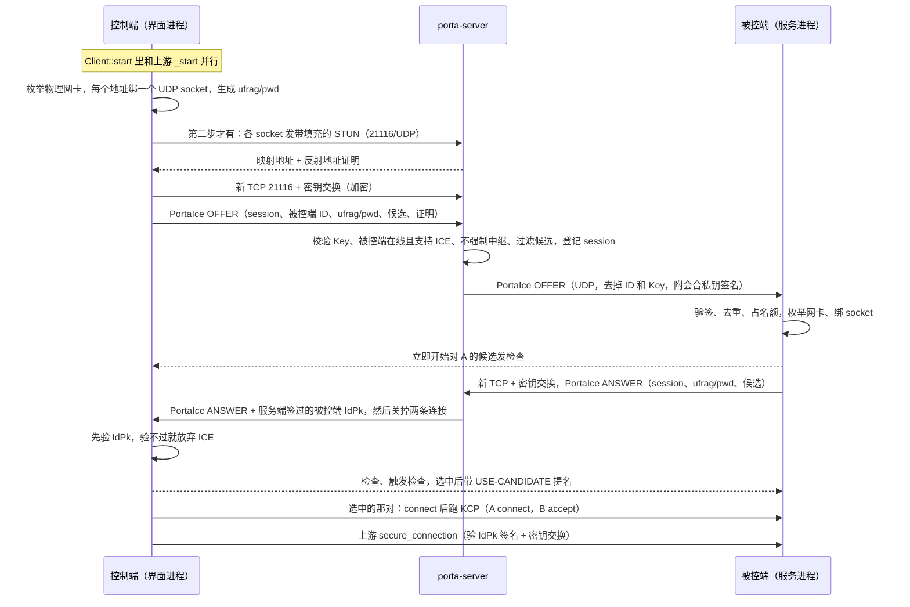

# 第三期调研 07：Porta 自研 ICE 设计方案（给维护者拍板）

> 2026-10-24 写。起因：维护者 2026-10-24 表示"如果进度快，直接用 Porta 自己做的 ICE 也行"，不依赖上游 RustDesk 的 WebRTC（webrtc-rs）路径。目标是像网易 UU 远程那样"两端交换全部候选地址、客户端逐对实测、选最好的那一对"（笔记 05），在"路由器透明代理只代理 TCP""本机开 TUN 代理""家宽 CGNAT、没有公网 IPv4 但有原生 IPv6""两端 UDP 走不同代理出口"这些环境里都能直连，直连不了回落 hbbr 中继。
> 本文是**设计方案**，不是实施契约：给出架构、关键决策（附备选）和明确不做的事，维护者确认后再写契约、派 coder。
> 怎么来的：三个方向各出一份草案——A「ICE-lite，在 Porta 现有零件上拼」、B「在 `libs/porta` 里自己实现比较完整的 ICE agent」、C「复用 webrtc-rs 的 ice crate，去掉 DTLS/SCTP」；两位评审分别从"所有环境都稳、性能"和"工作量、维护、合并上游成本"两个角度打分，并逐条读码核实。本文以 B 为主体，嫁接 C 的信令和 A 的几处细节，评审核实出的硬伤逐条处理（§10.3）。
> 维护者原则（2026-10-23）：**兼容性要考虑全面，不能假定任何运行环境，规则必须对所有环境都适用**；不接受要用户配代理规则，也不接受按设备主人授权来做同网判定。
> 代码基线：`porta-client@6bb19b190`、`porta-cardo@df76a0c`（客户端线）、`porta-server@d8403ad`、`rustdesk-org/webrtc@49c89bd8`（上游钉的 webrtc-rs 分支）、`kcp-sys@938eda3`。行号按这几个提交，契约定稿时再逐处核对。
> 标记：【读码】读代码确认；【官方】项目官方页面或 crates.io 元数据（2026-10-24 查）；【一手】RFC；【推测】推断，后面写依据；【待实测】只能靠实测回答。

术语（第一次出现时解释，后文直接用）：
- **ICE**（Interactive Connectivity Establishment，RFC 8445）：两端把所有可能连得通的地址（"候选"）交给对方，对每一对实际发探测包（"连通性检查"），哪对通就用哪对。
- **候选的几种类型**：**host** 是本机网卡上的地址；**srflx**（反射候选）是服务端看到的、本机在 NAT 外面的映射地址；**prflx**（对端反射候选）是检查包实际到达时的来源地址，在检查过程中学到。中继候选（relay）本方案不用，中继交给 hbbr。
- **候选对**：本端一个候选和对端一个候选。**提名**：控制端从检查通过的对里挑一对，告诉被控端"就用这对"。
- **STUN**：一种很小的 UDP 请求/响应格式（RFC 5389/8489），ICE 的检查包和"问服务端我的映射地址是什么"都用它。
- **trickle**：候选收集到一个就单独发一个；本方案不做，候选一次发全。
- **KCP**：RustDesk 现有的 UDP 可靠传输，UDP 打洞、IPv6 打洞建好以后都跑它（`src/kcp_stream.rs`）。
- **sans-IO**：协议内核只吃"收到的包、时间到了"这类输入，吐出"要发的包、下次唤醒时间"，自己不碰 socket，方便用模拟网络做单测。
- **强主机模型**：Windows 默认的源地址规则——socket 绑在哪块网卡的地址上，就只在那块网卡的路由里找出口。开 TUN 时"绑物理网卡地址的 socket 是否仍从物理网卡出去"取决于它（笔记 04 §3.2）。
- **续选**：会话中途换一对候选继续用（换网不断线）。

## 1. 结论先行

- **推荐：自研一个精简版 ICE**（以方案 B 为主体），不依赖 webrtc-rs：
  - 两端各自枚举物理网卡，**每个物理地址绑一个 UDP socket**，收集 host 候选；srflx 也从这些 socket 向 porta-server 问（§2.3）。
  - 候选经**独立的信令消息** `RendezvousMessage.porta_ice` 交换（取自方案 C），两端到服务端都是加密 TCP，和上游打洞流程完全分开（§2.2）。
  - 两端按"以太网 > WLAN > 其他"排优先级，逐对发 STUN 检查，用每次连接新生成的短期口令认证（§2.4）。
  - 选中一对后，在这对 UDP 上直接跑上游现成的 KCP，再走上游的 `secure_connection` 身份握手（§2.5）。
  - 控制端用上游现成的 `race_transports_prefer_webrtc` 让 ICE 和现有路径（局域网多候选、TCP 打洞、IPv6 打洞、hbbr 中继）竞速，谁先直连谁赢，中继结果最多压 2.5 秒等 ICE（§2.6）。
- **为什么是它**（详细对比见 §10）：
  1. 它是三个方案里唯一在"开 TUN + 跨网"时还可能拿到真实家宽映射、做真 P2P 的（前提是强主机模型在 TUN 下成立，见风险）；家宽 CGNAT 外网连回家，它直接交换全局 IPv6 host 候选、两端同时发检查。
  2. 数据面就是上游 UDP/IPv6 打洞已经在用的 KCP，没有新的性能未知数。
  3. 防伪造、防反射三份里最完整：公网 IPv4 候选必须带服务端签发的"反射地址证明"。
  4. 嫁接 C 的信令以后，上游文件只加 **3 处挂钩**，不改任何函数签名（B 原稿要改 `connect()` 和 `create_relay` 两个签名、约 10 处）。
  5. 以后能做续选和 ICE-TCP，不被冻结的 0.13 分支锁死。
- **回答"有哪些可用的 ICE"**：Rust 里能用的有 webrtc-rs 的 `webrtc-ice`（上游 RustDesk 钉在 0.13 的分支，官方最后一条维护线 0.17.2）、webrtc-rs 新的 sans-IO 栈 `rtc-ice` 0.21、从 str0m 拆出来的 sans-IO 内核 `is` 0.11、GStreamer 开发者的 `rice-proto` 0.4；C 库有 libjuice、libnice、pjnath；UU 用的是 Google libwebrtc（C++），它的 ICE 层能单独拿来用，但要自写 C++ 胶水、搭 Chromium 工具链（对照见 §10.5）。表和取舍在 §10.1。
- **回答"自研的好处是"**（和直接用上游 WebRTC 路径比）：
  1. **优先级按网络代价排**，TUN、Tailscale、虚拟机网卡根本不收集；webrtc-rs 0.13 所有 host 候选同优先级，开 TUN 时可能选中经 TUN 的对（笔记 06 §2.5）。
  2. **信令简单**：不做 trickle，服务端不用转发 `IceCandidate`、不用一直占着控制端的 TCP 连接（笔记 06 §3.3 里最难的两件事）。
  3. **数据面是 KCP**，不是 DTLS + SCTP；上游自己的模拟测试里 KCP 尾延迟更好（笔记 06 §4.3）。
  4. **细节自己管**：STUN 由 porta-server 自己回，不碰第三方 STUN；Windows 的 10054 坑（收到 ICMP 端口不可达后 socket 静默失效）直接关掉；只交出物理网卡地址，隐私面可控；以后的续选、ICE-TCP 自己做。
  5. 代价：状态机、时序、线上格式全归自己维护和审查；不能和浏览器互通（Porta 也不需要）。
- **工作量（coder 人天）**：分三步。
  - **第一步（MVP）约 10~12 天**：host 候选（私网 IPv4、ULA、全局 IPv6）+ 检查 + KCP + 信令 + 竞速。补上"同网但服务端判不出"的缺口，也覆盖"CGNAT + 原生 IPv6 外网连回家"。
  - 第二步约 3~4 天：srflx 和服务端反射地址证明，补上 IPv4 跨网打洞。
  - 第三步（完整版）约 10~14 天：续选（换网不断）、ICE-TCP（UDP 被封的网络）、赢家上报。三步合计约 25~30 天。
  - MVP 依赖 01 块（能力宣告、被控端版本）合入；`lan.rs` 双地址族枚举随 02 做，谁先做谁落地。
- **和上游 WebRTC 评估的关系**：评估照常完成（临时分支已做好）。它测的 webrtc-ice 0.13 正好能回答自研要依赖的几个前提：TUN 下绑物理地址的 socket 从哪块网卡出去、同网 UDP host 对在"两端 UDP 走不同出口"时能不能通、默认 Windows 防火墙放不放行进服务进程的 UDP、换网要断多久（§11）。评估结论不决定"自研还是不自研"，但如果评估里 S2 场景连 host 对都不通，自研 ICE 一样救不了，要先查清原因再开工。
- **最大风险**：
  1. **TUN 下绑物理地址的出站行为没实测**【推测】。依据是 Windows 强主机模型，和契约 04 §4.4 同一前提。不成立时，局域网 host 对不受影响（局域网有更具体的路由，已合入的局域网多候选在 Windows 控 Mac 那一轮验证过），但跨网 srflx 和全局 IPv6 对会经过 TUN。开工前先做半天实测（可以并进 WebRTC 评估）。
  2. **自写状态机的正确性和审查成本**：内核写成 sans-IO，用模拟网络和 Linux 测试机上的真实 NAT 压住；但审查轮数可能像第一期那样多。

## 2. 架构

### 2.1 组件和代码位置

```
控制端（界面进程）                      porta-server                       被控端（服务进程）
Client::start ─┬─ 上游 _start（不动）   21116/TCP  OFFER / ANSWER 会话表    handle_resp ── on_ice_offer
               └─ porta_hooks::race_ice 21116/UDP  STUN + 反射地址证明     （独立任务：收集、检查、KCP accept）
                    └─ libs/porta::ice  （转发给被控端的 OFFER 用会合私钥签名）  └─ libs/porta::ice
```

**客户端 `libs/porta`（Porta 自有，新模块）**

| 文件 | 内容 | 估计行数 |
|---|---|---|
| `ice/mod.rs` | 对外接口（控制端 `Offer`、被控端 `Answer`）、agent 任务（每个 socket 一个接收 future）、被控端并发名额 | 250 |
| `ice/gather.rs` | 用 `lan.rs` 选物理地址、每个地址绑一个 socket、关 10054、向 porta-server 问 srflx（第二步）、算优先级 | 200 |
| `ice/check.rs` | **sans-IO 内核**：配对、检查表、节奏、重发、触发检查、prflx、提名、超时 | 500 |
| `ice/stun.rs` | 基于已在依赖树里的 `stun_codec 0.3`：Binding 编解码、MESSAGE-INTEGRITY/FINGERPRINT 校验、自定义属性（PADDING、`PORTA-PROOF`）、"是不是 STUN"的分流判断 | 200 |
| `ice/sig.rs` | `PortaIce` 和内部结构互转、候选紧凑编码、本端对收到候选的过滤（防恶意对端） | 150 |
| `lan.rs` 扩展 | 双地址族、`Nic` 加 IPv6 和 DAD 状态、网络代价（02、03 也要） | 150 |

**客户端主 crate**：`src/porta_hooks.rs` 加约 250 行胶水，放需要主 crate 私有项的部分：`race_ice`（控制端：开信令 TCP、`secure_tcp_required`、等应答、验签、跑检查、KCP connect、`secure_connection`）、`on_ice_offer`（被控端：验 OFFER 签名、去重、名额、回 ANSWER、KCP accept、`create_tcp_connection`）。

**上游文件里的挂钩**（`client/PORTA.md` §1 的纪律：只加薄挂钩）：

| # | 文件、位置 | 改动 | 行数 |
|---|---|---|---|
| H-1 | `src/client.rs` `Client::start`（L372 起） | `match Self::_start(...).await {` 改成先 `let upstream = Self::_start(...);`，再 `match crate::porta_hooks::race_ice(peer, key, conn_type, &interface, upstream).await {`，前面一行 `// porta:` 注释。这是**改调用点**，和第三期第一项改 `accept_connection` 同类 | 3 |
| H-2 | `src/client.rs` `race_transports_prefer_webrtc`（L221） | 前面加 `pub(crate)`（先例：`secure_connection` 已改成 `pub(crate)`） | 1 个词 |
| H-3 | `src/rendezvous_mediator.rs` `handle_resp`（L489） | 加一个分支：收到 `Union::PortaIce` 时调 `crate::porta_hooks::on_ice_offer(...)` | 3 |

- MVP 不改 `kcp_stream.rs`：`KcpStream::connect(Arc<UdpSocket>, 超时)` 和 `KcpStream::accept(Arc<UdpSocket>, 超时, init_packet)` 都是 `pub`，要求传入已 `connect` 的 socket【读码：`src/kcp_stream.rs` L62、L100，`kcp_io` 用 `udp.send`】。ICE 选中后正好给它一个已 `connect` 的 socket。
- 不改 `connect()`、`create_relay`、`handle_punch_hole` 的签名和语句。被控端照常处理上游 `PunchHole`（TCP 打洞、IPv6 打洞、中继都照旧并行），不会因为 ICE 少掉任何一条现有回落路径。

**服务端 porta-server（硬分叉，复杂度放这里没有合并成本）**

| 位置 | 内容 | 估计行数（含测试） |
|---|---|---|
| `src/ice_signal.rs`（新） | OFFER/ANSWER/REJECT 会话表、候选过滤、给转发的 OFFER 签名、过期清理 | 300 + 测试 150 |
| `src/ice_stun.rs`（新，第二步） | 21116/UDP 上回 STUN Binding，附反射地址证明；只回带填充的请求；令牌桶 | 100 + 测试 60 |
| `rendezvous_server.rs` | `handle_tcp`（L766）加 `PortaIce` 分支；`handle_udp`（L557）入口按首字节分流 STUN（第二步）；Porta 心跳响应的 `features` 加 `"ice"`（01 块的接入点） | 约 25 |

**proto**（porta-cardo 两条线各一份、内容一致，只含 proto 的提交）：

```proto
// Porta ICE（Porta 字段号段 1000~1999）。PortaIce 是 Porta 自己的消息，内部字段号从 1 起。
message PortaIce {
  enum Kind { OFFER = 0; ANSWER = 1; REJECT = 2; }
  uint32 ver = 1;                 // 1；服务端只转发自己认识的版本
  Kind kind = 2;
  bytes session = 3;              // 16 字节随机数，控制端生成，充当应答凭证
  string id = 4;                  // OFFER，控制端 -> 服务端：被控端 ID（不转发给被控端）
  string licence_key = 5;         // OFFER，控制端 -> 服务端（同 PunchHoleRequest 的校验，不转发）
  string ufrag = 6;               // 本端 ICE 用户名片段，每次连接新生成
  string pwd = 7;                 // 本端 ICE 口令，每次连接新生成
  repeated bytes candidates = 8;  // 候选紧凑编码（见下），好的在前，最多 16 个
  repeated bytes proofs = 9;      // 第二步：公网候选的反射地址证明；服务端验过后去掉，不转发
  bytes pk = 10;                  // ANSWER，服务端 -> 控制端：服务端签过的被控端 IdPk
  bytes sig = 11;                 // OFFER，服务端 -> 被控端：服务端用会合私钥对转发内容的签名（§5.2）
  uint64 ts = 12;                 // OFFER，服务端 -> 被控端：签名时间，被控端拒收过期的
  string reason = 13;             // REJECT：offline / unsupported / relay / busy / bad
}
message RendezvousMessage { oneof union { ... PortaIce porta_ice = 1000; } }
```

- 字段号：`RendezvousMessage` 的 oneof 现有 6~29，1000 空着【读码：`protos/rendezvous.proto`】。它和已占用的 `LocalAddr/PunchHoleResponse.porta_local_addrs = 1000`、契约预分配的 `PunchHoleRequest.porta_from_id = 1000` 不在同一个消息里，不冲突。
- **候选紧凑编码**（取自 C，不传 SDP 字符串）：1 字节类型（0 = host、1 = srflx；完整版加 2 = TCP 被动）+ 2 字节本地偏好（大端）+ `AddrMangle` 编码的地址，最长 21 字节。**类型偏好由收方按类型自己定**，发送方没法把 srflx 冒充成 host；服务端只按长度限长，不解析文本。
- 大小：16 个候选约 350 字节，加凭据和签名，经 UDP 转给被控端的 OFFER 约 0.6 KB，远低于 1200 字节，不会分片。

### 2.2 信令流程

为什么用独立消息、不像 A 那样塞进 `PunchHole`/`PunchHoleSent`【读码】：
- 被控端的应答在上游有四条出口（UDP 打洞、TCP 打洞、WebRTC 短 TCP、`relay_v4` 的 `RelayResponse`），服务端判同网时还会换成 `FetchLocalAddr`/`LocalAddr`（`rendezvous_mediator.rs` `handle_punch_hole` L1049~1200）。塞进去就要在每条出口上挂钩。
- 默认的 TCP 打洞那条出口是明文发 `PunchHoleSent` 的（`handle_punch_hole` 尾部 `send_raw`），A 原稿的被控端候选和口令会明文经过链路；控制端开了 UDP 打洞时应答还会走 UDP，而 porta-server 只在 TCP 上处理 `PunchHoleSent`，应答直接丢掉（两位评审都读码核实了）。
- 独立消息的话：服务端只加一个分支和一张自己的会话表，上游打洞流程一行不动；被控端只在 `handle_resp` 加一个分支。**不管服务端判没判同网，ICE 都跑**，正好符合"规则不依赖环境判别"的原则。代价是两端各多一条到服务端的加密 TCP，和上游流程并行建立。



要点：
- **不做 trickle**：候选在发出 OFFER/ANSWER 前收齐。host 候选只要枚举网卡（5~10 ms）；srflx 问 porta-server 只要 1 个往返，而发 OFFER 之前的 TCP 建连加密钥交换至少 2 个往返，两件事并行，通常不多等。收集最多等 400 ms（和上游 `UDP_NAT_TEST_GRACE` 一致【读码：`src/client.rs` L663】），晚到的丢掉，检查过程中仍可能以 prflx 补上。
- **被控端的检查往往先于 ANSWER 到达控制端**（UU 日志里也是这样，笔记 05 §3.2）。控制端从绑好 socket 起就在每个 socket 上收包：检查包的 USERNAME 前半是自己的 ufrag、MESSAGE-INTEGRITY 用自己的 pwd 算，控制端不需要对方的口令就能验证并回应，把来源记成 prflx；ANSWER 到了再对上。这也绕开了 C 草案里 webrtc-ice 在 `dial()` 之前拿不到对端 ufrag、会丢掉先到检查的问题。
- **重发和去重**：控制端 1.5 秒没收到应答就在同一连接上原样重发一次 OFFER（服务端到被控端那段是 UDP），最多等 4 秒，收到 `REJECT` 立即失败。被控端按 session 去重，重复的 OFFER 不新建 agent。
- **角色固定**：控制端永远是 controlling，被控端永远是 controlled，不做 RFC 8445 的角色冲突处理；相关属性照带，方便抓包看。

### 2.3 候选收集与优先级

**收集**（复用 `lan.rs` 的 `GetAdaptersAddresses` 枚举，5~10 ms；`default-net` 每次 4~5 秒，而且开 TUN 时选中的就是 TUN，不能用，见 `client/PORTA.md` §3.3）：

| 候选 | 规则 | 上限 |
|---|---|---|
| host IPv4 | 在线、非虚拟（IfType 23/24/53/131 和名字、描述规则，描述补上 `Meta Tunnel` 这类，笔记 05 §3.3）、有默认网关的网卡上的私网地址；网卡上直接配的公网地址也收（第二步要带证明）。排除 `198.18.0.0/15`、`100.64.0.0/10`、回环、`169.254/16` | 4 |
| host IPv6 | 同样的网卡上，全局地址（`2000::/3`，要求有 IPv6 网关）和 ULA（`fc00::/7`，不要求网关）；不要链路本地；只收 DAD 状态为 Preferred 的；**每个 /64 只留一个，有临时地址时只留临时地址**（webrtc-ice 自带的"每前缀一个"在开 TUN 时会退化成保留整组，C 草案读码发现，所以 Porta 自己收窄） | 4 |
| srflx IPv4（第二步） | 每个 host IPv4 的 socket 向 porta-server 的 21116/UDP 发一次带填充的 STUN，回包里的映射地址不等于 host 地址时成为候选（底座是这个 host socket）；同一映射地址只留一份 | 4 |
| srflx IPv6（第二步） | 只在 porta-server 有 IPv6 时问；没有 NAT66 时映射地址等于 host，去重后不另报 | 2 |
| prflx | 只在检查过程中学到，不经信令发送 | — |

- **每个物理地址一个 UDP socket，绑 `物理地址:0`，不建 `0.0.0.0` socket**。按强主机模型，源地址绑在哪块网卡就只在那块网卡的路由里找出口：去局域网走直连网段，去公网走那块网卡自己的默认网关，不进 TUN【推测，见 §1 最大风险第 1 条，开工前先实测，§11】。srflx 也从这些 socket 问，拿到的是家宽真实映射，不是代理出口。`0.0.0.0` socket 的出口由路由表决定，开 TUN 时进隧道，问出来的是代理出口（A、C 的 srflx 都有这个问题，C 的出处读码核实在 webrtc-ice `agent_gather.rs` L644~651）。
- **TUN、VPN、虚拟网卡一律不收集**：mihomo/sing-box 的 Wintun、Tailscale、ZeroTier、WireGuard、VMware、vEthernet。两端 TUN 地址相同（都是 `198.18.0.1`）的对注定失败；本端 TUN 对对端物理网卡的对会经 mihomo 用户态转发，关 TUN 就断。
- **Windows 上每个 ICE socket 都关掉 `SIO_UDP_CONNRESET`**（`WSAIoctl`，`windows` crate 的 WinSock 特性已在 `libs/porta` 依赖里【读码】），接收循环遇到任何错误都继续、不退出。这两条针对笔记 06 §4.3 的"收到 ICMP 端口不可达后 socket 静默失效"（webrtc-ice 的 `recv_loop` 遇错直接 return，评审读码核实）。socket 是自己建的，ioctl 在第一次发包前设好，没有 C 草案那种竞争窗口。
- 非 Windows 平台枚举不到网卡时不出 ICE（第一阶段只做 Windows），不退到 `0.0.0.0`。
- 控制端配了代理（`Config::is_proxy()`）、强制中继、走 WebSocket、没配可信的服务器 Key 时不出 ICE：前者 ICE 会绕过代理暴露真实地址（上游 WebRTC 同一规则），后两者没有对应的信令通道或身份。

**优先级**（写进契约，两端必须一致）：

- 候选优先级照 RFC 8445 §5.1.2：`priority = 2^24·类型偏好 + 2^8·本地偏好 + 255`。类型偏好：host 126、prflx 110、srflx 100，由收方按类型定。
- 本地偏好由候选所有者算：`65535 − 64·网络代价 − 地址族罚分 − 序号`。
  - 网络代价：以太网 0、WLAN 10、其他物理网卡 50（借鉴 libwebrtc 的网络代价，笔记 05 §3.3）。
  - 地址族罚分：私网 IPv4 0、全局 IPv6 8、ULA 16。
- 候选对优先级照 RFC 8445 §6.1.2.3：`2^32·min(G,D) + 2·max(G,D) + (G>D ? 1 : 0)`，G 是控制端候选的优先级。**两端的网卡排序都生效**；webrtc-ice 的本地候选优先级恒为默认值，C 只能排被控端，A 两端都排不了。
- **MVP 让私网 IPv4 排在 IPv6 前面**（和 UU 相反）：MVP 没有续选，维护者路由器的 ULA 每 20~75 分钟出现又消失（笔记 05 §3.2），临时全局地址也会过期，选中这些对的话地址一变会话就断，约 8 秒后整次重连（`io_loop.rs` `KCP_PEER_SILENCE_LIMIT` 8 秒【读码】）。这和契约 03 P-4"私网 IPv4 优先"的理由相同。跨公网时 host IPv6（126）仍高于 srflx IPv4（100），回家直连优先走原生 IPv6。有了续选以后可以改成 IPv6 优先（§9 Q7）。

### 2.4 连通性检查与认证

**报文**：STUN Binding（RFC 8445 §7.2），选 STUN 而不是 A 那样自定义格式，理由是编解码已有（`stun_codec 0.3.5` 已在 `client/Cargo.lock`，带 PRIORITY、USE-CANDIDATE、ICE-CONTROLLING/CONTROLLED、MESSAGE-INTEGRITY、FINGERPRINT【读码，评审核实】；PADDING 和 `PORTA-PROOF` 要自己定义属性）、RFC 5769 有测试向量、Wireshark 能直接解析、服务端回反射地址也是同一种格式。

- 检查请求带：USERNAME（`对端ufrag:本端ufrag`）、PRIORITY（本端以 prflx 身份的优先级）、ICE-CONTROLLING 或 ICE-CONTROLLED、提名时加 USE-CANDIDATE、MESSAGE-INTEGRITY（HMAC-SHA1，密钥是对端 pwd）、FINGERPRINT。约 100 字节。
- 成功回应带 XOR-MAPPED-ADDRESS（对端看到的我的地址）、MESSAGE-INTEGRITY（密钥是本端 pwd）、FINGERPRINT。
- ufrag 8 个字符、pwd 24 个字符，`sodiumoxide` 随机数（已有依赖），每次连接新生成。
- **事务号第 5 个字节（整个包的偏移 12）恒为 0**（取自 A 的思路）。原因见 §2.5。

**校验（防连错机器、防伪造）**：
- 收到的检查：FINGERPRINT 和 MESSAGE-INTEGRITY 都要对，USERNAME 前半要等于本端 ufrag。别的局域网里恰好有同一个私网地址的机器不知道 pwd，造不出有效回应，那一对判失败（RFC 8445 §7.2.2；笔记 05 §6"探测必须认证对端"）。
- 收到的回应：事务号对得上；来源地址必须等于当初发往的地址（RFC 8445 §7.2.5.2.1 的对称性）；MESSAGE-INTEGRITY 要对。
- 两端都开 TUN、地址都是 `198.18.0.1` 的情况：TUN 地址不收集，不会出现。
- 身份最后仍由上游 `secure_connection` 确认（服务端签过的被控端公钥 + 密钥交换），ICE 层的口令只负责"这一对确实通到本次会话的对端"。控制端在跑检查之前就先验 ANSWER 里的 IdPk（同 `porta_hooks.rs` 的 `peer_key_verifies`），没有可信身份就不做 ICE，和已合入的 `lan_connect` 同一条线。

**检查表和节奏**：
- 同地址族才配对；本端 srflx 换成它的底座去配，去掉重复的对（RFC 8445 §6.1.2.4）；最多 32 对，按优先级排序；不冻结，所有对直接进入等待（和 str0m 的取舍一样）。
- 每 20 ms 开始一个新检查（RFC 建议 50 ms；UU 弱连接时用 8 ms）；单个检查在 100、200、400、800 ms 后重发，最多发 5 次（约 1.5 秒）；32 对的第一轮在 0.64 秒内发完。
- 触发检查：收到对端一个有效检查时，把对应的对插到队首立刻检查（RFC 8445 §7.3.1.4）；来源不在已知候选里时记成 prflx 并建对（§7.3.1.3）。被控端收到 OFFER 后马上对控制端的候选发检查，两端都先发，NAT 和 Windows 防火墙的 UDP 状态表都会为对方开口【推测：默认 Windows 防火墙对 UDP 按"本 socket 向该远端发过包"放行回包，要在开着防火墙的机器上实测】。

**提名**：
- 最好的有效对 P 出现后，满足任一条就提名：比 P 优先级高的对都已失败或结束；或从第一个有效对出现起，P 是 host↔host 时已等 100 ms、其他情况已等 300 ms（参考 webrtc-ice 的 host 0 ms、srflx 500 ms）。
- 提名就是在 P 上再发一次带 USE-CANDIDATE 的检查（RFC 8445 的常规提名），收到成功回应即选中。
- 超时：控制端收到 ANSWER 后 3 秒内一个有效对都没有就判失败；被控端发出 ANSWER 后 10 秒内没等到 KCP 的第一个包就收摊、释放名额。

### 2.5 选中后的传输

- **控制端**：停掉选中 socket 上的 ICE 接收任务（同一个 socket 不能有两个读者）、关掉其余 socket；`socket.connect(远端地址)`，交给上游 `KcpStream::connect`；再走 `Client::secure_connection`，要求 `is_secured()`。返回值和 `lan_connect` 同一个元组形状，连接类型沿用上游的 `"UDP"`/`"IPv6"` 标签，界面不用改。
- **被控端**：收到带 USE-CANDIDATE 的有效检查时标记已提名、继续回应；之后在该对 socket 上从那个远端地址收到**第一个不是 STUN 的包**（KCP 的 SYN），就停 ICE、`connect`，把这个包当 `init_packet` 交给 `KcpStream::accept`，再调 `crate::server::create_tcp_connection(server, stream, 选中对的远端地址, true, meta)`。这和上游 `punch_udp(listen=true)` → `KcpStream::accept(..., init_packet)` 同构【读码：`src/common.rs` `punch_udp`、`src/rendezvous_mediator.rs` `udp_nat_listen`】。地址参数用实际选中的远端地址，被控端的 IP 白名单照真实来源判断。
- **不经上游 `punch_udp`**（取自 A）：它把第一个"既不是探测也不是确认"的数据报当作对端已开始说 KCP、提前返回【读码：`common.rs` L2950~2958，评审核实】，迟到的检查包会让它出错。检查和提名已经证明了这一对双向通，直接上 KCP。
- **迟到的检查包不会干扰 KCP**：KCP 包头偏移 12 是标志字节；对不认识的连接，KCP 只在标志恰好是"SYN 且不带 ACK/FIN/DATA/RST"时才建状态，否则丢弃【读码：`kcp-sys@938eda3` `packet_def.rs` `KcpPacketHeader`、`state.rs` L86~95】。标准 STUN 的偏移 12 落在随机事务号里，约 1/32 的概率恰好组成 SYN（B 原稿漏了这一点，评审指出）。所以 Porta 生成事务号时把这个字节固定为 0，回应会原样带回同一个事务号，于是检查和回应在 KCP 眼里都是"标志为 0"的包，被安静丢掉。事务号剩下 88 位随机，足够。
- 保活：MVP 不做 RFC 7675 consent，交给 KCP 自己的 ping（`peer_silent_for`），NAT 映射靠它维持；断了走上游现有的"静默 8 秒 → 整次重连"。
- 被控端 `ConnectionMeta` 用默认值：porta-server 现在不填 `control_permissions`【读码，评审核实】，目前没有影响；以后服务端按策略下发权限时要补上（记为已知限制）。

### 2.6 和现有路径的竞速与回落

`race_ice` = `race_transports_prefer_webrtc(ice_future, vec![上游 _start], 2500 ms, |r| r.0.1)`【读码：`client.rs` L215~338，函数注释写明了语义】：
- ICE 直连成功立即胜出，丢掉上游 future（上游进行中的打洞或中继随之关闭；被控端那边已起的中继、打洞监听各自超时，和上游 WebRTC 竞速的后果一样）。
- 上游先给出直连（局域网多候选、TCP 打洞、IPv6 打洞）也立即胜出，ICE 随之关闭。
- 上游先给出中继，就压最多 2.5 秒等 ICE（和上游 `RELAY_FALLBACK_DELAY_MS` 同值）；ICE 失败立即采用中继，不多等。
- ICE 分支返回的第三个值是 `false`，不更新 `direct_failures`。

| 情况 | 结果 |
|---|---|
| 服务端判同网，局域网多候选 TCP 能通 | 两条都跑，谁先到谁赢；通常 TCP 先完成，结果一样 |
| 路由器只代理 TCP、两端 UDP 走不同出口（服务端判不出同网） | 上游拿不到局域网结果，ICE 的 host 对赢 |
| 被控端是原版或旧 Porta、服务端是原版 hbbs 或旧 porta-server | ICE 根本不启动，或几十毫秒内收到 `REJECT`，竞速直接用上游结果 |
| UDP 被封 | ICE 失败，现有 TCP 路径接住，不比现在差（完整版 ICE-TCP 补） |
| 两端都对称 NAT、没有 IPv6 | ICE 失败，用中继；中继最多晚 2.5 秒（§6） |

上游 WebRTC：porta-server 继续不转发它的信令，Porta 部署里它不启用，不会多出第三条腿。

## 3. 在各种环境下的预期

对照维护者原则：下表每一行用的都是**同一套规则**——只收物理网卡、两端逐对实测、强制中继时不做，没有任何一条按"是否开 TUN""是否同网""是否授权"切换行为。

| 环境 | 预期 | 为什么 |
|---|---|---|
| 同一局域网，路由器透明代理只代理 TCP | host↔host（私网 IPv4 或 ULA）直连 | 服务端看到的 TCP 来源是代理出口、UDP 是家宽，不判同网；ICE 不依赖服务端判定，检查包在局域网里直达，透明代理不碰局域网流量 |
| 同一局域网，一端或两端开 TUN（mihomo，Wintun） | host↔host 直连 | TUN 地址不收集；发往局域网地址时直连网段的路由比 TUN 的默认路由更具体，已合入的局域网多候选在 Windows 控 Mac 那一轮验证过（TCP）；绑物理地址的 socket 按强主机模型也走物理网卡【推测，§1 最大风险第 1 条】 |
| 同一局域网，两端 UDP 走不同代理出口（契约 04 §2.5.8 的缺口） | host↔host 直连 | 代理出口只影响去服务端的流量，检查包走局域网直达。这是现有路径（含已合入的局域网多候选）补不上、ICE 专门补的场景 |
| 家宽 CGNAT 无公网 IPv4、有原生 IPv6，外网连回家 | 两端都有 IPv6 时 host IPv6 对直连（MVP 就有）；外网一端没有 IPv6 时，看第二步的 srflx IPv4 能否打通，不行回落中继 | 两端同时向对方全局 IPv6 发检查，家用路由器的 IPv6 状态防火墙会为对方开口；socket 绑物理网卡的全局地址，开 TUN 也不进隧道【推测，同契约 04 §4.4 的前提】。CGNAT 下的 IPv4 打洞取决于运营商 NAT 是否端点无关映射，无法保证 |
| 家里连外网 | 同上，方向反过来 | 规则对称 |
| 两端都开 TUN、跨网 | 第二步的 srflx 对是真 P2P（前提成立时）；前提不成立时 srflx 是代理出口或经 mihomo 转发，按"经代理"处理（§9 Q9） | srflx 从绑物理地址的 socket 问，强主机模型成立时拿到家宽映射 |
| 只有 IPv6 的网络 | host IPv6 对直连 | 地址族独立配对 |
| 两端对称 NAT | 中继 | 不做端口预测（README §7） |
| UDP 被封 | 现有 TCP 路径或中继；完整版 ICE-TCP | MVP 只有 UDP |
| 两户恰好用同一私网网段（都是路由器默认网段） | 私网对检查失败（对方不知道口令），不会连错；其余对照常 | MESSAGE-INTEGRITY 认证 + 之后的身份握手 |
| 用户在 Porta 里配了代理 | 不做 ICE，和现在一样 | ICE 会绕过代理暴露真实地址（上游 WebRTC 同一规则） |
| 默认开着 Windows 防火墙 | 安装版能进：放行规则按程序路径、不限协议【读码：`src/platform/windows.rs` L1627~1628，评审核实】；便携版第一次会弹提示，和上游 UDP 打洞一样 | 维护者台式机三个防火墙配置都关着，在它上面测通不代表普通用户，验收要在开着防火墙的机器上测 |

## 4. 兼容

| 控制端 | 被控端 | 服务端 | 结果 |
|---|---|---|---|
| Porta | Porta（不低于首个带 ICE 的版本） | 带本方案的 porta-server | ICE 和现有路径竞速 |
| Porta | 原版或旧 Porta | 同上 | 服务端按 01 块的 `Peer.porta_hb` 判出不支持，回 `REJECT{unsupported}`，控制端几十毫秒内回落，和现在一样 |
| 原版 | 任意 | 同上 | 原版不发 `porta_ice`，和现在一样 |
| Porta | 任意 | 原版 hbbs、第一期 porta-server、rustdesk-api | 01 块的能力缓存里没有 `ice`，控制端不启动 ICE；万一手动指向了不认识的服务端，对方不认识 oneof 1000 会断开连接，ICE 立即失败 |
| Porta 便携运行（服务进程没跑） | 任意 | 带本方案 | 能力缓存为空，不启用 ICE（和契约 04 §2.5.6 同样的限制） |
| 原版 1.5（开了 WebRTC） | Porta | porta-server | WebRTC offer 不转发（现状），走原有路径 |

- 被控端能力的判断依赖 01 块的心跳（`porta_hb` 新鲜、`porta_ver` 不低于 `ICE_MIN_PORTA_VER`）。不判就转发的话，原版被控端收不到应答，控制端在中继到达后还要白等 2.5 秒，所以必须判。
- 原版客户端只在兼容期内支持（AGENTS.md 已定），不为它们补任何 UDP 直连。

## 5. 隐私与安全

### 5.1 密码之前交出什么

"等密码通过再交换候选"做不到：RustDesk 的认证跑在已经建好的连接上（笔记 06 §5.2 同一结论）。所以只能控制交出什么、交给谁、经过哪些段。

| 段 | 加密吗 | 带什么 |
|---|---|---|
| 控制端 → 服务端（TCP） | 是（密钥交换，不加密就不发） | 控制端的候选、ufrag/pwd |
| 服务端 → 被控端（UDP） | 明文，但有会合私钥签名（§5.2） | 控制端的候选、ufrag/pwd（不含被控端 ID 和 Key） |
| 被控端 → 服务端（新 TCP） | 是 | 被控端的候选、ufrag/pwd |
| 服务端 → 控制端（TCP） | 是 | 被控端的候选、ufrag/pwd、IdPk |

- **被控端是被动方**，任何知道 ID、Key 对、它在线的人都能让服务端转发 OFFER，所以它交出的最要紧：只有物理网卡的私网 IPv4、ULA、每个 /64 一个临时全局 IPv6（第二步加 srflx）。TUN、Tailscale、虚拟机网卡的地址都不交，比上游 WebRTC（全部网卡）和 UU（含 Tailscale）都少。被控端的候选只经过两段加密 TCP，链路上看不到，只有服务端看得到。
- **和现在比**：现在不认证也能拿到被控端的公网 IPv4（打洞）和全局 IPv6（IPv6 打洞）；私网 IPv4 只在服务端判同网后才给。新增的是"跨网时也给私网 IPv4 和 ULA"。
- **控制端是主动方**，交出的是自己的物理网卡地址，对象是它自己选的被控端；服务端到被控端那段明文 UDP 上，链路上的观察者能看到控制端的局域网地址，和上游 `PunchHole`、上游 WebRTC 同一个面。
- **第三方 STUN**：一个都不碰，srflx 由 porta-server 自己观测。
- **host 候选给谁**是要拍板的问题（§9 Q2）。推荐不按身份过滤：按授权过滤的话，匿名（密码）连接在"路由器只代理 TCP"环境里就拿不到局域网直连，"能不能直连"变成取决于授权，和维护者否掉的 P-2 选项同类。

### 5.2 防伪造

- **伪造 OFFER 直接打到被控端**：被控端的 UDP 会合 socket 不检查来源（笔记 06 §3.3），伪造的 `PunchHole` 今天就能让被控端去 TCP 连任意地址。本方案**新增**一道（三份草案都没有）：服务端用会合私钥对转发给被控端的 OFFER 签名，覆盖 session、被控端 ID、时间戳、控制端的 ufrag/pwd 和候选；被控端用配置的 Key 验签、拒收 10 秒前的、按 session 去重。这和 01 块已定的"服务端用会合私钥给 Porta 心跳响应签名、客户端配了 Key 就强制验签"是同一套机制，Ed25519 签一次约几十微秒。被控端没配 Key 就不应答 ICE（没有可信身份本来也不做）。于是伪造者既拿不到被控端的候选，也没法让被控端对攻击者指定的地址发检查。
- **伪造 ANSWER**：服务端只接受登记过、未过期、未用过的 session（128 位随机数），找不到就静默断开。不按来源 IP 校验，理由同笔记 06 §3.3：被控端的 TCP 和 UDP 可能从不同出口出去。
- **中间人**：会话加密由 `secure_connection` 对被控端签名公钥的密钥交换保证，和 TCP、UDP 打洞路径一样，不依赖 ICE 层。前提是服务端持有私钥（`server/PORTA.md` §6 第 1 条）。链路上的人最多能用明文段看到的控制端 pwd 伪造检查回应，让控制端挑一对坏的、握手失败后回落中继，属于拒绝服务。
- 服务端强制中继时回 `REJECT{relay}`，ICE 绕不过强制中继（A、C 都有这一条）。

### 5.3 防反射（RFC 8445 §19.5.1 说的"voice hammer"）

ICE 天然要按对方提供的地址发包，不加限制就能被人用来让被控端往第三方地址灌包。限制分三层：

1. **服务端过滤**（OFFER 和 ANSWER 用同一个函数）：
   - 先查 `ver`、ufrag 4~32 个字符、pwd 22~64 个字符、候选不超过 16 个、每个候选长度合法。
   - 丢掉回环、链路本地、组播、未指定地址、`198.18/15`、`100.64/10`、端口为 0 的候选。
   - **公网 IPv4 必须带有效的反射地址证明**，证明里的地址要和候选完全一致（第二步才有证明，MVP 里公网 IPv4 一律丢掉）。证明只能来自服务端 30 秒内亲眼看到、并且对方真收到了回包的地址，和契约 04 §2.4 否掉"控制端自报 UDP 地址"的理由一致。C 草案对公网 IPv4 照收，是放大型反射源，评审读码核实。
   - 全局 IPv6 带证明的保留；不带的每条消息最多 2 个，和上游 IPv6 打洞本来就转发控制端自报的 IPv6 同一档。私网 IPv4、ULA 不需要证明。
2. **客户端过滤**（`ice/sig.rs`，防恶意或被篡改的服务端、对端）：同样的地址类别规则和条数上限。
3. **发包上限**：最多 32 对、每对最多 5 次，一次连接对外约 160 个包、约 16 KB；被控端同时最多 8 个 agent（每个最多 10 个 socket），每个最多活 10 秒；服务端每个控制端来源最多 8 个未完成的 session、全表 4096 条。

剩下的只有"向自己局域网的私网地址发几个包"（和现有 `lan.rs` 同一类）和"向 2 个全局 IPv6 发约 10 个包"（和上游 IPv6 打洞同一档）。

**服务端的 STUN 本身不做放大器**（第二步）：只回长度不短于 96 字节的请求（Porta 客户端用 PADDING 属性补齐），回包约 80 字节，放大比小于 1；和契约 04 §3.2 同一个全局令牌桶，每秒 1000 个。所以 porta-server 不是通用 STUN 服务器，上游的 `ice-servers` 也不能指向它，这是有意的。

**A 草案的"前缀匹配披露"为什么没采用**：它规定按 `min(控制端报的前缀长度, 被控端的前缀长度)` 比网络号，而控制端的前缀长度是请求方自己报的；报成 /8、/12、/16，被控端的全部私网地址就都算"同网段"，一次请求全拿到，它主打的隐私和防反射收益都不成立（两位评审都读码核实）。修正版（只用被控端自己的前缀比、要求控制端候选是私网地址）可以作为备选（§9 Q2），但收益有限：不限请求次数时 `192.168.x.0/24` 的 256 个网段 32 次请求就能扫完，还会让跨网段路由的家庭网络匹配不上。

## 6. 性能

- **数据面**：选中后就是上游 UDP/IPv6 打洞一直在用的 KCP 直接跑在 UDP socket 上，没有多一层缓冲或异步通道（C 要多经过 webrtc-ice 的 `recv_loop`、1 MB 包缓冲和一份照抄的 `kcp_io`）。没有 DTLS/SCTP 的用户态加解密。
- **建连耗时**【推测】：局域网约是"到服务端的 TCP + 密钥交换（2 个往返，和上游 `_start` 并行）+ OFFER/ANSWER 各经服务端一次 + 一轮局域网检查（几毫秒）+ 100 ms 提名等待 + KCP 握手 + 身份握手"。到服务端往返 50 ms 时约 0.4~0.5 秒，和 UU 日志的 0.25~0.4 秒同一量级（笔记 05 §1）；跨网再加 srflx/prflx 的等待和往返。
- **代价**：
  - 每次连接两端各多一条到服务端的加密 TCP，最多约 10 个 UDP socket、约 160 个检查包，服务端多一张最多 4096 条的会话表。
  - **纯中继场景可能变慢**：上游先给出中继、ICE 还在检查时最多压 2.5 秒。ICE 在"没有任何对可试""收到 REJECT"时几十毫秒内失败，不压；真正多等的是"有候选但都不通"的情况（例如两端都是对称 NAT 又没有 IPv6）。等赢家上报（完整版）有了数据再调这个值。
- ICE 任务跑在调用方的 tokio 运行时上（控制端界面进程、被控端服务进程），不用上游 WebRTC 那个所有会话共用的 2 线程运行时。

## 7. 工作量与分期

### 7.1 三步

| 步 | 内容 | coder 人天 |
|---|---|---|
| **第一步（MVP）** | host 候选（私网 IPv4、ULA、全局 IPv6）、检查内核、信令、竞速、KCP 交接、服务端会话表和 OFFER 签名 | **10~12** |
| 第二步 | srflx：服务端 STUN + 反射地址证明 + 令牌桶，客户端从每个物理 socket 问映射地址，服务端要求公网 IPv4 带证明，netns + nftables 真实 NAT 集成测试 | 3~4 |
| 第三步（完整版） | 续选 6~8、ICE-TCP 3~4、赢家上报 1~2 | 10~14 |
| 合计 | | 约 25~30 |

MVP 明细：

| 项 | 人天 |
|---|---|
| 开工前的 TUN 实测（可并进 WebRTC 评估，§11） | 0.5 |
| proto（两条线） | 0.25 |
| porta-server：`ice_signal.rs` 会合表、REJECT 各分支、候选过滤、OFFER 签名、能力宣告、测试 | 2 |
| `lan.rs` 双地址族和网络代价（02 先做了就只剩网络代价，约 0.3） | 1 |
| ICE 内核 `check.rs` + `stun.rs`（手写；嵌入 `is` 约 1.5） | 3.5 |
| 收集、socket、10054 | 0.75 |
| 客户端信令（OFFER 重发、ANSWER、验签、被控端去重和名额） | 1 |
| 3 处挂钩 + `porta_hooks` 胶水（竞速、两端 KCP 交接） | 1.5 |
| 集成测试（回环上多 socket 的两个 agent 跑 KCP 回显；Windows 构建）、审查修改 | 1~1.5 |
| **合计** | **约 11.5（02 已做双地址族时约 11，区间 10~12）** |

维护者端到端实测约 1 天：两台 Windows 装 Porta，按 §3 的场景，判据见 §7.4。

### 7.2 和契约 01、02 的依赖

- **01（上报与认证，进行中）**：要用它的能力缓存（`features` 里的 `ice`）、`Peer.porta_hb` 和版本号；服务端签名的机制和它的心跳响应签名同源。MVP 排在 01 合入之后，可以先写不依赖 01 的部分（内核、收集、服务端会话表）。
- **02（路由第二级）**：`lan.rs` 双地址族枚举和 `is_physical(IpAddr)` 随 02 做（README 已这样排），ICE 直接用；两边同时动 `lan.rs` 时谁后合谁变基。

### 7.3 契约 03、04 的零件哪些复用、哪些不再需要（ICE 实测达标后）

| 零件 | 去留 |
|---|---|
| 04 §3.1 token 的 `seal`/`open` 格式和代码 | **复用**为第二步的反射地址证明（`PORTA-PROOF`） |
| 04 §3.2 UDP 回包的全局令牌桶 | **复用**给服务端 STUN |
| 03 §4.1 双地址族枚举、`is_physical(IpAddr)` | **复用**（随 02 落地） |
| 04 §4.4 IPv6 打洞绑物理网卡全局地址 | 可选保留：只对"Porta 控制端连原版被控端、控制端开 TUN"有用，原版只在兼容期内支持，优先级低 |
| 03 默认 ID 加盐 | 和 ICE 无关，照常 |
| 04 的 nonce 表、UDP 上收 `PunchHoleSent`、转发 `udp_port`/`is_udp`、`TestNatRequest` 填充和 `porta_udp_token` 字段、C-3（UDP 打洞改打 token 地址）、P-3 的 H-a | **不做**：srflx↔srflx 已是 ICE 的一对，单对的 UDP 打洞路径被 ICE 取代；检查是 Porta 自己的 STUN，不用 `TestNat` |
| 04 §2.5.4 token 参与同网判定、03 的 IPv6 局域网候选（`porta_local_addrs` 装 IPv6） | **不做**：局域网由检查包实测，不靠服务端判 |
| README 第 0 步合并 proto 提交里 04 的字段（`porta_nonce`、`porta_pad`、`porta_udp_token`、`porta_udp_addr`） | 不进 proto；第 0 步只剩 `porta_from_id = 1000`。已预分配的号在 proto 注释里标"保留不复用"，免得混淆 |
| 已合入的局域网多候选（`lan.rs` TCP） | **保留**：原版被控端还要用；UDP 被封的局域网里它是唯一的直连。完整版有了 ICE-TCP 再评估退役 |

### 7.4 测试和验收要点

- **单测**：优先级公式（两端一致）；STUN 编解码对照 RFC 5769 测试向量；事务号偏移 12 恒为 0；MESSAGE-INTEGRITY 错的检查不建对；候选编码往返和过滤规则（每一条）；模拟网络：两个局域网撞同一私网地址时那一对失败、检查先于 ANSWER 到达时能对上 prflx、对称 NAT 对锥形 NAT 靠 prflx 打通、迟到的检查包不影响 KCP；被控端重复 OFFER 复用 agent；服务端 REJECT 各分支、session 过期和每来源上限、OFFER 签名和被控端验签、STUN 只回不短于 96 字节的请求。
- **集成**：Linux 测试机上两个 network namespace 各挂一层 nftables NAT（全锥形、端口受限、对称各一组），跑 `libs/porta` 的示例程序走完"收集 → 交换 → 检查 → KCP"（第二步）。
- **端到端（维护者）**：场景同笔记 06 §6.4（S1 同网两端开 TUN、S2 两端 UDP 走不同代理出口、S3/S4 跨网、S5 IPv6、S6 换网）。控制端日志要有 `porta ice: selected <本端类型/地址族/网卡类型> <-> <对端类型/地址族> in N ms`（不打具体 IP），且 `relay_req_count = 0`。关键是 S2：现有路径判不出同网，期望 ICE 选中 host↔host。另在开着默认防火墙的机器上重复一次 S1；50 次连接断开后被控端 agent 数回到 0、句柄不涨。

## 8. 明确不做

- PeerConnection、DTLS、SCTP、SDP；和浏览器或标准 WebRTC 互通；上游 WebRTC 路径的信令转发（保持不启用）。
- TURN（中继就是 hbbr）、mDNS、trickle。
- 端口预测、多随机端口、按 NAT 类型选策略、UPnP/NAT-PMP/PCP（README §7 已列）。
- MVP 不做：srflx（第二步）、续选、ICE-TCP、consent 保活、赢家上报、WebSocket 信令、非 Windows 平台。
- 收集 TUN、VPN、虚拟网卡的地址；用 `0.0.0.0` socket 问映射地址。
- 角色冲突处理、候选对冻结、多组件。
- 给原版客户端补 UDP 直连。
- 要求用户配置代理规则；把连服务端的 socket 绑物理网卡；按设备主人或地址簿授权判同网（本方案根本不做同网判定）。

## 9. 需要维护者拍板的问题（推荐在前）

- **Q1 走自研，还是复用 webrtc-ice 0.13（方案 C）？**
  - **推荐：自研（本方案）。** 维护者的原话是"Porta 自己做的 ICE"；C 依赖的是 rustdesk-org 冻结在 0.13 的分支（分支头 2026-10-24 仍是 `49c89bd8`），带着 `recv_loop` 遇错退出、`close()` 上的 FIXME deadlock、本地候选优先级设不了、srflx 从 `0.0.0.0` 问会经过 TUN 这些问题；上游 RustDesk 以后换 webrtc 版本时还得跟着重写或把约 7800 行源码收进来自己背。
  - 备选：要"几天内先上线一个能用的"并接受 fork 风险时用 C 过渡（MVP 约 8 天，偏乐观），但必须补上本方案的公网 IPv4 证明，否则是反射源。
- **Q2 被控端的 host 候选给谁？**
  - **推荐：所有能让服务端转发 OFFER 的请求方都给**，只给物理网卡地址、IPv6 每个前缀一个临时地址。规则对所有环境、所有请求方一样。
  - 备选 (b)：修正后的前缀匹配（只用被控端自己的前缀比，控制端候选必须是私网）。对所有环境同样适用，但跨网段路由的家庭网络匹配不上，隐私收益有限（§5.3 末）。
  - 备选 (c)：只给登录的设备主人或地址簿授权的请求方。不推荐：和维护者否掉的"按授权"同类。
- **Q3 ICE 内核手写，还是嵌入 `is`？**
  - **推荐：手写精简版**（不冻结、角色固定、单组件、不 trickle），约 500 行；节奏、提名等待、和 KCP 的交接都能按 Porta 调。
  - 备选：嵌入 `is` 0.11.1（str0m 拆出来的 sans-IO 内核，MIT/Apache，2026-09-25 发布【官方：crates.io】），省 2 天左右；但它按 WebRTC 调的节奏和提名参数能不能配、只支持 trickle 的接口怎么接，都没核实，还会带进 `str0m-proto`。
  - 无论选哪个，都拿另一个（或 webrtc-ice 0.13）当差分测试的参照。
- **Q4 ICE 落地后契约 03、04 怎么收缩？**
  - **推荐：按 §7.3**：复用 token 格式、令牌桶、双地址族枚举；04 的 UDP 打洞整套（nonce、UDP `PunchHoleSent`、`udp_port` 转发、TestNat 填充）和 03 的 IPv6 局域网候选不做；04 §4.4 降为可选。这会改变已和维护者确认过的第三期结构。
  - 备选：03、04 照契约全做，ICE 再叠在上面（两套 UDP 直连并存，不推荐）。
- **Q5 MVP 范围**
  - **推荐：第一步只做 host 候选（含全局 IPv6），srflx 放第二步。** 第一步就补上"同网判不出"和"CGNAT + IPv6 回家"两个最常见的缺口，不用等服务端 STUN 和证明。
  - 备选：MVP 一次做到 srflx（约 14~15 天）。
- **Q6 服务端给转发的 OFFER 签名（§5.2，三份草案都没有的新增项）**
  - **推荐：做**，约 0.5 天，和 01 的心跳签名同一机制，彻底挡掉伪造 OFFER。
  - 备选 (b)：不签，接受"和伪造 `PunchHole` 同级"的现状，放进退出兼容前的会合层签名一起处理。
  - 备选 (c)：在签名之外再把 OFFER 加密给被控端（服务端知道被控端注册的设备公钥，可以用它加密），连控制端的局域网地址也不在链路上露出；多约 1 天，放完整版再定。
- **Q7 地址族偏好**：**推荐 MVP 私网 IPv4 优先于 IPv6**（§2.3）；备选照 UU 让 IPv6 优先，等有了续选再改。
- **Q8 Tailscale、ZeroTier 这类 VPN 网卡**：**推荐不收集**；备选照 UU 收集、排到最后（两端在同一个 tailnet 里时多一条"经 tailnet 的直连"），但控制端那边经 TUN 的对没法可靠排后，效果有限。
- **Q9 TUN 实测不通过时的 srflx**（绑物理地址的 socket 也被路由进 TUN）：**推荐不收集"经代理"的 srflx**，界面会显示直连、换节点就断；备选收集、排最低并在日志里标"经代理"。这个问题等开工前的实测有结果再定也行。

## 10. 三个方案的对比和没选的理由

### 10.1 现成的 ICE 实现（2026-10-24 查 crates.io【官方】）

| 实现 | 形态 | 传输 | 版本和维护 | 对 Porta |
|---|---|---|---|---|
| `webrtc-ice`（webrtc-rs，Pion 的 Rust 移植） | tokio 异步，自带收集和 socket | 上游钉的 0.13 只有 UDP，TURN 只支持 UDP | 官方 0.17.2（2026-07-20），旧架构最后一条线、只修 bug；上游 RustDesk 用 rustdesk-org 自己维护的 0.13 分支 | 已在 Porta 依赖树里（方案 C 的基础）；笔记 06 列的不足都出在这里 |
| `rtc-ice`（webrtc-rs 新的 sans-IO 栈） | sans-IO | UDP、ICE-TCP，有 consent | 0.21.1（2026-10-11） | 能用，但绑着 `rtc-*` 全家，偏重 |
| `is`（从 str0m 拆出来的 ICE agent） | sans-IO，不收集、不碰 socket | UDP、TCP 候选 | 0.11.1（2026-09-25），MIT/Apache | 嵌入的首选候补（§9 Q3）；能力和可配参数未核实 |
| `rice-proto` / librice | sans-IO 内核 + 异步外壳 | UDP、TCP、TURN | 0.4.3（2026-05-11），下载量小 | 标准覆盖最全，成熟度和社区小于 `is` |
| libjuice、libnice、pjnath（C） | 自带 socket | libjuice 只有 UDP | 活跃 / 老牌 | 要写 FFI、依赖重，不考虑 |
| Google libwebrtc（C++，UU 用它） | 全套 WebRTC；ICE 层 `P2PTransportChannel` 可以不经 PeerConnection 单独用，但不是稳定 API | UDP、TCP、TURN | 活跃，Chrome 现在每两周一个里程碑 | 技术上可行，要写 C++ 胶水、搭 Chromium 工具链；Rust 现成绑定（LiveKit）只给 PeerConnection。列为备选，对照见 §10.5 |
| 上游 RustDesk 的 WebRTC 路径 | 整个 WebRTC（ICE + DTLS + SCTP） | UDP | 早期（笔记 06 约 2/5） | 正在评估（笔记 06） |

STUN 编解码另有 `stun_codec`（Porta 依赖树里是 0.3.5，最新 0.4.0）、`stun-types`、`stun-rs`；本方案用已在树里的 0.3.5，不加新依赖。

### 10.2 三个草案和评审打分

两位评审：J1 偏重"所有环境都稳"和性能，J2 偏重工作量、维护和合并上游成本。分数 0~10，越高越好（工作量一栏越高表示越省事），格式"J1 / J2"。

| 维度 | A ICE-lite | B 完整自研 | C 复用 webrtc-ice 0.13 | 本方案（B 主体 + 嫁接）【推测】 |
|---|---|---|---|---|
| 环境覆盖 | 5 / 6 | 8 / 8.5 | 7 / 7.5 | 同 B |
| 性能 | 7.5 / 8 | 8.5 / 8.5 | 6.5 / 7 | 同 B |
| 工作量 | 8 / 8 | 4 / 3.5 | 7 / 7.5 | 好于 B：分步，MVP 10~12 天 |
| 对上游友好 | 8.5 / 8.5 | 5 / 4 | 6.5 / 6 | 接近 A：3 处挂钩、不改签名 |
| 隐私和安全 | 4.5 / 4 | 7.5 / 8 | 5.5 / 6.5 | 好于 B：加了 OFFER 签名，两段加密 |
| 可维护性 | 7 / 7 | 6.5 / 6 | 4.5 / 5 | 同 B |
| 两位的推荐 | J2：以 A 为骨架嫁接 B | J1：以 B 为主体嫁接 C、A | 两位都只作备选 | |

两位评审的分歧在骨架：J1 选 B，J2 选 A。本方案选 B，同时用 C 的信令解决了 J2 对 B 最主要的两条意见（上游侵入大、合并冲突多），用分步解决了工作量的顾虑。

### 10.3 嫁接了什么、评审核实的硬伤怎么处理

| 来源 | 内容 | 本方案 |
|---|---|---|
| C | 独立的 `RendezvousMessage.porta_ice` + 服务端会话表；`Client::start` 用 `race_transports_prefer_webrtc` 竞速；被控端只在 `handle_resp` 加分支 | 采用（§2.1、§2.2、§2.6） |
| C | 候选紧凑编码、类型偏好由收方定；ANSWER 附服务端签过的 IdPk、先验再检查；IPv6 只收 DAD Preferred、每前缀只留临时地址；`REJECT` 让不支持的对端快速回落 | 采用 |
| A | 选中后绕开 `punch_udp`，直接 `connect` + `KcpStream`；检查包偏移 12 恒为 0 和 KCP 隔离 | 采用；在 STUN 格式里实现为"事务号该字节恒为 0"（§2.5） |
| A | 强制中继时不做 ICE；契约 04 的收缩取舍表 | 采用（§5.2、§7.3） |
| A、J1 | 先做 host 候选、补"同网判不出"的分期节奏 | 采用，并把全局 IPv6 也放进第一步（§7.1） |
| B 硬伤：要改 `connect()`、`create_relay` 签名，约 10 处挂钩 | 改用 C 的信令后不需要，剩 3 处 | 已解决 |
| B 硬伤：有 ICE 应答时被控端提前 return，不再做 TCP 打洞，少一条回落 | 被控端照常处理上游 `PunchHole`，ICE 是独立任务 | 已解决 |
| B 硬伤：STUN 事务号的偏移 12 是随机的，约 1/32 被 KCP 当成 SYN | 事务号该字节恒为 0 | 已解决 |
| B 风险：TUN 下绑物理地址的出站行为没实测 | 开工前半天实测，可并进 WebRTC 评估 | **列为最大风险**（§9 Q9、§11） |
| B 风险：依赖 01；工作量最大 | 排在 01 合入后；分步，MVP 10~12 天 | 列为依赖 |
| A 硬伤：前缀匹配用 `min(plen)`，请求方报 /8 就拿全；应答随明文 `PunchHoleSent`；UDP 出口的应答被丢 | 不用前缀匹配（修正版作备选）；不走 `PunchHoleSent` | 已规避 |
| A 硬伤：MVP 只有 IPv4、ICE 串在 `connect()` 前白等 300 ms、改 `relay_v4` 让中继晚约 1 秒 | 不串行（竞速），不改 `relay_v4`，第一步含 IPv6 | 已规避 |
| C 硬伤：公网 IPv4 候选照收（反射源）；srflx 从 `0.0.0.0` 问；控制端本地优先级设不了；KCP 多一层缓冲；fork 冻结 | 公网 IPv4 要证明；每个物理地址一个 socket；两端都排优先级；KCP 直接跑在 socket 上；不依赖 fork | 已规避 |
| 三份共同：服务端到被控端的 OFFER 是明文、可伪造 | 新增服务端签名（§5.2），明文可见性另作备选 | 已处理（待 Q6 拍板） |

### 10.4 没选的理由

- **A 不单独做**：覆盖面只补了"同网但服务端判不出"一个缺口；CGNAT + IPv6 外网连回家这条最关键的路 ICE 永远不参与（IPv6 也按 /64 匹配）；srflx 从 `0.0.0.0` socket 问，开 TUN 时拿到代理出口；它的隐私主张（前缀匹配）读码不成立；应答搭在明文 `PunchHoleSent` 上。它的工程细节（KCP 交接、和 04 的取舍）都已吸收。
- **B 不按原稿做**：上游侵入面最大（两个热点函数签名），被控端有 ICE 就放弃 TCP 打洞。主体保留，信令换成 C 的。
- **C 不做长期方案**：和维护者"Porta 自己做"的方向冲突，fork 冻结且带已知缺陷，开 TUN 跨网拿不到真 P2P，控制端网卡排不了序，数据面多一层；对公网候选不设防。只在 Q1 选了"先快速上线"时作过渡。

### 10.5 对照：像 UU 一样直接用 libwebrtc

UU 不是自研 ICE，用的是网易改过的 libwebrtc，局域网直连全靠它自带的能力（笔记 05 §2、§3）。这里把"Porta 也直接用 libwebrtc 的 ICE 层"当第四个选项，和本方案、嵌入 sans-IO 库（§9 Q3）放在一起比。下列出处 2026-10-24 查。

**1. 只用 ICE 层可不可行：可行，但全是内部接口。**
- `api/ice_transport_factory.h` 的 `CreateIceTransport` 注释写明可以不经 PeerConnection 建 ICE 传输；`IceTransportInterface::internal()` 返回的 `IceTransportInternal` 继承 `PacketTransportInternal`，有 `SendPacket(data, len, options)` 和 `RegisterReceivedPacketCallback`，STUN 检查在内部消化，上层收发的就是选中对上的原始 UDP 载荷【官方：源码头文件】。KCP 能跑在上面，不必回到 SCTP；只有用 PeerConnection + DataChannel 时才是 DTLS + SCTP 数据面。
- 先例：Chrome 远程桌面旧协议的 `remoting/protocol/ice_transport_channel.cc` 就是直接建 `P2PTransportChannel` + 自己的 PortAllocator，包成数据报 socket 跑自己的协议；这套代码 2026-04-18 随旧协议删除（Chromium 提交 `e8ee8449`），Google 自己已经不这样用了【官方：Chromium 源码】。
- 不稳定：WebRTC `native-api.md` 只把 `api/` 算公开接口，没列出的目录（含 `p2p/`）可以随时不兼容地改、不预告；`internal()` 的注释也写着以后要停止暴露 `IceTransportInternal`【官方】。CRD 那份代码几年里就跟着改过构造方式（构造函数 → `P2PTransportChannel::Create(IceTransportInit)`）、回调（`Signal*` → `Subscribe*`）和命名空间（`cricket::` → `webrtc::`）【官方：对比 Chromium 新旧两版】。
- 必须自写 C++ 胶水：起 libwebrtc 的网络线程、配 `BasicPortAllocator`（构造时可传入自己的 `NetworkManager`）、把候选和包经 cxx 桥到 Rust。socket 归 libwebrtc 管，而 `KcpStream` 要求传入已 `connect` 的 `UdpSocket`（§2.1），要给它加一个"按回调收发包"的后端，或在本机多绕一层回环 UDP【读码 + 推测】。

**2. Rust 现成绑定：LiveKit 的 `webrtc-sys` 0.3.51 / `libwebrtc`（Apache-2.0）没有 p2p 层。** 预编译库从 `livekit/rust-sdks` 的 `webrtc-<提交>` 发布下载（`webrtc-sys-build` 里写死 URL），共 11 个包：win、linux、mac 的 x64/arm64，android 三种，iOS 真机和模拟器；最新一版基于 m150，`webrtc-win-x64-release.zip` 约 114 MB（静态库 + 全部头文件）【官方：crates.io、构建脚本、GitHub 发布页】。封装的是 PeerConnection、DataChannel、音视频轨、统计、ICE 候选字符串（`webrtc-sys/src` 里没有 p2p 相关文件）【官方：仓库目录】。直接用它就等于上游 RustDesk 的 WebRTC 路径（笔记 06）；要 p2p 层，仍得在它的头文件和静态库上自写胶水（p2p 是 PeerConnection 的依赖，符号应在库里【推测】），还受 LiveKit 的发布节奏约束。没找到其他暴露 p2p 层的 Rust 绑定。

**3. 自己编的成本。**
- 工具链 depot_tools + gclient + gn + ninja，Windows 要求跟 Chromium：当前文档写 VS 2026（18.0+）、Windows SDK 10.0.28000.2270、内存至少 8 GB（建议 16 GB 以上）、100 GB 空闲 NTFS 磁盘，拉源码"快网也要一小时以上"【官方】。WebRTC 文档给的检出体积 Linux 6.4 GB（没给 Windows），`--no-history` 能明显变小【官方】。
- `p2p/BUILD.gn` 里 `p2p_transport_channel`、`basic_port_allocator`、`tcp_port`、`stun_port` 都是独立 target，不依赖 `pc/`、`media/`，但经 `rtc_base:ssl` 带进 BoringSSL【官方】。编译耗时没有官方数字，只编这些 target 在维护者台式机上估计几十分钟【推测】。
- 和 Porta 链接：客户端已是静态 CRT（`+crt-static`，和 Chromium 默认一致）【读码：`client/.cargo/config.toml`】；但依赖树里有 `openssl-sys`，和 BoringSSL 的同名符号可能冲突（要给 BoringSSL 加符号前缀或改成动态库）【待实测】；胶水要和 libwebrtc 用同一套 C++ 标准库【推测】。
- 升级：Chrome 从 2026 年 9 月起每两周一个里程碑（此前四周）【官方：Chromium `release_cycle.md`】。p2p 层不保证兼容，跟版本就要改胶水；钉版本就要自己盯 STUN/TURN 解析类的安全修复。

**4. 体积和许可证。** 增量没有官方数字。参照：本机 UU 的 `streamer.dll` 19.1 MB（整套 libwebrtc + 视频 + QUIC + OpenSSL）【读码：本机文件大小】，LiveKit 的 `ffi-windows-x86_64.zip` 10.9 MB（整套 WebRTC + LiveKit）【官方：发布页】；只链 p2p + rtc_base + abseil + BoringSSL，估计让 `libporta.dll`（现约 39.7 MB）多 2~5 MB【推测】。许可证：WebRTC 本体 BSD 3-Clause，另附 Google 专利授权（对 WebRTC 发起专利诉讼即终止）【官方：`LICENSE`、`PATENTS`】；要带的 abseil、BoringSSL 现在都是 Apache-2.0【官方】。BSD-3 和 Apache-2.0 都和 GPLv3（AGPLv3 同）兼容【官方：FSF 许可证列表】，能链进 Porta，分发时附各组件许可证文本。

**5. 能继承的和要自己补的。**
- 继承（就是 UU 日志里起作用的那些）：按网络代价排序（以太网 0、WLAN 10、未知 50）、每块网卡的 host 候选、IPv6 host（默认最多 5 个 IPv6 网络，和笔记 05 看到的名额一致）、ICE-TCP（`tcp_port`）、续选（`IceParameters` 的 renomination 开关）、持续收集（`IceConfig.continual_gathering_policy`）、prflx、按网络失败重收集【官方：`rtc_base/network.cc`、`basic_port_allocator.cc`、`ice_transport_internal.h`】。
- 自己补：信令（同 §2.2）、服务端 STUN（同第二步，不用第三方 STUN）、反射地址证明和 OFFER 签名（在信令层做，同 §5.2）、KCP 交接、竞速挂钩。
- **物理网卡过滤恰好是 libwebrtc 在 Windows 上的短板**：Windows 分支只按 `IfType` 认以太网、WLAN、蜂窝、回环，其余（Wintun 一类 TUN、Tailscale）都是 `UNKNOWN`、代价 50，不排除；按名字认 `tun`/`tailscale` 的函数只在 POSIX 分支调用；release 构建里网卡名是序号，按名字的 `set_network_ignore_list` 实际用不上【官方：`rtc_base/network.cc` WEBRTC_WIN 分支】。可用的口子：`network_ignore_mask`（按类型，屏蔽 UNKNOWN 会误伤其他物理网卡）、`set_vpn_list` + `vpn_preference = kNeverUseVpn`（把网段标成 VPN 再排除，要先自己认出 TUN 的前缀），或自己实现 `NetworkManager`、把 `lan.rs` 的 `is_physical` 搬过去——最后一种最贴合 §2.3，也是胶水里最大的一块【官方 + 推测】。host socket 同样绑网卡地址，TUN 下的强主机前提（§1 风险 1）照样要实测。

**6. 和本方案比**【推测】
- 工作量：本方案 MVP + 第二步约 13~16 天。libwebrtc 路线：Windows 构建链和链接问题 3~5、C++ 胶水（线程、NetworkManager、分配器配置、候选和包的 FFI）4~6、KCP 回调后端 1.5~2、信令和服务端（含 STUN、证明）约 5~6、竞速挂钩和测试 2~3，合计约 16~22 天。省掉的是检查内核和收集（约 5 天），多出来的是构建和胶水。续选、ICE-TCP 基本现成（本方案第三步 10~14 天），算到完整版两边大致持平，libwebrtc 可能略省。依据：§7.1 明细，以及第二期搭 Flutter 引擎构建链的经验（同属 Chromium 系工具链，`docs/research/第二期客户端/03`）。
- 风险：p2p 层不是稳定 API，Google 自家的同类用法已经删掉；Windows 构建链重，且每两周一版；BoringSSL 和 OpenSSL 可能符号冲突；排错要下到 C++ 层，审查面从约 500 行 Rust 变成外部 C++ 大库加胶水；TUN 过滤仍要自己写。
- 维护：要么钉版本、自己盯安全公告，要么每隔几个里程碑合一次并改胶水；本方案只维护自己的约 500 行内核加 `stun_codec`。
- **结论：值得作为备选，不推翻推荐。** 适用条件是"续选和 ICE-TCP 要尽快到位"，并且维护者接受在本机再搭一套 Chromium 工具链；MVP 阶段本方案更省、更可控。

## 11. 上游 WebRTC 实测（笔记 06 §6）能帮自研回答哪些问题

评估测的 webrtc-ice 0.13 的 host 候选正好是"每个物理 IP 绑一个 socket"（`agent_gather.rs` L289~293【读码】），和本方案的 socket 模型相同；它的 srflx 是 `0.0.0.0` socket，正好能和本方案对照。所以评估顺带记几项，就能回答自研要依赖的前提。

| 自研要回答的问题 | 评估里看什么 | 结果怎么用 |
|---|---|---|
| TUN 下，绑物理地址的 UDP socket 发往**局域网**地址，是否从物理网卡出去 | S1、S2 选中 host↔host 对时，对端看到的源地址是不是物理网卡地址 | 是：MVP 的同网场景成立。否：自研也救不了，先查 mihomo 的路由和防火墙规则 |
| TUN 下，绑物理地址的 socket 发往**公网**地址，是否仍走物理网卡（Wintun 有没有开弱主机发送） | S3/S4 里本端 host 对对端 srflx 的对：对端学到的 prflx 是家宽出口还是代理出口；另在台式机上用一个绑以太网地址的小程序发一次 STUN 对照（半天实测） | 是：第二步的 srflx 是真 P2P，全局 IPv6 对不经 TUN。否：§9 Q9 走备选 |
| `0.0.0.0` socket 问出来的 srflx 在 TUN 下是什么 | S1~S4 记 srflx 是"家宽出口"还是"代理出口" | 印证"不能用 `0.0.0.0` 问"的设计（A、C 的问题） |
| 两端 UDP 走不同代理出口时，同网 UDP host 对能不能通 | S2 的 B 组直连率 | 这是本方案要补的核心缺口；B 组不通就要先找原因 |
| 开 TUN 时多常选中经 TUN 或 Tailscale 的对 | S1、S2 每次记选中对 | 量化"按网络代价排序、不收集虚拟网卡"的价值 |
| 默认 Windows 防火墙是否放行进 SYSTEM 服务的入站检查 | 笔记 06 §8 第 6 项（在开着防火墙的机器上） | 决定双向同时发检查是否足够，便携版要不要提示 |
| Windows 10054 静默失效的实际频率 | 笔记 06 §8 第 3 项 | 印证关 `SIO_UDP_CONNRESET` 的必要性 |
| 全局 IPv6 host 对跨网能不能通（CGNAT + 原生 IPv6） | S5 的 B 组 | 决定第一步含 IPv6 的收益 |
| 换网要断多久 | S6 | 量化完整版续选的价值（预期约 8 秒整次重连） |
| 建连耗时、检查节奏 | C 组耗时（上游检查间隔 200 ms） | 校准本方案 20 ms 节奏和提名等待的取值 |

评估不回答的：KCP 的性能（评估的数据面是 SCTP；KCP 的基线来自现有 IPv6 打洞）、自写状态机的正确性（靠单测和集成测试）。

## 参考

- 草案和评审（本次汇总的输入，不入库）：方向 A「ICE-lite」、方向 B「完整自研 ICE」、方向 C「复用 webrtc-ice」三份草案，两位评审的打分和读码核实意见。
- 本仓库：笔记 04（TUN 下的局域网直连）、05（UU 远程）、06（上游 WebRTC 评估）；`docs/第三期实施契约/` README、01、02、03、04；`client/PORTA.md` §1、§3；`server/PORTA.md` §6。
- 读过的代码：porta-client `src/client.rs`（`race_transports_prefer_webrtc` L215~338、`Client::start` L371~415、`_start_inner`、`UDP_NAT_TEST_GRACE` L663）、`src/kcp_stream.rs`（`accept` L62、`connect` L100）、`src/common.rs`（`punch_udp`、`secure_tcp_required` L2345）、`src/rendezvous_mediator.rs`（`handle_resp` L489、`handle_punch_hole` L1049、`udp_nat_listen`）、`src/porta_hooks.rs`（`lan_connect`、`peer_key_verifies`）、`src/client/io_loop.rs`、`src/platform/windows.rs` L1627~1628、`libs/porta/src/lan.rs`、`libs/hbb_common/protos/rendezvous.proto`；porta-server `src/rendezvous_server.rs`（`handle_udp` L557、`handle_tcp` L766）；`kcp-sys@938eda3` `src/packet_def.rs`、`src/state.rs`；`rustdesk-org/webrtc@49c89bd8` `ice/src/agent/`。
- RFC 8445（§5.1.2、§6.1.2.3/4、§7.2.2、§7.2.5.2.1、§7.3.1.3/4、§19.5.1）、RFC 5389/8489、RFC 5769、RFC 7675、RFC 6544、RFC 4571。
- crates.io（2026-10-24）：https://crates.io/crates/is 、https://crates.io/crates/rice-proto 、https://crates.io/crates/webrtc-ice 、https://crates.io/crates/rtc-ice 、https://crates.io/crates/str0m 、https://crates.io/crates/stun_codec
- webrtc-rs v0.17.2 发布页：https://github.com/webrtc-rs/webrtc/releases/tag/v0.17.2 ；str0m 的 ICE 设计取舍：https://github.com/algesten/str0m/blob/main/docs/ice.md
- §10.5 libwebrtc 对照（2026-10-24 查）：
  - WebRTC 接口边界：https://webrtc.googlesource.com/src/+/main/native-api.md ；源码 https://webrtc.googlesource.com/src/+/main/api/ice_transport_factory.h 、https://webrtc.googlesource.com/src/+/main/api/ice_transport_interface.h 、https://webrtc.googlesource.com/src/+/main/p2p/base/packet_transport_internal.h 、https://webrtc.googlesource.com/src/+/main/p2p/base/ice_transport_internal.h 、https://webrtc.googlesource.com/src/+/main/p2p/client/basic_port_allocator.cc 、https://webrtc.googlesource.com/src/+/main/p2p/BUILD.gn 、https://webrtc.googlesource.com/src/+/main/rtc_base/network.cc 、https://webrtc.googlesource.com/src/+/main/rtc_base/network.h 、https://chromium.googlesource.com/external/webrtc/+/master/rtc_base/network_constants.h
  - 许可证：https://webrtc.googlesource.com/src/+/main/LICENSE 、https://webrtc.googlesource.com/src/+/main/PATENTS 、https://boringssl.googlesource.com/boringssl/+/HEAD/LICENSE 、https://www.gnu.org/licenses/license-list.html
  - Chrome 远程桌面旧协议：https://chromium.googlesource.com/chromium/src/+/6ee3589bcc56744810531730b1de54355ef356ef/remoting/protocol/ice_transport_channel.cc （新版）、https://chromium.googlesource.com/experimental/chromium/src/+/64.0.3282.20/remoting/protocol/ice_transport_channel.cc （M64 旧版）、删除提交 https://chromium.googlesource.com/chromium/src/+/e8ee8449f69743ff719e8e1435c907def15c04c5
  - 构建和发布节奏：https://webrtc.googlesource.com/src/+/main/docs/native-code/development/ 、https://chromium.googlesource.com/chromium/src/+/main/docs/windows_build_instructions.md 、https://chromium.googlesource.com/chromium/src/+/main/docs/process/release_cycle.md
  - LiveKit：https://crates.io/crates/webrtc-sys 、https://docs.rs/webrtc-sys-build/latest/src/webrtc_sys_build/lib.rs.html 、https://github.com/livekit/rust-sdks/releases/tag/webrtc-a545de4 、https://github.com/livekit/rust-sdks/releases/tag/webrtc-9f6a87a 、https://github.com/livekit/rust-sdks/tree/main/webrtc-sys/src 、https://github.com/livekit/rust-sdks/releases/tag/livekit-ffi/v0.13.2
