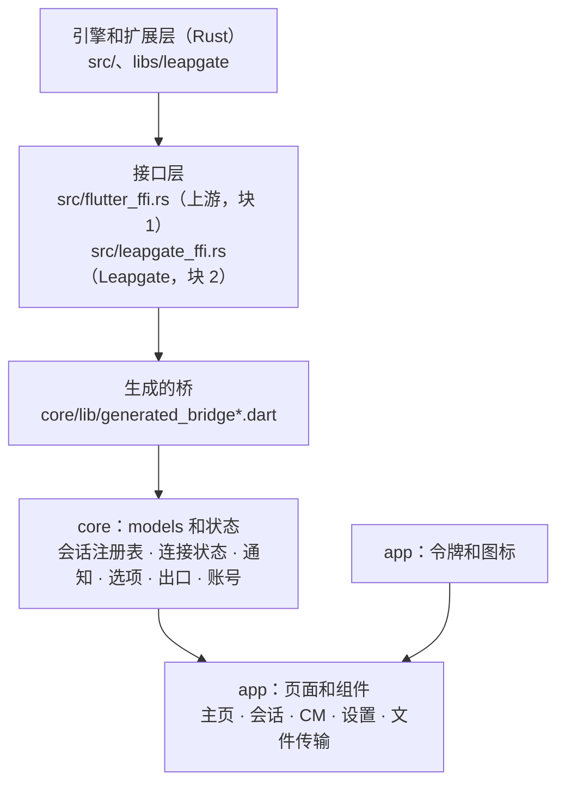
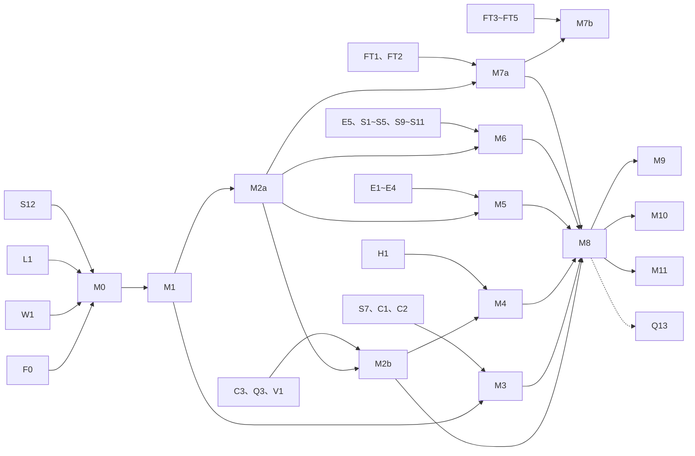

# 新界面：实施方案

2026-10-29 起草；2026-10-30 维护者逐条定了 §12 的 14 条待定问题（IQ1~IQ14），正文已按决定改。视觉设计：第一轮 2026-10-29 定稿冻结（AGENTS.md 2026-10-29）；第二轮维护者 2026-10-29 看过，没有大的意见，要求不在一处卡太久、先修小项并往下推进，界面真正用起来以后再慢慢调整（AGENTS.md 2026-10-28 第③条"样稿确认前不动 Flutter 代码"的关口由此放行，剩下的小项随下次改样稿时做）。说明和令牌：第一轮 `docs/新界面/01-内容与逻辑说明.md`，下称"01"；第二轮 `docs/新界面/02-第二轮内容与逻辑说明.md`，下称"02"；令牌和图标 `docs/新界面/样稿/A-基础.html`。这份方案写的是怎么把它做成能用的 Flutter 客户端：新工程放哪、怎么构建、models 怎么去界面化、组件库怎么落地、按什么顺序重写、Rust 要补哪些、新旧界面怎么并存和切换。

- 读者：维护者（重点看 §0.2、§5、§7 和 §12 的决定）；以后动手的 coder（重点看 §1、§3、§4、§6、§8）。
- 依据：五路读码盘点（models 和状态、FFI 和构建、要补的数据、Flutter 版本、上游合并和移动端），基线 leapgate-client main `c0858dd2d`，上游合并基点 `bd9262397`；`AGENTS.md`；`docs/architecture.md` §2.1、§3.3、§3.4、§3.10、§3.11、§5；两份界面说明和样稿。
- 引用代码写 `路径:行号`，路径相对 `client/`；总仓库的文件写 `scripts/...`、`docs/...`。说明里的章节写"01 §x""02 §x"，决定写"Qn"（01 §8）和"R2-Qn"（02 §6）。
- 凡是现有文档没定、要维护者取舍的，集中在 §12（IQ1~IQ14）。起草时正文按推荐写，标"（待定，见 IQn）"；2026-10-30 维护者逐条定了，IQ1 按修订后的推荐、IQ11 选了备选，其余按推荐，正文的标记改成"（IQn）"，和推荐不同的两条在正文里改了写法并注明。§7.1 最后一条、§7.3 第一条两处起草时的推荐不在 §12 里，维护者 2026-10-30 另外确认过，都按推荐定。规模数字是读码粗估，Rust 行数含单测。

## 要点

1. 新界面放在 `client/leapgate_ui/`，和上游 `flutter/` 同在 leapgate-client 仓库、互不引用，分 `core`（桥、models、会话和状态，包名沿用上游的 `flutter_hbb`）和 `app`（页面、组件、令牌、Windows 启动代码）两个 Dart 包（IQ2）。上游 `flutter/` 一行不改（architecture §3.3）。
2. models 去界面化只能"复制到新工程再改"：architecture §3.3 不许动上游 `flutter/`，而上游 models 反过来引用上游页面，没法原样复用。代价是上游 models 的修复从此要人工移植，为此给每个复制文件记下来源，合并上游后用脚本做三方合并（§3.8）。
3. Flutter 先用和上游界面同一套 3.44.9 SDK、同一份自编引擎，构建链不动；每个里程碑验收时用当时最新的 stable 把新界面编一次，提早发现新版本的问题（§8.8）；切换（M8）之后、且 3.50.x 出到 .2 以上时再升到当时的 stable（IQ1；2026-10-30 定时把起草时的"M0 试编一次"改成了每个里程碑都检查）。无障碍桥补丁（0001）升到哪个版本都还得带。
4. 动手顺序：工程骨架和三件前置（frb 第二个块 F0、Leapgate 专用窗口类名 W1、令牌和图标）→ core 第一批（会话注册表、连接状态、通知）→ 最小控制端（M2a）。M2a 做完，维护者就能用新界面便携版当控制端；之后主页和会话的其余部分、CM、账号和地址簿、出口页、设置、文件传输可以并行推进，CM 做完后新界面可以单独使用；第一、二轮做完（文件传输的暂停、重试、跳过除外）后切换成发布的界面（IQ5）。
5. Rust 要补的二十多项大多是 `src/leapgate_ffi.rs` 里的小导出，F0 打通后都能和界面并行；只有分段延迟（Q13）要改服务端和 proto，要先写契约，排在切换之后；文件传输的暂停、重试、跳过三项要先实测上游对端的行为。除 Q13 外不另写契约，以 §6.1 的表加 `client/LEAPGATE.md` 新开的"新界面"一节为依据（IQ13）。
6. 读码发现四处要重新定或补上：R2-Q8 的前提不成立，开源的服务端（leapgate-server 和原版 hbbs）对修改 ID 一律回"不支持"（IQ6）；HTTP 下沉后 TLS 回退还管什么（IQ7）；01 §4.6 漏列了 Q13 退路要的服务端转发（IQ9）；第一版的语言列表（IQ10）。另外 Q3 的实际挂钩数比定案时写的"一处"多（IQ14）。这五条 2026-10-30 都按推荐定了。
7. §12 的 14 条待定问题，维护者 2026-10-30 逐条定了：IQ1 按修订后的推荐（新界面在 3.44.9 上开发，每个里程碑验收时用最新 stable 检查一次），IQ11 选了备选（第四期统一验收里要看界面的几项，改在新界面做到 M6 之后在新界面上验；实际要 M3~M6 都做完，§8.5），其余 12 条按推荐。

---

## 0. 目的和范围

### 0.1 范围

| 本方案覆盖 | 说明 |
|---|---|
| Windows 桌面新界面 | 01 的 P1 主窗口、P2 远程会话、P3 CM；02 的 P6 设置（桌面）、P7 文件传输（桌面）；01 §3.1 区块 I 的出口页 |
| 和界面配套的 Rust 工作 | 两份说明里"要补的数据和行为"（01 §4.6、02 §4），以及读码新发现的几项（§6） |
| 构建、测试、过渡和切换 | §1.7、§7、§8 |
| 第三轮页面 | 端口转发管理、终端、摄像头查看、安装页（R2-Q1）只排位置（§5 M9），它们的说明和样稿还没写 |
| 移动端 | 手机 P4、P5 和 02 的手机部分只写以后怎么接（§9），排在桌面新界面之后（AGENTS.md 2026-10-28 第①条） |

不覆盖：macOS、Linux 桌面（architecture §3.11 第一阶段只做 Windows）；Web 客户端（architecture §4）。

### 0.2 和已定决策的关系

照办的：

| 已定 | 出处 | 本方案里 |
|---|---|---|
| 留 Flutter；单个 engine 的主窗口加应用内标签，会话暂不拖成独立窗口 | architecture §3.4；AGENTS.md 2026-10-28 第②条 | §1、§5 M2a |
| 上游 `flutter/` 原样不动，新界面放独立目录、有自己的工程文件和各平台启动代码，品牌改动在那里做 | architecture §3.3 | §1.1、§1.3、§1.5 |
| 动手前先做 models 去界面化，然后按块重写 | architecture §3.4 | §3、§5；页面里的 `bind.*` 分到各块收（IQ4）。§3.4 列的是要重写的块，不是先后；本方案把最小控制端排第一、CM 和其余块并行，是为了让新界面尽早能用、尽早能单独使用（§5.3） |
| 登录、地址簿、设备组的 HTTP 调用从 Dart 下沉到 `libs/leapgate` | architecture §5 | §6 H1 |
| flutter_rust_bridge 留 v1.80 | architecture §3.4 | §1.4 |
| 新的 FFI 函数只放 `src/leapgate_ffi.rs` | architecture §2.1、§3.3 | §1.4 F0 |
| Flutter 版本开工时定 | architecture §3.4 | §2 |
| 移动端只做控制端，Android 先、iOS 后，排在桌面新界面之后 | AGENTS.md 2026-10-28 第①条 | §9 |
| 不支持 Windows 7 | architecture §3.11 | 不需要兼容 UI 模式（02 §0.4 第 1 条） |
| 两份说明的 Q1~Q14、R2-Q1~R2-Q36 | 01 §8、02 §6 | 页面行为以说明为准；除 IQ6、IQ7、IQ9、IQ10、IQ14 外本方案不改。这几条维护者 2026-10-30 定了，已回写 01、02（IQ14 回写 01 §4.6 那一行和 Q3 里"连接就绪事件"的说法） |

和文档文字对不上、要说清的：

1. **R2-Q8 的前提不成立**。02 按"服务端不读 `old_id`、新 ID 按新设备注册"定了"保留修改 ID、对话框写明后果"。读码看，客户端改 ID 只走 TCP：在 TCP 上发 `RegisterPk{old_id,id,uuid}`（`src/ui_interface.rs:1502-1620`，`check_id` 用 `connect_tcp`，`:1568-1600`）。leapgate-server 的 TCP 路径对 `RegisterPk` 一律回 `NOT_SUPPORT`（`server/src/rendezvous_server.rs:1009-1017`），这一段是照原版 hbbs 写的，原版同样一律回 `NOT_SUPPORT`（`rustdesk-server@873230e:src/rendezvous_server.rs:596-597`）。客户端收到 `server_not_support`，本地 ID 不变。Leapgate 支持的服务端组合（leapgate-server，或原版 hbbs 加 rustdesk-api）里没有一个能改 ID，谈不上旧 ID 的去向，"按服务器类型区分"也没有意义。2026-10-30 定：去掉"修改 ID"入口，R2-Q8 由 IQ6 取代；动手前仍在 leapgate-server 和原版 hbbs 上各实测一次（§6.3，IQ6）。
2. **01 §4.6 漏列了 Q13 退路要的数据**。Q13（01 §8.3）定的退路是乙："两端每 5 分钟测一次到各中继，服务端把被控端那份转给控制端"，01 §4.2 据此写中继不支持回弹时"两段改显示第三期中继测速的最近结果"。01 §4.6 只列了回弹那一套，没列这两项：服务端把被控端到这台中继的最近往返和测得时间转给控制端；本机那段的测速结果在本机服务进程里（`libs/leapgate` 的路由状态），要交给界面进程。本方案把两项补进 Q13 的契约（§6.1 Q13 行）。2026-10-30 定：服务端那一项照退路乙做，写进 Q13 的契约，01 §4.6 补上这一行（IQ9）。
3. **Q3 的交付方式**。Q3 写"Rust 在连接就绪事件里多给一个路径字段和中继名"，定案时写的代价是"多一处 Rust 改动和一个新的导出"（01 §8.1 Q3）。连接就绪事件由 `FlutterHandler` 发（`src/flutter.rs:742-748`），要多给字段就得改上游 `InvokeUiSession::set_connection_type` 的签名和它的全部实现；而路径分散在 `src/client.rs` 的多个选路点，往 `LoginConfigHandler` 加字段要动约 8 处。本方案改成：路径记在 `libs/leapgate` 按会话索引的表里，尽量在已有挂钩里记，`src/client.rs` 新增目标不超过 3 处；界面收到就绪事件后调一个同步取值的导出（§6 Q3）。界面效果相同，但挂钩数比定案时写的"一处"多，请维护者确认。2026-10-30 维护者按这个做法定了，`src/client.rs` 新增超过 3 处时仍交维护者确认（IQ14）。
4. **"约 59 处弹窗"复现不了**（architecture §3.4）。逐处数过 `flutter/lib/models/model.dart`：35 处弹出加 7 处关闭，共 42 个调用点，另有 4 段内联界面（`:284-300`、`:534-555`、`:557-720`、`:1152-1180`）；其余 models 里还有约 60 处界面调用。工作量按这个数估。
5. **自编引擎去不掉**。architecture §3.4"怎么定"一段写新界面"去掉自编引擎和 SDK 补丁"；这一段 2026-10-28 已注明不再适用，这里只说明其中"去掉自编引擎"的设想做不到。两份引擎补丁里，0002（flutter#155685，多 engine 崩溃）单 engine 用不上；0001（无障碍桥释放后再访问，flutter#193588）和多窗口无关，引擎侧 2026-10-29 仍未修，新界面也要带（§2）。
6. **TLS 回退**。02 §1.5.2 保留"允许不安全的 TLS 回退"，说明里写它管"登录、地址簿等请求"。HTTP 下沉后这些请求改走 `libs/leapgate` 的严格客户端，这一项还要不要、管什么，要重新定。2026-10-30 定：账号、地址簿、设备组走 `libs/leapgate` 的严格客户端，不回退；这一项的说明改成只管剩下的上游请求，没有剩下的就去掉（IQ7）。读码看 WebSocket 的 wss 连接和 HTTPS 代理也读这一项（`libs/hbb_common/src/tls.rs:85`），它们不随 H1 消失，所以这一项会留下（02 §1.5.2）。
7. **语言列表**。02 §1.5.1 定了语言下拉是"跟随系统 + 各语言，顺序照上游按语言代码排"。按 IQ10（2026-10-30 按推荐定），第一版只做简体中文和英文，下拉只剩"跟随系统、简体中文、English"三项，系统语言是其他语言时回落英文。

---

## 1. 总体结构

### 1.1 目录

```
client/                        leapgate-client 仓库
├── flutter/                   上游界面，原样不动；过渡期继续构建（§7）
├── src/leapgate_ffi.rs        Leapgate 的全部新导出（frb 第二个块）
├── src/leapgate_bridge/       第二个块生成的 Rust 代码（不入库，目录自带 .gitignore）
├── libs/leapgate/             Leapgate 扩展层（Rust 逻辑都在这里）
└── leapgate_ui/               新界面（新增）
    ├── .gitignore             放开上游根 .gitignore 对 *png、*svg、*jpg 的忽略；忽略 build/、生成的桥、**/flutter/generated_plugin_registrant.*、**/flutter/generated_plugins.cmake
    ├── core/                  Dart 包 flutter_hbb：桥、models、会话和状态，不含页面
    │   ├── pubspec.yaml、pubspec.lock（入库）
    │   ├── lib/generated_bridge.dart 等      生成，不入库
    │   ├── lib/models/        从上游复制后去界面化的 models，含平台绑定 platform_model、native_model（文件头写上游来源，§3.8）
    │   ├── lib/common.dart    上游 common.dart 里被 models 用到的非界面部分
    │   ├── lib/native/、lib/utils/   上游同名目录里要用的几个文件（win32、custom_cursor、platform_channel）
    │   ├── lib/leapgate/      Leapgate 新写的状态层：会话注册表、连接状态、通知、选项、出口、账号
    │   └── test/
    ├── app/                   Dart 包 leapgate_ui：应用本身
    │   ├── pubspec.yaml、pubspec.lock（入库）
    │   ├── lib/main.dart      入口：主窗口；--cm（第三轮加安装页）
    │   ├── lib/theme/         令牌（ThemeExtension）
    │   ├── lib/icons/         由样稿转出的图标路径（生成，入库）
    │   ├── lib/widgets/       组件
    │   ├── lib/shell/         顶栏、应用内标签、窗口行为
    │   ├── lib/pages/         home/（设备、出口）、session/（远程桌面、文件传输）、cm/、settings/
    │   ├── lib/l10n/          界面文案（ARB，第一版只有简体中文和英文，IQ10）
    │   ├── lib/gallery_main.dart   调试入口：组件和页面状态画廊（§4.6）
    │   ├── assets/fonts/      Atkinson Hyperlegible Next 和许可证
    │   ├── windows/           Windows 启动代码（复制自 flutter/windows 后修改，§1.5）
    │   └── test/
    └── tools/gen_icons.dart   图标转换脚本（§4.2；样稿在总仓库，路径用参数传入）
```

为什么分两个包（IQ2）：

- 依赖方向由编译器保证：`core` 引不到 `app` 的任何页面，models 不会再长出弹窗；不用另写检查脚本。
- `core` 的单测可以单独跑（`flutter test` 在 `core/` 里）。
- `core` 沿用上游包名 `flutter_hbb`、上游的目录结构（`lib/models/…`、`lib/common.dart`），复制过来的文件 `import 'package:flutter_hbb/…'` 一行不用改。上游 `flutter/lib` 有 92 个文件用这个包名导入（`bd9262397`；其中 `models/` 19 个，要复制进 `core` 的 models、`common.dart`、`native`、`utils` 共 26 个），`model.dart` 一个文件就有 24 行；改名的话，每次三方合并这些导入行都会冲突（§3.8）。代价是同一仓库里有两个叫 `flutter_hbb` 的包（上游 `flutter/` 和 `leapgate_ui/core/`），它们不在同一个 pub 工程里，不冲突，但 grep 时两份会一起出来，容易改错到上游那份。为此定一条评审规则：新界面的分支合入前，`git diff main -- flutter/` 必须为空（§7.3 那次还原除外）。这条写进 `client/LEAPGATE.md` 的"新界面"一节，派 coder 时写进 prompt，不另写检查脚本。
- `core` 做不到完全不依赖 Flutter：`ImageModel` 用 `dart:ui`，`InputModel` 用手势和按键事件类型，纹理 model 依赖两个纹理插件。所以它是 Flutter 包，不是纯 Dart 包；目的只是守住"状态层不碰页面"这条边界。

放在 `client/` 下而不是单独仓库：FFI 签名（`src/leapgate_ffi.rs`）和用它的 Dart 在同一个提交里改；Rust 产物的相对路径照用；上游没有这个目录，合并上游时永远不冲突。

`.gitignore` 的坑：上游根 `.gitignore:13-21` 会忽略 `*png`、`*svg`、`*jpg`、`*exe`、`**pdb`（已用 `git check-ignore` 验证），新目录自带的 `.gitignore` 用 `!*.png`、`!*.svg` 等放开，不改上游的 `.gitignore`。上游界面里 Windows 生成文件的忽略规则在 `flutter/.gitignore:48-51` 和 `flutter/windows/.gitignore`（`flutter/ephemeral/`），对 `leapgate_ui/` 不起作用，所以新目录的 `.gitignore` 要自己带上插件注册文件那两条，复制 `flutter/windows/` 时连同它的 `.gitignore` 一起复制（§1.5）。

### 1.2 分层



- 依赖只往下走：页面只调 `core`，不直接调 `bind.*`（过渡做法见 §3.6）；`core` 只调桥，不弹任何界面；所有界面元素由 `app` 根据 `core` 的状态决定怎么显示。
- 业务逻辑尽量放进 `libs/leapgate`（architecture §3.4"界面做薄"），Dart 侧的 `core` 只留视图状态。

### 1.3 和上游 `flutter/` 的关系

- 新工程不 import 上游 `flutter/` 的任何 Dart 文件，也不 path 依赖上游的 `flutter_hbb` 包。理由：上游 models 反过来引用上游页面（`server_model.dart` 引 `server_page.dart`，`chat_model.dart` 引手机 `home_page.dart`，`shortcut_model.dart` 引 `remote_toolbar.dart`），弹窗是写死的函数调用，`dialogManager` 是 `late final`，要复用就得在上游加一百来处挂钩。
- 从上游复制的东西有三类：models 和 `common.dart` 的一部分（§3）、Windows 启动代码（§1.5）、以后的 Android 工程（§9）。复制件不会产生 git 冲突，上游的修复只能靠合并时的核对清单带过来（§3.8）。
- 不 `git mv` 上游文件，只复制。
- 两个界面共用的：同一个 `libleapgate.dll`（同一份 Rust 核心、同一份块 1 和块 2 的 Rust 侧桥代码）；同样的两个纹理插件和 `window_manager` 分叉（同一个 git ref）；`res/` 下的资源。

### 1.4 Rust 绑定层

现状：codegen 的输入只有 `src/flutter_ffi.rs`（`scripts/windows/build-client.ps1:72-76`），`src/leapgate_ffi.rs` 只有 4 行文件头，`src/lib.rs:44` 已经声明了 `mod leapgate_ffi`。第四期的界面没有新导出，借的是 `main_get_common` 开头的挂钩（`src/flutter_ffi.rs:2697-2700`）。

**F0：frb 第二个块**

- 块 1 `src/flutter_ffi.rs`（上游，不改），块 2 `src/leapgate_ffi.rs`（Leapgate）。frb 1.80.1 支持多块（codegen 源码 `raw_opts.rs:12-49`、`opts_parser.rs:24-176`），`--rust-input`、`--dart-output`、`--rust-output`、`--class-name` 都要一一对应，类名不能重复；加 `--skip-add-mod-to-lib`，不让它改 `src/lib.rs`。
- 块 2 的 Rust 输出放 `src/leapgate_bridge/`，由 `src/leapgate_ffi.rs` 用 `#[path]` 声明；目录自带 `.gitignore`，不改上游的 `src/lib.rs` 和 `.gitignore`。
- 新界面的两份 Dart 输出都写进 `core/lib/`。frb 从 `--dart-output` 往上找 pubspec 定工程根（`opts_parser.rs:344`），ffigen 和 build_runner 都在 `core/` 里跑，所以 `core/pubspec.yaml` 要带 `ffigen ^8.0.2`、`freezed`、`build_runner`、`freezed_annotation`、`uuid`（3.44.9 下解析成 8.0.2、2.5.2、2.4.13、2.4.4、3.0.7）。
- 上游界面也按两块生成：Rust 侧只有一份，两个界面必须用同一种形态生成，否则 `libleapgate.dll` 和 Dart 对不上。块 2 的 Dart 落在上游界面的构建 worktree 里，旧界面不用，也不提交。
- 试验要确认的（0.5~1 天）：两块共用的类型（`SessionID`、`EventToUI`）生成得对不对；`wire_` 符号会不会撞名；块 1 生成的 Dart 和单块时是否一致，上游界面照常能编；`StreamSink` 在块 2 里能用。
- 试验不通时的退路是第四期的做法：在 `flutter_ffi.rs` 的几个 `*_common` 函数开头加挂钩，用字符串键加 JSON。这会在上游文件里多几行挂钩、没有类型检查，和"新 FFI 只放 `leapgate_ffi.rs`"不完全相符，到时先请维护者同意。

**新导出的写法**

- `leapgate_ffi.rs` 里的函数只做转发，逻辑在 `libs/leapgate`。frb v1 只解析输入文件本身的 `pub fn`，所以导出必须直接写在这个文件里；按领域分段追加（会话、出口、设置、文件传输、账号），减少并行分支在这里的冲突。
- 同步取值用 `SyncReturn`；Leapgate 自己产生的事件（例如出口隧道状态）用块 2 的 `StreamSink`，不往上游的 `InvokeUiSession` 加方法。
- 生成的文件都不入库（上游的已在 `.gitignore:22-23`、`flutter/.gitignore:44-45,52`），每次构建重新生成。上游删函数或改签名，新界面编译直接报错；上游加的新会话事件不会报错，见 §3.3 第 8 条。

### 1.5 Windows 启动代码

把 `flutter/windows/` 复制到 `app/windows/`（约 1,100 行定制代码），连同它的 `.gitignore`（含 `flutter/ephemeral/`），文件头写上游来源。

保留：

- `runner/main.cpp:26-81` 加载 `libleapgate.dll`、处理安装相关参数；`:97-116` 多实例检查和链接转发；`:150` 把参数交给 Dart。
- `runner/flutter_window.cpp:107-146` bumpMouse 通道；`:24-83`、`:194-235` FancyZones 白窗补救（flutter#159630 仍 open）。
- `runner/win32_window.cpp` 的任务栏隐藏和 `SET_FOREGROUND_WINDOW` 处理（Rust 侧在 `src/common.rs:875` 设置）。
- `CMakeLists.txt:31-42` 的 `/MD → /MT`；`:103-108` 拷贝并改名成 `libleapgate.dll`，路径改成从 `app/windows/` 算起的 `../../../target`。
- `Runner.rc` 的版本资源和图标：品牌上还没定的几项（版本资源里的署名等）照第二期当时的取值抄过来，定了再改。

修改：

- 窗口类名改成 Leapgate 专用（W1，IQ3）。
- 窗口尺寸：首次启动的默认尺寸取 1280×800 和"当前显示器工作区 × 0.9"中较小的那个，居中；最小尺寸取 960×600 和工作区中较小的那个（01 §7.1 的 1280×800、960×600；上游默认 800×600）。都是逻辑像素：1920×1080 开 150% 缩放时工作区约 1280×672，1366×768 开 100% 时高度也放不下 800，1920×1080 开 200% 时连 960×600 都比工作区大。工作区比最小尺寸还小时，左栏照 01 §2.1 整栏纵向滚动。
- 去掉 `desktop_multi_window` 的回调（`flutter_window.cpp:3`、`:148-156`）。
- 升 Flutter 时加 `ImpellerSwitch` 退路（§2.3）。

**W1：窗口标题跟着标签以后怎么找主窗口**（IQ3）

01 §2.1 要求系统窗口标题跟着当前标签（主页"Leapgate"，会话"‹设备名› - Leapgate"）。现在找主窗口靠"类名 + 精确标题"：`FindWindowW(FLUTTER_RUNNER_WIN32_WINDOW, "Leapgate")`（`flutter/windows/runner/main.cpp:93`；`src/platform/windows.rs:2799-2832` 的 `send_message_to_hnwd`，类名常量在 `src/platform/windows.rs:120`）。标题一变，下面这些都会找不到主窗口、另起一个实例：

- 再次启动程序（单实例检查，`main.cpp:93`）；
- 托盘"打开"（`run_me([])`，`src/tray.rs:108`、`:119`、`:125`；它是再启动一次本程序，走的也是上一条的单实例检查）；
- `leapgate://` 链接、`--connect`、`--switch_uuid` 等（`src/core_main.rs:759-823`，发 `WM_USER+2`，`:817-821`）。

做法（2026-10-30 按推荐定，IQ3）：

- 新 runner 用 Leapgate 专用的窗口类名，只按类名找（单实例检查在各自的 runner 里，新旧界面互不影响）。
- `src/core_main.rs:817` 那处改调 `src/leapgate_hooks.rs` 里的查找函数。这一步在 runner 自己找窗口之前执行（`main.cpp:54` 先调 `rustdesk_core_main_args`，`:93` 才 `FindWindowW`），而两个界面的 exe 共用同一份 Rust 代码，所以查找函数必须知道自己跑在哪个界面里，否则"先找新类名、找不到再找旧的"会把新界面的 `--connect` 交给旧主窗口，反过来也一样。做法：新 runner 在调 `rustdesk_core_main_args` 之前设一个进程环境变量（`SetEnvironmentVariableW(L"LEAPGATE_UI", L"next")`）；查找函数看到它就只按新类名找，看不到（旧界面）就照上游按"旧类名 + 标题"找，不交叉回退。每个新界面进程都经过新 runner，变量每次重新设，不依赖子进程继承。（实施时补：runner 在 `rustdesk_core_main_args` 返回后马上清掉这个变量，免得从新界面起的浏览器、资源管理器等后代进程继承它，再从那里起旧界面时误判，见 `client/LEAPGATE.md` §10.4。）
- 原版 RustDesk 用的是同一个旧类名，只按旧类名找会找到原版的窗口，新界面换类名也顺带消除这个隐患。
- 动手前先 grep `FLUTTER_RUNNER_WIN32_WINDOW_CLASS` 的全部用处，一并处理。旧界面停止构建后，查找函数里旧类名那一支删掉（§7.3）。

### 1.6 插件和依赖

Windows 上实际编进来的插件 11 个（构建 worktree 里 `flutter pub get` 生成的 `flutter/windows/flutter/generated_plugins.cmake`，不入库）。新工程第一版：

| 包 | 处理 | 理由 |
|---|---|---|
| flutter_rust_bridge 1.80.1 | 保留（core） | architecture §3.4 |
| texture_rgba_renderer、flutter_gpu_texture_renderer | 保留（core），和上游界面同一个分叉 ref（`42797e0`、`08a471b`） | Rust 按 dll 文件名和 C 符号加载它们（`src/flutter.rs:60`、`:75`、`:81`、`:283-297`），加载失败只写日志（`:332-359`）；换实现或改名，表现是没画面或退回软件上屏 |
| flutter_custom_cursor | 保留（core），同分叉 | 远程光标 |
| window_manager | 保留（app），沿用分叉 `cf4aef0` | 自绘标题栏、全屏、隐藏到托盘、CM 贴边；分叉和当前 3.44.9、纹理插件的组合已经跑过。pub 上游是 0.5.2（2026-07-04），升 Flutter 时再评估换不换 |
| uni_links、uni_links_desktop `^0.1.6`（锁文件解析为 0.1.7） | 保留（app） | 和 Rust 的 `WM_USER+2` 消息协议绑定（`src/core_main.rs:817-821`） |
| get、provider | 保留（core） | 和上游写法一致（§3.3） |
| window_size | 不带，改用 window_manager 已依赖的 screen_retriever | 只用来取显示器列表 |
| desktop_multi_window | 不带 | 单 engine 不需要；上游 18 个 Dart 文件、71 处引用它 |
| sqflite、contextmenu、url_launcher_ios | 不带 | `lib/` 里没有引用 |
| google_fonts | 不带 | 运行时联网取字体；字体打包进去（§4.3） |
| desktop_drop、url_launcher、file_picker 等 | 用到时再加（P7 拖放、关于页链接） | — |

约束：frb 的 Dart 包 1.80.1 把 `uuid` 钉在 `^3.0.6`，还依赖 `js ^0.6.4`，新工程选第三方包时不能选和它们冲突的版本。两个工程的 `pubspec.lock` 都入库（新工程是 Leapgate 自己的，不需要像上游界面那样另存一份钉住的锁文件再覆盖）。

### 1.7 构建

`build.py` 把 `flutter/` 目录写死了（`build.py:25-35`、`:975-977`、`:288-294`），而且是上游文件，不改它。在 `scripts/windows/build-client.ps1` 上加一个参数 `-Ui upstream|leapgate`（默认 `upstream`，切换时改默认，§7.2）。vcpkg、路径前缀清理（`--remap-path-prefix`、`/d1trimfile`）、自编引擎核对这几步两个界面完全一样，放在同一个脚本里只维护一份。

`-Ui leapgate` 的步骤：

1. `vcpkg`：不变。
2. `bridge`：按两块生成（§1.4），Dart 输出到 `leapgate_ui/core/lib/`；过期判断看两个 ffi 文件的修改时间（现在只看 `flutter_ffi.rs`，`build-client.ps1:65-69`）。先在 `core/` 里 `flutter pub get`。
3. `build`：
   - 特性列表用 `python build.py --print-features …` 取（`build.py:149`、`:1009-1016`，这个参数本来就是给调用方用的），保证和上游界面用同一组 cargo 特性；
   - `cargo build --lib --release`，沿用现有的路径前缀清理变量；
   - 编虚拟显示的 dylib（`build.py:1038-1041` 的做法）；
   - 核对 SDK 缓存里的引擎是自编版（`Assert-LeapgateEngine`，和现在一样）；
   - 在 `leapgate_ui/app/` 里 `flutter build windows --release --build-name <libs/leapgate 的版本>`（R2-Q32：产品版本沿用 `libs/leapgate/Cargo.toml:3` 的版本号，Windows 版本资源由 `--build-name` 写入）；
   - 拷 `dylib_virtual_display.dll`（上游是 `build.py:978-979` 在 `flutter build` 之后拷的，不经过 CMake）；
   - 产物核对：`leapgate.exe`、`libleapgate.dll`、`flutter_windows.dll`、两个纹理插件 dll 都在。
4. 不跑 `patch` 步骤（新工程的源码不需要打补丁）。锁文件漂移检查：`pub get` 之后 `git diff --exit-code pubspec.lock`。
5. 产物在 `leapgate_ui/app/build/windows/x64/runner/Release/`；便携打包照第二期的做法调 `libs/portable/generate.py`（现在 `build.py:982-997` 里那几行是给上游界面用的）。

### 1.8 动态库名和资源

- crate 仍叫 `librustdesk`（`Cargo.toml:12`），改名只发生在拷贝这一步。新工程要照搬三处：CMake 的 RENAME（`flutter/windows/CMakeLists.txt:103-108`）、`main.cpp:26` 的 `LoadLibraryA("libleapgate.dll")`、`flutter/lib/models/native_model.dart:145` 的 `DynamicLibrary.open`。另外两处品牌值也随启动代码带过来：`CMakeLists.txt:7` 的 `BINARY_NAME "leapgate"`、`runner/main.cpp:83` 的默认 `app_name = L"Leapgate"`（取不到 Rust 的应用名时用它，W1 改类名后不再参与找窗口）。
- 字体、图标见 §4.2、§4.3。

---

## 2. Flutter 版本

### 2.1 现状（查证日期 2026-10-29）

| 事实 | 出处 |
|---|---|
| stable 是 3.47.8（2026-10-23，Dart 3.13.7）；beta 是 3.50.0-0.2.pre，3.50 排在 2026 年 11 月出 stable。现用的 3.44.9 是 2026-08-06 发布的 | 发布清单 https://storage.googleapis.com/flutter_infra_release/releases/releases_windows.json ；排期 https://docs.flutter.dev/install/archive |
| Windows 从 3.47 起默认 Impeller；退回 Skia 只能在 runner 的 `main.cpp` 里写 `set_impeller_switch(ImpellerSwitch::Disabled)`，release 下 `--no-enable-impeller` 不起作用；官方写明这条退路以后会删 | https://docs.flutter.dev/perf/impeller ；https://github.com/flutter/flutter/issues/190910 |
| D3D11 外部纹理崩溃 #190774（P1）的修复经 cherry-pick（PR #191222）进了 3.47.2 及以后 | https://github.com/flutter/flutter/issues/190774 ；3.47.8 的 CHANGELOG |
| 3.47.6 修了 Windows 生产应用卡死（#192513），3.47.4 修了智能应用控制拦截二进制时的崩溃（#191899）；3.47.8 的 CHANGELOG 最新一节是 3.47.7 | https://github.com/flutter/flutter/blob/3.47.8/CHANGELOG.md ；https://github.com/flutter/flutter/issues/192513 |
| #191468（DXGI 共享句柄外部纹理崩溃，正是 Leapgate D3D11 零拷贝的场景）2026-09-03 关闭，报告者只在 main 上确认过，stable 上没人验证 | https://github.com/flutter/flutter/issues/191468 |
| 官方多窗口 API 在 3.47.8、3.50 beta 里仍只对 master 开放 | https://flutter.dev/blog/desktop-windowing-apis ；`flutter/flutter@3.50.0-0.2.pre:packages/flutter_tools/lib/src/features.dart` |
| flutter#155685（多 engine 崩溃，补丁 0002 绕的那个）仍 open；新界面只有一个 engine，碰不到 | https://github.com/flutter/flutter/issues/155685 |
| flutter#193588（无障碍桥释放后再访问，补丁 0001 修的那个）引擎侧仍 open；框架侧的触发源修复 PR #193372 2026-10-19 进了 master，不在 3.47.8，也不在 3.50 beta | https://github.com/flutter/flutter/issues/193588 ；https://github.com/flutter/flutter/pull/193372 |
| frb 1.80.1 的 Dart 约束 `>=3.0.0 <4.0.0`，覆盖 3.13、3.14；`dart:ffi` 在 3.13、3.14 没有破坏性变更；"frb 1.80.1 + Flutter 3.47"没人构建过（上游 x64 仍是 3.24.5，arm64 是 3.44.9） | https://pub.dev/packages/flutter_rust_bridge/versions ；https://github.com/dart-lang/sdk/blob/3.13.7/CHANGELOG.md ；https://github.com/rustdesk/rustdesk/blob/master/.github/workflows/flutter-build.yml |

### 2.2 定下的做法（IQ1）

**新界面在 3.44.9 上开发，和上游界面共用同一套 SDK 和同一份自编引擎（两份补丁都在），构建链不动。每个里程碑验收时，用当时最新的 stable 把新界面编一次（§8.8），发现问题当场在 3.44.9 上改成两个版本都能用的写法。切换（M8）之后、且 3.50.x 出到 .2 以上时（取较晚的那个），作为单独一步升到当时的 stable（M10），只带 0001、不带 0002。**

（2026-10-30 维护者定 IQ1 时改。起草时的推荐是"M0 用当时的 stable 另试编一次，只为提早发现问题"，结果记进 §2.1，SDK 用完删掉。维护者接受先用 3.44.9 的条件是升到 3.47.8 或 3.50 时不出问题，这一点不能完全保证，所以把只做一次的试编改成每个里程碑都检查，原因的细节见 §12 IQ1。）

理由：

1. 构建链不动（§8.8 的检查只给 `build-client.ps1` 加一个参数）：`scripts/windows/env.ps1:9-30`、`:40`，`build-engine.ps1:51`、`:55`，`setup-toolchain.ps1:87-96` 现在都是单版本写法。新界面开工就换版本，等于同时引入补丁重对、Impeller 回归和脚本多版本三件事。
2. 开发期（M0~M8）不为过渡期加一套长期机制：新旧界面如果各用一个版本，就要两套 SDK、两份自编引擎（每份引擎检出几十 GB）并存，脚本改成按工程选版本，而这只为了一个终将停用的旧界面。
3. 只升一次：新界面要写几个月，等它能替代旧界面时，3.50 已经出了几个修订版。现在上 3.47、到时再升 3.50 是两次；等到切换后直接上当时的 stable 是一次。
4. 新界面的 Dart 代码和渲染器无关；对 Impeller 敏感的是纹理插件和 D3D11 上屏，那是升级那一步要回归的东西，早升晚升都要测一遍。
5. 升级不挂在 M9 上：M9 要等第三轮的说明和样稿，现在一份都没有，挂在它后面 M10 就没有日期；而官方写明 Skia 退路以后会删，升得越晚，越可能碰上"只能上 Impeller、没有退路"，渲染回归全压到最后。每个里程碑的最新 stable 检查（§8.8）把最可能先出问题的两处（依赖解析、Impeller 下的 D3D11 零拷贝）在整个开发期一直看着，不留到 M10 才第一次碰上。

检查用的官方 SDK 装在单独目录，只用于这项检查，不算第二套构建链：新旧界面的正式构建仍只用 3.44.9 和自编引擎，构建脚本最多加一个参数（§8.8）。

代价：每个里程碑验收多一项检查，检查用的 SDK 另占几 GB 磁盘；新界面开发期和第一次发布都在 Skia 上；3.44 不会再有修订版；升级那一步要重新适配 0001（`accessibility_bridge.cc` 在 master 上还有 3.44.9 没带的提交，例如 `0541913d86`，2026-05-14），并做一轮 Impeller 回归；M10 在 M9 之前做的话，M8 到 M9 之间旧界面便携版仍用 3.44.9 编：3.44.9 的 SDK 和引擎留在原处，`env.ps1`、`build-engine.ps1` 的版本在 M10 改成参数（§2.3 第 2 步本来就要改），合并上游后要跑端口转发冒烟时才用它重编旧界面，M9 之后删掉。

没选的备选（从 3.47.8 起步、两套 SDK 并存；两个界面一起升 3.47.8；等 3.50.x；M10 等到 M9 之后）见 §12 IQ1。

### 2.3 升级那一步（§5 M10）

1. 选当时最新的 stable 修订版（届时多半是 3.50.x），确认 #193588、#191468 的状态。
2. 在新版引擎上重新适配 0001，跑它自带的单测；不带 0002。`build-engine.ps1` 的版本改成参数。
3. runner 里加 `ImpellerSwitch` 的退路，默认开 Impeller。
4. 回归：开 Impeller 跑一次 D3D11 零拷贝硬解上屏（4K、频繁重建采集，即 2026-10-26 控制端崩溃的场景），同场景关 Impeller 再跑一次作对照；开着讲述人开关一次会话标签和对话框；新界面冒烟清单全过（§8.5）。渲染器换了，发布前把 §8.7 第 2 段的压力项和切换前那次一样再跑一遍。
5. frb 1.80.1 在新版本下 `pub get` 和生成一次桥（依赖解析是最可能先出问题的地方；开发期各里程碑的检查已经做过，这一步在正式构建链上再确认一次）。

---

## 3. models 去界面化

### 3.1 做法：复制到 `core` 再改

| 做法 | 结果 |
|---|---|
| 在上游 `flutter/lib/models` 里直接改 | 违反 architecture §3.3；`model.dart` 2026-03-15 以来被上游改了 20 次，要改四十多处，每次合并都冲突 |
| 抽成独立包，新旧界面都引用 | 旧界面引用它就得改上游的 pubspec 和 import，同样违反 §3.3 |
| 新界面 path 依赖上游 `flutter_hbb`，直接复用 | 做不成（§1.3） |
| **复制到新工程再改** | 满足 §3.3，合并上游时 Dart 侧零冲突；代价是上游 models 的修复要人工移植 |

只有最后一种可行。移植的量：1.4.9 → 1.5.0 一个版本，`flutter/lib/models` 就变了 +2,446/-185 行，其中 `model.dart` 561 行；1.4.9 → 1.5.0 碰 models 的提交 26 个，大半是光标、输入、终端、文件传输的修复。§3.8 是为此准备的同步办法。

### 3.2 范围

| 档 | 文件 | 做法 |
|---|---|---|
| 原样复制 | `models/peer_model.dart`、`models/printer_model.dart`、`models/cm_file_model.dart`、`models/platform_model.dart`、`models/native_model.dart`、`models/desktop_render_texture.dart`、`native/custom_cursor.dart`、`native/win32.dart`、`utils/platform_channel.dart` | 只去掉 Web 的条件导入 |
| 只删界面调用 | `models/input_model.dart`、`models/relative_mouse_model.dart`、`models/input_modifier_utils.dart`、`models/local_flutter_shortcuts.dart`；`models/model.dart` 里的 `ImageModel`、`CanvasModel`、`CursorModel`、`QualityMonitorModel`、`RecordingModel`、`PeerInfo`；`models/file_model.dart` 的任务和目录逻辑 | 弹窗、轻提示改调 §3.3 的接口；碰窗口的地方改调窗口接口；其余不动 |
| 改写 | `model.dart` 的 `FfiModel` 消息处理（`:331-482`、`:888-976`、`:1002-1030`、`:1064-1103`、`:1124`）和会话对象 `FFI`（`:4030` 起）；`server_model.dart` 的 CM 部分；`chat_model.dart` 只留消息存储；`shortcut_model.dart`；`state_model.dart`；`peer_tab_model.dart`（`:33`、`:134` 用了 `IconData`）；`common.dart` 里被 models 用到的非界面部分 | 按 §3.3 的机制重写 |
| 重写到 Rust | `ab_model.dart`、`group_model.dart`、`user_model.dart`，`utils/http_service.dart` | §6 H1；Dart 侧只留视图状态 |
| 不要 | `web_*`、`flutter/lib/web/`、`utils/multi_window_manager.dart`、标签拖成窗口用的缓存会话数据（`model.dart:4236-4262`）、`server_model.dart` 的 Android 被控端部分、第四期 F7 的 `flutter/lib/leapgate/*.dart`（由出口页取代，§7.4）、会话结束时询问备注（`model.dart:1259-1320` 的 `conn/active` 查询、`common/widgets/dialog.dart:1561-1680` 的结束备注对话框和 `PUT /api/audit`，01 §5.5 已去掉） | 会话中的"备注"照 01 §3.2 区块 B 保留，走 Rust 的审计上报，随 M2b 做 |
| 以后再复制 | `terminal_*`（第三轮）；手机专用的部分（`VirtualMouseMode` `model.dart:1851`、`CanvasModel` 的手机分支、`input_model` 的触控、`common/widgets/remote_input.dart`、`gestures.dart`、`mobile/widgets/floating_mouse*`，移动端阶段） | — |

复制件里能不删的就不删：`isWeb`（models 里 62 处）、手机分支保留原样，只删必须删的界面调用。删得越少，和上游原件的差异越小，三方合并越少冲突（§3.8）。

### 3.3 新增的几样机制

1. **会话注册表**（`core/lib/leapgate/session_registry.dart`）
   - 会话的创建和关闭从页面挪到这里。上游由页面负责：`desktop/pages/remote_page.dart:151` 创建 `FFI`、`:159` `Get.put`、`:180` `start`、`:690` `close`；文件、端口转发、摄像头、终端页同样如此。手机上游直接复用全局的 `gFFI` 当唯一会话（`mobile/pages/remote_page.dart:124`）。
   - 一台设备一个标签，标签里可以有远程桌面、文件传输（第三轮加终端、摄像头）几个视图，每个视图一个会话（Q1）。打开其他视图时复用连接令牌（`common/widgets/toolbar.dart:580-610`）。
   - 桌面可以同时开多个；手机最多一个（Q8）。
   - 按设备 ID 记的共享状态改成按会话记（Q1"实现时要做"：`desktop/pages/remote_tab_page.dart:67`、`:382` 和 `leapgate/exit_tunnel.dart:30-31` 在同一个设备 ID 上各自初始化、删除连接类型状态，同一个 engine 里会互相删掉）。不复制 `common/shared_state.dart` 那种按 tag `Get.put` 的全局注册，改成挂在会话对象上的字段。
   - 标签可见性（V1）：引擎每收到一次外部纹理的新帧都会安排一帧只重绘、不重建的帧（`flutter/flutter@3.44.9:engine/src/flutter/shell/common/shell.cc` 的 `Shell::OnPlatformViewMarkTextureFrameAvailable`）。上游每个会话一个窗口一个 engine，这份开销只在那个窗口里；单 engine 下，只要有会话在推流，哪怕停在主页标签，整个主窗口也按推流帧率重新合成，软件上屏时还给看不见的会话每帧拷一次像素。所以注册表在标签切走时经块 2 的 `leapgate_session_set_visible(session_id, false)` 告诉 Rust 停止往纹理推帧（照常收流、解码），切回时设回 `true` 并调上游已有的 `session_refresh` 要一帧刷新（§6.1 V1）。
2. **全局 model 只建一份**
   - 上游每个 `FFI` 实例都新建一整套"全局" model（`model.dart:4068-4097`）。其中 `ServerModel` 构造时无条件起一个 500 ms 的定时器（`server_model.dart:187`），`AbModel` 在 `desktopType == main` 时起同步定时器（`ab_model.dart:86-95`），`FFI.close()` 都不清。单 engine 下 `desktopType` 恒为 main，不拆的话每开一个会话标签就多一组永不停止的定时器。
   - 新的会话对象只带会话自己的 model（画面、光标、输入、画布、质量、录制、文件、聊天）；服务、账号、地址簿、设备组、设备列表、分类这些全局只建一份，由应用持有，定时器随它们的生命周期开关。
3. **连接状态**（每个会话一个）
   - 字段：阶段（01 §4.1 的 1~8）、要用户输入什么（密码、2FA、系统账号、选 Windows 会话、不安全连接确认）、原因码和参数（§6 C3）、能否重试、自动重试的倒计时、"对方正在重启"、最后一帧变暗。
   - 代替 `handleMsgBox`（`model.dart:888-976`）那串模态框和 `reconnect` 里的弹窗（`:1124`）。上游重连函数的签名本身带着 `OverlayDialogManager`（`:54`），一并改掉。
4. **会话通知和全局轻提示**
   - 会话通知是一个列表，挂在会话上，后来的不冲掉前面的（01 §4.5）；截图、打印、提权、隐私模式、Rust 推来的提示（`model.dart:1038-1053`）、显示器拔出（`:1694`）都进这里。
   - 全局轻提示一种，合并上游的两套（`common.dart:1023`、`model.dart:1032`）。
5. **提问接口**（返回 `Future`）
   - 给流程中途要等用户回答的地方用：文件覆盖确认（`file_model.dart:178`，整段对话框在 `:217-290`）、删除确认（`:779`、`:814`，对话框在 `:858-920`），重命名（`:952-1015`）。
   - 保留上游原来的 `await` 控制流，以后移植上游 diff 时还能大致对上。
   - 由 `app` 按作用域实现：会话里的提问只遮那个会话标签，主页的只遮主页（01 §4.5）。
6. **窗口接口**
   - models 里碰窗口的 16 处（`input_model.dart:1953-1954` 的 `rustDeskWinManager`/`WindowController`、`relative_mouse_model.dart:779`、`state_model.dart:109` 等）改调一个注入的接口：全屏、最小化、聚焦、窗口标题、光标限制区域。按"我是哪个窗口"分支的 `desktopType`（11 处）、`kWindowId`（8 处）在单 engine 下没有意义，按主窗口处理。
   - `app` 用 `window_manager` 实现它；手机上是空实现。
7. **选项 model**
   - Config、LocalConfig、每台设备的选项统一读写、变更通知、写入返回成败（§6 S9）；能力和环境标志（安装版、便携版、服务在不在跑等）也放这里。
   - 页面层的 `bind.*` 调用主要收进它和"会话选项"两处（§3.6）。
8. **事件分发的兜底**
   - 上游 `model.dart:331` 起约 50 个事件名靠 if/else 分发，最后的 else（`:478-480`）只 `debugPrint`，不写进日志文件，也不去重。上游加了新事件、新界面没处理时，功能悄悄不生效。新的分发把这个兜底改成写进日志（经 §6.1 L1），每个名字只打一次，合并上游后看日志就能发现。

状态管理沿用上游的 ChangeNotifier 加 GetX `Rx`，页面用 `ListenableBuilder`、`Obx` 消费。不换 Riverpod 一类：和上游写法一致，移植 diff 时几乎能逐行对上。

### 3.4 必须保留的上游行为

这些写在弹窗函数里，改成状态机时容易被当成界面代码删掉。每条都要有 §3.7 的回放测试。

| 行为 | 位置 |
|---|---|
| 网络中断后重连，间隔从 1 秒起每次翻倍、没有上限 | `model.dart:123`、`:1093-1102`（`_reconnects *= 2` 在 `:1098`） |
| 本次会话连上过、之后对方报"不在线"的，30 秒内自动重试；第一次连就不在线的不重试 | `model.dart:1002-1030` |
| 远程设备重启后静默重连（新界面另加"正在重启"面板和最后一帧变暗，01 §4.1 第 7 行） | `model.dart:929-948` |
| 连上后 1.5 秒还没画面，给对方发一个空的系统登录密码唤醒锁屏 | `model.dart:1201-1205` |
| 不安全连接确认时 Rust 在等用户选；回车等于断开 | `src/client/io_loop.rs:220-222`（`client::confirm_insecure_connection`）；01 §5.9 |
| 选"改用中继"写进这台设备的配置，以后都走中继 | `src/ui_session_interface.rs:1329-1336` |
| 能不能自动重试沿用 Rust 的判断规则，新界面不改规则 | `src/client.rs:5192-5210` 的 `check_if_retry` |
| 从远程桌面打开其他视图复用连接令牌，不再输密码 | `common/widgets/toolbar.dart:580-610` |
| 文件传输的续传、替换确认的流程 | `file_model.dart`（只删界面调用那一档） |

### 3.5 顺序

1. 骨架：`core` 包、两块桥、`platform_model`/`native_model`（能加载 `libleapgate.dll`、调到 `bind`）。
2. 结构性的先做：会话注册表、全局和会话的拆分、窗口接口、提问接口、通知、事件分发兜底。后面复制进来的文件直接接新结构。
3. 复制"原样复制""只删界面调用"两档。
4. 改写 `FfiModel` 成连接状态加通知。
5. 选项 model 的基础部分。
6. 随各块：CM model（M3）、出口和账号 model（M4、M5，接 Rust 导出）、`file_model` 余下部分（M7a、M7b）。

1~5 是 §5 的 M1，和 M0 后半段并行。

### 3.6 页面里的 `bind.*` 收进 models（IQ4）

- 量：`flutter/lib` 里 `bind.*` 共 1,050 处（上游 `bd9262397` 是 1,042，多的 8 处里 7 处在第四期 F7 的 `flutter/lib/leapgate/*.dart`，1 处是品牌改动在 `desktop/widgets/tabbar_widget.dart` 加的 `bind.mainGetAppNameSync()`），models 里 278 处，用到的不同函数 292 个，其中 168 个只在 models 以外调用。models 以外的 772 处里，读写选项 300、能力和环境标志 166、会话操作 105、设备列表 42、CM 24、其他 135。调用最多的是 `desktop_setting_page.dart`（116）、`common/widgets/toolbar.dart`（78）、`common.dart`（76）、手机 `settings_page.dart`（62）、`remote_toolbar.dart`（55）、`common/widgets/dialog.dart`（52）。
- 做法（2026-10-30 按推荐定）：不一次收完，每块开工的第一步先把这一块要用的调用收进 `core`（主要是选项 model 和会话选项），页面只调 `core`。
- 理由：新页面用哪些调用由两份说明决定，上游页面里有不少调用属于已经去掉的功能（01 §5、02 §1.8、§2.6）；先按上游页面一次收完，会把去掉的功能也搬一遍。M1 先做的选项 model 和会话选项是收这些调用的地方，结构在 M1 就定下来。

### 3.7 怎么验证没改坏行为

1. **回放测试**（`core/test/`）：
   - 生成的桥里有抽象类 `Rustdesk` 和实现类 `RustdeskImpl`；`bind` 是顶层 getter（`RustdeskImpl get bind => platformFFI.ffiBind;`，`models/platform_model.dart:8`），取的是 `PlatformFFI` 里类型为 `RustdeskImpl` 的字段（`models/native_model.dart:52`、`:61`），上游已有注入口 `setBindingForTesting`（`native_model.dart:63`）。测试用它注入一个 `implements RustdeskImpl` 的假桥，记录调用、按脚本返回值；不改副本里的字段类型，和上游原件的差异最小。块 2 的桥另有自己的类，同样留一个测试注入口（新写的代码，不受"差异最小"约束）。
   - 把会话事件序列（例如"连接中 → 要密码 → 密码错误 → 输入 → 已连接 → 中断 → 重连"）喂给事件分发，断言连接状态的变化和对桥的调用；定时相关的（翻倍重连、30 秒重试、1.5 秒唤醒、倒计时）用 `fake_async`。
   - §3.4 每一条至少一个用例；用例名写上游的位置，方便合并上游后对照。
2. **复制件和上游原件的差异保持最小**：评审时看 `git diff --no-index <上游原件> <副本>`，"只删界面调用"那一档的差异应该只有界面调用和导入。
3. **依赖方向**：由两个包的结构保证（§1.1）。
4. **端到端**：M2a 起按 §8.5 的冒烟清单在真实连接上过一遍；连接全过程、重连、对方重启这几条用无人值守的端点跑（§8.6）。

### 3.8 上游同步

每次合并上游 tag 之后：

1. **头上写着来源的复制件**：每个复制文件第一行写来源，例如 `// 上游：flutter/lib/models/input_model.dart@bd9262397（只删界面调用，不格式化）`。新脚本 `scripts/windows/sync-ui-upstream.ps1` 对这些文件做三方合并（base = 记下的提交里的上游原件，ours = 副本，theirs = 新 tag 的上游原件，`git merge-file`），冲突留给人处理，成功后改头上的提交号。来源只记在文件头上，不另建对照表。
   - 差异要保持最小：`core` 原样使用上游的 `flutter/analysis_options.yaml`；"原样复制""只删界面调用"两档的文件不跑 `dart format`、`dart fix`，不顺手修 lint。`flutter analyze` 的"新告警"以上游原件为基准算。派 coder 时把这条写进 prompt。
2. **改写档**：不自动合。脚本列出 `git log <旧>..<新> -- <对应的上游文件>`，逐个提交人工判断要不要移植。
3. **其他复制件和约定**，同一份清单人工核对：
   - Windows 启动代码和 CMake：`git log <旧>..<新> -- flutter/windows/`（上游 2025-01 以来改过 10 次，包括 FancyZones 白窗 `9d3ae7acd`、前台激活 `17feabbca`、白窗重绘 `9aeb54cf3`）；
   - 插件的 ref：`flutter/pubspec.yaml` 里两个纹理插件、`window_manager`、`flutter_custom_cursor` 的 ref 变了，新工程跟着改；
   - Rust 推给界面的事件名：比较新旧 tag 的 `push_event` 名单，新增的看新界面要不要处理（§3.3 第 8 条的日志是第二道保险）；
   - 新增的 FFI 函数（1.4.9 → 1.5.0 加了 2 个）：看新界面要不要用；
   - msgbox 的文本：C3、FT2 按上游 msgbox 的（类型、标题、正文）归类，上游改了措辞就会悄悄归错。比较新旧 tag 里 msgbox 调用的文本（`git diff <旧> <新> -- src | grep msgbox`），有变化就更新归类表和对应的单测（§6.1 C3）。
4. 这份流程写进 `client/LEAPGATE.md` 的合并清单（新开一节"新界面"）。

为什么要这个脚本：一年 6~8 次合并，每次几十个 models 提交，照搬那几档的修复可以机械套上；不做的话，漏一处就是 Leapgate 独有的 bug。

---

## 4. 设计令牌和组件库

### 4.1 令牌

- 来源：`A-基础.html` 的 `.lg-light`、`.lg-dark`（`:44-83`）、共用尺寸（`:31-42`）、详细模式 `.lg-detail`（`:85-91`）。样稿的 px 就是 Flutter 的逻辑像素。
- 一次性手工转成 `app/lib/theme/lg_tokens.dart`。之后 Flutter 代码就是唯一来源，样稿只作对照：界面以后会边用边调，不再回头改样稿，所以不做"从样稿自动生成令牌"的机制。
- 结构（都挂在 `ThemeExtension` 上）：

| 组 | 内容 | 变化 |
|---|---|---|
| 颜色 | 背景、表面、表面 2、边框、强边框、正文、次要文字、强调、强调上的文字；在线、离线、连接中、警告、错误、直连、经中继、未加密；警告底、错误底、画面底色；浮层、阴影、悬停、选中、禁用；导航选中底和字、分类选中底和字、CM 信息头底；窗口关闭按钮；标签浅底的掺入比例 | 浅色、深色两套 |
| 身份色 | 7 组，每组实色、浅底、深字（`--lg-kN-s`、`-t`、`-i`） | 浅色、深色两套 |
| 尺寸 | 按钮、导航项、行、主按钮、工具栏项、栏高、表格行、权限行、分组、手机分段等高度；正文、中号、小号、数字四档字号和行高；CM 信息头的几项 | 简洁、详细两套；手机不随详细模式变（`A-基础.html:84` 的说明） |
| 间距、圆角 | 间距 4~48 八档，圆角 6~28 六档 | 不变 |

- Material 的 `ColorScheme` 由颜色组映射，只给没有自己做的 Material 控件兜底；页面用的控件都是 §4.4 的组件。
- 界面模式（简洁 / 详细）是新的 LocalConfig 选项（02 §4.1），主窗口和 CM 都读，改了以后推给 CM（§6 S7）；主题沿用上游的 `theme` 选项（跟随系统 / 手动）。
- 身份色的取色函数放 `core`（纯 Dart）：对 ID 字符串算 FNV-1a 32 位，模 7。主窗口、CM（按来访设备的 ID）、手机共用这一个函数。样稿里的指派只是示例，实际以函数为准。身份色不承担文字对比度（01 §2.4）。
- 用户自选的标签颜色按比例掺进所在的底（浅色 12%、深色 16%，`--lg-tag-mix`），标签名用正文颜色。
- 数字一律等宽（`FontFeature.tabularFigures()`），ID 每 3 位空一格（01 §7.1）。

### 4.2 图标

- 样稿里 122 个 `<symbol>`，24 格线性图标，用到 path 178 个、rect 123 个、circle 72 个，36 个带填充（平台标志、连接方式标记等）。样稿按显示尺寸反推线宽，保证显示出来恒为 2 像素（`A-基础.html:101-103`）。
- `tools/gen_icons.dart` 读 `A-基础.html` 的 `<symbol>`，把 path、rect、circle 转成 Dart 的 `Path` 构造代码，输出 `app/lib/icons/lg_icons.g.dart`（入库）。运行时不依赖 SVG 库。`A-基础.html` 在总仓库的 `docs/新界面/样稿/` 下，不在 leapgate-client 里，脚本用参数接收它的路径；产物入库，单独检出 leapgate-client 时照常能编。
- `LgIcon(name, size)` 用 `CustomPainter` 把 24 格路径缩放到目标尺寸，线宽固定 2 逻辑像素、圆头圆角，带填充的部分照填。图标字体做不到"线宽不随尺寸变"，所以不用。
- 连接方式标记（简洁的 `m-*` 形状、详细的 `p-*` 路径）做成一个组件的两种画法（Q12）。
- 留着脚本，因为第三轮的样稿还会往 `A-基础.html` 里加图标；之后加图标就重跑一次。

### 4.3 字体

- 西文和数字：Atkinson Hyperlegible Next，样稿用到 400、600、700 三档（`A-基础.html:4`），按 OFL 带许可证文件打包进 `app/assets/fonts/`。
- 中文用系统字体（01 §7.1）：`fontFamilyFallback` 写 `Microsoft YaHei UI`、`Microsoft YaHei`；手机阶段再加 Android 的系统字体。

### 4.4 组件和先后

| 组件 | 先用在 | 要点 |
|---|---|---|
| 顶栏和应用内标签 | M0 | 自绘标题栏约 40 高；主页标签固定、不能关；会话标签带设备名、连接方式标记、未读数、身份色顶条、关闭；横向滚动和右端下拉（01 §2.1）；拖动空白移动窗口、双击最大化；四边改大小（上游上沿拖动区在 `common.dart:4048-4054`）；窗口按钮符合 Windows 习惯，关闭悬停变红；全屏时整条隐藏 |
| 按钮、图标按钮 | M0 | 主要 / 次要 / 文字 / 危险；尺寸取令牌 |
| 输入框 | M0 | 行内错误（密码错误显示在框下面，01 §4.3） |
| 开关、勾选框、单选、分段 | M0 | — |
| 菜单 | M0 | 下拉、右键、二级菜单；菜单项放不下时省略、悬停显示全文（01 §7.1） |
| 提示气泡、图标、连接方式标记、状态文字（色点加文字） | M0 | 状态不只靠颜色（01 §7.1） |
| 设备头像（平台图标 + 身份色）、设备列表行 | M2a | 最近列表先用列表行 |
| 标签块、设备卡片、列表视图（表格） | M2b | 卡片 / 列表两种视图，详细模式默认列表（01 §2.3） |
| 页内确认条、会话通知横条、全局轻提示、对话框 | M2a | 作用域见 §4.5 |
| 连接状态面板 | M2a | 步骤、输入框、倒计时、按钮组（01 §3.2 区块 D） |
| 浮动工具栏、弹层 | M2a | 连接方式详情弹层比可用高度高时在弹层内滚动（01 §4.2） |
| 延迟折线 | M2b（Q13 到位后才有三条线） | 近 60 秒、每 2 秒一点；颜色加线型区分（01 §4.2） |
| CM 头像、权限行、贴边小条 | M3 | 01 §3.3；聊天等和会话页共用的组件，M2b、M3 谁先做谁写 |
| 设置行（标题、说明、控件、就地反馈）、两级导航、锁定条、搜索 | M6 | 02 §1.2 |
| 双栏文件列表、面包屑、传输队列面板、进度条 | M7a | 02 §2.2 |

### 4.5 对话框和反馈的作用域

- 每个标签的内容区有自己的 `Overlay`：会话里的对话框和提问只遮那个会话标签，主页的只遮主页（01 §4.5）。上游主窗口、TCP 隧道、出口相关的弹窗挂在窗口全局上，单窗口后不能这样做。
- 全局轻提示在窗口一级，几秒消失。
- 反馈分三层（连接状态面板、会话通知、全局轻提示），各管各的范围，和 `core` 的三样机制一一对应（§3.3 第 3~5 条）。

### 4.6 画廊

- `app/lib/gallery_main.dart` 是一个调试入口（`flutter run -t lib/gallery_main.dart -d windows`）：列出全部组件 × 浅色 / 深色 × 简洁 / 详细，以及各页面的状态（用 §8.3 的假 model 喂数据）。
- 同一个入口带一个可选的导出开关（`--dart-define`）：按样稿画框的尺寸把每个状态渲染成 PNG（`RepaintBoundary.toImage`），写到 `build/` 下，需要和样稿并排对照时用（§8.4），不是每块必跑的步骤。用真实的引擎和字体渲染，所以不放进 `flutter test`（测试环境默认用占位字体）。
- 只有一个入口同时管"看组件"和"出对照图"，不另建工程。

---

## 5. 按块重写的顺序和里程碑

### 5.1 总览

| 里程碑 | 内容 | 主要依赖 | 做完以后 | 粗估（Dart 新写） |
|---|---|---|---|---|
| M0 工程骨架 | 目录、两块桥（F0）、构建（`-Ui leapgate`）、启动代码和窗口类名（W1）、Dart 异常写进日志（L1）、令牌、图标、字体、M0 组件、空壳主窗口；装好最新 stable 检查用的官方 SDK（§8.8，IQ1） | F0、W1、L1、S12 | 能编出便携目录、启动、看到本机 ID | 4~6k 行，8~12 人天 |
| M1 core 第一批 | §3.5 第 1~5 步 | M0 前半 | 连接状态有回放测试 | 新写和改写 3~5k 行（另复制上游 models 约 15k 行），10~15 人天 |
| M2a 最小控制端 | 连接框、最近列表、会话标签、画面和输入、连接状态面板、基础工具栏、关窗确认 | M1 | **维护者开始用新界面便携版当控制端**（被控和设置仍由旧界面负责，两者不同时运行，§7.1） | 5~7k 行，10~15 人天 |
| M2b 主页和会话的其余部分 | P1 区块 A、B、E、F（收藏、局域网、卡片和列表、多选、设备菜单）、J、K（除登录）；P2 其余；连接方式第二级、原因码文案、标签可见性 | M2a、C3、Q3、V1 | 控制端功能齐（账号和地址簿除外） | 8~11k 行 |
| M3 CM | P3 全部 | M1、S7、C1、C2 | 新界面便携版可以单独使用 | 2~3k 行 |
| M4 账号、地址簿、同组设备 | P1 区块 D、G、H、登录对话框 | M2b、H1（做法按 IQ7、IQ8） | 主页功能齐 | 3~5k 行 |
| M5 出口页 | P1 区块 I；设备菜单和连接按钮下拉里的"用作出口" | M2a（设备菜单的入口随 M2b）、E1~E4 | 出口不再需要 TCP 隧道窗口 | 1.5~2.5k 行 |
| M6 设置 | P6 桌面 | M2a、E5、S1~S5、S9~S11，02 §4.3 设置部分实测 | 设置不再依赖旧界面 | 7~10k 行 |
| M7a 文件传输 | P7 桌面，照上游现有语义（续传、替换确认、删除只确认一次） | M2a、FT1、FT2，02 §4.3 第 13~22 条实测 | 文件传输不再回旧界面 | 3~5k 行 |
| M7b 暂停、保留失败、跳过 | R2-Q25、R2-Q34、R2-Q24 | M7a、FT3~FT5 | 第一、二轮做完 | 约 1k 行（Rust 另计） |
| M8 切换 | 发布的界面换成新界面（§7.2） | M0~M6、M7a（时机按 IQ5） | — | — |
| M9 第三轮 | 端口转发管理、终端、摄像头查看、安装页 | M8；第三轮说明和样稿 | 旧界面便携版可以不再保留 | 另估 |
| M10 升 Flutter | §2.3（开发期各里程碑已用最新 stable 检查过，§8.8） | M8 之后，且 3.50.x 出到 .2 以上，取较晚的（IQ1） | 新界面在新版 SDK 上；M9 之后只剩一套 SDK | — |
| M11 Android 控制端 | §9 | M8 之后 | — | 另估 |
| Q13 分段延迟 | §6.1 Q13 | M8 之后，且第一期服务端部署之后（取较晚的） | 连接方式详情显示三段延迟 | Rust 900~1300 行 |

粗估的口径：Dart 行数按上游对应页面的规模和两份说明的状态清单估，合计约 38~56k 行，和 architecture §3.4 估的重写 45~50k 行同一量级；人天按以前各期由 agent 实施的节奏粗估，不含维护者看样稿、试用和拍板的时间；M2b 之后各块只给行数的量级。Rust 的规模见 §6.1。



M2a 之后，M2b、M5、M6、M7a 彼此不依赖；M3 只依赖 M1，可以和 M2a、M2b 并行；M4 用 M2b 的设备列表组件。先后可以按 Rust 项完成的先后调整。M7b 不挡切换（IQ5）。第三轮的说明和样稿可以在 M3~M7 期间并行写，不挡 M8。Q13 要等 leapgate-server 和 Leapgate 编的 hbbr 部署到现网才有用，第一期部署还没排，所以实现排在 M8 之后、和试用期更要紧的块不抢人力；它的契约可以提前写（IQ13）。

### 5.2 各里程碑

每个里程碑的验收都含 §8.8 的最新 stable 检查（IQ1），下面不逐个重复。

**M0 工程骨架**

- 范围：§1 的全部；§4.1~§4.3；§4.4 标"M0"的组件；空壳主窗口（顶栏、主页标签、左栏骨架、导航）；装好最新 stable 检查用的官方 SDK（§8.8）。起草时这一项是"新版 SDK 试编一次"，2026-10-30 定 IQ1 时改成每个里程碑都检查。
- Dart 侧的异常写进日志：`main.dart` 里设 `FlutterError.onError` 和 `PlatformDispatcher.instance.onError`，把异常和堆栈经 L1 写进 Rust 日志，带上当前会话 ID。维护者从 M2a 起天天用新界面，界面问题要靠它留证据；没捕获的 Dart 错误现在不进 Leapgate 日志。
- 依赖：F0（§1.4）、W1（§1.5）、L1、S12（版本资源）。
- 验收：
  - `build-client.ps1 -Ui leapgate` 从干净的构建 worktree 编出便携目录；`-Ui upstream` 照常编出旧界面，产物照 `docs/第二期客户端冒烟清单.md` 跑一次连接、中继、文件传输、端口转发、出口这五项（architecture §3.3 的合并后冒烟），确认两块生成没有影响旧界面。
  - 启动后显示本机 ID 和服务状态（调到 `bind`）。
  - 再次启动程序把已有窗口提到前面；`leapgate.exe --connect <ID>` 交给已在运行的主窗口（日志里能看到收到）；窗口标题改成别的以后，这两条照样成立（验证 W1）。两个界面同时运行时，旧界面主窗口开着，新界面的 `--connect` 不交给它；反过来也一样。
  - 窗口尺寸照 §1.5：工作区够大时最小 960×600、默认 1280×800；1920×1080 开 150%、1366×768 开 100% 两种组合下，首次启动整窗都在屏幕内。拖动、双击最大化、四边改大小、Windows 窗口按钮正常；125%、150%、200% 缩放下清楚。
  - 画廊里的输入框用中文输入法输入，候选框位置正确。
  - 画廊里全部 M0 组件浅色、深色 × 简洁、详细都能显示，和 `A-基础.html` 对应部分对照一次（§8.4）。
  - 第一次最新 stable 检查（§8.8 第 1、2、4 步，第 3 步从 M2a 起），结果写进 M0 的验收记录（起草时写的是"新版 SDK 试编的结果记进 §2.1"）。

**M1 core 第一批**

- 范围：§3.5 第 1~5 步。
- 验收：§3.4 每一条都有回放测试并通过；`core` 不引用 `app`（编译保证）；`flutter analyze` 相对上游原件没有新告警（§3.8 第 1 条）；"只删界面调用"那一档和上游原件的差异只有界面调用和导入。

**M2a 最小控制端**

- 范围：
  - P1：本机区的 ID 和密码（显示、复制）；连接框（统一输入框和回车规则，Q2）；最近列表（列表行）。
  - P2：会话标签；画面（纹理、切换显示器）；键盘鼠标输入；连接状态面板（01 §4.1 全过程：要密码、2FA、等对方接受、不安全连接确认、自动重试的倒计时、对方正在重启、"改用中继"）；基础工具栏（切显示器、画质、Ctrl+Alt+Del、断开）；关闭会话和关闭窗口的确认（01 §2.1、Q6）。
  - 视图切换控件只列已经实现的视图（这时只有远程桌面）。
  - 两处临时做法：C3 到位前错误先显示 Rust 的原文；Q3 到位前连接方式只显示第一级"直连 / 经中继 / 未加密"。只出现在维护者自用的便携版里，M2b 换掉。
- 依赖：M1。
- 会话切换要注意：只有当前标签收键盘；切走时按上游离开会话窗口的做法释放按下的键和键盘钩子。
- 验收（冒烟各一次，§8.5）：
  - 连接：直连、经中继、自研 ICE 胜出、存过密码直接进、输密码、密码错误、2FA、等对方接受、不安全连接确认、断线后自动重试、对方重启后静默重连、1.5 秒唤醒锁屏、"改用中继"、对方断开。
  - 引擎：§8.7 第 1 段。
  - 输入法和缩放：密码面板用中文输入法输入；输入法正在组字时切标签；会话中把窗口从 100% 的显示器拖到 150% 的显示器，原始尺寸模式下画面和光标的缩放正确。
  - 两个会话推流时停在主页标签，量一次 CPU、GPU 占用，作为 V1 之前的基线。
- 做完以后维护者拿新界面便携版当控制端日常用。被控、设置仍由旧界面（或装着的旧界面）负责，两者共用一套配置（§7.1）。试用中的意见记进 `docs/新界面/待调.md`（§8.4）。

**M2b 主页和会话的其余部分**

- 范围：
  - P1：本机区其余（一次性 / 固定密码、刷新、服务状态、"正在被远程控制"）、本机提示卡、导航、设备列表的收藏、局域网（卡片和列表、排序、多选、设备菜单）、被控时的遮罩、主页对话框（设置固定密码、添加设备等，登录除外）。"正在被远程控制（N 个会话）"先用现有的远程桌面连接数（`src/ui_interface.rs:39-49`、`:1353`），C1 到位后改成分类型的数。
  - 本机提示卡：M8 之前新界面不显示"便携版没安装""已安装的版本比当前程序旧"两张（点"安装""升级"会把新界面装成发布版，等于提前切换），系统错误那张照常显示；M8 起照 §7.2 处理。
  - 设置固定密码：便携版直接改。安装版要先走 R2-Q31 的解锁，解锁组件随 M6 做，M6 之前新界面在安装版里不显示密码行的"修改""设置固定密码"两个入口；M8 之前新界面只有便携版，实际碰不到。
  - P2：多显示器的合并显示、浮动工具栏的全部菜单、会话通知、聊天和语音、录制、相对鼠标模式、全屏、会话中的备注、详细模式、八种标签状态。
  - 连接方式两级（Q3）；原因码文案（C3）；分段延迟先只显示"端到端"一行（和直连时一样），Q13 到位后补两段和退路（IQ9）。
  - 标签可见性（V1，§3.3 第 1 条）。
- 依赖：M2a、C3、Q3、V1。
- 验收：
  - 和 `A-P1.html`（设备页、卡片和列表、最小窗口、详细模式、主页对话框）、`A-P2.html`（连接过程各状态、工具栏菜单、连接方式详情、详细模式、八种标签状态）对照一次，必修项清零（§8.4）。
  - 冒烟各一次：多显示器、断线后"2 秒后重试（第 2 次）"的文案、四种错误文案（01 §7.2 第二步）、聊天框用中文输入法输入。
  - 两个会话推流时停在主页标签，开着 V1 再量一次占用，和 M2a 的基线对照。

**M3 CM**

- 范围：P3 全部：`--cm` 入口、紧凑和展开两种尺寸、授权后收成贴边小条（Q5）、接受 / 拒绝 / 断开 / 提权、权限开关、聊天、文件记录侧栏、多个来访者、远程点击保护（看隐藏选项 `allow-remote-cm-modification`，02 §0.4 第 2 条）、跟随主窗口的主题、语言、界面模式。主窗口本机区"查看"把 CM 提到前面。
- 新 CM 不读 `hide_cm`。上游 CM 启动时按它直接隐藏（`flutter/lib/main.dart:292-295`），Rust 在定制客户端下照 `libs/hbb_common/src/password_security.rs:88-92` 返回（`src/ipc.rs:978-984`）。`allow-hide-cm` 在 Leapgate 的界面上已经去掉，服务端心跳策略却还能写它：审批方式为密码、只用固定密码时，再加这一项 CM 就不弹（02 §4.4）。只改 Dart，不碰 Rust。
- 依赖：M1、S7、C1、C2。
- 验收：`A-P3.html` 对照一次，必修项清零；三种审批方式各连一次；出口会话显示"作为出口"；断开全部会话的确认（R2-Q16：CM 始终确认，不读关窗确认那个选项）。

**M4 账号、地址簿、同组设备**

- 范围：P1 区块 D（账号区、退出登录确认）、G（地址簿：个人簿、共享簿、权限、标签和颜色、备注、共享密码）、H（同组设备）、登录对话框（含 2FA 和邮箱验证码）。
- 依赖：M2b（设备列表的卡片和列表视图）、H1（做法按 IQ7、IQ8）。
- 验收：
  - `A-P1.html` 账号和地址簿相关画框对照一次，必修项清零。
  - 对测试服务上的 leapgate-server 做登录、退出、个人簿增删改、共享簿三级权限、同组设备、标签颜色（02 §3.6）。
  - 兼容服务器：在 Linux 测试机上用 Docker 起一份 rustdesk-api 测试实例（不碰现网），对它跑登录、2FA、邮箱验证码和新版地址簿的各个端点。leapgate-server 第一期不做第三方登录、邮箱验证码和 TOTP（`server/LEAPGATE.md:32`），这几条只能对兼容服务器测；两边都测不到的流程用假 model 验证，在验收记录里写明。

**M5 出口页**

- 范围：P1 区块 I（目录、正在使用、按 ID 指定出口），设备菜单和连接按钮下拉的"用作出口"（Q4）；"使用"时当场登录（Q10）；端口按设备记、一台设备最多一张卡片、重启不自动恢复；关窗后出口在后台运行。
- 依赖：M2a（设备菜单里的入口随 M2b）、E1~E4。
- 验收：出口相关画框对照一次；冒烟各一次：没登录时按 ID 指定、登录后从目录"使用"、当场输密码和等对方接受、复制地址后浏览器走代理能打开网页、本地端口被占、对方没开出口、目标被拦的卡片通知、关窗后台运行；便携版选了"在后台运行"关窗后，再运行一次程序能找回窗口，出口还在用。托盘"打开"只在本程序就是已安装版、服务在跑时才有（`src/core_main.rs:104-110`），放到 M8 切换前的冒烟里。
  - 第四期统一验收里挪到新界面的几项（§8.5"第四期挪来的几项"，IQ11）要等 M3~M6 都做完再跑，验收记录写在其中最后做完的那一块。

**M6 设置**

- 范围：P6 桌面（02 §1.2~§1.6）。先做只有设置里才有入口的几节：传入连接 › 访问与密码、出口，通用 › 网络和服务器、账号；再做其余各节和快捷键；解锁（R2-Q3、R2-Q31），做完后接上主页密码行的两个入口（M2b）。
- 依赖：M2a、E5、S1~S5、S9~S11；02 §4.3 第 1、3~10、12 条在对应小节动手前各实测一次（第 11 条即第四期 B8，起草时写的是随统一验收一起测，2026-10-30 定 IQ11 后改在新界面上和 §8.5"第四期挪来的几项"一起测；第 2 条按 IQ6 处理）。
- 验收：`A-P6-设置.html`、`A-P6-设置-对话框.html` 对照一次，必修项清零；安装版的解锁和重新上锁（在测试虚拟机上用新界面便携版 `--silent-install` 装一份来测）；保存失败的提示；搜索。
  - M3~M6 都做完后，在新界面上跑第四期统一验收挪过来的几项（§8.5"第四期挪来的几项"，含会话中关出口开关 B8，IQ11）。

**M7a 文件传输**

- 范围：P7 桌面（02 §2.2、§2.4、§2.5），会话标签里的"文件传输"视图，照上游现有的语义：续传、替换确认、删除统计和一次确认、拖放方向、失败原因（FT2）；有未完成传输时的断开和关窗确认（R2-Q28）。"暂停""从失败处重试"和结束时的汇总不显示，队列行照上游的取消和失败处理，M7b 补上。
- 依赖：M2a、FT1、FT2；02 §4.3 第 13~22 条先实测。
- 验收：`A-P7-文件传输.html`、`A-P7-文件传输-菜单与其他状态.html`、`A-P7-文件传输-对话框.html` 对照一次，必修项清零；上传、下载、续传、替换确认、删除统计和一次确认、拖放方向，对上游 1.4.x / 1.5.x 对端各测一次。

**M7b 暂停、保留失败、跳过**

- 范围：R2-Q25（暂停 = 停下并保留断点）、R2-Q34（失败保留、从失败的文件接着传）、R2-Q24（个别文件跳过、结束时汇总）。
- 依赖：M7a、FT3~FT5；§6.3 文件传输那条先实测。
- 验收：暂停后继续、个别文件失败后汇总和重试，对上游 1.4.x / 1.5.x 对端各测一次。

**M8 切换**：见 §7.2。

### 5.3 哪块先能让维护者用起来

M2a 做完就能用：新界面便携版当控制端，连接、看画面、操作、断线重连都在新界面里，设置和被控仍交给旧界面（两者共用配置、ID，但不同时运行，§7.1：要被控或改设置时退出新界面、再开旧界面）。M3 之后新界面可以单独跑（有人连进来时弹新 CM）。之后每做完一块，就少一处要回旧界面的地方。

---

## 6. Rust / FFI / 服务端要补的工作项

### 6.1 清单

规模是粗估。"挂钩"列是要碰的上游文件；没写的只改 `src/leapgate_ffi.rs` 和 `libs/leapgate`。

| 编号 | 内容 | 改哪里 | 规模 | 挂钩 | 需要它的块 |
|---|---|---|---|---|---|
| F0 | frb 第二个块打通 | `build-client.ps1` 的 bridge 步、`src/leapgate_ffi.rs`、`src/leapgate_bridge/` | 0.5~1 天 | 无 | 全部 |
| W1 | Leapgate 专用窗口类名，按类名找主窗口（§1.5） | 新 runner（设 `LEAPGATE_UI` 环境变量）；`src/leapgate_hooks.rs` 的查找函数按它只找自己界面的类名 | 30~60 行 | `src/core_main.rs:817` 一处 | M0 |
| L1 | Dart 侧的日志写进 Rust 日志 | 块 2 导出 `leapgate_log(level, msg)`，转给 `log` | 10~20 | 无 | M0 |
| C3 | 结构化原因码和能否重试（01 §4.3 全表、出口的几种） | 新建 `libs/leapgate/src/reason.rs`；导出一个按（类型、标题、正文）归类的纯函数，能否重试直接调 `src/client.rs:5192` 的 `check_if_retry`，不另写规则。单测的输入直接用从上游源码抽出的（类型、标题、正文）元组，每条注明源码位置；没认出的文本归成通用原因，界面显示原文，按文本只打一次日志；上游改措辞时按 §3.8 第 3 条更新 | 150~250 | 无 | M2b |
| Q3 | 连接路径（局域网直连、直接 IP、打洞 IPv4/IPv6、经中继、经 WebSocket 中继）和中继地址（IQ14） | 路径记在 `libs/leapgate/src/session.rs` 按会话索引的表里，不往 `LoginConfigHandler` 加字段。`Client::start` 已经返回 `direct` 和 `stream_type`（`src/client/io_loop.rs:203`；取值有 TCP、UDP、WebRTC、Relay、WebSocket，`src/client.rs:448`、`:941-953`、`:1149`）；局域网多候选和自研 ICE 胜出时，已有挂钩 `lan_connect`、`lan_fallback`、`race_ice`（`src/leapgate_hooks.rs:48`、`:99`、`:151`）本来就知道哪条路径赢了，在挂钩内部记；直接 IP 用 `is_direct_ip_access`；用的哪台中继在 `request_relay`（`src/client.rs:1807`）补一行挂钩。纯函数映射成六种路径；导出 `leapgate_session_connection(session_id)`，界面收到连接就绪后调用。动手前读码确认能否拼全，`src/client.rs` 新增超过 3 处时把位置交维护者确认 | 200~300 | `src/client.rs` 目标不超过 3 处 | M2b |
| Q13 | 分段延迟（01 §4.2、Q13）和中继不支持回弹时的退路 | hbbr：`server/src/relay_server.rs:500-602` 的 `relay()` 对前缀帧回弹并限速；服务端：`server/src/config.rs:102-121` 的中继配置加"支持回弹"标记并下发；proto：cardo 两条线；客户端：`libs/hbb_common/src/tcp.rs:213-223`、`websocket.rs:399` 收到前缀帧时不走解密（`dec` 本来就跳过长度不超过 1 的帧，`tcp.rs:382-386`），发送绕开加密计数；`libs/base/protos/message.proto:702-707` 的 TestDelay 加字段；两端每 2 秒测自己那一段。退路（Q13 已定的乙，§0.2 第 2 条）：服务端把被控端到这台中继的最近往返和测得时间转给控制端（1~2 个 proto 字段、30~50 行服务端代码，IQ9）；本机那段的第三期测速结果从服务进程交给界面进程（走 C1 同一个 IPC 变体） | 900~1300（退路另加 80~150） | io_loop、connection.rs 各 4~6 行；cardo 两处 | M8 之后；先写契约 |
| C1 | 分类型的连入数（远程桌面、文件传输、出口……） | Leapgate 的 IPC 消息只给上游 `ipc::Data` 加一个变体 `Data::Leapgate(leapgate::ipc::Msg)`，子类型定义在 `libs/leapgate`；C1、C2、S5、S7 和以后的 Leapgate IPC 消息都走它，上游每个版本往这个枚举末尾加变体时只多一处固定冲突。服务进程有 `AUTHED_CONNS`（`src/server/connection.rs:195`、`:288-303`），出口看 `port_forward_mux.leapgate_exit`（`:1184`）区分 | 60~100 | `src/ipc.rs` 一个变体加分发一处 | M3（本机区）、M6（关出口前的确认） |
| C2 | 主窗口把 CM 提到前面 | 主窗口经 IPC（C1 那个变体）发给 CM 进程（`src/ui_cm_interface.rs`） | 30~60 | `src/ui_cm_interface.rs` 一处 | M3 |
| C4 | 2FA 是"第一次要"还是"输错了" | 只改 Dart（原因在 `model.dart:919` 没传进去） | 小 | 无 | M2a |
| V1 | 不可见的会话标签不往纹理推帧（§3.3 第 1 条） | 导出 `leapgate_session_set_visible(session_id, bool)`，状态记在 `libs/leapgate`；`src/flutter.rs` 的 `on_rgba`（`:871`）、`on_texture`（`:887`）开头各加一行判断，不可见时照常收流、解码，只是不推给 Flutter；切回时界面调上游已有的 `session_refresh`（`src/flutter_ffi.rs:313`） | 20~40 | `src/flutter.rs` 两处 | M2b |
| H1 | 账号、地址簿、设备组的 HTTP 下沉（IQ8） | `libs/leapgate` 新增 account、ab、group 三个模块，端点路径集中一处，令牌在 Rust 里读写；Dart 只留视图状态和分页。第一步把 19 个端点（新版地址簿 12、设备组 3、账号 4）的请求和响应类型化（约 18 个导出；IQ8 定了不保留旧版 `/api/ab` 回落，连只支持旧版的服务端时地址簿按"服务器不支持"处理：新版地址簿端点回 404 时返回"不支持"，不当作服务器报错，界面显示 01 §3.1 区块 F 的"服务器不提供地址簿"）；地址簿的合并和缓存要不要也挪进 Rust，第一步做完再看 | 900~1400 | 无 | M4 |
| E1 | 出口点"使用"就登录（Q10） | `src/leapgate_hooks/exit.rs:46-91` 的 run 不再等第一条本地连接；`src/port_forward.rs:414-527` 的 `connect_and_login_mux` 把本地 socket 参数改成可选（这个函数 Leapgate 已经改过）；断线后的重连仍是懒建立 | 80~150 | `src/port_forward.rs`（已有 Leapgate 改动） | M5 |
| E2 | 出口隧道的状态（监听中、连接中、可用、断开、被拒、冷却、端口被占） | `src/port_forward_mux.rs:455` 的 `Tunnel` 状态是 watch，加一个订阅；`src/leapgate_hooks/exit.rs` 把变化转进 `libs/leapgate` 的广播，界面经块 2 的 `StreamSink` 订阅（§1.4） | 80~120 | `src/port_forward_mux.rs` 几行 | M5 |
| E3 | 只起出口映射的会话 | 导出 `leapgate_exit_session_add`：建好会话后把内存里的 `port_forwards` 换成只有出口那一条，不写回设备配置；出口端口另存成设备选项。上游端口转发会话在没有参数时会把这台设备存过的全部映射一起拉起来（`src/ui_session_interface.rs:2004-2008`），而 `session_add_sync` 传不了参数（`src/flutter_ffi.rs:147-160`），直接用会把用户的普通 TCP 隧道一起拉起来；Q4 也要求重启后不自动恢复。出口要密码、2FA、等对方接受、验证中这几步（01 §4.6）不另加 Rust 事件：`connect_and_login_mux` 的登录经这个会话自己的 `interface`（`src/port_forward.rs:414-527` 里的 `handle_login_error`、`handle_hash` 等），事件进这个会话的事件流，由 `core` 的连接状态（§3.3 第 3 条）交给出口卡片显示 | 40~80 | 无 | M5 |
| E4 | 出口目录 | 原样复用 `main_get_common("leapgate-exits")`（`src/flutter_ffi.rs:2697-2698` → `libs/leapgate/src/exit/directory.rs`） | 0~15 | 已有 | M5 |
| E5 | 放行网段的逐行校验（有效、无效、永远拦截） | 导出 `exit/policy.rs` 的同一套判断，替掉 Dart 里复刻的 `flutter/lib/leapgate/exit_settings.dart:38-60` | 40~70 | 无 | M6 |
| S1 | 服务器四项的实际值和来源（02 §1.5.2） | 做成返回（值、来源）的共用函数，替换 `libs/leapgate/src/report/mod.rs:100` 的 `api_root()` 复刻，免得出第三份；导出 `brand.rs:37` 的推导 | 100~180 | 无 | M6 |
| S2 | 服务器类型三态（Leapgate / 兼容 / 正在确认，R2-Q14） | `leapgate-api-caps` 现在只在确认支持时写（`report/mod.rs:30`、`:297-303`），`mark_unsupported` 不落盘（`:315-330`）；`server_is_leapgate()`（`report/mod.rs:89-91`）对构建默认地址不确认也返回真（规则在 `:188-190` 的 `is_leapgate`），不能直接拿来显示。确认不支持时也写一条记录，导出三态 | 30~60 | 无 | M6 |
| S3 | Key 格式校验 | 导出 `sign.rs:89-105` | 10 | 无 | M6 |
| S4 | 桌面本机物理网卡地址（直接 IP 访问） | 复用 `lan.rs` 的 `nics()` | 30~50 | 无 | M6 |
| S5 | 直接 IP 访问的监听结果 | `src/rendezvous_mediator.rs:1376-1382` 现在只写日志，加一行挂钩把结果记进 `libs/leapgate`；界面经 IPC（C1 那个变体）向服务进程查询（02 §4.1"服务进程把监听结果经进程间接口给界面"）。不写 Config 选项：安装版界面写配置时发整张表，可能盖掉服务进程刚写的键（02 §4.4） | 20~40 | `src/rendezvous_mediator.rs` 一行 | M6 |
| S7 | 界面模式推给 CM | 仿照推主题和语言的做法（`src/flutter_ffi.rs:1615-1625`），消息走 C1 那个变体 | 20~40 | 无（变体由 C1 加） | M3 |
| S9 | 保存失败要有返回值 | `src/ui_interface.rs:412-417` 把 `.ok()` 的结果丢掉了；先读码确认安装版经 IPC 写配置失败时的表现（02 §4.3 第 5 条） | 30~60 | `src/ui_interface.rs` | M6 |
| S10 | Telegram 设置的三类错误（网络失败、Token 无效、没有对话） | 包一层 `src/auth_2fa.rs:165-203`，不改上游 | 30~50 | 无 | M6 |
| S11 | Telegram 消息跟随界面语言（R2-Q5） | `src/server/connection.rs:1877-1882`；安装版服务进程以 SYSTEM 身份运行、读不到用户的语言，由界面把语言另写进一个 Config 选项 | 40~70 | `connection.rs` 一处 | M6 |
| S12 | Leapgate 版本（R2-Q32） | 导出 `libs/leapgate` 的版本；构建脚本写进 `--build-name`（§1.7） | 小 | 无 | M6（关于页）、M0（版本资源） |
| FT1 | 隐藏的项目半透明 | `src/common.rs:2047-2063` 的 `_make_fd_to_json` 加 `is_hidden`（proto `message.proto:368` 已有） | 1 行 + Dart | `src/common.rs` 一行 | M7a |
| FT2 | 文件传输的失败原因码（R2-Q35：不扩展协议） | 和 C3 同一个模块：本机的按系统错误码；远程回来的按原文，原文里带 "(os error N)" 时按错误码，按对端平台解释。Windows 的系统错误文字是本地化的，只能按错误码，不能按英文关键词。单测和没认出时的处理同 C3 | 120~200 | 无 | M7a |
| FT3 | 暂停 = 停下并保留断点（R2-Q25） | 任务的保留、暂停、失败清单这些状态放进 `libs/leapgate`，按任务 ID 管理；"继续"走现有续传（`io_loop.rs:946-968`）。`client::Data` 加一个变体（或复用 C1 的做法给 Leapgate 一个变体），`src/client/io_loop.rs` 只在取消（`:1287-1301`）、写入失败（`:1984-1988`）、收到 `FileTransferError`（`:2047-2048`）这三处各加一行 `leapgate::` 调用 | 60~120 | `src/client/io_loop.rs` 三处、`src/client.rs` 一个变体 | M7b |
| FT4 | 失败保留、从失败的文件接着传（R2-Q34） | 写入失败现在取消整个任务，收到 `FileTransferError` 就移除任务；改成在 `libs/leapgate` 里保留任务记录，挂钩同 FT3 | 和 FT3 合计 200~350 | 同 FT3 | M7b |
| FT5 | 个别文件跳过、结束时汇总（R2-Q24） | 上游读取方出错后会继续读下一个文件（`libs/base/src/fs.rs:1390-1395`、`:884-898`），完成时再发一次汇总错误（`:1403-1408`）；CM 写入失败不移除任务（`src/ui_cm_interface.rs:1126-1145`），所以下载方向可以只改控制端。过程中的单文件错误和结束时的汇总错误在协议上长得一样，要实测怎么区分。挂钩同 FT3；实测后三处挂钩做不到的，照第四期 F7 的做法列成具名例外，写死行号 | 200~400 | 同 FT3，可能加 `libs/base/src/fs.rs` | M7b |

只改 Dart 或只是新的 LocalConfig 键的（关窗时的选择、02 §4.2 里标"Dart"的各行、M3 的"新 CM 不读 `hide_cm`"）不单列，随对应的块做。"被策略固定"不补（R2-Q4）。

### 6.2 依赖和并行

- F0 是所有导出的前置，最先做。之后一批小导出（L1、C3、Q3、V1、S2、S3、S4、S10、S12、E4、E5、FT1、FT2）可以马上开工，和 M0、M1 并行。
- 其余各项赶在对应的块之前：H1 在 M4 之前（它不依赖界面，可以单独对着 leapgate-server 和兼容服务器测，最早开工）；C1、C2、S7 在 M3 之前（C1 先做，它加的 IPC 变体 C2、S5、S7 都要用，S5 在 C1 之后、M6 之前）；E1~E3 在 M5 之前；S1、S9、S11 在 M6 之前；FT3~FT5 在 M7b 之前，而且要先实测（§6.3）。
- Q13 最后做也不挡界面：M2b 先只显示端到端，界面上的降级态本来就要画；实现排在 M8 之后（§5.1）。
- 要改服务端的只有 Q13；要改 proto 的只有 Q13。
- 共同的冲突点是 `src/leapgate_ffi.rs` 一个文件（frb v1 只解析输入文件本身），按领域分段追加可以把冲突压到相邻几行。

### 6.3 动手前要实测的

- 02 §4.3 的 22 条，在对应的块动手前各实测一次（单次核对，不是压力测试），结果回填 02。两条例外：第 11 条（会话中关出口开关，即第四期 B8）起草时写的是随统一验收一起测，2026-10-30 定 IQ11 后改成新界面 M3~M6 做完后在新界面上测（§8.5"第四期挪来的几项"）；第 2 条（修改 ID 后旧 ID 的去向）由下一条代替。
- 修改 ID：在测试服务上的 leapgate-server 和一份原版 hbbs 上各实测一次，确认都回"不支持"（IQ6）。
- 文件传输：对端是上游 1.4.x、1.5.x 时，单文件错误、汇总错误、暂停后对端临时文件的处理（FT3~FT5 的实现取决于它）。
- 两个界面共用一套配置时，各自写入对方不认的 LocalConfig 键是否无害（读码判断无害，§7.1）。
- 安装版界面写配置时发整张表（02 §4.4 最后一条），会不会盖掉服务进程刚写的 `leapgate-api-caps`（S2）：在测试虚拟机上装一份，改一项设置后看这个键还在不在。盖得掉就把 S2 也改走 IPC，和 S5 一样。

### 6.4 契约和文档

- Q13 跨仓库、改协议，单独写一份实施契约（01 §8.3 Q13 已写明"协议细节写进实施契约"）：回弹帧的前缀和格式、绕开会话加密器、每连接回弹限速、服务端怎么标明中继支持回弹、TestDelay 的新字段号、客户端收到前缀帧直接丢弃，以及退路要的服务端转发（IQ9）。部署时现网中继要换成 Leapgate 编的 hbbr（architecture §3.5）。
- 其余各项不另起契约（2026-10-30 按推荐定，IQ13）：§6.1 的表加上 `client/LEAPGATE.md` 新开的"新界面"一节就是要做什么的依据；每项动手前把挂钩位置写进那一节，合入时补上取值，和以前各期一样。Q3 的挂钩位置（IQ14）在动手前读码定下，写进那一节交维护者确认。

---

## 7. 过渡期

### 7.1 新旧界面怎么并存

- 旧界面（`flutter/`）继续是发布的 `leapgate.exe`；新界面编成单独的便携目录（同样叫 `leapgate.exe`），给维护者先用。
- 两者共用同一份 Rust 核心和 `APP_NAME`，所以共用配置和 ID。第四期出口的两个选项存在 Config 里，新设置页直接接上。
- **两个界面不同时运行**（维护者 2026-10-30 定）。起草时写的是"共用配置、ID、IPC 管道"，M0 验收实测不成立：上游 2026-05 起主 IPC 管道只接受和本进程同一路径的 exe（`src/ipc/auth.rs` 的 `authorize_windows_main_ipc_connection`），新界面便携版和旧界面（便携或安装版）不在同一路径，后启动的那个连不上，界面显示"未就绪"、日志每秒刷约 3 行。定的做法：用新界面便携版之前先退出旧界面，装着的旧界面要连托盘和服务一起停掉；不改上游的校验，不另起管道名。没选的：给两个界面的 exe 互相放行（要放宽上游的安全校验）；两个界面分开命名（配置、ID 不再共用）；M2a 之前就把新界面装成发布版（等于提前切换）。依据见 `client/LEAPGATE.md` §10.5 的 M0 验收记录。
- CM 由运行 `--server` 的那个 exe 拉起（`src/server/connection.rs:6405-6418`）：装着旧界面的机器上，有人连进来时弹的是旧 CM；新界面便携版单独跑时，弹的是新界面的 CM（M3 之后才有；M0~M2b 的 `--cm` 只是一个占位窗口，处理不了来访）。
- W1 换了窗口类名，查找函数又按 runner 设的环境变量只找自己界面的主窗口（§1.5），所以新界面启动时不会把参数交给旧主窗口后自己退出，反过来也一样（M0 验收）。
- M10 早于 M9 时，两个界面的 Flutter 版本在 M10 到 M9 之间不同（IQ1；没选的备选甲会从一开始就不同）。两个工程本来就放在不同目录、各编各的。开发期各里程碑检查用的最新 stable SDK 只用来编新界面做检查（§8.8），旧界面不用它，它也不是第二套构建链。
- 旧界面在过渡期只修阻塞性问题，不加功能（维护者 2026-10-30 按推荐定；备选是照常接小功能，代价是同一个功能要在两个界面各做一遍）。

### 7.2 什么时候切换（IQ5）

2026-10-30 按推荐定：M0~M6 加 M7a 做完后切换（P1~P3、P6 桌面、出口页、P7 桌面照上游语义的部分）；M7b（文件传输的暂停、保留失败、跳过）放到切换之后。

- 切换只改构建脚本的默认值（`-Ui leapgate`），exe 名、dll 名、安装路径、服务名都不变，已安装的用户覆盖安装即可。
- 第三轮（TCP 隧道 / RDP、终端、摄像头、安装页）晚于切换。这段时间：
  - 旧界面的便携版保留一个构建，需要 TCP 隧道、终端、摄像头时用它（共用配置）；合并上游后的冒烟清单里"端口转发"一项也用它跑（architecture §3.3 要求每次合并后跑端口转发）。
  - 本机提示卡的"安装"直接调 Rust 现成的 `--silent-install`（`src/core_main.rs:283-290`），用默认选项安装；第一次分发给别人之前要么等安装页做完，要么继续用旧界面的安装包。M8 之前新界面不显示"安装""升级"两张提示卡（M2b）。
- 应用图标和 Logo 这一轮没设计（01 §7.1），切换时还没有的话就带着占位图标发布（IQ5 的代价）。
- 切换前：新界面的冒烟清单（§8.5）全过一遍；§8.7 第 2 段的压力项跑一次；再加几条只有安装版才测得到的：托盘"打开"回到主窗口（`src/core_main.rs:104-110`、`src/tray.rs:108`）、安装版从主页改固定密码先解锁（R2-Q31）。

### 7.3 切换之后的上游 `flutter/`

- 旧界面便携版保留到第三轮做完（M9）。之后在下一次合并上游时，把 Leapgate 在 `flutter/` 里的改动还原成上游原样（`git checkout <上游 tag> -- …`，维护者 2026-10-30 按推荐定；备选是 `flutter/` 保持原状不还原，代价是每次合并这几个文件照旧冲突）：第四期 F7 改的 4 个 Dart 文件（`connection_page`、`desktop_setting_page`、`port_forward_page`、`server_page`）、品牌改的 2 个（`desktop/widgets/tabbar_widget.dart` 的应用名、`models/native_model.dart` 的 dll 名；`desktop_setting_page.dart` 的关于页一行也是品牌改动）、`flutter/windows/` 下的 4 个文件、`flutter/assets/icon.svg`；删掉 `flutter/lib/leapgate/`（Leapgate 自己的文件）；`build.py` 里改便携打包名的 3 行也还原（新界面的打包不经过 `build.py`，§1.7）。
- 还原的是改动、删的是 Leapgate 自己的文件，不违反"停用上游代码用挂钩关掉、不删文件"。之后合并上游时 `flutter/` 下零冲突（这 6 个上游 Dart 文件 1.4.9 → 1.5.0 被上游 19 个提交改过）。dll 名还原以后上游界面就编不出能用的产物了，所以同时删掉只为旧界面存在的过渡机制（见下面的清单）。
- 只为旧界面存在的 Rust 挂钩：新界面不用的照"挂钩关掉、不删上游文件"处理；出口目录那处（E4）新界面照用，保留。
- 旧界面停止构建时一起删掉的过渡机制（触发点：M9 之后的下一次合并上游）：
  - W1 查找函数里按旧类名加标题找的那一支（§1.5）；
  - `build-client.ps1` 的 `-Ui` 参数和 upstream 路径，只剩新界面；上游界面的两块生成随之去掉；
  - 3.44.9 的 SDK 和自编引擎（M10 已经做了的话，§2.2）；
  - 端到端脚本里按 `RustdeskMultiWindow` 关会话窗口的旧分支（§8.6）。
- M10（升 Flutter）的时机见 §2.2，不等旧界面停止构建。

### 7.4 第四期出口界面怎么迁

- 旧界面里第四期 F7 的入口（出口按钮和出口行、被控端出口设置卡片、CM 的"作为出口"、连接页的出口目录）在切换前原样保留。
- 新界面要的 Rust 新行为（E1 点"使用"就登录、E2 状态、E3 只起出口映射）都做成新增的入口，旧界面走的懒登录路径不动，已经跑过的第四期冒烟结论不会因此失效。
- 起草时的推荐（2026-10-30 没采用，见下一条）：第四期统一验收里要人看界面的几项在旧界面上验；新界面的出口页、出口设置、CM"作为出口"另写进新界面的冒烟清单。
  - 2026-10-30 维护者定 IQ11 时没按这条推荐，选了备选：这几项等新界面做到 M6（设置）之后在新界面上验（实际要 M3~M6 都做完，见 §8.5），旧界面上不再验；第四期统一验收里不需要界面的几项照原计划跑。挪过来的几项列在 §8.5"第四期挪来的几项"，会话进行中关出口开关（第四期 B8）也在里面。新界面的出口页、出口设置、CM"作为出口"照旧写进新界面的冒烟清单。
  - 代价：第四期在上游 Dart 里改的那几个文件（F7）不再有人工的界面验收；这几项的验收要等新界面 M3~M6 都做完。
- `flutter/lib/leapgate/` 的去向：`exit_nodes.dart`（81 行）换成出口页的目录块，目录的 JSON 原样复用；`exit_tunnel.dart`（203 行）的常量、复制地址、帮助文字搬进新的出口 model，"添加出口节点"对话框去掉（端口自动给），连接类型状态从按设备 ID 记改成按会话记；`exit_settings.dart`（124 行）搬到 02 §1.3.6、§1.6.6，选项键不变，校验改用 E5。出口的文案在 `libs/leapgate/src/lang.rs`，随 IQ10 的结果走：IQ10 定了界面上的文字放 `app/lib/l10n/` 的 ARB，Rust 里产生的出口提示仍放 `lang.rs`。
- Q10 让对方的 CM 在点"使用"时就出现一条出口会话，写进出口的说明（01 §8.2 Q10 的代价）。

### 7.5 过渡期合并上游

- 两个界面并存期间，合并上游要做的事是两份的并集：旧界面那几处品牌和 F7 改动照旧冲突；新界面的复制件按 §3.8 同步。
- 新界面新加的 Rust 挂钩（W1、Q3、V1、C1、C2、S5、S9、S11、FT1、FT3~FT5、Q13）会让常驻冲突面变大，每处都按"只加几行调用 `leapgate::…`"的纪律写（architecture §3.3）：IPC 只加一个 `Data::Leapgate` 变体（C1），Q3 在 `src/client.rs` 新增不超过 3 处，FT3~FT5 在 `io_loop.rs` 只占三处，做不到的列成具名例外（§6.1）。

---

## 8. 测试和验收

### 8.1 Rust 单测

- `libs/leapgate` 里各模块照以前各期的做法写单测：C3、FT2 的归类表（输入是从上游源码抽出的原文，输出原因码）；Q3 的路径映射纯函数；S1、S2 的取值和来源；E5 的网段判断；H1 的请求和响应序列化。
- H1 另对测试服务上的 leapgate-server 和兼容服务器（rustdesk-api 测试实例，M4）各跑一遍真实请求（登录、地址簿各端点、共享簿权限），在 Linux 测试机上做。

### 8.2 `core` 的回放测试

见 §3.7。另外：

- 提问接口：文件覆盖、删除确认在"替换 / 跳过 / 取消"各分支下的任务状态。
- 会话注册表：开关 N 个会话后全局 model 只有一份、没有残留定时器。
- 选项 model：写入失败时返回失败，界面拿得到。

### 8.3 组件和页面测试

- 用 `flutter test` 写行为测试，不比像素：每页"要画的状态"清单（01 §3.1~§3.3、02 §1.10、§2.2）各写一个用例，用假 model 喂状态，断言该出现的文字、按钮、灰显和焦点都在。这些假 model 同时给画廊用（§4.6）。
- 不做像素级的 golden 测试：界面会边用边调，golden 图要跟着反复重生成；测试环境默认用占位字体，和真实渲染也对不上。

### 8.4 和样稿对照

- 每块做完和样稿对照一次（浅色、深色，简洁、详细；需要并排比时用画廊的导出开关出 PNG，§4.6）。维护者的要求是不在一处卡太久、界面用起来以后再慢慢调，所以对照不是逐画框一致的关卡：
  - 必修（不修完不算这一块做完）：版面层级错、缺了说明里要画的状态、文案和说明不符、颜色或尺寸用错了令牌。
  - 其余视觉差异记进 `docs/新界面/待调.md`，不挡下一块；维护者试用中的意见也记在这里，按批处理。
- 数据和交互逻辑由读说明的人另外核对。

### 8.5 冒烟清单

- 新写一份 `docs/新界面/冒烟清单.md`，M2a 时写出第一版，之后每块追加。分两层：
  - 引擎和安装层沿用 `docs/第二期客户端冒烟清单.md` 的 §4 安装、§5 外呼、§6 与原版共存、§9 卸载和 §7 的判定条件，只引用，不抄。
  - 界面层重写操作步骤：§1 产物路径、§2 和 §3 的界面步骤、§7 的入口改成新界面的；§8 按新界面用的 Flutter 版本重写；§10 的多窗口压力测试换成本方案 §8.7 第 2 段（只在切换前和升 Flutter 后跑）。
- 加上各块验收里列的冒烟项（§5.2）。
- 切换前全过一遍；切换后每次合并上游跑一遍（architecture §3.3）。

**第四期挪来的几项**（IQ11，2026-10-30 定）：第四期统一验收里要人看界面的几项，原本要在旧界面上验，现在等新界面 M3~M6 都做完后在新界面上验，旧界面上不再验；第四期统一验收里不需要界面的几项照原计划跑。维护者的原话是"做到 M6 之后"；实际要四块都做完：第 2、9 项要 M3 的 CM，第 4、7 项要 M4 的登录，第 3~6、9 项要 M5 的出口页，第 1、8 项要 M6 的出口设置，而这四块彼此不依赖（§5.1）。这几项在新界面冒烟清单里单独成一节，依据是第四期实施契约（`docs/第四期实施契约/`）的端到端步骤：

1. 被控端设置里的出口开关：打开、关闭后写进配置的值是 Y / N；切换访问模式时开关不变。
2. 有出口会话时，被控端 CM 显示"作为出口"。
3. 控制端的出口卡片显示直连或经中继，复制出来的两个地址（SOCKS5、HTTP）正确。
4. 出口目录：没登录时、登录后各看一次，从目录点"使用"。
5. 连回第三期服务端时，提示"当前服务器不提供出口目录"。
6. Firefox 按出口页的"浏览器设置说明"（01 §3.1 区块 I；对应第四期契约 03 §3.5 的说明）配置代理后能打开网页。
7. 主人不被重新登录改掉：按第四期契约 01 的验收步骤把设备主人设成账号乙后，账号甲在被控端界面上重新登录，主人仍是乙。
8. 会话进行中关掉被控端的出口开关（第四期 B8）：1~2 秒内断开，竞争中新开的通道回 `MSG_NOT_ENABLED`。要专门在自研 ICE 胜出时测（控制端日志里能看到 ICE 被选中），这次是重点；经中继也测一次（02 §4.3 第 11 条要两种情况各测）。
9. 控制端用出口时登录被拒（例如密码错误）：被控端当场关闭这条连接，被控端 CM 里这条来访当场消失，不再等约 30 秒（第四期联合冒烟时发现的问题，已修，这里复测界面上的表现）。

### 8.6 无人值守端到端

现有脚本 `scripts/e2e/leapgate-e2e.ps1`、`leapgate-rounds.ps1` 驱动便携端点（运行手册在私有仓库 `internal/e2e-运行手册.md`）。接新界面时：

- `Connect`：仍是 `leapgate.exe --connect <ID>`，由 Rust 交给已在运行的主窗口（`src/core_main.rs:759-823`），W1 之后照样成立。
- `CloseSessions`：现在按窗口类 `RustdeskMultiWindow` 给会话窗口发 `WM_CLOSE`（`leapgate-e2e.ps1:319-353`），新界面的会话是标签，这一步会失效。改法：`Configure` 时用 `-LocalOption` 预先写好"关闭窗口前确认断开会话"关掉、便携版关窗"记住此选择 = 在后台运行"（Q6）这两个选项，`CloseSessions` 给新界面的主窗口（按新窗口类名找）发 `WM_CLOSE`：会话全部断开、主窗口隐藏、进程照常当被控端。用的是界面本来就有的两个选项，不另加测试专用的入口。
- 第三、四期的统一验收还要在旧界面的便携端点上跑（第四期要看界面的几项除外，改在新界面上验，§8.5"第四期挪来的几项"），所以 `CloseSessions` 按端点上找到的窗口类自动区分：找到新界面主窗口的类名就走新做法，否则照旧关 `RustdeskMultiWindow`，不加新的命令行参数。旧分支在旧界面停止构建时删掉（§7.3）。
- 日志、统计、部署、复原几个动作和界面无关，不变。
- 维护者的手动测试照旧只当最后抽查。

### 8.7 引擎回归

分两段。开发期间每块只做单测和一次冒烟，压力、吞吐和多轮对照放进开发全部完成后的统一验收（维护者 2026-10-26 定，`docs/第四期实施契约/README.md` §1.2）。

1. 每块验收各跑一次：
   - D3D11 零拷贝上屏（`vram` 特性）：连一次 4K、频繁重建采集的被控端（2026-10-26 控制端崩溃的场景）。
   - 开着讲述人（或其他 UIA 客户端）开、关一次会话标签和对话框：补丁 0001 修的就是无障碍桥的这类崩溃，新界面是重写的组件树，可能踩到不同的语义更新形状。
2. 切换（M8）前跑一次，升 Flutter（M10）后发布前再跑一次，和统一验收一样不在开发期间重复跑：
   - 会话标签开关 50 次：句柄、内存的斜率。新界面的冒烟清单里用它代替第二期清单的"多窗口开关 50 次"；旧界面的第二期验收照第二期清单跑。
   - 开着讲述人反复开关会话标签和对话框。
   - 3~4 个会话标签同时开着时的 CPU、GPU 占用（V1 开着）。

### 8.8 最新 stable 检查

每个里程碑验收的固定一项（IQ1，2026-10-30 定），§5.2 各里程碑引用这里，不逐个重复。目的是在开发期间就发现新界面在新版 Flutter 上的问题，不留到 M10 才第一次碰上。

- 用哪套 SDK：验收当时最新的 stable 官方 SDK，不带自编引擎，开 Impeller（3.47 起 Windows 默认就开，§2.1）。stable 出了新版本，下一次检查就换成新的，换的时候删掉上一套。
- 装在哪：和 3.44.9 的 SDK 分开的单独目录，例如构建根目录下和 `flutter-3.44.9` 并列的 `flutter-<版本>`（`scripts/windows/env.ps1` 的目录布局）。只用于这项检查，几 GB；不检出引擎源码，不编自编引擎。
- 不算第二套构建链：新旧界面的正式构建仍只用 3.44.9 和自编引擎，这项检查不改 `env.ps1`、`build-engine.ps1`、`setup-toolchain.ps1`。`build-client.ps1` 只加一个指定 Flutter 根目录的参数（同时关掉 §1.7 第 4 步的锁文件漂移检查）；引擎核对照样按这个根目录做，用现有的 `-AllowOfficialEngine` 放行官方引擎（`build-client.ps1:28`、`:91-92`，用官方引擎时只报警告）。
- 做什么：
  1. 用这套 SDK 按 `-Ui leapgate` 的步骤把新界面编一次（含 `pub get` 和 frb 1.80.1 生成桥）。新版 SDK 钉的基础包版本和 3.44.9 不同，`pub get` 会改两个入库的 `pubspec.lock`：在单独的检出里做，或做完后把两个锁文件还原；这一步不做漂移检查，生成的锁文件不提交。
  2. 跑组件画廊（§4.6）。
  3. 连一次 4K、频繁重建采集的被控端，看 D3D11 零拷贝上屏（§8.7 第 1 段的同一场景）。从 M2a 起做；M0、M1 新界面还没有会话页，这一步在验收记录里写"不适用"。
  4. 用这套 SDK 跑一次 `flutter analyze`，看废弃提示。
- 检查用的官方引擎不带 0001，第 3 步又正是 2026-10-26 控制端崩溃的场景：检查时不开讲述人等 UIA 客户端；仍然崩溃时先看转储里的崩溃位置，落在无障碍桥（`accessibility_bridge`，flutter#193588）的按已知问题记，不算新版本的回归，崩在别处或画面不对的才按新版本的问题处理。
- 结果写进这个里程碑的验收记录。Dart 侧的问题（API 废弃或改名、依赖解析失败）当场在 3.44.9 上改成两个版本都能用的写法，不等 M10；引擎和插件层的问题（Impeller 下纹理上屏异常、崩溃）新界面代码改不了，记进验收记录和 §10 的风险表，跟踪上游 issue，留到 M10 处理，不挡当前里程碑的验收（正式构建仍是 3.44.9 和自编引擎）。
- 验收记录写在 `client/LEAPGATE.md` 的"新界面"一节，只写 SDK 版本、四步的结果和发现的问题，不写机器和设备 ID；机器相关的细节照以往记在维护者的私有运行手册里。
- M10 正式升级以后，正式构建本身就在当时的 stable 上，这项检查停掉，检查用的 SDK 删掉。
- 废弃 API：新写的代码和"改写"档的文件不用最新 stable 已标记废弃的 API，第 4 步报出的这类提示当场处理。"原样复制""只删界面调用"两档的复制件照 §3.8 第 1 条不改（例如 `models/input_model.dart` 里的 `RawKeyEvent`、`RawKeyboard`）：上游原件在同一版 SDK 下也报的提示，在验收记录里单列，等上游改了随三方合并带过来，到 M10 还没改的在升级时处理；某个 API 在最新 stable 里已经删掉、复制件编不过时，照最小差异改，并在文件头的来源行后注明。维护者定 IQ1 时说的是"废弃提示也要处理"，没有单独谈到复制件，这条例外是为了守住 §3.8 的三方合并，回写时补上。这条和 §3.8 第 1 条一起写进 `client/LEAPGATE.md` 的"新界面"一节，派 coder 时写进 prompt。

---

## 9. 移动端以后怎么接

排在桌面新界面之后，Android 先、iOS 后（AGENTS.md 2026-10-28 第①条）。现在为它做的只有两件事：`core` 里不写 Windows 专用的代码（窗口操作经窗口接口，§3.3 第 6 条）；复制件里的手机分支不删（§3.2）。

到时要做的：

- **同一个工程**：`app/` 加 `android/`（以后 `ios/`），手机页面是另一组组件树（P4、P5 和 02 的手机部分），共用 `core`、令牌和图标。手机上会话注册表最多一个会话（Q8）；没有出口页（Q7）。
- **Android 工程从上游复制后裁剪**（Kotlin 13 个文件共 4,191 行，不含生成的 `GeneratedPluginRegistrant.java`）：
  - 留：`MainActivity`（1,021 行，删掉被控端的通道和 `MainService` 绑定）、`MainApplication`、`RdClipboardManager`、`AudioRecordHandle` 的麦克风部分（没有 `MainService` 时语音通话已直接用它，`MainActivity` `:969-1000`）、`setCodecInfo`、`ffi.kt`。
  - 删：`MainService`（1,003 行）、`InputService`（761 行）、`FloatingWindowService`、`BootReceiver`、`PermissionRequestTransparentActivity`、`VolumeController`、`KeyboardKeyEventMapper`，连同 protobuf 插件和 proto 源目录；Manifest 里 8 个被控端权限、5 个组件。
  - Kotlin 的 `ffi.FFI` 包名和类名不能改：Rust 的 JNI 导出是 `Java_ffi_FFI_*`（`src/flutter_ffi.rs:3015-3114`、`libs/scrap/src/android/ffi.rs`）。
  - 不调 `startServer` 的后果：控制端照样能连（配置目录由 Dart 的 `mainInit` 设置），只是手机不在服务器注册，路由第二级退回 GeoIP 估算。
- **包 ID 和签名**（IQ12）：applicationId 现在是 `com.carriez.flutter_hbb`（`flutter/android/app/build.gradle:85`、`:102`），iOS 是 `com.carriez.flutterHbb`，装着官方 RustDesk 的手机上装不了，必须换；label 和 URL scheme（Manifest `:32`、`:82`，iOS `Info.plist:38`）改成 Leapgate。Android 签名密钥以后换不了，一开始就要定放哪、怎么备份。2026-10-30 按推荐定：Android 开工前定 Leapgate 自己的反向域名，生成 release keystore，私钥不进仓库、离线备份。
- **手机专用的 models**：`common/widgets/remote_input.dart`（683 行）、`gestures.dart`（797 行）、`mobile/widgets/floating_mouse.dart`（1,209 行）、`floating_mouse_widgets.dart`（921 行），整文件约 3,610 行；加 `VirtualMouseMode`（`model.dart:1851-1915`，约 65 行），另有 `CanvasModel`、`input_model` 里的手机分支 33 处、18 处。按 §3.2 的"只删界面调用"复制。
- **`libs/leapgate` 的缺口**：非 Windows 上 `nics()` 返回空（`libs/leapgate/src/lan.rs:345-348`），Android 控制端第一版没有自研 ICE 和局域网多候选，直连率会低于桌面。上游的 `android_ifaddrs.c`（`build.rs:49-51`）能拿到地址，但开着 VPN 类应用时怎么只用物理网卡要 Kotlin 层配合（例如 `Network.bindSocket`），要单独设计。
- **构建**：上游在 Linux 上用 `cargo ndk` 编，产物放进 `jniLibs`，名字和 `loadLibrary` 对应；移动端阶段再写进构建脚本。
- **iOS**：要带 `bridge_generated.h` 和防止符号被剥掉的调用；本机一栏怎么做到时再定（R2-Q36）。

---

## 10. 风险

| 风险 | 应对 |
|---|---|
| 复制后上游 models、启动代码、插件 ref 的修复不会自动流入，漏一处就是 Leapgate 独有的 bug | §3.8 的脚本和核对清单写进合并流程；复制件尽量少删 |
| 重连翻倍、30 秒重试、重启静默重连、1.5 秒唤醒这些行为写在弹窗函数里，改状态机时被当界面代码删掉 | §3.4 列表，每条一个回放测试 |
| 单 engine 下全局 model 随会话标签重复创建，定时器累积 | §3.3 第 2 条；§8.2 的注册表测试 |
| frb 多块在本仓库没跑过：共用类型、符号撞名、块 1 的生成结果可能变 | F0 先试；不通时的退路要维护者同意（§1.4） |
| 窗口类名、标题改了以后，Rust 和其他地方还有按旧类名找窗口的用处没被发现 | W1 动手前 grep 全部用处；M0 验收逐条试 |
| 纹理插件按文件名加载，漏装或改名时只写日志，表现是没画面 | 构建产物核对（§1.7） |
| 无障碍桥崩溃（flutter#193588）新界面也可能触发，升级 Flutter 也没修 | 带 0001；§8.7 开着讲述人回归 |
| 升 Flutter 后 Impeller 下 D3D11 外部纹理（#191468）在 stable 上没人验证过 | 每个里程碑验收时用最新 stable、开 Impeller 跑一次 D3D11 零拷贝 4K 上屏（§8.8），问题在开发期就暴露；升级那一步专门回归，保留 `ImpellerSwitch` 退路（§2.3）；退路官方说以后会删 |
| frb 1.80.1 钉的老依赖（`uuid ^3`、`js ^0.6`）限制新工程能选的第三方包，升 Flutter 时依赖解析可能先失败 | 选包时先看依赖；每个里程碑的最新 stable 检查都跑一次 `pub get` 和生成桥（§8.8），升级时不是第一次碰上；升级时先跑 `pub get` |
| 新挂钩加在 `core_main.rs`、`io_loop.rs`、`client.rs`、`connection.rs`、`ipc.rs`、`ui_cm_interface.rs`、`rendezvous_mediator.rs`、`common.rs`、`flutter.rs`、cardo 的 `tcp.rs`、`websocket.rs`，合并上游的冲突面变大 | 照"只加几行挂钩"写，各处的上限见 §7.5；FT3~FT5 的实现取决于实测，先测再写，避免返工 |
| Q13 只能在标明支持回弹的中继上发探测帧；把原版 hbbr 误标成支持，探测帧会被转给对端、对端解密失败断开会话 | 契约里写清；部署说明写清；客户端收到前缀帧直接丢弃作第二道保险（Q13） |
| S2 用 Config 选项（`leapgate-api-caps`）把服务进程的状态交给界面进程，而安装版界面写配置时发整张表，可能盖掉服务进程刚写的键（02 §4.4） | §6.3 实测一次，盖得掉就改走 IPC；S5 一开始就走 IPC（02 §4.1） |
| 文件传输的跳过、暂停、重试取决于对端行为，对端多半是上游版本，单文件错误和汇总错误在协议上长得一样 | §6.3 先实测再定实现；M7b 不挡切换 |
| 出口会话的延迟：出口会话走多路复用，被控端照常发 TestDelay（`src/server/connection.rs:1193` 只跳过非复用、已授权的端口转发；多路复用分支 `:1814-1823` 不设 `port_forward_socket`），控制端隧道收到后经会话的 `handle_test_delay`（`src/port_forward_mux.rs:728-729` → `src/ui_session_interface.rs:1933-1942`）推出 `update_quality_status`，数据已经到了界面那一侧 | 01 区块 I 没要求出口卡片显示延迟，样稿也没画，第一版不显示，作为取舍写进出口的说明；以后要显示时订阅这个会话已有的质量状态事件，不用改 Rust |
| 新界面"使用出口"如果直接开上游的端口转发会话，会连带启动这台设备存过的全部 TCP 隧道映射 | E3 |
| 过渡期旧界面装着、新界面以便携版运行时，CM 仍是旧的 | 写进试用说明（§7.1）；M3 之后新界面便携版可以单独跑 |
| 安装页在第三轮，切换时可能还没有 | §7.2：先用 `--silent-install`；分发前做完安装页 |
| 后台会话标签的纹理更新让整个主窗口按推流帧率重新合成（引擎 `Shell::OnPlatformViewMarkTextureFrameAvailable` 每次都安排一帧） | V1（§3.3 第 1 条、§6.1）；M2a、M2b 各量一次 |
| C3、FT2 按上游 msgbox 的英文文本归类，上游改措辞会悄悄归错 | 单测用从上游源码抽出的原文；没认出的归通用原因并打日志；§3.8 第 3 条合并时比对 msgbox 文本 |
| 新界面工作量大（architecture §3.4 估重写约 45~50k 行，§5.1 的分块粗估合计 38~56k 行），拖得越久，过渡期的双份维护越久 | M2a 先能用，之后每块做完就能少用一处旧界面（§5.3）；第三轮说明和样稿并行写 |
| 维护者的决策和验收带宽：只有一个维护者，14 条待定问题、每块验收、试用反馈，和统一验收、第一期部署、第二期品牌待定项争同一个人的时间 | IQ1~IQ14 在 M0 前一次答完（IQ12 可以到移动端开工前）；2026-10-30 已一次定完，IQ12 的包名和签名密钥到 Android 开工前落实；验收默认由 agent 无人值守跑，维护者只抽查（AGENTS.md 2026-10-25）；对照样稿只卡必修项（§8.4）；试用意见记进 `docs/新界面/待调.md`，按批处理，不逐条打断 |

---

## 11. 明确不做

- 不改上游 `flutter/`（切换后的还原除外，§7.3），不 path 依赖它，不 `git mv` 它的文件。
- 不做 Web 客户端，不做 macOS、Linux 桌面界面（这一阶段）。
- 不做多窗口：会话不能拖成独立窗口，"各显示器独立窗口""用上我所有的显示器"去掉（Q11），不带 `desktop_multi_window`。
- 不换 Slint，不升 frb v2，不保留 Sciter 界面（architecture §3.4、§4）。
- 不做两套可切换的主题；详细模式只是一组尺寸令牌加连接方式标记的另一种画法（Q12）。
- 不用 google_fonts 在运行时取字体；不打包中文字体。
- 不做像素级 golden 测试（§8.3）。
- 不在第三轮的说明和样稿写好之前实现端口转发管理、终端、摄像头、安装页。
- 不复制 `ab_model`、`group_model`、`user_model` 的 HTTP 代码，不保留 Pro 专属接口（`PUT /api/audit` 等，architecture §4）。
- 不做 Leapgate 自己的检查更新和自动更新（R2-Q17）。
- 不在托盘上显示出口数（01 §2.1）；托盘进程不动。
- 不做手机被控端，手机第一版不做出口（Q7）。
- 文件传输不扩展协议（R2-Q35），不做拖出到系统资源管理器（R2-Q26），不做目标磁盘剩余空间预检（02 §4.2）。
- 第一版不支持简体中文和英文以外的界面语言，上游 `src/lang/` 的译文不沿用（IQ10）。
- 这一阶段不出 Windows arm64、x86 构建。
- 不在本方案里设计 Logo 和应用图标（01 §7.1 这一轮不设计，另行设计）；M8 前要么定稿，要么带着占位图标发布（IQ5 的代价）。
- 旧界面独有、新界面没有对应项的配置键（LocalConfig 和每台设备的选项）不迁移，也不删，留在配置里。
- 无障碍只保证开着讲述人不崩（§8.7），不做屏幕阅读器的完整适配。
- 解锁 PIN 照上游在界面进程里比对，PIN 经进程间接口明文交给界面、输错没有次数限制（`src/ipc.rs:987-988`，02 §4.4），这一阶段不改。

---

## 12. 待定问题和决定

起草时每条给推荐和备选，正文按推荐写，标"（待定，见 IQn）"。维护者 2026-10-30 在对话里逐条定了，结果见下表；各条下面的"定"一行写明定了什么，推荐和备选的原文留着备查（IQ1 的推荐换成了修订版，起草时的原文附在它下面）。正文已按决定改，标记改成"（IQn）"。

| 编号 | 定了什么 | 和推荐的关系 |
|---|---|---|
| IQ1 | 新界面在 3.44.9 上开发，每个里程碑验收时用最新 stable 检查一次；M10 的时机不变 | 按修订后的推荐 |
| IQ2 | `client/leapgate_ui/`，分 `core`、`app` 两个包 | 按推荐 |
| IQ3 | Leapgate 专用窗口类名，`LEAPGATE_UI` 环境变量，`core_main.rs` 一处挂钩，不交叉回退 | 按推荐 |
| IQ4 | 结构性的在 M1 做完，页面层的分到各块开头收 | 按推荐 |
| IQ5 | M0~M6 加 M7a 做完后切换，M7b 和第三轮在切换之后 | 按推荐 |
| IQ6 | 去掉"修改 ID"入口 | 按推荐 |
| IQ7 | 账号、地址簿、设备组走严格客户端，不回退 | 按推荐 |
| IQ8 | 不保留 `/api/ab` 回落，H1 合计 19 个端点 | 按推荐 |
| IQ9 | 照 Q13 的退路乙，服务端转发写进 Q13 的契约 | 按推荐 |
| IQ10 | ARB 放 `app/lib/l10n/`，第一版只做简体中文和英文 | 按推荐 |
| IQ11 | 要看界面的几项等新界面做到 M6 之后（实际要 M3~M6 都做完）在新界面上验，旧界面上不再验 | 选了备选 |
| IQ12 | Android 开工前定反向域名，生成 release keystore | 按推荐 |
| IQ13 | Q13 以外以 §6.1 的表加 `client/LEAPGATE.md` 的"新界面"一节为契约 | 按推荐 |
| IQ14 | 不改连接就绪事件，界面调同步导出取路径和中继 | 按推荐 |

**IQ1 新界面用哪个 Flutter 版本**（§2）

- **定（2026-10-30）**：按下面修订后的推荐定。维护者的原话是："如果你可以确定在 3.44.9 版本上面开发的新界面 feature，在最终升到 3.47.8 或者 3.50 的时候不会出问题的话，我觉得先用 3.44.9 是可以接受的"。主会话答复不能完全保证：Dart 侧风险小，有迁移说明和 `dart fix`；真正的风险在 Impeller 下的纹理插件和 D3D11 上屏，和新界面写了什么功能基本无关；frb 1.80.1 的老依赖可能让依赖解析先失败。所以把起草时"M0 试编一次"改成每个里程碑都检查，维护者同意。维护者还问过"为什么只新界面上 3.47.8 要两套 SDK"，主会话补了起草时没列的备选丁，维护者没有选它。
- **推荐（2026-10-30 修订）**：先用 3.44.9，和上游界面共用 SDK 和自编引擎（两份补丁都在），构建链不动；每个里程碑验收时，用当时最新的 stable（官方 SDK、不带自编引擎、开 Impeller）把新界面编一次，跑组件画廊和一次 D3D11 零拷贝 4K 上屏（4K 上屏从 M2a 有会话页起做，这是落实时的细节，见 §8.8），结果写进该里程碑的验收记录，发现问题当场在 3.44.9 上改成两个版本都能用的写法（§8.8）；这套官方 SDK 装在单独目录，只用于这项检查（几 GB，不检出、不编自编引擎），不算第二套构建链，构建脚本最多加一个指定 Flutter 根目录、跳过自编引擎核对的参数；开发中不用最新 stable 已标记废弃的 API，用最新 stable 跑 `flutter analyze` 时的废弃提示也要处理（从上游原样复制的文件按 §3.8 的口径另算，见 §8.8）。M8 切换之后、且 3.50.x 出到 .2 以上时（取较晚的），作为单独一步（M10）升到当时的 stable，只带 0001、不带 0002，默认开 Impeller，`ImpellerSwitch` 作退路。
  - 起草时的原文是："M0 用当时的 stable 试编一次（官方引擎、不带补丁；`pub get`、frb 1.80.1 生成桥、开 Impeller 跑一次 D3D11 零拷贝 4K 上屏），结果记进 §2.1，不留第二套构建"，其余不变。
  - 理由：开工不引入补丁重对、Impeller 回归、脚本多版本三件事；开发期不为一个终将停用的旧界面建两套 SDK、两份引擎并存的机制；只升一次而不是两次；新界面的 Dart 代码和渲染器无关，Impeller 敏感的纹理上屏升级时反正要回归。M10 不挂在 M9 上：M9 等第三轮的说明和样稿，挂在它后面就没有日期，而官方写明 Skia 退路以后会删；每个里程碑的检查把依赖解析和 Impeller 下的零拷贝在整个开发期一直看着（起草时是"M0 的试编提前看一眼"）。
  - 代价：每个里程碑验收多一项检查，检查用的 SDK 另占几 GB 磁盘；开发期和第一次发布在 Skia 上；3.44 不再有修订版；M10 早于 M9 时，M8 到 M9 之间旧界面便携版仍用 3.44.9 编，3.44.9 的 SDK 和引擎留在原处，`env.ps1`、`build-engine.ps1` 的版本在 M10 改成参数，M9 之后删掉（§2.2）。
- **备选甲**：现在就上 3.47.8（stable，3.47.2 起含 #190774 的修复，3.47.6 修了 Windows 生产应用卡死 #192513，§2.1），默认 Impeller，0001 重新适配、不带 0002；上游界面继续 3.44.9 加两份补丁，两套 SDK 并存，`env.ps1`、`build-engine.ps1`、`setup-toolchain.ps1` 改成按工程选版本。新界面从第一天就在 Impeller 上开发，不落后一个大版本；代价是开发全程两套 SDK、两份几十 GB 的引擎检出，到 3.50 还要再升一次。
- **备选乙**：等 3.50.x 出了一两个修订版再开工写界面代码。最新，但开工要等。
- **备选丙**：照原先的写法，M10 等旧界面停止构建（M9 之后）再做。始终只有一套 SDK，但 M10 没有日期。
- **备选丁**（2026-10-30 补，起草时没列）：两个界面一起升 3.47.8。只要一套 SDK，但两份引擎补丁要在 3.47.8 上重新适配，上游源码补丁脚本要重做，旧界面要在 Impeller 下整体重测（第二期的 66 条冒烟清单、多窗口、2026-10-26 那个 4K 控制端崩溃的场景）。

**IQ2 新工程放哪、包怎么分**（§1.1）

- **定（2026-10-30）**：按推荐，`client/leapgate_ui/`，分 `core` 和 `app` 两个包。
- **推荐**：`client/leapgate_ui/`，分 `core`（Dart 包名沿用 `flutter_hbb`，目录结构沿用上游，放桥和 models）和 `app`（包名 `leapgate_ui`，放页面、组件、令牌、启动代码）两个包，`app` 用 path 依赖 `core`。
  - 理由：依赖方向由编译器保证；`core` 能单独测；复制文件的导入不用改，三方合并少冲突；和 FFI 同仓库，一个提交改完；上游没有这个目录，合并不冲突。
  - 代价：多一份 pubspec；仓库里有两个叫 `flutter_hbb` 的包，读代码时要看清路径。
- **备选甲**：单个 app 包，models 放 `lib/core/`，另写一条检查（`lib/core` 不准 import `material.dart` 和页面目录）。少一份 pubspec，边界靠脚本守。
- **备选乙**：单独的公开仓库 `leapgate-ui`，挂成子模块。界面和引擎分开，但每改一个导出要两个仓库两次提交，版本配对另记。

**IQ3 窗口标题跟着标签以后，怎么找主窗口**（§1.5 W1）

- **定（2026-10-30）**：按推荐，Leapgate 专用窗口类名，`LEAPGATE_UI` 环境变量，`src/core_main.rs` 一处挂钩，不交叉回退。
- **推荐**：新 runner 用 Leapgate 专用的窗口类名，只按类名找；新 runner 在调 `rustdesk_core_main_args` 之前设环境变量 `LEAPGATE_UI=next`；`src/core_main.rs:817` 加一处挂钩，改调 `src/leapgate_hooks.rs` 的查找函数：有这个变量只找新类名，没有（旧界面）照上游按"旧类名 + 标题"找，不交叉回退（§1.5）。
  - 理由：Rust 一处一行的挂钩加 runner 一行；两个界面同时运行时，各自只把链接和 `--connect` 交给自己的主窗口；新界面顺带不再和原版 RustDesk 共用类名。
  - 代价：过渡期 Rust 里有两套查找，旧界面停止构建时删掉旧的那支（§7.3）；旧界面和原版 RustDesk 共用类名的隐患照旧（上游行为）。
- **备选甲**：系统窗口标题恒为"Leapgate"，标签名只在应用内显示。零代码，但要改 01 §2.1 的一条（任务栏上看不出当前在看哪台设备）。
- **备选乙**：runner 另建一个不显示的顶层窗口，保持旧类名和标题，专门接收消息再转给主窗口。Rust 一行不改，但多一个窗口实体；两个界面同时运行时仍会互相找到对方，原版 RustDesk 撞类名的隐患也还在。

**IQ4 页面里的 `bind.*` 什么时候收进 models**（§3.6）

- **定（2026-10-30）**：按推荐，结构性的在 M1 做完，页面层的分到各块开头收。
- **推荐**：结构性的（会话注册表、连接状态、通知、选项 model）在 M1 一次做完；页面层的 772 处调用分到各块，每块开工的第一步把这一块要用的收进 `core`。
  - 理由：新页面用哪些调用由两份说明决定，上游页面里有不少属于已经去掉的功能；一次按上游页面收完会把它们也搬一遍，而且开工后很久看不到界面。
  - 和 architecture §3.4 的关系：§3.4 写"先收进 models，然后按块重写"，推荐的做法把收的时机挪到每块开头，"页面不直接调 `bind`"的结果不变。
  - 代价：M1 结束时还看不出页面层一共要收多少调用，"页面不直接调 `bind`"要靠每块评审守住。
- **备选**：照 architecture §3.4 的字面，M1 把 168 个只在页面里调用的函数全部收进 `core`，再开始写页面。顺序最干净，但会搬已去掉功能的调用，M2a 推迟。

**IQ5 什么时候切换成发布的界面**（§7.2）

- **定（2026-10-30）**：按推荐，M0~M6 加 M7a 做完后切换；M7b 和第三轮在切换之后。
- **推荐**：M0~M6 加 M7a 做完后切换（P1~P3、P6 桌面、出口页、P7 桌面照上游语义的部分）；M7b（暂停、保留失败、跳过，R2-Q25、R2-Q34、R2-Q24）放到切换之后，行为照两份说明做，只是不挡切换。第三轮晚于切换：期间保留旧界面便携版的一个构建，TCP 隧道、终端、摄像头和合并后冒烟里的"端口转发"用它；"安装"先调 `--silent-install` 用默认选项安装，首次分发给别人之前做完安装页。
  - 理由：设置和文件传输做完后，日常用不再需要回旧界面；M7b 要先实测上游对端的行为、又落在热点文件，是不确定性最大的一块，不让切换跟着它走；第三轮还没有说明和样稿，等它会把切换推迟很久。
  - 代价：切换后有一段时间文件传输没有暂停和从失败处重试，行为和上游一样；应用图标和 Logo 还没设计（01 §7.1），M8 前要么另行定稿，要么带着占位图标发布。
- **备选甲**：更早，P1~P3 加设置里的访问与密码、出口、网络和服务器、账号几节做完就切，文件传输和其余设置先回旧界面。用得更早，但日常要在两个界面间来回。
- **备选乙**：M7b 也做完再切（第一、二轮全部做完）。切换时文件传输完整，但切换时间跟着 FT3~FT5 的实测走。
- **备选丙**：第三轮也做完再切。切换时功能完整、不需要回退构建，但切换要晚很多。

**IQ6 修改 ID 怎么处理**（R2-Q8 的前提不成立，§0.2 第 1 条）

- **定（2026-10-30）**：按推荐，去掉"修改 ID"入口；02 §1.3.8 的按钮、§1.6.1 整节、01 §5.7"安全：更改 ID"一行跟着改（已回写），R2-Q8 由 IQ6 取代。动手前仍在 leapgate-server 和原版 hbbs 上各实测一次，确认都回"不支持"。上游 Rust 代码不动。
- 前提：客户端改 ID 只走 TCP（`src/ui_interface.rs:1568-1600`），leapgate-server 和原版 hbbs 都在 TCP 上对 `RegisterPk` 一律回 `NOT_SUPPORT`（`server/src/rendezvous_server.rs:1009-1017`；`rustdesk-server@873230e:src/rendezvous_server.rs:596-597`）。Leapgate 支持的服务端组合里没有一个能改 ID，02 的后果文案和"新 ID 按新设备注册"都建立在错误的读码上。
- **推荐**：桌面设置去掉"修改 ID"；02 §1.3.8 的"修改 ID"按钮、§1.6.1 整节和 01 §5.7"安全：更改 ID"一行跟着改。动手前在测试服务上的 leapgate-server 和一份原版 hbbs 上各实测一次（§6.3）。上游的 Rust 代码不动。
  - 理由：没有一个受支持的服务器能用它，留着只会让每个试的人撞一次"服务器不支持修改 ID"；按服务器类型灰显也没有意义。
  - 代价：用闭源的 RustDesk Pro 等服务端、本来能改 ID 的人失去这个入口（这类服务端不在支持范围，architecture §4）。
- **备选甲**：一律灰显，旁边一行"当前服务器不支持修改 ID"。入口还在、说清了原因，但永远不可用。
- **备选乙**：服务端实现迁移（TCP 上处理 `RegisterPk.old_id`，把所有者、地址簿、出口授权改到新 ID），另起服务端契约。体验最好，工作量最大；原版 hbbs 上仍然改不了。
- **备选丙**：照 R2-Q8 保留入口和对话框，连上去报"服务器不支持修改 ID"。不用改说明，但每个试的人都要撞一次错，02 §1.6.1 的后果文案还得改掉。

**IQ7 HTTP 下沉后"允许不安全的 TLS 回退"还管不管登录和地址簿**（§6 H1，02 §1.5.2）

- **定（2026-10-30）**：按推荐，账号、地址簿、设备组走 `libs/leapgate` 的严格客户端，不回退；设置里"允许不安全的 TLS 回退"的说明改成只管剩下的上游请求，没有剩下的就去掉这一项（02 §1.5.2 已回写；读码看 wss 连接和 HTTPS 代理也读这一项，所以它会留下，§0.2 第 6 条）。
- **推荐**：下沉后的账号、地址簿、设备组请求沿用 `libs/leapgate/src/api.rs` 的严格客户端（不回退，信系统根证书库加内置 webpki），和心跳、审计同一个口径；设置里这一项的说明改成只管剩下的上游请求，没有剩下的就去掉。
  - 理由：回退会让账号密码在被劫持的连接上发出去；用私有 CA 的可以把根证书导入系统库，`api.rs` 本来就信系统库。
  - 代价：用自签证书、又不导入系统根证书的服务端，登录和地址簿连不上；02 §1.5.2 这一项的说明要改。
- **备选**：给 Leapgate 的账号接口客户端专门做 TLS 回退，和 02 §1.5.2 现在的说明一致。

**IQ8 新界面要不要保留旧版地址簿（`GET/POST /api/ab`）的回落**（§6 H1）

- **定（2026-10-30）**：按推荐，不保留 `/api/ab` 回落，只做新版 12 个地址簿端点，H1 合计 19 个端点；连只支持旧版的服务端时地址簿按"服务器不支持"处理。
- **推荐**：不保留，只做新版的 12 个地址簿端点（`settings`、`personal`、`shared/profiles`、`peers`、`tags`、`peer/add`、`peer/update`、`DELETE peer`、`tag/add`、`tag/rename`、`tag/update`、`DELETE tag`，leapgate-server 全部实现，`server/src/api/mod.rs:91-102`）。H1 合计 19 个端点（再加账号 4 个、设备组 3 个）。
  - 理由：leapgate-server 不实现旧版（`server/LEAPGATE.md:32`）；兼容服务器 rustdesk-api 也支持新版；官方公共服务器不在支持范围（architecture §4）；去掉可以少一整套模式切换。
  - 代价：连只支持旧版地址簿的服务端时，地址簿用不了，界面按"服务器不支持"处理。
- **备选**：照上游保留回落（`flutter/lib/models/ab_model.dart:1010`、`:1064` 的 `GET/POST /api/ab`），H1 是 21 个端点。代价是多一套旧版模式的切换和 404 判断，测试多一组。

**IQ9 中继不支持回弹时，"中继服务器 ↔ 远程设备"显示什么**（§0.2 第 2 条，01 §4.2）

- **定（2026-10-30）**：按推荐，照 Q13 已定的退路乙：服务端转发被控端到这台中继的最近往返和测得时间，写进 Q13 的契约；本机那段用本机的第三期测速结果，从服务进程交给界面进程；01 §4.6 补上这一行（已回写）。
- **推荐**：照 Q13 已定的退路乙：服务端在中继响应里带上被控端到这台中继的最近往返和测得时间（1~2 个 proto 字段、30~50 行服务端代码），写进 Q13 的契约；本机那段用本机自己的第三期测速结果（从服务进程的路由状态交给界面进程）。两段都写"‹n› 分钟前测得"，和 01 §4.2、§7.4 的现行写法一致；01 §4.6 补上这一行。
  - 理由：Q13 本来就要同时改 hbbr、服务端和 proto，在同一份契约里多一两个字段，边际成本很小；01 §4.6 只是漏列了这一项，不是要改决定。
- **备选**：第一版不让服务端下发被控端的测量，远程那段写"远程设备未提供此数据"（降级态本来就要画这一种）。少一组跨仓库字段，但推翻了 Q13 退路的一半，01 §4.2 和 §7.4"中继不支持回弹时的例子"要改。

**IQ10 界面文案放哪、第一版支持哪些语言**（§1.1 `lib/l10n/`）

- **定（2026-10-30）**：按推荐，ARB 放 `app/lib/l10n/`，第一版只做简体中文和英文，系统语言是其他语言时回落英文；语言下拉只剩"跟随系统、简体中文、English"；02 §1.5.1 和 §1.10 的状态清单已回写。
- **推荐**：新界面的文案用 Flutter 自带的 ARB 机制（`flutter gen-l10n`）放在 `app/lib/l10n/`，第一版只做简体中文和英文；Rust 里产生的文字（Telegram 消息、托盘、出口的提示）仍放 `libs/leapgate/src/lang.rs`；Rust 推来的错误由 C3 转成原因码，在界面里按原因码显示，不再翻译英文原句。界面语言沿用上游的 `lang` 选项（跟随系统 / 手动）。
  - 理由：两份说明把界面文字全部重写了（01 §7.6），上游 `src/lang/` 的四十多种译文对不上新文案；ARB 的键在编译期检查，支持英文的单复数（"1 session / 2 sessions"），上游的键值表做不到；不往上游 `src/lang/*.rs` 加键，合并上游时不冲突（上游每个版本往 `template.rs` 加 4~35 个键）。
  - 代价：改 02 §1.5.1 的语言列表，下拉只剩"跟随系统、简体中文、English"；系统语言是其他语言时回落英文，CM 同样处理；定了以后回写 02 §1.5.1 和 §1.10 的状态清单。和旧界面的四十多种语言比，这是用户看得到的退步（§11）。
- **备选甲**：全部放 `libs/leapgate/src/lang.rs`，从现在的两张简体中文表扩成多语言表，界面经 FFI 取译文。和上游 `translate()` 一个路子、文案只有一处，但键没有编译期检查，没有单复数；语言范围同推荐。
- **备选乙**：沿用上游 `src/lang/` 的现有译文，新文案没有译文的回落英文。和 02 §1.5.1 现行写法一致、语言多，但新旧文案混用，和 01 §7.6 的规范对不上。

**IQ11 第四期统一验收里要人看界面的几项，在哪个界面上验**（§7.4）

- **定（2026-10-30）**：没按推荐，选了备选。这几项等新界面做到 M6（设置）之后在新界面上验（实际要 M3~M6 都做完，见 §8.5），旧界面上不再验；第四期统一验收里不需要界面的几项照原计划跑。挪过来的几项列在 §8.5"第四期挪来的几项"，会话进行中关出口开关（第四期 B8，要专门在 ICE 胜出时测）也在里面。代价：第四期在上游 Dart 里改的那几个文件（F7）不再有人工的界面验收；这几项的验收要等新界面 M3~M6 都做完。
- **推荐**：在旧界面上验，统一验收不等新界面；新界面的出口页、出口设置、CM"作为出口"另写进新界面的冒烟清单，M5、M6 验收时跑。
  - 理由：新界面是一条很长的轨道，等它会把第三、四期的验收拖很久；新界面要的 Rust 新行为都做成新增入口、不改旧路径，已跑过的结论不会失效。
- **备选**：统一验收里的界面项等新界面做到 M6 后只在新界面上验，旧界面这几项不再验。少验一遍即将停用的界面，但第四期的验收要等新界面。

**IQ12 Android 的包 ID 和签名**（§9；移动端开工前答即可，不挡桌面）

- **定（2026-10-30）**：按推荐，Android 开工前定 Leapgate 自己的反向域名，生成 release keystore，私钥不进仓库、离线备份。
- **推荐**：Android 开工前定一个 Leapgate 自己的反向域名，替换 `com.carriez.flutter_hbb` 和 iOS 的 `com.carriez.flutterHbb`；生成 release keystore，私钥不进任何仓库，要有备份；只侧载时自签就够。
  - 理由：沿用上游包名的话，装着官方 RustDesk 的手机装不上；Android 签名密钥以后换不了，换了用户只能卸载重装。
- **备选甲**：沿用上游包名。不用选名字，但装着官方 RustDesk 的手机装不了 Leapgate（同包名、不同签名），两者也不能同装。
- **备选乙**：到要上应用商店时再定。侧载阶段换包名不影响用户，但签名密钥一旦用过就换不了，这一项晚定的代价最大。

**IQ13 除 Q13 外的 Rust 项要不要另写实施契约**（§6.4）

- **定（2026-10-30）**：按推荐，Q13 以外各项以 §6.1 的表加 `client/LEAPGATE.md` 新开的"新界面"一节为契约；Q13 单独写契约，IQ9 的服务端转发一并写进去。
- **推荐**：本方案确认后，§6.1 的表加上 `client/LEAPGATE.md` 新开的"新界面"一节，就作为 Q13 以外各项的实施契约：每项动手前把挂钩位置写进那一节，合入时补上取值。Q13 单独写契约，IQ9 的服务端转发一并写进去；Q3 的挂钩位置（IQ14）动手前读码定，写进那一节交维护者确认。
  - 理由：除 Q13 外都是 `libs/leapgate` 和 `src/leapgate_ffi.rs` 里的小项，上游文件里的挂钩每处一两行；为它们单写契约，文档成本比改动本身还大。
  - 代价：挂钩位置在动手时才写死，评审要逐项对照 LEAPGATE.md 那一节核对。
- **备选**：按里程碑分批写契约，每批先确认再派 coder，和以前各期一致：M0 前写 F0、W1；M2b 前写 C3、Q3、V1；M3 前写 C1、C2、S7；M5 前写 E1~E3；M7b 前写 FT3~FT5。多几轮确认，每轮都要维护者看。

**IQ14 Q3（连接路径和中继名）怎么交给界面**（§0.2 第 3 条，§6.1 Q3）

- **定（2026-10-30）**：按推荐，不改连接就绪事件；界面收到就绪后调同步导出取路径和中继；路径在已有挂钩里记，`request_relay` 补一行挂钩，`src/client.rs` 新增不超过 3 处，超过时交维护者确认。
- **推荐**：不改连接就绪事件，上游 `InvokeUiSession::set_connection_type` 的签名不动；界面收到就绪事件后调同步导出取路径和中继。路径由 `Client::start` 已返回的 `direct`、`stream_type`，加上已有挂钩（`race_ice`、`lan_connect`、`lan_fallback`）里记下的信息拼出，记在 `libs/leapgate` 按会话索引的表里；用的哪台中继在 `request_relay` 补一行挂钩。`src/client.rs` 新增目标不超过 3 处，超过时把位置交维护者确认。
  - 理由：照 Q3 原文在就绪事件里加字段，要改上游 trait 的签名和它的全部实现；往 `LoginConfigHandler` 加字段要动约 8 个选路点。两种都比推荐的冲突面大。
  - 代价：Q3 定案时写的是"多一处 Rust 改动和一个新的导出"，推荐做法是一个导出加 1~3 处挂钩，比定案时多一两处。
- **备选**：照 Q3 原文在连接就绪事件里加字段（改 `set_connection_type` 的签名，`FlutterHandler` 和其他实现都跟着改）。界面不用多调一次导出，但上游文件改动最多。
