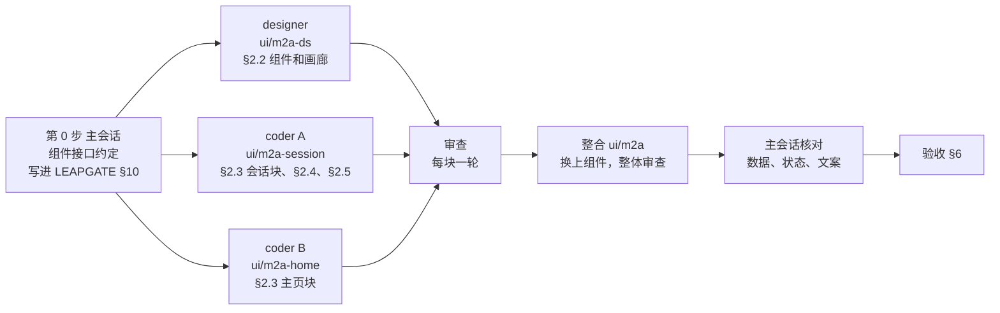

# 新界面 M2a：最小控制端的拆法

2026-10-31 起草，**待维护者确认 §9 的五条**，确认前不派人动手。

- 依据：`03-实施方案.md`（下称"03"）§3.3、§4.4、§4.5、§5.2 M2a、§8.4~§8.8；`01-内容与逻辑说明.md`（下称"01"）P1 区块 A、E、F，P2 区块 A~E、G，§2.1，§4.1、§4.3、§4.5、§7.6；样稿 `样稿/A-基础.html`、`A-P1.html`、`A-P2.html`；leapgate-client 分支 `ui/m1`（`f33609b14`）的 `LEAPGATE.md` §10（M1 的 core 结构、C3、V1、M0 和 M1 的验收记录）。
- M2a 是新界面的第三个里程碑，排在 M0（工程骨架）、M1（core 第一批：会话、连接状态、选项这些不含界面的状态层）之后。做完以后维护者开始用新界面便携版当控制端：连接、看画面、操作、断线重连都在新界面里；被控和设置仍交给旧界面，两者不同时运行（03 §7.1）。
- 这份文档写 M2a 拆成哪几块、谁做哪块、先后怎么排、怎么验收、哪些不做，以及要维护者定的几条。确认后，决定回写进 03 和 01，动手的细节（组件接口、挂钩位置）写进 `client/LEAPGATE.md` §10。

## 要点

1. 范围照 03 §5.2 M2a，有两处随 M1 的进展改了：错误直接用已经合入的原因码（C3）显示 01 §4.3 的文案，不再先显示 Rust 给的英文原句；连接路径（Q3）的挂钩方案还没定，连接方式只显示第一级"直连 / 经中继 / 未加密"。
2. 另有三样 03 排在 M2b 的，建议提前进 M2a：后台标签不推画面（V1）、全屏、"重启远程设备"（§9 D2~D4）。
3. 分工照前端规则：逻辑归 coder（Opus），视觉归 designer（Sonnet）。主会话先写组件接口约定，然后 designer 和两个 coder 三路并行，每块单独审查，整合后主会话核对数据和逻辑（§3）。
4. 输入：只有当前会话标签、而且标签里没有面板或对话框挡着时才拿键盘；切走时松开按下的键、停掉键盘钩子；输入法组字时切标签，未上屏的内容丢掉（§4）。
5. 验收：自动测试、冒烟清单第一版、便携端点上无人值守的真实连接、4K 上屏、最新 stable 检查；要真实鼠标、输入法、第二块显示器的几项写进维护者的试用清单（§6）。
6. 合并：建议现在把 M0、M1 合进 main，M0 剩下要手动看的几项挪到 M2a 的试用构建上一起看（§8、D1）。

---

## 1. 范围

### 1.1 做什么

| 区域 | M2a 做的 | 说明里的出处 |
|---|---|---|
| 主页 · 本机区 | ID（M0 已有）；密码行按本机设置显示五种样子，带"复制"；服务状态（M0 已有） | 01 P1 区块 A |
| 主页 · 连接框 | 统一输入框"输入 ID 或搜索设备"；输入时下面的列表变成搜索结果，第一行固定"连接到 ‹输入›"；回车默认执行哪一行照 Q2 的规则；上下键移动、Esc 回输入框；问号说明；"连接"按钮和下拉；ID 后缀 `/r` | 01 P1 区块 E、Q2 |
| 主页 · 设备列表 | 只有"最近"一类，用列表行（设备头像、名称、`用户名@主机名`、在线状态）；悬停出现"连接"；单击选中，双击或回车连接；在线状态照上游只查看得见的行、每 6 秒一次、窗口失焦就停；加载中、空状态"暂无最近连接的设备" | 01 P1 区块 F |
| 顶栏和会话标签 | 标签跟着会话注册表（一台设备一个标签）；设备名、身份色顶条、连接方式标记；连接中、已中断（会自动重试）、连接失败、已断开几种状态；悬停显示全名、ID、连接方式，出错时显示原因和倒计时；"+"切到主页并把光标放进连接框；系统窗口标题跟着当前标签；标签上的"×" | 01 §2.1、P2 区块 A |
| 会话页 · 画面 | 纹理上屏和软件上屏、远程光标、切换显示器、缩放（原始大小、适应窗口）、原始大小时的滚动（照上游默认方式） | 01 P2 区块 C |
| 会话页 · 输入 | 键盘鼠标照上游的输入 model；键盘模式沿用这台设备已存的设置（选模式的菜单随 M2b）；焦点规则见 §4 | 03 §5.2 |
| 连接状态面板 | 01 P2 区块 D 表里除"终端需要系统账号"以外的每一种：连接中、要密码、密码错误、正在验证、要验证码（含"信任本机"、输错）、等对方接受（含已等待时间）、选择 Windows 用户会话、不安全连接、已连接等画面（几秒后加一行说明）、出错（文案、倒计时、下一步按钮）、对方重启中 | 01 P2 区块 D、§4.1、§4.3 |
| 基础工具栏 | 固定；视图切换（只列远程桌面）；显示器（对端只有一块屏时不显示）；"画面"菜单（缩放两项、画质三档：画质优先、均衡、速度优先）；"操作"菜单（发送 Ctrl+Alt+Del，D4 定了再加"重启远程设备"）；连接方式标记（第一级，不能点开）；断开；不固定时鼠标进入画面 5 秒后收起，收起后只剩拖动条 | 01 P2 区块 B |
| 会话通知横条 | 组件落地，接 core 已经分流出来的会话通知；不带按钮的几种（隐私模式、权限变化、提权进度、对方发来的消息等）照 01 的文案显示，说明里没有文案的先显示原文、日志里记一次 | 01 P2 区块 E、§4.5 |
| 全局轻提示 | "已复制"；第一次连上时"已建立直连"或"已建立中继连接" | 01 §4.1 第 6 行、§4.5 |
| 关闭 | 工具栏"断开"；标签"×"；关窗确认：有会话时"断开全部 ‹N› 个会话并关闭窗口？"带"不再提示"；便携版把 Q6 的"退出 Leapgate / 在后台运行"和"记住此选择"合进同一个确认，没有会话时只问 Q6；安装版隐藏到托盘 | 01 §2.1"窗口关闭"、P2 区块 G、Q6 |
| 链接和命令行 | `leapgate.exe --connect <ID>`（带 `--password`、`--relay`）和 `leapgate://` 链接交给已在运行的主窗口后，开标签并把窗口提到前面；新界面自己启动时命令行里带的链接也照样处理（这两条是 M0 验收时发现、留给 M2a 的） | `LEAPGATE.md` §10.5 M0 |
| 文案 | 简体中文、英文两份同时写进 ARB（应用的翻译文件），按 01 §7.6 和术语表 | 01 §7.6、03 IQ10 |

### 1.2 和 03 原文不同的几处

| 项 | 03 原写 | 这里 | 理由 |
|---|---|---|---|
| 错误怎么显示 | C3 到位前先显示 Rust 原文 | 直接用原因码和 01 §4.3 的文案 | C3 已经合进 `ui/m1`（§5.1） |
| 密码行的五种样子 | M2b | M2a 只做显示和复制；"刷新""修改"仍在 M2b | 五种样子只是读几个选项，工作量很小；只显示一种的话，审批方式是"在本机接受"时会显示错的标签 |
| 会话通知 | 03 §4.4 把横条组件放 M2a，§5.2 把"会话通知"放 M2b | 组件和不带按钮的几种在 M2a，带按钮的几种（截图、打印、提权）随 M2b | 两处说法对齐；core 在 M1 已经把这些通知分出来，没有横条就看不见 |
| V1、全屏、重启远程设备 | M2b | 建议提前进 M2a | §9 D2~D4 |

## 2. 页面和组件清单

### 2.1 M0 现成的，直接用

- 顶栏和应用内标签（`LgTitleBar`、`LgSessionTab`），含窗口按钮、拖动和改大小的区域、标签横向滚动和右端下拉。
- 按钮和图标按钮、输入框（带行内错误）、开关、勾选框、单选、分段、菜单（下拉、二级）、提示气泡、图标、连接方式标记（`LgRouteMark`）、状态文字（色点加文字）。
- 主页外壳：左栏（本机区的 ID 和服务状态、导航）、右侧内容区。
- 令牌（颜色、尺寸、间距、圆角，浅色深色、简洁详细各一套）、图标、字体、身份色函数、组件画廊（调试用的入口，列出全部组件的各种状态，能导出成图片和样稿对照）。

### 2.2 新组件（designer 做）

每个组件都是"只管画"的控件：输入是普通数据和回调，不碰 core；画出 01 要求的全部状态，浅色、深色和简洁、详细两套尺寸都要对；可点的地方带语义标签（Semantics，讲述人和 UI Automation 脚本靠它找控件，§6.3）；在画廊里各状态都有一项。

| 组件 | 用在 | 样稿画框 |
|---|---|---|
| 设备头像（平台图标加身份色底） | 最近列表、标签的悬停提示 | `A-P1.html` 的设备卡片和列表视图 |
| 设备列表行（含悬停、选中、键盘焦点、在线状态正在查询） | 最近列表、连接框的搜索结果 | `p1-list-simple`、`p1-card-*` |
| 连接框的结果行（"连接到 ‹输入›"行、设备行、高亮）、问号说明、"连接"下拉 | 主页连接框 | `p1-cb-*` |
| 密码行的五种样子 | 本机区 | `p1-ben-*` |
| 连接状态面板（进度、输入框、倒计时、按钮组、出错） | 会话页 | `c-*`、`e-*` |
| 浮动工具栏（容器、按钮、菜单按钮、收起后的拖动条） | 会话页 | `s-default`、`s-collapsed`、`s-menu-view`、`m-display`、`m-action` |
| 会话通知横条（叠放、排队、自动消失） | 会话页 | `u-toasts` |
| 全局轻提示 | 窗口一级 | 第一轮样稿没单独画；第二轮 `A-P6-设置.html` 里有（例如"剪贴板中没有服务器配置"），照它 |
| 页内确认条、小确认框 | 关窗确认 | `p1-close-sessions`、`g-close` |
| 会话标签的几种状态（连接中转圈、出错标记、已断开变灰） | 顶栏 | `tabs-s`、`tabs-tip`（M0 的标签组件已经能放状态控件，缺什么补什么） |

### 2.3 页面和逻辑（两个 coder 做）

**会话块（coder A）**

- 外壳：标签接会话注册表；每个标签的内容区有自己的 Overlay（浮层的容器），会话里的确认框只遮这个标签，主页的只遮主页（03 §4.5）；窗口标题跟着标签；"+"；关标签、关窗的流程；全屏（D3）。
- 会话页：画面绘制、输入和焦点规则（§4）、显示器、缩放、画质、工具栏的动作；连接状态面板按 core 的连接状态（`ConnectionModel`）切换样子、调它的方法（登录、提交验证码、选会话、继续或断开、重试、改用中继、取消）；通知横条接会话通知，轻提示接全局轻提示。
- 链接和命令行（§1.1 最后两行）。
- V1（D2 定了提前时）。
- 端到端脚本 `scripts/e2e/leapgate-e2e.ps1` 的 `CloseSessions` 改法（03 §8.6，见 §6.3）。

**主页块（coder B）**

- 本机区密码行要的数据：一次性密码、审批方式、密码方式、服务是否停止；复制。
- 连接框：匹配范围（ID、别名、主机名、用户名、备注）；"输入看起来像地址"的判断（纯数字 ID、IP、`域名:端口`、带 `@服务器`），写成 core 里的纯函数、带单测；回车规则；`/r` 后缀；键盘上下移动。
- 最近列表：读取（上游 `load_recent_peers` 事件）、在线状态查询、连接。

两个 coder 先用简单的占位控件把逻辑写通，designer 的组件合进来以后换上。

### 2.4 core 要补的

- `FFI.start` 和 `SessionRegistry.open` 现在把密码、"是否共享密码"、`switchUuid` 写死成空值。`--connect <ID> --password`（端到端脚本唯一的连接方式）和以后地址簿的共享密码都要从这里传进去，所以这两个签名要加参数，M1 的注册表测试跟着补。由 coder A 改。
- M1 留给 M2a 的几项（`LEAPGATE.md` §10.6）：会话页开始时调 `canvasModel.initializeEdgeScrollFallback`（要页面提供动画时钟）；"显示远程光标"的初值在会话开始后读；`StateGlobal.tabBarHeight` 改成新顶栏的高度（全屏时为 0），画面可用高度按它算；离开会话时的 `enterOrLeave`、`hostStopSystemKeyPropagate` 和键盘焦点由会话页负责（§4）。
- 本机区要的几项数据先加在 M0 的 `LocalStatusModel` 上；CM 用的服务 model 在 M3 复制进来时再并过去。

### 2.5 画面绘制和输入监听：从上游页面复制

- 上游会话页里的 `ImagePaint`、`CursorPaint`、`_ViewStyleUpdater`（`flutter/lib/desktop/pages/remote_page.dart`）和 `RawKeyFocusScope`、`RawPointerMouseRegion`（`flutter/lib/common/widgets/remote_input.dart`）管滚动条、光标绘制、缩放、把指针和按键事件交给输入 model 这些细节，重写容易漏。做法：复制进 `app/lib/pages/session/`，文件头写上游来源，按"改写"档处理：不做自动的三方合并，合并上游时列出这两个上游文件的新提交，逐个人工判断要不要移植（03 §3.8 第 2 条）。
- 03 §9 把 `remote_input.dart` 整个归成"手机专用、移动端阶段再复制"，不对：桌面会话页也用其中这两个类。这一行随这次的决定一起改。

## 3. 分工和先后

- **第 0 步（主会话，约半天）**：读码把每个新组件的接口写清：输入的数据、回调、要画的状态、对应的样稿画框、语义标签；连同 §2.4、§2.5 的做法，写进 `client/LEAPGATE.md` §10 新开的"M2a"一小节。这是 designer 和 coder 共用的约定，两边照它各写各的。
- **第 1 步，三路并行**，各用一个分支和一个 worktree（D1 选甲就从合并后的 main 切，选乙就从 `ui/m1` 切）：
  - designer 在 `ui/m2a-ds` 做 §2.2，只改 `app/lib/widgets/` 和画廊；
  - coder A 在 `ui/m2a-session` 做会话块、§2.4、§2.5，core 只由它改；
  - coder B 在 `ui/m2a-home` 做主页块。
  - 三路改的文件不重叠：组件、会话页和外壳、主页各在各的目录。
- **第 2 步，审查**（reviewer 和写代码的分开，每块一轮，有必须改的再复核一轮）：组件一轮，对照样稿，必修项按 03 §8.4（版面层级、缺状态、文案、令牌用错）；会话块一轮，重点是焦点和按键释放、关闭流程、注册表、复制件和上游原件的差异；主页块一轮，重点是搜索和回车规则。
- **第 3 步，整合**：三个分支合进 `ui/m2a`，占位控件换成 designer 的组件，再做一轮整体审查。
- **第 4 步，主会话核对**（前端规则的第三步）：逐条对 01 的状态表、文案、按钮和 §4 的输入规则。
- **第 5 步，验收**（§6）。

M0 也是这样分的：designer 在 `ui/m0-ds` 做令牌、图标、组件和画廊，coder 同时做骨架和外壳，最后合并。这次多一个 coder，因为会话页和主页互不依赖，会话页又是最大、风险最高的一块。

每块合入前照 `LEAPGATE.md` §10.1：`git diff main -- flutter/` 为空；复制件不跑格式化；core 的 `flutter analyze` 以 M1 的 92 条提示为基线，只看新增的。

## 4. 会话标签和输入的要点

先解释一个词：**键盘钩子**是控制端在本机装的底层键盘拦截，把 Win 键、Alt+Tab 这类系统组合键截下来发给远程设备。上游用 `enterOrLeave(true / false)` 开关它，同时用 `hostStopSystemKeyPropagate` 决定系统键要不要留在本机。单窗口加标签以后，几个会话在同一个窗口里，谁开着钩子就特别要紧。

1. **谁拿键盘**：会话页只有同时满足这几条才请求键盘焦点：窗口在前台；它是当前标签；标签里没有连接状态面板或确认框挡着；鼠标在画面上，或者刚点过画面。照上游在 Windows 上的做法（`remote_page.dart` 的 `_windowsCanFocusRemoteInput`、`enterView`、`onWindowFocus`）。拿到焦点时 `enterOrLeave(true)`。
2. **切走时**（切到别的标签或主页、关标签、窗口退到后台）：`enterOrLeave(false)`，它会补发已按下的键的抬起、复位修饰键、让钩子转为等待；`hostStopSystemKeyPropagate(true)`；放掉焦点。先放旧标签，再让新标签按第 1 条决定拿不拿，免得两个会话同时开着钩子（上游在同一窗口的标签之间也是这个顺序，`remote_page.dart:304-310` 的注释）。
3. **切回来**：不自动抢键盘，等鼠标进入画面或点画面；用 Alt+Tab 回到窗口时鼠标已经在画面上的，直接拿（上游 `onWindowFocus`）。
4. **输入法组字时切标签**：切走前先让旧标签整个失焦，Flutter 随之关闭输入连接；还没上屏的组字内容丢掉，不提交到任何输入框，也不发给远程设备；新标签的输入框不接着这次组字。面板里的密码框、验证码框和主页的连接框都适用。Flutter 在 Windows 上关闭输入连接时组字是取消还是提交，以实测为准（§6.5），是提交的话再加处理。
5. **按着键切标签**（例如按着 Ctrl 去点另一个标签）：第 2 条会给远程设备补发抬起，远程设备上不会留下一直按着的键。
6. **关标签**：除第 2 条外，照上游会话页的 `dispose` 收尾；纹理、图像、光标图已经在 core 的 `FFI.close` 里清。
7. **V1**（D2 定了提前时）：标签切走时告诉 Rust 不再往这个标签推画面（照常收流、解码），切回时恢复并要一帧刷新。上游连上 1.5 秒还没画面会给对方发一个空的系统登录密码唤醒锁屏；第一帧到之前标签就被切走时，这个计时要取消，切回时还没画面再起一次（`LEAPGATE.md` §10.6 留下的要求），否则会误发。

## 5. 错误原因和连接方式

### 5.1 错误：直接用原因码

- 原因码（C3）是 Rust 把会话里弹出的错误消息按（类型、标题、正文）归成的固定代号，例如 `peer_offline`、`direct_reset`、`wrong_password`，对照表在 `LEAPGATE.md` §10.4。M1 的连接状态已经把它放在 `ConnectionModel.reason` 上，面板按代号查 01 §4.3 的文案和下一步按钮。能否自动重试照旧取 Rust 判断的结果。
- 归不进任何代号的（`other`）显示原文，服务器自定义的拒绝原因也在其中。01 §4.3 要的"服务器拒绝了此连接："前缀要在 Rust 里加两处挂钩，和 Q3 的挂钩方案一起等维护者定（待办"等用户拍板"里 Q3 那条的第②项）；定之前照原文显示，不带前缀。
- 下一步按钮在 M2a 里的落点："重试""改用中继""关闭标签""重新连接"照 01；"修改 ID"切到主页，把这个 ID 填进连接框并全部选中；"打开网络设置"要等设置页（M6），M2a 先不显示这个按钮（01"平台或版本不支持的隐藏"）；出口的几行不会在远程桌面会话里出现，随 M5。
- 2FA 是第一次要还是输错了（C4），M1 已经分开。

### 5.2 连接方式：只显示第一级

- 标签和工具栏上的标记只有"直连""经中继"，未加密时加警告。数据来自连接就绪事件，M1 已经接进 `ConnectionModel`。
- 工具栏上的标记在 M2a 不能点开。详情弹层（路径、中继服务器、加密和指纹、画面数据、延迟）随 M2b 做，路径和中继服务器要等 Q3 定。

## 6. 验收

每一条在验收记录里写通过、不通过或未验证，后两种写原因（`LEAPGATE.md` §10.2）；记录写进 `client/LEAPGATE.md` §10.5。

### 6.1 自动测试

- core：§2.4 改的两个签名、"输入看起来像地址"的判断加单测；M1 的 66 个照常通过。
- app：每个新组件的行为测试；每个页面状态一个用例（03 §8.3），用假的连接状态喂面板的每一种、最近列表的空和加载中、连接框的几种默认高亮、关窗确认的几种组合，断言该出现的文字、按钮、灰显和焦点。不做像素比对。
- `flutter analyze` 两个包没有新告警。

### 6.2 冒烟清单第一版

写出 `docs/新界面/冒烟清单.md` 第一版（03 §8.5）：引擎和安装层引用 `docs/第二期客户端冒烟清单.md`，界面层重写成新界面的步骤，加上 §6.3~§6.5 的各项。之后每块追加。

### 6.3 真实连接，无人值守

照 03 §8.6 在便携端点上跑；端点、ID、测试密码写在私有运行手册里，这里不写。

- 03 §5.2 M2a 的连接项逐条跑：直连、经中继、自研 ICE 胜出、存过密码直接进、输密码、密码错误、2FA、等对方接受、不安全连接确认、断线后自动重试、对方重启后静默重连（D4）、1.5 秒唤醒锁屏、"改用中继"、对方断开。
- 怎么操作：能用命令行做的走 `leapgate.exe --connect`（带密码、`--relay`）；面板上要输入和点按钮的（输密码、验证码、继续或断开、改用中继），用 UI Automation 脚本按语义标签找控件操作。UI Automation 是 Windows 的界面自动化接口，讲述人这类工具也靠它读界面。判定看两端日志和面板上的文字。
- UI Automation 只在 3.44.9 自编引擎的构建上用。官方引擎不带无障碍桥的补丁（0001），开着 UI Automation 客户端可能让控制端崩溃（`AGENTS.md` 2026-10-26 改走路线 C 的那条决定）。
- 旧界面曾出现第一次 UI Automation 查询以后语义树变空（待办"到期触发"第一条）；新界面上也出现的话，要点按钮的几项改由维护者试用时看，验收记录写明。
- `CloseSessions` 改成给新界面主窗口发关闭，事先用 `Configure` 关掉关窗确认、把"在后台运行"设成记住的选择，会话全部断开、主窗口隐藏、进程照常当被控端（03 §8.6）；按端点上找到的窗口类名自动区分新旧界面。UI Automation 脚本放 `scripts/e2e/`，不带具体值。
- 两个会话推流时停在主页标签，量一次 CPU、GPU 占用（03 §5.2 M2a 的基线）。D2 选提前时，在接 V1 之前的提交上量一次、接上以后再量一次；只有一台被控端有画面时，用一个会话对比。

### 6.4 引擎（03 §8.7 第 1 段）

- 连一次 4K、频繁重建采集的被控端，看 D3D11 零拷贝上屏（2026-10-26 控制端崩溃的那个场景）。
- 开着讲述人（或 UI Automation 脚本），开、关一次会话标签和关窗确认。

### 6.5 维护者试用时看的

会话里没有真实鼠标、输入法和不同缩放的第二块显示器，下面几项写进试用清单，维护者自己用的时候看：

- 03 §5.2 M2a 里的：密码框用中文输入法输入；输入法组字时切标签（§4 第 4 条）；会话中把窗口从 100% 的显示器拖到 150% 的显示器，原始大小下画面和光标的缩放正确。
- D1 选甲时并进来的 M0 几项：拖动空白移动窗口、拖上沿改大小、悬停效果（关闭按钮变红、提示气泡）、输入法候选框的位置、125% 和 200% 缩放；有条件再看 1920×1080@150%、1366×768@100% 首次启动整窗在屏幕内。

### 6.6 和样稿对照（03 §8.4）

P1 的本机区、连接框、最近列表；P2 的会话标签、面板各状态、工具栏默认态和收起态、通知、关窗确认，浅色、深色各对照一次。必修项清零，其余记进 `docs/新界面/待调.md`。

### 6.7 最新 stable 检查（03 §8.8）

四步都做，第 3 步（4K 上屏）从 M2a 起适用。这一轮只用 `--connect --password` 连接，不开任何 UI Automation 客户端和讲述人（原因同 §6.3）。检查前先看当时最新的 stable 是不是仍是 3.47.9。

### 6.8 旧界面五项冒烟

`ui/m1` 起 Rust 多了 V1 的两处挂钩（`src/flutter.rs`），没人调用时不起作用，只做过编译检查，旧界面没再跑过。M2a 的验收构建照 M0 那样同时编一次旧界面，跑一次五项冒烟（连接、中继、文件传输、端口转发、出口），顺带做待办里那条 ID 加盐冒烟（空配置目录起一次，看日志里的 `Generated id`）。

### 6.9 交付和试用说明

- 便携目录放在维护者的台式机上，维护者自己双击启动，不从会话里启动。
- 试用说明写明：先退出旧界面，装着的连托盘和服务一起停；新界面运行时有人连进来，弹出的是占位窗口，处理不了来访（CM 在 M3），要被控或改设置时退出新界面、开旧界面；设置页还没有；意见记进 `docs/新界面/待调.md`。

## 7. 明确不做（M2b 及以后）

- **主页**：收藏、局域网、地址簿、同组设备；卡片视图、表格式列表视图、"视图""排序"菜单、多选、设备的"⋯"菜单（删除最近记录也在里面）；本机提示卡、"正在被远程控制"、被控时的遮罩；密码行的"刷新""修改"和设置固定密码对话框；账号区和登录（M4）；出口页（M5）；设置页（M6）。
- **"连接"下拉**只有远程桌面和经中继连接；文件传输、终端、摄像头、TCP 隧道、用作出口、RDP 都不列。
- **会话**：视图切换只列远程桌面；工具栏的"输入""会话""聊天""录制"菜单；"画面"里缩放两项和画质三档以外的项（自定义缩放、滚动方式、自定义画质、编码、真彩色、分辨率、虚拟显示器、光标选项）；"操作"里发送 Ctrl+Alt+Del（和 D4 的重启远程设备）以外的项；工具栏的拖动、停靠、放不下时的"更多"；合并显示全部显示器；连接方式详情和质量数据浮层；带按钮的会话通知（截图、打印、提权）；聊天和语音、录制、相对鼠标模式、备注；标签右键菜单；快捷键（含切换标签的快捷键）；详细模式的开关（组件照样支持两套尺寸，只是还没有切换入口）；全屏（D3 不提前时）。
- **Rust**：Q3 的挂钩、"服务器拒绝了此连接："前缀（都等 Q3 那条定）、分段延迟（Q13）。
- **CM**（M3）：新界面的 `--cm` 仍是占位窗口。

## 8. 合并的现状

| 仓库 | 分支 | 内容 | 状态 |
|---|---|---|---|
| leapgate-client | `ui/m0`（`5f0b5bd3f`） | M0 | 已推送，没合 main |
| leapgate-client | `ui/m1`（`f33609b14`） | M0 加 M1，含 C3、V1 两个 Rust 导出 | 已推送，没合 main |
| leapgate（总仓库） | `ui/m0`（`d1406ab`） | 构建脚本的 `-Ui leapgate`、`待调.md` 里 M0 的记录 | 已推送，没合 main |

都卡在 M0 要维护者手动看的几项（拖动、悬停、输入法候选框、缩放，待办"等用户拍板"第二条）。两条路：

- **甲（推荐）**：现在把客户端 `ui/m1`（含 M0）和总仓库 `ui/m0` 合进 main，M0 那几项挪到 M2a 的试用构建上一起看（§6.5）。
  - 新界面不进发布构建，合入不改变旧界面：`git diff main -- flutter/` 为空；Rust 多出的 W1、V1 挂钩只在新界面调用时起作用，W1 随 M0 跑过旧界面冒烟，V1 只做过编译检查，§6.8 补一次。
  - 维护者试用 M2a 时本来就要拖窗口、用输入法，顺带看完，不用单独找时间。
  - 分支叠得越长，合入时越难看清每一层改了什么。
  - 代价：main 上的新界面有几项还没人手动看过，查出问题在 M2a 里修。
- **乙**：先看完 M0 那几项再合。M2a 的做法不变，从 `ui/m1` 切，只是 main 晚一点拿到新界面。

## 9. 要维护者定的

| 编号 | 问题 | 推荐 | 备选 | 代价 |
|---|---|---|---|---|
| D1 | M0、M1 什么时候合进 main | 甲：现在合，M0 那几项挪到 M2a 试用时看（§8） | 乙：先看完 M0 那几项再合 | 甲：main 上有几项还没手动看过；乙：多等一轮，分支继续叠 |
| D2 | V1（后台标签不推画面）提前进 M2a | 提前。已经合进 `ui/m1`；维护者日常会开几个标签，停在主页时后台标签照样按帧率让整个窗口重绘；占用基线在接 V1 之前的提交上量 | 照 03 留在 M2b | 提前：M2a 多处理 1.5 秒唤醒那一处（§4 第 7 条）；照 03：试用期间后台标签多耗 CPU、GPU |
| D3 | 全屏提前进 M2a | 提前。日常用得多，新旧界面又不能同时运行，没有全屏就得退出新界面换旧界面 | 照 03 留在 M2b | 提前：工具栏多"全屏 / 退出全屏"，全屏时工具栏最左显示设备名、拖动条多"最小化"（01 P2 区块 B），约几百行 |
| D4 | "重启远程设备"提前进 M2a | 提前，放进"操作"菜单，带确认。面板的"对方重启中"只在控制端点了这一项以后才会出现（被控端自己重启表现为掉线，走断线重试），M2a 不带它就测不到这个状态 | 照 03 留在 M2b，"对方重启后静默重连"的验收一起挪到 M2b | 提前：多一个菜单项和一个确认框；照 03：M2a 的面板有一种状态到 M2b 才验 |
| D5 | 连接进度"查找设备 → 建立连接 → 验证身份"的前两步 | 合成两步"建立连接 → 验证身份"，01 P2 区块 D 和样稿跟着改。Rust 在连接建立之前不发任何事件，界面分不出"已找到设备"这一刻（`LEAPGATE.md` §10.6 已知限制） | 一：照样稿三步，前两步同时进行、同时完成；二：Rust 加一处挂钩区分，占 Q3"`src/client.rs` 新增不超过 3 处"的名额 | 推荐：改了定稿样稿的一行文字；备选一：两步一起转、一起完成，看起来像出错；备选二：多一处上游挂钩 |

## 10. 工作量

03 粗估 M2a 新写 5~7k 行 Dart、10~15 人天；D2~D4 都提前大约多 1~2 人天。三路并行以后，日历时间主要取决于会话块。
