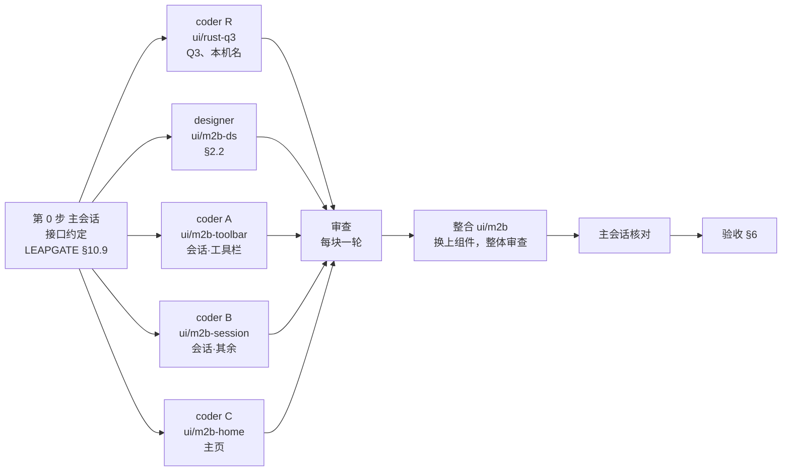

# 新界面 M2b：主页和会话其余部分的拆法

2026-10-31 起草；同日维护者把 §9 的四条全部按推荐定，决定已回写 03（§5.2 M2b、§6.1 Q3、§12 IQ14）和 01（§4.2、§4.3、§4.6、§8 Q3）。

- 依据：`03-实施方案.md`（下称"03"）§4.4、§5.1、§5.2 M2b、§6.1 Q3、§8；`01-内容与逻辑说明.md`（下称"01"）§2.1、§2.3、P1 区块 A~C、E、F、J、K，P2 区块 A~C、E、F，§4.2、§4.4、§5.1~§5.5；`02-第二轮内容与逻辑说明.md`（下称"02"）里和主页、会话有关的几条（界面模式、工具栏和显示器的设置项）；`04-M2a拆法.md`（下称"04"）；leapgate-client main（`f86ce27f7`）的 `LEAPGATE.md` §10.4~§10.8；分支 `ui/rust-q3`（`d36711646`）的 `LEAPGATE.md` §10.4"Q3 挂钩方案"；`待调.md`。
- M2b 排在 M2a（最小控制端，已合入、在试用）之后。做完以后，控制端除了账号和地址簿（M4）、文件传输（M7a）、出口页（M5）、设置页（M6）以外都在新界面里。
- 这份文档写 M2b 做什么、拆成几块、谁做哪块、怎么验收、哪些不做，以及要维护者定的几条。Q3 那三条待定问题也并进这里（§9 的 Q3-a~Q3-c），一次定完。确认后，决定回写进 03、01，动手的细节写进 `client/LEAPGATE.md` §10。

## 要点

1. 范围照 03 §5.2 M2b，去掉 M2a 已经提前做的（原因码文案、V1、全屏、"重启远程设备"、密码行五种样子、通知横条）。剩下的按页面分成两大块：会话页（工具栏的全部菜单、连接方式详情、聊天和语音、录制、带按钮的通知、标签右键菜单和快捷键）和主页（收藏、局域网、卡片和列表视图、排序、多选、设备菜单、密码行的"刷新""修改"、被控时的遮罩、主页对话框），另加详细模式的切换（§1）。
2. 很多项要等后面的块才有：文件传输（M7a）、出口（M5）、终端和摄像头（第三轮）、地址簿（M4）、设置页（M6）。M2b 的菜单只列已经实现的项，规则和 01"平台或版本不支持的隐藏"一致（§1.3）。
3. Rust 只剩 Q3（连接路径和中继名，`src/client.rs` 新增 1 处）和"服务器拒绝了此连接："前缀（再加 2 处，Q3-b 定做不做），另加一个只放在块 2 的导出（本机显示名，`待调.md` 第 23 条）。方案已经写好，在 `ui/rust-q3`，这里只引用、不重写（§2.5）。
4. 分工：designer 一路，coder 分会话·工具栏、会话·其余、主页三路，Rust 一个小 coder 先做。改的文件互不重叠，靠第 0 步写进 `LEAPGATE.md` §10.9 的约定（§3）。
5. 验收：自动测试、冒烟清单追加、无人值守真实连接、V1 的占用复测、样稿对照、最新 stable 检查。连接方式详情里的路径和中继名要 Q3 合入才能验，其余不依赖它（§6）。
6. 另一条要定的：M2b 期间要不要同时开 M3（CM）。03 §5.1 写了 M3 只依赖 M1，可以并行（§9 N1）。

---

## 1. 范围

### 1.1 做什么

**会话页（P2）**

| 区域 | M2b 做的 | 01 出处 |
|---|---|---|
| 工具栏布局 | 沿顶边拖动换位置、位置按设备记住；拖动时的落点预览；"允许工具栏停靠在任意一边"打开时（读现有选项，开关在 M6 的设置页，现在可以在旧界面里改）吸附四边、左右两边竖排只显示图标；放不下时按"录制、聊天、会话"的顺序收进右端的"更多"，聊天有未读时"更多"上带数字 | P2 区块 B |
| 显示器 | 每块屏一个按钮（按对端真实排布）、"全部显示器"（合并显示，上游 `kAllDisplayValue`，同一个标签里显示）；"平铺显示器按钮""下一个显示器按钮""收起时也显示"三个选项读现有值 | P2 区块 B 显示器、§5.5 |
| "画面"菜单 | M2a 有的两项缩放、三档画质以外的全部：自定义缩放滑块、滚动方式和边缘宽度、自定义画质两个滑块、编码、真彩色 4:4:4、分辨率二级（含自定义宽高对话框）、虚拟显示器二级（两种驱动）、光标四项 | P2 区块 B 菜单表 |
| "输入"菜单 | 全部（键盘模式、ANSI / ISO、输入源、仅查看、显示本机光标、交换 Ctrl 和 Command、相对鼠标、反转滚动、交换左右键、触控板速度滑块、Android 导航键）；没有键盘鼠标权限时整个菜单灰显 | 同上 |
| "操作"菜单 | M2a 有的发送 Ctrl+Alt+Del、重启远程设备以外的全部：锁定、阻止 / 取消阻止本地输入、请求提升权限（选方式的小对话框）、输入系统登录密码（可编辑保存的）、键入剪贴板文本、重置 Wayland 键盘授权、刷新画面、截图（30 秒冷却）、交换控制方向（确认）、添加备注 | 同上 |
| "会话"菜单 | 静音、同步剪贴板、允许复制粘贴文件、会话结束后锁定、隐私模式（多种实现时二级） | 同上 |
| 聊天、录制 | 聊天菜单（文字聊天、语音通话）、聊天面板、未读数；录制按钮和录制态 | P2 区块 B、F |
| 灰显和快捷键 | 被控端没给的权限、仅查看模式下的项灰显并说明，隐私模式和录制两处例外照上游；菜单项右侧显示已绑定的快捷键；快捷键本身照上游的 `shortcut_model` 生效，含"切换到下一个 / 上一个标签"（主页算第一个） | P2 区块 B、§2.1 |
| 连接方式详情 | 工具栏的连接方式标记能点开：路径、中继服务器（Q3）、传输、加密和指纹（可复制）、画面数据、延迟（往返，Q13 到位前只有"端到端"一行，带本次会话的最低、平均、最高和近 60 秒折线）、"在画面上显示质量数据"开关 | §4.2 |
| 画面区 | 质量数据浮层（左上）、相对鼠标模式的提示（顶部居中，这时工具栏隐藏）、Android 导航浮条 | P2 区块 C |
| 会话通知 | 带按钮的几种：截图完成（另存为、复制到剪贴板）、截图失败、收到打印任务（三个按钮加"记住此选择"）、提权（请求、等待、重试）、录屏（停止）、隐私模式要先切屏（切换到显示器 1）；权限中途被收回时加一条通知 | P2 区块 E |
| 会话标签 | 右键菜单（"复制设备 ID""关闭其他标签""关闭"；"打开文件传输 / 终端 / 摄像头"等对应视图做了再加）；有未读聊天时的数字；悬停提示里的连接方式 | P2 区块 A、§2.1 |
| 视图切换 | 控件照 01 画全，只列已经实现的视图（M2b 时只有远程桌面），和 M2a 相同 | §2.1 |
| 等对方接受 | 面板加"显示给对方的名称：‹本机名›"（`待调.md` 第 23 条，要块 2 的新导出） | P2 区块 D |

**主页（P1）**

| 区域 | M2b 做的 | 01 出处 |
|---|---|---|
| 本机区 | 密码行的"刷新"（一次性密码）和"修改"（打开设置固定密码对话框，只在便携版显示，安装版的解锁随 M6）；服务已停止时的"启动服务"按钮（M0 只显示了文字）；"正在被远程控制（N 个会话）"（先用现有的远程桌面连接数），"查看"随 M3 | 区块 A |
| 本机提示卡 | 只显示"系统错误"那张；"安装""升级"两张 M8 之前不显示（03 §5.2 M2b） | 区块 B |
| 分类 | 最近、收藏、局域网三类，文字分段；地址簿、同组设备两类随 M4，M2b 不显示 | 区块 F |
| 列表工具 | 视图（卡片 / 列表）、排序（名称、ID、用户名、在线状态，"最近"不排序；修上游按状态排序的比较函数）、多选、"视图"菜单（界面模式开关、调整显示的分类和顺序）、被策略固定时灰显 | 区块 F |
| 设备卡片和列表视图 | 卡片视图（每列至少 300 宽）、列表视图（表格）；悬停的"连接"和"⋯"、选中、键盘焦点、双击和回车连接；在线状态照 M2a 的查询规则；超过 1000 台的提示；各分类的空状态 | 区块 F |
| 设备的"⋯"菜单 | 连接方式组：远程桌面（M2b 只有它，加"经中继连接"见 §1.3）；设备组：始终经中继（勾选）、网络唤醒（局域网）、创建桌面快捷方式；管理组：重命名、加入 / 移出收藏、清除保存的密码；危险操作组：最近"删除"、局域网"移除"。地址簿相关的项随 M4 | 区块 F 菜单表 |
| 多选 | 多选条：删除、加入收藏（最近）、"已选择 N 台"、全选、完成；Shift 连选；删除前页内确认 | 区块 F |
| 连接框 | 搜索范围扩到最近、收藏、局域网三类，同一个 ID 只出现一次并标出来源；"连接到 ‹输入›"行尾的"⋯"；结果按当前视图显示（`待调.md` 第 25 条） | 区块 E |
| 被控时的遮罩 | 照上游 `canBeBlocked`、`shouldBeBlocked`（`flutter/lib/common.dart:3138-3205`），只盖主页，加一句"远程控制期间无法修改设置" | 区块 J |
| 对话框 | 设置固定密码（强度条、规则、二次验证受信设备那句）、重命名、删除确认（单台和多选） | 区块 K、§4.4 |

**详细模式**：主页"视图"菜单里的开关（02 §4.1 的新选项，和 M6 设置页"通用 › 外观"是同一个值），切换后立即生效：尺寸令牌换成详细一套（M0 的组件已经支持）、连接方式标记换成路径标记、工具栏菜单按钮图标加文字、设备列表默认列表视图、质量数据浮层默认开（01 §2.3、02 R2-Q11）。

### 1.2 和 03 原文不同的几处

| 项 | 03 原写 | 这里 | 理由 |
|---|---|---|---|
| 主页的分类 | "收藏、局域网"和地址簿、同组设备没分开写 | M2b 只做最近、收藏、局域网；地址簿、同组设备整个随 M4 | 两类都要登录和 H1；M2b 先把卡片、列表、菜单这些 M4 要复用的部分做出来 |
| 主页对话框 | "设置固定密码、添加设备等，登录除外" | 设置固定密码、重命名、删除确认；添加设备和其他地址簿对话框随 M4 | 添加设备、编辑标签、共享密码都是地址簿的 |
| 会话中的备注 | 列在 M2b | 照做，"操作"菜单最后一项，提交到服务端 | 无变化，列出来是因为 01 §5.5 去掉了结束时的备注框，容易混 |
| 本机显示名 | 没写 | 加一个块 2 导出 | M2a 验收时发现"等对方接受"缺这一行（`待调.md` 第 23 条） |

### 1.3 各块做了以后再补的项

M2b 的菜单和下拉只列已经能用的项。下面这些等对应的块做完时，由那一块顺手加上：

| 项 | 加在哪 | 哪一块 |
|---|---|---|
| 文件传输 | 视图切换、连接按钮下拉、设备菜单连接方式组、标签右键 | M7a |
| 用作出口 | 连接按钮下拉、设备菜单 | M5 |
| 终端、终端（管理员）、摄像头 | 同上 | 第三轮 |
| TCP 隧道、RDP（含 RDP 设置） | 连接按钮下拉、设备菜单 | 第三轮 |
| 地址簿、同组设备两类；加入地址簿、编辑标签、编辑备注、设置共享密码、查看所在地址簿 | 分类、设备菜单、多选条 | M4 |
| 本机区"查看"（把 CM 提到前面）、分类型的连入数 | 本机区 | M3（C1、C2） |
| 安装版的"修改"固定密码（先解锁） | 本机区 | M6 |
| "打开网络设置"按钮 | 连接状态面板 | M6 |
| 分段延迟（两段、"其余"、退路） | 连接方式详情 | Q13，M8 之后 |

"连接到 ‹输入›"行和设备菜单的连接方式组在 M2b 里只有"远程桌面""经中继连接"两项，和 M2a 的连接按钮下拉一样。

## 2. 页面和组件清单

### 2.1 现成的，直接用

- M0：顶栏和标签、按钮、输入框、开关、勾选、单选、分段、菜单（下拉、二级）、提示气泡、连接方式标记、状态文字、令牌（两套尺寸）、图标、身份色、画廊。
- M2a：设备头像、设备列表行、连接框和"连接到"行、密码行（留了操作区）、连接状态面板和输入件、浮动工具栏（按钮、菜单按钮、收起后的拖动条、全屏态）、通知横条、全局轻提示、确认框和页内确认条、标签的几种状态和悬停提示。

### 2.2 新组件（designer）

规则和 M2a 相同（`LEAPGATE.md` §10.8"组件约定"）：只管画、文字由调用方传、带语义标签、两套主题和两套尺寸、画廊里每种状态一项、有行为测试。

| 组件 | 用在 | 样稿画框 |
|---|---|---|
| 分类分段、列表工具条（视图、排序、多选、刷新）、"视图"和"排序"菜单（含界面模式开关、分类显示和顺序） | 设备页 | `p1-default-light`、`p1-menu-view`、`p1-menu-sort` |
| 设备卡片（悬停、选中、焦点、在线状态正在查询、星标）和卡片网格 | 设备页、连接框 | `p1-card-hover`、`p1-card-sel`、`p1-card-focus`、`p1-card-query` |
| 列表视图（表格：表头、可排序列、行悬停出现"连接"和"⋯"） | 设备页 | `p1-list-simple`、`p1-detail-light` |
| 设备菜单的分组样式（组标题、灰显说明、危险组） | 设备"⋯"、"连接到"行的"⋯" | `p1-menu-more-top`、`p1-menu-more-bottom` |
| 多选条 | 设备页 | `p1-multisel` |
| 各分类的空状态、超过 1000 台 | 设备页 | `p1-st-empty-fav`、`p1-st-empty-lan`、`p1-st-over1000` |
| 本机区"正在被远程控制"、本机提示卡、被控时的遮罩 | 本机区、主页 | `p1-who-2`、`p1-hint-error`、`p1-locked` |
| 设置固定密码对话框（强度条、规则逐条通过） | 主页 | `p1-dlg-pw-empty`、`-typing`、`-mismatch`、`-fail`、`-set` |
| 菜单里的滑块项、步进器（"− 数量 +"）、带"当前值"的单选项、二级菜单的勾选列表 | 工具栏菜单 | `s-menu-view`（画面）、`m-input`、`m-action`、`m-session`、`m-display`、`m-res`、`m-vd-plug`、`m-vd-step` |
| 工具栏的拖动和停靠（落点预览框、竖排、"更多"） | 会话页 | `s-drag`、`s-dock-left`、`min-s`、`min-d` |
| 显示器平铺按钮、收起后的切屏按钮 | 工具栏、拖动条 | `m-display-flat`、`s-collapsed-sw` |
| 连接方式详情弹层（分组的键值行、可复制的指纹、延迟表和折线、质量数据开关） | 工具栏标记 | `d-conn`、`d-conn-direct`、`d-conn-d`（`d-conn-noecho`、`d-conn-nopeer` 是 Q13 的退路，M2b 不做） |
| 延迟折线（近 60 秒、颜色加线型、图例用文字） | 详情弹层 | 同上；03 §4.4 |
| 质量数据浮层、相对鼠标提示、仅查看和没有权限时的灰显、权限被收回 | 画面区、菜单 | `det-session`、`x-rel`、`x-view-only`、`x-no-perm`、`x-revoked` |
| Android 导航浮条 | 画面区 | 样稿没画，照 01 P2 区块 C 和通用样式 |
| 带按钮的通知（主次按钮、勾选、一直保留直到处理） | 会话通知 | `u-toasts` |
| 聊天面板（可拖动、气泡、时间、输入）、语音通话的几种状态 | 会话页 | `u-chat`、`u-voice-wait`、`u-voice-call` |
| 标签右键菜单、标签上的未读数、详细模式的标签 | 顶栏 | `tabs-ctx`、`tabs-s`、`tabs-d` |
| 详细模式下的会话页和设备页 | 全部 | `g-detail` 一组（`s-default-d`、`det-session-d`、`p1-detail-*`、`p1-min-detail`） |
| 会话里的小对话框：自定义分辨率、键盘布局 ANSI / ISO、系统登录密码、请求提升权限的方式、交换控制方向确认、Wayland 授权确认、添加备注 | 会话页 | 照 01 §4.4 的通用对话框样式，不单独出图 |

### 2.3 页面和逻辑（三个 coder）

**会话·工具栏（coder A）**

- 工具栏的全部菜单、显示器、拖动和停靠、"更多"；菜单项的出现条件、灰显规则照上游 `flutter/lib/common/widgets/toolbar.dart` 和 `flutter/lib/desktop/widgets/remote_toolbar.dart`，改成 01 的分组（§4.1）。
- 菜单打开的几个小对话框（自定义分辨率、键盘布局、系统登录密码、请求提升权限的方式、交换控制方向、Wayland 授权、添加备注）。
- 快捷键：复制 `shortcut_model` 进 core，补回 `LEAPGATE.md` §10.6 里暂删的三处（`input_model` 的分发、`_matchFlutterShortcut`、`kShortcutEventName` 事件）；切换标签的快捷键接到外壳。
- 画面区的相对鼠标提示、Android 导航浮条、质量数据浮层的显示（开关在 B 的详情弹层里，状态由 core 持有）。
- core：`StateGlobal` 补回分辨率菜单记的上次选择（`LEAPGATE.md` §10.6 末尾）。

**会话·其余（coder B）**

- 连接方式详情弹层：接 Q3 的导出（`leapgate_session_connection`，Rust 合入前用假数据），指纹，画面数据（`QualityMonitorModel` 已在 core），延迟统计和折线（每个会话在 core 里记一份往返的环形缓冲和本次会话的最低、平均、最高）。
- 会话通知里带按钮的几种：登记会话流的 `screenshot`、`printer_request`、`switch_back`（`LEAPGATE.md` §10.6）；截图"另存为"要选保存位置，app 加 `file_picker`（03 §1.6"用到时再加"；先用上游 `flutter/pubspec.lock` 锁的版本，解析不了时选 `pub get` 能和 frb 1.80.1 的 `uuid ^3.0.6`、`js ^0.6.4` 共存的版本）；提权通知的"请求提升权限"弹选方式的小对话框（对话框本身归 A，B 调它）。
- 聊天和语音：`chat_model` 改写进 core，只留消息存储和未读数，消息类型用 core 自己的，不带 `dash_chat_2`；登记 6 个聊天和语音事件（`LEAPGATE.md` §10.6）；聊天面板、未读数、语音通话。
- 录制：按钮、录制态、"已开始自动录制"通知的"停止"。
- 会话标签：右键菜单、未读数、悬停提示里的连接方式。
- "等对方接受"面板的本机名（接块 2 的新导出）。
- V1 的占用复测（§6.3）。

**主页（coder C）**

- 分类（最近、收藏、局域网）：复制件 `models/peer_model.dart` 的 `Peers` 各一份，由 `AppCore` 持有（M2a 的最近列表已经这样做）；加载事件 `load_fav_peers`、`load_lan_peers`。
- 视图、排序、多选、设备菜单、各空状态、1000 台上限；菜单项的出现条件照上游 `flutter/lib/common/widgets/peer_card.dart:958-1348`，改成 01 的四组。
- 连接框：搜索扩到三类、"连接到"行的"⋯"、结果按当前视图显示。
- 本机区：密码行"刷新""修改"、"启动服务"、"正在被远程控制"；提示卡；被控时的遮罩。
- 设置固定密码、重命名、删除确认三个对话框的逻辑。
- 界面模式：读写 02 §4.1 的新选项，接到 app 的主题（尺寸令牌整套切换），设备列表的默认视图跟着它。

### 2.4 从上游复制或改写的

| 上游 | 落点 | 档 | 谁 |
|---|---|---|---|
| `flutter/lib/models/shortcut_model.dart` | core `models/` | 只删界面调用 | A |
| `flutter/lib/models/chat_model.dart` | core `models/` | 改写（去掉窗口、`dash_chat_2`、聊天窗口大小） | B |
| `flutter/lib/common/widgets/toolbar.dart` 里菜单项的出现条件和动作 | app `pages/session/toolbar/` | 不复制，照着重写（01 改了分组），每个菜单文件头注明上游出处 | A |
| `flutter/lib/common/widgets/peer_card.dart`、`peers_view.dart`、`peer_tab_page.dart` 里的菜单条件、排序、在线查询、分类显示 | app `pages/home/` | 同上 | C |

照 `LEAPGATE.md` §10.1 登记来源行、不跑格式化。

### 2.5 Rust

- **Q3**：照 `ui/rust-q3` 上 `LEAPGATE.md` §10.4"Q3 挂钩方案"实现：`race_ice` 里判路径、写表，task-local 记录器收 `lan_connect`、`lan_fallback` 和新加的 `note_relay`；导出 `leapgate_session_connection(session_id)`，返回 `{"path":…,"transport":…,"relay":…}` 或 `{}`。挂钩位置按 §9 的 Q3-a 定，C3 前缀按 Q3-b 定，ICE 走局域网地址怎么显示按 Q3-c 定。方案的基线 `7bc0abd92` 到 main（`f86ce27f7`）之间，`src/` 和 `libs/leapgate/` 只改了 `libs/leapgate/src/reason.rs`，方案引用的行号仍有效；动手前若 main 又合了上游，重新核对这两处。
- **本机显示名**：块 2 导出 `leapgate_local_display_name()`，在 `libs/leapgate` 里照 `src/client.rs:3816-3849`（登录消息里 `display_name` 的算法：内置选项、`user_info` 的显示名或用户名、系统用户名，再按词首字母大写）重写一份，不改上游。上游这段改了时对照更新，写进合并上游时的核对清单。
- 两项都只改 `src/leapgate_ffi.rs`、`src/leapgate_hooks.rs`、`libs/leapgate` 和 `src/client.rs` 的 1~3 处，接着 `ui/rust-q3` 分支做（C3、V1 也是在单独的 Rust 分支上做完再合的），先合进 `ui/m2b`。

## 3. 分工和先后

- **第 0 步（主会话）**：核对样稿画框名，写组件接口、文件边界、三路共用的接口（会话页上给 A、B 的挂载位置；详情弹层和质量浮层共用的开关；外壳的标签右键菜单和快捷键入口），写进 `client/LEAPGATE.md` §10.9。
- **第 1 步**：coder R 先开工（量小，做完先合进 `ui/m2b`，B 接真实数据）；designer 和 A、B、C 同时开工，各用一个分支和 worktree，都从 main 切出的 `ui/m2b` 再切（M2a 的开发 worktree 还停在已合入的 `ui/m2a`，不再用它）。
  - 文件边界：designer 只改 `app/lib/widgets/`、画廊和组件测试；A 改 `app/lib/pages/session/toolbar/`、`session_toolbar.dart`、core 的 `shortcut_model`、`input_model` 补回的三处、`state_model`；B 改 `app/lib/pages/session/` 下的详情、通知、聊天、录制文件和 core 的 `chat_model`；C 改 `app/lib/pages/home/`、`app/lib/theme/` 的界面模式接线、core 的 `local_status`、`app_core`（只加分类的 `Peers`）。`session_page.dart` 和外壳里给 A、B 留的挂载点由第 0 步先放好，两人只往自己的挂载点里填。
  - ARB 的键按前缀分：A 用 `toolbar`、`menu`、`shortcut`，B 用 `route`、`notice`、`chat`、`record`、`tabMenu`，C 用 `home`、`peers`、`peerMenu`、`pwd`、`uiMode`，都加在文件末尾。
- 同时最多 5 路（R 做完以后 4 路）。用量吃紧、并发被限到 2 路时，按 R → C → A → B → designer 的顺序排队（R 量小且 B 要等它；designer 晚到时 coder 照样用占位控件推进）。
- **第 2 步，审查**：每块一轮，有必须改的再复核一轮。组件看样稿必修项（03 §8.4）；A 看菜单条件和权限灰显、快捷键、拖动停靠的位置记忆；B 看事件登记、聊天和通知的生命周期、延迟统计；C 看分类和搜索、多选删除、被控遮罩的判断；R 看挂钩数和 Q3 方案第 5 节的风险。
- **第 3 步，整合**：合进 `ui/m2b`，占位换成组件，整体审查。
- **第 4 步，主会话核对**：逐条对 01 的菜单表、状态表和文案。
- **第 5 步，验收**（§6）。

合入规则照 `LEAPGATE.md` §10.1：`git diff main -- flutter/` 为空；复制件不跑格式化；core 的 `flutter analyze` 在 3.44.9 下不超出 92 条 info 的基线（全在复制件里），新复制进来的 `shortcut_model` 带来的上游提示另记，app 0 条。

## 4. 几处要先说清的

### 4.1 工具栏菜单的分组

上游的"显示设置""键盘设置"里混着会话开关（01 P2 区块 B），01 已经按"改的是什么"重新分好。实现时按 01 的表一项一项对上游的出现条件和动作，不搬上游的菜单结构。每项的出现条件照上游；01 要求权限不够时灰显并说明、上游是隐藏的，按 01 改；两处例外（隐私模式开着时权限被收回、录制中录制权限被收回）照上游。

### 4.2 选项归谁

- 按设备记的（缩放、画质、编码、键盘模式、工具栏位置、收起……）照上游读写会话选项，已经在 core 的选项 model 里（`LEAPGATE.md` §10.7）。
- 全局的、开关在 M6 设置页的（停靠任意一边、平铺显示器、下一个显示器、收起时也显示、界面模式）：M2b 只读；界面模式另在"视图"菜单里能改。M6 之前要改其他几项，到旧界面的设置里改（两个界面共用配置）。

### 4.3 连接方式详情

- 第一级标记照旧来自连接就绪事件；点开详情时调 Q3 的导出取路径和中继名，重连后（新一轮连接就绪）重新取。导出返回 `{}`（Rust 还没写表、正在重连、或 Q3 合入前）时详情只显示第一级和其余各项，不显示"路径""中继服务器"两行。
- 延迟：Q13 到位前经中继时也只有"端到端"一行（01 §4.2）。统计从这次会话开始算，重连后接着算；折线近 60 秒、每 2 秒一点，数据来自质量数据里已有的延迟。

### 4.4 主页的被控遮罩

照上游：鼠标进主页时查一次"刚才的鼠标事件是不是来自远程"（`bind.mainCheckMouseTime`、`mainGetMouseTime`），是的话盖遮罩、挡住点击和键盘焦点；能不能挡看 `canBeBlocked`（控制权限、访问模式、"允许远程修改配置"）。只盖主页标签，会话标签不盖（01 区块 J）。

### 4.5 V1 的占用复测

M2a 验收时只有一台被控端有画面，用一个会话量了接 V1 前后的占用（`LEAPGATE.md` §10.5"V1 占用对比"：后台时单核 CPU 18.9% → 16.8%）。M2b 用同样的办法再量一次，看工具栏、通知、聊天多了以后后台标签的占用有没有回退（03 §5.2 M2b 验收第 3 条）。

## 5. Q3 的三条（摘要）

原文在 `ui/rust-q3` 的 `LEAPGATE.md` §10.4"Q3 挂钩方案"，这里只摘要，决定见 §9。

- **路径怎么判**：在 `race_ice`（Leapgate 已有的挂钩，包着整个上游连接过程）里判。上游的直连、打洞、中继，和 Leapgate 自研 ICE 的结果都从这里出去。判出六种之一：局域网直连、直接 IP 访问、打洞直连（IPv4）、打洞直连（IPv6）、经中继、经中继（WebSocket）。另给传输（TCP / UDP）和中继名。
- **中继名的挂钩放在哪（Q3-a）**：03 原写放 `request_relay`。读码发现中继连接有三个来源，其中"被控端要求走中继"那一路（被控端是对称 NAT、任一端强制中继时都走它）不经过 `request_relay`，三路最后都经过 `create_relay`，所以放在 `create_relay`。`src/client.rs` 新增 1 处。
- **"服务器拒绝了此连接："前缀（Q3-b）**：服务器自定义的拒绝原因到界面时和系统错误原文分不开。要加前缀，得在 `src/client.rs` 再加 2 处挂钩（共 3 处，没超 03 定的上限）。推荐把拒绝原因记进同一张表，由同一个导出返回，错误原文不动、旧界面不受影响；备选是把错误文字改写成 "Server refused the connection: <原因>"，旧界面也会显示这句英文；或者不做，照原文显示。
- **ICE 走局域网地址时怎么显示（Q3-c）**：推荐显示"局域网直连"（显示的是实际走的网络）；备选是 ICE 一律按地址族显示打洞直连。
- **已知风险**：记录器只在上游连接过程不被 `tokio::spawn` 拆开时有效。上游哪天改成 spawn，局域网直连会显示成打洞直连、中继没有名字，不报错。合并上游时核对（写进核对清单）。

## 6. 验收

每条写通过、不通过或未验证，后两种写原因；记录写进 `client/LEAPGATE.md` §10.5。

### 6.1 自动测试

- core：`chat_model` 改写件、延迟统计、分类合并搜索（同一 ID 去重、来源）、排序（含修过的在线状态比较）、被控遮罩的判断各有单测。
- app：每个页面状态一个行为测试（03 §8.3）：菜单的出现条件和灰显（用假的权限和对端信息）、多选、设备菜单的分类差异、空状态、对话框的出错态、界面模式切换。
- Rust：Q3 的分类函数照方案第 1 节的表逐行有单测；本机名导出和上游算法对几组输入结果相同。

### 6.2 冒烟清单

`docs/新界面/冒烟清单.md` 追加 M2b 一节：03 §5.2 M2b 验收的几项（多显示器、断线后"2 秒后重试（第 2 次）"的文案、四种错误文案、聊天框用中文输入法），加上本文 §1.1 每个区域一条。

### 6.3 真实连接，无人值守

照 04 §6.3 的端点和做法（命令行连接、UI Automation 按语义标签操作、看两端日志和界面文字），要求被测构建带补丁 0003（`docs/新界面/无障碍语义树为空排查.md` §9）。

- 连接方式详情：直连、经中继、自研 ICE 胜出、局域网直连各一次，路径、中继名、传输和日志对得上。这一项要 Q3 合入后才能验。
- 菜单：每个菜单打开一次，切一次显示器和"全部显示器"、改一次画质和缩放、开关一次隐私模式、截图并另存、锁定远程设备、阻止输入再取消。
- 聊天：两端互发一条（被控端在旧界面 CM 上发，能自动化就自动化，不行写进试用清单）。
- 主页：收藏一台、在三类之间切换、卡片和列表视图、排序、多选删除最近记录、重命名、局域网分类能发现同一局域网里的测试端点。
- 会话标签切到后台时量一次占用，和 M2a 的数对照（§4.5）。
- 准备不出来的（打印任务、语音通话、提权、Android 对端、Wayland 对端、两种虚拟显示器驱动里没装的那种），在验收记录里写"未验证"和原因，能交给维护者试用时看的写进试用清单。

### 6.4 和样稿对照（03 §8.4）

`A-P1.html` 设备页（卡片和列表、菜单、多选、最小窗口、详细模式、主页对话框），`A-P2.html` 工具栏各菜单、拖动和停靠、连接方式详情、聊天、通知、八种标签状态、详细模式，浅色深色各一次。必修项清零，其余记 `待调.md`。

### 6.5 最新 stable 检查（03 §8.8）

四步都做，前提和 04 §6.7 相同。

### 6.6 维护者试用时看的

- 拖工具栏换位置、停靠四边、窗口窄时的"更多"。
- 快捷键（切标签、截图、全屏、切显示器）。
- 聊天和语音（要真实麦克风）。
- 被控时的遮罩：在另一台机器上连进这台、移鼠标进主页。
- `待调.md` 里跟着 M2b 改的几条（第 25、29、30、33 条）是否满意。

## 7. 明确不做

- **主页**：地址簿、同组设备、登录和账号区（M4）；出口页（M5）；设置页、安装版的固定密码修改（M6）；"安装""升级"提示卡（M8 前）；本机区"查看"（M3）。
- **会话**：文件传输、终端、摄像头视图（M7a、第三轮）；分段延迟的两段和退路（Q13）；"各显示器独立窗口""用上我所有的显示器"（01 Q11 已去掉，要多个窗口；和 §1.1 的"全部显示器"不是一回事，后者是在同一个标签里合并显示，上游 `kAllDisplayValue`）；"按远程分辨率调整窗口"（01 §5.5 已去掉）。
- **Rust**：除 §2.5 两项外不加导出和挂钩。连接进度"查找设备"一步仍不分（04 D5）。
- **待调**：`待调.md` 第 31 条（对方掉线后重连报"无法连接服务器"、不自动重试）是 Rust 的重试规则决定的，照 01 §4.3"新界面不改自动重试的行为"，M2b 不动；其余条目按 03 §8.4 分批处理，M2b 只顺手做和本块直接相关的第 25、29、30、33 条。

## 8. 工作量

03 粗估 M2b 8~11k 行 Dart；扣掉提前进 M2a 的几项、挪到 M4 的地址簿部分，估 7~9k 行，Rust 300~400 行（Q3 200~300，本机名 30~50，C3 前缀 30~50）。分成五路以后日历时间主要取决于 coder A（工具栏菜单最多）。

## 9. 要维护者定的

2026-10-31 维护者：四条全部按推荐定。

| 编号 | 问题 | 推荐 | 备选 | 代价 |
|---|---|---|---|---|
| Q3-a | 中继名的挂钩放在哪 | 放 `create_relay`，`src/client.rs` 新增 1 处（§5） | 照 03 原文放 `request_relay` | 推荐：和 03 原文不同；备选："被控端要求走中继"那一路（对称 NAT、强制中继时都走它）显示不出中继名 |
| Q3-b | "服务器拒绝了此连接："前缀做不做、怎么做 | 做。拒绝原因记进同一张表、由同一个导出返回；错误原文不动，旧界面不受影响。`src/client.rs` 再加 2 处，共 3 处 | 一：改写错误文字为 "Server refused the connection: <原因>"；二：不做，照原文显示 | 推荐：多 2 处上游挂钩；备选一：旧界面也显示这句英文，`connect()` 里原来的 "Failed to connect via relay server: <原因>: Please try later" 也变成它；备选二：服务器自定义的拒绝原因和系统错误混在一起，用户分不出是谁拒绝的 |
| Q3-c | 自研 ICE 走的是局域网地址（私网 IPv4、ULA）时显示什么 | "局域网直连"：显示的是实际走的网络 | 一律按地址族显示"打洞直连（IPv4 / IPv6）"，和旧界面的标签一致 | 推荐：同一台设备有时显示局域网直连、有时显示打洞直连（取决于 ICE 选中哪对地址）；备选：在同一局域网里也显示打洞，看起来像没走局域网 |
| N1 | M2b 期间要不要同时开 M3（CM） | 开。03 §5.1 已定 M3 可以和 M2b 并行；它的前置最少（只依赖 M1 和 C1、C2、S7 三个小导出）；切换（M8）必须有它，第四期挪到新界面的验收项也要 M3~M6 都做完才能跑。M3 的拆法在本文确认后另写一份（06），同样先交维护者确认 | 一：M2b 做完再开 M3；二：并行的换成 M7a 文件传输：试用期间当控制端时，最常要退回旧界面做的大概是传文件 | 推荐：同时在跑的 agent 更多，整合时要多看一个分支；对试用期间的体验改善不大（试用时被控一侧本来就交给旧界面，04 §6.9）；备选一：日历时间更长；备选二：M7a 要先做 FT1、FT2 两个 Rust 项并实测 02 §4.3 第 13~22 条，前置工作比 M3 多 |
