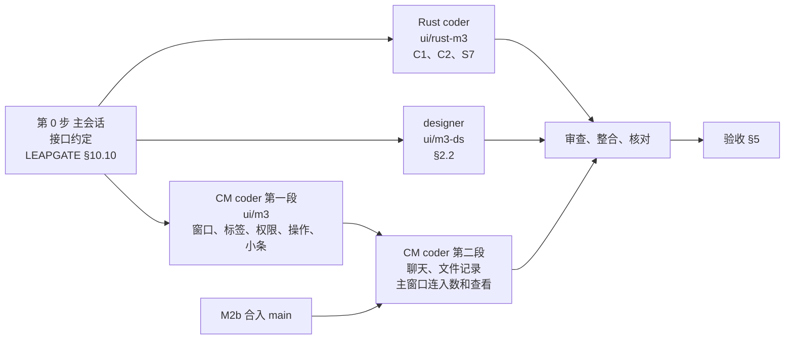

# 新界面 M3：被控端连接管理小窗（CM）的拆法

2026-10-31 起草；同日维护者把 §8 的 M3-1 按推荐定，决定已回写 03（§5.2 M3）和 01（§3.1 区块 A）。

- 依据：`03-实施方案.md`（下称"03"）§5.2 M3、§6.1 C1、C2、S7、§7.1；`01-内容与逻辑说明.md`（下称"01"）§3.3 P3 全部、§3.1 区块 A"正在连入"、§2.3；`02-第二轮内容与逻辑说明.md`（下称"02"）§0.4 第 2、11 条、§1.5.1（主题、界面模式、语言 CM 跟着变）、R2-Q16、§2.4.1；样稿 `样稿/A-P3.html`；`05-M2b拆法.md`（下称"05"）§9 N1（维护者定 M3 和 M2b 并行）；leapgate-client main（`f86ce27f7`）的 `LEAPGATE.md` §10。
- CM 是被控端有人连进来时弹出的小窗：谁在连、接受或拒绝、对方在做什么、能做什么、断开。它不在主窗口里，是被控服务用 `--cm` 另起的进程（01 §3.3）。
- M3 做完以后，新界面便携版可以单独使用：有人连进来时弹的是新 CM，不再是现在的空白占位窗口（03 §5.3）。装着旧界面的机器上，弹的仍是旧 CM（CM 由运行 `--server` 的那个程序拉起，03 §7.1）。
- 这份文档写 M3 做什么、分几段、谁做哪块、怎么验收、哪些不做，以及要维护者定的一条。确认后，决定回写进 03、01，动手的细节写进 `client/LEAPGATE.md` §10。

## 要点

1. 范围照 03 §5.2 M3：01 P3 全部，加主窗口本机区的"查看"（把 CM 提到前面）。
2. 聊天侧栏要用的聊天 model 和聊天面板，M2b 正在做（会话·其余和 designer 两路）。所以 M3 分两段：第一段现在就做窗口、来访标签、信息头、权限区、操作区、贴边小条、远程点击保护和三个 Rust 项；第二段等 M2b 合入 main 后做聊天侧栏、文件记录侧栏、主窗口的连入数和"查看"（§3）。
3. Rust 三项共用一个新的进程间消息变体（`ipc::Data` 末尾加 `Data::Leapgate(...)`，03 §6.1 C1 已定）：C1 分类型的连入数，出口另记在 `libs/leapgate`，不改上游的连接表；C2 主窗口把 CM 提到前面；S7 界面模式推给 CM（§2.4）。
4. 现在的 `--cm` 占位连 Rust 那一侧的 CM 初始化都没跑。新 CM 要照上游初始化，否则点接受、权限开关、聊天都到不了服务进程（§4.1）。
5. 要定的一条：主窗口"正在被远程控制（N 个会话）"在 C1 之后怎么数、怎么说（§8 M3-1）。

---

## 1. 范围

### 1.1 做什么

| 区域 | M3 做的 | 01 出处 | 段 |
|---|---|---|---|
| 窗口 | `--cm` 进程照上游初始化；紧凑态约 300×490、贴主显示器工作区右上角、置顶、不能改大小；展开侧栏时向左展开到约 700 宽；没有来访时不显示，约 6 秒没有来访就退出进程；新来访时显示并置顶 | §3.3 尺寸、状态 | 一 |
| 来访标签 | 每条连接一个标签（会话类型图标、名字、未读数），只有一个也显示；悬停显示连接编号 | §3.3 区块 | 一 |
| 信息头 | 头像（没有就用名字第一个字）、名字、ID、会话类型、状态行（请求中 / 已连接时长 / 已断开；语音期间换成"正在请求语音通话…""语音通话中"）；颜色跟主题 | §3.3 区块 | 一 |
| 会话类型的样子 | 远程桌面、文件传输、查看摄像头、终端、端口转发（显示目标）、作为出口（一句说明，没有权限区和聊天） | §3.3 区块 | 一 |
| 权限区 | 带文字的开关，两列：远程桌面八项、摄像头两项，其余会话和已断开时不显示；内置选项禁止改时整块只读 | §3.3 区块 | 一 |
| 操作区 | 接受、拒绝、接受并提升权限（便携版能提权时）；审批方式为"输入密码"时"对方正在输入密码…"加拒绝；断开、提升权限；撤销交换；已断开时关闭；语音来电的接听、拒绝，通话中的麦克风选择、挂断 | §3.3 操作区表 | 一（语音的麦克风选择在二） |
| 贴边小条 | 授权后收成贴边小条（密码直接通过的 3 秒后，点接受或提权的当场；在完整小窗里按下或移动鼠标取消这次自动收起）；一个连接时按会话类型的文案加时长加"断开"，几个连接时"N 个会话进行中"加"展开"；沿屏幕上边左右拖动、位置记住；点空白或"展开"恢复 | §3.3 状态 | 一 |
| 远程点击保护 | 控制方在画面里点 CM（含小条）不算数，按钮旁提示"无法远程执行此操作"；照上游 120 ms 的判断，`allow-remote-cm-modification` 开着时放行 | §3.3 状态、02 §0.4 第 2 条 | 一 |
| 关窗 | 多于一个连接时始终确认"断开全部会话？"，不读主窗口的关窗确认选项（R2-Q16） | §3.3 状态 | 一 |
| 跟随主窗口 | 主题、语言、界面模式跟着主窗口变；详细模式在 CM 里只换尺寸，不显示连接方式 | §2.3、02 §1.5.1 | 一（界面模式在二，等 M2b 的界面模式接线） |
| 聊天侧栏 | 消息列表、输入框；对方断开后只读 | §3.3 区块 | 二 |
| 文件记录侧栏 | 动作（上传到本机、从本机下载、删除、新建文件夹、重命名）、文件名、大小、进度或结果；空状态 | §3.3 区块、02 §0.4 第 11 条 | 二 |
| 主窗口本机区 | "正在被远程控制（N 个会话）"按 §8 M3-1 数和说；"查看"把 CM 提到前面（C2） | §3.1 区块 A | 二 |

### 1.2 和 03 原文不同的几处

| 项 | 03 原写 | 这里 | 理由 |
|---|---|---|---|
| 先后 | M3 一块做完 | 分两段，聊天、文件记录、主窗口两项等 M2b 合入 | 聊天 model 和面板、主页本机区都在 M2b 里改，同时改会冲突 |
| C1 怎么区分出口 | 看 `port_forward_mux.leapgate_exit` | 出口连接的编号另记在 `libs/leapgate`，数的时候和上游连接表对一下 | 上游的连接表（`AUTHED_CONNS`）里出口和普通端口转发是同一种类型，按 03 的写法要给上游结构加字段（§2.4） |

## 2. 组件、页面和 Rust

### 2.1 现成的

M0、M2a 的按钮、开关、勾选、标签、提示气泡、状态文字、确认框、令牌和画廊；M2b 正在做的聊天面板（第二段用）。

### 2.2 新组件（designer）

规则同 `LEAPGATE.md` §10.8"组件约定"。

| 组件 | 样稿画框 |
|---|---|
| CM 外框（可拖动的标题区、"收起""关闭"）、紧凑和展开两种宽度 | `p3-rc-light`、`p3-chat-light` |
| 来访标签条（类型图标、名字、未读数） | `p3-tabs-light`、`p3-tabs-dark` |
| 信息头（头像、名字、ID、类型、状态行、侧栏按钮） | `p3-rc-light`、`p3-req-click-light` |
| 出口、端口转发、终端、摄像头几种会话的信息区 | `p3-exit-light`、`p3-port-light`、`p3-term-light`、`p3-cam-light` |
| 权限区（带文字的开关两列、只读态） | `p3-rc-light`、`p3-rc-detail-light` |
| 操作区的几种组合 | `p3-req-*`、`p3-rc-elev-light`、`p3-rc-swap-light`、`p3-call-*`、`p3-gone-*` |
| 贴边小条（一个连接按类型的文案、几个连接） | `p3-pill-*` |
| 远程点击被拦下的提示 | `p3-block-light`、`p3-pill-block-light` |
| 文件记录侧栏（列表行、空状态） | `p3-file-light`、`p3-file-empty-light` |
| 聊天侧栏的只读态（在 M2b 的聊天面板上补） | `p3-chat-ro-light` |
| 关窗确认 | `p3-close-light` |

### 2.3 页面和逻辑（一个 coder）

- **初始化**：`--cm` 分支照上游 `flutter/lib/main.dart:285-302` 初始化平台接口的 CM 分支（它会调 Rust 的 `cm_init`），登记 CM 的全局事件（`add_connection`、`on_client_remove`、`show_elevation`、`update_voice_call_state`、`cm_file_transfer_log`、`chat_server_mode`、`theme`、`language`），都登记在 `appCore.events` 上（`LEAPGATE.md` §10.6）。新 CM 不读 `hide_cm`（03 §5.2 M3）。
- **复制件**：`flutter/lib/models/server_model.dart` 复制进 core，CM 用到的部分（客户端列表、增删、接受和拒绝、断开、提权、撤销交换、语音状态、关闭全部）按"只删界面调用"保留，主窗口和 Android 的部分（密码、ID、起停服务）整段删掉；`cm_file_model.dart` 第二段复制。标签不用上游的 `DesktopTabController`，用自己的列表。
- **窗口**：尺寸、位置、置顶、贴边小条用 `window_manager`；runner 里 CM 现在给的是 800×600（`app/windows/runner/main.cpp`），改成和 Dart 一致的初值。隐藏照上游用透明加隐藏，不销毁窗口。
- **定时**：没有来访约 6 秒退出、授权后的自动收起、取消收起的条件，照上游 `server_model.dart:133-190`、`:571-590`。
- **远程点击保护**：照上游 `server_page.dart:1237-1253`（Rust 的 `cm_check_click_time`、`cm_get_click_time`），被拦下时显示提示。
- **关窗**：多于一个连接时始终确认，不读 `enable-confirm-closing-tabs`（R2-Q16）。

### 2.4 Rust（一个小 coder）

三项共用 `ipc::Data` 末尾新加的 `Data::Leapgate(leapgate::ipc::Msg)`，子类型定义在 `libs/leapgate`（03 §6.1 C1）。上游的 `Data` 枚举两头都有兜底的 `_ => {}`，主进程一侧（`src/ipc.rs` 的 `handle`）和 CM 一侧（`src/ui_cm_interface.rs` 的消息循环）各加一处分发，否则新消息被静默吞掉。

| 编号 | 做法 | 上游文件 |
|---|---|---|
| C1 | 出口连接的编号在已有的 Leapgate 出口挂钩里记进 `libs/leapgate`（出口在登录时就判定了）；数的时候按上游连接表（`AUTHED_CONNS`，有远程桌面、文件传输、端口转发、摄像头、终端五种）分类，端口转发里编号在出口表中的算出口，出口表里已经不在连接表的编号顺手删掉（V1 的做法）。主窗口经 `Data::Leapgate` 向服务进程查询 | `src/ipc.rs` 一个变体加主进程一侧分发一处；出口编号如果在现有挂钩里拿不到，`src/server/connection.rs` 加一行 |
| C2 | 主窗口经 `Data::Leapgate` 发给 CM 进程，CM 一侧推一个界面事件，界面自己把窗口提到前面 | `src/ui_cm_interface.rs` 分发一处；推事件放 `libs/leapgate` 和块 2 的 `StreamSink`，不往上游的 `InvokeUiCM` 加方法（`LEAPGATE.md` §10.1） |
| S7 | 照主题、语言的做法（`src/flutter_ffi.rs:1616-1626`），界面模式改了以后经 `Data::Leapgate` 推给 CM | 无（变体由 C1 加） |

- 已知限制：升级时如果新旧版本的进程短暂同时在跑，旧进程收到新变体会解码失败（上游 `Data::DrmCursor` 的注释里写过同类问题）。新界面便携版和旧界面不同时运行（03 §7.1），日常碰不到，写进 `LEAPGATE.md`。
- C1 在 M6 也要用（关出口前的确认），这次一并做完。

## 3. 分工和先后

- **第 0 步（主会话）**：写 `client/LEAPGATE.md` §10.10：组件接口、文件边界、`Data::Leapgate` 的消息定义、CM 的事件登记表。
- **第一段**：Rust、designer、CM coder 三路，从 main 切 `ui/m3`，再各切一条。CM 的文件放 `app/lib/cm/`；组件放 `app/lib/widgets/` 下的新文件；core 加 `models/server_model.dart` 和 `leapgate/` 下的新文件。和 M2b 各路重叠的只有 `app/lib/main.dart`（M2b 主页块改界面模式那几行，M3 改 `--cm` 分支）和画廊的入口，整合时合并相邻行。
- **第二段**：M2b 合入 main 以后，把 main 合进 `ui/m3`，同一个 CM coder 接着做聊天侧栏、文件记录侧栏、主窗口的连入数和"查看"、界面模式跟随。
- 审查、整合、核对照 M2b 的做法（05 §3），每块一轮。
- M2b 正在跑五路，M3 第一段再加三路。用量吃紧、并发被限时，M2b 先走（它在关键路径上），M3 排队。

## 4. 几处要先说清的

### 4.1 初始化和文件传输

上游 CM 进程启动时初始化平台接口的 CM 分支，Rust 侧由此起 CM 的进程间通道：接受、拒绝、权限开关、聊天、语音都经它到服务进程。Windows 安装版上，文件传输的读写也交给 CM 进程做（02 §2.4.1）。M3 照上游初始化，不改 Rust 的这条路；M8 切换之前新界面只有便携版，安装版那条路在切换前的冒烟里验。

### 4.2 一条连接的两次事件

同一条连接会先后收到"未授权""已授权"两次 `add_connection`，第二次只改授权状态；`on_client_remove` 不带关闭标记时只标成已断开，要用户点"关闭"才删，同一个人重新连进来时自动删掉旧的那条。照上游 `server_model.dart:525-569`、`:696-721` 的规则做，不改。

### 4.3 远程点击保护

判断的是"这次本地点击是否比对方最近一次远程输入晚 120 ms 以上"，要经进程间通道问一次服务进程，所以按钮的动作会晚约 120 ms 才执行。照上游做，界面上被拦下时才提示。

### 4.4 主题、语言、界面模式

CM 启动时读当前设置；运行中主窗口改了，主题、语言经上游已有的消息推过来（`theme`、`language` 事件），界面模式经 S7 推。语言照 IQ10 只有简体中文和英文，跟随系统而系统是其他语言时用英文。

2026-11-01 改：设置页到 M6 才有，在那之前新界面主窗口和 CM 的主题、语言都跟随 Windows 系统设置，不读旧界面写的 `theme`、`lang`（旧界面设过的新界面不认）；M3 只做界面模式经 S7 跟随主窗口。`theme`、`language` 事件随 M6 设置页接上。§5 验收里"主窗口改主题、语言，CM 跟着变"相应改成"系统切深色，主窗口和 CM 一起变"。

## 5. 验收

记录写进 `client/LEAPGATE.md` §10.5，每条写通过、不通过或未验证。

### 5.1 自动测试

- core：客户端列表的增删和两次事件、已断开的保留和清理、自动收起的取消条件、没有来访时退出的计时（用假时钟）、C1 的分类计数，各有单测。
- app：每种会话类型、请求中的两种审批方式、语音的几种状态、多个标签、贴边小条的两种、远程点击被拦下、关窗确认，各一个行为测试。
- Rust：C1 的分类（含出口表清理）、`Data::Leapgate` 的编解码有单测。

### 5.2 真实连接，无人值守

被控端用新界面便携版（带补丁 0003 的构建，UI Automation 按语义标签操作 CM），控制端用旧界面或新界面。端点和做法照 04 §6.3 和私有运行手册。

- 03 §5.2 M3 的几项：三种审批方式各连一次（输入密码、在本机接受、两者都可）；出口会话显示"作为出口"；断开全部会话的确认。
- 权限开关在会话中关掉、打开，控制端看到对应的变化（例如关掉键盘和鼠标后控制端"输入"菜单灰显，M2b 做了的话）。
- 文件传输一次，文件记录侧栏有记录（第二段）。
- 聊天两端各发一条（第二段）。
- 控制端在远程画面里点 CM 的"断开"，不生效并出现提示。
- 主窗口改主题、语言，CM 跟着变；主窗口"查看"把 CM 提到前面（第二段）。
- 没有来访约 6 秒后 CM 进程退出。
- 旧界面五项冒烟一次：`Data` 枚举加了变体，确认旧界面的 CM（接受、权限、聊天）照常。

### 5.3 和样稿对照、最新 stable 检查

`A-P3.html` 全部画框，浅色深色各一次，必修项清零（03 §8.4）；最新 stable 检查四步（03 §8.8）。

### 5.4 维护者试用时看的

- 贴边小条沿屏幕上边拖动、位置记住；多显示器时出现在主显示器上。
- 语音通话的接听、麦克风选择、挂断（要真实麦克风）。
- 自动收起的时机和取消（在完整小窗里移动鼠标）。

## 6. 明确不做

- 新 CM 不读 `hide_cm`（03 §5.2 M3）。
- CM 不显示连接方式（01 §4.2）。
- 第四期统一验收里挪到新界面的几项，要等 M3~M6 都做完再跑（03 IQ11），不在 M3。
- 安装版的 CM（切换之前新界面只有便携版，03 §7.2）。
- Rust 除 C1、C2、S7 外不加挂钩和导出。

## 7. 工作量

03 粗估 M3 2~3k 行 Dart；Rust 110~200 行（C1 60~100、C2 30~60、S7 20~40）。第一段约占七成。

## 8. 要维护者定的

2026-10-31 维护者：按推荐定。

| 编号 | 问题 | 推荐 | 备选 | 代价 |
|---|---|---|---|---|
| M3-1 | 主窗口本机区"正在被远程控制（N 个会话）"在 C1 之后怎么数、怎么说 | N 数全部传入会话（远程桌面、文件传输、终端、摄像头、端口转发、出口）。至少有一个远程桌面或终端会话时写"正在被远程控制（N 个会话）"；只有文件传输、摄像头、端口转发、出口这些不操作本机的会话时，写"‹N› 个传入会话进行中"（和贴边小条几个连接时的说法一致） | 一：N 数全部，一律写"正在被远程控制（N 个会话）"；二：照现在只数远程桌面（上游的数），C1 推到 M6 再做 | 推荐：多一条文案（01 §3.1 区块 A 补上）；备选一：只有人在用出口时也说"正在被远程控制"，和 01 P3 强调出口"无法查看本机屏幕"的说法矛盾；备选二：别人在传文件、用出口时本机区什么都不显示 |
