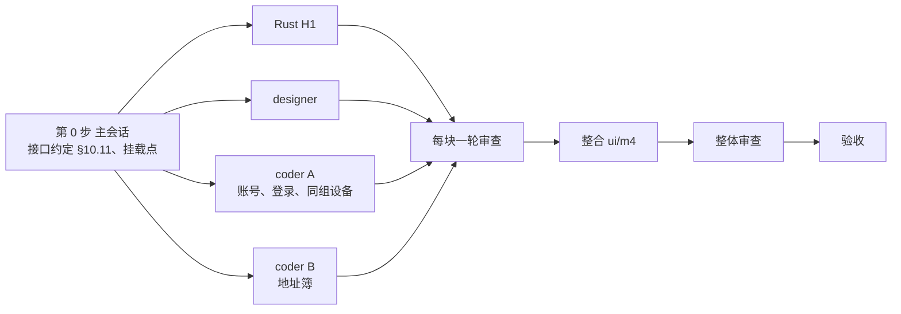

# 新界面 M4：账号、地址簿、同组设备的拆法

2026-11-01 起草；2026-11-02 维护者把 §8 的 M4-1~M4-9 全部按推荐定，决定已回写 03（§5.2 M4、§6.1 H1）和 01（区块 K）。

- 依据：`03-实施方案.md`（下称"03"）§5.2 M4、§6.1 H1、IQ7（账号和地址簿走严格 TLS、不回退）、IQ8（不保留旧版 `/api/ab`）；`01-内容与逻辑说明.md`（下称"01"）§3.1 区块 D（账号区）、E（连接框）、F（设备列表）、G（地址簿）、H（同组设备）、K（登录对话框）、§4.4、§5.3、§7.6；`02-第二轮内容与逻辑说明.md`（下称"02"）§1.5.2（API 地址）、§1.5.3（账号）、§3.6（标签颜色）；服务端 `server/LEAPGATE.md` §9、§11、§12。
- M4 做完，新界面主页的五类设备（最近、收藏、局域网、地址簿、同组设备）就都有了，登录、退出也在新界面里做。设置页里的"账号"一节属于 M6，M6 直接复用 M4 的账号 model 和登录对话框。
- 这份文档写 M4 做什么、谁做哪块、怎么验收、哪些不做，以及要维护者定的九条。确认后，决定回写进 03、01，动手的细节写进 `client/LEAPGATE.md` §10。

## 要点

1. 范围照 03 §5.2 M4：01 区块 D、G、H、K，加上区块 E、F 里留给 M4 的地址簿和同组设备部分（分类、卡片和列表的备注、设备菜单和多选条的地址簿项、连接框搜索、连接时带共享密码）。
2. 前置是 Rust 项 H1：账号、地址簿、同组设备的 HTTP 请求全部挪进 Rust（`libs/leapgate` 新增 account 模块，块 2 导出约 18 个），令牌只在 Rust 里读写。H1 和界面四路同时开工，界面先用测试里能换掉的取值函数。
3. 读码发现三处要先说清的：①登录的 401 在 Leapgate 服务端表示"密码错"，不能当成"令牌失效、退出登录"（§4.1）；②Rust 连接时会读地址簿缓存 `_ab`，用个人簿里存的密码自动登录，新界面不写这份缓存，这个功能就静默失效，所以缓存由 H1 写（§4.2）；③兼容服务器 rustdesk-api 有两处不合约定（`ab/peers` 不分页、人员和设备列表的分页参数名不同），H1 兼容到"不出错"（§4.3）。
4. 03 §5.2 M4 写了"登录对话框含 2FA 和邮箱验证码"，但 01 和样稿都写"不画"，Leapgate 服务端和 rustdesk-api 也都不会要求验证码（只有官方 Pro 版会）。建议不做，改掉 03 那两句（§8 M4-1）。
5. 要定的九条在 §8，最要紧的是 M4-1（验证码登录做不做）、M4-2（缓存和合并逻辑放哪）、M4-3（令牌经不经过 Dart）。

---

## 1. 范围

### 1.1 做什么

| 区域 | 内容 | 出处 |
|---|---|---|
| 左栏账号区 | 没登录："登录"和一行说明；已登录：头像（显示名第一个字）、显示名、展开菜单（账号信息 @用户名、退出登录，退出前页内确认） | 01 区块 D；文案 02 §1.5.3 |
| 登录对话框 | 用户名（预填上次的）、密码、登录；"请输入用户名""请输入密码"、服务器返回的错误、"正在登录…"、"无法获取登录选项。请检查网络连接。"加重试 | 01 区块 K |
| 分类 | 地址簿、同组设备加进分类条；内置选项禁用账号、地址簿、组面板时隐藏 | 01 区块 F |
| 地址簿 | 簿切换下拉（个人簿第一、共享簿按名排、能搜索、权限文字和所有者）、标签筛选条（"未标记"、多选、"匹配全部所选标签"）、"更多"菜单（添加设备、添加标签、取消选择所有标签、与最近会话同步；只读簿隐藏写操作）、标签右键（重命名、修改颜色、删除）、刷新 | 01 区块 G |
| 同组设备 | 人员列表（自己第一带"我"、点人筛选、再点取消、带搜索）、右侧设备 | 01 区块 H |
| 列表状态 | 加载中、空（两类各一）、没登录（两类各一句加登录按钮）、服务器不提供地址簿、网络错误加重试、服务器报错横幅加重试 | 01 区块 F 状态表 |
| 设备卡片和列表 | 地址簿和同组设备的卡片多一行备注、列表视图多一列备注；共享簿存了密码显示钥匙 | 01 区块 F |
| 设备菜单、多选条 | 管理组补加入地址簿、编辑标签、编辑备注、设置共享密码、查看所在地址簿；危险组补"从地址簿中删除"；只读簿写操作灰显并在组标题旁写一次"此地址簿为只读"；同组设备只有连接方式和"加入地址簿"；多选条补"加入地址簿""编辑标签" | 01 区块 F；05 §1.3 列给 M4 的项 |
| 连接框 | 搜索扩到地址簿、同组设备；没加载过的分类在结果末尾显示"正在加载其他分类…"；匹配加上备注 | 01 区块 E |
| 连接 | 从地址簿连接时带上共享密码 | 01 区块 F |
| 对话框 | 添加设备（提交中、ID 重复、簿满、服务器报错）、修改标签颜色（预设色、自定义色轮和 #RRGGBB）、添加标签、重命名标签、编辑标签、编辑备注、设置共享密码、加入地址簿、查看所在地址簿、删除确认 | 01 区块 G、K，§4.4；02 §3.6 |
| 后台 | 启动和登录后拉账号、地址簿、组；令牌失效时清登录；"与最近会话同步"；连接成功后把密码同步进个人簿（Rust 推的 `sync_peer_hash_password_to_personal_ab` 事件） | 上游 `user_model.dart`、`ab_model.dart` |

### 1.2 和 03 原文不同的几处

- 登录的 2FA 和邮箱验证码不做（M4-1）；03 §5.2 M4 范围和验收里那两句改掉。
- H1 实际类型化 18 个端点（不调 `/api/device-group/accessible`，M4-6）；03 写的是 19 个。
- H1 除了请求，还负责写和删地址簿、组两份本地缓存（M4-2）；03 写的是"缓存要不要挪进 Rust，第一步做完再看"。

---

## 2. 组件、页面和 Rust

### 2.1 现成的

M2b 的分类条、列表工具条、设备卡片（已有标签小块、钥匙、勾选）、列表视图、菜单（已有组标题旁说明和灰显说明）、多选条、空状态、横幅、确认框、输入框、按钮、开关、提示气泡、轻提示。

### 2.2 新组件（designer）

对照 `A-P1.html` 的画框：

| 组件 | 画框 |
|---|---|
| 账号区（没登录、已登录、菜单向上展开、退出的页内确认条） | `p1-acct-out`、`p1-acct-in`、`p1-acct-menu` |
| 登录对话框（默认、缺用户名、缺密码、服务器错误、登录中、拿不到登录选项） | `p1-dlg-login` 及 `-nouser`、`-nopw`、`-server`、`-busy`、`-neterr` |
| 簿切换下拉（搜索、权限文字和所有者、底部说明） | `p1-ab-switch`、`p1-ab-editable`、`p1-ab-readonly` |
| 标签筛选条（"未标记"、选中态描边加勾） | `p1-ab-tags`、`p1-ab-tags-dark` |
| 地址簿"更多"菜单（可编辑、只读） | `p1-ab-more`、`p1-ab-readonly` |
| 同组设备的人员列表（"我"标记、选中行的 ×、搜索） | `p1-group` |
| 卡片的备注行、列表视图的备注列 | `p1-ab-editable` |
| 列表状态（没登录加登录、网络错误加重试、报错横幅、两类空、加载中骨架） | `p1-st-*` |
| 添加设备对话框（含提交中、ID 重复、簿满、报错） | `p1-dlg-add` 及变体 |
| 修改标签颜色对话框（预览、预设色、色相环加明度条、#RRGGBB、格式错误、提交中、失败） | `p1-tagcolor-*` |

色轮自己画，不引第三方依赖。"服务器不提供地址簿"样稿没画，用空状态的样式套一句话。其余小对话框（添加标签、重命名、编辑标签、编辑备注、设置共享密码、加入地址簿、查看所在地址簿）照添加设备的样式拼，不单独出组件。

### 2.3 页面和逻辑（两个 coder）

- **coder A（账号、登录、同组设备）**：core 新写 `leapgate/account.dart`、`leapgate/group.dart`（改写上游 `user_model.dart`、`group_model.dart`，HTTP 换成 H1 导出）；app 新目录 `pages/home/account/`（账号区、登录对话框、退出确认）、`pages/home/group/`（人员列表、同组设备分类）；`peer_tabs.dart` 的 `isEnabled`；启动时拉取的顺序（当前用户 → 地址簿和组）；令牌失效后全局复位。
- **coder B（地址簿）**：core 新写 `leapgate/address_book.dart`（改写上游 `ab_model.dart`，旧版 `LegacyAb` 整段不要，"与最近会话同步"的比对规则照上游，`sync_peer_hash_password_to_personal_ab` 登记在全局事件）；app 新目录 `pages/home/address_book/`（簿切换、标签条、更多菜单、标签右键、地址簿的全部对话框、设备菜单和多选条里的地址簿项、横幅）；连接时带共享密码；连接框搜索扩到地址簿和同组设备（同组设备的数据读 A 的 model）。
- 上游 `user_model.dart`、`ab_model.dart`、`group_model.dart` 都按"改写"处理（不整份复制），文件头登记来源行（`client/LEAPGATE.md` §10.1）。`common/hbbs/hbbs.dart` 里 `PeerPayload → Peer` 的转换和 `ShareRule` 照抄，其余用导出的 JSON 解析。

### 2.4 Rust（一个 coder，H1）

- `libs/leapgate/src/api.rs` 加一个通用的带 Bearer 的请求函数（方法、路径、查询、JSON 体），沿用现有的严格客户端（系统根证书加 webpki、不跟随重定向、不回退、按上游规则走代理）。
- 新模块 `libs/leapgate/src/account/`：账号 4 个端点、地址簿 12 个、人员和设备列表 2 个；分页循环；写接口的结果统一成 `ok / unauthorized / not_found / conflict / unsupported / network / server(文字)` 几种；拉取成功后写 `_ab`、`_group` 缓存，退出和令牌失效时删。
- `src/leapgate_ffi.rs` 末尾加约 18 个导出（登录、登出、当前用户、登录选项、读缓存、拉簿列表、拉一本簿、写操作约 9 个、拉人员和设备），都是异步回 JSON；登录要的设备信息、ID、UUID 由导出在 `src/` 取好传进去。上游文件（`src/flutter_ffi.rs`、`src/client.rs`）不动。
- 令牌（`access_token`）和 `user_info` 照原来的本地配置键和格式写：Rust 别处（审计、出口目录、登录消息里的显示名、M2b 的本机显示名导出）都在读它们。
- 估 1150~1650 行（含单测和对两种服务器的集成测试），比 03 原估多出的是缓存和集成测试。

---

## 3. 分工和先后

1. **第 0 步（主会话）**：把 H1 每个导出的名字、参数、返回 JSON 和错误种类写进 `client/LEAPGATE.md` 新一节 §10.11；定 core 里账号、地址簿、组三个 model 的公开接口（A、B 互相要用）；在 `devices_page.dart`、设备菜单、多选条、连接框里给 A、B 放挂载点（M2b 的做法）。分支 `ui/m4`。
2. **四路并行**：Rust `ui/rust-h1`、designer `ui/m4-ds`、A `ui/m4-account`、B `ui/m4-ab`。两个 coder 都碰的只有 `devices_page.dart`、设备菜单、连接框和 ARB，只往第 0 步留好的函数里填；ARB 键名 A 用 `account`、`login`、`group` 开头，B 用 `ab` 开头。
3. 每块一轮审查，合进 `ui/m4`，换上组件和真实导出，整体审查（代码接缝一路、对照 01 一路），再验收。
4. 用量吃紧时按 Rust → B → A → designer 的顺序排：Rust 量最大、最早能单独对服务器测；B 的 Dart 量约占六成。

---

## 4. 几处要先说清的

### 4.1 两种 401

Leapgate 服务端登录接口用 401 表示用户名或密码错；其他接口的 401 表示令牌无效或账号被禁用。H1 把登录的 401 报成"密码错"，其他接口的 401 报成 `unauthorized`，界面收到后者才清登录、复位三个 model。上游对 `currentUser` 还有"400 只清令牌"的规则，照抄。

### 4.2 地址簿缓存和个人簿自动填密码

Rust 连接时（`src/client.rs` 的 `try_get_password_from_personal_ab`）读 `_ab` 缓存：缓存里的令牌和当前令牌相同时，用个人簿里这台设备存的密码哈希自动登录。新界面要保住这个功能，缓存格式和失效规则都照旧，由 H1 在拉取成功后写（个人簿加当前簿，带当前令牌）。验收时连一台存过密码的设备，看是否免输密码。

### 4.3 兼容服务器的两处不合约定

- `ab/peers` 不看分页参数，每次都回同样的前 1000 条：分页循环按 ID 去重，某一页没有新 ID 就停。超过 1000 台的簿照上游截断。
- `users`、`peers` 的分页参数叫 `page`，客户端发 `current`：查询同时带两个。

两处都是读码推断，H1 对测试实例跑一次确认。

### 4.4 "服务器不提供地址簿"怎么判

只有 `/api/ab/personal` 回 404 时算"不支持"（IQ8），界面显示 01 区块 F 那句；`settings`、`shared/profiles` 回 404 当普通错误（两种服务器都实现了这两个）。

---

## 5. 验收

记录写进 `client/LEAPGATE.md` §10.5，每条写通过、不通过或未验证。

### 5.1 自动测试

- Rust：每个端点的请求序列化、响应解析、状态码映射（两种 401、`personal` 404、分页去重和停止条件）；对两种服务器的集成测试（`#[ignore]`，地址和测试账号由环境变量给）。
- core：地址簿的权限判断、只读簿灰显项、标签筛选（并集和交集）、与最近同步的比对、退出后状态清空、令牌失效复位。
- app：每个页面状态一个行为测试（没登录、加载中、空、网络错误、报错横幅、不提供地址簿、只读簿菜单、各对话框的出错态）。

### 5.2 对 Leapgate 服务端的测试服务

登录（含密码错、限流）、当前用户、退出（令牌删掉、设备主人按服务端 §11 处理）、个人簿全部写操作、共享簿三级权限（只读的写操作被拒）、簿满、标签改名和删除、标签颜色、同组设备（先用命令行建两个账号、一本共享簿、三种权限和一个共享组）、个人簿自动填密码（§4.2）。

### 5.3 对 rustdesk-api 测试实例

在 Linux 测试机上用 Docker 起一份（钉版本，不碰现网）：账号 4 个端点（含登录选项回 `common-oidc/…` 时照常能用账号登录）、新版地址簿各端点和共享簿权限、簿大小不限、§4.3 两处不合约定、设备组有数据时新界面不显示。

### 5.4 只能用假 model 或假服务的

旧版服务端（`personal` 回 404）、推送失败的横幅、令牌中途失效（Leapgate 服务端上用命令行改密码也能触发，算真测）。Rust 侧可以在测试里起一个最小的假 HTTP 服务。

### 5.5 和样稿对照、最新 stable 检查

`A-P1.html` 账号和地址簿相关画框（§2.2 的表）浅色深色各一次，必修项清零；最新 stable 检查四步，第 1 步带 `-ForceBridge`（M3 验收时发现不强制时会跳过代码生成）。

### 5.6 维护者试用时看的

登录和退出、在自己的共享簿里改标签和颜色、从地址簿连接（共享密码）、同组设备的人员筛选。

---

## 6. 明确不做

- 登录时的 2FA、邮箱验证码、第三方登录（M4-1；01 已去掉第三方登录）。
- 旧版地址簿 `/api/ab`（IQ8）。
- 设备组（01 区块 H 已去掉）。
- 手机端的账号和地址簿（手机排在桌面之后）。
- 设置页的"账号"一节（M6，复用 M4 的 model 和对话框）。
- "与最近会话同步"等合并规则挪进 Rust（M4-2，M4 做完再看）。

---

## 7. 工作量

Dart 约 3~5k 行（03 原估），地址簿那一路约占六成；Rust 约 1150~1650 行。B 那一路偏重时，把"与最近会话同步"和地址簿对话框拆给第三个 coder。

---

## 8. 要维护者定的

| 编号 | 问题 | 推荐 | 备选 | 理由和代价 |
|---|---|---|---|---|
| M4-1 | 登录要不要做邮箱验证码和 2FA | **不做**，按 01 和样稿；服务器回的登录结果要求验证码时，报一种错误"此服务器要求验证码登录，Leapgate 暂不支持"；03 §5.2 M4 那两句改掉 | 一：照上游做验证码对话框（邮箱码、TOTP），只用假 model 验；二：只做 TOTP | 两种支持的服务器都不会要求验证码，做了没有真实环境能测，样稿也没画。代价：将来连开了 2FA 的官方 Pro 版服务器时登不上（Pro 不在支持范围） |
| M4-2 | 地址簿的缓存和合并逻辑放哪 | 拉取链和 `_ab`、`_group` 缓存进 Rust；"与最近会话同步"等合并规则留在 Dart，M4 做完再看 | 一：全部进 Rust，Dart 只订阅事件；二：缓存也留在 Dart（照上游） | 缓存的唯一读者是 Rust（个人簿自动填密码），由它写最不会错。备选一 Rust 多 500 行以上，还要有长期状态和定时器；备选二令牌要进 Dart、缓存格式靠两边对齐 |
| M4-3 | 令牌经不经过 Dart | 不经过：登录、拉取、写操作都由 Rust 读写令牌，Dart 只知道"已登录、是谁"。地址簿里存的密码哈希和共享密码仍回给 Dart（发起连接时要传） | 照上游，Dart 也读令牌 | 03 原文就是"令牌在 Rust 里读写"。密码也不回给 Dart 的话，要改会话的建立接口（按簿在 Rust 里查），改动大，第一步不值得 |
| M4-4 | 登录对话框要不要先取登录选项 | 要，只用来判断"能不能连上 API 服务器"，结果里的第三方登录项一律忽略 | 不取，直接登录，连不上时把网络错误显示在密码框下 | 推荐和 01、样稿的"无法获取登录选项"状态一致；只看"能不能拿到"，不解析内容，避开 rustdesk-api 回 `common-oidc/null` 时的类型问题。备选少一个请求和一个状态，但要改 01 |
| M4-5 | 同组设备只能看到自己时怎么显示 | 照常：人员列表只有"我"一行，右侧是自己的设备 | 只有自己时隐藏人员列表 | 不在共享组的普通用户两种服务器都只回自己。推荐不加判断；备选省地方但多一条状态 |
| M4-6 | `/api/device-group/accessible` 还调不调 | 不调，H1 实际 18 个端点 | 照 19 个类型化，界面不显示 | 01 已去掉设备组，Leapgate 服务端恒回空；调了只多一个请求 |
| M4-7 | rustdesk-api 的两处不合约定要不要兼容 | 兼容到"不出错"（§4.3），超过 1000 台的簿照上游截断、不另提示 | 一字不差照上游的请求 | 推荐只有几行、不加状态；照上游时每次刷新会重复拉同一批 |
| M4-8 | API 地址要不要补上"程序文件名里带配置"那一支 | 不补，照现有的 `report::api_root()`，写进已知限制 | 补进去（要从 `src/` 传程序名） | 心跳、出口目录已经用同一个函数，账号请求和它一致，不会出现"心跳和登录发往两台服务器"；Leapgate 不发带配置的程序名，那一支只对上游定制版有意义 |
| M4-9 | 退出登录的连带清理 | Rust 一并删令牌、`user_info`、两份缓存；Dart 复位账号、地址簿、组三个 model 和出口目录。登出请求照上游 2 秒超时，失败也清本地 | 照上游：Dart 先发登出、超时后再分别清 | 效果和上游相同，清理集中在 Rust 一处 |

不用定、写进约定就行的：`personal` 404 才算"不提供地址簿"（§4.4）；两种 401 分开（§4.1）；`user_info` 原格式；新增 ARB 键。
