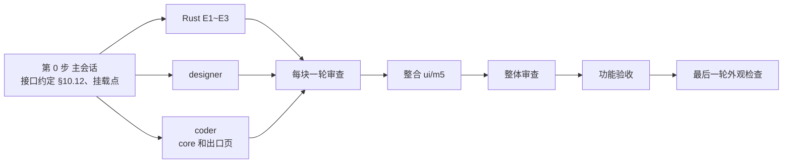

# 新界面 M5：出口页的拆法

2026-11-03 起草，待维护者定 §8 的 M5-1~M5-13。

- 依据：`03-实施方案.md`（下称"03"）§5.2 M5、§6.1 E1~E4、§8.5"第四期挪来的几项"；`01-内容与逻辑说明.md`（下称"01"）§2.1（导航、主页标签、关窗）、§3.1 区块 E、F（"用作出口"入口）、区块 I（出口页）、§4.3、§4.6、§5.4、§7.6、§8 Q4、Q10；样稿 `样稿/A-P1.html` 的 `p1-exit-*`、`p1-ex-*`、`p1-xc-*`、`p1-close-exit`、`p1-cb-menu`、`p1-menu-more-top`；第四期契约 `docs/第四期实施契约/`、`client/LEAPGATE.md` §9（出口的实现）。读码基于 leapgate-client main `31a6e0667`。
- M5 做完，出口不再需要旧界面的 TCP 隧道窗口：在出口页上点"使用"就开本地代理、当场登录对方，卡片显示实时状态。出口设置（允许本机作为出口、放行网段）属于 M6。
- 这份文档写 M5 做什么、谁做哪块、怎么验收、哪些不做，以及要维护者定的十三条。确认后，决定回写进 03、01，动手的细节写进 `client/LEAPGATE.md` §10。

## 要点

1. 范围照 03 §5.2 M5：01 区块 I 的出口页（正在使用、可用的出口、按 ID 指定），设备菜单、连接按钮下拉和"连接到 ‹输入›"行里的"用作出口"，导航和主页标签上的数字和提醒标记，关窗时出口那句。
2. 前置是 Rust 的 E1~E3（E4 出口目录现成可用）。读码后做法和 03 原写有三处不同，都是为了不动上游文件（§1.2）：出口会话走上游现成的"命令行端口转发"分支，不换内存里的映射列表；登录放在 Leapgate 自己的 `exit.rs` 里新写一条"卡片模式"，旧界面的懒登录路径一行不动；状态用块 2 的一个全局事件流推给界面。上游文件只多约 6 行。
3. 读码发现三处要先说清的（§4）：①上游登录时会吞掉关闭信号，卡片在连接中点"取消"会被无视，卡片模式要自己处理；②出口会话不能交给新界面现有的会话连接状态和会话注册表，否则会被自动重试起第二份、抢同一个端口，关主窗口时还会被一起关掉；③单个目标被拦的提示现在以错误框的形式进会话事件流，要当通知、不能当失败。
4. 01 区块 I 有十几处没写清或和样稿对不上（"复制地址"按钮、"重新连接"的含义、端口建议值会撞、数字数哪些卡片、提醒标记何时消失等），在 §8 一起定，定了回写 01。
5. 要定的十三条在 §8，最要紧的是 M5-1（出口卡片的状态由谁管）、M5-2（要不要做二次验证态）、M5-6（端口怎么存、建议值怎么取）。

---

## 1. 范围

### 1.1 做什么

| 区域 | 内容 | 出处 |
|---|---|---|
| 出口页 | 一句说明 → 正在使用（卡片网格，每列至少 440 宽，按添加顺序）→ 可用的出口（目录加"刷新"）→ 按 ID 指定（输入框加"使用"） | 01 区块 I；`p1-exit-light`、`p1-exit-dark`、`p1-ex-inuse-empty` |
| 出口卡片 | 设备名和 ID；状态和连接方式（直连 / 经中继，实时）；两行本地代理地址各带复制；修改端口（卡片里原地编辑）；浏览器设置说明（展开）；停止 / 移除；卡片通知（目标被拦、虚拟地址，按原因去重、可关）。状态：正在连接、要密码（含输错）、要验证码（M5-2）、正在验证、等对方接受、在用、暂时断开、已停止（四种原因）、端口被占用 | 01 区块 I 卡片表；`p1-xc-*` |
| 目录 | 加载中、服务器不提供、没登录（带"登录"）、空、出错（带"重试"）；行：主机名（没有用 ID）、ID、"我的"或"所有者：‹用户名›"、"使用 / 使用中"；打开页面时取一次，不轮询 | 01 区块 I；第四期 D2、D6；`p1-ex-dir-*` |
| 入口 | 设备卡片和列表的"⋯"、连接按钮下拉、"连接到 ‹输入›"行的"⋯"里加"用作出口"（对端是 Windows 时才列，手输 ID 全列） | 01 区块 E、F、Q4；`p1-cb-menu`、`p1-menu-more-top` |
| 数字和提醒 | 导航"出口"和主页标签上的数字（M5-8），要处理时加提醒标记（M5-8） | 01 §2.1、区块 C、区块 I；`p1-ex-remind` |
| 关窗 | 有出口在跑时关窗确认加一句"‹N› 个出口将在后台继续运行。"；便携版退出时出口会停（M5-11） | 01 §2.1；`p1-close-exit` |
| 行为 | 点"使用"就开监听、当场登录（Q10、E1）；只起出口这一条映射的会话（E3）；实时状态（E2）；一台设备最多一张卡片；端口按设备记、重启后不自动恢复；关窗后在后台继续运行 | 01 区块 I、§4.6、§5.4；03 §6.1 |

### 1.2 和 03 原文不同的几处

- **E3**：03 写"建好会话后把内存里的 `port_forwards` 换成只有出口那一条"。读码发现那个字段是私有的，要在上游 `client.rs` 加写入函数，而且 `toggle_option` 会把内存里的整份设备配置写盘（`src/client.rs:3351`），有冲掉用户普通 TCP 隧道列表的风险。改成走上游现成的分支：端口转发会话的参数是三个时，`io_loop` 只起这一条映射、不读设备配置里存的列表（`src/ui_session_interface.rs:2050-2069`）。新导出照 `session_add` 抄一份，参数设成"端口、出口哨兵地址、65536"（M5-3）。
- **E1**：03 写"把 `connect_and_login_mux` 的本地 socket 参数改成可选"。改成在 `src/leapgate_hooks/exit.rs` 新写一条卡片模式的运行函数，旧界面走的懒登录 `run` / `serve` 不动（`client/AGENTS.md`：宁可少量重复，不改已验证的旧路径）。第一次登录时没有本地连接的问题见 M5-4。
- **E2**：03 写"状态经 `libs/leapgate` 的广播"。出口状态只在主界面进程里产生，改成块 2 一个全局 `StreamSink`（照 M3 的 `leapgate_cm_events`）。

---

## 2. 组件、页面和 Rust

### 2.1 现成的

按钮（含文字按钮）、输入框和错误行、密码框和验证码框（会话面板的）、记住密码勾选、横幅（带关闭）、空状态、状态文字和路径标记、转圈、设备头像底、数字徽标、确认框、关窗确认、轻提示、菜单项、提示气泡。会话页的原因码文案（`app/lib/pages/session/reasons.dart` 的 `reasonView`）卡片直接用。

### 2.2 新组件（designer）

| 组件 | 画框 |
|---|---|
| 出口页的版式（说明、三个小节标题、"刷新"、卡片网格、整页滚动） | `p1-exit-light`、`p1-exit-dark`、`p1-ex-inuse-empty` |
| 出口卡片：头（平台底、名称、ID）、状态行（经中继时的说明小字）、地址行（地址加复制，长了省略）、操作行、内嵌区（密码区、验证码区、通知、说明展开、改端口）；只收参数，不带逻辑 | `p1-xc-*` 全部；验证码态（M5-2）、端口被占用加"移除"、暂时断开加地址行（M5-10）要 designer 补 |
| 卡片里原地改端口（只收数字的输入框、确定、取消、一行提示、框下错误） | `p1-xc-port` |
| 浏览器设置说明的展开块（四条，最后一条含可选中的等宽启动参数） | `p1-xc-help` |
| 目录行（平台底、主机名、ID、我的 / 所有者、使用 / 使用中） | `p1-exit-light`、`p1-ex-inuse-empty` |
| 线性的不定进度条（新界面还没有） | `p1-ex-dir-loading` |
| 按 ID 指定行（输入框、"使用"、框下错误） | `p1-exit-light`、`p1-ex-id-err` |
| 导航项的数字和提醒标记；主页标签数字旁的提醒标记（`LgTitleBar` 的 `homeBadge` 之外再加一个开关） | `p1-ex-remind` |
| 滚到卡片后的短暂高亮（样稿没画，designer 定） | 无 |

深色只有整页 `p1-exit-dark` 一张，其余各态在验收时用画廊截图对照，不补样稿（M4 的做法）。

### 2.3 页面和逻辑（一个 coder）

Dart 估 1.5~2.5k 行（03 原估），core 和 app 接缝多，一个 coder 做。

- **core**（`core/lib/leapgate/`）
  - `exit_directory.dart`：目录 model。调 E4（`bind.mainGetCommon(key: 'leapgate-exits')`，回 `ok / unsupported / not_logged_in / error`）；没登录时不发请求；实现 M4 的 `AccountData`，退出登录时清空。目录回 `not_logged_in` 但账号区仍是已登录时（服务端回了 401），按 M4 的令牌失效走一遍（调 `leapgate_account_current_user` 确认）。
  - `exit_nodes.dart`：正在使用的卡片列表，进 `AppCore`：`use(id, {name})`（已有就返回那张）、`remove(id)`、数字、要不要提醒、端口（M5-6）。卡片只在内存里，重启不恢复。
  - `exit_card.dart`：一张卡片的状态（M5-1）。订阅出口会话自己的事件流和 E2；动作有提交密码、提交验证码、取消、停止 / 移除、重试 / 重新连接、改端口。
- **app**（`app/lib/pages/home/exit/`）：`exit_page.dart`（页面、滚到卡片和高亮、按 ID 指定）、`exit_card_view.dart`（卡片 model 到卡片组件的映射、文案）、`exit_directory_view.dart`（目录五态和行）。
- **接线**（各一两处）：`home_page.dart` 加出口页分支和导航数字；`main_window.dart` 给主页标签传数字和提醒；`window_close.dart` 加出口那句（M5-11）；`peer_list.dart` 加 `PeerAction.useAsExit`（按**对端**平台判断：菜单现在的 `windows:` 参数是本机平台，`peer_views.dart:236`）；`peer_views.dart`、`devices_page.dart` 两处下拉加菜单项；导航加"打开出口页并使用某台设备"（M5-9）。ARB 键用 `exit` 开头。
- 旧界面里照搬的：建议端口 21180 和避开常见代理端口的理由（`flutter/lib/leapgate/exit_tunnel.dart:15-17`）、端口 1~65535 不收 0（`:75-78`）、两种地址的写法（`:150-153`）、启动参数（`:196`）、目录的取值逻辑（`exit_nodes.dart:10-81`）。帮助文字按 01 区块 I 重写。

### 2.4 Rust（一个 coder，E1~E3）

| 导出（块 2） | 参数 | 返回 / 事件 |
|---|---|---|
| `leapgate_exit_session_add` | 会话 ID、设备 ID、端口、密码、是否共享密码、连接令牌、是否强制中继 | 成功 `{}`；`already`（这台设备已有出口或端口转发会话）、`invalid_port`、`other`。之后界面照常调 `bind.sessionStart` 拿这个会话的事件流 |
| `leapgate_exit_events` | `StreamSink<String>` | 新订阅替换旧的，订阅时先把每张卡片的当前状态各推一次。`{"id","port","state",…}`，`state` 取 `connecting`、`in_use`（带 `transport`: `direct` / `relay`）、`interrupted`（带 `cause`: `tunnel_ended` / `login_failed`）、`stopped`（Rust 知道原因时带 C3 原因）、`port_in_use`、`closed` |
| `leapgate_exit_retry` | 设备 ID | 清冷却、马上登录。"重试"（已停止）和"重新连接"（暂时断开）共用（M5-7） |
| `leapgate_exit_set_port` | 设备 ID、端口 | 换监听，隧道保留（M5-5）；新端口被占时进 `port_in_use` |
| 停止、取消 | 现成的 `bind.sessionClose` | 卡片模式收到关闭后关监听、关隧道，登录中也能取消（§4.1），推 `closed` |
| 目录 | 现成的 `bind.mainGetCommon(key: 'leapgate-exits')` | 不改 |
| 路径和中继名 | 现成的 `leapgate_session_connection` | 收到 `connection_ready` 后调 |

- 改动：`src/leapgate_hooks/exit.rs` 加卡片模式 +200~300 行（`run` 开头按卡片登记表分流，查不到就走原来的懒登录）；`src/leapgate_ffi.rs` +40；`libs/leapgate` 放状态类型和 JSON（可单测）+50~80；上游 `src/port_forward_mux.rs` 给 `Tunnel` 加一个只增不改的 `ended()` 约 6 行（M5-5 的备选为 0）。`port_forward.rs`、`ui_session_interface.rs`、`flutter.rs`、`flutter_ffi.rs`、`client.rs` 都不动。
- 守卫照 K0 的三种结局交还（`exit.rs:165-169`，`8aa45d77b` 修的那处），登录被拒时被控端的 CM 当场消失（§8.5 第 9 项复测）。
- 照抄 `session_add` 时去掉 `LocalConfig::set_remote_id`（`src/flutter.rs:1340`），免得连接框的"上次连接的 ID"变成出口设备。
- 关主窗口后在后台运行不用改 Rust：出口会话、本地监听、隧道都在主界面进程里，窗口隐藏后照常工作。

---

## 3. 分工和先后

1. **第 0 步（主会话）**：把四个导出的名字、参数、事件 JSON 和 `state` 的取值写进 `client/LEAPGATE.md` 新一节 §10.12；定 core 三个 model 的公开接口；在 `home_page.dart`、设备菜单、连接下拉、`window_close.dart`、`main_window.dart` 放挂载点；读码确认出口会话的事件不会落进 M1 的会话事件分发和 `appCore.prompter`（它们按会话标签找遮罩，出口会话没有标签）。分支 `ui/m5`。
2. **三路并行**：Rust `ui/rust-exit`、designer `ui/m5-ds`、coder `ui/m5-exit`。coder 先用测试里能换掉的假导出和占位组件。
3. 每块一轮审查，合进 `ui/m5`，换上组件和真实导出，整体审查（代码接缝一路、对照 01 一路），功能验收，验收后的修复都做完再跑最后一轮外观检查（AGENTS.md 2026-11-03 条），然后合 main。
4. 用量吃紧时按 Rust → coder → designer 排：Rust 改的是第四期冒烟过的模块，要留出审查和真机冒烟的时间。

---

## 4. 几处要先说清的

### 4.1 登录中途的取消

上游 `connect_and_login_mux` 的登录循环把关闭信号落进 `_ => {}`（`src/port_forward.rs:497-506`），`Client::start` 期间也不读界面发来的消息。照旧写，卡片在"正在连接""要密码""等对方接受"时点"取消"或"停止"，这次登录会照样走完，监听继续占着端口（读码推断）。卡片模式自己持有会话的接收端，把登录和关闭信号放进同一个 `select!`：收到关闭就丢掉登录、退出；其余消息（密码、验证码、不安全连接的回答）转给登录。

中途丢掉登录时，如果走的是 KCP，被控端收不到 FIN，要等它的 20 秒静默关闭（`c0858dd2d`）才关；TCP 和中继当场关。写成已知限制。旧界面懒登录中途关隧道窗口有同样的问题，只记录不修（过渡期旧界面只修阻塞性问题）。

### 4.2 出口会话不进会话注册表、不用会话连接状态

- 出口临时失败的提示（"Timeout"、"Reset by the peer"）会被判成可自动重试（`src/client.rs:5198-5216`），会话的连接状态 `ConnectionModel` 会倒计时调 `sessionReconnect`（`core/lib/leapgate/connection.dart:356-378`）。端口转发会话的线程没有记进会话，重连会再起一个运行实例，抢同一个端口，第二个报"端口被占用"（读码推断）。
- 关主窗口时会关闭会话注册表里的全部会话（`app/lib/shell/window_close.dart:83-87`），出口进了注册表就不能在后台运行。

所以出口会话不登记进 `appCore.sessions`，也不用 `ConnectionModel` 的重试；重连只按第四期 C9 和 E1 由 Rust 做。卡片的状态以 E2 为准，会话事件流只用来补"要输入什么"和失败原因（两条流之间没有先后保证）。卡片怎么复用会话面板的密码、验证码、等接受处理，见 M5-1。

### 4.3 目标被拦是通知，不是失败

被控端拦下单个目标时（局域网、本机、DNS 回了虚拟地址），控制端经 `interface.on_error` 发一条错误框进会话事件流（`src/port_forward_mux.rs:726-728`），C3 原因码是 `exit_blocked`；程序自己送来 198.18 开头的地址时是 `exit_fake_ip_literal`。这两种要显示成卡片通知（01 区块 I 的两句），不能把卡片推进"已停止"。Rust 已经在 10 秒内按原因去重，卡片再按原因只提示一次。拿不到被拦的具体目标，和 01 一致。

### 4.4 不安全连接

出口必须加密（第四期）。出口会话碰到"不安全连接"的确认时，卡片直接回拒绝，卡片模式在 `stopped` 里带上 `exit_need_encryption`，卡片显示"已停止：此连接未加密，无法用作出口"。

---

## 5. 验收

记录写进 `client/LEAPGATE.md` §10.5"M5"，每条写通过、不通过或未验证。端点：A = 台式机（控制端），B = msi（被控端），做法沿用运行手册 §14、§15、§16~§20。

### 5.1 自动测试

- Rust：状态类型的 JSON；卡片模式的登录结局（可用、被拒、临时失败）和守卫交还；中途取消；改端口；`already`。旧路径 `run` / `serve` 的现有测试照常过。
- core：卡片状态在两条事件流下的走向（含先后颠倒）；目标被拦按原因去重；数字和提醒的计算；端口建议值；退出登录只清目录。
- app：页面三块的各态；卡片各态一个行为测试；"用作出口"入口只在对端是 Windows 时出现。

### 5.2 真机冒烟（无人值守）

| 项 | 做法 |
|---|---|
| 没登录时按 ID 指定，当场输密码 | A 在"按 ID 指定"输 B 的 ID、"使用"，卡片进"输入密码"，密码经程序直接送入、不进输出，进"可用" |
| 登录后从目录"使用" | 测试账号登录，目录里有 B，点"使用" |
| 等对方接受 | B 的审批方式含"在本机接受"，B 上用 UI Automation 点小窗的"接受" |
| 二次验证（M5-2 做的话） | 前几个里程碑都没验过 2FA（端点条件不够）。这次的条件在被控端 B 自己：用 B 的旧界面设置开二次验证，测试脚本从 B 的配置读密钥、算一次性验证码，直接送进卡片的验证码框，密钥和验证码都不进输出；卡片进"输入验证码"、提交后进"可用"；测完关掉 B 的二次验证。做不到就标未验证，靠假 model 的测试和维护者试用 |
| 代理能用 | 两个地址各用 curl（`--socks5-hostname`、`-x http://`）访问一个 https 网站；复制按钮的内容读剪贴板核对 |
| 直连和经中继 | 各做一次"可用"，卡片的连接方式和日志一致 |
| 本地端口被占 | A 先占住 21180 再"使用"，看"本机端口 21180 已被其他应用占用"，改端口后可用 |
| 对方没开出口 | B 去掉"允许作为出口"重起，看"已停止：远程设备未开启'允许作为出口'"，B 的小窗当场消失（§8.5 第 9 项） |
| 目标被拦的通知 | 经代理访问 B 所在局域网的网关，卡片出现通知，同一原因第二次不再提示 |
| 暂时断开和重新连接 | B 停 30 秒以上再起，卡片进"暂时断开"，点"重新连接"回到"可用" |
| 重连要密码时的提醒 | 不勾"记住密码"，B 重起后触发一条本地连接，主页标签和导航出现提醒标记（读语义名） |
| 取消 | "正在连接""输入密码""等对方接受"三处点"取消"，监听当场关掉（端口能被别的程序占用） |
| 关窗后台运行 | 关窗选"在后台运行"，curl 仍通；再起一次程序找回窗口，卡片仍是"可用" |
| 第四期挪来的 | 第 3 项（卡片显示直连 / 经中继、复制的两个地址）、第 4 项（目录没登录、登录后、"使用"）、第 5 项（连第三期服务端时"当前服务器不提供出口目录"；测试机的验收服务已经是第四期，要另起一份第三期服务端或原版 hbbs，照手册 §15"对照"的办法）随 M5 跑；第 6 项（Firefox）、第 9 项的界面复测留到 M3~M6 都做完后（03 §8.5） |
| 旧界面 | Rust 改了 `exit.rs`，旧界面的出口照第四期 B15 冒烟一次（懒登录路径没动，确认没被卡片模式的分流影响），加五项冒烟 |
| 最新 stable 检查 | 四步，第 1 步带 `-ForceBridge` |

### 5.3 最后一轮外观检查

功能验收和验收后的修复都做完后，对准备合入的提交做：出口页、卡片各态、目录各态、改端口、说明展开、提醒标记、关窗那句，浅色深色（深色用画廊），和样稿逐个对照；这次改到的共享组件（导航项、主页标签、关窗确认、设备菜单）出现的旧页面也看一遍。

### 5.4 维护者试用时看的

Firefox 按"浏览器设置说明"配置后能打开网页；日常用一台自己的设备当出口；深色下的出口页。

---

## 6. 明确不做

- 出口设置（允许本机作为出口、放行网段）：M6。
- 托盘显示出口数（01 §2.1）；卡片上的延迟（03 §10）；被拦目标的具体地址（01 §4.6）。
- 手机上的出口（Q7）。
- 重启后自动恢复正在使用的出口（01 区块 I）。
- 修旧界面懒登录中途关窗口、监听留着的问题（§4.1，M5-12）。
- 第三轮的 TCP 隧道页：它的会话会和出口会话撞同一个键（`(设备 ID, PORT_FORWARD)`，`src/flutter.rs:2279-2289`），旧界面存过的出口映射也留在设备配置里，第三轮出拆法时一起处理。

---

## 7. 工作量

Dart 1.5~2.5k 行（03 原估）；Rust 300~420 行（含单测），比 03 的 E1~E3 合计偏上限，多出来的是取消和状态事件；上游文件约 6 行。

---

## 8. 要维护者定的

| 编号 | 问题 | 推荐 | 备选 | 理由和代价 |
|---|---|---|---|---|
| M5-1 | 出口卡片的状态由谁管 | core 另写一个轻量的卡片 model：自己订阅出口会话的事件流和 E2，复用 C3 原因码、会话页的原因文案和会话面板的输入组件；"要输入什么"的判断（`input-password`、`re-input-password`、`input-2fa`、`wait-remote-accept-nook`）照 `ConnectionModel` 抄一份，约 60 行 | 让卡片也用 `ConnectionModel`：给它加一个关掉自动重试的开关，"取消"改成回调，出口会话也建一个 `FFI` | 推荐不碰 M1 起验收过的会话连接状态，出口会话也不用建画面、光标、输入那套对象。代价是"要输入什么"的判断有两份。备选只有一份判断，但要改 `ConnectionModel` 的两处行为，会话面板要重新回归 |
| M5-2 | 卡片要不要做二次验证态 | 做：卡片里放验证码框（会话面板同一个组件和文案"输入验证码"，带"信任此设备"），designer 补一张画框，01 卡片表加一行 | 不做：对方开了二次验证时卡片进"已停止"，提示先用远程桌面连一次并勾"信任此设备" | 出口登录走同一个登录流程，对方开了二次验证就会要验证码（读码推断）。不做等于开了二次验证的设备不能当出口。和 M4-1（登录不做验证码）不矛盾：那边是两种支持的服务器都不会要求验证码，这边是被控端自己就能开，是常见配置，验收时也能在 B 上开起来测（§5.2） |
| M5-3 | 只起出口这一条映射的会话怎么做 | 照 `session_add` 抄一份，参数设成"端口、哨兵地址、65536"，走上游现成的分支（§1.2） | 03 原写：建会话后换掉内存里的映射列表 | 推荐上游零改动，也不碰设备配置里存的 TCP 隧道列表；备选要改上游 `client.rs`，还可能把用户的隧道列表写坏 |
| M5-4 | 第一次登录时没有本地连接怎么办（上游登录函数必须给一条本地连接） | 卡片模式开好监听后自己连一次自己的端口，拿这条空连接当占位，登录完丢掉；上游零改动。§10.12 把三条约束钉死：监听起来后先接受自己这条占位连接，再开始接真实客户端（浏览器早就指着这个端口时不能抢先进来）；占位连接不交给 SOCKS 握手；登录函数返回后两头一起丢，不开通道 | 一：登录函数的这个参数改成可选（03 原写），改上游已有路径约 10 行，别的调用方要跟着改；二：把登录函数抄一份进 `exit.rs`（约 90 行），上游改 4 处可见性，以后合并上游两边要同步 | 推荐写法讨巧但隔离最好；备选一和仓库"不让无关调用方为改过的签名迁就"的规则相抵；备选二重复最多 |
| M5-5 | 改端口时隧道怎么办，怎么知道隧道断了 | 改端口：原地换监听、隧道保留，不用重新登录；01 那句提示改成"代理地址将改为新端口，需同步修改应用中的代理设置。"。隧道断了：给 `Tunnel` 加一个只增不改的 `ended()`（上游约 6 行） | 改端口：关掉会话重建，可能要重新输密码，提示照 01。隧道断了：每秒查一次状态，上游零改动、最多晚 1 秒 | 推荐两条都少打扰用户：改端口不用重新输密码；断开当场反映到卡片上 |
| M5-6 | 端口怎么存、建议值怎么取 | 本机配置里存一张表（设备 ID → 端口），不写设备配置；建议值从 21180 起，跳过别的卡片正在用的和别的设备记过的端口；改端口撞上另一张卡片时框下直接提示"此端口已被另一个出口使用"；不迁移旧界面存过的出口端口 | 存设备配置的选项 `leapgate-exit-port`（03 原写），建议值照 01 只跳过正在用的卡片；第一次用时拿旧界面那条出口映射的端口当建议值 | 照 01 原文，两台设备会记成同一个端口，以后同时用时后开的那张"端口被占用"；本机一张表算建议值时不用遍历所有设备配置。旧界面的出口只有维护者用过，默认端口一样是 21180 |
| M5-7 | "重新连接"和"重试"做什么 | 都是马上去登录对方（跳过 10 秒冷却），卡片回到"正在连接"；运行实例不退出，原地等 | "重新连接"只清冷却，仍等下一条本地连接；"重试"由界面关掉会话再新建 | 按钮叫"重新连接"就该马上连。备选的"重试"做法卡片会闪一下 |
| M5-8 | 数字数哪些卡片，提醒标记何时出现和消失 | 数字数本地监听开着的卡片（正在连接、要密码、要验证码、正在验证、等对方接受、可用、暂时断开），已停止和端口被占用不算；任一卡片在要密码、要验证码、等对方接受时出提醒标记，离开这些状态就消失；出口页正显示时导航上不画（主页标签上仍画）。读屏名"出口，‹N› 个正在使用"，有提醒时加"，需要处理" | 数字数所有卡片；提醒只在重连时出现（01 原文），看过出口页就消失 | 数字的意思是"后台有几个出口在跑"，关窗那句"将在后台继续运行"对已停止的卡片不成立；提醒只看状态，不用记"是不是重连""看没看过" |
| M5-9 | "用作出口"点了以后 | 和目录里点"使用"一样：切到出口页，新建卡片并当场登录，滚过去；已有这台的卡片就只滚过去高亮 | 切到出口页，把 ID 填进"按 ID 指定"，等用户点"使用" | 01 §1 把"连接按钮下拉选用作出口"算成 3 步，说明点了就开始用；备选多一步但不会误开 |
| M5-10 | 卡片表和样稿对不上的几处 | 在用态的操作照样稿写成"复制 SOCKS5 地址、复制 HTTP 地址、修改端口、浏览器设置说明、停止"（01 表里的"复制地址"去掉）；端口被占用加"移除"；暂时断开也显示两行地址；"停止"和"移除"保持样稿的分工（停一个在跑的、移走一个不在跑的，效果都是卡片消失），术语表补一行 | 照样稿原样：端口被占用只有"修改端口"，暂时断开不显示地址 | 端口被占用的卡片现在去不掉；暂时断开时监听仍开着，浏览器照旧指着它，复制有用。各要 designer 改一张画框 |
| M5-11 | 便携版退出时出口会停 | 有出口在跑、这次的动作又是"退出 Leapgate"（包括记住了"退出"）时仍要确认："退出 Leapgate？""‹N› 个出口将停止。"，按钮"退出""取消"；"将在后台继续运行"那句只在动作是"在后台运行"或安装版关窗时出现 | 照现在：记住了"退出"就直接退，出口跟着停 | 记住"退出"的人可能后来才开始用出口，一关窗出口就静默停掉，浏览器上不了网又找不到原因。代价是多一种确认 |
| M5-12 | "按 ID 指定"收什么 | 只收设备 ID（去掉空格）和 `ID@服务器`，不收 IP 直连和 `/r` | 和连接框"看起来像地址"同一个判断（收 IP、`域名:端口`） | 这一栏叫"按 ID"；IP 直连能不能当出口没验证过，先不开 |
| M5-13 | 旧界面懒登录中途关隧道窗口、监听一直占着端口（§4.1）修不修 | 只记录，不修；新路径自己处理取消 | 旧路径也套一层取消 | 旧路径是第四期冒烟过的，改了要重新冒烟；过渡期旧界面只修阻塞性问题 |

不用定、写进约定就行的：用过出口的设备会出现在"最近"里（出口登录成功后上游照常存设备配置，`src/ui_session_interface.rs:1871`，旧界面也是这样）；退出登录只清目录、不动正在使用的卡片（出口不依赖登录，第四期 A2）；"正在使用"按添加顺序排，状态变化不重排；目录里这台设备有卡片（不论状态）就写"使用中"，点了滚过去；卡片网格每列至少 440 宽；01 区块 I"数据补上之前写'上次连接：直连'"在 M5 起不再出现；M5 新词的英文（正在使用 In use、可用的出口 Available exit nodes、按 ID 指定出口 Use an exit node by ID、使用 Use、停止 Stop、浏览器设置说明 Browser setup、复制 SOCKS5 地址 Copy SOCKS5 address、本地代理 Local proxy）写进 01 §7.5，ARB 照它。
