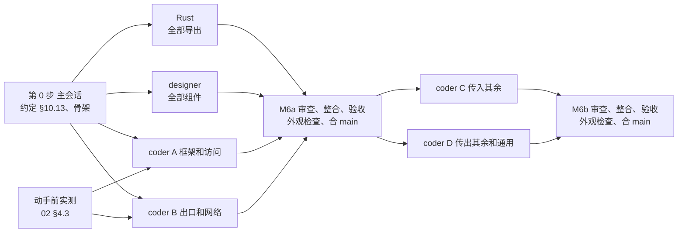

# 新界面 M6：设置页的拆法

2026-11-04 起草；同日维护者把 §8 的 M6-1~M6-6 全部按推荐定，决定已回写 03（§5.1、§5.2 M6、§6.1、§6.3）、02（§4.1、§4.3）、01（§3.1 区块 A 服务状态行）。

- 依据：`03-实施方案.md`（下称"03"）§4.4、§5.2 M6、§6.1 E5、S1~S5、S9~S12、§6.3、§8.5"第四期挪来的几项"；`02-第二轮内容与逻辑说明.md`（下称"02"）§1.1~§1.6、§1.8~§1.10、§3.1、§3.3~§3.5、§4.1、§4.3、§4.4、§6.2（R2-Q2~R2-Q20、R2-Q31、R2-Q32）；`01-内容与逻辑说明.md`（下称"01"）§2.1、§3.1 区块 A、J、§4.3；样稿 `样稿/A-P6-设置.html`、`A-P6-设置-对话框.html`。读码基于 leapgate-client main `4dd661da1`。
- M6 做完，设置不再依赖旧界面：被控端怎么放行、能被做什么，去连别人时的默认值，服务器、代理、外观，都在新界面的设置页里改。手机设置页（02 §1.7）不在 M6，随 M11。
- 这份文档写 M6 做什么、谁做哪块、怎么验收、哪些不做，以及要维护者定的六条。确认后，决定回写进 03、02，动手的细节写进 `client/LEAPGATE.md` §10。

## 要点

1. 范围照 03 §5.2 M6：02 §1.2~§1.6 的桌面设置页（三组、二十个小节，搜索、解锁、八个对话框），加 02 §3.3 列的联动：主页密码行"修改"先解锁、"更多访问设置"、会话错误里的"打开网络设置"、主窗口和连接管理小窗（CM）跟随设置里存的主题和语言。
2. 读码后规模比 03 估的大：Dart 页面和 model 约 9.5k 行、新组件约 2k 行，加测试约 6k、画廊约 1.8k，合计约 19k 行（03 写 7~10k，按 M3~M5 的实际增量看，03 那一列只算了页面代码）。所以推荐分两段，各自验收、合进 main（M6-1）：
   - **M6a**：设置页框架、搜索、解锁，加访问与密码、权限、出口、服务与 ID、连接方式、外观、网络和服务器、账号八个小节。只能在设置里改的几项都在这一段，第四期挪来的界面验收也能在这一段跑完。
   - **M6b**：其余十二个小节，含二次验证、访问限制、会话、新设备的默认设置、快捷键。
3. Rust 约 600~850 行，上游文件只改 2 处、约 7 行。和 03 原写有三处不同（§1.2）：保存设置改走 Leapgate 自己的进程间连接、不改上游 `ui_interface.rs`（M6-2）；安装版三处自己弹用户账户控制（UAC）窗口的操作，结果都拿得到，不用补导出；直接 IP 访问的监听结果用一层透传函数包住上游那一行。
4. 读码发现几处要先说清的（§4）：安装版界面进程里的服务器能力和地址可能是旧的，M5 的出口目录也受影响，顺手修；改 API 服务器时退出登录的先后；"允许不安全的 TLS 回退"的说明要按实际剩下的用途重写。
5. 要定的六条在 §8，最要紧的是 M6-1（分不分两段）、M6-2（保存设置怎么拿到成败）和 M6-6（安装版的验收怎么取得管理员权限，解锁是 M6a 的核心，这一条不落实就验不了）。

---

## 1. 范围

### 1.1 做什么

| 段 | 区域 | 内容 | 出处 |
|---|---|---|---|
| M6a | 框架 | 主页"设置"打开的一页：小节导航（三组，组下列小节，选中态同主页左栏）、小节内容（标题、锁定条、各项）、上次打开的小节（本次运行内记住）；被远程控制时的遮罩（主页已有，设置页在主页标签里自动带上） | 02 §1.2.1~§1.2.3、§1.2.5、§1.2.7 |
| M6a | 搜索 | 导航顶部的搜索框，匹配项名、说明和单选项名；结果列表、点开后滚到那一项并高亮；上下键、回车、Esc | 02 §1.2.4（R2-Q2） |
| M6a | 解锁 | 安装版：一次解锁覆盖"传入连接"和"通用 › 网络和服务器"，离开设置页重新上锁；锁定条、输入解锁 PIN 对话框（含"改用管理员权限解锁"）、UAC 被取消的红字；主页密码行"修改"先解锁、对话框关闭后重新上锁 | 02 §1.2.6、§1.6.7（R2-Q3、R2-Q31） |
| M6a | 传入连接 | 访问与密码、权限、出口（含放行的网段对话框）、服务与 ID（含解锁 PIN 对话框） | 02 §1.3.1、§1.3.2、§1.3.6、§1.3.8 |
| M6a | 传出连接 | 连接方式（打洞直连、高级两项、顶部状态条） | 02 §1.4.1（R2-Q9） |
| M6a | 通用 | 外观（主窗口和 CM 一起接）、网络和服务器（服务器摘要、服务器对话框、导入导出、代理对话框、高级三项和开启前确认）、账号 | 02 §1.5.1~§1.5.3、§1.6.8、§1.6.9 |
| M6a | 入口和联动 | 主页密码行下的"更多访问设置"；会话错误"本机与服务器的密钥（Key）不一致""与服务器的加密握手失败"带"打开网络设置"；出口小节前提里的"修改"跳到对应项并高亮；02 §3.3 表里属于这几节的联动 | 01 §3.1 区块 A、§4.3；02 §1.2.1、§3.3 |
| M6b | 传入连接 | 二次验证（开启对话框带二维码、受信设备列表、Telegram 机器人对话框）、访问限制（IP / ID 白名单对话框、直接 IP 访问的端口和本机地址、端口被占用）、会话（含移除壁纸预览、RDP 会话共享、声音来源、隐私模式实现、录制位置）、远程打印 | 02 §1.3.3~§1.3.5、§1.3.7、§1.6.3~§1.6.5 |
| M6b | 传出连接 | 新设备的默认设置、会话期间、工具栏与显示器、渲染、快捷键（列表、录制对话框、恢复默认）、收到的打印任务 | 02 §1.4.2~§1.4.7 |
| M6b | 通用 | 其他（关闭窗口前确认、关闭主窗口时、硬件编解码）、关于 | 02 §1.5.4、§1.5.5 |
| M6b | 联动 | "传出会话期间保持屏幕常亮"接上（`待调.md` 2026-10-31 那条）；工具栏与显示器、渲染改了以后已开的会话当场跟着变 | 02 §1.4.3~§1.4.5、§3.3 |

M6a 合入后，导航只列已经做好的小节（M2b 起"菜单只列已经实现的项"的做法），其余小节仍到旧界面里改；M6b 合入后补齐。

### 1.2 和 03 原文不同的几处

- **规模**：03 写 Dart 7~10k 行。逐节估下来，页面和 model 约 9.5k、新组件约 2k，测试约 6k、画廊约 1.8k，ARB 约 450 个键。分段见 M6-1。
- **S9 保存失败**：03 写"改 `src/ui_interface.rs:412-417`，把丢掉的结果返回出来"。读码看，上游 `ipc::set_options` 连不上时直接跳过、等确认只等 1 秒且不看结果，最后不论成败都写界面进程自己的配置并返回成功（`src/ipc.rs:1926-1935`）。改成 Leapgate 自己开一条进程间连接，同一条连接上先读服务进程当前的整张表、合并改动、写回、等服务进程回确认，上游一行不动（M6-2）。顺带消掉 02 §4.4 记的"界面发最多旧 1 秒的整张表，可能盖掉服务进程刚写入的键"。
- **UAC 的结果**：03 没列，02 §1.6.10 要求 UAC 被取消时就地写"未获得管理员权限，…"。读码看三处都不用补导出：安装版停止 / 启动服务成功时进程直接退出、重新打开，调用能返回就说明没成（`src/platform/windows.rs:3333-3356`、`:3390-3411`）；RDP 会话共享等调用返回后再读一次注册表的值（`mainIsShareRdp`）；安装打印机的结果本来就经全局事件 `install-printer-res` 推给界面（`src/flutter_ffi.rs:2809-2840`）。
- **S5 直接 IP 访问的监听结果**：03 写"加一行挂钩"，成功、失败两个分支都要记，改成用一个原样透传结果的函数包住 `src/rendezvous_mediator.rs:1367` 那一行，仍只改一行。
- **S2 服务器类型三态**：确认不支持时也落盘一个新键 `leapgate-api-nocaps`（`leapgate-` 开头，服务端策略写不了），三态由"支持 / 不支持 / 都没有"算出；不走进程间接口问服务进程，免得服务停了就一直"正在确认…"。
- **S12** 已在 M0 做了（`src/leapgate_ffi.rs:31` 的 `leapgate_version`），关于页直接用。

---

## 2. 组件、页面和 Rust

### 2.1 现成的

- 控件：开关、勾选框、单选（带说明行）、分段、下拉、滑块（带拖完回调）、输入框和框下错误、多行输入框、验证码框、密码框。
- 对话框和反馈：表单对话框、确认框、遮主页标签的暗层、行内确认、横幅（四种语气，连接方式顶部的状态条用它）、状态文字（色点加文字，出口前提的状态行用它）、轻提示。
- 已有的对话框和 model：设置固定密码对话框（"全部受信设备将被清除"那句已经算好）、登录对话框、账号 model（M4）、服务状态和"启动服务"（`LocalStatusModel`）、收到的打印任务的选项（`core/lib/models/printer_model.dart`）、快捷键 model 和按键工具（M2b 复制的）、被控时的遮罩、界面模式（M2b、S7）、关窗选项（M5）、C1 的出口数（`leapgate_incoming_counts().exit`）。
- 选项 model（`client/LEAPGATE.md` §10.7）能用，要补四处：加"新设备的默认设置"用的 UserDefaultConfig 作用域；写入返回保存结果（S9）；补齐约 70 个选项键常量；把 `kOptionLeapgateCloseAction` 从 `app/lib/shell/window_close.dart` 挪进 core。`app/lib/pages/session/toolbar/monitor_menu.dart:52` 页面直接调 `bind` 读默认值，顺手改成经选项 model。
- 插件：选录制文件夹用 app 里已有的 `file_picker 5.5.0`。

### 2.2 新组件（designer，M6a 一次做完）

M6b 要用的几样（受信设备列表、快捷键行和录制框、二维码、关于行）也放在 M6a 做，两段用同一批组件，不另起一轮 designer。

| 组件 | 画框 |
|---|---|
| 设置页版式：小节导航（组标题、小节项、搜索框）、小节内容区（标题、最大宽度约 640，960×600 时约 540、控件换到名字下面一行） | `P6 桌面 · 传入连接 › 访问与密码` 各态、最小窗口两张 |
| 设置行：名字、说明、控件；灰显带原因；行下一行红字（"无法保存设置"等）；被搜索或跳转点到时高亮约 2 秒 | 各小节 |
| 小节里的小标题（"高级""录制"） | 连接方式、会话 |
| 锁定条（带盾牌按钮，下面一行红字）；盾牌图标 | 锁定各态 |
| 状态加按钮的行（白名单、PIN、二次验证、Telegram、代理、服务、打印机、放行的网段） | 访问限制、服务与 ID 等 |
| 数字输入框加单位（回车或失焦保存、Esc 还原、框下错误） | 自动断开、端口、等待直连的时间 |
| 搜索结果列表（"分组 › 小节"、项名、说明，键盘移动） | 搜索三态 |
| 受信设备列表（身份色平台底、剩余天数、多选、空态） | 二次验证 |
| 快捷键行和录制对话框（五种状态） | 快捷键 |
| 二维码（颜色按令牌） | 开启二次验证 |
| 关于页的行（带复制） | 关于 |

深色照样稿只画了每个小节的默认态，其余各态在验收时用画廊截图对照（M4、M5 的做法）。

### 2.3 页面和逻辑（每段两个 coder）

小节按"共用数据少、Rust 依赖集中"分给两个人，每人约 3.5~3.8k 行（含测试）。

| 段 | 份 | 小节和入口 | 估计 | 等的 Rust |
|---|---|---|---|---|
| M6a | A 框架和访问 | 框架（小节注册表、搜索索引、滚动和高亮、解锁控制器、"重新读"、UserDefault 作用域、选项键常量）；访问与密码、权限、服务与 ID；密码行"修改"先解锁、"更多访问设置" | 约 3.8k | S9 |
| M6a | B 出口和网络 | 出口、连接方式、外观（含主窗口和 CM 的接线）、网络和服务器、账号；会话错误的"打开网络设置" | 约 3.5k | E5、S1、S2、S3、S9 |
| M6b | C 传入其余 | 二次验证、访问限制、会话、远程打印、会话期间（和会话共用录制位置） | 约 3.8k | S4、S5、S10、S11 |
| M6b | D 传出其余和通用 | 新设备的默认设置、工具栏与显示器、渲染、快捷键、收到的打印任务、其他、关于 | 约 3.6k | — |

- **core**（`core/lib/leapgate/settings/`）：小节注册表（id、组、标题、可见条件、是否上锁、搜索条目）；解锁控制器（安装版才上锁；离开设置页、切到别的标签、主窗口隐藏时上锁）；服务器摘要和服务器类型的 model；出口前提的计算；快捷键的绑定读写和录制校验（从上游 `page_body.dart`、`recording_dialog.dart` 去界面化后搬进 core，约 250 行）；声音来源（照上游 `audio_input.dart`）；受信设备的解析；导入导出用的服务器配置编解码（照上游 `common.dart:2921-2973`）。
- **app**（`app/lib/pages/settings/`）：设置页、每个小节一个文件、八个对话框。小节文件只认注册表和选项 model，彼此不引用。
- **导航**：`MainNavigation` 加 `showSettings(section, {item})`（打开设置页，滚到那一项并高亮），出口前提的"修改"、会话错误、密码行都用它。会话错误的"打开网络设置"先切到主页标签（02 §1.2.1）。
- **主题和语言**：主窗口读 LocalConfig 的 `theme`、`lang` 并监听；设置页写入后照上游调 `mainChangeTheme`、`mainChangeLanguage`，CM 在全局事件里登记 `theme`、`language` 两个事件跟着切换（`client/LEAPGATE.md` §10.10 M3 留下的那条）。语言选项写 Rust 认的代码（`zh-cn`、`en`，跟随系统写空），和旧界面同一个键、同一套取值。
- **ARB** 键用 `settings` 开头。

### 2.4 Rust（一个 coder，M6a 一次做完）

M6b 用的 S4、S5、S10、S11 也在 M6a 这一路做完，M6b 开工时导出都是真的。

| 编号 | 导出（块 2） | 参数 | 返回 | 上游 | 规模 |
|---|---|---|---|---|---|
| E5 | `leapgate_exit_allow_nets_check` | 文本 | `{valid, count, lines:[{line, state: invalid / blocked}]}` | 无 | 60~90 |
| S1 | `leapgate_server_summary`（异步） | — | `{id, api, key, relay}`，前三项带 `source` | 无 | 140~200 |
| S2 | `leapgate_server_kind` | — | `{kind: leapgate / compat / checking, features}` | 无（新键 `leapgate-api-nocaps`） | 40~70 |
| S3 | `leapgate_key_check` | Key | `empty / valid / invalid` | 无 | 15~25 |
| S4 | `leapgate_local_addresses`（异步） | — | `[{name, ipv4, ipv6}]`，不列临时 IPv6 | 无 | 40~60 |
| S5 | `leapgate_direct_listen` | — | `{state: listening / failed, port, error: in_use / denied / other}` 或 `{}` | `src/rendezvous_mediator.rs:1367` 改 1 行 | 60~90 |
| S9 | `leapgate_set_options`、`leapgate_set_socks` | 改动的键值 / 代理三项 | `saved / saved_local / failed`；代理返回成败 | 无 | 120~170 |
| S10 | `leapgate_verify_bot` | Token | `{result: ok / network / invalid_token / no_chat / other, text}` | 无 | 40~60 |
| S11 | 不导出；界面经 S9 写 Config 键 `leapgate-ui-lang`（解析后的实际语言） | — | — | `src/server/connection.rs:1879-1884` 换成 1 个调用 | 40~70 |
| 修 | `libs/leapgate/src/exit/directory.rs` 改从界面缓存的选项取服务器地址和能力（§4.1） | — | — | 无 | 10~20 |

- 服务器对话框里"API 留空时会用的地址"用上游现成的 `mainGetCommonSync("resolve-api-server:…")` 实时算，不另加导出。S1 的来源推导在 `libs/leapgate` 写成一个纯函数，`report::api_root()` 也改调它，不出第三份复刻。
- 关于页、隐私模式实现、声音来源、录制目录、打印机、受信设备、二次验证、硬件编解码用现成的 `bind.main*`。
- S9 照搬上游写选项时的副作用：改 TLS 回退时清 TLS 缓存、改声音来源时重启音频服务、`CheckTestNatType` 的判断。"停止服务"不走 S9，照旧调上游 `mainSetOption`（它要弹 UAC、成功时进程退出）。
- S10 成功后再读一次服务进程的配置，确认 Telegram 设置真的存上了；开启二次验证同样复查一次（上游这两处保存失败也是静默的）。
- 合计约 600~850 行（含单测）；上游 2 处、约 7 行。

---

## 3. 分工和先后

1. **第 0 步（主会话）**：把 §2.4 的导出名、参数和 JSON，小节注册表和小节页面的接口，解锁控制器的接口，`showSettings` 和高亮的约定，选项 model 的四处补充写进 `client/LEAPGATE.md` 新一节 §10.13；在 `home_page.dart` 的设置分支、`MainNavigation`、密码行、`reasons.dart` 放挂载点。分支 `ui/m6a`。
2. **动手前实测**（tester，和第 0 步同时）：02 §4.3 第 1、3、4、6、7、8、10、12 条，结果回填 02 再交给 coder（§5.1）。第 3、4 条决定两处文案（R2-Q7、M6-4），先出结果。
3. **M6a 四路并行**：Rust `ui/rust-m6`、designer `ui/m6-ds`、coder A `ui/m6a-access`、coder B `ui/m6a-net`。coder 先用测试里能换掉的假导出和占位组件。
4. 每块一轮审查，合进 `ui/m6a`，换上组件和真实导出，整体审查（代码接缝一路、对照 02 一路），功能验收，验收后的修复都做完再跑最后一轮外观检查（AGENTS 2026-11-03），然后合 main。
5. **M6b**：从 main 切 `ui/m6b`，coder C、D 并行，同样每块审查、整合、整体审查、验收、外观检查、合 main。
6. 用量吃紧时按 Rust → coder A → coder B → designer 排：Rust 和框架是其余几路的前提。

---

## 4. 几处要先说清的

### 4.1 安装版界面进程里的服务器能力和地址可能是旧的

安装版的界面进程里，`Config` 只在启动时和本进程写选项时更新；每秒的读回只刷新 `ui_interface` 的选项缓存（`src/ui_interface.rs:1378`）。`libs/leapgate` 在界面进程里直接读 `Config`（`exit/directory.rs:36`、`:43` 调的 `report::has_feature`、`report::api_root()`），读到的 `leapgate-api-caps` 和服务器地址可能是旧的：界面启动以后服务进程才确认服务器是 Leapgate 时，出口目录会一直显示"不提供"，直到界面写一次选项或重启（读码推断）。S1、S2 一律从界面的选项缓存取值再交给 `libs/leapgate`，`directory.rs` 顺手改成同样的取法。M6a 验收时在安装版上复现一次修前修后。

便携版不受影响：界面启动时连不上服务进程，就在本进程里起服务（`src/server.rs:726-757`），界面和服务是同一个进程、同一份 `Config`。已交付的便携版试用构建没有这个问题；M8 之前也没有安装版的新界面。

### 4.2 设置页怎么知道值被别处改了

服务进程每秒读回、服务端心跳策略改了值，选项 model 不发通知。设置页在打开小节、主窗口拿回焦点、S9 写完以后重新读这一节的值，不加每秒的定时刷新：策略改值很少见，S9 写完拿到的就是服务进程的最新整表。

### 4.3 解锁

- UAC：`mainCheckSuperUserPermission` 本身就返回 UAC 是否通过（`src/platform/windows.rs:2409-2439`，用户取消时为假），上游界面只是没用这个返回值。
- PIN：现在由服务进程经进程间接口把 PIN 原文交给界面、在界面里比对（02 §4.4）。`mainGetUnlockPin` 是同步调用、内部最多等 1 秒，点"解锁"时再取，不在页面构建时调。比对放哪见 M6-3。
- 读码还看到 `ipc::get_unlock_pin` 会把 PIN 存一份进界面进程自己的 `Leapgate2.toml`（`src/ipc.rs:1821`，可逆加密），记进 02 §4.4，不在 M6 改。

### 4.4 UAC 被取消和失败分不开

安装版停止 / 启动服务时，取消和"授权了但脚本失败"都只是调用正常返回，原因只写进日志；要分开得改上游。照 02 统一写"未获得管理员权限，服务未停止"（启动时"……服务未启动"），后者很少见，详情看日志。RDP 会话共享同理。

### 4.5 改 API 服务器时退出登录的先后

上游是先写新地址、再向旧服务器退出登录（`flutter/lib/common.dart:3628-3641`）。M4 的 `leapgate_account_logout()` 按当前地址退出，照抄就会发到新服务器。改成：先验证地址 → 已登录且 API 变了时先退出登录（发到旧服务器）→ 再保存。退出失败不挡保存（M4-9 定了退出时 Rust 一并清本地令牌）。验证失败时不退出。

### 4.6 "允许不安全的 TLS 回退"的说明

按 03 IQ7，账号、地址簿已改走严格的客户端，这一项只管还走上游代码的 TLS 连接：WebSocket 的 wss 连接、HTTPS 代理，以及还剩下的上游 HTTP 请求（02 §1.5.2）。coder B 列出剩下的上游 HTTP 请求，说明写成"开启后，WebSocket 连接和 HTTPS 代理在证书校验失败时改用不校验证书的连接，内容可能被第三方读取"，有剩下的 HTTP 请求再补进去；定稿回写 02。

### 4.7 新界面还没有的功能对应的设置

终端、文件传输、TCP 隧道在新界面里还没有（M7a、M9），对应的设置（"允许使用终端""终端应用写入剪贴板""断开连接后保持终端会话""允许复制粘贴文件"等）照常显示：旧界面便携版在第三轮之前还要用，两个界面读同一份配置。

### 4.8 旧界面存过的语言

旧界面可能存了 `ja` 这类新界面不支持的语言。新界面把这种值当作"跟随系统"显示和处理，不改写（改写会连旧界面的语言一起改）；由 Rust 产生、按 `lang` 翻译的少量文字会是那种语言，记为已知限制。

---

## 5. 验收

两段各写一节验收记录进 `client/LEAPGATE.md` §10.5（"M6a""M6b"），每条写通过、不通过或未验证。端点：A = 台式机，B = msi，安装版的项在测试虚拟机上做（03 §5.2 M6：用新界面便携版 `--silent-install` 装一份，测前打快照、测完回滚；怎么取得管理员权限见 M6-6），做法沿用运行手册 §14~§21。

### 5.1 动手前实测（02 §4.3）

| 条 | 内容 | 在哪测 | 影响 |
|---|---|---|---|
| 1 | 新设备的默认设置只对没连过的设备生效 | A、B | 1.4.2 的说明（M6b） |
| 3 | 便携版停止服务后进行中的传入会话断不断 | A、B | "停止服务？"正文（R2-Q7，M6a） |
| 4 | 代理、WebSocket、禁用 UDP 开着时主页服务状态显示什么、别人能不能连上 | A、B，测试服务 | M6-4（M6a） |
| 6 | 隐私模式两种实现的实际表现 | 测试虚拟机上的安装版（旧界面） | 两个名字（M6b） |
| 7 | "使用 DirectX 采集屏幕"什么时候生效 | A、B | 02 的"生效"列（M6b） |
| 8 | Key、中继服务器改了什么时候生效 | A、测试服务 | 02 的"生效"列（M6a） |
| 10 | 指定的打印机被删后自动打印走 Rust 分支会怎样 | 测试虚拟机（系统自带的虚拟打印机） | 1.4.7（M6b） |
| 12 | 清空自定义 ID 服务器后实际在用的是不是缓存的旧地址 | A | S1 的"（上次使用）"（M6a） |

第 5 条（安装版写配置失败）改在 M6a 验收时对新做法测；第 11 条就是第四期 B8，在 M6a 验收时测；第 2、9 条见 M6-5。

### 5.2 自动测试

- Rust：E5 的逐行判断（含 `0.0.0.0/0`、198.18.0.0/15、各类始终禁止）；S1 的来源推导表；S2 三态；S3；S9 的合并和三种返回；S10 按上游错误原文归类；S11 的两种语言正文。
- core：小节注册表和搜索（匹配名字、说明、单选项名，不区分大小写）；解锁控制器的上锁时机；出口前提的计算；服务器摘要的显示规则；快捷键录制的五种状态和冲突替换；选项 model 的 UserDefault 作用域和保存结果。
- app：02 §1.10 每个状态一个行为测试，用假 model 喂数据。

### 5.3 M6a 真机（无人值守）

| 项 | 做法 |
|---|---|
| 各小节写进配置 | A 上逐项改，读配置文件核对键和值，改回 |
| 出口开关（第四期挪来第 1 项） | B 上打开、关闭"允许作为出口"，配置里是 Y / N；切换访问模式，开关不变 |
| 会话中关出口（第 8 项，即第四期 B8） | A 用 B 当出口、curl 持续请求，B 上关开关：先看确认里的会话数，再量 A 多久断开、竞争中新开的通道回不回 `MSG_NOT_ENABLED`；自研 ICE 胜出（看日志）和经中继各一次，ICE 那次是重点。判据两种情况都是 1~2 秒内断开（第四期契约）。读码推断 ICE 胜出时 KCP 的关闭包可能丢、控制端要靠约 18 秒的读超时才发现：落到十几秒时记为发现、交主会话，不在 M6 里修（要改的是 Rust 的出口路径），也不重复折腾 |
| 出口登录被拒（第 9 项） | B 的审批方式用"输入密码或在本机接受"，让小窗在登录前出现；A 用错误密码"使用"，B 的小窗当场消失（每 0.5 秒查进程）。M5 第 7 项那次登录在审批前就被拒，小窗没出现过，不算这一项 |
| 主人不被重新登录改掉（第 7 项） | 按第四期契约 01 的步骤把 B 的主人设成 `h1it-b`，B 上用新界面登录 `h1it-a`，测试服务上主人仍是 `h1it-b`；测完改回。测试服务上的 `h1it-*` 账号在这一项做完前不删 |
| 出口前提 | 固定密码未设置、审批方式"在本机接受"、允许 TCP 隧道三种不满足的状态行，"修改"跳到对应项并高亮 |
| 放行的网段 | 对话框里写一条始终禁止的地址出警告、一行格式不对不能保存；保存后经出口访问放行段里的地址能通 |
| 服务器 | 摘要的来源标记（默认、自定义、由 ID 服务器推出带明文警告）；对话框改 ID 服务器后主页"正在连接服务器…"再"已就绪"；Key 格式不对；已登录时改 API 先退出（§4.5）；导出后导入预填、点"确定"才保存 |
| 服务器类型 | Leapgate（测试服务）、兼容、正在确认各一次；连接方式顶部状态条跟着变。兼容要用对所有请求都回 404 的 API 服务器：第三期服务端也有 Leapgate 心跳，显示的是 Leapgate（2026-11-04 M6a 验收时更正） |
| 代理、WebSocket、禁用 UDP | 开启前确认、状态条；M6-4 定的主页服务状态 |
| 外观 | 主题、语言、界面模式切换，主窗口和 B 的小窗当场跟着变（B 上开一个来访） |
| 打开网络设置 | A 的 Key 改错后连 B，错误面板点"打开网络设置"切到主页、打开网络和服务器 |
| 搜索 | 中文、英文各搜一个项名、一个说明里的词，回车打开并高亮 |
| 安装版（测试虚拟机） | 锁定条；PIN 解锁（对、错）；UAC 解锁（§5.5）；离开设置页后重新上锁；主页密码行"修改"先解锁；停止、启动服务（确认文案，进程重开；"调用能返回就说明没成"是读码推断，这里核实）；保存失败：停掉服务进程后改一项，项下"无法保存设置"、值还原（02 §4.3 第 5 条）；§4.1 的出口目录复现 |
| 旧界面 | Rust 改了 `rendezvous_mediator.rs`、`connection.rs`、`report`、出口目录，旧界面五项冒烟加出口 B15 冒烟 |
| 最新 stable 检查 | 四步，第 1 步带 `-ForceBridge` |

### 5.4 M6b 真机（无人值守）

| 项 | 做法 |
|---|---|
| 二次验证 | B 上用新界面开启：测试脚本从 B 的配置读密钥、算出一次性验证码直接送进对话框，密钥和验证码不进输出，开启对话框不截图（M5 验收时截图里出现过测试用的密钥）；A 连 B 进"输入验证码"，勾"信任此设备"后再连不要验证码；受信设备列表出现 A、删除后再连又要；关闭二次验证的确认；测完关掉 |
| Telegram | 用一个无效 Token 测"Token 无效"，断网测"无法连接 Telegram"；"未找到对话"要真机器人，标未验证、留给维护者 |
| 白名单 | B 设 IP 白名单不含 A，A 连不上；ID 白名单同理；清除后恢复 |
| 直接 IP 访问 | B 打开，显示端口和本机地址，A 用 IP 直连；先占住端口再打开，看"端口 ‹端口› 已被其他应用占用" |
| 会话 | 自动断开（设 1 分钟）、移除壁纸预览倒数、声音来源列表、录制位置打开和修改；RDP 会话共享、隐私模式实现在测试虚拟机的安装版上 |
| 远程打印 | 测试虚拟机的安装版：未安装打印机 → 安装 → 已安装；B（便携版）显示"仅安装版支持远程打印" |
| 新设备的默认设置 | 改画质和显示方式后连一台没连过的设备，会话里是新值；连过的设备不变 |
| 工具栏与显示器、渲染 | 会话开着时改，工具栏和画面当场跟着变 |
| 快捷键 | 打开总开关写入默认绑定；录制一个新组合、冲突替换、恢复默认；会话里按下生效，"发送到远程设备"打开后不生效（按键用 `scripts/e2e/leapgate-post-input.ps1` 投递） |
| 收到的打印任务 | 四种处理方式写进配置的三个键（02 §1.4.7 的对应） |
| 其他、关于 | 关窗两个选项和关窗确认联动；关于页各行复制 |
| 旧界面 | M6b 只改 Dart 时不跑；改了 Rust 就照 M6a 跑五项冒烟 |
| 最新 stable 检查 | 同 M6a |

### 5.5 UAC 怎么验

UAC 的确认框在安全桌面上，无人值守点不了。测试虚拟机上把管理员的提权提示设成直接通过（`ConsentPromptBehaviorAdmin = 0`，只在测试用的快照里），验证成功的路径；"取消"的路径靠假 model 的测试和维护者试用。这一步本身要管理员权限，怎么取得见 M6-6。

### 5.6 最后一轮外观检查

每段功能验收和修复都做完后，对准备合入的提交做：本段的小节、对话框、锁定条、搜索，浅色深色（深色用画廊），和样稿逐个对照；这次改到的共享组件（主页导航、密码行、会话错误面板、工具栏）出现的旧页面也看一遍。

### 5.7 维护者试用时看的

M6a：用新界面改日常要改的设置，看分组好不好找；安装版的解锁（M8 之前碰不到，可以不看）；Firefox 按出口页的说明配代理（第四期挪来第 6 项，M5 试用已列）。M6b：快捷键录制；Telegram 机器人"未找到对话"那一步。

---

## 6. 明确不做

- 手机设置页（02 §1.7）：随 M11。
- 修改 ID（03 IQ6）、检查更新和自动更新（R2-Q17）、"被策略固定"的来源（R2-Q4）。
- 远程打印里的"安装"按钮：M8 之前不显示，只显示"仅安装版支持远程打印"（同 M2b 本机提示卡的做法：点了会把新界面装成发布版，等于提前切换）。
- 托盘菜单里"停止服务"的确认（02 §1.3.8，托盘是单独的进程）。
- PIN 的存放和比对方式（02 §4.4），除非 M6-3 选备选。
- `hide_cm()` 仍读 `allow-hide-cm`（02 §4.4）：M3 定了只改 Dart，不碰 Rust。
- 停止服务的"取消"和"失败"分开显示（§4.4）。
- 硬件编解码"本机没有可用硬件时隐藏"只按解码能力判断（照上游 `mainSupportedHwdecodings`），不另读服务进程的编码能力。

---

## 7. 工作量

| 部分 | M6a | M6b |
|---|---|---|
| Dart 页面、model、测试 | 约 7.3k（A 3.8k、B 3.5k） | 约 7.4k（C 3.8k、D 3.6k） |
| 新组件和画廊 | 约 3.8k（含 M6b 用的几样） | — |
| Rust（含单测） | 600~850 | — |
| 上游文件 | 2 处、约 7 行 | — |

ARB 约 450 个键（中英各一份）。合计和 03 的 7~10k 比，见 §1.2。

---

## 8. 要维护者定的

| 编号 | 问题 | 推荐 | 备选 | 理由和代价 |
|---|---|---|---|---|
| M6-1 | M6 分不分两段 | 分 M6a、M6b 两段，各自验收、外观检查、合 main；M6a 是框架、搜索、解锁和八个小节（§1.1），M6b 是其余十二个小节；designer 和 Rust 在 M6a 一次做完，所以 M6a 约 12k 行（页面 7.3k、组件和画廊 3.8k、Rust 0.6~0.85k）是大头，M6b 约 7.4k | 一段做完：designer、Rust 加四个 coder 同时开工，一次验收 | 约 19k 行一次整体审查和验收太大；框架（注册表、解锁、设置行）先被八个真实小节用一遍，后面七千多行不会建在没验过的接口上；只在设置里才有入口的几项和第四期挪来的界面验收（第 1、7、8、9 项）在 M6a 就能做完。代价是多一轮验收和外观检查，M6a 到 M6b 之间其余小节还要回旧界面改 |
| M6-2 | 保存设置怎么拿到成败（S9） | Leapgate 自己开一条进程间连接，同一条连接上先读服务进程的整表、合并、写回、等确认；上游不改。安装版连不上服务进程、而 `stop-service` 不是 Y（服务应当在跑）时报"无法保存设置"、不写本地；便携版，或安装版 `stop-service` 为 Y（用户停了服务）时照上游写本地，服务下次启动时会导入（`src/platform/windows.rs:3943-3948`） | 03 原写：改上游 `ui_interface.rs` 把结果返回出来，其余照上游（不论成败都先写本地） | 推荐上游零改动，还顺带消掉"界面发最多旧 1 秒的整表、盖掉服务进程刚写的键"（02 §4.4）。和上游不同的是安装版连不上时不写本地：上游写了也会在 1 秒内被读回盖掉，等于静默失败。备选要动上游，覆盖问题还在 |
| M6-3 | 解锁 PIN 在哪比对 | 照旧：服务进程把 PIN 交给界面，在界面里比对，不加次数限制 | 服务进程比对并限次数（约 40 行 Rust，进程间接口加一种消息） | 写选项的进程间接口本来就不检查锁（02 §1.2.6），PIN 只是界面上的门槛，挡的是"顺手改"，不是安全边界；只改比对位置挡不住直接经进程间接口写选项的程序。要真正当安全边界，得让写入也检查解锁，不在 M6 范围 |
| M6-4 | 代理、WebSocket、禁用 UDP 开着时，主页服务状态怎么写（R2-Q15 定了"先实测再定"） | 按 §5.1 第 4 条的结果：主页显示"已就绪"而别人其实连不上时，服务状态行下加一行警告"已设置代理，其他设备无法连接本机"（WebSocket、禁用 UDP 各一句），带"网络和服务器"链接；显示的已经是"无法连接服务器…"这类时不另加 | 不加，只靠设置页项下的说明和连接方式的状态条 | 用户看主页才知道本机能不能被连；显示"已就绪"却连不上是最难查的情况。代价是 01 区块 A 的服务状态行多一种样子，designer 补一张 |
| M6-5 | 02 §4.3 第 2、9 条测不测 | 不测：第 2 条（修改 ID 在两种服务端上回"不支持"）只是确认已经定了的去掉，结果不改任何东西；第 9 条（上游开启二次验证输错时显示不显示错误）新界面的对话框是重写的，结果也不改任何东西 | 照 03 §6.3 测：第 2 条要用旧界面的"修改 ID"对测试服务和一份原版 hbbs 各发一次 | 两条的结果都不影响 M6 的实现和文案 |
| M6-6 | 安装版的验收（解锁、PIN、停止 / 启动服务、保存失败、RDP 会话共享、隐私模式、安装打印机）怎么取得管理员权限 | 测试虚拟机：开工时先开机看它的远程操控有没有管理员通道；有就全由 agent 做（装新界面、在测试用快照里把提权提示设成直接通过，测完回滚）。没有的话请维护者在 PVE 网页控制台做一次：确认本地账户在管理员组、把提权提示设成直接通过、打一个快照，之后 agent 用它装、测、回滚 | 在 msi 上做：它有管理员通道，但要在维护者的笔记本上装一份 Leapgate 服务、测完卸载，没有快照可回滚（上面的原版 RustDesk 不碰） | 测试虚拟机能整机回滚，装服务、装打印机驱动、改 UAC 策略都不留痕；它的远程操控现在记的是"非管理员"，有没有管理员通道没核过（虚拟机关着）。备选不用维护者动手，但改的是日常用的机器 |

不用定、写进约定就行的：

- 二维码用 `qr_flutter 4.1.0`（上游同一版本，纯 Dart、不带原生插件，本机依赖缓存里已有）；打开文件夹和网址用 app 已有的 `win32` 调 `ShellExecute`，不加 `url_launcher`（它带原生插件、要改插件注册）。
- 搜索只匹配当前界面语言的文字，不建别名表（02 §1.2.4）。
- 设置页里的写入一律走选项 model：Config 经 S9，LocalConfig、UserDefaultConfig 照旧；会弹 UAC 的三项（停止 / 启动服务、RDP 会话共享、安装打印机）不走 S9。
- 每改一个滑块停 1 秒再保存（上游做法，02 §1.4.2）；数字框回车或失焦保存、Esc 还原，不要"应用"按钮（02 §1.2.5）。
- 小节导航里没有任何一项要显示的小节直接去掉（02 §1.2.3），例如便携版没有 RDP 会话共享和解锁 PIN 时，"服务与 ID"仍在（有服务和本机 ID）。
- S11 的语言键 `leapgate-ui-lang` 只由新界面写；旧界面不写，旧界面用户的 Telegram 消息仍是英文。
