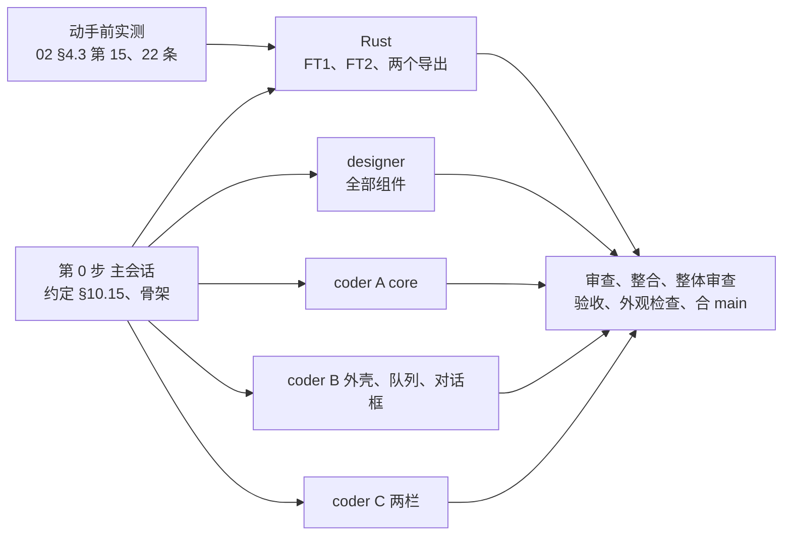

# 新界面 M7a：文件传输的拆法

2026-11-05 起草，待维护者定 §8 的 M7a-1~M7a-9。

- 依据：`03-实施方案.md`（下称"03"）§5.2 M7a、§6.1 FT1、FT2、§7.5；`02-第二轮内容与逻辑说明.md`（下称"02"）§2.1、§2.2、§2.4~§2.6、§3.1、§3.2、§4.2、§4.3 第 13~22 条、§6.3（R2-Q21~R2-Q28、R2-Q34、R2-Q35）；`01-内容与逻辑说明.md`（下称"01"）§2.1、§3.2 区块 A、B、G；样稿 `样稿/A-P7-文件传输.html`、`A-P7-文件传输-菜单与其他状态.html`、`A-P7-文件传输-对话框.html`。读码基于 leapgate-client main `537aa77e6`。
- M7a 做完，文件传输不再回旧界面：在会话标签里打开"文件传输"视图，两栏浏览、上传下载、续传、替换确认、删除、新建、重命名、拖放都在新界面里做。做完后就到了 03 IQ5 定的切换门槛（M0~M6 加 M7a）。手机文件传输页（02 §2.3）不在 M7a。
- 这份文档写 M7a 做什么、谁做哪块、怎么验收、哪些不做，以及要维护者定的九条。确认后，决定回写进 03、02、01，动手的细节写进 `client/LEAPGATE.md` 新一节 §10.15。

## 要点

1. 范围照 03 §5.2 M7a：02 §2.2 的桌面文件传输视图，照上游现有语义（续传、替换确认、删除统计和一次确认、拖放方向、失败原因），加 R2-Q28 的断开和关窗确认、02 §3.2 的进度显示。"暂停""从失败处重试"、个别文件跳过和结束时的汇总属于 M7b，队列行照上游的取消和失败处理。
2. 读码发现 M7a 不只是一个页面：**"一个会话标签里放几个视图"至今没有实现**。主窗口每个标签只画第一个视图，视图切换只是占位，标签 × 不确认（01 §3.2 区块 G 的多视图确认从没做过）。M7a 要第一次把它做出来，所以远程桌面也要回归测试。
3. 规模比 03 估的大：页面和 model 约 6.3~7.7k 行、新组件和画廊约 3.4~4.4k，加测试约 4.3~5.4k，合计约 14~17.5k 行（03 写 3~5k，和 M6 一样只算了页面代码）。和 M6a 一段（页面、组件 9.8k，测试 4.7k）同量级，推荐一段做完（M7a-1）。
4. Rust 约 400 行，上游文件只改 `src/common.rs` 一行（FT1）。和 03 不同的是 FT2 之外要补两个导出：本机读文件夹带回失败原因（上游把原文丢了），删文件夹链接只删链接本身（上游会删掉链接指向的文件夹里的内容）。两个导出都不碰上游文件（M7a-3、M7a-4）。
5. 要定的九条在 §8，最要紧的是 M7a-1（分不分段）、M7a-2（`file_model` 复制件怎么改）、M7a-3（删文件夹链接怎么做）和 M7a-6（验收用的上游对端从哪来，要下载上游安装包）。

---

## 1. 范围

### 1.1 做什么

| 区域 | 内容 | 出处 |
|---|---|---|
| 入口 | 设备"⋯"菜单和连接按钮下拉的"文件传输"；远程桌面工具栏最左的视图切换；会话标签右键"打开文件传输"；已有标签时切到那个标签并打开文件视图，已有远程桌面会话时复用连接令牌、不再问密码 | 02 §2.1.1；01 §3.1 区块 E、F，§3.2 区块 A、B |
| 一个标签多个视图 | 标签里同时有远程桌面和文件传输；只让当前视图拿键盘；远程桌面不在前台时不推帧（V1）；标签上的连接方式显示几个视图里最差的；悬停每个视图一行；标签 ×、右键"关闭"的多视图确认 | 01 §2.1、§3.2 区块 A、G |
| 视图标题栏 | 视图切换（"文件传输"一项带进度）、连接方式标记和详情（文件传输版）、"断开"（有未完成的传输时确认，R2-Q28） | 02 §2.2 区块 A |
| 两栏 | 栏头（本机 / 远程设备、设备名、平台）；后退、上一级、主文件夹、刷新；面包屑（省略中间、根下拉、Ctrl+L 输入路径）；常驻搜索（不区分大小写）；文件列表（四列、排序按本机记住、列宽可拖、窄时隐藏类型列；隐藏项半透明、链接标记、未完成传输的临时文件）；选择、双击和 Enter（R2-Q27）、键入跳转；状态行；列表各状态（正在读取、空、无结果、打开失败两种）；分隔线可拖 | 02 §2.2 区块 B~F |
| 操作 | 上传、下载（悬停写目标）、新建文件夹、删除（R2-Q23 一次确认）、重命名、"⋯"菜单、右键菜单五种目标和多选、复制路径、"此电脑"不能作目标；键盘快捷键全表 | 02 §2.2 区块 F、J，键盘 |
| 拖放 | 从资源管理器拖进远程设备栏（含放在文件夹行上）；两栏之间互拖；不接受的位置画提示；整栏或那一行高亮、栏中间写目标 | 02 §2.2 区块 G |
| 传输队列 | 底部面板：汇总行（计数、总进度、"全部继续""清除已完成"、收起展开、新任务自动展开一次）、可拖高；队列行（方向、名称、源 → 目标、状态和进度、速度和剩余时间）。M7a 用到的状态：排队中、正在统计、进行中、等待确认、正在删除、已暂停（上次关闭时没传完的）、已中断、已完成、已跳过、已取消、失败 | 02 §2.2 区块 H |
| 替换确认 | 普通、两个文件相同（默认焦点"跳过"）、只有临时文件、"对此次传输中的其他冲突执行相同操作"；几个冲突排队 | 02 §2.2 区块 I |
| 连接过程和中断 | 连接过程面板盖在两栏位置；"远程设备不允许文件传输。"的按钮按标签里有几个视图写"关闭标签"或"关闭文件传输"；网络中断时行变"已中断"、重连后自动续传；对方断开时变"已暂停" | 02 §2.2"连接过程和中断"、§2.4.7 |
| 失败原因 | 队列行、栏顶横幅、对话框里按原因码显示 02 §2.5 的文案（FT2） | 02 §2.5 |
| 跨页面 | 关窗确认多一句"‹N› 个传输尚未完成，下次打开文件传输时可继续。"，勾过"不再提示"时仍确认；会话标签和视图切换上的进度环、替换确认等着时的提醒标记 | 02 §3.1、§3.2 |

### 1.2 和 03 原文、样稿不同的几处

- **规模**：03 写 3~5k 行。逐块估下来页面和 model 约 6.3~7.7k、组件和画廊约 3.4~4.4k，测试约 4.3~5.4k，ARB 约 260~320 个键（中英各一份）。多出来的是第一次实现的多视图标签、五种对话框、组件和测试。
- **一个标签多个视图**：03 没有单列，读码发现是 M7a 的前提（§4.1）。
- **FT2**：03 估 120~200 行。读码后要处理的上游原文有 28 类，本机和远程的错误还要分平台查错误码（§4.3），约 200 行加单测约 150 行。另补两个 03 没列的导出（M7a-3、M7a-4）。上游文件仍只有 FT1 那一行。
- **FT1 的 Dart 半边**：`Entry.fromJson` 要读 `is_hidden`，这两行落在 `file_model` 复制件"只删界面调用"的部分里，作为来源行注明的例外（M7a-2）。符号链接不用加字段：`entry_type` 已经能分出目录链接（2）和文件链接（5），Windows 的目录联接也算链接。
- **替换确认的两文件对照表**：样稿画了两边的大小和修改时间，但 Rust 推来的替换确认事件只有目标路径、方向和"是否相同"（`src/flutter.rs:832-851`），没有两边的大小和时间。02 正文本来就没要求这张表，按"实现以说明为准"去掉，最后的外观检查不把它当差异。"只有临时文件"那一态怎么判见 M7a-5。
- **拖放的光标**：02 区块 G 写"本机栏不接受（光标显示禁止）"。拖放插件不设置拖放效果，做不出禁止光标，改成只在应用里画"不接受"的提示（样稿那张本来就是应用内提示，M7a-8）。
- **空文件夹的附注**：02 §2.4.3 写"读取超时"。读码看，远程读空文件夹失败时被控端什么都不回，Dart 只能等到超时，真实原因多半是没有权限，所以附注改成"未能读取"（M7a-7）。
- **插件注册**：09 §8 末尾写 `url_launcher`"带原生插件、要改插件注册"，不准确。新界面已经有 6 个原生插件，注册代码由 `flutter pub get` 生成进被忽略的 `windows/flutter/generated_plugins.cmake`，加 `desktop_drop` 不用手改任何文件。

---

## 2. 组件、页面和 Rust

### 2.1 现成的

- 会话：`SessionRegistry.open` 对已开标签的设备新开视图时复用连接令牌（`core/lib/leapgate/session_registry.dart:24-40`）；文件传输会话的事件（`file_dir`、`empty_dirs`、`job_progress`、`job_done`、`job_error`、`override_file_confirm`、`load_last_job`、`update_folder_files`）已登记（`session.dart:95-114`）；收到对方设备信息就进"已连接"；关会话时 `fileModel.close()` 保存上次的文件夹和"显示隐藏"。
- 连接过程面板 `ConnectionPanel` 只依赖 `ConnectionModel`，文件传输会话能直接用，外层要自己套一层（现在只被远程桌面的 `SessionPage` 用）。
- 组件：菜单（`LgContextMenuRegion`、`showLgMenuAt`、菜单行、勾选行、分隔线）、`LgBanner`（可关闭）、`LgDialogScrim`、`LgConfirmDialog`、`LgFormDialog`、`LgTextField`、`LgCheckbox`、危险样式按钮、`LgRouteDetails`（按组拼，文件传输版少一组）、`LgCountMark`（主页标签的提醒标记，出口用过）、第二轮图标（`LgIcons` 已有 upload、drive、folderPlus、pause、play、link 等）。
- 传出会话期间保持常亮：有任何会话标签就保持，不分视图，不用改。

### 2.2 一个标签多个视图（coder B）

- 新建标签里的视图容器：当前视图、切换、只有当前视图拿键盘；远程桌面不在前台时 `SessionPage` 的 `active` 为假（键盘钩子放开），会话 `setVisible(false)`（V1，不推帧）。
- `main_window.dart`：每个标签画所有视图；状态标记、悬停、未读按几个视图合起来算（连接方式取最差的）；`LgSessionTab` 加进度环和提醒标记两个字段。
- 视图切换做成真的（远程桌面工具栏最左和文件视图标题栏是同一个控件），"文件传输"一项带进度。
- 标签 ×、右键"关闭"：一个视图时直接关；几个视图时确认"断开与此设备的 ‹N› 个会话？"；有未完成的传输时多一句。"关闭其他标签"只在有未完成的传输时确认一次。关窗确认加传输那一句和"不再提示"的例外（02 §3.1）。
- 入口：`PeerAction` 加"文件传输"，设备菜单、连接下拉、标签右键、`MainNavigation.openFileTransfer`。
- 文件视图里的提问照旧按设备遮整个标签（替换确认开着时远程桌面也拿不到键盘），和 02"只遮这个会话标签"一致。
- 打开文件传输时这台设备的远程桌面还在连接、还没拿到令牌，文件传输会再问一次密码。上游也是这样，不处理。

### 2.3 core（coder A）

`core/lib/models/file_model.dart` 复制件里的 `FileModel`、`FileController` 改写进 `core/lib/leapgate/file_transfer/`，沿用类名和成员名（M7a-2）；其余类（`JobController`、`FileFetcher`、`Entry`、`JobProgress`、`PathUtil`、`SelectedItems` 等）保持只删界面调用。

| 文件 | 内容 | 估行 |
|---|---|---|
| `file_transfer/file_model.dart` | 改写的两个类：读文件夹的"正在读取"状态和发起时间；读文件夹、新建、重命名、删除的错误按请求编号交回发起处；远程读文件夹同一时刻只发一个（§4.4）；删除前统计和读空文件夹的超时放宽到 30 秒、统计可取消；传文件夹总带隐藏项（R2-Q22）；"此电脑"不能作目标；删除一次确认、链接不递归（调 M7a-3 的导出）；上次打开的文件夹每次打开成功就存；本机读文件夹改调 M7a-4 的导出 | 900~1100 |
| `file_transfer/jobs.dart` | 队列行的视图 model，从任务表派生：排队中和进行中（同一方向第一个没结束的是进行中）、正在统计、已中断（连接不在"已连接"时）；目标路径旁表；速度按进度字节、剩余时间按最近约 10 秒；汇总、未完成数（关窗和断开确认用）、全部继续、清除已完成、移除 | 350~450 |
| `file_transfer/sort.dart` | 排序（文件夹和盘符始终在前，两栏分开记，存 LocalConfig 的 `leapgate-` 新键）。复制件的 `_sortList` 不碰，它按类型、大小排时会丢掉盘符，"升序"的方向也和 02 不一致 | 120 |
| `file_transfer/errors.dart` | 原因码枚举，包 FT2 导出；"skipped""cancel"这两个上游内部值先挡掉 | 60~80 |
| `prompts.dart` | 删除提问改成一次确认（文件、空文件夹、文件夹或多项、链接、统计失败、超过上限，带数量、大小和在哪一侧）；新增新建文件夹、断开文件传输两种提问；新建、重命名的提问带提交回调，等 Rust 回结果才关、失败写在对话框里；替换提问加目标路径和"只有临时文件" | 120 |
| 合计 | 不含测试；测试 1.3~1.6k | 约 1.6~1.9k |

### 2.4 页面（coder B、C）

放 `app/lib/pages/files/`。

| 文件 | 内容 | 归 | 估行 |
|---|---|---|---|
| `file_view.dart` | 视图外壳：标题栏、两栏和分隔线（位置按本机记住）、底部队列、连接过程面板盖在中间、Tab 在两栏之间切焦点、文件视图的快捷键作用域 | C | 450~550 |
| `pane.dart` | 一栏：栏头、导航行、操作行、搜索框（窄时收成图标）、栏顶横幅、状态行、列表各状态 | C | 550~650 |
| `breadcrumb.dart` | 面包屑、根下拉、路径输入态 | C | 350~450 |
| `file_list.dart` | 列头和行、选择、双击和 Enter、键盘移动（按过滤后的列表）、键入跳转、滚动保持 | C | 700~850 |
| `pane_menus.dart` | "⋯"菜单、右键菜单、快捷键提示、重命名的版本门槛（1.3.0）、复制路径 | C | 250~300 |
| `drag_drop.dart` | 系统拖入（`desktop_drop` 0.4.4，和上游同版本；整个窗口一个拖放目标，落在哪栏哪行自己判断）、栏间拖放（Flutter 自带的拖放）、高亮和提示 | C | 300~400 |
| `formats.dart` | 大小三位有效数字、日期（系统短日期和时间格式）、类型列文字、速度、剩余时间、原因码 → 文案 | C | 200~250 |
| `queue_panel.dart` | 队列面板和队列行 | B | 500~600 |
| `file_dialogs.dart` | 新建、重命名、删除（七态）、替换（四态）、断开文件传输；接进 `ShellPrompter`（现在是桩，打一行日志就返回） | B | 550~700 |
| `file_route_details.dart` | 连接方式详情文件传输版 | B | 60~100 |
| 外壳改动 | §2.2 | B | 800~1000 |
| 合计 | 不含测试；测试 3.0~3.8k | | 约 4.7~5.8k |

### 2.5 新组件（designer）

| 组件 | 画框（P7 样稿） |
|---|---|
| 视图标题栏（视图切换带进度环、连接方式标记、断开）；视图切换菜单里带进度的一行 | `默认态`、`视图切换控件展开："文件传输"带进度` |
| 小进度环和提醒标记（标签、视图切换按钮、菜单行三处） | `会话标签带进度环`、`会话标签带提醒标记` |
| 栏外框和栏头（平台图标身份色底，平台未知时留空） | `默认态`、`列表状态：远程设备栏正在读取` |
| 导航行；面包屑（省略中间、省略号悬停列表）和路径输入态（框下错误）；根下拉（盘符、读取中） | 三张"路径" |
| 操作行和栏内搜索框（窄时收成图标）；上传、下载主按钮带箭头 | 三张"选择"、`另一栏位于"此电脑"时` |
| 文件列表列头（排序箭头、拖宽把手）和行（链接小标记、隐藏半透明、选中、焦点、拖放目标行）；状态行 | `默认态`、`列表条目：…`、三张"选择" |
| 列表空态和错误态（图标、文字、最多两个按钮；现有 `LgEmptyState` 只能放一个）；"正在读取"时旧内容变暗 | 四张"列表状态" |
| 队列面板（汇总行、抓手、收起态）和队列行各状态（"查看详情"展开是 M7b 用的，组件可以一起做） | `队列展开，面板已拖高`、`暂无传输任务`、`失败行：单向文件传输`、两张"最小窗口"、`英文抽查` |
| 拖放：整栏高亮、不接受、栏中间的目标提示、跟手的小标签 | 三张"拖放" |
| 删除确认"正在统计"那一态 | `删除：正在统计` |

栏顶横幅先试现成 `LgBanner`，对不上再小改；连接方式详情、右键和"⋯"菜单、表单对话框、断开确认都用现成组件。深色照样稿只画了三张（默认态、队列展开、替换确认），其余各态在验收时用画廊截图对照。估组件 2.2~2.8k、画廊 1.2~1.6k。

### 2.6 Rust（一个 coder）

| 编号 | 导出（块 2） | 参数 | 返回 | 上游 | 规模 |
|---|---|---|---|---|---|
| FT1 | 不导出；`_make_fd_to_json` 每条加 `is_hidden`，三条读文件夹的路（本机、远程、空文件夹）都带上 | — | — | `src/common.rs:2059` 后加 1 行 | 1 + 单测 |
| FT2 | `leapgate_ft_reason` | 原文、对端平台、来源（本机 / 远程 / 不确定） | `{reason, args, text}` | 无 | 约 200 + 单测约 150 |
| M7a-4 | `leapgate_ft_read_local_dir` | 路径、是否显示隐藏 | 成功时和上游 `session_read_local_dir_sync` 同样的 JSON；失败时 `{error, reason}` | 无 | 约 30 |
| M7a-3 | `leapgate_ft_remove_link` | 会话、请求编号、路径、本机还是远程、目录链接还是文件链接 | 结果照常经 `job_done` / `job_error`，用同一个请求编号 | 无 | 约 40 |

- FT2 放在 C3 原因码的模块旁边（`libs/leapgate/src/reason.rs` 同目录新文件），形状和 `leapgate_msgbox_reason` 一样，共用截断和日志去重。原因码：没有权限、正被使用、不存在、空间不足、文件过大、路径过长、名称无效、文件名在 Windows 上无效（带名字）、目标路径含符号链接、单向文件传输、文件数上限（带本次数和上限两个数）、Android 存储范围、跳过（不是错误）、其他。超时由 Dart 自己判，不进 Rust。
- 错误码取原文末尾最后一个"(os error N)"：Windows 的系统文字随系统语言变，只认错误码不认文字；没有错误码的按上游自己拼的句子认（`symlink path component is not allowed`、`invalid Windows download file name: …`、文件数上限那句、翻译键 `one-way-file-transfer-tip`、不带错误码的 `Permission denied` 是 Android 范围）。来源不确定时的判法见 §4.3。
- 单测每条上游原文一条（注明源码位置，照 C3），每个码在 Windows、Linux、macOS 各一条，撞号消歧，截断。
- 本机读空文件夹失败时上游同样只返回空字符串（`src/flutter_ffi.rs:863-872`）。空文件夹只用在附注里，第 0 步定是一起换成带原因的导出，还是照旧只记"未能读取"（M7a-7 的写法），不留给 coder 自己定。
- 合计约 400 行（含单测）；上游 1 处、1 行。FT3~FT5（M7b）以后在 `io_loop.rs` 加挂钩时调同一个归类函数，FT2 不挡它们。

---

## 3. 分工和先后

1. **第 0 步（主会话）**：把 §2.6 的导出名、参数和 JSON，原因码清单，core 交给页面的接口（文件视图 model、队列行、提问类型），视图容器的接口（文件视图只交一个组件给外壳挂），`LgSessionTab` 的新字段，`MainNavigation.openFileTransfer`，ARB 前缀，写进 `client/LEAPGATE.md` §10.15；放好挂载点。分支 `ui/m7a`。
2. **动手前实测**（tester，和第 0 步同时）：02 §4.3 第 15、22 条（§5.1），结果回填 02，第 22 条交给 Rust 那一路定错误码表。
3. **五路并行**：Rust `ui/rust-m7`、designer `ui/m7-ds`、coder A `ui/m7a-core`、coder B `ui/m7a-shell`、coder C `ui/m7a-panes`。coder 先用测试里能换掉的假导出和占位组件。
4. 每块一轮审查，合进 `ui/m7a`，换上组件和真实导出，整体审查（代码接缝一路、对照 02 一路），功能验收，验收后的修复都做完再跑最后一轮外观检查（AGENTS 2026-11-03），然后合 main，交付试用构建和说明。
5. 最容易互相踩的文件，约定归属：`main_window.dart` 和 `tab_overlays.dart` 的 `ShellPrompter` 只归 B；`prompts.dart` 的类型第 0 步定死，A 改、B 用；`session.dart` 的事件登记只归 A；`peer_list.dart` 归 B；画廊新文件 `gallery_m7.dart` 只归 designer；两份 ARB 按前缀分（`files` 开头的归 C，`ft`、`queue` 开头和外壳的归 B），合并时只有追加冲突。
6. 用量吃紧时按 Rust、coder A → coder B → coder C → designer 排：导出和 core 是其余几路的前提。

---

## 4. 几处要先说清的

### 4.1 一个标签多个视图是第一次落地

01 定了"一台设备一个标签，标签里可以有远程桌面、文件传输等几个视图"，但 M2a~M6b 只有远程桌面一个视图：主窗口每个标签只取第一个视图（`app/lib/shell/main_window.dart:222-223`），视图切换菜单里只有"远程桌面"（`session_toolbar.dart:366-376`），标签 × 直接关（`main_window.dart:349`），右键"关闭"也不问（`tab_menu.dart:37-50`）。M7a 把它补上（§2.2），改的是远程桌面每天都走的外壳，所以验收里远程桌面的冒烟照跑，另加"远程桌面不在前台时不推帧、不抓键盘"两项。

### 4.2 删除文件夹链接

读码看，上游删除"文件夹链接"会删掉链接指向的文件夹里的内容：Dart 把目录链接当文件夹（`entryType < 3`），先递归列文件（`libs/base/src/fs.rs:157-182`，`is_dir()` 跟随链接，列出的是目标里的文件），逐个删除，再删空文件夹（`:1426-1442`）。Linux 上链接本身还留着、目标被清空。02 §4.2 定了"对链接条目不递归、直接删链接，远程是上游版本时也要成立"。

现有导出做不到：删文件夹的导出固定递归（`src/client/io_loop.rs:1095-1106`）；Windows 上删文件的接口删不掉目录链接。协议里删文件夹本来就带"是否递归"（`FileRemoveDir.recursive`，最早的协议里就有，各版本对端都认），被控端在不递归时只调 `std::fs::remove_dir`（`src/ui_cm_interface.rs:1677-1690`），Windows 上它只删链接本身。所以新导出（M7a-3）：远程是 Windows 时发不递归的删文件夹，远程是 Linux、macOS 时发删文件（删的是链接本身）；本机同理直接调。上游文件不动。

### 4.3 错误是本机的还是远程的，协议上分不清

所有失败都只有一种事件 `job_error`，只带原文，不带来源（`src/flutter.rs:758`）。新建、重命名、删除、读文件夹由 Dart 知道是哪一栏，直接传给 FT2。传输任务只知道方向，而且有一处回声：上传时本机读文件出错，被控端会把同一句原文原样发回来（`fs.rs:1390` → `connection.rs:3900` → `ui_cm_interface.rs:1122`），所以"从远程回来的错误"不一定是远程设备的。

判法：对端也是 Windows 时两边查同一张表，没有歧义（最常见）。对端不是 Windows 时，看错误码前面的文字是不是那个 errno 的英文原句（Linux 和 macOS 各约 15 条），是就按对端平台查，否则按本机 Windows 查。Linux 被控端的系统文字被翻译成本地语言时会退化成显示原文，写成已知限制。文案里"本机 / 远程设备的磁盘空间不足"按方向定：空间不足、文件过大、名称无效、路径过长、链接只会发生在目标那一侧。

### 4.4 远程读文件夹没有编号

读远程文件夹的请求不带编号，成功时编号是 0、失败时编号是 0 而且不带路径。所以远程栏同一时刻只发一个读取：后来的排队，根下拉的盘符列表用最近一次读"此电脑"的结果，没有缓存时等当前读取结束。被控端本地读很快，影响只在慢的网络盘上能看出来。新建、重命名、删除都带 Dart 生成的编号，Rust 回成功和失败用同一个，Dart 记下来就能交回对话框，不用改 Rust。

### 4.5 替换确认里只有"是否相同"

Rust 推来的替换确认事件只有任务编号、文件序号、一个路径、方向、两个文件是否相同（`src/flutter.rs:832-851`），没有两边的大小和时间。那个路径下载时是本机目标文件的完整路径，上传时是本机源文件的路径（`src/client/io_loop.rs:1847-1848`、`:1890-1891`）；上传的远程目标要 Dart 用任务的目标文件夹加文件的相对路径拼出来，正文里的"目标文件夹“‹路径›”"也这样取。02 区块 I 写的"只有临时文件"判法（看确认里大小和时间是否为空）因此做不到：下载时 Rust 在目标没有同名文件、只有 `.download` / `.digest` 时也要确认（`libs/base/src/fs/download.rs:176-189`），但这个区别没推给界面。怎么判见 M7a-5。样稿的两文件对照表同理去掉（§1.2）。

### 4.6 拖放的两处限制

`desktop_drop` 0.4.4 的 Windows 部分在拖入、经过、放下时都不设置拖放效果（`desktop_drop_plugin.cpp:177-201`），系统光标总是拖放源给的默认样子，做不出"不接受"的光标；文件名用 `MAX_PATH` 长的缓冲区（`:225-226`），超过 260 个字符的路径会被截断（读码推断）。两条都写成已知限制（M7a-8），截断那条在验收时实测一次。上游拖入的方向读码确认是反的（`flutter/lib/desktop/pages/file_manager_page.dart:402-417`：把本机路径交给远程那一栏去"下载"），拖进来的文件夹也被当成文件；新界面按 02 区块 G 重写。

### 4.7 文件夹任务中途有一个文件出错

照上游语义，第一次收到 `job_error` 队列行就显示"失败：‹原因›"，实际上：读取出错时被控端还接着发后面的文件、控制端全部丢弃；结局也不一致，下载停在失败，上传的 `job_done` 会把行改成已完成（读码推断）。M7a 照上游，写成已知限制，M7b 的 FT5 再改（03 §6.1：单文件错误和结束时的汇总错误在协议上长得一样，要先实测）。M7a-8 一起定。

### 4.8 两种错误码要实测才能定文案

FAT32 上超过 4 GB 的文件 Windows 可能报 112（会显示成"空间不足"）而不是 223 或 665；下载最后把临时文件改名成目标文件时，目标正被占用通常报 5（会显示成"没有访问权限"）而不是 32。先按表做，验收时在测试虚拟机上实测（FAT32 的虚拟盘要管理员权限，快照里有管理员通道），归错的再调表。

---

## 5. 验收

验收记录写进 `client/LEAPGATE.md` §10.5"M7a"，每条写通过、不通过或未验证。端点：两台 Windows 便携版 A、B 互连，测试虚拟机上的安装版，加 M7a-6 定的上游对端；做法沿用运行手册 §14~§23。拖放的 OLE 操作无人值守时用脚本模拟拖放源，模拟不了的标未验证、交维护者试用。

### 5.1 动手前实测（02 §4.3）

| 条 | 内容 | 在哪测 | 影响 |
|---|---|---|---|
| 15 | 上游删除"文件夹链接"是否删掉了指向的内容：Windows 目录符号链接、目录联接各一次（一次性数据） | B，用旧界面 | 把 §4.2 从读码变成事实；新导出的单测照这个写 |
| 22 | 远程回来的错误原文是不是"‹文字› (os error N)"、文字是不是中文：没有权限、正被使用两例 | A 连 B | FT2 的错误码表和"只认错误码"的做法 |

### 5.2 读码已定、直接回写 02 §4.3 的

- 第 13 条：上游拖入方向确实反了（§4.6），新写法在验收时测。
- 第 14 条：上游传文件夹时用的是目标栏的"显示隐藏"开关（`flutter/lib/models/file_model.dart:623-625`），按 R2-Q22 一律带上。
- 第 16 条：文件夹里一个文件读失败、下载遇到 Windows 上无效的文件名，都是整个任务失败（§4.7），M7b 再测。
- 第 18 条：会话中远程设备关掉文件传输权限，进行中的文件传输不断开：权限只在登录时查（`src/server/connection.rs:2931-2942`）。
- 第 20 条：新界面在"此电脑"灰掉上传、下载和新建，不依赖上游行为。
- 第 19 条放进验收（结果只影响排障说明）；第 17、21 条不在 M7a（手机、非 Windows 控制端）。

### 5.3 自动测试

- Rust：FT2 每条上游原文、每个码的三个平台、撞号消歧、截断；FT1 的 JSON 带 `is_hidden`；`leapgate_ft_read_local_dir` 的成功和失败；`leapgate_ft_remove_link` 在本机对目录符号链接、目录联接、文件链接只删链接、目标完好（Windows 上建一次性数据测）。
- core：队列行的状态派生（排队中、进行中、正在统计、已中断）、速度和剩余时间、未完成数；排序（文件夹在前、盘符不丢）；删除流程（统计、一次确认、取消、链接不递归，用假导出）；错误按请求编号交回；远程读取串行；超时。
- app：02 §2.2"P7 桌面要画的状态"每组一个行为测试（用假 model）；外壳的多视图、键盘归属、几种确认；拖放按坐标判断落点。

### 5.4 真机（无人值守）

| 项 | 做法 |
|---|---|
| 入口和多视图 | 设备菜单、连接下拉、标签右键、工具栏视图切换各开一次；已有远程桌面时打开文件传输不问密码；切到文件视图后远程桌面不推帧（看 V1 的日志）、键盘不发到远程；标签上的连接方式取最差的；标签 ×、右键"关闭"的多视图确认，"关闭其他标签"；远程桌面按 `冒烟清单.md` 跑一遍 |
| 浏览 | 两栏读完；后退、上一级、主文件夹、刷新；面包屑点段、根下拉列盘符、Ctrl+L 输入路径和"未找到"；搜索不区分大小写、无结果；排序重启后还在；"显示隐藏的项目"和半透明；目录符号链接、目录联接、未完成传输的临时文件的样子；打开没有权限的文件夹出横幅 |
| 上传、下载 | 文件和文件夹（含隐藏项）各一次；排队中和进行中分开、目标路径、速度和剩余时间；双击和 Enter；传完两栏刷新、保留选择；进度环在标签和视图切换上 |
| 续传 | 传大文件时断网（防火墙挡住）：行变"已中断"，恢复后自动接着传；关掉视图再打开：行是"已暂停"，"继续""全部继续"从断点接着传 |
| 替换确认 | 同名、两个文件相同（焦点在"跳过"）、只有临时文件（M7a-5 定的判法）、勾选"其他冲突执行相同操作"、"取消传输"取消整批；在别的标签时标签上出提醒标记 |
| 删除 | 一个文件、空文件夹、几个项目、超过 2 秒才统计完的大文件夹、统计中取消；目录符号链接和目录联接只删链接、目标完好；本机栏同样测一遍 |
| 新建、重命名 | 非法字符、同名、提交中、失败写在对话框里（在 B 的受保护文件夹里新建） |
| 失败原因 | 没有权限、正被使用、不存在各一例看文案；§4.8 的两例在测试虚拟机上实测（FAT32 虚拟盘、目标被占用时下载）；空间不足（可选，小容量虚拟盘） |
| 拖放 | 从资源管理器拖进远程栏和远程栏的文件夹行；拖到本机栏出"不接受"的提示；两栏互拖、同一栏不接受；"此电脑"的规则；超过 260 个字符的路径（§4.6） |
| 确认 | 视图"断开"在有未完成传输时确认；关窗确认多传输那一句；勾过"不再提示"后有未完成传输仍问、没有时直接关 |
| 连接 | 被控端关了文件传输权限："远程设备不允许文件传输。"，按钮随标签里有几个视图变；密码错；会话中断网的面板 |
| 安装版对端 | 测试虚拟机的安装版注销到登录界面，A 连文件传输：列文件夹、上传、下载各一次（02 §4.3 第 19 条） |
| 上游对端 | 按 M7a-6：上传、下载、续传、替换确认、删除统计和一次确认、拖放方向各一次 |
| 旧界面 | Rust 改了 `src/common.rs`，旧界面五项冒烟加文件传输窗口浏览一次 |
| 最新 stable 检查 | 四步，第 1 步带 `-ForceBridge` |

### 5.5 最后一轮外观检查

功能验收和修复都做完后，对准备合入的提交做：文件视图各态、对话框、队列、拖放提示，浅色深色（深色用画廊），和三份 P7 样稿逐个对照（替换确认的对照表按 §1.2 不算差异）；这次改到的共享部分（标签栏、视图切换、关窗确认、设备菜单、连接下拉、远程桌面工具栏）出现的旧页面也看一遍。

### 5.6 维护者试用时看的

日常传文件用一段时间，看两栏和队列的布局好不好用；从资源管理器拖进来；关窗、关标签时的确认会不会太多。

---

## 6. 明确不做

- M7b 的全部：用户点的"暂停"、"从失败处重试"、个别文件跳过和"已完成，‹k› 个文件未传输"、"查看详情"展开（R2-Q24、R2-Q25、R2-Q34，FT3~FT5）。
- 拖出到资源管理器（R2-Q26）；"保留两者（自动改名）"（02 区块 I）。
- 手机文件传输页（02 §2.3）：随手机端。
- 扩展协议（R2-Q35）：不报"已跳过 ‹k› 个符号链接"，事先不知道远程设备的单向传输、文件数上限和剩余空间。
- 终端、摄像头视图（第三轮），视图切换里只有远程桌面和文件传输。
- 被控端的连接管理小窗不改（M3 已做文件记录）；文件记录里的大小仍是两位小数。
- 旧界面的文件传输窗口除了 FT1 带来的一个 JSON 字段，不改。
- 单向传输、文件数上限两种报错只会出现在 RustDesk 官方定制客户端上（Leapgate 签不出它的签名），文案照 02 做，验收标未验证。

---

## 7. 工作量

| 部分 | 行数 |
|---|---|
| core（含 `prompts.dart`） | 约 1.6~1.9k，测试 1.3~1.6k |
| 页面和外壳 | 约 4.7~5.8k，测试 3.0~3.8k |
| 新组件和画廊 | 约 3.4~4.4k |
| Rust（含单测） | 约 400 |
| 上游文件 | 1 处、1 行（`src/common.rs`） |

ARB 约 260~320 个键（中英各一份）。合计和 03 的 3~5k 比，见 §1.2。

---

## 8. 要维护者定的

| 编号 | 问题 | 推荐 | 备选 | 理由和代价 |
|---|---|---|---|---|
| M7a-1 | M7a 分不分两段 | 一段做完：Rust、designer、三个 coder 同时开工，一次整体审查、验收、外观检查 | 分两段：M7a1 是多视图标签和入口、两栏浏览、上传下载、队列、替换确认、各处确认；M7a2 是删除、新建、重命名、右键菜单、拖放、路径输入和根下拉 | 规模（页面和组件约 10~12k，测试约 4.3~5.4k）和 M6a 一段同量级，M6a 一段做下来没出问题；M6 分段的依据是 19k 和"框架先被八个真实小节用一遍"，这里多视图外壳当场就被文件视图用上，第二段只剩约 2~3.5k；M7a 整块是切换的门槛，分段不让切换提前，只多一轮验收和外观检查。代价是一次整体审查和验收的量大，问题集中暴露 |
| M7a-2 | `file_model` 复制件怎么改 | 照 `client/LEAPGATE.md` §10.1"一个上游文件混两档"：`FileModel`、`FileController` 改写进 `core/lib/leapgate/file_transfer/`，其余类保持只删界面调用；`Entry` 读 `is_hidden` 的两行作为来源行注明的例外 | 整份改成改写档，直接在复制件里改 | 02 要的改动大多在这两个类的方法体里（取哪个"显示隐藏"、逐个确认、吞掉的错误、只在关闭时保存），外面包一层做不到。其余类保持原样，合并上游时仍能按 03 §3.8 三方合并（上游 1.4.9 → 1.5.0 碰 models 的 26 个提交大半是光标、输入、终端、文件传输的修复，03 §3.1）。备选最省事，但以后上游对这份文件的修复都要人工移植 |
| M7a-3 | 删除文件夹链接怎么只删链接（§4.2） | 加导出 `leapgate_ft_remove_link`：远程是 Windows 时发不递归的删文件夹，远程是 Linux、macOS 时发删文件，本机同理；上游文件不动，约 40 行 | 只用现有的删文件：文件链接和 Linux、macOS 上的目录链接能删，Windows 上的目录链接和目录联接删不掉，删除灰显并悬停写原因 | 推荐对任何版本的对端都只删链接（"不递归"是最早的协议里就有的字段）。备选不加导出，但 Windows 上最常见的目录联接删不了 |
| M7a-4 | 本机读文件夹失败时的原因 | 加导出 `leapgate_ft_read_local_dir`：成功时和上游一样，失败时带原因码；上游文件不动，约 30 行 | 不加：本机栏打开失败只写"无法打开“‹文件夹名›”。"，不写原因 | 上游的本机读文件夹失败时只返回空字符串、把原文丢了（`src/flutter_ffi.rs:852-861`），Dart 拿不到原因。不加的话 02 §2.5 的"没有访问权限""未找到"只在远程栏有 |
| M7a-5 | 替换确认的"只有临时文件"那一态怎么判（§4.5） | 只改 Dart：下载时目标在本机，直接看目标文件在不在、旁边有没有 `.download` / `.digest`；上传时目标文件夹正好是远程栏当前打开的文件夹，就按已读到的列表判断，否则写合并的一句"目标文件夹“‹路径›”中已有同名文件，或有上次未完成传输留下的临时文件。" | 在 `src/client/io_loop.rs` 调用替换确认的两处各加一行 `leapgate::` 挂钩，记下这次确认是不是"只有临时文件"，两个方向都准 | 推荐不碰上游，下载方向准确，上传方向在最常见的情况（传到远程栏当前文件夹）也准，只有文件夹任务里更深的文件会用合并的那句。备选两个方向都准，但多两处上游挂钩，03 §7.5 在盯 `io_loop.rs` 的冲突面（M7b 还要在那里加三处） |
| M7a-6 | 验收用的上游对端（03 写"对上游 1.4.x / 1.5.x 对端各测一次"） | 1.5.x：被控端 B 本身就是基于上游 1.5.1 代码的 Leapgate，加一台装着官方 1.5.0 的 Mac（先确认它的服务器配置，指着现网就不用）；1.4.x：在测试虚拟机上放一份上游 1.4.x 便携版当被控端，测完回滚快照。要从 GitHub 下载上游发布包，版本和下载地址开测前列出来再问一次 | 只对 Leapgate 被控端测，上游对端留给维护者试用时碰到再说 | 替换确认、续传、删除、读文件夹走的都是对端的代码，Leapgate 被控端只代表 1.5.1 一个版本；测试虚拟机能整机回滚，不留痕。维护者日常用的两台上的原版指着现网，不碰。备选不用下载，但上游对端的差异要等到切换以后才可能暴露 |
| M7a-7 | 远程读空文件夹失败时附注的写法（02 §2.4.3） | 改成"‹k› 个空文件夹未创建：未能读取。"（另一种"远程设备的版本过低"不变） | 照 02 写"读取超时" | 读码看，远程读空文件夹失败时被控端什么都不回（`src/ui_cm_interface.rs:1580-1597`），Dart 只能等到超时，真实原因多半是没有权限；写"读取超时"会说错 |
| M7a-8 | 三条写成已知限制：拖入时做不出"不接受"的光标、超过 260 个字符的路径被截断（§4.6）；文件夹任务中途一个文件出错时照上游显示"失败"（§4.7） | 都写成已知限制：光标只在应用里画提示；路径截断验收时实测一次；中途出错留给 M7b 的 FT5 | 光标和截断：fork `desktop_drop`，改 C++，以后要维护一份 fork（拖放经过时系统要同步拿结果，Dart 回传是异步的，不止几行）。中途出错：M7a 就在 Dart 里把中途的错误记成附注、等 `job_done` 再定结局 | 前两条只影响拖放时的观感和极少见的长路径；中途出错要先实测"单文件错误和结束时的汇总错误怎么分"（03 §6.1 FT5），在 M7a 里做容易和 M7b 返工 |
| M7a-9 | 03 §5.2 写"02 §4.3 第 13~22 条先实测"，动手前测哪几条 | 只测第 15、22 条（§5.1）；第 13、14、16、18、20 条按 §5.2 的读码结论直接回写 02；第 19 条放进验收；第 17、21 条不在 M7a | 照 03 原文，第 13~22 条里属于桌面的都先测 | 判据是"结果会不会改实现或文案"：第 22 条决定 FT2 的错误码表，第 15 条把"上游会删掉目标里的内容"从读码变成事实、新导出的单测照它写；其余几条读码已能定，结果也不改实现（第 16 条 M7a 照上游、M7b 再测，第 20 条直接灰掉）。和 09 M6-5 同一种处理 |

不用定、写进约定就行的：

- 远程栏同一时刻只发一个读取，根下拉用缓存（§4.4）；新建、重命名、删除的请求编号由 Dart 记下，等 Rust 回结果再关对话框、失败写在对话框里。
- 排序方式、列宽、两栏分隔线的位置、队列面板高度存 LocalConfig 的新键（`leapgate-` 开头）。
- 日期用 app 已有的 `win32` 调系统的短日期和时间格式（跟着用户在系统里改过的格式），不是 Windows 时退回 `intl`。
- 拖放用 `desktop_drop` 0.4.4（和上游同版本），栏间拖放用 Flutter 自带的拖放；不用手改插件注册（§1.2）。
- 右键"关闭"和 × 同一套确认；"关闭其他标签"只在有未完成的传输时确认一次。
- 大小三位有效数字的新格式只用在文件视图；`core/lib/common.dart` 的 `readableFileSize` 不改（连接管理小窗的文件记录在用）。
- 复制件里还调 `translate` 的 `JobState.display`、`JobProgress.display` 和写死英文的 "files"，界面不调，留着不改。
