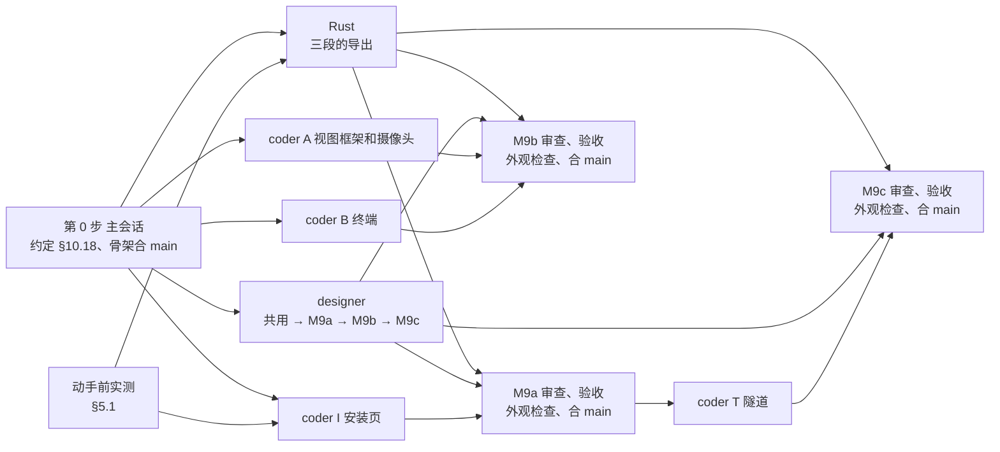

# 新界面 M9：第三轮（隧道、终端、摄像头、安装页）的拆法

2026-11-08 起草；2026-11-09 维护者把 §9 的 M9-1~M9-8 全部按推荐定，§1.2 已回写 13、03。

- 依据：`13-第三轮内容与逻辑说明.md`（下称"13"，R3-Q1~R3-Q24 已定，样稿 `样稿/A-P8-隧道.html`~`A-P11-安装.html` 已定稿）；`03-实施方案.md`（下称"03"）§1、§3、§5.1 M9、§7.2、§7.3、§7.5、§8；`client/LEAPGATE.md` §10.1、§10.4、§10.6、§10.12（M5 出口）、§10.15（M7a 多视图）、§10.16（M8 安装和链接）、§10.17（M7b）；拆法先例 `08-M5拆法.md`、`09-M6拆法.md`、`10-M7a拆法.md`、`11-M8拆法.md`。读码基于 leapgate-client main `68131def7`，分三路（Rust、会话视图、主页）。
- M9 做完，第三轮的四页都在新界面里：TCP 隧道和 RDP 在"出口与隧道"页上建、用、停；终端和摄像头是会话标签里的视图；安装页是主页上的对话框。旧界面便携版不再需要（03 §7.2），还原 `flutter/` 等收尾排在 M9 之后的下一次合并上游（§6.2）。
- 这份文档写 M9 做什么、谁做哪块、怎么验收、哪些不做，以及要维护者定的八条。确认后，决定回写进 13、03，动手的细节写进 `client/LEAPGATE.md` 新一节 §10.18。

## 要点

1. **规模**：Dart 新写约 13~18k 行（页面和 model 约 4.8~6.4k、组件和画廊约 3.2~4.8k、测试约 5.4~7.2k），另有原样复制的上游终端 models 1.8k；Rust 约 1.2k（含单测）；上游文件 1 处 1 行。和 M6（约 19k，分了两段）同一量级。
2. **推荐分三段，并行开发、各自验收合入**（M9-1）：
   - **M9a 安装页**：量小、不依赖第三轮其余部分，是第一次分发给别人的前置（03 §7.2），最先合。
   - **M9b 终端和摄像头**：会话标签里的视图从两种扩成四种，加终端、摄像头两个视图。
   - **M9c 隧道**：出口页扩成"出口与隧道"，TCP 隧道和 RDP 卡片。Rust 最重，排最后合。
3. **Rust 一个 coder 做完三段**：新导出 4 个、改 1 个，原因码 9 个；隧道推荐在上游 `io_loop` 端口转发分支开头加 1 行挂钩，把新界面登记过的隧道会话整个交给 Leapgate 自己的卡片循环（M9-2）。这样关卡片时正在登录的转发能干净收尾，新界面的 RDP 会话也不再把凭据写进进程环境变量，R3-Q6 的串号整个消失。
4. **读码更正了 13 的几处**（§1.2），最要紧的是 R3-Q5：别的程序监听 `0.0.0.0:P` 时，不复用地址照样绑得上 `127.0.0.1:P`，连接全落到隧道，"端口被占用"报不出来。推荐绑好后再试绑一次通配地址，出口一起改（M9-3），动手前先在台式机上实测。
5. **验收的难点在环境**：RDP 被控端只有测试虚拟机合适，无人值守做到远程桌面协议的握手为止（M9-5）；摄像头要一台带摄像头的 Windows 被控端，两个摄像头还要再接一个（M9-6）；打印机驱动要进构建（M9-4）；测试虚拟机现在为"同时下载加上传卡死"留着（M9-8）。
6. 手机终端页、手机摄像头页不在 M9，随 M11（M9-7）。

---

## 1. 范围

### 1.1 做什么

| 段 | 区域 | 内容 | 出处 |
|---|---|---|---|
| M9a | 安装页 | 主页标签上的对话框"安装 Leapgate"：安装位置（只读路径、"修改"）、四项位置检查、三个选项、有会话时的后果句、安装过程和失败横幅；许可协议一行在品牌事项定之前不显示 | 13 §4.2（R3-Q21、R3-Q24） |
| M9a | 入口 | 本机提示卡"安装"改成打开安装页，"升级"卡照 M8 直接升级并加盾牌；设置"远程打印"便携版加"安装"（打开安装页，打印机预先勾选，不带盾牌） | 13 §4.1、§4.2"和其他页面的衔接"（R3-Q20） |
| M9a | 构建 | 构建带上打印机驱动（M9-4） | 13 R3-Q23 |
| M9b | 视图框架 | 会话标签里的视图从两种扩成四种：视图切换、标签右键、标签汇总（连接方式取最差、未读数求和）、单视图时 × 的处理、全屏归进入它的视图、连接面板的关闭按钮文字；按对端平台隐藏终端、摄像头（R3-Q12） | 13 §0.4 ②③、§5.4 |
| M9b | 终端 | 终端视图：视图标题栏里的多终端标签条、"+"、"⋯"（R3-Q8）；终端区（固定深色，R3-Q14）、复制粘贴、Ctrl+A 交给远程（R3-Q10）、剪贴板写入请求横幅；保持会话和恢复、重连新 shell 的提示行（R3-Q11）；普通和管理员终端二选一（R3-Q9）；管理员账户的连接面板；断开确认（R3-Q15） | 13 §2.1、§2.2 |
| M9b | 摄像头 | 摄像头视图：复用远程桌面的会话页和浮动工具栏，去掉"输入""会话"（R3-Q16）；摄像头切换列表带名称（R3-Q18）、全部摄像头、截图、录制、聊天（R3-Q17）；只发摄像头会话认的消息 | 13 §3.1、§3.2、§3.4 |
| M9b | 入口和链接 | 设备菜单、连接下拉、"连接到"的"⋯"里的终端、终端（管理员）、摄像头；链接 `terminal`、`terminal-admin`、`view-camera` | 13 §2.1、§3.1 |
| M9c | 页面 | 导航和页标题"出口与隧道"（R3-Q1），页面分"出口""隧道"两节、三级标题；出口一节外观和行为不变 | 13 §1.3 区块 A |
| M9c | 卡片 | TCP 隧道卡片（一台设备一张，列全部端口转发，R3-Q2）：转发小表、原地展开的添加行、行下原因和通知、提问区（含不安全连接）、冲突态（R3-Q4）；RDP 卡片和 RDP 设置对话框；打开就登录、每条转发实时状态（R3-Q3）；本机端口独占（R3-Q5）；RDP 凭据按会话取（R3-Q6）；复用会话标签的连接令牌（R3-Q7，出口卡片一起） | 13 §1.3 区块 B~E |
| M9c | 联动 | 导航和主页标签的数字、提醒标记按"出口 + 隧道卡片"数；关窗、退出、服务启停确认、"关闭主窗口时"两条说明、安装页后果句带上隧道；出口和隧道互查端口 | 13 §1.3 区块 F、§1.1.3、§0.4 ⑤ |
| M9c | 入口和链接 | 设备菜单、连接下拉、"连接到"的"⋯"里的 TCP 隧道、RDP（菜单"RDP"行带编辑按钮）；链接 `port-forward`、`rdp` | 13 §1.1.2 |

### 1.2 和 13、03 原文不同的几处

读码时三路核对出来的，2026-11-09 维护者定了 §9 以后回写 13、03（各处注明"2026-11-09 按 14"）：

- **R3-Q5 的推理**（13 §1.7 第 1 条、§5.1、§7.1）：按微软文档的绑定表（"Using SO_REUSEADDR and SO_EXCLUSIVEADDRUSE"，2026-11-08 查），同一用户下先有程序绑 `0.0.0.0:P`，再绑 `127.0.0.1:P` 不论带不带 `SO_REUSEADDR` 都成功；`SO_REUSEADDR` 只在对方也带它、或对方是通配地址时才共用端口。所以"新路径不复用就能报端口被占用"只对了一半，13 自己举的"别的应用监听 0.0.0.0、连接全落到隧道"挡不住。做法见 M9-3。出口 A10（`src/leapgate_hooks/exit.rs:57-58`）有同一个缺口。
- **R3-Q6 的代价那句**（13 §5.2）："两种做法都拦不住 RDP 会话开始时写环境变量"对 13 列的做法 (a) 成立，对 (b) 和本拆法的做法 (c) 都不成立：挂钩在 `src/ui_session_interface.rs:1990` 的 RDP 判断之前，新界面的 RDP 会话不再执行 `:1994-2001`。
- **不需要 M7b 那种总开关**（13 §5.2）：只有经新导出登记过的隧道会话才走新路径，旧界面从不登记（和出口卡片的 `cards::take` 同理）。
- **一张卡多行时连接方式和通知要按行**（13 §5.1 P8、§1.3 区块 E）：几条转发登录都写会话共用的 `lc.direct`（`src/port_forward.rs:435`），照出口读它会读串；被控端拒绝打开通道走会话共用的 `on_error`（`src/port_forward_mux.rs:729-732`），"No permission""Too many"两种原文不带地址，界面对不上是哪一行。改由 Rust 按行推（§4.3）。13 的界面写法不变。
- **冲突态的"重试"**（13 §1.3 区块 B）：出口卡片停在"已停止""端口被占用"时 Rust 会话还在（`exit.rs:606-618`），冲突要等出口卡片**移除**才解除，"出口卡片已经停掉时"改成"已经移除时"。
- **二次验证码发给几条连接会不会被当重放**（13 §1.7 第 4 条）：被控端只调 `totp.check_current`，不记用过的码（`src/server/connection.rs:3126-3127`），不会被拒；实测只当回归。
- **终端编号**（13 §2.2.2 区块 B）：是控制端界面分的（上游 `terminal_tab_page.dart:57`），不是 Rust 的；规则本身不变。
- **R3-Q10 的代价那句**：不改复制件里的快捷键表，终端区给 `TerminalMouseInteraction` 传自己的表（§2.4），复制件保持原样档。
- **连接下拉不列"终端（管理员）"**（13 §2.1.1）：定稿样稿 `A-P1.html#p1-cb-menu` 里没有，只有设备卡片"⋯"菜单有，照样稿（手输的 ID 平台多半未知）。
- **摄像头视图里的会话快捷键**（13 §3.2"键盘"）："一打开就能用"是读码推断：Flutter 侧的匹配对摄像头直接返回空（`core/lib/models/input_model.dart:1211`），只剩 Rust 的键盘抓取一条路，上游从没走过，验收实测（§4.6）。
- **13 §5.4 漏列的 5 处**：视图标题栏上视图切换的高亮（`app/lib/shell/session_views.dart:239`）、单视图时关标签只认文件视图（`tab_menu.dart:113`）、注册表没有管理员终端参数、`FFI` 没有终端的事件登记和清理、`ffi_model.dart` 改写时漏了上游 `model.dart:1415-1420` 的终端一支。
- **主页标签的读屏名**（13 §1.3 区块 F 漏写）："主页，‹N› 个出口或隧道正在使用"，有提醒时加"，需要处理"。
- **安装页"修改"的初始位置**（13 §4.2 区块 A）：位置 = 选中的文件夹 + `\Leapgate`，从当前路径开始选会得到 `…\Leapgate\Leapgate`，改成当前位置的上一级。
- **runner 的安装页窗口类**（13 §0.5、§5.5"不用"）：只是不再当安装页用，不删：它保证带 `--install` 的进程不建主窗口类、不接链接（`app/windows/runner/main.cpp:20`、`:161-214`）。
- **03 §1.1"core 不含组件"**：终端复制件里的 `TerminalMouseInteraction` 是一个只处理指针和按键、不弹界面的组件，随复制件进 core（§2.4），03 §1.1 补一句；03 §1.2"core 不弹界面"仍成立。
- **03 §5.1 M9 行"另估"**：改成 §8 的数。

---

## 2. 代码

### 2.1 现成的

- 出口页（M5）：`LgExitPage`、`LgExitCard`、`ExitNodesModel`、`ExitCard`、`useAsExit` 和 `ExitPageRequests`、出口导出的卡片模式（`src/leapgate_hooks/exit.rs`，`run_card`、`loopback_pair`、`login_or_close`、K0 守卫）。
- 多视图（M7a）：`SessionTabView` 的视图容器、视图标题栏 `LgViewBar`、标签汇总、关闭确认、`MainNavigation.openFileTransfer`。
- 会话页和工具栏（M2a、M2b）：core 复制件里摄像头的分支早已在（`input_model.dart` 22 处早返回、`ffi_model.dart:397-449`），工具栏的输入、会话、画面、操作菜单已按连接类型分好；连接状态已认管理员终端的两种输入（`core/lib/leapgate/connection.dart:227-230`）。
- 安装（M8）：子进程 `--leapgate-install`、`LocalStatusModel.install`、本机提示卡、`leapgate_install(kind)`；链接 `app/lib/shell/links.dart`。
- CM（M3）对端口转发、终端、摄像头三种来访已做完，读码没有要补的（RDP 来访显示"端口转发：localhost:‹RDP 端口›"，同 13 §1.4）。
- 第三方包：`xterm 4.0.0`（上游同版本，本机 pub 缓存有它和全部依赖；草稿目录的探针包在 3.44.9、3.47.9 上都能离线解析、`flutter test` 里能建 `TerminalView` 并写入带颜色和中文的输出，Windows release 编译留给最新 stable 检查）；`file_picker`、`win32` app 已有。

### 2.2 Rust（一个 coder，三段共用）

| 段 | 导出（块 2）或改动 | 参数 | 返回 / 事件 | 上游 | 规模（含单测） |
|---|---|---|---|---|---|
| M9a | 改 `leapgate_install` | `kind`、`path`、`start_menu`、`desktop_shortcut`、`printer` | 不变（§10.16）；`upgrade` 时后四个忽略 | 无 | 约 45 |
| M9b | 原因码 `terminal_unsupported`、`os_login_failed`、`no_console_user`、`os_login_backoff{seconds}`、`no_cameras`、`camera_unsupported` | — | C3 | 无 | 约 70 |
| M9b | `leapgate_session_display_names` | `session_id` | JSON 字符串数组（对端给的显示器 / 摄像头名称，去控制字符、截到 64 字） | 无 | 约 30 |
| M9c | `leapgate_tunnel_session_add` | `session_id`、`id`、`rdp`、`password`、`is_shared_password`、`conn_token`、`force_relay` | `{}`；`{"error":"already"}`（TCP：这台设备已有端口转发会话，即出口卡片或没关完的隧道卡片；RDP：已有 RDP 会话）、`invalid_id`、`other` | 无 | 见下 |
| M9c | `leapgate_tunnel_events` | 全局流（和出口的分开） | 每条带 `id`、`session_id`、`kind`（tcp / rdp），行事件另带 `port`；`state`：`connecting`、`in_use`（`transport`）、`interrupted`（`cause`、`reason`）、`stopped`（`reason`）、`port_in_use`、`notice`（`reason`）、`removed`、`closed`（卡片）；订阅时补推每行最后一条状态 | 无 | 见下 |
| M9c | `leapgate_tunnel_retry` | `session_id`、`port`（RDP 传 0） | 有没有这一行 | 无 | 见下 |
| M9c | 原因码 `tunnel_unreachable{target}`、`tunnel_too_many_channels`、`insecure_declined` | — | C3 | 无 | 含在下面 |
| M9c | 挂钩：`io_loop` 端口转发分支开头（`src/ui_session_interface.rs:1988` 之后）一行，登记过的隧道会话交给 `leapgate_hooks::tunnel::run` | — | — | **1 行** | 隧道合计约 1.0k |

- 增删转发、停止、新建 RDP 连接、读存下的转发、RDP 设置都用上游现成的块 1 导出（`sessionAddPortForward`、`sessionRemovePortForward`、`sessionClose`、`sessionNewRdp`、`mainGetPeerSync`、`mainGetPeerOption` / `mainSetPeerOption`）。界面先做 13 §1.3 区块 B 的三条校验，Rust 不另查。
- 隧道的 Rust 在新文件 `src/leapgate_hooks/tunnel.rs`（登记表、卡片循环、单条转发循环、按行的 `Interface` 包装、打开远程桌面连接、通配地址试绑）和 `libs/leapgate/src/tunnel.rs`（事件 JSON、登录结局到下一步的纯函数、通知原文分类）；`exit.rs` 把建会话那段抽成两边共用的函数，几处改 `pub(super)`，出口行为不变、现有测试照跑。
- 单条转发照出口的 `run_card` 另写一份（不改原函数）：登录目标是这一行的目标、不做 SOCKS 握手、结局判断不看出口能力、登录失败不冷却（照上游）、不安全连接被拒记 `insecure_declined`、没有改端口。占位连接、`login_or_close`、K0 守卫照搬。
- RDP：一行进 `in_use` 时如果是这次监听开好后的第一次，打开一次远程桌面连接；用户名密码从本会话的选项取，不读进程环境变量；`cmdkey`、`mstsc` 放 `spawn_blocking`。照上游 `run_rdp` 在 `tunnel.rs` 另写约 45 行，窗口标题用上游已公开的 `set_rdp_window_title`。
- 起转发时跳过旧界面存的出口占位映射（目标 `leapgate-exit.invalid:65536`）和端口 ≤ 0 的；占位映射走不到上游的出口挂钩。
- 令牌（R3-Q7）Rust 不改：两种卡片的导出都收 `conn_token`，界面传标签里的值。
- 提交顺序：M9a 那一项 → M9b 的原因码和名称（各约半天，界面那几路先接）→ 隧道登记表和导出骨架（事件格式先定死，coder T 对着假实现写）→ 单条转发和按行包装 → RDP → 通配地址试绑。块 2 的桥由主会话重新生成。
- 合计约 720 行加单测约 460 行；上游 1 处 1 行。

### 2.3 M9a 安装页（coder I）

- **core** `InstallPageModel`（约 150~250 行）：位置、三个勾选、检查结果、有会话时那一行的条件；四项位置检查是纯函数加一层取系统信息的薄壳（`GetDriveTypeW`：不是本机固定磁盘就挡，UNC 直接当网络位置；含"%"；在 `Platform.resolvedExecutable` 所在文件夹或其下，不分大小写；已存在且非空只提醒），可注入假实现单测。
- **app** `app/lib/pages/home/install_dialog.dart`：`overlays.show(null, …)` 只遮主页标签；进行中和失败读 `LocalStatusModel` 已有的 `installing`、`installFailure`；有会话时那一行用 `ListenableBuilder` 跟着显示，焦点只在打开时按当时的值定。
- `LocalStatusModel.install` 加可选的 `path`、`options`；本机提示卡"安装"改成打开对话框，卡片自己不再显示进行中和失败。
- 有会话时：传出的会话标签、出口和隧道卡片（M9c 合入前只有出口）、传入会话数，不复用 `serviceAsksFirst`（它要求已安装）。
- `app/lib/main.dart:38-42` 的 `--install` 分支只改注释和日志文字（R3-Q22 定为长期行为）。

### 2.4 M9b 终端和摄像头（coder A、coder B）

**视图框架（A）**：在 `app/lib/shell/session_views.dart` 里把"是不是文件视图"换成按 `ConnType` 的几处 `switch`（名字、图标、页面、断开、面板关闭按钮），另加 `hasImage`（远程桌面、摄像头）、`usesViewBar`（文件、终端），不建类层次。`MainNavigation` 加一个 `openView(id, kind, {terminalAdmin, password, isSharedPassword, forceRelay})`，`openFileTransfer` 留着转调。13 §5.4 列的 14 处加 §1.2 的 5 处，逐处改法在约定里列。

**摄像头（A，接着框架做）**：会话页整页复用；要改的只有工具栏对摄像头不放"会话"按钮、"显示器"菜单换成带名称的摄像头列表（`LgMenuItem` 的 `description` 和 `checked`）、输入菜单那组快捷键只在远程桌面登记、权限收回只看声音和录制、等画面提示和截图通知换成摄像头的说法、两个新原因码的面板。名称在对端信息到了以后取一次（`leapgate_session_display_names`），没有时只写编号。

**终端（B）**：

| 上游 | 去向 | 档位 |
|---|---|---|
| `flutter/lib/models/terminal_model.dart`（649 行） | `core/lib/models/` | 改写 6 处：删多窗口导入、删 `dismissAll`、恢复留着的 shell 改成回调、提示行经可注入的文案函数并截到 200 字、退出那一行不写、R3-Q11 的重连提示行 |
| 其余 8 个 `models/terminal_*.dart`、`rustdesk_terminal.dart`（1,177 行，含 Web 那个 `part`） | `core/lib/models/` | 原样复制（`terminal_copy_shortcut.dart` 去掉 Web 条件导入） |
| `desktop/pages/terminal_tab_page.dart`、`terminal_page.dart`（1,056 行） | 按 13 重写成 core 的 `terminal/terminals.dart`（标签集合、编号、关闭规则、保持会话、恢复、剪贴板请求的判断，约 0.4k）和 app 的终端视图页（约 1k） | 不复制 |
| `terminal_connection_manager.dart`、窗口入口、Web 剪贴板写入、手机两个文件 | — | 不要（手机随 M11） |

- `FFI` 加 `terminalAdmin`（只在新建时定）和 `terminals`；`terminal` 类型时登记 `terminal_response`；`start()` 在 `sessionAddSync` 之前设 `IS_TERMINAL_ADMIN`（Rust 在结尾清掉）；`close()` 清终端。注册表 `open` 加 `terminalAdmin`；`ffi_model.dart` 补终端一支。
- 二选一（R3-Q9）：core 一个 `terminalOpenState(id)`（无 / 普通 / 管理员），设备菜单和视图切换共用；开着普通终端时"终端（管理员）"灰显加悬停说明。
- 按键：终端区给 `TerminalMouseInteraction` 传 Leapgate 自己的快捷键表（去掉 Ctrl+A、加 Ctrl+Shift+A 全选）；会话快捷键在终端区 `onKeyEvent` 里先用现成的 `matchShortcut` 拦，不加全局键盘处理器。
- 依赖：core 写 `xterm: 4.0.0`（钉死），app 写 `xterm: any`。
- 管理员账户的连接面板输入归 A（在连接面板里），B 只调 `conn.login`。

### 2.5 M9c 隧道（coder T）

- **core**：另起 `tunnels.dart`（`TunnelsModel`，进 `AppCore`）、`tunnel_card.dart`（`TunnelCard`、每条转发的状态）、`tunnel_api.dart`（接口、测试替身、Rust 实现，照 `exit_api.dart`），不扩 `ExitNodesModel`：键、端口来源、状态粒度都不同。
- **和出口共享的三样**：`AppCore` 的 `backgroundCount`、`backgroundAttention` 两个 getter，替换只数出口的四处（导航、主页标签、关窗确认、服务启停确认）和安装页的后果句；本机端口占用表（出口的 `portError`、建议端口并进隧道端口，隧道查出口卡片的端口）；提问区状态机，从 `ExitCard` 抽出 `CardLogin`（约 120 行），不安全连接按参数分"自动拒绝"（出口）和"问用户"（隧道），抽完先跑出口现有测试。
- 提问区什么时候收起：没有任何一条转发还在 `connecting` 时才清（"在本机接受"时几条转发分别等）。
- 存下的转发从 `mainGetPeerSync` 读，先滤掉出口占位（常量从 `cm_core.dart:92-98` 挪到公共处）。
- **页面**：`exit_page.dart` 加隧道一节的插槽，隧道一节在新文件 `tunnel_section.dart`；`exitStoppedView` 照写一个 `tunnelStoppedView`。
- **入口**：照 `useAsExit` 加顶层函数 `openTunnel(id, {rdp, …})`（已有卡片只滚过去高亮，没有就建卡片、切到这一页并滚过去）；`ExitPageRequests` 的请求加卡片种类；`SessionRegistry` 提一个 `tokenOf(id)`，出口卡片（`exit_api.dart:115`）和隧道卡片建卡时取一次。
- RDP 设置对话框、设备菜单"RDP"行的编辑按钮（只开对话框，不建卡片）。
- ARB：导航名 `navExitNodes`、`exitPortTaken`、`closingExitDetail`、`closingBackgroundDetail`、`settingsServiceStartBody`、`settingsServiceStopBodyInstalled` 只改值；关窗新句子四条；`linkUnsupported*` 四条在 M9b、M9c 各删各的。

### 2.6 新组件（designer，一个人，按段排）

| 段 | 组件 | 样稿画框 |
|---|---|---|
| 共用（先做） | 重跑 `tools/gen_icons.dart`（`i-rdp`、`i-cameras`）；导航项数字间距 12→4、文字省略号截断（`home_page.dart` 的 `_NavItem`，只动这个类） | `p8-nav-*` |
| M9a | 只读路径行（中间省略、悬停全文、"修改"）；路径下的红字行和警告行；带说明的勾选组；带盾牌、有忙碌态的主按钮；本机提示卡按钮能带盾牌 | `A-P11-安装.html` 全部、`A-P1.html#p1-hint-upgrade` |
| M9b | `LgViewBar` 加中段槽位和"⋯"槽位（文件视图不传，外观不变）；终端标签条 `LgTermTabs`；终端主题（`--lg-term-*` 进 `LgTokens`，`TerminalTheme`、`TerminalStyle` 工厂，深底滚动条）；剪贴板请求横幅（`LgBanner` 盖在内容上的形态）；连接面板的管理员账户两种输入；摄像头切换按钮和列表用现有组件拼不出来时才新做；画廊 `gallery_m9_views.dart` | `A-P9-终端.html`、`A-P10-摄像头.html`、`A-P2.html#c-terminal` |
| M9c | 先把 `LgExitCard` 的私有部件（设备头、状态行、密码区、验证码区、操作行）导出成公共部件，出口卡片改用它们拼、对外参数和外观不变；页面三级标题（`LgExitPage` 加参数、`LgExitSection` 加层级）；整行隧道卡片和类型标记；转发小表（行、复制、状态、行内操作、行下原因和通知，960 宽状态换行）；原地展开的添加行；不安全连接提问态；冲突态；RDP 设置对话框；菜单行编辑按钮的焦点和读屏名 | `A-P8-隧道.html` 全部 |

深色照样稿画过的那几张对照，其余各态在验收时用画廊截图对照（M4 起的做法）。

---

## 3. 分工和先后

1. **第 0 步（主会话）**：把 §2 的导出名、参数和 JSON，`openView`、`openTunnel`、`ConnectLink` 的种类枚举、`PeerAction` 的五个新值和 `peerMenu` 的新签名（收对端平台字符串）、`FFI.terminalAdmin` / `FFI.terminals` / `TerminalTabs` 的公开接口、终端视图页的构造参数、`disconnectTerminalView`、`terminalOpenState`、`TunnelApi`、`AppCore.backgroundCount`、文件归属和 ARB 前缀写进 `client/LEAPGATE.md` §10.18；在 `session_views.dart`、`navigation.dart`、`links.dart`、`peer_list.dart`、`peer_views.dart`、`devices_page.dart`、`exit_page.dart` 放挂载点和空实现（菜单不列新项、链接照旧出轻提示）。**这一步单独审查后先合 main**：三段并行开发，共用文件里的接口要先在 main 上，各段从 main 切分支（和前几个里程碑不同，前几个只有一段）。
2. **开工**：Rust `ui/rust-m9`、designer `ui/m9-ds`、coder I `ui/m9a`、coder A `ui/m9b-views`、coder B `ui/m9b-term` 五路并行。coder T 在 M9a 合入后开工（`ui/m9c`），先对着假 `TunnelApi` 写；这时 Rust 的隧道骨架和事件格式应已提交。同时在跑的始终不超过五路。
3. 每块一轮审查，合进各段的整合分支（M9b 是 `ui/m9b`），换上组件和真实导出（主会话重新生成块 2 的桥），整体审查（代码接缝一路、对照 13 一路），功能验收，验收后的修复做完再跑最后一轮外观检查，合 main。各段只合自己需要的 Rust 提交。
4. **文件归属**（容易互相踩的）：`main_window.dart`、`session_views.dart`、`tab_menu.dart`、`navigation.dart`、连接面板、`reasons.dart`、`toolbar/*` 归 A；`core/lib/models/terminal_*`、`core/lib/leapgate/terminal/`、`session.dart` / `session_registry.dart` / `ffi_model.dart` 的终端部分归 B；`exit_page.dart`、`exit_*.dart`、`window_close.dart`、`local_status.dart` 的计数归 T；`install_dialog.dart`、`local_status.dart` 的安装部分、`remote_printing.dart` 归 I。`peer_views.dart`、`devices_page.dart`、`links.dart` 的分派骨架在第 0 步写好，各段只填自己那几支。ARB 按前缀分（`install`、`term`、`cam` / `view`、`tunnel`），合并时只有追加冲突。
5. 用量吃紧时按 Rust → coder B → coder A → designer → coder I → coder T 排：Rust 是其余几路的前提，终端代码最多。

---

## 4. 几处要先说清的

### 4.1 端口被通配地址占着

见 §1.2 第一条和 M9-3。推荐在隧道的监听函数里绑好 `127.0.0.1:P` 后再试绑一次 `0.0.0.0:P`（只 bind 不 listen，马上丢），试绑报占用就关掉刚开的监听、推 `port_in_use`；按同一张表，我们自己别的卡片都绑具体地址，不会挡住试绑。出口卡片和旧界面的出口代理也换用这个函数（回归一次出口）。别的程序只监听 `[::]:P` 时，本机程序用 `localhost` 可能先连到 `::1` 那边，写成已知限制。动手前实测（§5.1 第 1 条），表不成立就去掉试绑。

2026-11-09 在台式机 A 上实测（.NET 默认 Socket，和 tokio 在 Windows 上不带 `SO_REUSEADDR` 的绑定相同），表成立：

| 别的程序 | 绑 `127.0.0.1:P` | 本机连 `127.0.0.1:P` 落到 | 试绑 `0.0.0.0:P` |
|---|---|---|---|
| `0.0.0.0:P`，默认 | 成功 | 我们 | 占用（认出） |
| `0.0.0.0:P`，带 `ReuseAddress` | 成功 | 我们 | 占用（认出） |
| `127.0.0.1:P` | 占用 | — | — |
| `0.0.0.0:P`，独占（`SO_EXCLUSIVEADDRUSE`） | **拒绝访问**（`WSAEACCES`） | — | — |
| 只有 `[::]:P`（仅 IPv6） | 成功 | 我们 | 成功（认不出，已知限制） |
| 没有别的程序（只有我们刚开的监听） | 成功 | — | 成功（不误报） |

所以监听函数把绑定和试绑的"拒绝访问"也当成端口被占用（系统保留的端口段也报这个）。

2026-11-09 Rust 审查补测、做法改了：表里漏了一行，本机有一条源端口正好是 P 的出站连接（例如 `10.10.0.1:P → 外网`）时，绑 `127.0.0.1:P` 成功，试绑 `0.0.0.0:P` 却报占用；连接进了 TIME_WAIT 以后不再挡。本机动态端口范围是 1024~15000，当时约 1/27 的端口被活着的连接占着，试绑会凭空报"端口被占用"，出口也跟着回归。所以不再试绑，改成绑好 `127.0.0.1:P` 以后查 IPv4、IPv6 两张 TCP 监听表（`GetExtendedTcpTable`），`0.0.0.0:P` 或 `[::]:P` 上有 LISTEN 才算占用。这样上面"只有 `[::]:P` 认不出"那一行也认得出了。约定见 `client/LEAPGATE.md` §10.18"独占监听"。

### 4.2 关卡片时正在登录的转发

隧道和出口不同：出口卡片走上游的三参数分支，`start_one_port_forward` 被 `io_loop` 直接等着，关卡片时能收尾；隧道走无参数分支，上游循环收到 `Close` 只 `break`（`src/ui_session_interface.rs:2039-2041`），会话线程的运行时随之丢掉，正在登录的转发在下一个 await 处被取消，守卫跟着丢，被控端的提问挂到它自己超时（30 秒或 180 秒，M6a 验收第 9 项那一类）。所以挂钩放在 `io_loop` 分支开头（M9-2），卡片循环先把关闭发给每一行、等它们都收尾（照 `login_or_close`）再返回。M9c 验收第一项就测这个。

### 4.3 一张卡多行：连接方式和通知按行

每条转发一个按行的 `Interface` 包装（约 60 行），只改三处：`update_direct` 同时记进这一行自己的格子；`handle_login_error` 先记下原文再转给会话（会话流照常收到"密码错误"这类提问），这一行停下时拿它分类；`on_error` 收到通道被拒的三种原文时推这一行的 `notice`，不再转给会话。界面因此不用再像出口卡片那样从会话流里取失败原因、处理两条流的先后颠倒（§10.12 已知限制第 3 条）：卡片状态和原因都以隧道事件为准，会话流只用来知道要输入什么。

### 4.4 出口和隧道的冲突

`leapgate_tunnel_session_add` 查到同设备的端口转发会话就回 `already`，界面按自己有没有这台设备的出口卡片显示"已停止：本机已有连接此设备的出口"；出口那边对隧道会话本来就回 `already`。出口卡片停在"已停止"时会话还在，冲突一直成立，要移除出口卡片后"重试"（§1.2）。RDP 和出口不冲突。

### 4.5 打开就登录的代价

每条转发一条连接，卡片打开时各行同时登录；提问由上游现成的轮流锁（`port_forward_login_turn`）一次答完，二次验证码同一个发给几条连接也不会被拒（§1.2）。对方 CM 上每条转发各是一个"端口转发：‹目标›"来访，"在本机接受"时要接受几次。这是 R3-Q3 定下的代价，CM 不改。

### 4.6 摄像头视图里的会话快捷键

上游摄像头页从不登记快捷键；新界面登记了，但按键对摄像头在 Flutter 侧直接返回、只剩 Rust 的键盘抓取（`session_enter_or_leave` 不分会话类型，读码看能到 `keyboard.rs` 的分发）。M9b 验收实测全屏、截图、切换标签三个；不通再看是登记没生效还是抓取没进来，写进验收记录，不阻塞合入时改成已知限制。

### 4.7 测试虚拟机的排期

测试虚拟机现在为"同时下载加上传卡死"那个会话留着、没回滚。M9a 的动手前实测和验收、M9c 的 RDP 都要用它（装安装版、开远程桌面、改提权策略，都要整机回滚）。见 M9-8。

---

## 5. 验收

每段写一节验收记录进 `client/LEAPGATE.md` §10.5（"M9a""M9b""M9c"），每条写通过、不通过或未验证。端点：台式机 A、msi B、测试虚拟机（同局域网，安装版和管理员的项在它上面做，测前不回滚、测完回滚关机），维护者的 Mac 上的官方 1.5.0 当不支持终端摄像头的对端。做法沿用运行手册，测试窗口在显示前挪到副屏、编译先看负载（手册 §0）。

### 5.1 动手前实测

| 条 | 内容 | 在哪 | 影响 |
|---|---|---|---|
| 1 | Windows 端口占用的几种情形：别的程序监听 `0.0.0.0:P` / `127.0.0.1:P` / 带 `ReuseAddress` 时，不复用地址绑 `127.0.0.1:P` 成不成、连接落到哪边；"绑好后试绑 0.0.0.0"能不能认出第一种 | 台式机 A（PowerShell `TcpListener` 加一个小测试程序） | M9-3 的做法（Rust 隧道监听） |
| 2 | 安装位置检查的前提：选映射的网络盘、选 Leapgate 所在文件夹各装一次，看是否装出空壳、XCOPY 是否报循环复制（13 R3-Q24 第 1、3 项是读码推断） | 测试虚拟机，用旧界面的安装页（它没有任何检查） | 四项检查的说明文字；M9 之后旧界面停止构建，这一条要在 coder I 写完检查之前做 |
| 3 | msi B 有没有内置摄像头、名称是什么 | msi B（只读：列设备） | M9-6 |

13 §1.7、§2.7、§3.7 里其余标"读码推断"的都不改实现，放进验收。

2026-11-09 结果：第 1 条见 §4.1，做法成立。第 3 条：msi B 有一个可用的内置摄像头"HD Webcam"（Microsoft 驱动）；另有一个小米的"Virtual Camera"（手机当摄像头用的虚拟设备）处于停用状态，两个 HP 摄像头是以前接过、现在不在的。第 2 条等测试虚拟机（M9-8）。

### 5.2 自动测试

- Rust：九个原因码各一条原文（`os_login_backoff` 单复数）；名称截断；安装选项拼法和子进程参数解析（空位置走默认、带空格的路径原样）；隧道用假会话测：打开即登录、两行同时登录各自的连接方式、关卡片时登录中的行被取消且守卫交给 `release_kcp`、删一行不影响另一行、懒重连不冷却、通配地址占着报 `port_in_use`、RDP 只在第一次可用时打开、占位映射被跳过。
- core：安装位置四项检查；终端集合（编号、关闭规则、保持会话、恢复、R3-Q11、剪贴板请求的判断顺序）；`CardLogin` 抽出后出口现有测试全过；隧道卡片的状态、计数、提问区收起时机、端口互查。
- app：各页"要画的状态"每个一个行为测试，用假 model 喂数据；视图框架四种视图的确认、全屏、未读求和、链接。

### 5.3 M9a 真机（无人值守）

| 项 | 做法 |
|---|---|
| 默认安装 | 测试虚拟机上的便携版点本机提示卡"安装"，对话框默认位置、三个选项，装完核对注册表 InstallLocation、开始菜单文件夹、公共桌面快捷方式按勾选有无；安装后配置沿用 |
| 自定义位置 | 带空格的位置（例如 `C:\Apps\Leap gate` 的上一级），很长的路径省略中间；"修改"的选择框起始位置是已知限制（`file_picker` 5.5.0 在 Windows 上不认，13 §4.2 区块 A），只看选中以后位置拼成"选中的文件夹 + `\Leapgate`"、选择框挂在主窗口上。有会话时那一行在 M9c 之前还是"……所有会话和正在使用的出口都将断开。"、只数出口，不按样稿带"隧道"判 |
| 四项检查 | 映射的网络盘（虚拟机里建共享再映射）、`C:\100%`、Leapgate 所在文件夹（选 `%LOCALAPPDATA%`）三种灰显"安装"；预先放一个文件的文件夹只提醒 |
| 有会话时 | 由 A 连进来一个会话、开一张出口卡片，看后果句出现、焦点在"取消" |
| 远程打印 | 便携版设置里"安装"打开对话框、打印机已勾；构建带驱动时装完 `Get-Printer` 有"Leapgate Printer"（M9-4） |
| 升级卡 | 带盾牌，仍直接升级 |
| `--install` | 仍写日志后退出 |
| 取消 UAC | 虚拟机提权不弹框，测不了，靠假导出的测试和维护者试用 |
| 旧界面 | Rust 改了 `libs/leapgate` 和 `src/leapgate_hooks/install.rs`：旧界面编一次加五项冒烟 |

### 5.4 M9b 真机（无人值守）

| 项 | 做法 |
|---|---|
| 入口和视图切换 | 设备菜单、连接下拉、视图切换、标签右键、三种链接各开一次；已有远程桌面时开终端、摄像头不问密码；对端是 Mac 时设备菜单不列摄像头；四行视图切换、未打开写"未打开"；标签悬停逐行列出 |
| 二选一 | 开着普通终端时"终端（管理员）"灰显加悬停；开着管理员终端时"终端"切过去；`--terminal-admin` 在普通终端开着时切到普通终端，之后新开的终端不是管理员终端 |
| 终端 | 对端是 Windows 便携版、测试虚拟机上的安装版、Mac 官方 1.5.0 各一次；三个终端、Ctrl+1~9、Alt+←→、Ctrl+Shift+T/W；Ctrl+A 到远程、Ctrl+Shift+A 全选；选中后 Ctrl+C、右键复制粘贴；vim、htop 的鼠标模式；改窗口大小行列跟着变；中文输入法候选框位置 |
| 保持会话 | 开着时断开再连回三个终端并回放；关着时断开再连是新 shell，自动重连写 R3-Q11 那一行；控制端断网 2~10 秒内恢复，看 shell 会不会被旧连接结束（13 §2.7 第 2 条） |
| 剪贴板写入请求 | 远程 `printf` 一段 OSC 52，三种设置下各一次；"允许""拒绝"写回设置；远程关剪贴板权限时不出横幅 |
| 管理员终端 | 测试虚拟机安装版：`whoami` 是 SYSTEM；账户错；连错 3 次后的秒数文案；便携版对端的"仅支持安装版"；系统密码带首尾空格能不能登上（新界面的连接状态会去掉首尾空格，`connection.dart:476`） |
| 断开和确认 | 两个以上终端、保持会话关着时"断开"和只剩终端视图时的标签 × 都问一次；开着时不问 |
| 摄像头 | 一个摄像头：画面、缩放、画质、编码、截图、录制、聊天和语音、全屏、收起；会话快捷键（§4.6）；工具栏没有"输入""会话"；连上时不出"对方已关闭键盘和鼠标控制权限"；测试虚拟机报"未找到可用的摄像头"；Mac 报"不支持"；两个摄像头时列表带名称、平铺、下一个、全部摄像头（M9-6；全部摄像头不能用就去掉这个开关并回写 13）；摄像头被别的应用占着时停在等画面 |
| 同标签远程桌面加摄像头 | 两个视图来回切，不在前台的不推帧（V1 日志）；两边各录一份；未读求和、视图切换行带数；远程桌面全屏后关掉它退出全屏 |
| 4K 上屏 | 远程桌面视图 4K；同一标签开着摄像头时切回远程桌面再看一次 |
| 读屏 | `scripts/e2e/leapgate-uia.ps1` 在终端视图和摄像头工具栏各读一次语义树：终端内容没有逐行语义是预期的，整棵树不能变空 |
| 旧界面 | Rust 只改 `libs/leapgate`、`src/leapgate_ffi.rs`：旧界面编一次加五项冒烟，终端窗口和摄像头窗口各开一次 |

### 5.5 M9c 真机（无人值守）

| 项 | 做法 |
|---|---|
| 关卡片时登录中的转发（§4.2） | 存 3 条转发、被控端设"在本机接受"，提问出现时点"停止"，被控端 3 个 CM 标签当场消失；走中继和走 KCP 各一次 |
| 隧道基本 | A → B：添加（三种校验文字、回车同"添加"、Esc 收起）、可用直连 / 经中继、curl 本机端口 200、"复制地址"、删除、停止 / 移除后再打开存过的全部回来、暂时断开和重新连接、被拒的"已停止"和"重试" |
| 提问区 | 要密码（含输错）、二次验证（照 M5 的办法，验证码不进输出）、等对方接受（两条转发要接受两次）；不安全连接端点条件不够（Leapgate 被控端一律加密），靠假 model 测试 |
| 独占端口 | 先占住 `127.0.0.1:P`、再占 `0.0.0.0:P`、再用带 `ReuseAddress` 的占，三种都报"端口被占用"，放掉后"重试"可用（M9-3） |
| 端口互查 | 出口卡片占着的端口，隧道添加时报"此端口已被另一个出口或隧道使用"；隧道占着的端口，新出口卡片的建议端口跳过它 |
| 冲突 | 先出口后 TCP 隧道 → 冲突态；出口"已停止"时仍冲突，移除后"重试"起来；反方向出口卡片报原来那句；同设备 RDP 和出口同时开 |
| 旧界面存的出口占位 | 改 A 上 B 的设备配置，加一条普通映射和一条出口占位，打开 TCP 隧道卡片：只列一条，占位端口没有监听 |
| RDP | 控制端 A，被控端测试虚拟机（开远程桌面，测完回滚）：卡片可用后远程桌面连接窗口出现、标题是设备名；从 `netstat` 按进程找到 RDP 的本机端口，发一个 X.224 连接请求收到确认（证明隧道通到对端 3389）；"新建 RDP 连接"；RDP 设置对话框（端口无效、运行中的那句）；菜单编辑按钮只开对话框。完整登录和两台同时开（R3-Q6）见 M9-5 |
| 连接令牌 | 先开 B 的远程桌面标签，再打开 TCP 隧道和出口，都不问密码 |
| 数字和句子 | 导航和主页标签 = 出口 + 隧道卡片；提醒标记；关窗、退出、服务启停的三种组合（只出口、只隧道、都有），便携版在 A、安装版在测试虚拟机 |
| 链接 | `port-forward`、`rdp`（带 `--relay`）打开对应卡片，已有卡片只滚过去 |
| KCP 下停止 | 看 B 的日志，几条转发是否各自约 20 秒后关（已知限制，同出口） |
| 旧界面 | Rust 改了上游 `ui_session_interface.rs` 一行和出口的监听函数：旧界面编一次，五项冒烟加端口转发、出口 B15 冒烟 |

### 5.6 每段都做的

- 最新 stable 检查四步（第 1 步带 `-ForceBridge`）；M9b 重点看 xterm 的 release 编译和终端区在 Impeller 下的绘制。
- 合入前 `git diff main -- flutter/` 为空；analyze 不超基线；新旧界面都能编。
- 最后一轮外观检查：本段的页面、对话框、各态，浅色深色，和样稿逐个对照；这次改到的共享组件出现的旧页面也看一遍（M9a：本机提示卡；M9b：视图标题栏和文件视图、连接面板、工具栏；M9c：出口卡片在部件拆出后外观不能变、导航项、关窗确认、设备菜单）。
- 冒烟清单每段加对应的条目；M9c 合入后第 8 节"旧界面五项"换成新界面上的五项（端口转发在隧道页上跑），每次合并上游照跑（architecture §3.3）。

### 5.7 维护者试用时看的

M9a：取消 UAC 时对话框的提示、从远程打印进来装打印机。M9b：日常用终端（vim、tmux 的剪贴板同步）、两个摄像头的列表和名称（M9-6 没条件时）。M9c：完整的 RDP 登录、两台设备同时开 RDP 凭据不串（R3-Q6）、真实应用（数据库客户端、SSH）经隧道连接。

---

## 6. M9 做完以后

### 6.1 M9 里一并做的收尾

- 冒烟清单和试用说明里"先停安装版服务和托盘再开旧界面便携版"（M8-8）作废；AGENTS 状态加一条，写明 M8 定的"第三轮链接给提示""切换后用旧界面便携版"两条作废。
- `client/LEAPGATE.md` §10.4、§10.16 的已知限制：`--install` 改成长期行为，安装断开会话那条指向安装页，第三轮链接轻提示那条删（13 §6.4）。
- 03 §7.2 旧界面便携版那一条标"已做完"，§10 风险表改实写；`待调.md` 远程打印"安装"那条删、轻提示那条去掉链接的例子（13 §6.3、§6.6）。
- 13 §6.4~§6.7 里带"（M9 做完后）"前缀的各行。

### 6.2 留到 M9 之后的下一次合并上游（写进待办，不在 M9 做）

- 还原 `flutter/` 里 Leapgate 的改动（第四期 F7 的 4 个 Dart 文件、品牌的 2 个、关于页一行、`flutter/windows/` 下 4 个、`flutter/assets/icon.svg`），删 `flutter/lib/leapgate/`，`build.py` 改包名的 3 行还原（03 §7.3）。
- 只为旧界面存在的 Rust 路径（第四期出口的懒登录 `exit.rs` 的 `run` / `serve`）照"挂钩关掉、不删上游文件"处理；出口目录保留；M7b 的总开关届时恒开，旧路径分支留着，下次碰到那几个文件时再决定删不删。
- 删过渡机制：W1 按旧类名找的一支；`build-client.ps1` 的 `-Ui` 和上游界面的两块生成；3.44.9 SDK 和自编引擎（M10 已做时）；端到端脚本里按旧窗口类关会话窗口的分支。
- 冒烟清单里旧界面的几处（"准备"的新旧界面不同时运行、第 1 节 `-Ui upstream`、覆盖安装的旧界面方向、§22 的旧界面原路）；`client/LEAPGATE.md` §10.16 旧界面便携版"升级"卡那条。
- 第三、四期统一验收里原计划在旧界面端点上跑的几项，旧界面停止构建前确认已跑完或改在新界面上跑（03 §8.6）；统一验收步骤里"在旧界面隧道窗口里建映射"改成新界面的隧道页。

---

## 7. 明确不做

- 手机终端页、手机摄像头页（13 §2.3、§3.3）：随 M11（M9-7）。
- "不安装直接运行"、`--install` 打开安装页（R3-Q22）；许可协议行在品牌事项定之前不显示。
- 停止走 KCP 的隧道卡片被控端约 20 秒才关、停在不安全连接提示时取消被控端约 30 秒才关：照出口写已知限制，不改上游 `port_forward_mux.rs`。
- 隧道登录失败的冷却（照上游不加）；修改一条转发（上游只能删了重加）。
- `cmdkey /generic:localhost` 全机一个名字（13 §1.7 第 6 条）：写已知限制。
- 终端内容的逐行读屏（xterm 不提供）。
- 驱动名改名（打印机属性里显示上游的驱动名，architecture §3.11 定了不改）。

---

## 8. 工作量

| 部分 | M9a 安装页 | M9b 终端和摄像头 | M9c 隧道 |
|---|---|---|---|
| Dart 页面和 model | 0.45~0.65k | 2.35~3.05k | 2.0~2.7k |
| 组件和画廊 | 0.45~0.7k | 1.0~1.55k | 1.75~2.5k |
| 测试 | 0.45~0.6k | 3.0~4.0k | 1.95~2.6k |
| 复制件 | — | 1.83k（原样 1.18k、改写 0.65k） | — |
| Rust（含单测） | 约 45 | 约 100 | 约 1.0k |
| 上游文件 | 0 | 0 | 1 处 1 行 |
| ARB 键（中英各一份） | 约 15 | 约 90~120 | 约 50 |

合计 Dart 新写约 13.4~18.4k（含测试和画廊），加复制件 1.8k；Rust 约 1.2k。M9b 的估计里测试按 M7a 的实际比例放大了约 1.4 倍（M7a 估得准的是页面，测试实际多出四成）。

---

## 9. 要维护者定的

2026-11-09 维护者全部按推荐定。

| 编号 | 问题 | 推荐 | 备选 | 理由和代价 |
|---|---|---|---|---|
| M9-1 | M9 怎么分段 | 三段：M9a 安装页、M9b 终端和摄像头、M9c 隧道。第 0 步的接口骨架先合 main，五路并行开发（coder T 在 M9a 合入后接上），三段各自审查、验收、外观检查、合 main，大致按 M9a → M9b → M9c 的顺序合 | 甲：两段，M9a 主页（隧道 + 安装页）、M9b 会话视图；乙：一段做完 | 合计约 16~21k 行（含复制件和 Rust），和 M6 一样一次审查验收太大。三块彼此几乎不共用代码（主页对话框、会话标签里的视图、主页上的卡片），并行开发不互相等；安装页是第一次分发给别人的前置，单独一段能最先合；隧道 Rust 最重、在关键路径上，排最后不拖住前两段。代价是三轮验收和外观检查，第 0 步的骨架要先进 main（前几个里程碑都在里程碑分支上），共用的菜单、链接、ARB 文件合并时有追加冲突 |
| M9-2 | 隧道的 Rust 怎么接进上游 | 在 `io_loop` 端口转发分支开头加 1 行挂钩，新界面登记过的隧道会话整个交给 Leapgate 自己的卡片循环（03 §7.5 的具名例外加一条） | 甲：扩 `start_one_port_forward` 里已有的出口挂钩（上游 1~2 行）；乙：不进 `io_loop`，Leapgate 导出自己起会话线程、挂事件流（上游 0 行） | 甲关卡片时正在登录的转发被硬切断、被控端的提问挂到超时（§4.2），要修还得再动上游循环；乙上游不动，但要在 Leapgate 文件里复刻上游私有的会话启动和事件流挂接，合并上游时最容易悄悄坏。推荐只用 1 行上游换来关卡片能干净收尾，顺带让新界面的 RDP 会话不写进程环境变量、R3-Q6 的串号整个消失。代价是合并上游时要核对 `io_loop` 端口转发分支的结构 |
| M9-3 | 端口被别的程序以通配地址占着时报不报"端口被占用"（R3-Q5 的补充） | 报：隧道绑好 `127.0.0.1:P` 后再试绑 `0.0.0.0:P`（约 8 行），出口卡片和旧界面出口代理也换用同一个监听函数（出口回归一次）；动手前先实测（§5.1 第 1 条） | 甲：只给隧道加，出口照旧写已知限制；乙：都不加，"端口被占用"只在系统真报错时出现 | 本机的开发服务器、数据库多半监听通配地址，正是最常撞端口的情形；不加的话 R3-Q5 定下的行为在这种情形里不成立，应用连本机端口会不声不响地落到隧道（或出口）上。代价是每次开监听多一次系统调用、出口多一轮回归 |
| M9-4 | 打印机驱动进不进构建（R3-Q23） | 进：`build-client.ps1` 照上游 CI 加一步，从上游的发布页下载打印机驱动和适配器两个 zip、按 sha256 核对、解到程序旁的 `drivers/`（约 40 行）；第一次下载前再说明文件名、来源和大小 | 不补，从远程打印进来的打印机项标未验证，试用说明写明装不上 | R3-Q23 已定照上游显示打印机选项、在构建里补驱动；不补的话从远程打印进来的人（打印机预先勾上）一定装失败，M6b 留下的"安装 → 已安装"也验不了。代价是一次外部下载和构建脚本多一步。驱动是上游签过名的，打印机属性里显示上游的驱动名 |
| M9-5 | RDP 的验收做到哪 | 被控端用测试虚拟机（开远程桌面，测完回滚）；无人值守做到"远程桌面连接窗口起来、协议握手有回包"；完整登录和两台同时开 RDP 凭据不串（R3-Q6）留给维护者试用，Rust 单测覆盖凭据从会话取。RDP 测试前先在台式机 A 上查有没有名为 `localhost` 的 Windows 凭据（只看有无、不看值），有就停下来问维护者 | 把测试虚拟机账户的密码经文件送进 RDP 设置，做完整登录 | msi B 是维护者在用的机器，不改它的远程桌面设置；完整登录要处理 mstsc 的证书提示框，无人值守成本高，握手已经证明隧道通到对端 3389。上游每次打开远程桌面连接前先删再写 `localhost` 凭据，会删掉维护者自己存的同名凭据、无法恢复。代价是凭据那条路径只靠单测和试用 |
| M9-6 | 摄像头验收用什么设备 | 一个摄像头：msi B 的内置摄像头（动手前先确认有没有，§5.1 第 3 条）；"未找到可用的摄像头"用测试虚拟机；"不支持"用 Mac 上的官方 1.5.0。两个摄像头：给 msi B 插一个 USB 摄像头，或装一个虚拟摄像头（要下载，装之前问维护者） | 只测一个摄像头，多摄像头的列表、名称、平铺、下一个、全部摄像头留给维护者试用 | R3-Q18 的名称、平铺按钮、"下一个摄像头"和全部摄像头都只有两个摄像头时才出现；全部摄像头上游留着 FIXME，能不能用要实测。代价是要维护者插一个摄像头或同意装一个虚拟摄像头 |
| M9-7 | 手机终端页、手机摄像头页在不在 M9 | 不在，随 M11（Android 控制端）；13 §2.3、§3.3 和两份手机样稿留给 M11 | M9 一起做 | 新界面现在没有手机外壳；手机终端还要换掉上游运行时取字体的做法（03 §11）。代价是写好了的手机部分要等到 M11 |
| M9-8 | 测试虚拟机先给谁用 | 先等"同时下载加上传卡死"那个会话查完、回滚（请维护者叫它继续）；M9a 的动手前实测（§5.1 第 2 条）排在它之后，M9 其余各路照常开工 | 现在就回滚到 `m6-admin` 给 M9 用，卡死的调查以后重新搭环境 | 卡死是已发现的真实问题，调查环境留着成本最低；M9a 动手前实测只挡安装页的检查文字，不挡开工。代价是 M9a 可能要等那边；那边一直不动的话，到 M9a 验收前再问一次 |

不用定、写进约定就行的：

- 逐行的连接方式、原因和通知由 Rust 按行推（§4.3），隧道事件流和出口的分开（出口那条是"新订阅替换旧的"，合用会把出口卡片的事件顶掉）。
- 隧道另起 `TunnelsModel`，和出口只共享计数、端口占用表和抽出的 `CardLogin`（§2.5）。
- 终端复制件全部进 `core/lib/models/`，含 `TerminalMouseInteraction`（03 §1.1 补一句）；`xterm` core 钉 4.0.0、app 写 `any`。
- R3-Q10 由终端区传快捷键表实现，复制件不改；会话快捷键在终端区的 `onKeyEvent` 里拦。
- 终端写进去的提示行经 core 一个可注入的文案函数（默认英文，app 启动时设成 ARB 文案和"次要前景"颜色）。
- `MainNavigation` 只加一个 `openView`；打开隧道照 `useAsExit` 写成顶层函数 `openTunnel`。
- "全部摄像头"先做（复用显示器的合并，约 20 行），验收实测，不能用就去掉。
- `leapgate_install` 改签名，不另加导出；runner 的 `--install` 分支留着。
- 连接下拉不列"终端（管理员）"（照样稿）；安装页"修改"从当前位置的上一级开始；冲突要等出口卡片移除才解除（§1.2）。
- 不对隧道会话调 `sessionReconnect`（同出口，会另起一个 `io_loop`）。
