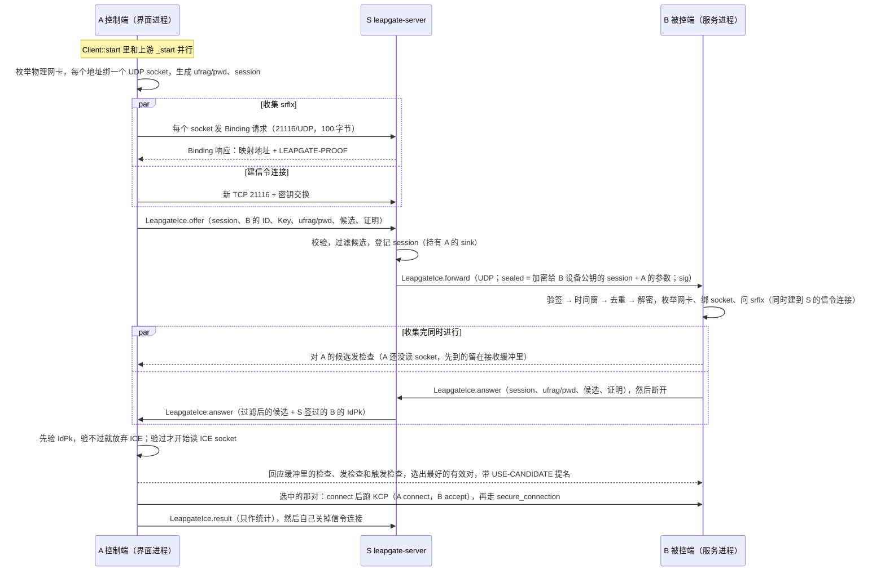

第三期实施契约 · 第 5 块，总述和维护者的决定见 README.md。状态：维护者 2026-10-24 确认；2026-10-25 已实施（服务端 leapgate-server `p3/ice` 到 `ebc4028`、客户端 leapgate-client `p3/ice` 到 `fa090f666`，两边各经三路审查和两轮复核，测试机 netns 真实 NAT 测试 6 组 × 3 次全部符合，§6.3），待合入 main 和维护者端到端（§6.4）。方向问题 Q1~Q9 和起草中提出的 P-A、P-B 都已由维护者拍板（AGENTS.md 2026-10-24"自研 ICE 的决定"一条，P-A、P-B 按推荐）；实施中又定了 F1、F2（§1）。本文已于 2026-10-25 按最终实现同步：实现和原稿不同的地方直接改在对应节里，必要时注明原因。

# 自研 ICE：host 与 srflx 候选、独立信令、STUN 连通性检查、KCP 交接

> 标注：【读码】读过现版源码；【推测】推断，没有实测；【待实测】只能靠实测回答；【实测】笔记 06 §9 的实测结果；【计算】按格式手算或用脚本独立算出；【官方】一手文档，写明查证日期。
> 读码基线：leapgate-client main `648eab0a0`（之后的 `c2e83a732` 只在 `src/leapgate_hooks.rs` 末尾追加了单元测试，本文引用的行号不受影响）、leapgate-server main `08a41fa`、leapgate-cardo 客户端线 `eee588e`（分支 `leapgate/client`）、服务端线 `a80c99e`（分支 `leapgate/server`）。两条 cardo 线的 `protos/rendezvous.proto` 逐字节相同，文中 proto 行号对两条线都成立。第三方代码按两份 `Cargo.lock` 钉的版本读：`sodiumoxide 0.2.7`（自带 libsodium 1.0.18）、`stun_codec 0.3.5`、`bytecodec 0.4.15`、`windows 0.61.1`、kcp-sys `938eda3`。
> 依据：笔记 07（`docs/research/第三期/07-Porta自研ICE设计.md`，设计底稿）、笔记 06 §9（`06-WebRTC评估.md` 的实测结果和结论）。笔记 07 是改名前写的，读码基线和名字都已过时，也有几处被维护者的决定推翻（Q5、Q6）；**本文和笔记 07 冲突时以本文为准**，本文的代码事实都按上面的基线重新核对过。读码过程不复述，只引用节号。

**术语**（第一次出现时解释，后文直接用）：
- **A、B、S**：A 是控制端（发起连接的一方，ICE 里固定当 controlling），B 是被控端（固定当 controlled），S 是 leapgate-server。
- **ICE**（RFC 8445）：两端把所有可能连得通的地址（候选）交给对方，对每一对实际发探测包，哪对通就用哪对。本文的 ICE 是 Leapgate 自己写的精简版，不和浏览器、标准 WebRTC 互通。
- **候选**：**host** 是本机物理网卡上的地址；**srflx**（反射候选）是 S 看到的、本机在 NAT 外面的映射地址；**prflx**（对端反射候选）是检查包实际到达时的来源地址，只在检查过程中学到，不经信令发送。本文不用中继候选，中继交给 hbbr。
- **候选对**：本端一个候选和对端一个候选；**底座（base）**：发出这个候选的那个本机 socket 的地址，host 的底座是它自己，srflx 的底座是问出它的那个 host socket。
- **检查**：在一对候选上发 STUN Binding 请求、收到合法回应就算这一对**有效**；**提名**：A 从有效对里挑一对，带上 USE-CANDIDATE 再检查一次，成功就**选中**它。
- **STUN**（RFC 8489）：一种很小的 UDP 请求/响应格式。本文用它做两件事：ICE 检查，以及"问 S 我的映射地址是什么"（Binding 请求）。
- **反射地址证明**：S 回 Binding 响应时附上的一段 MAC，证明"S 在 30 秒内亲眼看到这个 UDP 地址，而且对方收到了回包"。公网 IPv4 候选必须带它（§2.8）。STUN 属性名 `LEAPGATE-PROOF`。
- **信令**：交换候选和口令的消息，挂在 `RendezvousMessage.leapgate_ice`（oneof 1000）上，有 OFFER（A 发起）、FORWARD（S 转给 B 的信封）、ANSWER（B 应答）、REJECT（拒绝）、RESULT（A 补报结果，只作统计）五种。
- **sealed box**：libsodium 的匿名公钥加密，只有持有收方私钥的人能解开，但它不证明是谁加密的；所以 FORWARD 既加密又签名（§2.5）。
- **sans-IO**：协议内核只吃"收到的包、时间到了"这类输入，吐出"要发的包、下次唤醒时间"，自己不碰 socket，方便用模拟网络做单测。
- **KCP**：RustDesk 现有的 UDP 可靠传输（`src/kcp_stream.rs`），UDP/IPv6 打洞建好后跑的就是它。ICE 选中一对后同样在这对 UDP 上跑 KCP。
- **事务号**：STUN 头里 12 字节的随机数（整个包的偏移 8~19），回应原样带回，用来对上请求。
- **ICE 腿 / 上游腿**：控制端竞速的两条路，一条是 ICE，一条是上游原有的 `_start`（局域网多候选、TCP 打洞、IPv6 打洞、hbbr 中继）。
- **能力缓存**、**锁定**：契约 01 定义的两件事。能力缓存是客户端记住"这个 API 地址是 leapgate-server、支持哪些特性"（Config 选项 `leapgate-api-caps`）；锁定是 S 记下"这个 ID 只认这把设备公钥"，之后换公钥的注册一律被拒。

## 1. 目标与范围

**做什么**：Leapgate 控制端连 Leapgate 被控端时，在上游原有路径之外再跑一条自研 ICE：两端在每个物理网卡地址上各绑一个 UDP socket，收集 host 候选和向 S 问到的 srflx 候选，经独立信令交换，用 STUN 检查逐对实测，选中一对后在它上面跑上游现成的 KCP 和 `secure_connection` 身份握手。ICE 和上游路径竞速，谁先给出直连谁赢；上游先给出中继时最多压一个窗口等 ICE。服务端 S 负责转发信令（转给被控端的 OFFER 用会合私钥签名、用被控端的设备公钥加密）、在 21116/UDP 上回 STUN Binding 并签发反射地址证明。

它要补的是现有路径做不到、笔记 06 §9.2 实测 ICE 能做到的几种情况：同一局域网但 S 判不出同网（路由器透明代理只代理 TCP、两端 UDP 走不同代理出口，S2 3/3【实测】）；IPv4 跨网打洞（S3 4/4【实测】，上游 UDP 打洞从没运行过，契约 04 §1）；家宽 CGNAT 没有公网 IPv4、经全局 IPv6 互连（S4 2/3【实测】，失败那次是 Windows 10054，本文的 socket 规则专门对付它）。

**维护者的决定**（2026-10-24，笔记 07 §9；AGENTS.md 已记）。加粗的三条和笔记 07 **不同**：Q5、Q6 和笔记 07 §9 的推荐相反，P-A 把笔记 07 放在第三步的"赢家上报"提前进了 MVP。笔记 07 里与之冲突的写法一律作废（逐项对照见 §11）：

| 项 | 决定 | 本文落在哪 |
|---|---|---|
| Q1 | 自研，不复用 webrtc-ice 0.13 | 全文 |
| Q2 | 被控端的 host 候选给所有能让 S 转发 OFFER 的请求方，不按身份过滤；只给物理网卡地址，IPv6 每个 /64 只给一个临时地址 | §2.7、§4 |
| Q3 | 检查内核手写精简版：不冻结、角色固定（A controlling、B controlled）、单组件、不 trickle，写成 sans-IO；现成库只作差分测试参照（MVP 里做一次，不进 CI） | §4、§6.2 |
| Q4 | 契约 03、04 按笔记 07 §7.3 收缩：复用 04 的 token 格式、令牌桶、双地址族枚举；04 的 UDP 打洞整套和 03 的 IPv6 局域网候选不做；04 §4.4 降为可选；03 的"默认 ID 加盐"照常 | 03、04 文件头的逐节去留表 |
| **Q5** | **MVP 一次做到 srflx**：S 在 21116/UDP 回 STUN Binding、附反射地址证明、令牌桶限速；客户端从每个物理 socket 问映射地址；公网 IPv4 候选必须带证明；测试机上 netns + nftables 真实 NAT 的集成测试进 MVP 验收。续选、ICE-TCP 不进 MVP | §2.8、§2.9.3、§6 |
| **Q6** | **S 转给 B 的 OFFER 既签名、又加密**：用 B 注册并被 01 锁定的设备公钥加密，链路上看不到 A 的局域网地址和口令 | §2.5 |
| Q7 | MVP 私网 IPv4 优先于 IPv6，有了续选再改 | §2.10 |
| Q8 | Tailscale、ZeroTier、WireGuard 这类 VPN 网卡和 TUN 都不收集 | §4 |
| Q9 | 不用定：开 TUN 时绑物理网卡地址的 socket 发往公网仍走物理网卡（S3【实测】）。但"每个候选 socket 关掉 `SIO_UDP_CONNRESET`、接收循环遇错不退出、不收集 TUN/VPN 候选"是**必须**（笔记 06 §9.3）；默认开着 Windows 防火墙时的行为没测过，放进 MVP 验收 | §4、§6 |
| **P-A**（起草中提出，按推荐定） | **A 在信令连接上补报一条 RESULT**（选中对的类型、地址族、用时或失败原因；不认证，只作统计），S 按 session 记进新表（迁移 0006），不和 `conn_attempt` 按 IP 硬合并。理由：ICE 胜出时 `conn_attempt` 照样记成 `relay`/`direct_tcp`，不补报的话中继回落率会失真。备选和代价见 §8 | §2.3、§3.7 |
| P-B（起草中提出，按推荐定） | 加密 FORWARD 复用 B 已锁定的 Ed25519 设备密钥转成 X25519（`sodiumoxide` 的 `to_curve25519_pk/sk` + sealed box），不另生成密钥。libsodium 允许，但建议条件允许时签名和加密分开用两把，记为已知取舍。备选见 §8 | §2.5 |
| F1（实施审查中提出，维护者 2026-10-25 定） | 会合服务器是域名时，客户端先问物理网卡自己的 DNS 服务器（从这块网卡的地址发出），拿不到地址才退回系统解析，两边的答案都去掉 §2.7"丢弃"类地址。原因：mihomo/Clash 的 TUN 开 fake-ip 时，系统解析给的是 `198.18/15` 的假地址，从物理网卡 socket 发过去永远没有回包，两端都拿不到 srflx（维护者本机实测）。不判断有没有开 TUN，所有环境同一套规则。代价见 §9 第 22 条 | §4.3、§4.7、§9 |
| F2（实施审查中提出，维护者 2026-10-25 定） | ICE 不新增开关，但跟随上游现有的两个打洞开关：控制端 `enable-udp-punch`、`enable-ipv6-punch` 都关时不做 ICE。原因：两个都关说明用户不要 UDP 直连，原稿让 ICE 照样建 UDP 直连、胜出后还不回落 | §4.8.1、§7 |

**维护者原则**（2026-10-23，适用整份契约）：兼容性要考虑全面，不能假定任何运行环境，规则必须对所有环境都适用；不接受要用户配代理规则，不接受按设备主人或授权判同网。本块的落法：所有环境用**同一套规则**（只收物理网卡、两端逐对实测、强制中继时不做），没有任何一条按"是否开 TUN""是否同网""是否授权"切换行为；ICE 根本不做同网判定。

**本块已定的实现取舍**（主会话 2026-10-24 定，不再列为待定；这里只列结论，规则和读码依据以括号里的正文各节为准）：
1. 控制端竞速自己写，不用上游 `race_transports_prefer_webrtc`：ICE 直连立即胜出，上游直连也立即胜出，上游先给中继时最多压一个窗口（和上游取同一个用户选项 `relay-fallback-delay`，`leapgate_hooks` 照抄解析，不改上游可见性）；**ICE 失败一律不对外报错，返回上游自己的结果和错误文本**；笔记 07 的 H-2 删掉（§4.8.1）。
2. ICE 腿只在"普通路径"上启用：不是 `id@server?key=`、直连 IP 或 `域名:端口`、只允许入站、强制中继（含 `/r`、代理、WebSocket）、`disable-udp`，两个打洞开关至少开一个（F2），有可信 Key，能力缓存含 `ice`；连接类型不特判，端口转发、RDP 也走 ICE（§4.8.1）。
3. 被控端两种 mediator 收到的 FORWARD 都处理；B 开了代理、WebSocket、`disable-udp` 或配了 IP 白名单时回 `REJECT{UNSUPPORTED}`；挂钩必须 `tokio::spawn`，不能用 `?`（§4.8.2）。
4. B 交给 `create_tcp_connection` 的地址是 ICE **实际选中的远端地址**，`ConnectionMeta` 两个字段都取 `None`（§4.8.2）。
5. S 只在已完成密钥交换的 21116 TCP 上处理 ICE 信令；OFFER 分支 `return true`，A 的 sink 由会话表持有；B 回完 ANSWER/REJECT 就断开；S 关不掉 A 的连接，由 A 自己关；会话条目和 A 的信令连接同寿（§2.3、§3.3.2）。
6. FORWARD 时间窗 ±40 秒（客户端只在偏差超过 30 秒时才采信 S 的时间），去重条目留到它再也过不了时间窗（§2.5）。
7. S 的 STUN 手写最小编解码、不加 `stun_codec`，在 `parse_from_bytes` 之前分流，发送错误不用 `?`，请求门槛按放大比**严格小于 1** 算（§2.9.2、§2.9.3、§3.4.3）。
8. 候选不用 `AddrMangle`，改用确定的显式编码和长度白名单（§2.6）。
9. 检查报文自己校验 MESSAGE-INTEGRITY、常数时间比较；MESSAGE-INTEGRITY、FINGERPRINT 各恰好一个，前者之后只许有后者；不认识的属性一律丢弃；每个数据报新建解码器；随机字节输入不 panic（§2.9.2、§2.9.4）。
10. 和 KCP 的交接：Leapgate 生成的事务号偏移 12 恒为 0；B 按 SYN 的位模式识别 KCP 的第一个包，不是"第一个不是 STUN 的包"（§2.9.5）。
11. 能力和版本：S 的 `features` 加 `"ice"`（常量）；B 要 `leapgate_hb` 新鲜、版本不低于 0.3.1、设备公钥已被 01 锁定（§2.12）。
12. 网卡过滤：契约 03 §4.1 的关键字规则搬进本块，只新增 `wi-fi direct`；Hyper-V 不加关键字，改为出候选的网卡必须有默认网关（任一地址族）；`is_virtual` 变严对已合入的局域网多候选和 02 测速的影响是有意的，要求回归测试（§4.3、§4.7）。
13. 依赖：客户端只新增 `stun_codec`、`bytecodec` 的直接声明和 `windows` 的 `Win32_System_IO` feature，服务端只显式声明 `crc32fast`，都已在锁文件里（§3.10、§4.10）。
14. 资源都由已有上限或本块的常数兜住（§2.11、§3.9）。

**整合时定的取舍**（三段草稿之间对不上、删掉之后更简单，或第 1 轮核对发现的问题；按维护者原则和工程取舍原则定，细节在各节）：
- A 收到并验过 ANSWER 之后才开始读 ICE socket，之前到达的检查留在接收缓冲里（§2.9.4）；B 先收集，收集完同时发 ANSWER、开始检查（§2.3 ③）。
- 会话条目和 A 的信令连接同寿，S 由此分出"拿到结果"和"被竞速取消"（`abandoned`）。不设会话过期、不设全表上限：一条连接最多登记一个 session、结束时一定清掉，条目数由 21116 的 2048 条并发连接封顶；不守规矩、一直不关连接的 A 最多占住自己来源的 8 个名额。判重、判名额、插入在 `register` 的一次加锁里，只在成功时取走 sink（§2.3、§3.3.2）。
- A、B 的信令连接（建连加密钥交换）整段套 `SIGNAL_TIMEOUT`，不用上游的两段 18 秒；A 的 `secure_connection` 套 `KCP_HANDOFF_TIMEOUT`。ICE 腿因此最长约 16 秒（§4.8.1、§9 第 20 条）。
- RESULT 的 `CONNECTED` 由 `race_ice` 在选定 ICE 之后才发；ICE 腿被竞速丢掉时 S 记 `abandoned`，不会记成 `connected`（§4.8.1）。
- 被控端先验签、去重、解密，拿到 session 后先占名额、再判能不能做；名额满就静默丢弃、不回 `BUSY`，回 REJECT 也占着名额，B 为 ICE 开出的 TCP 同时最多 8 条（§4.8.2）。B 认任一提名过的对上来的 KCP SYN（§2.9.5）。
- B 配了 IP 白名单（非空且不含 `0.0.0.0`）时不做 ICE：白名单按 ICE 选中的地址判，可能拒掉以前经中继能连上的连接，而 ICE 胜出后不再回落（§4.8.2）。
- 每个 agent 最多学 `MAX_PRFLX` 个 prflx，触发检查只对还没发过检查的对起，失败的对不重起（每对最多检查一次），两端都不会被当成有放大效果的反射器（§2.9.4、§4.5）。
- 客户端认 S 的 Binding 响应只看事务号、不看来源（§2.9.3）；MESSAGE-INTEGRITY 按 0 填充重算，只和填充为 0 的发送方（Leapgate 自己）互通（§2.9.4）；本端候选类型按提名检查成功响应里的映射地址判（§4.5）。
- 控制端 ICE 腿跨 await 的状态都要 `Send`：端口转发把 `Client::start` 放进 `tokio::spawn`（§4.11）。
- FORWARD 的外形（含 `ver`、只认 `forward` 变体）、验签、时间窗、去重、解密整段放 `libs/leapgate`，`open_forward` 收整条 `LeapgateIce`（§4.2、§4.6）；`Nic.ipv6` 保留全部地址，每个 /64 只留一个只在选 ICE 候选时做（§4.7）；出候选的网卡要有默认网关，ULA 也一样（§4.3）。
- 控制端每次连接的结果日志不限频（§4.12）；不加 `relay status` 的会话数一行（§3.8）；和 `is` 的一次性差分对照进 MVP、不进 CI（§6.2）。

**和契约 01、02 的关系**（03、04 的逐节去留见两份文件开头，和笔记 07 的对照见 §11）：

| 来源 | 本块怎么用 |
|---|---|
| 01 能力缓存 `has_feature(name)`（`report/mod.rs` L94~96） | A 在界面进程里用 `has_feature("ice")` 决定启不启动 ICE |
| 01 `sign::server_pk()`（`sign.rs` L89） | B 验 FORWARD 签名时用它取会合公钥；`Ok(None)`（没配 Key）、`Err`（配了但无效）都不做 ICE。A 验 ANSWER 里的 IdPk 不用它，用 `peer_key_verifies`（`get_rs_pk(key)`，和 `secure_connection` 同源，§2.3 ⑥） |
| 01 时钟偏移 `sign::clock_skew(t)`（`sign.rs` L81，crate 内可见） | B 判 FORWARD 的时间窗、去重条目过期（所以 FORWARD 的校验整段放在 `libs/leapgate`，§4.6） |
| 01 `Peer.leapgate_hb`、锁定 `Peer.pinned`（`server/src/peer.rs` L99~114） | S 判 B 支不支持 ICE、加密目标公钥是否可信。ICE 是 `leapgate_hb` 的第一个读者，去掉两处 `#[allow(dead_code)]` |
| 01 版本号规则（契约 01 §2.3） | 0.3.1 原留给 04，现归本块；01 §2.3 那句"04 块客户端合入时前移到 0.3.1……第三期只前移这两次"已于 2026-10-24 改成归 05（`ICE_MIN_LEAPGATE_VER` 取 0.3.1） |
| 02 `lan.rs` 双地址族枚举（`AF_UNSPEC`、`Nic.ipv6`、`is_physical(IpAddr)`、`physical_snapshot`） | 直接用；02 没做的部分（契约 03 §4.1 的描述关键字、`has_gateway_v4/v6`、地址分类，加上 ICE 另要的 IPv6 地址属性和网络代价）由本块补（§4.7） |

**分期**（笔记 07 §7.1 的三步，按 Q5、P-A 重排）：MVP 是笔记 07 原来的第一、二步合在一起，就是本契约（验收含测试机 netns + nftables 真实 NAT 集成测试、在开着默认 Windows 防火墙的机器上重测、和 `is` 0.11 的一次性差分对照）；第三步（完整版）另起契约，内容见 §7 第一条；04 §4.4 可选，不排期。

**实施顺序**（README §2 新增的 D 步）：先做只含 proto 的提交（§2.2），两条 cardo 线各一份；然后服务端、客户端并行（不同仓库）。依赖 01 的能力缓存、心跳签名机制和 `leapgate_hb`、02 的 `lan.rs` 双地址族（都已合入）。迁移 0006 归本块（P-A），在 02 的 0005 之后。和 03 的"默认 ID 加盐"无依赖、可并行。

**工作量**：coder 约 20 人天（区间 18.5~22.5）【推测】，维护者端到端约 1.5 天；明细、比笔记 07 多出来的部分和实际情况见 §10。

**不在本块**：见 §7；另外 03 的默认 ID 加盐是另一块。

## 2. 协议与接口

本节把三方必须一致的东西一次定死。服务端（§3）和客户端（§4）只引用这里，不另起定义。

### 2.1 总览



四段信令：

| 段 | 通道 | 加密 | 认证 | 带什么 |
|---|---|---|---|---|
| A → S | A 新开的 21116 TCP，密钥交换后 | 是（密钥交换） | A 不认证（任何人都能发起） | `offer`；之后可能有一次 `offer` 重发、一条 `result` |
| S → B | 21116/UDP，发往 B 最近一次注册的 UDP 地址 `Peer.socket_addr` | 是（sealed box 给 B 的设备公钥） | 会合私钥签名 | `forward`：外层只有 `ts`、`sealed`、`sig`；session 和 A 的参数都在密文里 |
| B → S | B 新开的 21116 TCP，密钥交换后 | 是 | B 不认证，凭密文里拿到的 session（128 位随机数） | `answer` 或 `reject`，发完 B 断开 |
| S → A | A 的那条信令连接（S 在会话表里持有它的 sink） | 是 | A 已在密钥交换里验过 S 的签名 | `answer`（带 S 签过的 B 的 IdPk）或 `reject` |

### 2.2 proto

在两条 leapgate-cardo 线的 `protos/rendezvous.proto` 里加下面这些消息，并在 `RendezvousMessage` 的 oneof 里加一行（现有 oneof 用到 6~29，L295~322；1000 空着【读码】）。文件头 L4 已有号段注释"field numbers 1000~1999 are Leapgate's"，不用再改；新消息是 Leapgate 自己的，内部字段号从 1 起。

```proto
// Leapgate: self-built ICE signaling (phase 3 contract 05). Leapgate's own messages; their field
// numbers start at 1. A = controller, S = leapgate-server, B = controlled side.

// One side's ICE credentials and candidates.
message LeapgateIceParams {
  string ufrag = 1;
  string pwd = 2;
  repeated bytes candidates = 3;   // explicit encoding (contract 05 §2.6), best first, at most 16
}

// A -> S, on an encrypted 21116 TCP connection.
message LeapgateIceOffer {
  bytes session = 1;               // 16 random bytes chosen by A
  string id = 2;                   // B's id
  string licence_key = 3;
  LeapgateIceParams params = 4;
  repeated bytes proofs = 5;       // LEAPGATE-PROOF values for A's candidates; checked, not forwarded
}

// The plaintext sealed inside LeapgateIceForward.sealed.
message LeapgateIceSealed {
  bytes session = 1;
  LeapgateIceParams params = 2;    // A's, as filtered by S
}

// S -> B over UDP: encrypted to B's device key, then signed with the rendezvous key.
message LeapgateIceForward {
  uint64 ts = 1;                   // S's unix seconds at signing
  bytes sealed = 2;                // sealed box of a serialized LeapgateIceSealed
  bytes sig = 3;                   // Ed25519 detached signature, 64 bytes
}

// B -> S (pk empty), then S -> A (proofs empty).
message LeapgateIceAnswer {
  bytes session = 1;
  LeapgateIceParams params = 2;
  repeated bytes proofs = 3;       // B -> S only
  bytes pk = 4;                    // S -> A only: B's IdPk signed by S, as PunchHoleResponse.pk
}

// S -> A, or B -> S and then S -> A.
message LeapgateIceReject {
  enum Reason {
    BAD = 0;
    OFFLINE = 1;
    UNSUPPORTED = 2;
    RELAY = 3;
    BUSY = 4;
  }
  bytes session = 1;
  Reason reason = 2;
}

// A -> S once A's ICE leg has an outcome. Statistics only, not authenticated.
message LeapgateIceResult {
  enum Outcome {
    UNKNOWN = 0;
    CONNECTED = 1;
    NO_ANSWER = 2;
    BAD_ANSWER = 3;
    NO_PAIR = 4;
    KCP_FAILED = 5;
    SECURE_FAILED = 6;
  }
  enum Kind {
    HOST = 0;
    SRFLX = 1;
    PRFLX = 2;
  }
  enum Net {
    ETHERNET = 0;
    WLAN = 1;
    OTHER = 2;
  }
  bytes session = 1;
  Outcome outcome = 2;
  uint32 elapsed_ms = 3;           // from the start of A's ICE leg to the outcome
  Kind local_kind = 4;             // the selected pair; CONNECTED only
  Kind remote_kind = 5;            // CONNECTED only
  uint32 family = 6;               // 4 or 6; CONNECTED only
  Net local_net = 7;               // CONNECTED only
}

message LeapgateIce {
  uint32 ver = 1;                  // 1
  oneof union {
    LeapgateIceOffer offer = 2;
    LeapgateIceForward forward = 3;
    LeapgateIceAnswer answer = 4;
    LeapgateIceReject reject = 5;
    LeapgateIceResult result = 6;
  }
}
```

`RendezvousMessage` 的 oneof 末尾（`IceCandidate ice_candidate = 29;` 之后）加：

```proto
    // Leapgate: self-built ICE signaling (phase 3 contract 05).
    LeapgateIce leapgate_ice = 1000;
```

- 生成的 Rust 名字：`rendezvous_message::Union::LeapgateIce`、`leapgate_ice::Union::{Offer, Forward, Answer, Reject, Result}`、`leapgate_ice_reject::Reason`、`leapgate_ice_result::{Outcome, Kind, Net}`（hbb_common 用 `protobuf-codegen 3.7` 纯 Rust 模式生成，`bytes` 字段是 `bytes::Bytes`，不用手写代码【读码：`hbb_common/build.rs`】）。
- 枚举的 0 值：`Reason` 的 0 是 `BAD`（没填原因按格式错处理）；`Outcome` 的 0 是 `UNKNOWN`，避免漏填时被当成成功。
- **不复用上游的 `IceCandidate`（29）**：B 的 `handle_resp` 会把它路由给上游 WebRTC（`rendezvous_mediator.rs` L561~584），语义绑死在上游 WebRTC 会话上【读码】。
- **旧版本收到 oneof 1000**：原版 hbbs 和不带本块的 leapgate-server 在 TCP 上收到不认识的 oneof 会断开连接（`handle_tcp` 兜底 `_ => {}` 后返回 `false`，L955~958），A 的 ICE 立即失败；UDP 上静默丢掉；原版和旧版被控端 `handle_resp` 兜底 `_ => {}`（L585），静默丢掉【读码】。所以 S 必须先判 B 支不支持再转发（§2.12）。
- **大小**：FORWARD 最长约 640 字节（16 个 IPv6 候选、ufrag 32 个字符、pwd 64 个字符时）【计算】，常见的 8 个候选约 450 字节，都低于 1200 字节，不会分片。A→S 的 OFFER 最长约 1.6 KB（含 16 条证明），远低于 21116 TCP 的帧上限 16 KB（`MAX_FRAME`，L63）。
- **提交方式**：同一份 proto 文本在两条线上各做一个**只含 proto 的提交**（提交说明英文），推 `leapgate/client`、`leapgate/server` 两个分支（Forgejo + GitHub 双推），再挪 `client`、`server` 两个子模块指针和总仓库指针。**验收**：`git diff origin/leapgate/server origin/leapgate/client -- protos/` 为空（不要再出现 02 那次事后补齐措辞的提交）。cardo 只改 proto，不动任何 `.rs`。

### 2.3 各段消息和处理

所有 `LeapgateIce` 一律要求 `ver == 1`。不合时各方的处理（实施时补定，原稿只写了"不合规"）：S 收到的 OFFER 回 `REJECT{BAD}`；ANSWER 按不合规处理，给 A 发 `REJECT{BAD}` 并删掉这条 session；B 的 REJECT 忽略、断开 B 的连接；RESULT 忽略、A 的连接保持；A 收到的 ANSWER 按 `BAD_ANSWER`；B 收到的 FORWARD 静默丢弃（§2.5 第 1 步）。S 只在**已完成密钥交换的 21116 TCP 连接**上处理 `offer`、`answer`、`reject`、`result`：WebSocket 连接（21118，不做密钥交换）和明文 TCP 连接上收到任何 `LeapgateIce` 都不回包、直接断开；21116/UDP 上收到的 `LeapgateIce` 丢掉。Leapgate 客户端只会经 `secure_tcp_required` 建好的连接发它，所以这条只挡不按协议来的发送方。

**① A → S：`offer`**（A 新开的信令连接上的第一条消息）

| 字段 | A 填什么 | S 的检查（不合就 `REJECT{BAD}`，§2.4） |
|---|---|---|
| `ver` | 1 | 等于 1 |
| `offer.session` | 16 字节随机数（`sodiumoxide::randombytes`） | 正好 16 字节；会话表里没有（在登记的同一次加锁里判，§3.3.2；这条连接已经登记过 session 时，再来的 OFFER 一律按②处理，不走这里） |
| `offer.id` | B 的 ID | 非空、不超过 253 字节（`MAX_PEER_ID_LEN`，`peer.rs` L35）、不含 0x00（签名内容用 0x00 分隔，§2.5） |
| `offer.licence_key` | 和上游 `PunchHoleRequest.licence_key` 同一个值 | 照 `handle_punch_hole_request` 的写法：S 的 key 非空且不相等就拒 |
| `offer.params.ufrag` | 8 个 ice-char（字母、数字、`+`、`/`） | 4~32 个 ice-char |
| `offer.params.pwd` | 24 个 ice-char | 22~64 个 ice-char |
| `offer.params.candidates` | 本端候选，好的在前（§2.6、§2.10） | 不超过 16 条、每条都能按 §2.6 解码；再按 §2.7 过滤（带证明模式） |
| `offer.proofs` | 本端 srflx 拿到的 `LEAPGATE-PROOF` 原值 | 不超过 16 条；单条打不开（过期、MAC 不对）只是不算数，不拒 |

- ufrag、pwd 的生成：分别取 6、18 字节随机数做标准 base64（不带填充），正好 8、24 个字符，字母表就是 ice-char。
- 过滤后候选为空也照常转发：B 还能收到 A 的检查、按来源学到 prflx。
- 检查都过了：S 按 §2.5 构造 FORWARD，登记 session（持有 A 的 sink、B 的 ID、构造好的 FORWARD；判重、判名额和插入在一次加锁里完成，§3.3.2），经 `send_udp(forward, B.socket_addr)` 发出，`handle_tcp` 的这个分支 **`return true`**，保住连接。
- 检查顺序和对应的拒绝原因见 §2.4。当场能回的 REJECT 用这条连接自己的 sink 回（登记成功之前 sink 一直在这条连接手里）。

**② A → S：`offer` 重发**

- A 从发出 OFFER 起 1.5 秒（`OFFER_RESEND`）没收到 `answer`/`reject`，就在同一连接上把**同一条** OFFER 再发一次，只重发一次。
- S：这条连接登记的 session 还没应答、session 相同 → 按**登记时**的 B 的 ID 重新读一次 B 的 `socket_addr`（B 可能换了 UDP 映射重新注册；不用重发 OFFER 里的 `id`，否则 A 能把缓存的 FORWARD 指到任意在线设备），把**缓存的同一份 FORWARD**（同一个 `ts`、`sealed`、`sig`）再发一次，不重新检查、不重新加密签名。其他情况（已应答、已被删掉、超过 `ICE_OFFER_SENDS = 2` 次、session 不同）一律忽略。
- 用同一份字节的原因：B 按 FORWARD 去重（§2.5），重新加密会变出一份"新的"FORWARD，让 B 起第二个 agent。

**③ S → B：`forward`**

| 字段 | 内容 |
|---|---|
| `ver` | 1 |
| `forward.ts` | S 签名时的 unix 秒 |
| `forward.sealed` | `LeapgateIceSealed { session, params }` 序列化后用 sealed box 加密给 B 的设备公钥（§2.5）；`params` 是**过滤后**的 A 的参数，不含 B 的 ID、Key、证明 |
| `forward.sig` | 64 字节 Ed25519 签名（§2.5） |

- 走 `send_udp`，进 4096 条的有界队列（`UDP_SEND_QUEUE`，L227）；队列满就丢、不报错，靠 A 的重发兜底【读码：`send_udp` L1398】。
- S 只经 UDP 发 FORWARD。B 的挂钩不区分消息从哪种 mediator 来（上游 `handle_resp` 同时服务 UDP、TCP 两种），两条路收到的都处理。B 的处理顺序见 §2.5"B 的校验顺序"和 §4.8.2，通过后 B 起 agent：收集自己的候选（绑 socket、问 srflx，和 A 一样最多 `GATHER_WAIT`），同时建好到会合服务器的信令连接（整段不超过 `SIGNAL_TIMEOUT`）；两件都好了以后，同时发 ANSWER（④）、对 A 的候选开始检查。B 的检查常常先于 ANSWER 到达 A，A 那时还没读 socket，它们留在 A 的接收缓冲里（§2.9.4）。
- B 不能做 ICE 时（开了代理、WebSocket、`disable-udp`，配了 IP 白名单，没有可用的物理网卡候选）回 REJECT（⑤），见 §2.4；agent 名额满时静默丢弃，不回（§4.8.2）。实际上 B 开代理、WebSocket 或 `disable-udp` 时上游让它走 TCP mediator（`rendezvous_mediator.rs` `start` 里 `Config::is_proxy() || use_ws() || crate::is_udp_disabled()`），而 leapgate-server 和原版 hbbs 一样不在 TCP 上处理 `RegisterPeer`（`handle_tcp` 没有这个分支，L817~958）【读码】，B 在 S 看来不在线，S 当场回 `OFFLINE`；B 这一侧的 `UNSUPPORTED` 管的是 B 刚改设置、mediator 还没切过去的那几秒。

**④ B → S：`answer`**

- B 新开一条到会合服务器的 TCP（`connect_tcp(host)` + `secure_tcp_required`，和上游 WebRTC 应答同一写法，`rendezvous_mediator.rs` L1158~1171【读码】；整段不超过 `SIGNAL_TIMEOUT`），发 `LeapgateIce { ver: 1, answer { session, params, proofs } }`，`pk` 留空，发完断开。收集等待规则和 A 一样（§2.11 `GATHER_WAIT`）。
- S：连接已加密；session 在会话表里、还没应答 → 否则忽略（不回、断开）。`params` 和 `proofs` 按①的规则检查、按 §2.7 过滤（用 B 的证明）；格式不合就给 A 发 `REJECT{BAD}` 并删掉这条 session。取 B 的签名身份 `pk = get_pk(<非空版本串>, 登记时的 B 的 ID)`（`rendezvous_server.rs` L1803，只查内存；返回空时给 A 发 `REJECT{UNSUPPORTED}` 并删掉这条 session），给 A 发 `LeapgateIce { ver: 1, answer { session, params: 过滤后, pk } }`，`proofs` 留空；把这条 session 标为**已应答**（A 的 sink 交出去，条目留到 A 的信令连接结束，用来判"放弃"，见本节末"会话表的生命周期"）；这个分支返回 `false`（B 的连接随之关闭）。
- 不按来源 IP 校验 ANSWER：B 的 TCP 和 UDP 可能从不同出口出去（笔记 06 §3.3）。session 只出现在三段加密信道和密文里，链路上拿不到它（§2.5）。

**⑤ B → S：`reject`**

- 同④的连接方式，`LeapgateIce { ver: 1, reject { session, reason } }`，`reason` 只会是 `UNSUPPORTED`、`BAD`（B 名额满时不回，§4.8.2）。
- S：session 在表里、还没应答 → 原样转给 A（`reject { session, reason }`），删掉这条 session；否则忽略。返回 `false`。

**⑥ S → A：`answer` / `reject`**

- 经会话表里持有的 A 的 sink 发出（加密）。S 不主动关 A 的连接：丢掉 sink 关不掉 socket，A 的读循环还在（`handle_listener_inner` 的 `timeout(30_000, b.next())`，L1757）【读码】。
- A 收到 `reject`：ICE 腿立即失败（不发 RESULT），关掉信令连接。不比 session（S 只会为这条连接自己的 session 发 REJECT）；不认识的 `reason` 在日志里记成 `bad`。
- A 在信令连接上收到其他消息一律忽略，继续读到 `ANSWER_WAIT`。
- A 收到 `answer`：`ver` 是 1、session 等于自己的，否则按 `BAD_ANSWER` 失败；先用 `peer_key_verifies(B 的 ID, pk, key)`（`src/leapgate_hooks.rs` L52）验 IdPk，验不过、`params` 不合规（同①的规则，§2.7 不带证明模式）都按 `BAD_ANSWER` 失败；验过才开始读 ICE socket、做检查。

**⑦ A → S：`result`**（P-A）

- A 的 ICE 腿到达终点、而且这条腿还活着时发一条，发完 A 关掉信令连接：

| `outcome` | 何时 | 带的其他字段 |
|---|---|---|
| `CONNECTED` | 选中一对、KCP 建好、`secure_connection` 通过且 `is_secured()`，并且 `race_ice` 已选定 ICE（§4.8.1） | `elapsed_ms`、`local_kind`、`remote_kind`、`family`、`local_net` |
| `NO_ANSWER` | 发出第一条 OFFER 后 `ANSWER_WAIT` 内没收到 `answer`/`reject` | `elapsed_ms` |
| `BAD_ANSWER` | `answer` 的 IdPk 验不过或参数不合规 | `elapsed_ms` |
| `NO_PAIR` | 收到 `answer` 后 `CHECK_TIMEOUT` 内没选中任何一对 | `elapsed_ms` |
| `KCP_FAILED` | 选中了，`socket.connect(远端)` 失败，或 `KcpStream::connect` 失败、超时 | `elapsed_ms` |
| `SECURE_FAILED` | KCP 建好了，`secure_connection` 失败、超时（`KCP_HANDOFF_TIMEOUT`）或流没加密 | `elapsed_ms` |

- 不发 RESULT 的情况：没有物理网卡候选、信令连接建不起来（S 那里没有登记）；等 ANSWER 时信令连接被关或读出错（连接已断，§4.8.1 第 4 步）；收到 `reject`（S 自己知道原因）；ICE 腿被竞速丢掉（上游先给出直连、中继窗口到期）——这时信令连接随 ICE 腿一起被丢掉，S 看到"登记过、没被拒、连接关了、没有 RESULT"，按"放弃"（`abandoned`）记（§3.3.2、§3.7）。
- `CONNECTED` 那条由 `race_ice` 在选定 ICE 之后写出（§4.8.1），只是一次缓冲写，不等任何回应，不拖慢建连。
- S：只认 `ver == 1`、这条连接自己登记的 session、第一条；其余一律忽略，连接保持（`return true`）。不认证（A 能乱报），只进统计表，不参与任何决策。字段长度由帧上限兜住，不另设检查；枚举越界值的落库规则见 §3.7。

**会话表的生命周期（S）**：一条 session 从①登记起进表，下面两种情况先到哪种就删掉，删除时都不发任何消息：
- 给 A 转发 `reject`（⑤），或 ANSWER 不合规、`get_pk` 为空而给 A 发了 REJECT（④）：整条删除，不记统计；
- A 的信令连接结束（A 发完 RESULT 或收到 REJECT 后自己关、被竞速丢掉、出错、30 秒空闲读超时）：删除；这时条目还在、又没收到过 RESULT，就记一行 `abandoned`（§3.7）。

给 A 转发了 `answer` 的条目不删：A 的 sink 已经交出去，标为已应答（之后同一 session 的 ANSWER、REJECT、重发一律忽略），留到 A 的信令连接结束，这样 S 能分出"拿到结果"和"被竞速取消"。正常一条从登记到 A 关连接 1~3 秒，最长约 16 秒（§9 第 20 条）。不另设过期，也不另设全表上限：一条连接最多登记一个 session（登记成功后再来的 OFFER 按②处理），连接结束时一定清掉（§3.4.1），所以条目数不超过 21116 的并发连接数（`MAX_CONNS = 2048`，`rendezvous_server.rs` L83）。不守规矩的 A 可以不停发帧、让连接碰不到 30 秒空闲读超时，它的条目就一直留着，但只占它自己来源的 8 个名额（§2.4 第 5 步）。每来源上限数的是表里的全部条目，含已应答的。

### 2.4 REJECT 的原因

S 处理 OFFER 时按下面的顺序检查，第一条不满足的决定原因：

| 顺序 | 检查 | 不满足时 |
|---|---|---|
| 0 | 连接已完成密钥交换（不是 WebSocket、不是明文） | 不回包、断开 |
| 1 | `ver`、`session`、`id`、`licence_key`、`params`、`proofs` 合规（§2.3 ①） | `BAD` |
| 2 | B 在线：内存里有这个 ID，且 `last_reg_time` 距今不到 30 秒（`REG_TIMEOUT`，L55）。只查内存，不查库 | `OFFLINE` |
| 3 | 不强制中继：和打洞同一个表达式 `ALWAYS_USE_RELAY \|\| (peer_is_lan ^ is_lan)`（L1222），抽成一个函数两处共用 | `RELAY` |
| 4 | B 支持 ICE：`leapgate_hb` 存在且 `at` 在 180 秒内、`leapgate_ver ≥ 3010`、`pinned` 为真、S 持有会合私钥、`to_curve25519_pk(B.pk)` 成功（§2.5） | `UNSUPPORTED` |
| 5 | 有名额：A 的来源在表里的条目不满 8 条（`ICE_SESSIONS_PER_SOURCE`）。来源先把 A 的地址按 `try_into_v4` 规范化，再取 `conn_tracker::source_key`（IPv4 按地址、IPv6 按 /64，`conn_tracker.rs` L342，和 `ConnLimiter` 同一做法）：21116 双栈监听，IPv4 来源是 `::ffff:a.b.c.d`，`source_key` 自己不规范化，不先还原的话所有 IPv4 控制端会落进同一个来源。第 1 步的"会话表里没有"也在这一步的同一次加锁里判（§3.3.2） | `BUSY` |

| 原因 | 谁发 | 何时 | A 怎么办 |
|---|---|---|---|
| `BAD` | S | 上表第 1 步；B 的 ANSWER 格式不合规 | ICE 腿立即失败，等上游结果 |
| `BAD` | B | 解密出的内层格式不合规（只可能是 S 的错） | 同上 |
| `OFFLINE` | S | 上表第 2 步 | 同上 |
| `RELAY` | S | 上表第 3 步：ICE 绕不过强制中继 | 同上 |
| `UNSUPPORTED` | S | 上表第 4 步；`get_pk` 返回空 | 同上 |
| `UNSUPPORTED` | B | B 开了代理（`Config::is_proxy()`）、WebSocket（`use_ws()`）、`disable-udp`，配了 IP 白名单；或者没有可用的物理网卡候选（§4.8.2） | 同上 |
| `BUSY` | S | 上表第 5 步 | 同上 |

- B 同时在跑的 agent 已有 8 个时静默丢弃 FORWARD、不回 `BUSY`，A 到 `ANSWER_WAIT` 按 `NO_ANSWER` 收摊（§4.8.2）。
- 不区分 Key 不对和其他格式错：ICE 的失败不对外显示，上游路径会照常报"Key mismatch"之类的文字。
- S 的 `licence_key` 失败、格式错这类每帧都能触发的日志一律 `throttled_log!`，不记 `conn_attempt`。实现里只有 `BAD` 打一条限频 warn（不打 IP），`OFFLINE`、`RELAY`、`UNSUPPORTED`、`BUSY` 不打日志。
- 没有会合私钥的 S 签不了 Leapgate 心跳响应，配了 Key 的控制端验签不过、能力缓存写不进 `ice`（`libs/leapgate/src/report/mod.rs` `exchange` L357~379），不会启动 ICE（ICE 又要求有可信 Key，§4.8.1）；这种 S 也不做密钥交换（L1750 `if let Some(sk) = &self.state.sk`），万一有 A 发起，`secure_tcp_required` 要等服务端的第一帧，到 `SIGNAL_TIMEOUT` 失败，OFFER 不会发出。所以第 4 步里的"S 持有会合私钥"只是兜底。`features` 照样宣告 `"ice"`（§2.12）。
- B 收不到 FORWARD、或 B 不能验签（没配 Key、Key 配错）而静默丢弃时，A 只能等到 `ANSWER_WAIT`（4 秒）按 `NO_ANSWER` 收摊。S 在第 4 步已挡掉大部分这种情况（不是新版、没锁定的 B 不转发）；剩下的"B 没配 Key"S 看不出来，记为已知限制（§9 第 4 条）。

### 2.5 FORWARD 的加密和签名

**构造（S）**，先加密再签名：

```
inner  = LeapgateIceSealed { session, params: 过滤后的 A 的参数 } 序列化后的字节
x_pk   = sodiumoxide::crypto::sign::to_curve25519_pk(&sign::PublicKey(B.pk))   // 失败 → REJECT{UNSUPPORTED}
sealed = sodiumoxide::crypto::sealedbox::seal(&inner, &x_pk)                    // 比 inner 长 48 字节
ts     = S 当前 unix 秒（u64）
msg    = "leapgate-ice-offer-v1\0" ‖ B 的 ID（UTF-8）‖ 0x00 ‖ ts（8 字节大端）‖ sealed
sig    = sign::sign_detached(&msg, 会合私钥)                                     // 64 字节
FORWARD = LeapgateIce { ver: 1, forward { ts, sealed, sig } }
```

- 私钥是 `AppState.sk`，和 KeyExchange、`IdPk`、Leapgate 心跳响应签名同一把（`server/LEAPGATE.md` §3）。B 的 ID 用 OFFER 里的那个（已确认在内存里有这个 ID）；它不上线路，只进签名内容。
- **新域前缀 `"leapgate-ice-offer-v1\0"`**。会合私钥已经在签四种东西：`IdPk`（`sign::sign` 合并式、无前缀，`get_pk` L1803）、KeyExchange 的 `keys[0]`（合并式、无前缀，原文是 32 字节临时公钥）、`KxParams`（前缀 `rdkx-params`）、Leapgate 心跳响应（前缀 `"leapgate-server-v1\0"`，`devauth.rs` L40）【读码】。新前缀和 `rdkx-params` 第一个字节就不同，和 `"leapgate-server-v1\0"`、`"leapgate-device-v1\0"` 在第 10 个字节不同，而且都以 `\0` 结尾，互不为前缀；它的第一个字节 `l`（0x6C）在 protobuf 里是"字段 13 的结束组"标签，`msg` 不可能被当成一段合法的 `IdPk` 解析出来【推测：按 protobuf 编码规则，§6 用测试钉住 `IdPk::parse_from_bytes(&msg)` 返回错误】；它也远长于 32 字节，当不了 KeyExchange 的临时公钥。所以一种签名拿不去冒充另一种。不能复用 `"leapgate-server-v1\0"`：那一种绑在请求签名上，`verify_server_sig` 要求 64 字节的请求签名（`libs/leapgate/src/sign.rs` L115），FORWARD 没有。
- **为什么先加密再签名**：签名覆盖密文，B 不解密就能先丢掉伪造的包（解密是一次 X25519 加两次哈希，几十到一百多微秒）。签名本身在链路上可见，但它只说明"S 给某个 ID 签过一份东西"，ID 不在线路上。
- **为什么外层不带 session**：session 是 B 回 ANSWER 的凭证。放在外层的话，S→B 这段 UDP 上的旁观者拿到它就能抢先用自己的候选和口令伪造 ANSWER，让 A 去检查攻击者的地址（最后在身份握手处失败，属于拒绝服务）。Q6 要的是这一段什么都看不到，所以 session 只放在密文里；B 去重用密文自己的字节（下面第 4 步），不需要外层标识。
- **sealed box 的性质**：匿名，不认证发送方（任何知道 B 公钥的人都能造一个），所以签名不能省【官方：https://doc.libsodium.org/public-key_cryptography/sealed_boxes ，2026-10-24 查】。格式是"32 字节临时公钥 ‖ 加密体（含 16 字节 MAC）"，每次加密随机生成临时密钥。

**B 的校验顺序**（任何一步不过都静默丢弃，日志 `throttled_log!`；到第 6 步之前 B 还不知道 session，没法回 REJECT）：

0. 前提：`leapgate::sign::server_pk()` 是 `Ok(Some(pk))`，并且本机有设备密钥（`Config::get_existing_key_pair()`，hbb_common `config.rs` L1157，不生成新的）。不满足就整条忽略。
1. 外形：`ver == 1`；变体是 `forward`（offer/answer/reject/result 是发错方向）；`sig` 正好 64 字节；`sealed` 长度在 49~1024 字节之间。
2. **验签**：按上面的格式用**本机自己的 ID**（`Config::get_id()`）、`ts`、`sealed` 拼出 `msg`，`sign::verify_detached`。
3. **时间窗**：`|sign::clock_skew(ts as i64)| ≤ 40` 秒（`OFFER_TS_WINDOW_SECS`）。`clock_skew` 用的是心跳学到的"S 时间减本地时间"（`sign.rs` L81），记在跑心跳的进程里，正好就是处理 FORWARD 的服务进程（便携运行时两者都在界面进程里）。
4. **去重**：键是 `sealed` 的前 32 字节（sealed box 的临时公钥：每次加密随机生成、受签名覆盖、不可篡改）。见过就丢；没见过就连同 `ts` 记下。条目在 `clock_skew(ts) < −40`（这份 FORWARD 再也过不了第 3 步）时删掉，插入新条目时顺手扫一遍；表满 1024 条（`OFFER_SEEN_MAX`）时丢掉这条 FORWARD、不淘汰旧条目（淘汰会让重放重新生效）。
5. **解密**：`x_sk = to_curve25519_sk(设备私钥)`（libsodium 里这个转换总是成功：对私钥前 32 字节种子做 SHA-512 再夹紧【读码：libsodium `keypair.c` L69~83】）、`x_pk = to_curve25519_pk(设备公钥)`，`sealedbox::open(sealed, &x_pk, &x_sk)`【读码：`sodiumoxide 0.2.7` `crypto/sign/ed25519.rs` L252、L267 的 `to_curve25519_pk/sk`，`crypto/sealedbox/curve25519blake2bxsalsa20poly1305.rs` L45 的 `open`，0 行 unsafe】。
6. **内层**：`LeapgateIceSealed::parse_from_bytes`（解析失败时还拿不到 session，按丢弃处理）；`session` 正好 16 字节（不是 16 字节也回 `REJECT{BAD}`，带上解出的原样 session）；`params` 按 §2.3 ① 的规则检查并按 §2.7 过滤（不带证明模式）。从这一步起 B 有了 session，不合规回 `REJECT{BAD}`，B 自己做不了回 `REJECT{UNSUPPORTED}`（§2.4）；名额满时静默丢弃、不回（§4.8.2 第 3 步）。

为什么时间窗是 40 秒：客户端只在 2xx 心跳的 `time` 和本地校正时钟差超过 30 秒时才采信（`report/mod.rs` L36、L384），所以心跳正常时 B 校正后的时钟和 S 的残余偏差最多约 30 秒；再留 10 秒给传输（S 的 `io_loop` 停顿约 0.4 秒、UDP 队列、A 1.5 秒后的重发仍用第一次的 `ts`）。B 的时钟可能快也可能慢，所以窗口两边都开。为什么去重按 `ts` 过期、不按固定时长：条目只需要活到这份 FORWARD 再也过不了第 3 步。`ts` 是整秒、本地时间也截成整秒，一份 FORWARD 能落在窗口里的时间实际约 81 秒，按固定 80 秒算会差一秒；心跳调整时钟偏移时窗口还会整体平移。按当前的 `clock_skew(ts)` 判，两种情况都对（B 的系统时钟往回跳的情况见 §9 第 19 条）。S 只对 `leapgate_hb` 在 180 秒内的 B 转发，而一次成功的心跳就意味着 B 的时钟已按上面的规则校正过。

**密钥转换失败**：
- S：`to_curve25519_pk(B.pk)` 在公钥不是合法曲线点（小阶点、编码无效、不在主子群）时返回 `Err`【读码：libsodium `keypair.c` L53~57】。S 收 `RegisterPk` 时只检查长度是 32（`rendezvous_server.rs` L584），所以这种情况可能出现。这时回 `REJECT{UNSUPPORTED}`，**绝不退回明文转发**；转换结果不缓存，每次重算（约几十微秒，不加状态，§3.3.3）。
- B：自己的私钥转换不会失败；自己的公钥是 libsodium 生成的合法点，`to_curve25519_pk` 也不会失败。真遇到 `Err` 就按第 5 步失败处理（丢弃）。
- B 的公钥和 S 记的不一致（B 重置了配置、换了密钥，S 还没收到新的 `RegisterPk`；锁定后 S 也不会接受新公钥）：解不开，这一次 ICE 失败、回落其他路径，不需要特殊处理。

**已知取舍（P-B）**：B 的同一把 Ed25519 设备私钥现在既签 Leapgate 请求（`leapgate-device-v1` 前缀）、签上游 `SignedId`，又经转换用来解密 FORWARD。libsodium 提供这个转换，但原话是"If you can afford it, using distinct keys for signing and for encryption is still highly recommended"【官方：https://doc.libsodium.org/advanced/ed25519-curve25519 ，2026-10-24 查】；Thormarker 2021 证明了 Ed25519 和一个 X25519 KEM 共用一把密钥是安全的（https://eprint.iacr.org/2021/509），sealed box 的密钥派生和论文里的构造不同，严格说只能类推。维护者按推荐选了复用：零新状态、不加 proto 字段、不加存储；AGENTS.md 已定"不做公钥轮换、私钥加密存放"。备选（另生成一对 X25519 密钥、在已签名的心跳里上报、S 存进 Peer）留到退出兼容前和会合层签名一起再看。

**测试向量**（两端各自的单测都要过；用 Python `cryptography` 49.0 / PyNaCl 1.6.2 独立算出【计算】，脚本思路同契约 01 的共享向量）：
- 种子沿用契约 01：设备种子 `[7; 32]`，会合私钥种子 `[9; 32]`。设备公钥 `ea4a6c63e29c520abef5507b132ec5f9954776aebebe7b92421eea691446d22c`，会合公钥 `fd1724385aa0c75b64fb78cd602fa1d991fdebf76b13c58ed702eac835e9f618`，设备公钥转成的 X25519 公钥 `761d88ec830413919dfe9d4d1d56f17e653c8c994082df5b137b90a0ae6edf74`。
- 内层明文 `inner`（68 字节）= `LeapgateIceSealed { session: 00 01 … 0f, params { ufrag: "AAAAAAAA", pwd: "aaaaaaaaaaaaaaaaaaaaaaaa", candidates: [§2.6 的向量 c1] } }`：
  `0a10000102030405060708090a0b0c0d0e0f12300a08414141414141414112186161616161616161616161616161616161616161616161611a0a00ffff04c0a8010ac350`
- 一次加密的结果 `sealed`（116 字节；sealed box 带随机数，这是固定下来的一份，B 的测试必须能用设备种子 `[7; 32]` 解出上面的 `inner`）：
  `1efed8033c4fda7f2ea111068b846a64b9a565c0b24066caad74b4732359b22f1d7cc65bd678b90b11713c25a1acd7fa6e9538b2a54243c19945b13903847822b07aa74c37ac203c5ce2895a753a382fca93611ac14f51be9c6419edb6e4f385ad937c842331da56c74127100cf8ecf84dd61e5e`
- B 的 ID `"123456789"`、`ts = 1761200000`：`msg` 共 156 字节，前 40 字节 `6c656170676174652d6963652d6f666665722d763100313233343536373839000000000068f9c780`，其后是上面的 `sealed`；签名（Ed25519 是确定的，S 的测试必须逐字节算出它，B 的测试必须验过它）：
  `af0420c4ff56072b64aa67109baad18b6559c124895c2fc2fffab0f1eea75fde2652d4c0039a4be24ded171ae09174005b34e41415374da44704cd9f746fd90b`

### 2.6 候选的编码

每个候选是一段定长字节，网络字节序（大端）：

| 段 | 字节 | 内容 |
|---|---|---|
| 类型 | 1 | 0 = host，1 = srflx。其他值非法（完整版的 ICE-TCP 再定新值） |
| 本地偏好 | 2 | 候选所有者算的 local preference（§2.10），0~65535 |
| 地址族 | 1 | 4 或 6 |
| 地址 | 4 或 16 | IPv4 或 IPv6 原样字节 |
| 端口 | 2 | 1~65535 |

- **长度白名单**：只有 10 字节（地址族必须是 4）和 22 字节（地址族必须是 6）两种；长度、地址族、类型任一不对，整条消息不合规（S 回 `REJECT{BAD}`，客户端丢弃消息）。端口为 0 同样不合规。
- 编码是确定的：同一个候选每次编出的字节相同，去重、比较可以直接按字节，也可以按解码后的值，结果一样。
- IPv4 地址一律用地址族 4 编码；地址族 6 里装 IPv4 映射地址（`::ffff:a.b.c.d`）不算非法，但 §2.7 会把它当作"丢弃"类去掉。
- **类型偏好由收方按类型自己定**（§2.10），发送方没法把 srflx 冒充成 host；本地偏好由发送方给，只影响同类型候选之间的排序。
- **不用 `AddrMangle`**：它编 IPv4 时混入当前微秒时间，`decode` 不校验长度，构造的 3 字节输入就能在 debug 下 panic（`hbb_common/src/lib.rs` L142~199）【读码】。
- 向量【计算】：
  - c1：host，偏好 0xFFFF，`192.168.1.10:50000` → `00ffff04c0a8010ac350`（10 字节）
  - c2：srflx，偏好 0x1234，`[2001:db8::1]:3478` → `0112340620010db80000000000000000000000010d96`（22 字节）

### 2.7 候选过滤（S 和客户端同一个函数语义）

地址分类（端口为 0 在 §2.6 已判非法）：

| 类别 | 地址 | 带证明模式（S） | 不带证明模式（客户端） |
|---|---|---|---|
| 私网 IPv4 | `10.0.0.0/8`、`172.16.0.0/12`、`192.168.0.0/16` | 保留 | 保留 |
| ULA | `fc00::/7`，`fdfe:dcba:9876::/48` 除外 | 保留 | 保留 |
| 全局 IPv6 | `2000::/3` | 有证明的保留；没有证明的按消息里的顺序只留前 2 个（`MAX_UNPROVEN_V6`） | 保留 |
| 公网 IPv4 | 不属于上面和下面的其余 IPv4 | 必须有证明，没有就去掉 | 保留（S 已验过） |
| 丢弃 | IPv4：`0.0.0.0/8`、`127.0.0.0/8`、`169.254.0.0/16`、`100.64.0.0/10`、`198.18.0.0/15`、`224.0.0.0/4`、`240.0.0.0/4`（含广播）；IPv6：不属于 `2000::/3` 和 `fc00::/7` 的一切（含 `::`、`::1`、`fe80::/10`、`ff00::/8`、`::ffff:0:0/96`），以及 `fdfe:dcba:9876::/48` | 去掉 | 去掉 |

- `198.18.0.0/15`、`fdfe:dcba:9876::/48` 是 mihomo 一类 TUN 的默认地址段（笔记 06 §9.1 实测两端 TUN 都是 `198.18.0.1`、`fdfe:dcba:9876::1`）；`100.64.0.0/10` 是 CGNAT 和 Tailscale 的默认段。真正挡住 TUN、VPN 候选的是客户端"只收物理网卡"（§4），地址段规则是兜底：Headscale 自定义前缀时 tailnet 地址可以落在私网段，地址段拦不住【读码 + 一台 Windows 机器上的只读查询】。
- "有证明"：消息里有一条证明能按 §2.8 打开，而且打开得到的地址（IP 和端口都）等于这个候选的地址；和候选类型无关（网卡上直接配的公网 IPv4 host 候选同样要证明）。

函数语义 `filter(candidates, proofs: Option<&[SocketAddr]>) -> Result<Vec<Candidate>, Bad>`（`Some` 是 S 用的带证明模式，参数是打开成功的证明地址；`None` 是客户端用的不带证明模式）：

1. 条数超过 16（`MAX_CANDIDATES`），或任一条按 §2.6 解码不了 → `Bad`（整条消息不合规）。
2. 按上表逐条分类，"丢弃"类去掉（不算不合规：发送方和收方的分类表可能因版本不同而不同，去掉比拒绝更兼容）。
3. 带证明模式下按上表处理公网 IPv4 和全局 IPv6。
4. 地址相同的只留第一条（不看类型）。
5. 其余保持原来的顺序。

谁在哪用：S 对 OFFER 的候选（用 A 的证明）、对 ANSWER 的候选（用 B 的证明）；A 对 ANSWER 里的候选、B 对解密出的 A 的候选（不带证明模式）。客户端挑**自己**的候选时（§4）用同一张分类表，所以自己发出的候选过 S 的过滤不会被去掉（除了没拿到证明的公网 IPv4）。

客户端也过滤的理由：S 发来的是外部数据，不同版本的 S 分类可能更宽；"丢弃"类地址（回环、自己的 TUN 段）不能去发检查。

### 2.8 反射地址证明（`LEAPGATE-PROOF`）

格式照契约 04 §2.5.2 的 token，地址改用 §2.6 的显式编码、时间戳改用大端（04 从没实现过，没有兼容问题）：

| 段 | 字节 | 内容 |
|---|---|---|
| 版本 | 1 | 1 = UDP 反射地址证明 |
| 时间戳 | 4 | 签发时刻的 unix 秒，`u32` 大端 |
| 观测地址 | 7 或 19 | 地址族（1 字节，4 或 6）‖ 地址（4 或 16 字节）‖ 端口（2 字节大端）：S 看到的这个 Binding 请求的来源地址，先规范化（双栈 socket 上 IPv4 来源是 `::ffff:a.b.c.d`，先还原成 IPv4） |
| MAC | 16 | libsodium `crypto_auth`（HMAC-SHA512-256）对前三段算出的 32 字节，取前 16 字节 |

- 总长只有 28 字节（IPv4）和 40 字节（IPv6）两种。都是 4 的倍数，做 STUN 属性值时不用补齐。
- **密钥**：S 进程启动时 `sodiumoxide::crypto::auth::gen_key()` 生成、只在内存（模块 static），不落盘、不开表。S 重启后旧证明全部失效，只影响那一刻正在建立的几次连接。这把密钥只做这一件事；以后要是还有别的用途，靠版本字节区分。
- **有效期 30 秒**：时间戳不晚于现在、不早于 30 秒前。签发和校验在同一个 S 进程里，不涉及两边的时钟。30 秒够 A 的重发（1.5 秒）和 B 的收集；A、B 都是收集完当场用。
- **不加密**：里面只有对方自己的公网 UDP 地址和签发时间。客户端不解析证明，原样放进 `offer.proofs`/`answer.proofs`，映射地址从 Binding 响应的 XOR-MAPPED-ADDRESS 里读（§2.9.3），S 以后改证明格式不影响客户端。

S 侧的常量、`seal`/`open` 的签名和 `open` 的检查顺序见 §3.2.2（签名照 04 §3.1）。

**安全论证**（契约 04 §2.5.7 可搬的五条）：
1. 伪造 UDP 源地址拿不到证明：回包发往被伪造的那个地址。
2. 路径上的攻击者能截下证明，但他本来就能看、改会合流量，不是新增的面。
3. 30 秒内重放的后果只是"又一次按真实地址处理"：证明只能证明一个确实收得到包的地址。
4. 伪造证明要有 S 内存里的密钥，MAC 截到 16 字节（128 位），猜不出。
5. 不当放大器：见 §2.9.3。

为什么公网 IPv4 必须带证明：不带的话，任何人都能在 OFFER 里写一个第三方的公网地址，让 B 往那里发检查（RFC 8445 §19.5.1 说的"voice hammer"）；证明只能来自 S 30 秒内亲眼看到、并且对方真收到了回包的地址，和契约 04 §2.4 否掉"控制端自报 UDP 地址"的理由一致。全局 IPv6 不带证明的每条消息最多 2 个，和上游 IPv6 打洞本来就转发控制端自报的 IPv6 同一档；私网 IPv4、ULA 只会把包发进收方自己的局域网，和已合入的局域网多候选同一类。

向量（MAC 密钥用 `[5; 32]`，`ts = 1761200000`）【计算】：
- `203.0.113.7:40000` → `0168f9c78004cb0071079c4019f16eb06b0d075a34e2cabc1d3347bd`（28 字节）
- `[2001:db8::7]:40000` → `0168f9c7800620010db80000000000000000000000079c40e7e3d0fa91fc4de0f67431fb376d3ada`（40 字节）

### 2.9 STUN 报文

#### 2.9.1 用到的属性

| 属性 | codepoint | 理解要求 | 出现在 | 来源 |
|---|---|---|---|---|
| USERNAME | 0x0006 | 必须 | 检查请求 | RFC 8489 |
| MESSAGE-INTEGRITY | 0x0008 | 必须 | 检查请求、检查响应 | RFC 8489 |
| XOR-MAPPED-ADDRESS | 0x0020 | 必须 | 检查响应、S 的 Binding 响应 | RFC 8489 |
| PRIORITY | 0x0024 | 必须 | 检查请求 | RFC 8445 |
| USE-CANDIDATE | 0x0025 | 必须 | A 发的提名检查 | RFC 8445 |
| PADDING | 0x0026 | 必须 | 客户端发给 S 的 Binding 请求 | RFC 5780 |
| FINGERPRINT | 0x8028 | 可选 | 检查请求、检查响应、S 的 Binding 响应 | RFC 8489 |
| ICE-CONTROLLED | 0x8029 | 可选 | B 发的检查请求 | RFC 8445 |
| ICE-CONTROLLING | 0x802A | 可选 | A 发的检查请求 | RFC 8445 |
| **LEAPGATE-PROOF** | **0xC1E9** | 可选 | S 的 Binding 响应 | 本文 §2.8 |

- `stun_codec 0.3.5` 带除 PADDING、`LEAPGATE-PROOF` 以外的全部属性（`rfc5389`、`rfc5245` 两个模块）；这两个要用 `define_attribute_enums!` 自己定义，所以 `libs/leapgate` 要直接依赖 `bytecodec`（宏展开写的是 `::bytecodec::…`）【读码】。
- **`LEAPGATE-PROOF` 的 codepoint**：STUN 属性注册表没有私用区。0x8000~0xBFFF 要 IETF Review，0xC000~0xFFFF 是 Expert Review 的可选理解区，厂商自定义属性（CISCO、GOOG、META 等）都在后一段【官方：https://www.iana.org/assignments/stun-parameters/stun-parameters.xhtml ，2026-10-24 查，注册表最后更新 2024-12-20】。本文选 0xC1E9：查证时未分配，离已分配的 0xC000~0xC003、0xC056~0xC060、0xC070~0xC071 都远。不去注册：这个属性只在 leapgate-server 和 Leapgate 客户端之间出现，别家的同号属性不会到达这里；将来真撞上，客户端的属性枚举里只认 0xC1E9 的这一种含义，S 也只会发这一种。
- PADDING 用 RFC 5780 的标准号，含义也一致。它是必须理解属性，但只出现在发给 S 的请求里，而 S 不解析属性（§2.9.3）。

#### 2.9.2 怎么认出 STUN（两端的接收入口）

**客户端 ICE socket 上**：接收缓冲 1500 字节（`RECV_BUF`，和 `kcp_io` 一样，`client/src/kcp_stream.rs` L139）；更长的数据报在 Windows 上 `recv_from` 报 `WSAEMSGSIZE`，按"接收出错"处理（继续收，不退出循环）。每个数据报按下面的顺序分流：
1. 是 STUN：长度不小于 20；第一个字节最高两位是 0；偏移 4~8 是 magic cookie `21 12 A4 42`；`20 + 长度字段 == 数据报长度`；长度字段是 4 的倍数。是就进 STUN 解码（§2.9.4 的校验），不合格就丢。
2. 只在 B 上、并且已有提名过的对时：来自提名过的对的远端地址、落在那一对 socket 上的 KCP SYN（§2.9.5）→ 交接给 KCP。
3. 其他一律丢弃，不结束 ICE。

**每个数据报新建一个 `MessageDecoder`**（解码器有内部状态，出错后复用是否干净没逐一验证；构造成本只是一个默认值）。读码没找到能被任意输入触发的 panic，但库里有 unsafe、作者没做模糊测试，客户端 release 是 `panic = 'abort'`（`client/Cargo.toml` L289），所以 §6 要有"随机字节和截断的合法包喂给解码器不 panic"的属性测试【读码：`stun_codec 0.3.5` `message.rs`、`bytecodec 0.4.15` `decode.rs`】。

**S 的 21116/UDP 上**：在 `handle_udp` 的 `RendezvousMessage::parse_from_bytes`（L562）**之前**判：第一个字节是 0x00 或 0x01、而且偏移 4~8 是 magic cookie → 走 STUN 分支（§2.9.3），不再交给 protobuf；否则照旧。protobuf 消息的第一个字节是字段标签，字段号从 1 起，不可能是 0x00 或 0x01（`RendezvousMessage` 现有标签首字节在 0x32~0xEA，字段 1000 是 0xC2）【读码 + protobuf 编码规则】。不能照搬客户端的"最高两位为 0"：`RegisterPeer`（0x32）、`RegisterPeerResponse`（0x3A）的首字节最高两位也是 0。现在发到 21116/UDP 的 STUN 包会在解析失败后被静默丢掉。

#### 2.9.3 S 的 Binding 请求和响应

**请求**（客户端每个 host socket 发给会合服务器同地址族的地址、同一个端口，地址怎么取见 §4.3；固定 100 字节）：

| 段 | 字节 | 内容 |
|---|---|---|
| 头 | 20 | 类型 0x0001（Binding 请求）、长度 80、magic cookie、事务号（§2.9.5：偏移 12 的字节为 0） |
| PADDING | 4 + 76 | 值是 76 个 0 字节 |

不带 FINGERPRINT、MESSAGE-INTEGRITY（S 和客户端之间没有共享口令；S 不解析属性，FINGERPRINT 对它没用）。

**S 的判断**（在 `io_loop` 里，不查库、除了发送不 await）：
1. 前两个字节是 `00 01`、magic cookie 对、`20 + 长度字段 == 数据报长度`、长度字段是 4 的倍数，否则丢弃（包括 STUN 的响应、指示和其他方法）。
2. **数据报不短于 100 字节**（`STUN_MIN_REQUEST`），否则丢弃。不看属性内容，PADDING 只是让长度够。
3. 取令牌（全局每秒 1000、突发 1000），规范化来源地址，签证明（§2.8），回响应；发送错误不能让 `io_loop` 重建 socket。代码层面的写法见 §3.4.3。

**响应**：

| 段 | IPv4 来源 | IPv6 来源 | 内容 |
|---|---|---|---|
| 头 | 20 | 20 | 类型 0x0101（Binding 成功响应）、长度、magic cookie、原样带回请求的事务号 |
| XOR-MAPPED-ADDRESS | 4 + 8 | 4 + 20 | 规范化后的来源地址，RFC 8489 §14.2 的异或编码（端口异或 0x2112；IPv4 地址异或 magic cookie；IPv6 地址异或 magic cookie ‖ 事务号） |
| LEAPGATE-PROOF | 4 + 28 | 4 + 40 | §2.8 |
| FINGERPRINT | 4 + 4 | 4 + 4 | CRC-32（ISO-HDLC，即 `crc32fast`/zlib 的那种）对它之前的整条消息（头里的长度已包含 FINGERPRINT 这 8 字节）算出，再异或 0x5354554E |
| **合计** | **72** | **96** | |

**放大比**（回包 ÷ 请求，严格小于 1）：

| 来源 | 请求 | 响应 | STUN 层 | 加上 IP/UDP 头（IPv4 28 字节、IPv6 48 字节） |
|---|---|---|---|---|
| IPv4 | 100 | 72 | 0.72 | 100 / 128 = 0.78 |
| IPv6 | 100 | 96 | 0.96 | 144 / 148 = 0.97 |

门槛取 100 的理由：最长的响应是 96 字节（IPv6），STUN 长度是 4 的倍数，大于 96 的最小合法长度就是 100。按笔记 07 原写的 96 字节门槛，IPv6 的放大比正好等于 1。最坏反射流量：令牌桶每秒 1000 个，约 1000 × 148 字节 ≈ 148 KB/s（IPv6、含头），而攻击者自己要花更多的上行流量。所以 leapgate-server 不是通用 STUN 服务器（短请求一律不回），上游的 `ice-servers` 也不能指向它，这是有意的。

**客户端收响应**：只认"事务号对得上本 socket 上未完成的 Binding 请求"的 Binding 成功响应，不看来源地址（事务号有 88 位随机，路径外的人猜不中；会合服务器有多个地址时回包的源地址可能不是客户端发往的那个，全锥形 NAT 后面的客户端照样能用，§9 第 7 条）；XOR-MAPPED-ADDRESS 必须有、地址族和 socket 一致；FINGERPRINT 必须有、是最后一个属性（解码时库自动校验）；XOR-MAPPED-ADDRESS、`LEAPGATE-PROOF` 都不许重复；`LEAPGATE-PROOF` 可以没有（S 没给证明时，这个映射地址如果是公网 IPv4 就会在 S 的过滤里被去掉）；出现别的属性就丢弃。映射地址不等于底座地址时成为 srflx 候选，同一映射地址只留一份。

向量（事务号 `0102030400060708090a0b0c`，来源 `203.0.113.7:40000`，证明用 §2.8 的 IPv4 向量）【计算】：
- 请求（100 字节）：`000100502112a4420102030400060708090a0b0c0026004c` 后接 76 个 `00`
- IPv4 响应（72 字节）：`010100342112a4420102030400060708090a0b0c002000080001bd52ea12d545c1e9001c0168f9c78004cb0071079c4019f16eb06b0d075a34e2cabc1d3347bd802800044a994370`

生成向量的同一份脚本先用 RFC 5769 §2.2 的 IPv4 响应向量自检过 XOR-MAPPED-ADDRESS、MESSAGE-INTEGRITY 和 FINGERPRINT 的算法（逐字节相等）。S 的单测另外用 RFC 5769 §2.2、§2.3 的向量测 XOR-MAPPED-ADDRESS 编码和 FINGERPRINT。

#### 2.9.4 连通性检查

**请求**（类型 0x0001），属性按这个顺序：

| # | 属性 | 内容 |
|---|---|---|
| 1 | USERNAME | `"<收方 ufrag>:<发方 ufrag>"`（RFC 8445 §7.2.2） |
| 2 | PRIORITY | 发方底座 host 候选按 prflx 算的优先级：`(110 << 24) + (本地偏好 << 8) + 255`（§2.10） |
| 3 | ICE-CONTROLLING（A 发）或 ICE-CONTROLLED（B 发） | 8 字节随机数，每个 agent 生成一次；角色固定，不做冲突处理，只为抓包时能看出角色 |
| 4 | USE-CANDIDATE | 只在 A 提名时带，值为空 |
| 5 | MESSAGE-INTEGRITY | HMAC-SHA1，密钥是**收方**的 pwd |
| 6 | FINGERPRINT | 同 §2.9.3 |

带 USE-CANDIDATE 时 100 字节（ufrag 都是 8 个字符时），不带时 96 字节。

**成功响应**（类型 0x0101），事务号原样带回：

| # | 属性 | 内容 |
|---|---|---|
| 1 | XOR-MAPPED-ADDRESS | 请求的来源地址 |
| 2 | MESSAGE-INTEGRITY | HMAC-SHA1，密钥是**响应方自己**的 pwd（也就是请求用的那把） |
| 3 | FINGERPRINT | 同上 |

IPv4 时 64 字节，IPv6 时 76 字节，都比请求短。MVP 不发错误响应：不合格的请求一律静默丢弃（包括角色冲突），所以 ICE socket 不会对没认证的请求回任何东西。认证过的请求（知道本端 pwd 的只有本次会话的对端）可以伪造来源，但回应比请求短，学 prflx 和触发检查又有上限（下面第 6 步），也不能拿它放大。

**收请求的校验**（全部通过才回响应、才计入检查状态；任一条不过就静默丢弃，日志只能用 `trace` 或 `throttled_log!`）：
1. 类型是 Binding 请求；**没有任何不认识的属性**（必须理解的、可选理解的都算；将来要加属性，靠信令 `ver` 协商，不靠可选理解属性。这样第 3 步重算 MESSAGE-INTEGRITY 时，"它之前的属性"就是解码出的全部属性）。
2. 属性的个数和顺序：整条消息里 MESSAGE-INTEGRITY、FINGERPRINT **各恰好一个**，其他已知属性每种至多一个；FINGERPRINT 是最后一个，MESSAGE-INTEGRITY 是倒数第二个。**MESSAGE-INTEGRITY 之后除 FINGERPRINT 外不许有别的属性**：它不保护后面的属性，库也不拒绝，`get_attribute::<T>()` 返回第一个匹配的属性，不管在前在后（`stun_codec` `message.rs` L205~211），不查这两条的话链路上的人能在后面塞 USE-CANDIDATE、PRIORITY（或再塞一个 MESSAGE-INTEGRITY，让"倒数第二个"和"第一个"不是同一个）再重算没有密钥的 FINGERPRINT【读码】。FINGERPRINT 由库在解码时自动校验。
3. MESSAGE-INTEGRITY：自己算期望值，和倒数第二个属性（也就是唯一的那个 MESSAGE-INTEGRITY）的值用 `sodiumoxide::utils::memcmp` 常数时间比较；**不调 `check_short_term_credential`**（它用 `==` 比较，`stun_codec` `rfc5389/attributes.rs` L427~439【读码】）。算法：用请求的类别、方法、事务号新建一条消息，按原顺序加入 MESSAGE-INTEGRITY 之前的全部属性，对它调 `MessageIntegrity::new_short_term_credential(&msg, 本端 pwd)`，取 `hmac_sha1()`。新建的属性不带原始填充，编码时补 0（`stun_codec` `attribute.rs` L330~335），而库在 `after_decode` 里用的是保留原始填充的字节（L319~328、L430~441）【读码】，所以这个算法**只对填充为 0 的发送方成立**。Leapgate 两端都用 `stun_codec` 编码，填充恒为 0；填充不为 0 的请求 MESSAGE-INTEGRITY 对不上，按校验失败丢弃（本来就只和 Leapgate 自己互通）。不需要新依赖。
4. USERNAME：必须正好等于 `"<本端 ufrag>:<对端 ufrag>"`。B 从 FORWARD 里知道 A 的 ufrag；A 只在收到并验过 ANSWER 之后才读 ICE socket（见下），读的时候已经知道 B 的 ufrag。
5. 角色：A 收到的请求必须带 ICE-CONTROLLED、不带 ICE-CONTROLLING 和 USE-CANDIDATE；B 收到的请求必须带 ICE-CONTROLLING、不带 ICE-CONTROLLED。PRIORITY 必须有。
6. 来源地址不在已知的远端候选里时，记成 prflx 远端候选（优先级见 §2.10），并安排一次触发检查（RFC 8445 §7.3.1.3、§7.3.1.4）。每个 agent 最多学 `MAX_PRFLX`（4）个 prflx，每个 prflx 只和收到它的那个 socket 配一对；超出后新来源的合法请求照常回响应，但不建对、不触发检查。触发检查只对**还在等待、一次都没发过**的对起（新建的 prflx 对，或这个来源对应的、还没轮到的已有对），只是把它提到队首；进行中的对照常按自己的重发走，已成功的对和**已失败的对都不重起**（比 RFC 8445 §7.3.1.4 简化：RFC 会把失败的对重新放回等待）。提到队首的对在下一个 `CHECK_PACE` 时隙发出（前 20 毫秒内没开始过检查时就是立刻），不在节奏之外插发，§2.11 的包数上限因此照样成立。这样每一对最多检查一次，一个 agent 对外发的检查包有固定上限（§2.11 `MAX_PAIRS`），伪造来源的合法请求最多让它多发 `MAX_PRFLX` × 5 个；允许重起失败的对的话，知道 pwd 的对端每 2.3 秒（`CHECK_RTO` 判失败）就能用伪造来源让同一对再发 5 个，上限就不成立了。失败的对不重起不影响连通：B 和 ANSWER 同时开始检查、早于 A 开跑，32 对在 0.64 秒内都发过第一次、为 A 开了口，A 自己的重发（最后一次在第一次发出后 1.5 秒）足够穿过；B 不要求自己的检查成功，收到合法的提名就认（§4.5）。

**A 收到 ANSWER 之前不读 ICE socket**：B 收集完就同时发 ANSWER 和检查（§2.3 ③），检查直达、ANSWER 要经 S 绕一圈，所以 B 的检查常常先到 A。它们留在 A 的 socket 接收缓冲里，A 验过 ANSWER、开始跑检查时照常按上面的规则校验、回应、学 prflx。B 的每个检查事务要到第一次发出后 2.3 秒才判失败（`CHECK_RTO`），而 ANSWER 一般只比检查晚 S 的一两个往返，等得到。收集阶段 A 读 socket 只为 Binding 响应，那时 B 还没收到 FORWARD，不会有检查进来。

**收响应的校验**：类型是 Binding 成功响应（错误响应一律忽略）；没有不认识的属性；只有上表三个属性、顺序一致；事务号对得上本 socket 上一个未完成的检查；**来源地址等于当初发往的地址**（RFC 8445 §7.2.5.2.1 的对称性）；MESSAGE-INTEGRITY 用对端 pwd、按上面第 3 步的方法常数时间比较。

两户恰好用同一私网网段时，另一户里同地址的机器不知道 pwd，造不出合法响应，那一对判失败，不会连错（RFC 8445 §7.2.2；笔记 05 §6"探测必须认证对端"）。ICE 层的口令只负责"这一对确实通到本次会话的对端"，身份最后仍由上游 `secure_connection`（S 签过的 B 的公钥 + 密钥交换）确认。

向量（A 的 ufrag/pwd `AAAAAAAA`/`aaaaaaaaaaaaaaaaaaaaaaaa`，B 的 `BBBBBBBB`/`bbbbbbbbbbbbbbbbbbbbbbbb`，事务号 `a1a2a3a400a6a7a8a9aaabac`，ICE-CONTROLLING 值 `0102030405060708`，PRIORITY `0x6effffff`）【计算】：
- A → B 带 USE-CANDIDATE 的检查（100 字节）：`000100502112a442a1a2a3a400a6a7a8a9aaabac0006001142424242424242423a4141414141414141000000002400046effffff802a0008010203040506070800250000000800149a69e7da9c992b547c2657aaabeb4234ef00d79880280004be2aae67`
- B 的成功响应，A 的来源 `192.168.1.10:50000`（64 字节）：`0101002c2112a442a1a2a3a400a6a7a8a9aaabac002000080001e242e1baa548000800140396113d058210523292f34adddce596e64ae414802800041adeaeb8`

客户端还要用 RFC 5769 §2.1~§2.3 的向量测自己的属性枚举能逐字节还原（字节数组从 `stun_codec` 的测试里抄，它们在 `#[cfg(test)]` 里不导出）；这几个向量带 SOFTWARE 属性，按上面第 1 步会被检查校验拒收，所以向量只测编解码，不走校验函数。

#### 2.9.5 事务号规则和 KCP 的区分

**规则**：Leapgate 生成的每个 STUN 请求（检查和发给 S 的 Binding 请求）事务号取 12 个随机字节，然后把第 5 个字节（`id[4]`，整个包的偏移 12）置 0；响应原样带回。收方不检查这一条（响应的事务号必须对上自己发过的，自然是 0；请求由 MESSAGE-INTEGRITY 认证），所以 RFC 5769 向量照样能解。

**为什么**：KCP 包头 14 字节，小端 `conv(4) ‖ src_session_id(4) ‖ dst_session_id(4) ‖ flag(1) ‖ rsv(1)`，偏移 12 是标志字节（SYN 0x01、ACK 0x02、FIN 0x04、DATA 0x08、RST 0x10、PING 0x20、PONG 0x40）【读码：kcp-sys `packet_def.rs` L7~31】。选中的那对 socket 交给 KCP 以后，迟到的检查包和检查响应会进到 KCP 的接收路径。kcp-sys 对它们的处理【读码：`endpoint.rs` L628~671、L747~771、L822~831，`state.rs` L86~95、L183~195】：
- 带 PING 不带 PONG 的包：整包复制一份回发（连接不存在时去掉 PING、加上 RST）。
- 连接不存在、不带 RST：交给 Listen 状态机，只有"SYN=1，ACK、FIN、RST、DATA、PING 都是 0"才建状态（被控端随后会对着发送方重发最多 1 + 10 次 SYN-ACK），否则回一个 14 字节的 RST。
- 连接不存在、带 RST：丢弃。

标准 STUN 的偏移 12 落在随机事务号里，随机取值会让一部分迟到包带上 PING 位被整包回弹，少数恰好被当成 SYN 建状态，其余被回 RST 或丢弃。事务号这个字节置 0 后，标志为 0：不建状态、不回弹，只会被回一个 14 字节的 RST（偏移 0~12 照抄来包，所以它偏移 4~8 正好是 magic cookie，标志 0x10）。这个 RST 到了对端：对端已在跑 KCP 时，连接不存在又带 RST，被静默丢弃（它的 `src_session_id` 是 magic cookie，真实连接是 0，不会对上）；对端还在 ICE 阶段时，它不到 20 字节不算 STUN，也不是 SYN（下一条），被忽略。所以迟到的检查包不影响建连。

**B 识别 KCP 的第一个包**（交接条件，不是"第一个不是 STUN 的包"）：落在某个**提名过的对**（B 收到过带 USE-CANDIDATE 的合法检查请求的对；A 的提名检查失败后会提名下一对，B 两对都认，跟着 SYN 走）的 socket 上、来自那一对的远端地址，且

```
len >= 14 && buf[12] & 0x3F == 0x01 && buf[4..12] == [0u8; 8]
```

即 SYN=1，ACK、FIN、DATA、RST、PING 都是 0，两个 session id 都是 0（上游 `KcpStream::connect` 调 `endpoint.connect(timeout, 0, 0, …)`，`kcp_stream.rs` L117；SYN 包本身正好 14 字节：`[conv 小端 4 字节][00 × 8][01][00]`）。B 把这个包原样当 `init_packet` 交给 `KcpStream::accept`（小于 14 字节的 `init_packet` 会被静默忽略，`kcp_stream.rs` L78~82【读码】，SYN 不受影响）。B 漏掉第一个 SYN 也没关系：A 的 KCP 以 250 毫秒起、最长 1 秒的间隔重发 SYN，直到握手推进或超时（`endpoint.rs` L1077~1130），后面的 SYN 同样满足这个条件。

**交接时两端各自**：先停掉选中 socket 上的 ICE 接收任务（同一个 socket 不能有两个读者），关掉其余 socket，再 `socket.connect(选中的远端地址)`。connect 之后内核只收那个远端的包，其他候选地址的迟到包到不了 KCP。B 在第一次被提名后不再发起新的检查，进行中的检查也不再重发（只回应），减少迟到包。`kcp_io` 对收发错误（含 10054）只当丢包、不退出（`kcp_stream.rs` L141~144、L169~174），所以交接后 `SIO_UDP_CONNRESET` 不再要紧，但同一个 socket 已经关掉了它，没有副作用。

### 2.10 优先级

两端必须用同一套公式（A 靠它排检查顺序和提名，B 靠它排检查顺序）。

**候选优先级**（RFC 8445 §5.1.2，单组件）：

```
priority = 2^24 × 类型偏好 + 2^8 × 本地偏好 + 255
```

- **类型偏好**，由**收方**按候选类型定：host 126、prflx 110、srflx 100。
- **本地偏好**，由候选所有者算、随候选编码发出（§2.6）：

```
本地偏好 = 65535 − 64 × 网络代价 − 地址族罚分 − 序号
```

| 项 | 取值 |
|---|---|
| 网络代价（候选底座所在网卡） | 以太网（IfType 6）0；WLAN（IfType 71）10；其他物理网卡 50（借鉴 libwebrtc，笔记 05 §3.3）。先按 §4 的规则排除虚拟网卡，再按 IfType 算代价（IfType 6 里混着 VMware、Hyper-V、ZeroTier，71 里混着 Wi-Fi Direct 虚拟网卡） |
| 地址族罚分（候选地址的类别） | IPv4（私网或公网）0；全局 IPv6 8；ULA 16 |
| 序号 | 同一类型、同一地址族罚分档里，按所有者自己的偏好排（代价低在前，同代价按链路速度从高到低）的位置，0~3 |

  每档最多 4 个，罚分档的间距是 8、网络代价的间距是 64 的倍数，所以同一类型的候选本地偏好互不相同（RFC 8445 §5.1.2.1 的要求）。srflx 候选的网络代价取它底座的网卡，地址族罚分按映射地址的类别算，序号在同一罚分档的 srflx 里数。
- **prflx**：发检查时 PRIORITY 属性填"底座按 prflx 算的优先级"（类型偏好 110、本地偏好取底座 host 候选的）。收方从检查里学到 prflx 远端候选时，优先级取 `(110 << 24) | (PRIORITY & 0x00FFFFFF)`：只用对方给的低 24 位，类型偏好仍由收方定，对方没法用 PRIORITY 把 prflx 抬到 host 之上。

**候选对优先级**（RFC 8445 §6.1.2.3，`u64`）：

```
pair = 2^32 × min(G, D) + 2 × max(G, D) + (G > D ? 1 : 0)
```

G 是 A（controlling）那一端候选的优先级，D 是 B 那一端的。两端用各自手里的同一组数（自己候选的优先级、对方候选按"收方定类型偏好 + 对方给的本地偏好"算出的优先级）算出同样的值。

**这套数字的效果**【计算】：
- 同一块网卡上私网 IPv4 先于 IPv6（Q7）：以太网私网 IPv4 host 是 `0x7EFFFFFF`，同网卡全局 IPv6 `0x7EFFF7FF`、ULA `0x7EFFEFFF`。
- 网络代价先于地址族：以太网上的全局 IPv6（本地偏好 65527）高于 WLAN 上的私网 IPv4（64895）。实际两端每块网卡通常同时有两种地址，同一局域网里配出的对，私网 IPv4 对的 `min(G, D)` 总是高于同两块网卡上的 IPv6 对，所以选中的仍是 IPv4；只有某一端的 IPv4 落在更差的网卡上时 IPv6 才会胜出。
- 跨公网时全局 IPv6 host（类型偏好 126）高于 srflx IPv4（100），CGNAT 家宽回家优先走原生 IPv6，和笔记 07 §2.3 一致；私网 IPv4 host 对跨网检查不通，自然失败。
- 有了续选以后再改成 IPv6 优先（第三步，Q7）。

### 2.11 常数表

写死在代码里，不做配置项（`server/LEAPGATE.md` §17"如非必要，勿增实体"）。

**协议常数（两端、三方一致）**

| 常数 | 值 | 理由 |
|---|---|---|
| `ICE_VER` | 1 | `LeapgateIce.ver`；不认识的版本：S 对 OFFER、ANSWER 回 `BAD`，对 REJECT、RESULT 忽略（§2.3 开头）；B 丢弃 |
| `SESSION_LEN` | 16 字节 | 128 位随机数，猜不中 |
| `OFFER_DOMAIN` | `b"leapgate-ice-offer-v1\0"` | §2.5 |
| `OFFER_TS_WINDOW_SECS` | 40 | 残余时钟偏差 30 秒（`MAX_SKEW`）+ 传输余量 10 秒，§2.5 |
| `MAX_CANDIDATES` | 16 / 条消息 | 每端实际最多 14 个（下面客户端的上限之和）；超过即不合规 |
| `MAX_PROOFS` | 16 / 条消息 | 同上 |
| `MAX_UNPROVEN_V6` | 2 / 条消息 | 和上游 IPv6 打洞转发自报 IPv6 同一档，§2.8 |
| 候选长度 | 10（IPv4）、22（IPv6） | §2.6 |
| 候选类型 | 0 host、1 srflx | §2.6 |
| ufrag | 生成 8 个字符；接受 4~32 | RFC 8445 §5.3 要求不少于 4 个字符、24 位随机性；8 个字符 48 位 |
| pwd | 生成 24 个字符；接受 22~64 | RFC 要求不少于 22 个字符、128 位；24 个字符 144 位 |
| `STUN_MAGIC` | 0x2112A442 | RFC 8489 |
| `ATTR_PADDING` | 0x0026 | RFC 5780 |
| `ATTR_LEAPGATE_PROOF` | 0xC1E9 | §2.9.1 |
| `STUN_MIN_REQUEST` | 100 字节 | 最长响应 96 字节，放大比严格小于 1，§2.9.3 |
| Binding 请求长度 | 100 字节（PADDING 值 76 字节） | 正好达到门槛 |
| 事务号偏移 12 | 0 | §2.9.5 |
| 类型偏好 | host 126、prflx 110、srflx 100 | RFC 8445 §5.1.2.2 推荐值 |
| 网络代价 | 以太网 0、WLAN 10、其他 50 | §2.10 |
| 地址族罚分 | IPv4 0、全局 IPv6 8、ULA 16 | Q7，§2.10 |

**服务端常数**

| 常数 | 值 | 理由 |
|---|---|---|
| `ICE_MIN_LEAPGATE_VER` | 3010 | `get_version_number("0.3.1")`（`hbb_common/src/lib.rs` L264），§2.12 |
| `ICE_HB_FRESH` | 180 秒 | 客户端心跳空闲 15 秒一次、失败退避最长 60 秒（`libs/leapgate/src/report/heartbeat.rs` L24~26），180 秒内至少该有一次成功；沿用契约 04 §3.1 的取值 |
| 在线判定 | `REG_TIMEOUT` 30 秒 | 和打洞同一判据（L55） |
| `ICE_SESSIONS_PER_SOURCE` | 8 条 | 按规范化后的 `source_key`（IPv4 按地址、IPv6 按 /64，§2.4 第 5 步）；数表里的全部条目，含已应答、留到 A 关连接的；一条正常 1~3 秒（§2.3"会话表的生命周期"）；和笔记 07 §5.3 一致。CGNAT 下多人共用一个出口时，同时在表里 8 条仍够用。全表不另设上限，由 21116 的 2048 条并发连接封顶（§2.3） |
| `ICE_OFFER_SENDS` | 2 次 / 连接 | 第一次加一次重发 |
| STUN 令牌桶 | 每秒 1000、突发 1000，全局 | 契约 04 §3.2；被灌满时的后果见 §9 第 11 条 |
| `PROOF_VER` / `PROOF_TTL_SECS` / `PROOF_MAC_LEN` | 1 / 30 秒 / 16 字节 | §2.8 |
| 证明长度 | 28（IPv4）、40（IPv6） | §2.8 |

已有上限兜住的资源（每次 ICE 两端各多一条 21116 TCP、FORWARD 走 UDP 有界队列）汇总在 §3.9。

**客户端常数**

| 常数 | 值 | 理由 |
|---|---|---|
| `GATHER_WAIT` | 600 毫秒（从开始收集算，含解析会合服务器地址） | S 的 `io_loop` 写库停顿约 0.4 秒，再留约 200 毫秒往返；OFFER/ANSWER 的发出时机见 §4.3 |
| `RESOLVE_WAIT` | 200 毫秒（从开始收集算） | F1：会合服务器是域名时解析的上限，网卡 DNS 和系统解析共用这个截止时间；剩下的至少 400 毫秒留给 Binding（§4.3） |
| `SIGNAL_TIMEOUT` | 3000 毫秒 | A、B 建信令连接整段（`connect_tcp` 加 `secure_tcp_required`）的上限，超时按"信令连接建不起来"处理。不用上游的 `CONNECT_TIMEOUT`、`READ_TIMEOUT`（各 18 秒）：会合服务器不做密钥交换时（原版 hbbs、没有私钥），`secure_tcp_required` 要等满 18 秒才失败；上游刚连过同一台会合服务器，3 秒够跨洲往返 |
| Binding 重发 | 从解析完成算起第 200、400 毫秒各重发一次（共 3 次），重发沿用第一次的事务号，截止仍是 `GATHER_WAIT` | 第一次碰上 S 停顿时还有机会；三次都没回就放弃这个 socket 的 srflx。解析用满 `RESOLVE_WAIT` 时只剩前两次 |
| `OFFER_RESEND` | 1500 毫秒，只重发一次 | 覆盖 S→B 那段 UDP 丢包和 S 的停顿；B 按 FORWARD 去重 |
| `ANSWER_WAIT` | 4000 毫秒（从发出第一条 OFFER 算） | B 的收集 0.6 秒 + B 到 S 的建连和密钥交换 + S 的停顿 + 一次重发 |
| `CHECK_PACE` | 20 毫秒开始一个新检查 | 笔记 07 §2.4；32 对的第一轮 0.64 秒内发完；RFC 默认 50 毫秒，UU 弱连接时用 8 毫秒 |
| `CHECK_RTO` | 第一次发出后 100、300、700、1500 毫秒重发（间隔 100、200、400、800），共 5 次；最后一次之后再等 800 毫秒仍没回应就判这一对失败（即第一次发出后 2.3 秒） | 指数退避，跨洲往返也能覆盖 |
| `MAX_PAIRS` | 32 对 | 初始配对按候选对优先级取前 32；prflx 对另计（`MAX_PRFLX`）。每个 agent 对外的检查包最多 (32 + 4) × 5 = 180 个加提名检查，约 18 KB |
| `MAX_PRFLX` | 4 个 / agent | 学到的 prflx 远端候选上限；超出后新来源的合法请求只回响应、不建对、不触发检查（§2.9.4 第 6 步）。对称 NAT 一侧通常只多出一两个映射 |
| `NOMINATE_WAIT_HOST` / `NOMINATE_WAIT_OTHER` | 100 / 300 毫秒 | 提名规则见 §4.5；参考 webrtc-ice 的 host 0、srflx 500 毫秒 |
| `CHECK_TIMEOUT` | 3000 毫秒（从收到 ANSWER 算） | 期间没有选中任何一对就 `NO_PAIR`；第 32 对在 0.62 秒时开始、2.92 秒时判失败，刚好落在里面 |
| `KCP_HANDOFF_TIMEOUT` | 3000 毫秒 | A 的 `KcpStream::connect`、B 的 `KcpStream::accept` 用，A 的 `secure_connection` 外面也套它；这一对已被检查证明双向通，不用上游的 18 秒（`CONNECT_TIMEOUT`、`READ_TIMEOUT`） |
| `AGENT_TTL`（B） | 10 秒（从开始收集算，紧接在接受 FORWARD、占名额之后，差一次枚举网卡，约 5~10 毫秒；`Agent::new` 不另收接受时刻） | 覆盖 A 的 `ANSWER_WAIT` 4 秒 + `CHECK_TIMEOUT` 3 秒 + 交接；到时没等到 KCP SYN 就收摊、释放名额 |
| `MAX_AGENTS`（B） | 8 个同时 | 进程级静态量（便携运行时和界面进程在同一个进程里）；回 REJECT 也占名额；满了静默丢弃 FORWARD，不回 `BUSY`（§4.8.2） |
| `MAX_SOCKETS` | 8 个 / agent | 每个物理地址一个：host IPv4 最多 4 个、host IPv6 最多 4 个；srflx 复用底座 socket |
| 候选上限 | host IPv4 4、host IPv6 4（每个 /64 一个，有临时地址只留临时地址）、srflx IPv4 4、srflx IPv6 2 | 合计 14 ≤ 16 |
| `OFFER_SEEN_MAX`（B） | 1024 条 | 去重表；条目在 `clock_skew(ts) < −40` 时过期（§2.5 第 4 步）；满了丢新的、不淘汰旧的 |
| `RECV_BUF` | 1500 字节 | §2.9.2 |
| 竞速窗口 | 取上游 `relay_fallback_delay_ms()` 的值：LocalConfig 选项 `relay-fallback-delay`（秒），没设或无效时用上游默认 `RELAY_FALLBACK_DELAY_MS`（2500 毫秒） | 和上游竞速同一个值、同一个用户选项（§4.8.1） |

### 2.12 能力宣告和版本

- **S**：`LEAPGATE_FEATURES` 从空改成 `["ice"]`（代码位置见 §3.5）。它是常量，没有会合私钥时照样宣告（这种 S 的后果见 §2.4）。04 不做了，`"udp-punch"` 不再出现。
- **A**：界面进程里 `leapgate::report::has_feature("ice")` 为真才启动 ICE 腿（`report/mod.rs` L94~96：每次按 `api_root()` 现算根地址再和持久值比，不依赖心跳先跑过）。名字里不能有 `,` 和 `\n`（`parse_caps` 按这两个字符分隔）。
- **B 的版本**：ICE 客户端合入时把 `libs/leapgate/Cargo.toml` 的 `version` 从 0.3.0（L3）改成 **0.3.1**；B 的 Leapgate 心跳里 `leapgate` 键就是这个版本，S 存成 `Peer.leapgate_hb.leapgate_ver = get_version_number("0.3.1") = 3010`。S 判 B 支持 ICE 的三件事都要满足：`leapgate_hb.at` 在 180 秒内；`leapgate_ver ≥ ICE_MIN_LEAPGATE_VER`（3010）；`pinned` 为真（加密目标必须是锁定过的公钥：没锁定时，别人抢先用 B 的 ID 注册了自己的公钥，S 就会把 FORWARD 加密给攻击者；`leapgate_hb` 新鲜也说明这把公钥最近验过心跳签名）。和 01 同一次发布时版本条件恒真，但保留，防客户端降级（契约 04 §2.2 同一理由）。写成纯函数，单测直接用常量。
- **已知限制（干净失败）**：能力缓存按 **API 根地址**记，信令却走**会合服务器** 21116。两者指向不同服务器时：API 是含本块的 leapgate-server、会合服务器是原版 hbbs → 它不做密钥交换，信令连接到 `SIGNAL_TIMEOUT` 失败；会合服务器是不含本块的 leapgate-server → 它在 TCP 上收到 oneof 1000 就断开连接，ICE 腿在信令连接上当场失败；反过来 → ICE 不启动，少一条路。和契约 02 §9 第 11 条同一种限制。另外继承 01 的两条：构建时注入的默认地址在第一次心跳成功前 `has_feature` 为假；界面进程改设置时可能把缓存写回旧值，服务进程补写前几秒为假（契约 01 §9）。都只是这一次不出 ICE。

### 2.13 固定文字表示（日志和统计共用）

RESULT 的枚举、日志和 S 的统计表用同一套小写名字，端到端按文字查找：

| 东西 | 名字 |
|---|---|
| 候选类型（`Kind`） | `host`、`srflx`、`prflx` |
| 地址族 | `v4`、`v6` |
| 网卡（`Net`） | `ethernet`、`wlan`、`other` |
| `Outcome` | `connected`、`no_answer`、`bad_answer`、`no_pair`、`kcp_failed`、`secure_failed`（`unknown` 只会来自不按协议的发送方）；S 的统计表另有 `abandoned`（登记过、没被拒、连接关了、没收到 RESULT），它不是 RESULT 里的值 |
| REJECT 原因（`Reason`） | `bad`、`offline`、`unsupported`、`relay`、`busy` |

日志前缀一律 `leapgate ice:`；固定日志的文字（含 A 选中时的那一行）由 §4.12 定，不打具体 IP。

## 3. 服务端改动（leapgate-server）

leapgate-server 是硬分叉、不再合并上游，所以 ICE 的复杂度放在服务端没有合并成本：会合消息分发、STUN 收发、会话表都直接改 `rendezvous_server.rs` 和新文件，不走"只加薄挂钩"那套客户端纪律（那套是 §4 的要求）。本节只引用 §2 定下的线上格式、常数和名字，不另起定义；§2 和本节冲突时以 §2 为准。

### 3.1 文件一览

| 文件 | 改动 | 约多少行【推测】 |
|---|---|---|
| `src/ice_stun.rs`（新） | 手写 STUN Binding 解析和响应、FINGERPRINT、反射地址证明 `seal`/`open`、`PROOF_KEY` | 260 |
| `src/ice_signal.rs`（新） | 候选编码/解码/过滤、会话表 `Sessions<S>`（判重、每来源上限）、FORWARD 构造（加密并签名）、各 REJECT 分支的判定、ANSWER 附 `IdPk`、`forced_relay` 判据的共用函数 | 400 |
| `src/rendezvous_server.rs` | `handle_tcp` 加 `LeapgateIce` 分支和 `encrypted`/`ice` 两个参数；`handle_ice` 分发；会话表的进程级 static `ICE_SESSIONS`；连接结束时清会话条目；`handle_udp` 入口按首字节分流 STUN；`LookupBudget` 泛化并加 `stun` 字段；强制中继的表达式改调 `ice_signal::forced_relay`；原始 UDP 发送的分支 | 300 |
| `src/api/device.rs` | `LEAPGATE_FEATURES` 加 `"ice"`，注释同步 | 2 |
| `src/peer.rs` | 去掉 `leapgate_hb` / `LeapgateHb` 两处 `#[allow(dead_code)]`；注释改成"ICE 读" | 4 |
| `src/conn_tracker.rs` | P-A：`on_ice_result` 挂钩、`IceResult` 行；写库通道的元素改成两类、每小时修剪加一张表（§3.7） | 140 |
| `migrations/0006_ice_result.sql`（新） | P-A：`ice_result` 表 | 15 |
| `src/cli/ops.rs` | `stats` 补 ICE 结果计数和口径说明 | 25 |
| `Cargo.toml` | 显式声明 `crc32fast = "1"`（锁文件已有 1.4.2，经 `flate2` 进树） | 1 |

`ice_stun.rs`、`ice_signal.rs` 都是 Leapgate 新增、只在 `io_loop` 和会合连接任务里用的纯逻辑模块：比较、落库前先规范化地址（`server/LEAPGATE.md` §3 L80 的规矩），不碰库、除发送外不 `await`（同文件 §6 第 4 条、§8 的规矩）。两个新文件在 `src/lib.rs` 的模块列表里加 `mod ice_signal; mod ice_stun;`。

### 3.2 `src/ice_stun.rs`：STUN、反射地址证明（另含令牌桶泛化）

#### 3.2.1 `LookupBudget` 泛化（连带改现有测试）

令牌桶和两组常量留在 `rendezvous_server.rs`（§3.1 的文件表），不在 `ice_stun.rs`。

现在的 `LookupBudget`（`rendezvous_server.rs` L113~142【读码】）速率和突发写死成 `LOOKUPS_PER_SEC = 200`、`LOOKUP_BURST = 1000` 两个常量，`take_at` 直接读它们。STUN 要第二份令牌桶（每秒 1000、突发 1000，§2.11），把它改成带 `rate`、`burst` 两个字段的通用桶：

```rust
#[derive(Clone)]
struct LookupBudget { tokens: f64, at: Instant, rate: f64, burst: f64 }
impl LookupBudget {
    fn with(rate: f64, burst: f64) -> Self { Self { tokens: burst, at: Instant::now(), rate, burst } }
    fn new() -> Self { Self::with(LOOKUPS_PER_SEC, LOOKUP_BURST) }   // RegisterPk 查库预算，取值不变
    fn take(&mut self) -> bool { self.take_at(Instant::now()) }      // 现有（L128），L602、L655 在用，不动
    fn take_at(&mut self, now: Instant) -> bool {
        let earned = now.saturating_duration_since(self.at).as_secs_f64() * self.rate;
        self.tokens = (self.tokens + earned).min(self.burst);
        self.at = now;
        if self.tokens < 1.0 { return false; }
        self.tokens -= 1.0; true
    }
}
```

- `RendezvousServer` 加字段 `stun: LookupBudget`（`new()` 处 `LookupBudget::with(1000.0, 1000.0)`，L363、测试夹具 L2138 两处都要加）。它和 `lookups`、`new_ids` 一样是普通字段，只有跑 `io_loop` 的那个实例用（STUN 只在 `io_loop` 里处理，L289~292 的理由同样成立），连接任务的克隆不碰它。常量 `STUN_PER_SEC = 1000.0`、`STUN_BURST = 1000.0` 和现有两个常量并排。
- 现有测试直接写 `h.rs.lookups.tokens` / `.at`（L2954~2955、L3357~3358【读码】）仍然成立：泛化只加字段、不改这两个字段的名字和语义；`lookups` 的两处构造（L363、L2138）照旧调 `LookupBudget::new()`，取值不变。

#### 3.2.2 反射地址证明 `LEAPGATE-PROOF` 的 `seal`/`open`

格式、常数、安全论证见 §2.8，这里是服务端的实现约束：

```rust
const PROOF_VER: u8 = 1;
const PROOF_TTL_SECS: u64 = 30;
const PROOF_MAC_LEN: usize = 16;
static PROOF_KEY: Lazy<auth::Key> = Lazy::new(auth::gen_key);   // 进程内随机，只在内存，不落盘

/// 版本(1) ‖ ts(u32 大端) ‖ 地址族(1,4|6) ‖ 地址(4|16) ‖ 端口(u16 大端) ‖ crypto_auth 前 16 字节。
pub fn seal(addr: SocketAddr, now: u64) -> Vec<u8>;
/// 本进程 30 秒内签发、MAC 对得上的证明里的地址；其余一律 None。
pub fn open(proof: &[u8], now: u64) -> Option<SocketAddr>;
```

- `auth` 是 `sodiumoxide::crypto::auth`（HMAC-SHA512-256，已有依赖【读码：`server/Cargo.lock` L3672 `sodiumoxide 0.2.7`】）；`auth::authenticate` 返回 32 字节 `Tag`，取前 16 字节放进证明。
- `seal` 的 `addr` 由调用方先规范化（`handle_stun` 里 `try_into_v4(addr)`，§3.4.3），所以 `seal`/`open` 里不再处理 `::ffff:` 映射。
- `open` 的检查顺序（任一步不过返回 `None`，空串和 27/29/41 不用算 MAC）：长度只能是 28（地址族 4）或 40（地址族 6）且和地址族字节一致 → `sodiumoxide::utils::memcmp` 常数时间比较 MAC 前 16 字节（截短的 MAC 不能用 `auth::verify`） → 版本是 1、`ts ≤ now` 且 `ts ≥ now − 30` → 解码地址（端口非 0、地址非未指定）。
- 时间由调用方传入（`crate::common::now()`，L191）；真正干活的是带密钥参数的两个私有函数，`seal`/`open` 只是传入模块 static 的那把，单测直接调私有函数、传 §2.8 向量的密钥，不用等时间流逝。`seal` 只在令牌桶放行之后调用（每秒最多 1000 次），HMAC 对几十字节约 1 微秒。测试见 §6.1。

#### 3.2.3 STUN Binding 请求的识别和响应

只认 Binding 请求、只回 Binding 成功响应，不引入 `stun_codec`（服务端编进去的 crate 里没有任何 STUN 库【读码：`cargo tree -i`】，引入它要给公网 UDP 端口新加约 6 个 crate；客户端那套 `stun_codec` 在另一个 crate，两端靠 §2.9 的向量对齐，不共享代码）。

```rust
pub(crate) const STUN_MAGIC: [u8; 4] = [0x21, 0x12, 0xA4, 0x42];   // rendezvous_server.rs 的分流要用（§3.4.3）
const STUN_MIN_REQUEST: usize = 100;
const ATTR_XOR_MAPPED: u16 = 0x0020;
const ATTR_LEAPGATE_PROOF: u16 = 0xC1E9;
const ATTR_FINGERPRINT: u16 = 0x8028;

/// bytes 是一整个 UDP 数据报。只有合法的 Binding 请求返回 Some(事务号的 12 字节)。
/// 判据：前两字节 00 01、偏移 4~8 是 magic、`20 + 长度字段 == 数据报长度`、长度字段是 4 的倍数、
/// 整报不短于 STUN_MIN_REQUEST。不看属性内容（PADDING 只用来凑够长度）。
pub fn parse_binding_request(bytes: &[u8]) -> Option<[u8; 12]>;

/// 成功响应（0x0101）：原样带回事务号，XOR-MAPPED-ADDRESS → LEAPGATE-PROOF → FINGERPRINT。
/// 长度 72（IPv4 来源）/ 96（IPv6 来源）。source 已规范化。
pub fn binding_response(txid: &[u8; 12], source: SocketAddr, proof: &[u8]) -> Vec<u8>;
```

编码规则（XOR-MAPPED-ADDRESS、`LEAPGATE-PROOF` 的值就是 `seal` 的输出、FINGERPRINT 用 `crc32fast`）和放大比见 §2.9.3，测试见 §6.1。

### 3.3 `src/ice_signal.rs`：候选、会话表、FORWARD、统计

#### 3.3.1 候选编码和过滤

候选的线上格式见 §2.6，分类表见 §2.7，都在本模块实现：

```rust
#[derive(Clone, Copy, PartialEq)]
pub struct Candidate { pub kind: u8, pub local_pref: u16, pub addr: SocketAddr }  // kind 0=host 1=srflx
pub struct Bad;   // 整条消息不合规

/// 一条候选解码：长度只能是 10（地址族 4）或 22（地址族 6），类型 0/1，端口非 0；否则 None。
pub fn decode(b: &[u8]) -> Option<Candidate>;
pub fn encode(c: &Candidate) -> Vec<u8>;   // 确定性编码，去重和比较按字节或按值都行

/// §2.7 的过滤；proofs = Some 是带证明模式（open 成功的证明地址），None 是不带证明模式。
/// `repeated bytes` 在 tokio_bytes(true) 下生成的是 Vec<Bytes>（cardo `build.rs`）。
pub fn filter(cands: &[Bytes], proofs: Option<&[SocketAddr]>) -> Result<Vec<Candidate>, Bad>;
```

过滤的步骤和"有证明"的定义按 §2.7；证明只在 S 这里核对、不转发（§2.3 ③）。测试见 §6.1。

#### 3.3.2 会话表

会话表在连接任务之间共享（A 的 OFFER 在 A 的连接任务里登记，B 的 ANSWER 在 B 的另一个连接任务里取用，`io_loop` 两边都不经手【读码：`start_with_bind`、`handle_listener` 每条连接 `tokio::spawn` 一个任务】），用 std `Mutex`、锁里不 `await`。A 的回写句柄是 `rendezvous_server.rs` 的私有类型 `Sink`（L217），`ice_signal` 是它的兄弟模块、看不到，所以 `Sessions` 写成对 sink 类型泛型，进程级 static 放在 `rendezvous_server.rs`（按 `server/LEAPGATE.md` §3 L78"模块自己的小状态放模块内 static"），`Sink` 不用改可见性；单测对局部的 `Sessions<u32>` 做，不碰 static，`cargo test` 并行跑也互不干扰：

```rust
// ice_signal.rs
struct Entry<S> {
    sink: Option<S>,             // A 的回写句柄；answer/reject 转发时 take 走
    forward: RendezvousMessage,  // 缓存的 FORWARD，重发时原样再发
    b_id: String,                // OFFER 里的 B 的 ID：重发读地址、ANSWER 取 pk、统计都用它
    a_ip: IpAddr,                // try_into_v4(A 信令连接地址).ip()，和 conn_attempt 同一规范化
    source: IpAddr,              // conn_tracker::source_key(a_ip)：a_ip 已规范化（§2.4 第 5 步）
    sends: u8,                   // 已发 FORWARD 次数，上限 ICE_OFFER_SENDS = 2
    answered: bool,              // 已给 A 转过 answer
    result: bool,                // A 已补报过 RESULT（只认第一条）
}
pub struct Sessions<S> { map: HashMap<[u8; 16], Entry<S>>, per_source: HashMap<IpAddr, u8> }
pub enum Refused { Duplicate, Busy }   // Duplicate → REJECT{BAD}，Busy → REJECT{BUSY}

// rendezvous_server.rs（这个文件里裸写的 `Mutex` 是 tokio 的，L30，所以写全路径）
static ICE_SESSIONS: Lazy<std::sync::Mutex<ice_signal::Sessions<Sink>>> =
    Lazy::new(|| std::sync::Mutex::new(ice_signal::Sessions::new()));
```

`Sessions` 对外给连接任务的方法（都不 `await`，锁内只做内存操作）：

| 方法 | 做什么 |
|---|---|
| `register(session, sink: &mut Option<S>, forward, b_id, a_ip) -> Result<(), Refused>` | 一次加锁里依次：session 已在表里 → `Duplicate`；`source_key(a_ip)` 在表里已有 `ICE_SESSIONS_PER_SOURCE = 8` 条 → `Busy`；否则插入（`sends = 1`）、该来源计数加一。**只在成功时** `sink.take()`，失败时 sink 还在这条连接手里，调用方用它当场回 REJECT。FORWARD 在调用前已构造好（一次密封加一次签名，和每条连接本来就有的密钥交换同一量级） |
| `resend(session) -> Option<(RendezvousMessage, String)>` | session 在表、未应答、`sends < ICE_OFFER_SENDS` → `sends += 1`，返回缓存 FORWARD 的克隆和登记时的 `b_id`；否则 `None` |
| `peek_unanswered(session) -> Option<String>` | session 在表、未应答 → 登记时的 `b_id`；否则 `None` |
| `take_sink_for_answer(session) -> Option<S>` | 锁内再判一次未应答 → `answered = true`、`sink.take()` 返回；条目留在表里，直到 A 的连接结束 |
| `drop_for_reject(session) -> Option<S>` | session 在表、未应答 → 整条删除（不记统计）、减计数、返回 sink。B 的 REJECT、ANSWER 不合规、`get_pk` 为空都走它，S 用取出的 sink 给 A 发 REJECT |
| `mark_result(session) -> Option<(IpAddr, String)>` | session 在表、`!result` → `result = true`、返回 `(a_ip, b_id)`；否则 `None`（已报过，或条目已被拒删掉） |
| `close(session) -> Option<(IpAddr, String, bool)>` | A 的连接结束时调：删除条目、减计数，返回 `(a_ip, b_id, !result)`；最后一个布尔为真表示要记一行 `abandoned`（§3.3.4）。条目已不在（被拒删掉）时返回 `None`，什么都不记 |

- **生命周期**照 §2.3"会话表的生命周期"：被拒的整条删除、不记统计；其余留到 A 的连接结束，结束时一定走 `close`（§3.4.1）。没有过期清理，也没有全表上限（理由在 §2.3）。
- **判重在锁内**：两条连接用同一个 session 时，后登记的那条拿到 `Duplicate`，不会覆盖前一条（覆盖的话前一条 `close` 时找不到自己的条目，来源计数就再也减不回来）。session 是 A 自己挑的随机数，撞上的只会是同一个人自己的两条连接。
- **每来源上限**数表里的全部条目，`source_key` 和其他每来源口径一致（`conn_tracker.rs` L342【读码】）。

#### 3.3.3 FORWARD 的构造（先加密后签名）

按 §2.5 构造（格式、域前缀论证、转换失败的处理都在那里）。代码层面：私钥是 `AppState.sk`（`Option<Arc<sign::SecretKey>>`，`state.rs` L26【读码】，§2.4 第 4 步已判非空）；B 的公钥取内存 `Peer.pk`（`Bytes`，`peer.rs` L94），`sign::PublicKey::from_slice` 为 `None` 和 `to_curve25519_pk` 返回 `Err` 一样回 `REJECT{UNSUPPORTED}`；`inner` 用 `write_to_bytes()`；`ts = crate::common::now()`；签名是 `sign::sign_detached(&msg, sk).to_bytes()`（同 `devauth.rs` L297）。测试见 §6.1。

#### 3.3.4 其它共用件

- `pub fn forced_relay(always: bool, a_is_lan: bool, b_is_lan: bool) -> bool { always || (a_is_lan ^ b_is_lan) }`：和打洞同一个表达式（`rendezvous_server.rs` L1222【读码】`ALWAYS_USE_RELAY.load(SeqCst) || (peer_is_lan ^ is_lan)`）。`handle_punch_hole_request` 和 ICE 两处都调它，避免两边判据漂移（§2.4 检查 3）。`ALWAYS_USE_RELAY` 的读由调用方传进来（它是 `rendezvous_server.rs` 的 static）。
- 固定文字：§2.13 里 S 有读者的几组在本模块定死：`Outcome`、`Kind`、`Net` 的名字和只给 S 的统计用的 `abandoned`（`close` 返回"没收到 RESULT"时记，§3.3.2），都给 `ice_result` 用。REJECT 原因和地址族 `v4`/`v6` 的名字 S 不定义：S 不打原因日志，`family` 按整数落库；客户端自己有一份（§4.12）。

### 3.4 `src/rendezvous_server.rs` 的改动

#### 3.4.1 `handle_tcp` 的新分支和两个新参数

`handle_tcp`（L816~959【读码】）现在的签名是 `(&mut self, bytes, sink: &mut Option<Sink>, addr, key, ws, relay_requests: &mut usize) -> bool`，`_ => {}` 在 L955、兜底 `false` 在 L958。加两个参数、一个分支：

```rust
async fn handle_tcp(&mut self, bytes, sink, addr, key, ws,
                    relay_requests: &mut usize,
                    encrypted: bool,                 // 这条连接完成了 KeyExchange
                    ice: &mut Option<[u8; 16]>) -> bool {   // 本连接登记过的 ICE session
    ...
    // 在 L955 的 `_ => {}` 之前：
    Some(rendezvous_message::Union::LeapgateIce(m)) => {
        return self.handle_ice(m, sink, addr, key, ws, encrypted, ice).await;
    }
    ...
}
```

- `encrypted` 的来源：现在 `handle_tcp` 拿不到"这条连接加没加密"，明文首帧照常处理（L1758~1786【读码】），所以要新传。`handle_listener_inner` 的 TCP 分支在调 `handle_tcp`（L1787）处传 `dec.is_some()`（`dec: Option<Encrypt>` 在作用域里，L1756、L1781）；WebSocket 分支（L1736）传 `false`（21118 永不加密，`Sink::Ws` 不带加密器，L1732）。
- `ice` 是本连接登记过的 session（像 `relay_requests` 一样是 per-连接可变量），在 `handle_listener_inner` 里和 `relay_requests` 并排声明 `let mut ice_session: Option<[u8; 16]> = None;`，两个分支都把 `&mut ice_session` 传下去。WebSocket 分支永远不会登记（`encrypted = false`，OFFER 被挡），`ice_session` 一直是 `None`。
- **连接关闭清理**（L1795~1797 现在只清 `tcp_punch`，两个分支结束后都走到这里）：在那之后加

  ```rust
  if let Some(session) = ice_session {
      let closed = ICE_SESSIONS.lock().unwrap().close(&session);
      if let Some((a_ip, b_id, abandoned)) = closed {
          if abandoned { self.state.tracker.on_ice_result(IceResult::abandoned(a_ip, b_id)); }
      }
  }
  ```

  这对应 §2.3 ⑦ 的"登记过、没被拒、连接关了、没有 RESULT → 按放弃记"。被拒删掉的条目 `close` 返回 `None`，不记。`close` 只锁内存，`on_ice_result` 不 `await`（和 `server/LEAPGATE.md` §6 第 4 条的 H1~H5 一样只进内存通道，§3.7）。

#### 3.4.2 `handle_ice`：分发和各分支

```rust
async fn handle_ice(&mut self, m: LeapgateIce, sink, addr, key, ws, encrypted, ice) -> bool
```

先判 `encrypted && !ws`，不满足就不回包、`return false`（对所有变体都一样，§2.4 第 0 步）；`ver != 1` 一律当不合规，各变体不合规时怎么办见 §2.3 开头。再按消息种类分。各分支的规则在 §2.3、§2.4，这里只写代码层面怎么取：

**① OFFER（A → S）**：检查顺序和拒绝原因照 §2.4，第一条不满足的决定结果。
- 第 1 步：`*ice` 已有值时这条 OFFER 按②处理，不走①；`id` 的上限是 `MAX_PEER_ID_LEN`（`peer.rs` L35）；`licence_key` 照 L1139 的写法（S 的 `key` 非空且不等就拒）。
- 第 2 步：`self.pm.get_in_memory(&id)`，在同一个 `peer.read().await` 块里一次取完 `socket_addr`、`last_reg_time`、`pk`、`leapgate_hb`、`pinned`（和 L1182~1185 一样）；在线判定写成 `last_reg_time.elapsed().as_millis() as i64 < REG_TIMEOUT`（`REG_TIMEOUT` 是 `i64` 毫秒，L55，同 L1184~1187、L1302~1306）。只查内存：在线的 peer 一定在内存里（`update_addr` 对不在内存的 ID 只回 `request_pk`、不建条目，L968~993【读码】），所以不需要 `get_from_main`，连接任务不碰库（和 `get_pk` 只查内存同一理由，`server/LEAPGATE.md` §4.1 的审查 D-15）。
- 第 3 步：`!ice_signal::forced_relay(ALWAYS_USE_RELAY.load(SeqCst), self.is_lan(addr), self.is_lan(peer_addr))`（§3.4.4）。
- 第 4 步：`leapgate_hb` 的 `at.elapsed()` 和 `ICE_HB_FRESH` 比、`leapgate_ver` 和 `ICE_MIN_LEAPGATE_VER` 比；`self.state.sk` 非空；`to_curve25519_pk` 的结果留给 FORWARD 构造用（§3.3.3）。
- 第 1~4 步都过了：按 §3.3.3 构造 FORWARD，再做第 5 步 `ICE_SESSIONS.lock().unwrap().register(session, sink, forward.clone(), b_id, try_into_v4(addr).ip())`。
- **当场 REJECT**（第 1~5 步任一步不过，`register` 回 `Duplicate` 按第 1 步的 `BAD`、回 `Busy` 按第 5 步的 `BUSY`）：用这条连接自己的 sink（`register` 失败时没取走它）`Self::send_to_sink(sink, reject_msg).await`，然后 `return false`（A 收到 reject 即判 ICE 腿失败、自己会关）。
- `register` 成功：`*ice = Some(session)`，`self.send_udp(forward, peer_addr)`，`return true`（保住连接，等 ANSWER、可能的重发和 RESULT）。

**② OFFER 重发（A → S）**：同一连接上的第二条 OFFER。`*ice == Some(session)` 且 session 相同时调 `resend(session)`；返回 `Some((forward, b_id))` 就按这个 `b_id` 用 `get_in_memory` 重读一次 B 的 `socket_addr`，把缓存的同一份 FORWARD 再发一次（理由见 §2.3 ②）；其他情况忽略。都 `return true`。

**③ ANSWER（B → S）**（§2.3 ④）：`answer.pk` 为空（S→A 才填）。按这个顺序：
1. `peek_unanswered(session)` 取出登记时的 `b_id`；`None` 就忽略（不回、`return false`）。
2. `ver`、`params`、`proofs` 按①第 1 步的规则检查、`filter(..., Some(&opened))` 用 B 的证明过滤；不合规（含 `ver != 1`）→ `drop_for_reject` 取出 A 的 sink，给 A 发 `REJECT{BAD}`，`return false`。
3. `let pk = self.get_pk("ice", b_id.clone())`（L1803，只查内存、签 `IdPk{id, pk}`、`version` 非空才签，所以传任意非空串）。返回空（B 已不在内存，或 `sk` 为 None）→ 同上走 `drop_for_reject`，给 A 发 `REJECT{UNSUPPORTED}`，`return false`。
4. `take_sink_for_answer(session)` 取出 A 的 sink（锁内再判一次未应答；已是 `None` 说明另一条 ANSWER 抢先，忽略），锁外 `Self::send_to_sink(&mut Some(sink), LeapgateIce{ver:1, answer{session, params:<过滤后>, pk}}).await`（`proofs` 留空）；`return false`（B 的连接随之关闭）。

先 peek、最后才 take：`get_pk` 为空时条目要整条删除、不记统计（§2.3），先标"已应答"的话 A 关连接时会被记成 `abandoned`。

**④ REJECT（B → S）**：`ver == 1` 且 `drop_for_reject(session)` 返回 sink（session 在表、未应答）时给 A 原样发 `reject{session, reason}`；否则忽略。`return false`。

**⑤ RESULT（A → S）**（§2.3 ⑦）：`ver == 1`、`*ice == Some(session)` 且 session 相同时调 `mark_result(session)`，返回 `Some((a_ip, b_id))` 就 `self.state.tracker.on_ice_result(IceResult::from(result_msg, a_ip, b_id))`（不 `await`）；否则忽略。`return true`（A 发完自己关）。

**⑥ 其它**：`FORWARD` 变体（S→B 才发）收到就当不合规忽略（`return false`）；带 `pk` 的 ANSWER 里的 `pk` 忽略（S→A 才填）。

- 发 answer/reject 给 A 用会话表持有的 sink。`send_to_sink` 会 `.await`，所以先在锁里把 sink 取出、出锁后再发（和 `send_to_tcp` 的写法一样）。

#### 3.4.3 `handle_udp` 入口分流 STUN

`handle_udp`（L555~814）第一句是 `if let Ok(msg_in) = RendezvousMessage::parse_from_bytes(bytes)`（L562【读码】）。在它**之前**加分流：

```rust
if bytes.len() >= 20 && (bytes[0] == 0x00 || bytes[0] == 0x01) && bytes[4..8] == ice_stun::STUN_MAGIC {
    self.handle_stun(bytes, addr, socket).await;   // 不查库、除发送外不 await、发送用 allow_err!
    return Ok(());
}
```

- 判据和理由见 §2.9.2（首字节 0x00/0x01 加 magic cookie，不会和任何合法的 protobuf 消息冲突）。
- `handle_stun`：
  1. `parse_binding_request(bytes)`（§3.2.3）→ `None` 就丢。
  2. 从 `self.stun.take_at(now)` 取令牌，没有就丢，每分钟最多一条 warn（`throttled_log!`）；不计入 `IP_BLOCKER`（那是 `RegisterPk` 的每来源限额）。
  3. `let src = try_into_v4(addr);`（双栈 socket 上 IPv4 来源是 `::ffff:a.b.c.d`，先还原；`SocketAddr` 没有 `to_canonical`，用 hbb_common 的 `try_into_v4`，L34 已导入），`let proof = ice_stun::seal(src, crate::common::now());`，`let resp = ice_stun::binding_response(&txid, src, &proof);`。
  4. 发回原始来源 `addr`（不是规范化后的）：`FramedSocket::send` 只收 `Message`，所以按 `match socket { FramedSocket::Direct(f) => allow_err!(f.send((Bytes::from(resp), addr)).await), _ => {} }`（枚举变体是 `pub` 的，`udp.rs` L12~15【读码】，不用改 cardo）。**不能用 `?`**：`handle_udp` 返回 `Err` 会让 `io_loop` 重建整个 21116/UDP socket（L431~434、L485~492【读码】），一个打不通的回包地址不该有这个后果。
- STUN 回包和 FORWARD 都会被 `io_loop` 的写库停顿拖慢，见 §9 第 12 条。

#### 3.4.4 `forced_relay` 两处共用

把 `handle_punch_hole_request` 里 L1222 的 `let forced_relay = ALWAYS_USE_RELAY.load(Ordering::SeqCst) || (peer_is_lan ^ is_lan);` 换成 `let forced_relay = ice_signal::forced_relay(ALWAYS_USE_RELAY.load(Ordering::SeqCst), is_lan, peer_is_lan);`（§3.3.4）。打洞路径其余逻辑（强制时改 nat、清 v6、置 `force_relay`）不动。ICE 的第 3 步用同一个函数。

### 3.5 `src/api/device.rs`：features

`LEAPGATE_FEATURES`（L462【读码】`const LEAPGATE_FEATURES: &[&str] = &[];`）改成 `&["ice"]`，L460~461 注释里"block 04 adds `"udp-punch"`"改成"block 05 (self-built ICE) adds `"ice"`"（规则见 §2.12）。心跳写 `Peer.leapgate_hb` 的那段（L545~549）不改（ICE 直接读它）。

### 3.6 `src/peer.rs`：读 `leapgate_hb`

`Peer.leapgate_hb`（L105）和 `LeapgateHb`（L111~114）现在带 `#[allow(dead_code)]`（L104、L110【读码】），注释写"给 UDP punch work（第三期 04 块）用，目前没人读"。ICE 是第一个读者：去掉这两处 `#[allow(dead_code)]`，注释改成"ICE 判被控端支不支持时读（`server/LEAPGATE.md` §6 第 10 条）"。字段本身（`at: Instant`、`leapgate_ver: u32`）不动。`pinned`（L101）ICE 也读，它已有别处读者、不用改。

### 3.7 P-A：`ice_result` 表、迁移 0006、落库

ICE 和上游路径并行，ICE 胜出时上游那次打洞请求在 `conn_attempt` 里照样记成 `direct_tcp`、`direct_lan`、`relay`、`no_reply` 之一（`Attempt::outcome` 按上游信令推断，`conn_tracker.rs` L291~310【读码】），不补报的话中继回落率会失真。P-A 让 A 在信令连接上补一条 RESULT，S 按 session 记进**新表**（不和 `conn_attempt` 按 IP 硬合并）。

**迁移 `migrations/0006_ice_result.sql`**（0005 之后；0001 的注释不能改，改了校验和就变，所以新列新表都用新迁移）：

```sql
-- 自研 ICE 的结果（P-A）。控制端在信令连接上补报，不认证，只作统计；
-- 和 conn_attempt 分开，避免把"ICE 胜出"按 IP 硬合并进上游那一行。
create table ice_result (
  id          integer primary key autoincrement,
  at          integer not null,   -- unix ms，S 记录的时刻
  a_ip        text not null,      -- try_into_v4(A 信令连接地址).ip()
  b_id        text not null,      -- OFFER 里的目标 ID
  outcome     text not null,      -- connected|no_answer|bad_answer|no_pair|kcp_failed|secure_failed|abandoned|unknown
  elapsed_ms  integer,            -- RESULT.elapsed_ms；abandoned 为 NULL
  local_kind  text,               -- connected 才有：host|srflx|prflx
  remote_kind text,
  family      integer,            -- 4|6，connected 才有
  local_net   text                -- ethernet|wlan|other，connected 才有
);
create index if not exists idx_ice_at on ice_result(at);
```

- 不存 session：session 是每次随机的 16 字节、对统计没用，去重（"只认第一条"）由会话条目的 `result` 标志挡住（§3.3.2），不靠表。按 `a_ip + b_id + at` 就能和 `conn_attempt` 按对、按时间对照。
- `outcome` 的 `unknown` 只会来自不按协议的发送方（RESULT 的 `Outcome` 0 值）。

**落库复用 `conn_tracker` 的现成通道**（不另起 writer，§2.11"如非必要勿增实体"）：

- `ConnTracker` 加 `on_ice_result(&self, r: IceResult)`（和 H1~H5 一样只锁 std `Mutex`、不 `await`）：把 `IceResult` 推进 `TrackerState` 里一个新的有界缓冲 `ice_results: Vec<IceResult>`，带和 `conn_attempt` 同样取值、单独计数的每来源（60 行/分钟，按 `a_ip` 的 `source_key`）和全局（120 行/分钟）上限（`has_room`，`conn_tracker.rs` L351），超了丢弃并计数（RESULT 不认证，必须有上限；连接本身已被每来源 32 条并发兜一层）。ICE 的每来源计数表在 `sweep` 里和 `rows_per_ip` 一样按窗口 `retain`（L582）。
- 写库通道（`spawn_tasks` 里的 `mpsc::channel::<Finalized>`，L805【读码】）的元素改成 `enum Row { Attempt(Finalized), Ice(IceResult) }`，`write` 按类别分两种插入（`conn_attempt` 那一类照旧按 `Finalized` 查令牌，L630~641）；5 秒收尾任务（L803~834）把 `ice_results` 一起取走、入同一个队列。测试用的 `flush()`（`cfg(test)`，L798~802，现在只 sweep 并写 `conn_attempt`）一并取走并写入 `ice_results`。
- 每小时修剪：`hourly_purge`（L736）加一步 `ice_result`：删 `at` 早于 `RETENTION_MS`（90 天）的行，再只留最新的 `MAX_ICE_ROWS = 200_000` 行。现有 `purge`/`trim`（L713~733）把表名和时间列写死，给它们加表名和时间列参数，或照抄成 ICE 的两个函数；不单开定时器。行数上界：最坏一行约 350 字节（`b_id` 最长 253 字节：`RegisterPk` 接受这么长的 ID，有人可以拿长 ID 的设备当 B），加 `at` 索引，20 万行约 80 MB【推测，没实测】，远小于 `conn_attempt` 的上界（约 0.5 GB，`conn_tracker.rs` L55~63 的注释）。
- `IceResult` 的字段直接取 §2.2 `LeapgateIceResult` 的值（`outcome`、`elapsed_ms`、`local_kind`、`remote_kind`、`family`、`local_net`），加 S 这边的 `a_ip`、`b_id`、`at = now_ms()`（`at` 同时用作限额窗口的时刻）；枚举转 §2.13 的固定小写文字。`IceResult::abandoned(a_ip, b_id)` 是 `outcome = "abandoned"`、其余为 `None`。原稿没说的取值规则（实施时定）：`Outcome` 不在枚举里的数按 0 值记成 `unknown`；`Kind`、`Net` 越界的数记 NULL；`elapsed_ms` 每条 RESULT 都存（含 `unknown`）；选中对的四个字段只在 `connected` 时存，别的结果即使 A 填了也丢掉；`family` 照 A 报的存，不校验是不是 4 或 6。
- 实现上，`conn_attempt` 原有的每来源和全局限额逻辑抽成一个两张表共用的函数，各用各的计数器，`conn_attempt` 的行为和现有测试不变；`purge`/`trim` 改成带表名和时间列参数（上面两种写法里的前一种），每小时修剪里 `ice_result` 排在 `conn_attempt` 后面，中间停 20 毫秒（和审计表同一个 `PURGE_PAUSE`）；写库队列（10000 条）和批大小两类共用。

### 3.8 命令行（`src/cli/ops.rs`）

- `stats [--days N]`（L364~381【读码】）补一段 ICE 结果计数：按时间范围 `select outcome, count(*) from ice_result ... group by outcome`，打成一张 `ICE OUTCOME | COUNT` 的表，并加一行口径说明"ICE 胜出的连接在 `conn_attempt` 里仍按上游信令记成 relay/direct_tcp，所以单看 `conn_attempt` 的中继回落率会偏高；ICE 的实际直连看这里的 `connected`"。统计查询放进 `ConnTracker::stats`（和现有 `Stats` 一起返回），只读库，时间范围和 `conn_attempt` 一样是 `at` 上的左闭右开区间。这段表头和口径说明照命令行其余输出用英文，上面引号里是意思。
- 不加 `relay status` 末尾的会话数一行（契约骨架里本来就是可选）：会话条目和 A 的信令连接同寿、条目数由连接数封顶，没有需要运维盯的状态；要跨模块读 `ice_signal` 的 static 拼进 `router.status_text()` 的输出，不值。
- 不加别的命令：ICE 没有需要运维改的运行时状态（证明密钥、会话表都是进程内随机或自清）。

### 3.9 资源上限与清理（汇总，写进 `server/LEAPGATE.md` §6 第 8 条）

| 东西 | 上限 | 兜在哪 |
|---|---|---|
| ICE 会话表 | 每来源（规范化后的 `source_key`）8 条；全表不另设上限，一条连接最多登记一个，21116 并发连接最多 2048 条（`MAX_CONNS`，L83） | `register`，满了 `REJECT{BUSY}`（§3.3.2） |
| 每次 ICE 的信令 TCP | A 一条（活到 RESULT 或被竞速取消，正常 1~3 秒，最长约 16 秒，A 不关时 30 秒空闲读超时）、B 一条（发一条消息就关；B 为 ICE 同时开的最多 8 条，§4.8.2） | 计入每来源 32 条并发（`MAX_CONNS_PER_SOURCE`，`conn_limit.rs` L15【读码】） |
| 转给 B 的 FORWARD | 和其它 UDP 下发共用 4096 条有界队列，满了丢 | `UDP_SEND_QUEUE`（L227）、`send_udp`（L1398） |
| STUN 令牌桶 | 每秒 1000、突发 1000，全局 | `self.stun`（§3.2.1）；被灌满时的后果见 §9 第 11 条 |
| 反射地址证明密钥 | 进程启动时随机、只在内存 | `ice_stun::PROOF_KEY`（§2.8） |
| 会话条目的清理 | 被拒的当场删；其余随 A 的连接结束删，不设过期 | `drop_for_reject`、连接结束时 `close`（§3.3.2） |
| `ice_result` 行 | 每来源 60 行/分钟、全局 120 行/分钟（单独计数）；90 天保留 + 20 万行封顶 | 复用 `conn_tracker` 的限额写法、写库队列和每小时修剪（§3.7） |

`io_loop` 的写库停顿见 §9 第 12 条。

### 3.10 依赖

`server/Cargo.toml` 显式声明 `crc32fast = "1"`（FINGERPRINT 用；经 `flate2` 已在树里，`Cargo.lock` L717 是 1.4.2【读码】，不新增包）。`sodiumoxide 0.2.7` 的 `sign::{sign_detached, to_curve25519_pk}`、`sealedbox::seal`、`auth`、`utils::memcmp`、`randombytes` 都是已有依赖（`server/Cargo.lock` L3672【读码】）。不引入别的新包（STUN 手写、不加 `stun_codec`）。

给 coder 的提醒：已提交的 `server/Cargo.lock` 里 `leapgate-server` 这一项不在字母顺序的位置上（改名时直接替换文本留下的），在服务端跑任何 cargo 命令都会让它挪回原位，得到约 80 行纯排序的 diff、版本不变【读码：排序后逐行相同】。建议在本块之前单独提交一次，免得混进 ICE 的 diff（已照做：`17dead7` 只挪顺序，ICE 的提交里锁文件只多 `crc32fast` 一行）。

### 3.11 要同步的 `server/LEAPGATE.md` 章节

| 章节（行号） | 现状 | 改什么 |
|---|---|---|
| §1 第三期加了（L22~24） | 列了 01、02 | 加"**自研 ICE 的信令和 STUN**（第三期实施契约 05，§6 第 10、11 条）" |
| §1 不做（第一期）（L26） | "……WebRTC 信令转发、转发 `udp_port`……" | 两项后注明"（第三期起直连走自研 ICE，这两项继续不做）" |
| §2 文件表（L28~64） | 到 `0004`、`0005` | 加 `src/ice_stun.rs`、`src/ice_signal.rs`、`migrations/0006_ice_result.sql`（P-A），归属"第三期 05" |
| §3 L77（`sk`） | KeyExchange、`IdPk`、API 响应签名共用 | 加"和转给被控端的 ICE OFFER 签名（§6 第 10 条）" |
| §3 L78（模块 static） | 登录失败计数、审计 nonce、防重放表 | 加"ICE 会话表、反射地址证明的内存密钥" |
| §3 L79（`leapgate_hb`） | "给第三期 04 块用，目前没人读" | 改"ICE 用它判被控端支不支持（新鲜度 180 秒、版本不低于 0.3.1，§6 第 10 条）"；去掉 `#[allow(dead_code)]` 的说法 |
| §6 第 2 条（L298） | "不转发 `udp_port` 和 WebRTC 字段" | 不改，补一句"直连另走 ICE 的独立信令（第 10 条）" |
| §6 第 7 条（L304~319） | 写库在 `io_loop` 里 | 补"STUN 在 `io_loop` 里处理，不查库、除发送外不 await；会被这里的写库停顿拖慢" |
| §4.2（库表） | 到 0005 | 加 0006 的 `ice_result` 表（P-A） |
| §6 第 8 条（L320~326） | 帧长、连接数、UDP 队列 4096 | 加 §3.9 的整张表，另注明 `LookupBudget` 泛化后两份桶各自取值、OFFER 重发每连接上限 2 |
| §6 新增第 10 条（ICE 信令） | 原计划给 04 的 UDP 出口证明，空着 | OFFER/ANSWER/REJECT/RESULT 的处理：只在加密 21116 TCP 上收；校验 Key 和版本、B 在线且支持（`leapgate_hb`）、不强制中继、候选过滤（同一函数过滤 OFFER 和 ANSWER）、登记 session、FORWARD 加密并签名后经 UDP 转给 B、ANSWER 附签过的 `IdPk`、REJECT 各原因、会话条目和 A 的连接同寿、RESULT 和"放弃"记 `ice_result`（P-A） |
| §6 新增第 11 条（STUN 和证明） | 原计划给 04 的 UDP 打洞 | `handle_udp` 按首字节分流 STUN（首字节 0x00/0x01 + magic，不会是 protobuf 标签）；只回不短于 100 字节的带 PADDING 请求；回包 XOR-MAPPED-ADDRESS + LEAPGATE-PROOF + FINGERPRINT，放大比严格小于 1；证明格式照 §2.8；令牌桶每秒 1000 突发 1000 |
| §7 第二级 | — | 不改（ICE 和路由第二级无关） |
| §8 连接结果记录（L366~375） | `outcome` 全集、回落率 | 补"ICE 胜出时 `conn_attempt` 仍按上游信令记成 `relay`/`direct_tcp`，ICE 的实际结果在 `ice_result`（P-A，§6 第 10 条）；中继回落率口径要加这一句" |
| §9.5 心跳第 8 步（L467） | "`features` 本期为空（04 块加 udp-punch）" | 改"05 合入后为 `["ice"]`（常量，没有私钥也宣告）"，去掉 udp-punch |
| §14 命令行 | `stats` 等 | `stats` 补 ICE 结果计数和口径说明 |
| §16 测试 | 01、02 的清单 | 加 §6.1 的服务端 ICE 测试清单 |

（另：`server/LEAPGATE.md` §17"提交信息用中文"和 AGENTS.md 2026-10-24"四个公开仓库一律英文"冲突，和 ICE 无关，同步时顺手改。）

上表已在 S3（`d2fe1ac`）全部同步，§17 也改成了英文；审查修订后 §9.5 的示例响应改成 `"features": ["ice"]`，§6 第 8 条的名额一步改成"先 `try_into_v4` 再取 `source_key`"。

服务端的单元测试清单在 §6.1。

## 4. 客户端改动（leapgate-client）

逻辑全部放在 `libs/leapgate`（Leapgate 自有 crate），上游文件里只加两处薄挂钩（H-1、H-3），胶水放主 crate 的 `src/leapgate_hooks.rs`（它要用主 crate 的 `Client::secure_connection`、`KcpStream`、`create_tcp_connection` 这些 `libs/leapgate` 调不到的项）。协议常数、消息、编码一律引用 §2，本节不另定义。

### 4.1 `libs/leapgate` 的结构

```
libs/leapgate/src/
  ice/
    mod.rs      对外接口（§4.2）、Offer/Agent、把各 socket 的收包喂进 sans-IO 内核的单任务驱动
    gather.rs   选物理地址、每地址一个 UDP socket（绑物理地址、关 SIO_UDP_CONNRESET、收循环遇错不退出）、问 srflx、算候选优先级
    dns.rs      F1：解析会合服务器地址，先问物理网卡自己的 DNS 服务器，再退回系统解析（§4.3）；手写的 A/AAAA 查询和应答解析
    stun.rs     STUN 属性枚举（含 PADDING、LEAPGATE-PROOF）、Binding 编解码、MESSAGE-INTEGRITY/FINGERPRINT、"是不是 STUN"的分流判断、事务号偏移 12 置 0
    check.rs    sans-IO 检查内核：配对、节奏、重发、触发检查、prflx、提名、超时
    sig.rs      LeapgateIce 和内部结构互转、候选 §2.6 编解码、§2.7 过滤、FORWARD 验签/时间窗/去重/解密（整段，§4.6）
  lan.rs        扩展：双地址族的网卡属性、描述关键字、has_gateway_v6、地址分类、网络代价（§4.7）
libs/leapgate/examples/
  ice_peer.rs   只给测试机上的 netns 集成测试用（§6.3）：按命令行给的地址收集、交换参数、跑检查，打印结果
```

`lib.rs` 的模块列表里加一行 `pub mod ice;`。`ice/mod.rs` 是上游挂钩经 `leapgate_hooks` 调进来的唯一入口；`gather`/`dns`/`check`/`stun`/`sig` 都是 `ice` 的子模块，对 crate 外不可见。

预计新增代码（不含测试）【推测】：`stun.rs` ~250、`check.rs` ~450、`gather.rs` ~250、`sig.rs` ~250、`mod.rs` ~250、`lan.rs` 扩展 ~180、`examples/ice_peer.rs` ~120；`src/leapgate_hooks.rs` 加 ~220 行。

`Cargo.toml` 的改动集中写在 §4.10。

### 4.2 `ice/mod.rs`：对外接口、Agent、单任务驱动

对外入口和两端的胶水一一对应；示例程序 `examples/ice_peer.rs` 也只用这些公开项（Linux 上 `nics()` 枚举不到网卡，它直接给地址）：

```rust
/// 枚举物理网卡并按 §4.3 选出本机地址。空 = 不出 ICE：控制端的 ICE 腿不建信令连接、以"未启动"结束，
/// 被控端回 REJECT{UNSUPPORTED}。
pub async fn local_addrs() -> Vec<LocalAddr>;
/// 在给定的本机地址上各绑一个 socket（§4.3 的 socket 规则），向会合服务器问 srflx，收集到 GATHER_WAIT 为止。
/// rendezvous 是会合服务器的 host:port，解析也算在 GATHER_WAIT 里（§4.3）。
pub async fn gather(local: &[LocalAddr], rendezvous: &str) -> Gathered;
/// 同上，直接给 STUN 地址：IPv4 socket 问 stun 里第一个 IPv4 地址，IPv6 socket 问第一个 IPv6 地址；
/// 没有对应地址族就不问那一族的 srflx。gather 解析完调它；示例程序直接调它。
/// 不按 §2.7 过滤给定的地址（回环测试要绑 127.0.0.1/::1），过滤只在 local_addrs 的选择里做。
pub async fn gather_on(local: &[LocalAddr], stun: &[SocketAddr]) -> Gathered;
/// 示例程序的 NAT 自检（§6.3）：从绑在 local 上的同一个 socket 依次问 servers，返回各自的映射地址。
pub async fn probe(local: SocketAddr, servers: &[SocketAddr]) -> Vec<Option<SocketAddr>>;

/// 对端的 ufrag、pwd、候选。parse 按 §2.3 ① 的规则检查、按 §2.7 不带证明模式过滤。
/// 过滤只在 parse 和 open_forward 里做；crate 内的回环测试直接构造它，绕过过滤（127.0.0.1 属于"丢弃"类）。
pub struct AnswerParams { /* ufrag, pwd, candidates */ }
impl AnswerParams { pub fn parse(p: &LeapgateIceParams) -> Result<Self, Bad>; }

/// 控制端一次 ICE 尝试。new 生成 session、ufrag、pwd。不碰信令连接、不碰 KCP：那两件要主 crate 的项，留在 leapgate_hooks。
pub struct Offer { /* session: [u8;16], ufrag, pwd, sockets, 候选, 证明, 内核状态 */ }
impl Offer {
    pub fn new(g: Gathered) -> Offer;
    pub fn params(&self) -> (String, String, Vec<Bytes>, Vec<Bytes>); // ufrag, pwd, candidates, proofs
    pub fn session(&self) -> [u8; 16];
    /// 收到并验过 ANSWER 后调：从这时起才读 ICE socket（§2.9.4），驱动检查到选中或 CHECK_TIMEOUT。
    /// 成功返回 Selected{ socket: Arc<UdpSocket>, remote, local_kind, remote_kind, family, net }。
    pub async fn run(self, remote: AnswerParams) -> Result<Selected, NoPair>;
}

/// 被控端一个 agent。new 生成 ufrag、pwd。
pub struct Agent { /* 同 Offer 的对称结构 + role = controlled */ }
impl Agent {
    pub fn new(g: Gathered, peer: AnswerParams) -> Agent;
    pub fn params(&self) -> (String, String, Vec<Bytes>, Vec<Bytes>);
    /// 跑检查（回应、发检查和触发检查，不提名），等提名过的对上来的 KCP SYN，返回那一对的 socket、
    /// 远端地址和作为 init_packet 的那个 SYN。到 AGENT_TTL（从开始收集算，§2.11）还没等到就 Err。
    pub async fn run(self) -> Result<Accepted, TimedOut>;           // Accepted{ socket, remote, init_packet: BytesMut }
}

/// 被控端收到 LeapgateIce 后原样传进来：§2.5"B 的校验顺序"第 0~6 步整段（含第 1 步的 ver 和"只认 forward"），
/// 去重表是模块内的进程级 static（§4.6）。
pub fn open_forward(m: &LeapgateIce) -> Opened;   // Drop | Bad{ session: Bytes } | Ok{ session: [u8; 16], peer: AnswerParams }
```

和原稿不同的几处（实施时定）：`Opened::Bad` 的 session 是 `Bytes`（"内层 session 不是 16 字节"也要回 `REJECT{BAD}`，这时没有 16 字节可带）；`AnswerParams` 的字段是 `pub(crate)`，crate 内的回环测试直接构造；另外公开导出 `ICE_VER`，胶水构造和比对 `ver` 都用它。

`LocalAddr` 带地址和它所在网卡的 `net_cost`、地址族罚分档（算本地偏好用，§2.10）。`local_addrs()` 之外只有一个公开构造 `impl LocalAddr { pub fn new(addr: IpAddr, net_cost: u8) -> Self; }`，罚分档由地址自己算（§2.10），字段不公开；示例程序（crate 外）用它造 `gather_on` 的参数。F1 之后 `LocalAddr` 另带这块网卡最多 2 个 DNS 服务器（私有字段，只由 `local_addrs()` 填）；`LocalAddr::new` 造出的没有 DNS 服务器，所以示例程序和回环测试的行为不受 F1 影响。`Gathered` 是 socket、候选、证明的集合，`Offer`、`Agent` 从它构造。

**单任务驱动，不 `tokio::spawn` 每个 socket**：`Offer::run`/`Agent::run` 是一个 future，里面用 `futures::stream::FuturesUnordered`（或手写 `poll`）在 `MAX_SOCKETS`（8）个 socket 的 `recv_from` 和一个 `tokio::time::sleep`（下一次内核唤醒）之间 `select!`。收到数据报就按 §2.9.2 分流、喂进 `check.rs` 的 sans-IO 内核，内核吐出"要发的包"和"下次唤醒时间"，驱动循环照发、照睡。好处：ICE 腿整段在一条 future 里，被竞速丢掉时整体取消、不留子任务；单测里用假时钟和内存 socket 也能驱动它（和 02 的 `summarize`、01 的 `Fake` 同一路子：碰系统和网络的地方抽成参数或 trait）。收集阶段也是同一个驱动，只是内核在等 Binding 响应。

- 控制端 `run` 失败只有 `NoPair` 一种；RESULT 的其余 `outcome`（`NO_ANSWER`、`BAD_ANSWER`、`KCP_FAILED`、`SECURE_FAILED`、`CONNECTED`）在胶水那层判（§4.8.1）。被控端 `run` 失败只有"到 `AGENT_TTL` 没等到 SYN"。被竞速取消就是 future 被丢掉，不产生返回值。
- `AnswerParams`/`Selected`/`Accepted` 都只含 `std` 类型、`Arc<UdpSocket>` 和 proto 的枚举：`Selected` 的 `local_kind`、`remote_kind`、`net` 直接用 `leapgate_ice_result::Kind`、`Net`，`family` 是 `u32`（4 或 6），胶水填 RESULT 时不再转一道；它们都是 `Copy`、`Send`。`Offer::run`、`Agent::run` 的 future 也必须是 `Send`（控制端在端口转发时被 `tokio::spawn`，被控端在 spawn 出的任务里跑，§4.11）。
- `local_addrs` 里枚举网卡是阻塞系统调用（`GetAdaptersAddresses`），照 `lan.rs` 的 `local_candidates_async` 用 `spawn_blocking`【读码：`lan.rs` L142~146】。

### 4.3 `ice/gather.rs`：收集候选和 socket

**选地址**（`local_addrs`；双地址族，不复用 `lan.rs::select_candidates`——那个只出 IPv4、给已合入的局域网 TCP 多候选用，本块不动它【读码：`lan.rs` L108~133】）：拿 `lan.rs` 扩展后的网卡列表（§4.7），先挑出**能出候选的网卡**：在线、`!is_virtual`（IfType 和关键字，§4.7）、有默认网关（`has_gateway_v4 || has_gateway_v6`）。没有网关的网卡一律不出候选：Hyper-V 内部交换机、WSL 的 `vEthernet`、VMware host-only 这类只通本机的虚拟口靠这一条排掉，不必加 `hyper-v`/`vethernet` 关键字；外部虚拟交换机的 `vEthernet` 有网关、是宿主机真正上网的口，照常收（§4.7 第 2 条）。再按下表选，每个被选中的地址绑一个 socket：

| 候选 | 规则（§2.7 地址类别用 `ice/sig.rs` 的分类函数） | 上限 |
|---|---|---|
| host IPv4 | 能出候选、而且有 IPv4 默认网关（`has_gateway_v4`，和已合入的局域网多候选同一条）的网卡上的私网 IPv4（`10/8`、`172.16/12`、`192.168/16`）；网卡上直接配的公网 IPv4 也收（它要靠 Binding 拿到证明才过得了 S 的过滤） | 4 |
| host IPv6 | 能出候选的网卡上的全局地址（`2000::/3`）和 ULA（`fc00::/7`，`fdfe:dcba:9876::/48` 除外）；不要链路本地；DAD 为 Preferred；**每个 /64 只留一个，有临时地址时只留临时地址**（分组和取舍规则见 §4.7 第 5、6 条，在这里做，不改 `Nic.ipv6`） | 4（每 /64 一个） |
| srflx IPv4 | 每个 host IPv4 socket 向会合服务器的 IPv4 地址（21116/UDP）发 §2.9.3 的 Binding 请求，映射地址不等于底座时成为候选（底座是这个 host socket），同一映射地址只留一份；客户端不按 §2.7 过滤映射地址，由 S 过滤 | 4 |
| srflx IPv6 | 每个 host IPv6 socket 向会合服务器的 IPv6 地址发 Binding 请求；没有 NAT66 时映射等于 host，去重后不另报 | 2 |
| prflx | 只在检查里学到，不经信令发送（§2.9.4） | — |

合计最多 14 个候选 ≤ `MAX_CANDIDATES`（16），socket 最多 8 个（`MAX_SOCKETS`，srflx 复用底座 socket）。上限内的取舍：代价低的网卡在前，同代价按链路速度从高到低。

**会合服务器的地址**（`ice/dns.rs`；F1，维护者 2026-10-25 定，原稿是只用 `tokio::net::lookup_host` 走系统解析）：每次 ICE 尝试解析一次会合服务器的 `host:port`（A 用 `get_rendezvous_server` 的结果，B 用 mediator 的 `host`），IPv4 socket 发给解析出的第一个 IPv4 地址，IPv6 socket 发给第一个 IPv6 地址；哪一族解析不出就不问那一族的 srflx。S 不知道自己有没有可达的 IPv6（没有检测、没有配置项【读码】），所以只能这样按"有没有 AAAA、Binding 回没回来"判断，不假定环境。解析规则：
- IP 字面量（含 `[v6]:port`）直接用；没有端口的串解析不出地址（和 `lookup_host` 一样）。
- 域名先问**物理网卡自己的 DNS 服务器**：每个 host 地址带上它所在网卡同地址族、不属于 §2.7"丢弃"类的前 2 个 DNS 服务器（链路本地、Windows 的 `fec0:0:0:ffff::` 占位地址、`198.18/15` 的 fake-ip DNS、回环都跳过），再按 host 地址的顺序（IPv4 在前）取前 2 个不同的服务器。每个服务器用一个单独的临时 UDP socket（绑在带它的那个 host 地址上，不用 ICE 的 socket）同时发 A 和 AAAA 查询（随机事务号，RD=1）：一个 DNS 服务器两种记录都可能答。
- 只认来自该服务器 53 端口、事务号相同、QR=1、问题段相同（不分大小写）的回包，其余忽略、接着等。RCODE 不为 0、或格式不对的匹配回包算"这个服务器这种记录没有答案"，不从里面取记录。从回答段取和问题同类型的记录，跳过 CNAME，不跟压缩指针；A 记录长度不是 4（AAAA 不是 16）的整条回包算格式不对。A、AAAA 都答完就结束；到截止时间只答了一种时用已收到的那种。
- 系统解析同时起，只当回退：网卡 DNS 有地址就用它，哪怕系统的先到（企业分离 DNS 下系统给的可能是内网地址，而 Binding 走物理网卡）；网卡 DNS 没有地址（网卡没有 DNS 服务器、超时、出错、答案全被丢弃）才用系统的结果。两边的答案都去掉 §2.7"丢弃"类地址（`198.18/15`、回环等），所以会合服务器名字解析到这些地址时一律没有 srflx。
- 整个解析最多 `RESOLVE_WAIT`（200 毫秒，§2.11），两条路共用这个截止时间；失败或超时就没有 srflx，host 候选照常。Binding 的截止仍是 `GATHER_WAIT`，解析完才开始第 0、200、400 毫秒的发送，所以网卡 DNS 连不通时 Binding 也至少有 400 毫秒（两次发送）；DNS 一般一个往返（几十毫秒）就答，Binding 几乎还有完整的 600 毫秒。
- 查询和应答解析手写（只做 A/AAAA），不加依赖；失败只打 `trace`。代价和已知限制见 §9 第 22 条。

**每个 socket**：
- `tokio::net::UdpSocket::bind("物理地址:0")`，绑在具体网卡地址上。强主机模型下源地址绑哪块网卡就从哪块出：去局域网走直连网段，去公网走那块网卡自己的默认网关，开 TUN 也不进隧道（笔记 06 §9.2 S3、S4 实测成立）。**不建 `0.0.0.0` socket**（它的出口由路由表选，开 TUN 时进隧道，srflx 问出的是代理出口）。
- 绑好后、第一次发包前，Windows 上关掉 `SIO_UDP_CONNRESET`【读码：`windows 0.61.1` `Win32::Networking::WinSock::WSAIoctl`，`SIO_UDP_CONNRESET = 0x9800000C`；要 `Win32_System_IO` feature（§4.10）】：
  ```rust
  // leapgate 自建的 socket，ioctl 在发第一个包前设好，没有竞争窗口
  use std::os::windows::io::AsRawSocket;
  let s = windows::Win32::Networking::WinSock::SOCKET(udp.as_raw_socket() as usize);
  let enable: u32 = 0; // FALSE：不因收到 ICMP 端口不可达而让下一个 recv_from 返回 10054
  let mut ret: u32 = 0;
  unsafe { WSAIoctl(s, SIO_UDP_CONNRESET, Some(&enable as *const _ as _), 4, None, 0, &mut ret, None, None) };
  ```
  非 Windows 上这一步跳过（第一阶段只做 Windows，枚举不到物理网卡就不出 ICE）。
- **接收循环遇任何错误都继续、不退出**（WSAEMSGSIZE 10040、WSAECONNRESET 10054、其他）。这两条针对笔记 06 §9.1/§9.3 的"收到 ICMP 后 socket 静默失效"：对端报了会在本机或局域网引来 ICMP 的候选（对端开同款 TUN、对端某端口已关）时，关掉报错 + 遇错继续才能保住这个 socket。遇错后这个 socket 停 10 毫秒再收（同 `kcp_io`，`kcp_stream.rs` L156、L173），网卡掉线这类持续性错误不会让驱动空转。接收缓冲 `RECV_BUF`（1500）字节，更长的报错按"接收出错"处理（§2.9.2）。

**Binding 请求的收发**（srflx）：按 §2.9.3，每个 host socket 发一条 100 字节的请求（头 20 + PADDING 4+76），解析完成后在第 200、400 毫秒各重发一次（沿用第一次的事务号，RFC 8489 的重传做法），截止是 `GATHER_WAIT`（600 毫秒，从开始收集算）；收到事务号对得上本 socket 未完成请求的 Binding 成功响应就取 XOR-MAPPED-ADDRESS 当映射地址，`LEAPGATE-PROOF` 原值进 `proofs`（§2.8：客户端不解析证明，原样转发）。OFFER/ANSWER 的发出时机是"信令连接密钥交换完成"和"所有 Binding 都有回应或到了 `GATHER_WAIT`"两者都满足，后者通常先到（Binding 一个往返，建连加密钥交换至少两个往返，一般不额外多等）；两件事用 `tokio::join!` 并行（不 spawn，§4.11）。`GATHER_WAIT` 一到就停止读 socket，晚到的 Binding 响应留在缓冲里，开跑检查后按"事务号对不上"丢掉。

**优先级**：本地偏好按 §2.10 算（两端必须一致，`check.rs` 排检查顺序和提名靠它），网络代价用 §4.7 第 8 条的 `net_cost`，srflx 取底座网卡的代价。

### 4.4 `ice/stun.rs`：STUN 编解码和校验

基于 `stun_codec 0.3.5` + `bytecodec 0.4.15`（§4.10），自定义两个属性枚举项：

```rust
stun_codec::define_attribute_enums!(
    Attribute, AttributeDecoder, AttributeEncoder,
    [Username, MessageIntegrity, XorMappedAddress, Fingerprint,          // rfc5389
     Priority, UseCandidate, IceControlled, IceControlling,              // rfc5245
     Padding, LeapgateProof]);                                           // 本块自定义（§2.9.1）
```

- `Padding`（codepoint 0x0026，§2.9.1）和 `LeapgateProof`（0xC1E9）照库里 `RawAttribute` 的写法用 `bytecodec::bytes::{RemainingBytesDecoder, BytesEncoder}` 包一层，各有 `pub const CODEPOINT: u16`、derive `Debug/Clone/PartialEq/Eq/Hash`、`impl stun_codec::Attribute`【读码：`stun_codec 0.3.5` `macros.rs`、`attribute.rs`】。
- 分流（§2.9.2）、报文格式、事务号规则和 KCP SYN 判据（§2.9.5）在本模块实现，规则以那几节为准。§2.9.4 的收包校验分在两处：收请求的全部规则（含第 5 步的角色检查，角色只在这里查）和收响应的类别、属性、MESSAGE-INTEGRITY 在本模块；检查响应的事务号是否对得上本 socket 上未完成的检查、来源是否等于当初发往的地址，在 `check.rs` 的内核（`Kernel::on_response`）里判（审查时去掉了两层重复的那一层）。S 的 Binding 响应只按事务号认，仍在本模块（§2.9.3）。
- Binding 请求是手写的固定 100 字节（PADDING 仍在属性枚举里，测试核对用 `stun_codec` 编出的字节和它相同）。

### 4.5 `ice/check.rs`：sans-IO 检查内核

纯状态机，输入"收到的 STUN 消息（已过 §4.4 校验）、时间到了"，输出"要在某个 socket 上发某个 STUN 报文、下次唤醒时间、选中/失败"；自己不碰 socket（`mod.rs` 的驱动负责 I/O）。角色固定（A controlling、B controlled）、不冻结、单组件、不 trickle。

- **配对**：同地址族才配；本端 srflx 换成它的底座去配，去掉重复对（RFC 8445 §6.1.2.4）；按候选对优先级（§2.10）排序，最多 `MAX_PAIRS`（32）对，全部直接进等待（不冻结）。实际效果是从不建 srflx 对：底座的 host 对优先级更高，换成底座后的 srflx 对都被当重复去掉，本端 srflx 只用来判选中对的本端类型；对按（socket，远端地址）去重。
- **节奏**：按 §2.11 的 `CHECK_PACE`、`CHECK_RTO` 开始新检查、重发、判失败。提名检查用同一套重发和判失败时间。
- **触发检查**（§2.9.4 第 6 步）：收到对端有效检查时，对应的对还在等待、没发过检查就提到队首，在下一个 `CHECK_PACE` 时隙发出；进行中、已成功、已失败的对都不重起（每对最多检查一次）。来源不在已知候选里时记成 prflx 远端候选（优先级见 §2.10），只和收到它的 socket 配一对，最多 `MAX_PRFLX`（4）个，超出后只回响应、不建对。A 开跑时先处理缓冲里已有的检查（§2.9.4），它们同样触发检查。
- **提名**（只有 A 做）：最好的有效对 P 出现后，比 P 优先级高的对都失败或结束就立即提名；否则从第一个有效对出现起，P 是 host↔host 等 `NOMINATE_WAIT_HOST`（100 毫秒）、其他 `NOMINATE_WAIT_OTHER`（300 毫秒）。提名 = 在 P 上再发一次带 USE-CANDIDATE 的检查，成功回应即选中。提名检查失败就提名下一个最好的有效对。
- **选中对的类型**（RESULT 和日志用）：本端类型看提名检查成功响应里的 XOR-MAPPED-ADDRESS：等于底座记 `host`，等于本端已收集的某个 srflx 记 `srflx`，其余记 `prflx`（RFC 8445 §7.2.5.3.1 的做法；对表里的本端永远是底座，不能直接拿来报）。对端类型取对端候选的来历：信令里给的按 §2.6 的类型字节，检查中学到的记 `prflx`。
- **B 这边**：收到带 USE-CANDIDATE 的合法请求就照常回应，把这一对记进"提名过的对"（最多 `MAX_PAIRS` 个，A 换了提名时两对都在里面）；第一次被提名后不再发起新的检查、进行中的检查也不再重发，只回应，等提名过的对上来的 KCP SYN（§2.9.5）。
- **角色**：内核不查角色，收到的检查请求也不带角色字段；角色检查只在 `stun.rs` 收请求时做（§4.4）。
- **超时**：A 从收到 ANSWER 起 `CHECK_TIMEOUT`（3000 毫秒）没选中任何对就 `NO_PAIR`，所有对都失败了也等到这个时刻（B 的检查还可能带来新的 prflx 对）；B 从开始收集起 `AGENT_TTL`（10 秒，§2.11）没等到 KCP SYN 就收摊、释放名额。

### 4.6 `ice/sig.rs`：信令编解码、候选过滤、FORWARD 验签解密

- **候选编解码**按 §2.6，**过滤**按 §2.7 的不带证明模式（`AnswerParams::parse` 和 `open_forward` 第 6 步调它；客户端只用这一种模式，所以函数是 `filter(&[Bytes]) -> Result<Vec<Candidate>, Bad>`，不带 `proofs` 参数）；地址分类函数（私网 IPv4、`is_ula`、`is_global`、`excluded_v6`）定在本模块，`gather.rs` 挑自己的候选时用同一张表。往返测试钉 §2.6 的向量 c1、c2。
- **`open_forward`**：§2.5"B 的校验顺序"第 0~6 步整段在本模块做，去重表是模块内的进程级 static（`OFFER_SEEN_MAX` 条，按 §2.5 第 4 步过期）。放在 `libs/leapgate`、不放主 crate：第 3 步的 `sign::clock_skew` 是 `libs/leapgate` 的 `pub(crate)`（`sign.rs` L81），而设备密钥 `Config::get_existing_key_pair()`、本机 ID `Config::get_id()`、会合公钥 `sign::server_pk()` 在这里都拿得到（`sign.rs` L33 已在读 `Config::get_key_pair()`）。返回 `Drop`（第 0~5 步任一步不过，静默丢弃）、`Bad{ session }`（第 6 步内层不合规，胶水回 `REJECT{BAD}`）或 `Ok{ session, peer }`。真正干活的是带会合公钥、设备密钥、本机 ID、当前偏移参数的纯函数，`open_forward` 只是传入本机的值，单测直接调纯函数；测试向量用 §2.5 的那一组（设备种子 `[7;32]`、会合种子 `[9;32]`），和服务端共享。

### 4.7 `lan.rs` 要补的部分

02 只做了双地址族枚举（`AF_UNSPEC`）、`Nic.ipv6`（只收 DAD Preferred、丢链路本地）、`is_physical(IpAddr)`、`physical_snapshot`（`lan.rs` L43~55、L87~106【读码】，`client/LEAPGATE.md` §5.4）。本块按 03 §4.1 的设计补齐，所有改动都在 `lan.rs`（Leapgate 自己的文件，不碰上游），并把 ICE 要用的 `Nic`（连同它的字段，现在全是私有的，L43~55）、`nics`、`is_physical`、`Nic::is_virtual`、`excluded_ip` 从私有改成 `pub(crate)`：

1. **`Nic.description: String`**（`IP_ADAPTER_ADDRESSES_LH.Description`）。现在只读 `FriendlyName`【读码：`lan.rs` L375~387】。
2. **`is_virtual` 加关键字规则**：现有规则（IfType 23/24/53/131；名字以 `tun`/`utun` 开头或含 `mihomo`/`wintun`，`lan.rs` L57~71）不变，再加一条——`description` 或 `name` 转小写含下列任一关键字就算虚拟：`meta tunnel`、`wintun`、`wireguard`、`tailscale`、`zerotier`、`tap-windows`、`openvpn`、`vpn`、`vmware virtual ethernet`、`vmnet`、`virtualbox host-only`、`wi-fi direct`。这是 03 §4.1 的表原样搬来，只新增 `wi-fi direct`。
   - **ZeroTier、VMware、VirtualBox host-only、Wi-Fi Direct 现在漏网**（一台 Windows 机器上只读查询：ZeroTier、VMware 的 IfType 是 6，`is_virtual` 抓不到，现在只靠"有 IPv4 默认网关"挡掉它们）。ICE 的候选网卡要求有默认网关（§4.3），但 ZeroTier 网络开了"允许默认路由"时它就有网关，`is_physical`（02 测速、局域网多候选用，不要求网关）也认它，所以必须靠关键字。Tailscale/WireGuard 的 Wintun 本来就是 IfType 53，关键字只是加固。不能用"是不是硬件网卡"（`HardwareInterface`）判：查询的那台机器的有线网卡就报 False。
   - **Wi-Fi Direct**（IfType 71 的虚拟口，描述 `Microsoft Wi-Fi Direct Virtual Adapter`）靠 `wi-fi direct` 关键字排除：它和真 WLAN 同为 IfType 71，不能只按 IfType 判。
   - **不加 `hyper-v` / `vethernet` 关键字**（延续 03 §4.1 的决定）：Hyper-V 外部虚拟交换机下，宿主机真正上网的就是 `vEthernet (…)`（带默认网关），物理网卡反而没有 IP，加关键字会把真实上行口排掉。Hyper-V 内部交换机和 WSL 的 `vEthernet` 没有默认网关，ICE 选候选网卡时的"要求有默认网关"（§4.3）已排除它们；对 `is_physical`（不要求网关）它们仍算物理，这和现在一样，不额外加规则（如非必要勿增实体）。
   - **不加 `virtio`、`vmxnet`、`hyper-v network adapter`**：Leapgate 装在虚拟机里时那是唯一的真实网卡。
   - `has_gateway_v6` 挡不住 TUN：mihomo 的 TUN 有 `::/0` 路由【一台 Windows 机器上只读查询】；挡住 TUN/VPN 的是 IfType 和关键字，不是网关。
3. **`has_gateway` 拆成 `has_gateway_v4` / `has_gateway_v6`**：`FirstGatewayAddress` 链表里按地址族分别看有没有非未指定地址（现在只认 IPv4，`lan.rs` L369~374 的 `ipv4_of` 把 IPv6 网关丢了）。**IPv4 候选照旧只看 `has_gateway_v4`**，现有 IPv4 行为不变。
4. **IPv6 地址属性**：`ipv6` 从 `Vec<Ipv6Addr>` 换成带属性的结构 `V6 { ip, suffix }`，`suffix` 是三值枚举 `Temporary`（`SuffixOrigin == IpSuffixOriginRandom`）、`Dhcp`（`IpSuffixOriginDhcp`）、`Other`，不用两个布尔（DHCPv6 地址当稳定地址，单独一个布尔会是没人读的字段）。**仍保留全部 Preferred 地址**，只多加属性：`is_physical` 对每个地址照旧都认，02 的测速和局域网多候选的判断不变。DAD 已经只收 Preferred（过期临时地址被现有过滤去掉，`lan.rs` L364~366）。`PrefixOrigin`/`SuffixOrigin` 在 `IP_ADAPTER_UNICAST_ADDRESS_LH` 里，现有 feature 就能读【读码：`windows 0.61.1` `IpHelper/mod.rs` L2177~2187】。
5. **每个 /64 只留一个，按地址前 64 位自己算**（不用 `OnLinkPrefixLength`）：只在 `gather.rs` 选 ICE 候选时做（§4.3），不改 `Nic.ipv6`。查询的那台机器上临时地址报 `OnLinkPrefixLength = 128`，还有一个 DHCPv6 的 `/128` 地址【一台 Windows 机器上只读查询】。分组键取地址的高 64 位。
6. **DHCPv6 `/128` 的处理**（同样只在选 ICE 候选时）：当稳定地址，有临时地址的 /64 里不报它（临时地址优先）。
7. **WLAN 区分**：加常量 `IF_TYPE_IEEE80211 = 71`；现在生产代码只认 `IF_TYPE_ETHERNET = 6`（`lan.rs` L41），71 在测试里才有（L398）。
8. **网络代价 `net_cost(if_type)`**：以太网（6）0、WLAN（71）10、其他物理网卡 50（§2.10，§4.3 的优先级用它）。先按第 2 条排除虚拟网卡，再按 IfType 算代价（IfType 6 里混着 VMware/ZeroTier，71 里混着 Wi-Fi Direct，都已先排除）。
9. **地址分类函数**（§2.7 用，放 `ice/sig.rs`，`lan.rs` 的候选选择也引用）：`excluded_v6`（回环、未指定、链路本地、组播、`::ffff:0:0/96`、`fdfe:dcba:9876::/48`）、`is_ula`（`octets()[0] & 0xfe == 0xfc`）、`is_global`（`segments()[0] & 0xe000 == 0x2000`）。
10. **网卡的 DNS 服务器**（F1，2026-10-25 加）：`Nic.dns: Vec<IpAddr>`，照网关列表的读法读 `FirstDnsServerAddress` 链表。为此 `GetAdaptersAddresses` 的标志去掉了 `GAA_FLAG_SKIP_DNS_SERVER`，所以 `nics()` 的所有现有调用方（局域网多候选、02 测速的物理网卡判断）现在也会拿到 DNS 条目，它们不读这个字段，结果不变。

**`is_virtual` 变严的回归面**（有意行为，§6.2 要回归测试）：第 2 条的关键字规则同时作用于 `is_physical`（它判网卡是否虚拟），而 `is_physical` 被两处已合入的代码用——已合入的局域网 TCP 多候选（`select_candidates`、`controller_bind_addr`、`connect_candidates` 的 `handshake_timeout`，`lan.rs`）和 02 测速的 `physical_snapshot`（`route/probe.rs` 的 `summarize`）。影响：原来靠"有没有网关"才漏进来的 ZeroTier/VMware 之类，现在在这两处也被判成虚拟——对局域网多候选是把一个本来连不通的候选提前去掉（更好）；对 02 测速是让落在这些网卡上的测量作废（VMware 一类本来就没有对外流量，影响可忽略）。必须加回归测试钉住"加了关键字后，`is_physical(&nics, ip)` 和 `select_candidates(&nics, ..)` 对带这些描述的网卡的判断变成虚拟"（两者都接受网卡切片；`physical_snapshot` 内部直接调 `nics()`，测它的底层 `is_physical`）。第 4 条 `Nic.ipv6` 的类型变化也落在这两处：`is_physical`、`select_candidates` 改按新结构取地址，判断结果不变，同一组回归测试一并钉住。

### 4.8 `src/leapgate_hooks.rs`：控制端 `race_ice`、被控端 `on_ice_offer`

胶水放这里，因为要用主 crate 的项：`Client::secure_connection`（已是 `pub(crate)`，`client.rs` L1670）、`KcpStream`、`get_rendezvous_server`、`secure_tcp_required`、`get_rs_pk`、`create_tcp_connection`。`peer_key_verifies`（L52）已在本文件，直接复用。

#### 4.8.1 控制端 `race_ice`（H-1 调它）

```rust
/// 在上游 _start 之外并行跑一条 ICE 腿并竞速。upstream 是 Client::start 建好的 Self::_start(...) future：
/// 泛型 I 下证明不了它是 Send，所以不装 BoxFuture（具体到 Session<T> 时它是 Send，race_ice 返回的
/// future 也必须是，§4.11）。返回和 _start 相同的三元组，Client::start 的 Ok(x) 处理（x.0/x.1/x.2）原样不变。
pub(crate) async fn race_ice<I, F>(
    peer: &str, key: &str, interface: &I, upstream: F,
) -> ResultType<((Stream, bool, Option<Vec<u8>>, Option<KcpStream>, &'static str), (i32, String), bool)>
where
    I: crate::client::Interface,
    F: std::future::Future<Output = ResultType<((Stream, bool, Option<Vec<u8>>, Option<KcpStream>, &'static str), (i32, String), bool)>>,
{ ... }
```

- **启用条件**（任一成立就 `return upstream.await;`，不出 ICE）：
  - `config::is_incoming_only()`（`_start` 开头 bail，`client.rs` L434）；
  - `hbb_common::is_ip_str(peer)` 或 `is_domain_port_str(peer)`（直连 IP / 域名:端口，L438、L453）；
  - `interface.get_lch().read().unwrap().other_server.is_some()`（`id@server?key=`，会换服务器和 Key，L467~472；用 `other_server` 判，不替 `_start` 复刻换服务器的逻辑；读锁的守卫在这条语句末尾就放掉，不跨 await，§4.11）；
  - `interface.is_force_relay()`（已含强制中继、`/r`、`Config::is_proxy()`、`use_ws()` 四种，`client.rs` L2998~3002、L4923）；
  - `crate::is_udp_disabled()`（选项 `disable-udp`，`common.rs` L2701）；
  - `!crate::get_udp_punch_enabled() && !crate::get_ipv6_punch_enabled()`（F2，维护者 2026-10-25 定：控制端本地的 `enable-udp-punch`、`enable-ipv6-punch` 两个打洞开关都关；读法和上游 `client.rs` L363~364 相同）。只管控制端：这两个是控制端的本地选项，上游被控端也不读它们，所以 `on_ice_offer` 不看；
  - `crate::common::get_rs_pk(if key.is_empty() { config::RS_PUB_KEY } else { key }).is_none()`（没有可信 Key；`secure_tcp_required` 也会因此失败）；
  - `!leapgate::report::has_feature("ice")`（能力缓存里没有 "ice"，`report/mod.rs` L94~96；每次按 `api_root()` 现算）。
  - 连接类型不特判：端口转发、RDP 经 `Client::start`（`port_forward.rs` L178、L419）的也走 ICE。读码没发现要区别对待的理由：它们拿到的同样是 `Client::start` 返回的流，ICE 腿返回的流和上游 UDP/IPv6 打洞同形（KCP 上的 `Stream`，同样经 `secure_connection` 加密）。
- **ICE 腿**（一条 future，不 `tokio::spawn`，§4.11；从第 1 步开始计 `elapsed_ms`）。它和 upstream 从一开始就同时被轮询（见下面"竞速"），收集和信令都不推迟 upstream 的开始：
  1. `let rendezvous_server = crate::get_rendezvous_server(1_000).await.0;`（和 `_start` 同一取法，`client.rs` L473）；`let local = leapgate::ice::local_addrs().await;`。`local` 为空（没有物理网卡候选）→ ICE 腿以"未启动"结束：不建信令连接、不发 RESULT、不打日志，竞速只等上游。
  2. `tokio::join!` 并行两件事：`leapgate::ice::gather(&local, &rendezvous_server)`（收集，§4.3，结果交给 `Offer::new`）；`timeout(SIGNAL_TIMEOUT, async { connect_tcp(&rendezvous_server, CONNECT_TIMEOUT) 加 crate::secure_tcp_required(&mut sig, key) })`（信令连接和密钥交换整段不超过 `SIGNAL_TIMEOUT`：会合服务器不做密钥交换时 `secure_tcp_required` 要等满 `READ_TIMEOUT` 18 秒，`common.rs` L2268）。信令连接失败或超时就让 ICE 腿失败（日志 `signaling failed`，不发 RESULT：连接都没有）。
  3. 发 OFFER：`LeapgateIce { ver: 1, union: Offer(LeapgateIceOffer { session, id: peer, licence_key: key, params, proofs }) }`（`params`/`proofs` 来自 `offer.params()`，`licence_key` 和上游 `PunchHoleRequest` 填的是同一个值）。`OFFER_RESEND`（1500 毫秒）没收到 answer/reject 就原样重发一次。
  4. 读信令，从第一条 OFFER 起最多等 `ANSWER_WAIT`（4000 毫秒）：收到 `reject` → ICE 腿失败（不发 RESULT），日志 `rejected (<reason>)`；收到 `answer` → `ver` 是 1、session 要等于自己的（REJECT 不比 session、其他消息忽略，见 §2.3 ⑥），再 `peer_key_verifies(peer, &answer.pk, key)`（本文件 L52）验 S 签过的 B 的 IdPk、`AnswerParams::parse(&answer.params)`（§2.3 ① 的规则、§2.7 不带证明模式），不过就按 `BAD_ANSWER` 失败；过了才 `offer.run(answer_params).await`（从这时起读 ICE socket）。超时按 `NO_ANSWER` 失败。读信令时连接被对方关掉或读出错（不含本块的 leapgate-server 收到 oneof 1000 就断开，§2.12）→ ICE 腿立即失败，日志 `signaling failed`，不发 RESULT（连接已断）。收到 ANSWER 之后 A 不再读 `sig`，它这时断开不影响检查和交接。
  5. `offer.run` 返回 `Selected { socket, remote, local_kind, remote_kind, family, net }` → `socket.connect(remote).await`；`KcpStream::connect(socket, Duration::from_millis(KCP_HANDOFF_TIMEOUT)).await` 得到 `(kcp_guard, stream)`，两步任一失败都按 `KCP_FAILED`；`timeout(KCP_HANDOFF_TIMEOUT, Client::secure_connection(peer, answer.pk.to_vec(), key, &mut stream))` 得到 `pk`，失败、超时或 `!stream.is_secured()` 都按 `SECURE_FAILED`（和 `lan_connect` 同一条线，L39~45；这一对刚被检查证明双向通，B 的身份消息一个往返就到，不必等上游的 18 秒 `READ_TIMEOUT`）。`run` 返回 `NoPair` 按 `NO_PAIR`。
  6. 成功：ICE 腿产出流、`pk`、`kcp_guard`、`typ`、选中对的类型，连同 `sig` 一起交回，**不在腿里发 RESULT**。`race_ice` 选定 ICE 之后才在 `sig` 上发 `result { CONNECTED, elapsed_ms, local_kind, remote_kind, family, local_net }`（一次缓冲写，不等回应；`sig` 这时可能已被 S 断开，写出错就忽略，不能用 `?` 把已建好的连接丢掉）、关掉 `sig`、打 `selected` 那一行日志，再返回 `((stream, true, pk, Some(kcp_guard), typ), (0, rendezvous_server), false)`；ICE 腿的结果被竞速丢掉时 `sig` 随之关闭，S 记 `abandoned`，不会把输了的 ICE 记成 `connected`。`typ` 取 `"IPv6"`（family 6）或 `"UDP"`（family 4），沿用上游标签，界面不改【读码：`client.rs` L1072、L1498、L1508 的 `udp_nat_connect(.., "IPv6"/"UDP", ..)`】。第三项 `false`：不更新 `direct_failures`，和 `lan_connect` 返回的 `true` 不同，是有意的（ICE 的成败不该影响上游下次是否先试直连）。
  7. 失败（`NO_ANSWER`、`BAD_ANSWER`、`NO_PAIR`、`KCP_FAILED`、`SECURE_FAILED`）：在 `sig` 上发对应的 `result`（§2.3 ⑦），关掉 `sig`，打 `no direct path` 那一行日志，ICE 腿返回 `Err`。
- **竞速**（不复用上游 `race_transports_prefer_webrtc`，`client.rs` L221）：写成泛型函数 `race_legs(ice, upstream, window_ms, is_direct) -> ResultType<Either<IceWin, Up>>`（只管两条腿谁赢，不碰 RESULT 和日志），`race_ice` 调它（`is_direct` 取 `r.0.1`），单测直接测它（§6.2）。里面 `tokio::select!` 两条 `pin!` 的腿，小状态机：
  - ICE 腿先 `Ok` → 立即胜出，丢掉 upstream（upstream 的打洞、中继随之关闭，被控端那边已起的打洞监听、中继各自超时，和上游 WebRTC 竞速同后果）。
  - upstream 先 `Ok(r)` 且 `r.0.1 == true`（直连）→ 立即胜出，丢掉 ICE 腿（信令连接随之关闭，S 记 `abandoned`）。
  - upstream 先 `Ok(r)` 且 `r.0.1 == false`（中继）→ 从中继到达起最多等一个窗口等 ICE；窗口到或 ICE 腿失败就采用中继。窗口值：读 LocalConfig 选项 `relay-fallback-delay`（`keys::OPTION_RELAY_FALLBACK_DELAY`），解析规则照抄上游 `relay_fallback_delay_ms()`（`client.rs` L641~649：按秒解析成 `f64`，有限且大于 0 时换成毫秒，否则用上游默认 `RELAY_FALLBACK_DELAY_MS` 的值，L634）。上游这个函数是 `Client` 的私有关联函数，照抄这几行而不是改它的可见性，按 `client/AGENTS.md`"接受少量重复、不改原有代码"；代价是默认值和解析规则复制了一份，合并上游时核对（§4.9）。
  - upstream 先 `Err` → 继续等 ICE：ICE 成功就用 ICE，失败返回 upstream 的那个 `Err`。
  - **ICE 失败一律不对外报错**：最终返回的错误文本一律取 upstream 的（界面靠全文匹配 "Remote desktop is offline" 等做自动重试，`flutter/lib/models/model.dart` L1000~1009【读码】；ICE 没有打洞那套拒绝文本）。
- **H-2 删掉**：不给 `race_transports_prefer_webrtc` 加 `pub(crate)`。它要两条腿都是 `BoxFuture`（带 `Send`），而 `_start` 的 future 在泛型上下文里不是 `Send`（`is_switch_sides_back(conn_type, &interface)` 跨 await 借着 `&impl Interface`，`Interface` 没有 `Sync`，L434、L4896【读码，并用最小模型编译验证过】）；而且它两腿都失败时返回后失败那条腿的错误，前提是两腿拿到同一个会合服务器拒绝文本（上游测试 `same_failure_on_both_legs_reported_once` 写明），ICE 腿做不到。

#### 4.8.2 被控端 `on_ice_offer`（H-3 调它）

```rust
/// handle_resp 收到 LeapgateIce 时调。必须 spawn、不能 ? ——handle_resp 返回 Err 会经 start_udp/start_tcp 的 ?
/// 让整个 mediator 退出、等一会儿再重连（rendezvous_mediator.rs L321~337）。host 是会合服务器 host:port
/// （self.host 字段私有，由挂钩传出）。
pub(crate) fn on_ice_offer(ice: LeapgateIce, host: String, server: ServerPtr) {
    tokio::spawn(async move { let _ = on_ice_offer_(ice, host, server).await; });
}
```

`on_ice_offer_` 流程（顺序要紧：拿到 session 之前没法回 REJECT，所以先验签、解密，再占名额、判"能不能做"）：
1. 胶水不先拆变体：`ver` 和"只处理 `forward`"（offer/answer/reject/result 是发错方向）都在 `open_forward` 的第 1 步判（§2.5），不合就是 `Drop`。
2. `leapgate::ice::open_forward(&ice)`（收整条 `LeapgateIce`；§2.5 第 0~6 步，§4.6）：`Drop` → 静默丢弃，日志只有限频的那一行（§4.12）；`Bad{ session }`、`Ok{ session, peer }` 往下走。
3. 名额：占一个进程级静态的 `MAX_AGENTS`（8）名额，满了**静默丢弃**（日志同上），不回 `BUSY`：每回一条 REJECT 都要新开一条到 S 的 TCP，名额满时多半正被人刷 FORWARD，回包只会多占 B 在 S 上每来源 32 条的并发连接（`conn_limit.rs` L15），A 到 `ANSWER_WAIT` 按 `NO_ANSWER` 收摊。占到名额后，下面任何一步结束（回完 REJECT、成功交接、失败、`AGENT_TTL` 到）都要还回去；交接成功后在调 `create_tcp_connection` **之前**就还（照上游 `udp_nat_listen` 在交接前 `drop(slot)`，`rendezvous_mediator.rs` L1475~1508）。名额管的是"同时在跑的 ICE 处理"（含回 REJECT），不是会话数，所以 B 为 ICE 开出的 TCP 同时最多 8 条。便携运行时名额和界面进程同处一个进程（§4.11）。
4. `Bad` → 回 `REJECT{BAD}`。被控端不能做 ICE 的情况回 `REJECT{UNSUPPORTED}`（§2.4）：
   - `Config::is_proxy()`、`use_ws()`、`crate::is_udp_disabled()`。实际这几种上游让 mediator 走 TCP，S 当场回 `OFFLINE`，B 这侧的 `UNSUPPORTED` 只管刚改设置的那几秒（§2.3 ③）。WebSocket 下这条 REJECT 经 21118 发出会被 S 丢掉（§2.3），A 按 `NO_ANSWER` 收摊，只发生在那几秒里，不另处理。
   - 配了 IP 白名单：选项 `whitelist` 按逗号分出的非空项不为空、且不含 `0.0.0.0`（和 `check_whitelist` 同一判法，`connection.rs` L1418~1444）。白名单按交给 `create_tcp_connection` 的地址判（第 8 条），而 ICE 选中的可能是 A 的私网地址、IPv6 或另一个 UDP 映射；以前经中继（S 看到的 A 的地址）或 IPv6 打洞（S 看到的 IPv4，下面第 8 条）能连上的连接会被拒，ICE 胜出后又不再回落，所以配了白名单就不做 ICE（`client/AGENTS.md`"功能不支持时走原来的路径"）。判断写成一个纯函数，单测钉住（§6.2）。
   - 回 REJECT 的连接方式同第 5 条（新开加密 TCP、整段 `SIGNAL_TIMEOUT`、发完断开），然后还名额、结束。
5. `let local = leapgate::ice::local_addrs().await;` 为空（没有物理候选）→ 按第 4 条回 `REJECT{UNSUPPORTED}`。否则 `tokio::join!` 并行收集（`AGENT_TTL` 从这里开始算，§2.11）（`gather(&local, &host)`）和建回 ANSWER 用的加密 TCP（照上游 WebRTC 应答的写法：`connect_tcp(&host, CONNECT_TIMEOUT)` → `secure_tcp_required(&mut s, &crate::get_key(true).await)`，`rendezvous_mediator.rs` L1158~1171；整段套 `SIGNAL_TIMEOUT`）。信令连接建不起来就收摊、还名额：ANSWER 到不了 A，A 不会读 ICE socket，B 的检查全是白发（A 那边会按 `NO_ANSWER` 收摊）。
6. `let agent = Agent::new(gathered, peer);` 回 ANSWER 并开始检查（同时进行）：在那条连接上 `s.send(LeapgateIce { ver: 1, Answer { session, params: agent.params(), proofs } })`，发完断开；`pk` 字段留空（S→A 才填）；同时 `agent.run()`。
7. `agent.run().await` → `Accepted { socket, remote, init_packet }`：`socket.connect(remote).await`；`KcpStream::accept(socket, Duration::from_millis(KCP_HANDOFF_TIMEOUT), Some(init_packet)).await` 得到 `(kcp_guard, stream)`；还名额；`crate::server::create_tcp_connection(server, stream, remote, true, ConnectionMeta::default()).await`；`kcp_guard` 留在作用域里直到会话结束（照 `udp_nat_listen` 的 `stream.0`，`rendezvous_mediator.rs` L1488~1497、`server.rs` L217~262）。`run` 超时或 KCP 交接失败就收摊，只打 `trace`。
8. **交给 `create_tcp_connection` 的地址是 ICE 实际选中的远端地址 `remote`**，和 TCP 局域网直连 accept 到的真实地址一致，不像上游 IPv6 打洞用 S 看到的 IPv4（`udp_nat_listen` 传 `peer_addr_v4`，`rendezvous_mediator.rs` L1497）。影响写清楚：
   - IP 白名单 `check_whitelist`（`connection.rs` L1418，`on_open` L1507 用 `addr.ip()`）会按这个地址判，所以配了白名单的 B 不做 ICE（第 4 条）；
   - 每来源未认证名额 `admit_unauthorized`（`connection.rs` L123，按 `addr.ip()` 计，`MAX_UNAUTHORIZED_CONNS_PER_ADDR`）按真实来源算；
   - `ConnectionMeta` 两个字段 `control_permissions`、`controlled_context` 都取 `None`（FORWARD 不带它们，同 `direct_server`，`rendezvous_mediator.rs` L1354~1408）。

### 4.9 上游文件里的挂钩

照 `client/AGENTS.md`"只加薄挂钩、能插行就不改调用点、热点文件每处几行"。本块两处（H-2 已删）。

| # | 文件、位置【读码】 | 改动 | 行数 | 回归面 |
|---|---|---|---|---|
| H-1 | `src/client.rs` `Client::start`（L391，热点） | `match Self::_start(peer, key, token, conn_type, interface.clone()).await {` 改成先 `let upstream = Self::_start(peer, key, token, conn_type, interface.clone());`，再 `match crate::leapgate_hooks::race_ice(peer, key, &interface, upstream).await {`，前加一行 `// leapgate:` 注释 | 3 | **改调用点**（和第三期第一项给 `accept_connection` 加参数同类）。`Client::start` 还被 `port_forward.rs` L178、L419 调，H-1 让端口转发/RDP 也经 `race_ice`——不启用 ICE 时（§4.8.1 启用条件）`race_ice` 立即 `return upstream.await`，行为和现在逐字节相同；只有普通路径、可信 Key、能力含 "ice" 的会话多一条 ICE 腿。`Ok(x)` 的 `x.0/x.1/x.2` 处理不变 |
| H-3 | `src/rendezvous_mediator.rs` `handle_resp`（L585 的 `_ => {}` 之前，热点） | 加 `Some(rendezvous_message::Union::LeapgateIce(ice)) => crate::leapgate_hooks::on_ice_offer(ice, self.host.clone(), server.clone()),` | 3 | `on_ice_offer` 内部 `tokio::spawn`、吞掉错误，不返回 `Err`（`handle_resp` 返回 `Err` 会让 mediator 退出重连）。UDP、TCP 两种 mediator 都走 `handle_resp`（`start` L648~660 选哪一种【读码】），两条路收到的 FORWARD 都处理。旧版本的 `_ => {}` 兜底不变，原版/旧 Leapgate 被控端收到 `LeapgateIce` 仍静默丢弃 |

- 都不改上游语句结构、不挪上游代码、不改函数签名。`src/lib.rs` 已声明 `mod leapgate_hooks;`（L44~45【读码】），不用改。
- 合并上游后的核对点（写进 `client/LEAPGATE.md` §7）：`Client::_start` 的返回三元组形状和前置分支（`is_incoming_only`、直连 IP、`other_server`）；`relay_fallback_delay_ms()` 的选项名、解析规则和默认值（`race_ice` 照抄了这几行）；上游竞速规则（`race_transports_prefer_webrtc` 的"直连立即赢、中继压窗口"，`race_legs` 没用它但照它的规则写，上游改规则时跟着看）；`Client::start` 在端口转发里仍被 `tokio::spawn`（决定 `race_ice` 的 future 要不要 `Send`，§4.11）；`handle_resp` 的结构；`KcpStream::connect/accept` 签名和 SYN 的包头（`endpoint.connect(timeout, 0, 0, …)`）；`create_tcp_connection` 签名；`secure_connection`/`secure_tcp_required`/`get_rs_pk` 签名。

### 4.10 依赖和版本

`libs/leapgate/Cargo.toml`：
```toml
[package]
version = "0.3.1"   # 原 0.3.0；ICE 合入时前移（见下）

[dependencies]
stun_codec = "0.3"   # client/Cargo.lock 已有 0.3.5
bytecodec  = "0.4"   # client/Cargo.lock 已有 0.4.15；define_attribute_enums! 展开写 ::bytecodec，stun_codec 不重导出它

[target.'cfg(target_os = "windows")'.dependencies.windows]
features = [ ..., "Win32_System_IO" ]   # 在现有四个 feature 基础上加这一个
```
- `stun_codec`、`bytecodec` 都已在 `client/Cargo.lock`（`client/Cargo.lock` L8058 起；引入方是根 crate 的非可选依赖 `stunclient 0.4`，和 webrtc 无关【读码】），不下载新包，但 `leapgate` 这一项的依赖列表会变，`--locked` 构建前先更新 lock。直接声明还有一个好处：上游哪天删掉 `stunclient`，Leapgate 不受影响。
- `windows` 加 `Win32_System_IO`：`WSAIoctl` 的参数含 `OVERLAPPED`，要这个 feature（`windows 0.61.1` `WinSock/mod.rs` L595~597【读码】）；根 crate 开了，但单独 `cargo test -p leapgate` 不合并根 crate feature（resolver 2），不加就编不过。`SIO_UDP_CONNRESET`、`SOCKET` 在已开的 `Win32_Networking_WinSock` 里。
- 不新增别的包：ufrag/pwd 随机数、`memcmp`、sealed box、Ed25519 转换都走 `hbb_common` 重导出的 `sodiumoxide`；`serde_json`/`bytes`/`tokio`/`rand` 同样重导出。CRC-32（FINGERPRINT）由 `stun_codec` 自带（它依赖 `crc`），客户端不另引。
- **版本号前移**：`libs/leapgate` 从 0.3.0 改 0.3.1。原来契约 01 §2.3 把 0.3.1 留给 04，04 不做后归 ICE，服务端 `ICE_MIN_LEAPGATE_VER = get_version_number("0.3.1") = 3010`（§2.11、§2.12）。**同步改 01 §2.3** 那句"04 块客户端合入时前移到 0.3.1……第三期只前移这两次"为"05 块（自研 ICE）客户端合入时前移到 0.3.1，05 的 `ICE_MIN_LEAPGATE_VER` 取 0.3.1"（2026-10-24 已同步）。

### 4.11 运行时和 `Send` 约束

| 端 | 在哪个运行时 | ICE 任务放哪 | `Send` |
|---|---|---|---|
| 控制端 A | 每个会话一条 `std::thread` 上的 `#[tokio::main(flavor = "current_thread")] io_loop`（界面进程）【读码：`ui_session_interface.rs` L1977、`flutter.rs` L1416】 | `race_ice` 在 `Client::start` 的栈帧里**直接 await**，不 `tokio::spawn` 子任务（单个 future 被竞速丢掉时整体取消）；ICE 腿是一条 future，用 `FuturesUnordered`/手写 `poll` 在 8 个 socket 的 `recv_from` 和定时器间 `select!`（§4.2） | **要求**。端口转发多映射时 `start_one_port_forward` 被 `tokio::spawn`（`ui_session_interface.rs` L2021），经 `port_forward::listen` → `connect_and_login`（`port_forward.rs` L178）/`connect_and_login_mux`（L419）→ `Client::start::<Session<T>>`，所以 `race_ice` 返回的 future 在 `I = Session<T>` 下必须是 `Send`（`InvokeUiSession: Send + Sync`，L1712）：ICE 腿跨 await 的状态都要 `Send`，不用 `Rc`/`RefCell`，不跨 await 持有 `RwLockReadGuard`/`MutexGuard`。泛型 `I` 下 `_start` 的 future 证明不了 `Send`（`is_switch_sides_back(&interface)` 跨 await，`Interface` 无 `Sync`，§4.8.1），所以 `race_ice` 接 `upstream: impl Future`，不装 `BoxFuture` |
| 被控端 B | `--server` 进程的 `#[tokio::main]`（多线程）；便携运行时在界面进程的另一个多线程运行时（`start_server(true,false)` 回退）【读码：`server.rs` L668、L749~757】 | `on_ice_offer` 在 `handle_resp` 里 `tokio::spawn` 一个任务（H-3 必须 spawn，不能 `?`） | 要求。`on_ice_offer_` 持有的 `Arc<UdpSocket>`、`String`、`ServerPtr`、sans-IO 内核（纯数据）都是 `Send`，可在多线程运行时 spawn |

- 控制端 ICE 腿里不能有阻塞调用（网卡枚举用 `spawn_blocking`，§4.2）。
- 被控端名额（`MAX_AGENTS` = 8）是进程级静态量，便携运行时和界面进程同处一个进程，名额共享。

### 4.12 固定日志（§2.13）

文字固定、不打具体 IP，端到端测试按此查找；登记进 `client/LEAPGATE.md` §7（和 §4.4、§5.5 的写法一样）。前缀一律 `leapgate ice:`。

控制端每次连接最多一行，频率由用户发起连接决定、不由对端控制，用 `info` 不限频（端到端要逐条数，限频会把同一分钟里的后几条吞掉）：
- 选中：`leapgate ice: selected <本端类型>/<地址族>/<网卡> <-> <对端类型>/<地址族> in <N> ms`（例 `leapgate ice: selected host/v4/ethernet <-> host/v4 in 85 ms`；名字取 §2.13 的小写名，类型的判法见 §4.5）。只在 `race_ice` 选定 ICE 之后打。
- ICE 腿失败：`leapgate ice: no direct path (<outcome>), falling back`（`<outcome>` 取 §2.13 的小写名，`connected` 以外的五种）。
- 收到 REJECT：`leapgate ice: rejected (<reason>), falling back`（`<reason>` 取 §2.13 的小写名）。
- 信令连接建不起来（连不上、密钥交换失败、超过 `SIGNAL_TIMEOUT`），或等 ANSWER 时连接被关、读出错（§4.8.1 第 4 步）：`leapgate ice: signaling failed, falling back`。
- 被竞速取消、没有物理网卡候选（ICE 没启动）不打日志（前者上游的结果日志已经说明了谁赢）。

被控端和收包路径上的，频率可能由对端或 S 控制，按 `client/AGENTS.md` Logging 只能 `throttled_log!`（每分钟一条）或 `trace`：
- B 丢弃 FORWARD（前提、外形、验签、时间窗、去重、解密任一步不过，或名额满）：`leapgate ice: dropped a forwarded offer`，`info` 级 `throttled_log!`（每分钟最多一条），不打原因细节。B 回 ANSWER、REJECT 发送失败只打 `trace`（频率由让 S 转发 FORWARD 的人决定）。
- 检查包收发、STUN 校验失败、agent 超时、KCP 交接失败：`trace`。

### 4.13 `client/LEAPGATE.md` 要同步的章节

ICE 合入后按代码的最终行为写：

| 章节 | 改什么 |
|---|---|
| §2 已有挂钩 L15 | 模块列表加 `ice/`（`mod`、`gather`、`check`、`stun`、`sig`，第三期 05，§7）；`lan.rs` 说明补"05 加的网卡描述、`has_gateway_v6`、IPv6 地址属性、地址分类、网络代价" |
| §2 L17（`leapgate_hooks.rs`） | 补 `race_ice`（控制端：启用条件、信令 TCP、验 IdPk、检查、KCP connect、`secure_connection`、竞速）、`on_ice_offer`（被控端：spawn、验签解密去重名额、ANSWER、KCP accept、`create_tcp_connection` 的参数） |
| §3.7 不做 L75 | "IPv6 候选（IPv6 直连另有打洞路径）、UDP" 改成"局域网多候选只做 IPv4 TCP；IPv6 和 UDP 的局域网直连由自研 ICE 做（§7）" |
| §4.2 能力缓存 L92 | 补一句"界面进程用 `has_feature("ice")` 决定启不启动 ICE（§7）" |
| §5.4 `lan.rs` 双地址族 L143~148 | 改成"网卡描述关键字、`has_gateway_v4/v6`、IPv6 地址属性、地址分类、网络代价由 05 做（§7）；IPv6 局域网候选、`listen_dual` 不做（03 收缩）"；写明 05 让 `is_virtual` 变严后对局域网多候选和 02 测速的影响（§4.7 回归面） |
| 新增 **§6 默认 ID 加盐** | 03 落地时写（和 ICE 无关，占位） |
| 新增 **§7 自研 ICE（第三期 05）** | 下面的结构 |

**§7 自研 ICE 的结构**（按代码的最终行为写，不复述契约推导）：挂钩和合并上游时的核对点（§4.9）；候选规则（§4.3、§4.7）；优先级公式（§2.10，两端必须一致，改参数时两端一起改）；控制端启用条件和竞速（§4.8.1）；被控端（§4.8.2）；事务号和 KCP 交接（§2.9.5）；版本号前移规则（§4.10，写一句免得以后改协议忘了前移）；固定日志登记（§4.12）；兼容表（照 §5 摘写客户端相关的行）；已知限制（照 §9 的第 2~5、7~10、13、14、18~21 条）。

**§8 的去留**：新建 §8"不配也能用：自动降级与可选优化"，把 02 的 §5.6 整段挪进去（实施时原位置留了一行"挪到 §8"，保住 §5.7、§5.8 和契约里 §5.4~§5.6 引用的编号），再加 ICE 的两行（抽象描述：不配任何代理规则时，ICE 靠两端对物理网卡候选逐对实测直连，在"路由器只代理 TCP""本机开 TUN""两端 UDP 出口不同"的网络里也能成；不满足时自动回落上游路径和中继，不要求用户配规则）。§6 = 默认 ID 加盐（03）、§7 = 自研 ICE（05）。

上面各项已在 C4（`d44e6a35c`）同步，F1、F2 和审查补的已知限制随后补进 §7.2、§7.4、§7.10（`client/LEAPGATE.md` §7 开头写明它和本文有出入时以代码为准）。

客户端的单元测试清单在 §6.2，集成测试在 §6.3。

## 5. 兼容矩阵

ICE 只在"两端都是含本块的 Leapgate、服务端是含本块的 leapgate-server、控制端走普通路径"时出现。任何一条不满足，要么不启动 ICE，要么 ICE 腿很快失败；ICE 失败一律不对外报错，连接结果和错误文字都是上游路径自己的（§4.8.1）。

**服务端是含本块的 leapgate-server 时**：

| 控制端 A | 被控端 B | 结果 |
|---|---|---|
| Leapgate（含 05） | Leapgate（含 05：`libs/leapgate` 不低于 0.3.1、心跳 180 秒内成功过、设备公钥已被 01 锁定、配了正确的 Key） | ICE 和上游路径竞速（§4.8.1）。ICE 先直连就用 ICE；`conn_attempt` 里上游那次打洞请求照样有一行（可能记成 `relay`、`direct_tcp`），ICE 的实际结果在 `ice_result`（§3.7） |
| Leapgate（含 05） | 原版，或 Leapgate 0.3.0（01、02 那一版） | S 第 4 步判不支持，回 `REJECT{UNSUPPORTED}`，ICE 腿在信令连接上当场失败，上游路径照常 |
| Leapgate（含 05） | Leapgate（含 05），但公钥还没锁定，或心跳 180 秒内没成功过（API 没指向 leapgate-server、API 证书不受信任、心跳一直失败） | 同上，`UNSUPPORTED` |
| Leapgate（含 05） | Leapgate（含 05），但没配 Key 或 Key 配错 | S 照样转发，B 验不了签名、静默丢弃，A 按 `no_answer` 收摊（§9 第 4 条） |
| Leapgate（含 05） | Leapgate（含 05），走 TCP mediator（B 开了代理、WebSocket 或 `disable-udp`） | S 判 B 不在线，回 `REJECT{OFFLINE}`；B 刚改设置、mediator 还没切过去的几秒里 B 自己回 `REJECT{UNSUPPORTED}`，WebSocket 下这条会被 S 丢掉、A 按 `no_answer` 收摊（§2.3 ③、§4.8.2） |
| Leapgate（含 05） | Leapgate（含 05），配了 IP 白名单（非空、不含 `0.0.0.0`） | B 回 `REJECT{UNSUPPORTED}`，只走上游路径，白名单照旧按上游给的地址判（§4.8.2） |
| Leapgate（含 05） | Leapgate（含 05），设备密钥刚换过、S 还没收到新的 `RegisterPk` | 解不开，静默丢弃，`no_answer`（§2.5"密钥转换失败"） |
| 原版，或 Leapgate 0.3.0 | 任意 | 不发 `leapgate_ice`，和现在一样；B 是含 05 的 Leapgate 也不受影响（收不到 FORWARD） |
| 原版 1.5（开了 WebRTC） | 任意 | leapgate-server 不转发上游 WebRTC 信令（现状不变），走原有路径 |

**其他组合**（控制端是含本块的 Leapgate）：

| 情况 | 结果 |
|---|---|
| S 是只有 01、02 的 leapgate-server | `features` 为空，`has_feature("ice")` 为假，不启动 ICE；B 收不到 FORWARD |
| S 是第一期 leapgate-server、原版 hbbs（配不配 rustdesk-api 都一样） | 能力缓存里没有 `ice`，不启动 ICE |
| 能力缓存所在的 API 根地址和会合服务器不是同一台 | 已知限制，干净失败：会合服务器是原版 hbbs 时信令连接到 `SIGNAL_TIMEOUT` 失败，是不含本块的 leapgate-server 时收到 oneof 1000 就断开；反过来就不启动 ICE，少一条路（§2.12） |
| S 没有会合私钥（`-k` 只给了公钥） | 签不了 Leapgate 心跳响应，配了 Key 的 A 能力缓存写不进 `ice`，不启动 ICE（§2.4）。这种部署本来就连不上登录过的客户端（`server/LEAPGATE.md` §6 第 1 条） |
| 会合服务器的 21116/UDP 回包源地址不是客户端发往的那个（多地址主机） | 端口受限、对称 NAT 后面的客户端拿不到 srflx 和证明，只剩 host 和 prflx（§9 第 7 条） |
| A 走普通路径以外的连接：`id@server?key=`、直连 IP 或 `域名:端口`、只允许入站、强制中继（含 ID 带 `/r`、配了代理、WebSocket）、`disable-udp`、`enable-udp-punch` 和 `enable-ipv6-punch` 都关（F2）、没有可信 Key | 不启动 ICE，`race_ice` 直接 `return upstream.await`，行为和现在逐字节相同（§4.8.1） |
| 端口转发、RDP（经 `Client::start`） | 和远程桌面一样经 `race_ice`，条件同上 |
| A 刚装好、第一次心跳成功之前 | `has_feature` 为假（契约 01 §4.4），这一次不出 ICE |
| A 便携运行（没装服务） | 界面进程连不上服务进程时，会在本进程里起服务（`start_server(true, false)`），心跳和能力缓存照常【读码：`src/server.rs` L748~757】，ICE 照常。只有带 `no_server` 启动、只当控制端用时缓存为空，不启动 ICE |
| B 便携运行 | mediator、心跳、FORWARD 处理都在界面进程里，ICE 照常应答；`MAX_AGENTS` 和去重表也在这个进程里。没有安装时加的防火墙放行规则，第一次收包时 Windows 防火墙可能弹提示【待实测，§6.4 第 7 步】 |
| 两端只有 IPv6，或只有 IPv4 | 地址族各自配对，有哪一族用哪一族 |
| 会合服务器没有 IPv6 地址（只有 A 记录，或用 `-b` 只绑了 IPv4） | 没有 IPv6 srflx；全局 IPv6 host 候选照常（§4.3） |
| 本机开着 fake-ip 的 TUN（mihomo、Clash），会合服务器配的是域名 | 物理网卡 DNS 给出真实地址，srflx 照常（F1，§4.3）；网卡没有可用的 DNS 服务器时退回系统解析，假地址被丢掉，这一次没有 srflx。【推测：只有单元测试（回环上的假 DNS 服务器），以及审查时在维护者开着 fake-ip 的机器上直接调 `resolve` 拿到了真实地址；端到端由 §6.4 第 10 步覆盖】 |
| 路由器自己做 fake-ip（例如 OpenClash 的 fake-ip 模式） | 网卡 DNS 和系统解析给的都是假地址，都被丢掉，没有 srflx，只剩 host 和 prflx，不通就干净回落（§9 第 22 条） |

## 6. 测试

### 6.1 服务端单元测试（Linux 测试机 `cargo test`）

沿用 `rendezvous_server.rs` 的 `Harness`（L2104~2189【读码】：`127.0.0.1:0` 上起真实的 21116/TCP 监听、不跑 `io_loop`；`connect(Client::{Plain, V0, V1})` 做三种 KeyExchange；`to_b()` 从 `rx` 取 S 发往 UDP 的消息；`online(id, addr)` 直接造一个在线的 B；`b_sends` 模拟 B 新开连接回包；`listener_as(h, from, ws)` 指定来源和 ws）。本块要给它补两样：带 Key 的构造（`harness_with` 或 `listener_as` 加 `key` 参数；现在监听固定传 `""`，L2145，Key 不对的分支测不到）；`online_ice(id, addr, pk)`（在 `online` 的基础上设 `pk`、`pinned = true`、`leapgate_hb { at: now, leapgate_ver: 3010 }`；现在的 `online` 只设地址和注册时刻，L2177~2182，造不出支持 ICE 的 B）。会话表是进程级 static，`cargo test` 多线程并行、Harness 的客户端默认都来自 127.0.0.1，所以数名额的测试对局部的 `Sessions` 做，Harness 里的 `BUSY` 测试用本测试独有的假来源（`listener_as(h, Some(<独有地址>), false)`；先例见 `PUNCH_REQS` 测试 L2081~2082 的注释）。和客户端共用的向量一律取 §2 的原值（候选 c1、c2 §2.6；证明 §2.8；Binding 请求和响应 §2.9.3；FORWARD 的 `inner`/`sealed`/`msg`/`sig` §2.5），字节逐个相等，不另算。

**`ice_stun`（纯函数，不用 Harness）**
- 反射地址证明：`seal` 后 `open` 解出原地址（IPv4、IPv6 各一）；改任一字节（版本、ts、地址、MAC）→ `None`；`ts` 早于 30 秒前、晚于 `now` → `None`；长度 0、27、29、41 → `None`；用 §2.8 的两条向量逐字节核 `seal` 的输出。
- `parse_binding_request`：§2.9.3 的 100 字节请求 → `Some(txid)`；短于 100 字节、不是 Binding 请求（指示、响应、其他方法）、magic cookie 不对、长度字段不是 4 的倍数 → `None`。
- `binding_response`：§2.9.3 的 IPv4 响应向量逐字节相等；RFC 5769 §2.2、§2.3 的向量自检 XOR-MAPPED-ADDRESS 编码和 FINGERPRINT。
- `LookupBudget::with`：1000/1000 的桶耗尽后 `take_at` 为假、按速率恢复；`lookups`（200/1000）取值不变，现有两个测试（L2954、L3357）照过。

**`ice_signal`（纯函数）**
- 候选 `encode`/`decode` 往返（c1、c2）；超过 16 条、地址族/类型/长度不对、端口为 0 → `Bad`。
- `filter` 带证明模式：公网 IPv4 没证明去掉、有证明保留；全局 IPv6 没证明的只留前 2 个；私网 IPv4、ULA 保留；"丢弃"类（`198.18/15`、`fdfe:dcba:9876::/48`、回环、链路本地等）去掉；同地址只留第一条；解不出 → `Bad`。
- FORWARD 构造：用 §2.5 的种子和 `ts` 逐字节算出 `sig`，用 B 的设备种子 `[7; 32]` `sealedbox::open` 出 `inner`；`IdPk::parse_from_bytes(&msg)` 返回错误（钉住 §2.5 的域分隔论证）；`to_curve25519_pk` 对非法公钥（构造一个小阶点）返回 `Err`。
- `forced_relay`：`always` 为真、或 `a_is_lan ^ b_is_lan` 为真时为真；其余为假。
- 会话表（局部的 `Sessions<u32>`）：每来源到 8 条时 `register` 回 `Busy`，sink 原样留在调用方；同一 session 第二次 `register` 回 `Duplicate`、不覆盖前一条；两个 `::ffff:` 映射的不同 IPv4 来源（规范化后）互不占名额；`resend` 返回登记时的 `b_id`，第 2 次返回 `None`；`take_sink_for_answer` 之后 `peek_unanswered` 为 `None`，再来的 ANSWER、REJECT 被忽略；`close` 对没收到 RESULT 的条目返回放弃、对收到过的返回不放弃、对已被 `drop_for_reject` 删掉的返回 `None`，三种情况计数都回到原值。

**会合集成（Harness）**
- OFFER 全过：`connect(V1)` 发 OFFER，`to_b()` 收到 FORWARD；用会合公钥验签、用 B 的私钥解密，比对 session 和过滤后的候选。
- 第 0 步：`Plain` 连接、`listener_as(h, None, true)`（ws）上发 OFFER → 连接被断开、没有回包。
- REJECT 各分支各一条：离线的 B → `OFFLINE`；`harness(true, Some(mask))` 造强制中继（A、B 一个判 LAN 一个不判）→ `RELAY`；B 没锁定、`leapgate_hb` 超过 180 秒、版本低于 3010 → `UNSUPPORTED`；同一来源第 9 个在表里的会话 → `BUSY`；Key 不对（带 Key 的 Harness）、session 不是 16 字节、候选超过 16 条 → `BAD`。
- OFFER 重发：同一连接上第二条相同的 OFFER → `to_b()` 再收到一份**同字节**的 FORWARD；两次之间 B 换地址重新注册时，第二份发往新地址；第三条被忽略。
- ANSWER：另一条 V1 连接冒充 B 发 ANSWER（session 用上一条 OFFER 的），A 的连接上收到 `answer`，带 S 签过的 `IdPk`（用会合公钥验出 `IdPk{id, pk}`）；B 发非法候选 → A 收到 `REJECT{BAD}`；B 发 ANSWER 前用 `pm.remove`（`peer.rs` L417）把它从内存里去掉、`get_pk` 为空 → A 收到 `REJECT{UNSUPPORTED}`，A 关连接后 `ice_result` 里没有 `abandoned`；未知 session 的 ANSWER 被忽略。
- REJECT（B → S）：B 发 `reject{session, UNSUPPORTED}` → A 收到同样的 reject，session 从表里消失。
- RESULT（P-A）：A 发 `result{CONNECTED, …}` → `tracker.flush()` 后 `ice_result` 里一行 `connected`；同一连接第二条 RESULT 被忽略；A 的连接在应答后不发 RESULT 直接关 → 一行 `abandoned`。
- STUN：`handle_udp` 直接喂 §2.9.3 的 100 字节请求，`FramedSocket` 收回包，XOR-MAPPED-ADDRESS 还原出来源 IPv4、证明能 `open`；短于 100 字节、magic 不对的请求没有回包；令牌桶耗尽后没有回包；双栈 socket 上 `::ffff:` 来源的映射地址被还原成 IPv4。
- 迁移：0006 能在跑过 0001~0005 的库上执行；`_sqlx_migrations` 条数等于 `migrations/` 的文件数（现有断言 `database.rs` L386【读码】自动覆盖）。

REJECT 各分支、`filter` 的公网 IPv4 证明、FORWARD 的签名和加密这几处断言做变异验证（改掉被测的那一行，测试必须失败）。

不测：真实的 NAT 行为（§6.3）、GeoIP、`io_loop` 停顿的实际时长。

**实施结果**（2026-10-25，`ebc4028`）：测试机上 `cargo test` 共 396 个通过（第一期到 02 是 359 个）。Harness 选了给 `listener_as` 加 `key` 参数；凡是会登记 session 的测试都从自己独有的来源连接，不只 `BUSY` 那条。实现自测、三路审查和复核共做了 60 多个变异，第一轮存活的几个（ANSWER 不用 B 的证明、重发按重发 OFFER 里的 `id` 读地址、ANSWER 和 B 的 REJECT 不查 `ver`、已应答后仍重发）都补了测试并确认转红；仍存活的只有等价变异和只在公网不可路由的 `::a.b.c.d` 来源上才有差别的一个。

### 6.2 客户端单元测试（`cargo test -p leapgate`）

照 `client/AGENTS.md` Tests 节：只钉行为、测试 diff 不超过实现的两倍。检查内核、STUN 编解码、信令和过滤都是纯 Rust、不碰系统调用，不加平台门控，Linux 测试机和 Windows 上都跑；只有 `SIO_UDP_CONNRESET` 那几行和 `nics()` 是 `cfg(windows)`（feature 写在哪见 §4.10）。**Windows 上必须跑一遍 `cargo test -p leapgate`**（含下面 Windows 专属的 `SIO_UDP_CONNRESET` 测试和 §6.3 的回环测试），结果作为合入条件：Windows CI 只跑根 crate 的 `--lib` 和 `-p clipboard`（`client/AGENTS.md`），覆盖不到 `-p leapgate`。

- **`ice/stun.rs`**
  - RFC 5769 §2.1~§2.3 的向量（字节数组抄自 `stun_codec` 的 `#[cfg(test)]`，它不导出）用本块的属性枚举解码，重新编码逐字节等于输入；§2.1 断言 PRIORITY、ICE-CONTROLLED 被识别，库自带的 `check_short_term_credential` 用向量给的 pwd 能过（只作向量自检）。这几个向量带 SOFTWARE，§2.1 的 USERNAME 还用 `0x20` 填充，所以只测编解码：不走收包校验函数（会按"不认识的属性"拒收），也不走 §2.9.4 第 3 步的常数时间算法（它按 0 填充重算，对这条向量不成立）。
  - §2.9.3、§2.9.4 的自算向量：Binding 请求和响应、检查请求和响应逐字节相等；常数时间算法用 §2.9.4 的 A → B 检查请求测：用 B 的 pwd 校验通过，pwd 改一个字节就不通过。
  - 收包校验：MESSAGE-INTEGRITY 之后多一个属性 → 拒收；带两个 MESSAGE-INTEGRITY（第二个紧挨 FINGERPRINT）→ 拒收；某个已知属性出现两次 → 拒收；出现不认识的属性 → 拒收；角色不对的请求 → 丢弃。（"检查响应的来源不等于发往地址 → 丢弃"随校验挪进内核，测试在 `check.rs`，见下面 `ice/check.rs` 一条。）S 的 Binding 响应只按事务号认：事务号对不上 → 丢弃，来源不同但事务号对得上 → 接受。
  - 随机字节和截断的合法包喂进 `MessageDecoder` 不 panic（客户端 release 是 `panic = 'abort'`）。用 `hbb_common::rand` 生成几千个缓冲区，不加属性测试的依赖。
  - 事务号偏移 12 恒为 0；KCP SYN 判据命中 14 字节的上游 SYN，不命中其他位组合（含 RFC 5769 向量那种偏移 12 是 0xbc、带 PING 位的包）和 14 字节的 RST 回声。
- **`ice/sig.rs`**
  - 候选编码往返（c1、c2）；长度不在白名单、地址族/类型/端口不对 → 坏输入。
  - `filter` 不带证明模式：私网 IPv4、ULA、全局 IPv6、公网 IPv4 保留；回环、`169.254/16`、`100.64/10`、`198.18/15`、组播、`fdfe:dcba:9876::/48`、不在 `2000::/3` 和 `fc00::/7` 里的 IPv6 去掉；超过 16 条或解不出 → `Bad`；同地址只留第一条，保持顺序。
  - `open_forward` 的纯函数（§2.5 的向量，和服务端共享）：原样解出 `inner`；`ver` 不是 1、变体不是 `forward` → `Drop`；改签名或 `sealed` 的任一字节 → `Drop`；`clock_skew` 超过 40 秒 → `Drop`；同一个 `sealed[0..32]` 第二次 → 当重复丢掉；注入的偏移让 `clock_skew(ts) < −40` 之后这个条目被删掉；去重表满时丢新的、旧条目还在；内层 session 不是 16 字节或 `params` 不合规 → `Bad`。
- **`ice/check.rs`**（模拟网络：内核直接喂消息和时间，`mod.rs` 的驱动注入假时钟和内存 socket）
  - 两个局域网撞同一私网地址：另一户的机器不知道 pwd，MESSAGE-INTEGRITY 过不了，那一对失败，不会连错。
  - ANSWER 之前到达的检查：留在缓冲里，A 开跑后照常回应，并把来源学成 prflx。
  - 对称 NAT 对锥形 NAT 靠 prflx：收到来源不在已知候选里的合法检查 → 建 prflx 对、触发检查 → 选中。
  - 候选对优先级两端算出同一个值；提名在 `NOMINATE_WAIT_HOST`/`NOMINATE_WAIT_OTHER` 之后发；提名检查的响应丢了、A 改提名下一对时，B 认第二对上来的 SYN；`CHECK_TIMEOUT` 内没有有效对 → `NoPair`。
  - 放大上限：同一 agent 收到 N（远大于 4）个不同来源的合法请求时，学到的 prflx 不超过 `MAX_PRFLX`，对外检查包总数不超过 (32 + `MAX_PRFLX`) × 5 加提名；进行中、已成功、已失败的对收到对端检查时不重起检查（一对判失败后再按它的远端地址反复喂合法请求，这一对不再发包）。
  - 选中对的本端类型：成功响应的映射地址等于底座 → `host`、等于已收集的 srflx → `srflx`、都不是 → `prflx`。
  - 检查响应的事务号对得上、来源却不是当初发往的地址（普通对和提名检查各一种）→ 忽略。
- **`ice/dns.rs`**（F1）：查询的格式，非法域名（空标签、标签超过 63 字节、总长超过 255 字节）不出查询；经 CNAME 链读出 A、AAAA；只有对同一问题的成功回包给地址（RCODE 不为 0 给空、问题段不符或格式不对给"不是回包"）；随机字节喂解析不 panic；回环上起一个假 DNS 服务器（随机端口）喂 `resolve_via`：网卡 DNS 的答案优先，系统的答案只在网卡 DNS 没有地址时用、而且要去掉"丢弃"类，服务器只答 A、从不答 AAAA 时到截止时间仍用已收到的 A（审查补的，修复前是红的）。系统解析那一路用地址字面量的名字，离线也有答案。`gather.rs` 另有一条：每个地址带上本网卡同地址族的前 2 个 DNS 服务器。
- **`ice/gather.rs`**（纯函数，手工构造网卡列表）：选 host IPv4、IPv6（每个 /64 一个，临时地址优先）、没有默认网关的网卡不出候选、srflx 去重、各类上限；本地偏好按网络代价、地址族罚分、序号算；没有物理网卡 → 空。`SIO_UDP_CONNRESET`（`cfg(windows)`）：用建候选 socket 的同一个函数建一个绑 `127.0.0.1` 的 socket，向本机一个已关闭的端口发一个包，随后 200 毫秒内的 `recv_from` 必须超时、不能返回 10054（去掉 ioctl 这条就失败）。
- **`lan.rs`**：带 `zerotier`、`vmware virtual ethernet`、`wi-fi direct` 描述的网卡判成虚拟；外部虚拟交换机的 `vEthernet`（有网关、没有关键字）**不**判成虚拟。回归测试钉住 `is_virtual` 变严是有意的：`is_physical(&nics, ip)`、`select_candidates(&nics, ..)` 对带这些描述的网卡的判断变成虚拟，对普通网卡的全部 IPv6 地址（含被 ICE 去重掉的稳定地址）照旧认（§4.7）。另有 `has_gateway_v6`、按地址前 64 位分组、有临时地址时不报 DHCPv6 的 `/128`、`net_cost` 三档、`is_ula`/`is_global`/`excluded_v6`。
- **`src/leapgate_hooks.rs`**（根 crate，`cargo test --lib`，Windows CI 会跑）：`race_legs` 照上游 `race_transports_prefer_webrtc` 的测试写法（真实计时、几十毫秒的 `ok_after`/`err_after`，`client.rs` L5698~5755）：ICE 先成功 → 用 ICE；上游先给直连 → 立即用上游；上游先给中继、ICE 在窗口内成功 → 用 ICE，窗口过了 → 用中继；上游先失败、ICE 后成功 → 用 ICE；两条腿都失败 → 返回上游的错误文本（逐字相等）；上游先给中继、ICE 在窗口内失败 → 用中继（审查补的）。白名单判断：空、只有 `0.0.0.0`、含 `0.0.0.0` 的列表不限制，其余非空列表限制。启用条件 `ice_enabled` 没有单测，见 §9 第 23 条。

不测：真实网络（§6.3）、线程调度、网卡枚举本身（系统调用）、关键字表逐项、排序的每种组合。Windows 构建通过 `scripts/windows/build-client.ps1`。

**和现成 sans-IO 库的一次性差分对照（MVP 里做一次，不进 CI）**：Q3 定了现成库只作差分测试参照。在不合并的临时分支里加 `is 0.11`，对同一组候选和模拟网络比较两边的候选对排序和最终选中的对，结论写回本节，分支删掉。约 0.5 天，计入 §10。

**对照结果**（2026-10-25，基于客户端 `d44e6a35c`；临时分支从没提交，已和临时目录一起删掉）：`is` 解析为 0.11.1，作为 dev 依赖加进临时分支。为了让两边吃同样的优先级，给 `is` 注入了 §2.10 的本地偏好、把候选对上限设成 32；节奏和提名策略用 `is` 自己的（比的是排序和选择，不比时间）。模拟网络按每端全锥形、对称或不经 NAT 配，IPv6 不做转换，每跳 5 毫秒，跑 6 秒。
- 7 个场景里，两边在 A、B 两端算出的检查表内容和顺序逐项相同（含候选对优先级的值），`is` 在没有回应时第一轮检查的发送顺序也和我们相同。这覆盖了只配同地址族、不建 srflx 对（我们不建，`is` 建了再按 host 对去掉）、候选对优先级公式和第一轮发送顺序。
- 前 6 个场景最终选中的对也相同：同一局域网私网 IPv4 加全局 IPv6，都选 IPv4 host 对（Q7）；两端全锥形，都选（A 的本地地址，B 的 srflx）；两端对称 NAT 加全局 IPv6，都选 IPv6 host 对；A 的 IPv4 在 WLAN、全局 IPv6 和 ULA 在以太网，都选以太网的全局 IPv6、ULA 排在全局之后（§2.10 的算例）；A 对称、B 全锥形，都选（A 的本地地址，B 的 srflx），B 最后被提名的对也相同；B 的检查先于 ANSWER 到达、B 没报 srflx，都把 B 的映射地址学成 prflx 并选中它。
- 唯一选中结果不同的是第 7 个场景：A 在最好的 host 对上的前两次检查丢包。我们从第一个有效对出现起等 `NOMINATE_WAIT_HOST`（100 毫秒）后提名了次好的对；`is` 先立即提名第一个有效对，等最好的对检查成功后再改提名，最后落在最好的对上。原因是本文有意的简化：只提名一次，提名检查失败才换（§4.5，Q3）。
- 读 `is` 的代码看到的其余不同（没写成测试），也都是本文有意的取舍：`is` 用 487 回应角色冲突，我们静默丢弃（§2.9.4 第 5 步）；`is` 会反复检查、保活检查，我们每对最多查一次、失败不重起（§2.9.4 第 6 步）；`is` 不限 prflx 个数，我们最多 4 个；已知地址的请求落在没有对应对的 socket 上时（被 32 对上限截掉，或 prflx 是在别的 socket 上学到的）`is` 新建一对，我们不建；拿到对端口令之前到的请求，`is` 排队最多 100 个，我们留在 socket 接收缓冲里。另外 `is` 默认的本地偏好把 IPv6 排在前面，同一局域网场景会选 IPv6 对，我们按 Q7 私网 IPv4 优先。
- 没比的：时间；选中对本端类型的标法（`is` 的提名事件不给，我们这边有 `selected_local_kind_follows_the_mapped_address` 测试）；MESSAGE-INTEGRITY 和冒充包（那是校验层，不是检查内核）。

结论：**没有发现疑似 bug**，所有不同都能追到本文有意的决定。

### 6.3 集成测试

**回环（`cargo test -p leapgate`，coder 做）**：`ice/mod.rs` 里的一个异步测试，两个 agent 用 `gather_on`（§4.2）绑 `127.0.0.1`（和 `::1`），不问 srflx，在进程内交换参数（直接构造 `AnswerParams`，绕过 §2.7 的过滤：`127.0.0.0/8` 属于"丢弃"类），跑到 A 返回 `Selected`；A 在选中的 socket 上 `connect` 后发一个 14 字节、形状同上游 KCP SYN 的数据报，B 返回 `Accepted`，`init_packet` 等于这个数据报；之后两边在 `connect` 过的 socket 上互发一个数据报。再加一条：B 的候选里混一个本机已关闭端口的地址，并给它最高的本地偏好（让它最先被检查）。这个地址会引来 ICMP 端口不可达，验证 ICMP 引来的错误不打断选中（关 `SIO_UDP_CONNRESET` 和接收循环遇错继续，任一条都能让它通过，所以 ioctl 本身由 §6.2 的 Windows 专属测试钉住）。KCP 本身不在这里测：交接后跑的是上游原样的 `KcpStream`，由 §6.4 验。

**真实 NAT（Linux 测试机，需要 root，coder 做，进 MVP 验收）**：总仓库新增 `scripts/linux/ice-netns.sh`，`libs/leapgate` 新增示例程序 `examples/ice_peer.rs`（§4.1）。脚本建下面的网络，在 `s1`、`s2` 两个 netns 里各起一份 leapgate-server（各用自己的临时工作目录，只用它的 21116/UDP STUN；不需要 hbbr、不需要注册设备），在 `a`、`b` 里各跑一个 `ice_peer`。不能用一份服务端挂两个地址做映射自检：服务端的 21116/UDP 绑通配地址、回包不指定源地址（`rendezvous_server.rs` L330、L2026~2035），发往第二个地址的请求从主地址回包，端口受限和对称组的 NAT 会把它丢掉（§9 第 7 条）。

```
       s1：203.0.113.1      s2：203.0.113.2        ← 各起一份 leapgate-server，供映射自检
                 │                │
                 └───────┬────────┘   公网段 203.0.113.0/24（netns 里的网桥）
          ┌──────────────┴──────────────┐
  r1：wan 203.0.113.11                r2：wan 203.0.113.12      ← nftables NAT，类型按组换
      lan 192.168.1.1/24                  lan 192.168.2.1/24
          │                                   │
  a：192.168.1.10（a2：192.168.1.11）   b：192.168.2.10
```

- 示例程序的命令行（契约只定了输出行，命令行由实现定）：
  - `ice_peer --probe <本机地址> <STUN 地址>...`：从绑在本机地址上的同一个 socket 依次问各个服务器，每个打印一行 `mapped <地址>` 或 `mapped none`。
  - `ice_peer offer <本机地址> <STUN 地址>`（A）：先打印自己的 `params <十六进制>`（`LeapgateIceParams` 序列化后），再从标准输入读 B 的那一行，跑检查，打印 `selected <本端类型>/<地址族> <-> <对端类型>/<地址族> in <N> ms`（N 从 `Offer::run` 开始算）或 `no_pair`。选中后在选中的 socket 上 `connect`，隔 100 毫秒发 3 个 SYN 形状的包，发送出错忽略（B 收到第一个就退出，后面的会引来 ICMP 端口不可达）。
  - `ice_peer answer <本机地址> <STUN 地址>`（B）：先读 A 的一行，再打印自己的，收到 SYN 形状的包打印 `accepted`，到 `AGENT_TTL` 没收到打印 `timed_out`。
  - 每种结果（选中、`no_pair`、`accepted`、`timed_out`）的退出码都是 0；用法、参数或对端参数解析错误，以及选中后 `connect` 失败（这时还没打印 selected 行），退出码是 2。脚本按标准输出判结果。脚本给两端的 STUN 地址都是 s1 `203.0.113.1:21116`。
- 示例程序用 `gather_on(&[LocalAddr::new(<本 netns 的地址>, 0)], ..)` 收集（Linux 上 `nics()` 枚举不到网卡，所以示例程序直接给地址），参数经脚本的 fifo 在两个进程之间转交，不经 S 的信令，收方用 `AnswerParams::parse` 解（这里的地址都不属于"丢弃"类）。会合服务器是 IP 字面量，所以 F1 的域名解析不在这个测试里，只有 §6.2 的单测覆盖。
- NAT 类型（每组 r1、r2 用同一种或按下表组合；以脚本自检为准）：
  - 全锥形（映射和过滤都和对端无关）：一对一映射，`snat` 把 `192.168.x.10` 换成 wan 地址、端口不变，`dnat` 把到 wan 地址的 UDP 全部转回 `192.168.x.10`。
  - 端口受限锥形（映射和对端无关、过滤看对端地址和端口）：`masquerade`（端口不冲突时 conntrack 保留源端口，没有入站 DNAT，只放行已有 conntrack 的回包），**并且 wan 口进来的 `ct state new` 包要在 filter 的 input、forward 两个钩子上丢弃**。只写 `masquerade` 不够：对端先到的检查包会在路由器上留下一条确认过的 conntrack 条目，内网主机之后发往同一对端时 masquerade 为避开冲突换端口，映射就变成和对端有关的了；在 filter 钩子上丢掉，未确认的条目随包一起丢弃，不会占住映射端口。审查变异 V3 去掉这条丢弃后，端口受限对端口受限 3 次全是 `no_pair`。
  - 对称（映射和对端有关）：`masquerade fully-random`，同样加上面的丢弃。
- **自检**：每组开始前 `ice_peer --probe` 从同一个 socket 分别向 s1 `203.0.113.1` 和 s2 `203.0.113.2` 发 Binding 请求，比较两次的映射地址：全锥形和端口受限必须相同，对称必须不同。全锥形另做一次行为自检：从 s2 往路由器 wan 口的一个端口发一个主机从没联系过的包，主机必须收到、来源是 s2（只查规则文本里有没有 `dnat` 抓不出 `dnat` 指错主机这类配错，那时会被报成 ICE 失败；审查变异 V5 证实，改成行为自检后它在自检就被抓到）。任一项不符，脚本报"NAT 没配对"、退出码 2。行为自检要用测试机上的 `python3`。
- 期望和实测（2026-10-25，最终版本：leapgate-server `ebc4028`、客户端 `fa090f666` 编的 `ice_peer`、总仓库 `785a93d` 的脚本；用时是 A 打印的 `in <N> ms`，`no_pair` 是脚本从把 B 的参数交给 A 到 A 退出的时间）：

| a 侧 | b 侧 | 期望 | 实测（每组 3 次） |
|---|---|---|---|
| a ↔ a2（同一网段、不经 NAT） | — | 选中 `host/v4 <-> host/v4` | 3/3 选中 `host/v4 <-> host/v4`，1 毫秒 |
| 全锥形 | 全锥形 | 选中，选中对至少一端是 srflx 或 prflx | 3/3 选中 `srflx/v4 <-> srflx/v4`，约 324 毫秒 |
| 端口受限 | 端口受限 | 选中（两端同时向对方 srflx 发检查，各自的 NAT 都已为对方开口） | 3/3 选中 `srflx/v4 <-> srflx/v4`，约 324 毫秒 |
| 全锥形 | 对称 | 选中，对称一侧被对端学成 prflx | 3/3 选中 `srflx/v4 <-> prflx/v4`，约 324 毫秒 |
| 端口受限 | 对称 | `no_pair`，在 `CHECK_TIMEOUT` 内结束 | 3/3 `no_pair`，约 3.01~3.03 秒，B `timed_out` |
| 对称 | 对称 | `no_pair`，在 `CHECK_TIMEOUT` 内结束 | 3/3 `no_pair`，约 3.01~3.03 秒，B `timed_out` |

  原稿这张表标的是【推测】，6 组 × 3 次全部符合，整套约 70 秒，退出码 0，选中的组 B 每次都 `accepted`、两端都正常退出。NAT 组一律约 324 毫秒，是 `NOMINATE_WAIT_OTHER`（300 毫秒）加检查往返，不是丢包重发。实施过程中同一组结果在不同版本上复跑过多次，都一致。
- 每组跑 3 次，"选中"的组 3 次都要选中，"`no_pair`"的组 3 次都要在 `CHECK_TIMEOUT` 加 1 秒内结束、进程正常退出。每组重建整套 netns（conntrack 一起清掉）；脚本退出时（含中途失败、Ctrl-C）清掉所有 netns 和后台进程，NAT 规则都在 netns 里、随之删除，不碰根 netns。跑完核对过：没有残留的 netns 和 `ice_peer`，根 netns 的 nftables 表和跑前相同。
- 依赖：`cargo build -p leapgate --example ice_peer` 在测试机上编得过（原标【待实测】，2026-10-25 实测：不用补系统库、不改代码，第一次编译约 6 分钟）；最终版本（`fa090f666`）在测试机上跑 `cargo test -p leapgate`，95 个全部通过（Windows 上是 97 个，差的两条是 Windows 专属的）。
- 早期版本的 `ice_peer` 每次发 SYN 都用 `?`，B 退出后的 ICMP 让 A 以退出码 2 结束、丢掉结果行，脚本曾在主机上丢弃出站 ICMP 绕开它；示例程序改成忽略这几次发送的错误后（`9b59485fc`），脚本里的这段已删（`785a93d`），上面的实测是删掉以后的结果。

### 6.4 端到端验收（维护者）

**准备**：
- 测试机上起含本块的 leapgate-server（持有会合私钥）和一台 hbbr（配 `-k`）。
- 两台以上装了含本块构建的 Leapgate Windows，都配了测试机的 Key、指向测试机；被控端用安装版。
- 同一局域网里需要两台 Leapgate Windows 才能测 S1、S2：把外地的笔记本带到同一局域网，或用桥接到物理网卡的虚拟机。不要用 Windows 沙盒这类藏在宿主机 NAT 后面的虚拟机，它和宿主机经虚拟交换机直连，结果不代表真实局域网（笔记 06 §6.1）。
- 判直连**不看** `conn_attempt` 的 `relay_req_count`：上游先给出中继、ICE 在窗口内胜出时，A 已经请求过中继，`conn_attempt` 记 `relay`、`relay_req_count ≥ 1`；ICE 在上游出结果前胜出时，上游那次请求可能记成 `direct_tcp` 或 `no_reply`（§3.7）。
- **每次连接按结果分三类**（上游路径也在竞速，上游直连先赢时 ICE 被取消、不打日志，§4.12）：
  - **ICE 选中**：控制端（界面进程）日志里有 `leapgate ice: selected …`（§4.12），**并且**服务端 `ice_result` 最新一行是 `connected`，`local_kind`、`remote_kind`、`family`、`local_net` 和日志一致（`leapgate-server stats --days 1` 看计数；看单行用 `sqlite3` 查 `select * from ice_result order by id desc limit 1`）。会话窗口里显示的连接类型是 `UDP`（IPv4）或 `IPv6`。
  - **上游直连先赢**：控制端日志有上游的直连行（局域网多候选 `LAN candidate … won`、IPv6 打洞 `used to establish IPv6 connection`，README §6），没有 `leapgate ice:` 的结果行，服务端 `ice_result` 这一次是 `abandoned`。单独计数，不算 ICE 失败，补测到够数。Leapgate 控制端对自建服务器默认开着 IPv6 打洞（`libs/leapgate/src/options.rs`），S3~S5 里它和 ICE 并跑；要单看 ICE 时可以在测试期间临时关掉 A 的 `enable-ipv6-punch`。
  - **ICE 失败**：控制端日志有 `no direct path (…)`、`rejected (…)` 或 `signaling failed`，连接本身照常经上游完成。
- 两端都不配任何代理规则；S2 那条为了造出场景改一条代理规则，只用于验收。

**步骤**：
1. **冒烟**：A 连 B 一次，结果是"ICE 选中"；服务端日志没有 `leapgate ice` 相关的 warn。
2. **S1 同一局域网、两端开同款 TUN**（上游 WebRTC 在这里必败，笔记 06 §9.1）：A → B 10 次、B → A 5 次。期望选中 `host/… <-> host/…`，私网 IPv4 优先（§2.10）。通过：每个方向"ICE 失败"不超过 1 次（"上游直连先赢"不算）。
3. **S2 两端 UDP 走不同代理出口**：在**被控端 B** 的 mihomo 里把到测试机的 UDP 交给一个支持 UDP 的代理节点，A 不动；用服务端日志确认 B 的 UDP 注册来源 IP 和 A 连 21116 的 TCP 来源 IP 不同（S 判同网比的就是这两个；只代理 A 的 UDP 时 S 仍判同网，上游局域网多候选会先赢）。A → B 10 次，期望选中 `host/… <-> host/…`，通过标准同 S1。这正是现有路径判不出同网的场景。
4. **S3 外网连回家**：外地网络的设备 → 家里的设备，5 次。两端都有全局 IPv6 时期望 `host/v6/… <-> host/v6`；否则期望一个 IPv4 对，至少一端是 `srflx` 或 `prflx`。5 次都要是"ICE 选中"（"上游直连先赢"的不计入，补测到 5 次）。
5. **S4 家里连外网**：方向反过来，期望和通过标准同 S3。
6. **S5 IPv6 和 srflx 对照**：外地设备在"有 IPv6"和"网卡上临时取消 IPv6"两种状态下各连 5 次。有 IPv6 时期望 `host/v6 <-> host/v6`；取消后期望 IPv4 对、至少一端是 `srflx` 或 `prflx`（这一路就是 Q5 要验的 srflx）。取消 IPv6 后如果外地网络是对称 NAT、选不中，照实记录选中失败的 `outcome` 和服务端 `ice_result`，连接经中继完成即可，不算不通过。
7. **默认 Windows 防火墙**：找一台 Windows 防火墙为默认设置（域、专用、公用三个配置文件都开着）的机器当 B（笔记 06 实测用的机器防火墙都关着，代表不了普通用户），重复 S1（5 次）和 S3（5 次），安装版、便携版各一轮。记录便携版第一次收到连接时有没有弹防火墙提示、点允许之前和之后 ICE 能不能选中。安装版期望和防火墙关着时一样（安装时加了按程序路径、不限协议的放行规则，`src/platform/windows.rs` L1627~1628【读码】）；便携版的行为【待实测】，结果写回 §9 第 2 条。
8. **50 次连接断开**：A → B 50 次，每次出画面后停 10~20 秒再关窗口；每第 5 次（第 5、10、…、50 次，共 10 次，多于 `MAX_AGENTS`）改成在"正在连接"时就关（走取消路径）。第 50 次之后等 15 秒（超过 `AGENT_TTL`），再连 5 次。全程不能出现 `leapgate ice: no direct path (no_answer)`：B 名额满时静默丢弃 FORWARD（§4.8.2），10 次取消里漏掉 8 个以上名额就会出现。第 10 次和第 50 次时记 B 进程的句柄数、线程数、专用字节，第 50 次不比第 10 次多出 20% 以上。全程无崩溃、无超过 30 秒既不报错也不回落的卡死。
9. **回落**：(a) A 连一台原版或 0.3.0 的 Leapgate 被控端：控制端日志有 `leapgate ice: rejected (unsupported), falling back`，连接经上游照常完成；(b) 服务端控制台 `aur Y` 打开强制中继后连一次：`rejected (relay)`，连接走中继，测完 `aur N`；(c) A 的客户端设置里配一个代理后连一次：控制端日志里没有任何 `leapgate ice:` 行；(d) B 配一个包含 A 公网 IP 的 IP 白名单后连一次：`rejected (unsupported)`，连接经上游照常完成，测完清掉白名单；(e) A 把"UDP 打洞"（`enable-udp-punch`）和"IPv6 P2P"（`enable-ipv6-punch`）都关掉后连一次：控制端日志里没有任何 `leapgate ice:` 行（F2），测完改回。
10. **fake-ip 下的 srflx**（F1，2026-10-25 加）：两端的会合服务器改填一个指向测试机的域名（可以用 sslip.io 这类把 IP 写进域名的公共通配 DNS，不用另配记录），开 mihomo 的 fake-ip TUN。先在 A 上用 `Resolve-DnsName` 确认系统解析这个域名得到的是 `198.18/15` 的地址；然后按第 6 步"取消 IPv6"那一半连 5 次，期望和第 6 步相同（IPv4 对、至少一端是 `srflx` 或 `prflx`；外地网络是对称 NAT、选不中时照实记录）。F1 不生效时两端都没有 srflx，跨 NAT 的 IPv4 对一个也选不中。

判定通过：1~10 全部符合（第 6、10 步的对称 NAT 情况按上面写的口径）。

## 7. 明确不做

- **完整版的东西**（第三步，另起契约）：续选（会话中途换一对，换网不断线）、ICE-TCP（UDP 被封的网络）、consent 保活（RFC 7675）、按 `ice_result` 的统计调参数（例如中继等待窗口）、有了续选后改成 IPv6 优先（Q7）。
- PeerConnection、DTLS、SCTP、SDP；和浏览器或标准 WebRTC 互通；TURN（中继就是 hbbr）、mDNS、trickle；角色冲突处理、候选对冻结、多组件。
- 上游 WebRTC 路径：leapgate-server 继续不转发它的信令，Leapgate 部署里它不启用；不给 `race_transports_prefer_webrtc` 改可见性（§4.8.1）。
- 修上游 UDP 打洞（S 继续不转发 `udp_port`）；契约 04 的 nonce 表、UDP 上收 `PunchHoleSent`、`TestNatRequest` 填充、UDP 出口证明参与同网判定、P-3 的 H-a；03 的 IPv6 局域网候选和 `listen_dual`（§11）。
- 端口预测、多随机端口、按 NAT 类型选策略、UPnP/NAT-PMP/PCP（README §7）。
- 收集 TUN、VPN、虚拟网卡的地址；用 `0.0.0.0` socket 收集或问映射地址；把连服务端的信令 TCP 绑到物理网卡（信令照上游走系统路由；问映射地址的 Binding 和 F1 的 DNS 查询本来就从物理网卡地址发出，§4.3）。
- 同网判定：本块根本不判同网，也不按发起方 ID、设备主人或地址簿授权决定给不给候选（Q2，维护者原则）；不要求用户配任何代理规则。
- OFFER 里带 A 的身份或设备 ID；按 A 的身份过滤 B 的候选（Q2）。
- STUN 错误响应、通用 STUN 服务：leapgate-server 只回不短于 100 字节、带 PADDING 的 Binding 请求，上游的 `ice-servers` 也不能指向它；不去 IANA 注册 `LEAPGATE-PROOF`（§2.9.1）。
- 反射地址证明的记账表（一次性使用、按来源限额）、每个来源单独的 STUN 限速表：证明无状态，30 秒内重放的后果只是又一次按真实地址处理（§2.8）。
- 服务端记录 REJECT（每帧都能触发，只打限频日志）；`relay status` 末尾加会话数一行（§3.8）；会话表的过期清理和全表上限（§2.3）；S 上按被控端计的 FORWARD 速率桶（§9 第 13 条）。
- 服务端判断自己有没有可达的 IPv6、在 `leapgate.toml` 加 IPv6 开关：客户端按会合服务器有没有 AAAA 记录、问不问得到决定（§4.3）。
- "按设备策略强制中继"拦 ICE：服务端现在没有这个概念（`device_policy.relay_pin` 是固定中继，不是强制中继），强制中继只认 `ALWAYS_USE_RELAY` 和 `--mask`（§3.4.4）。
- 给 ICE 新增开关或配置项：常数写死（§2.11）。ICE 跟随上游现有的开关：`disable-udp` 打开时不启动；控制端 `enable-udp-punch`、`enable-ipv6-punch` 两个打洞开关都关时也不启动（F2，维护者 2026-10-25 定，§4.8.1）。
- 改 `kcp_stream.rs`、`punch_udp`、`create_tcp_connection`、`handle_punch_hole` 的签名和语句；改 hbb_common 的 `.rs`（cardo 只加 proto）。
- 候选沿用 `AddrMangle`（§2.6）；服务端引入 `stun_codec`（§3.2.3）；除 `stun_codec`、`bytecodec`、`crc32fast` 的直接声明外引入任何新包（§3.10、§4.10）。
- 会合层签名、公钥轮换、私钥加密存放，以及 P-B 的"另生成一对 X25519 密钥"（退出兼容前单独定，§8）。
- 非 Windows 平台的收集（枚举不到物理网卡就不出 ICE）；给原版客户端补 UDP 直连。

## 8. 需要维护者定的问题

没有待定问题：笔记 07 §9 的 Q1~Q9 和起草中提出的 P-A、P-B 都已由维护者定（§1，AGENTS.md"自研 ICE 的决定"一条）；其余取舍按维护者原则和工程取舍原则自定，写在 §1。被否的备选留作记录：
- P-A 的备选：MVP 只看控制端日志，赢家上报留到第三步。服务端就没有 ICE 的数据，回落率失真、调中继等待窗口没有依据。采用的做法和代价见 §2.3 ⑦、§3.7、§9 第 6 条；不和 `conn_attempt` 按 IP 硬合并，是因为 A 的信令连接和打洞连接端口不同，硬合并会合错。
- P-B 的备选：B 另生成一对 X25519 密钥，在已签名的心跳里上报，S 存进 `Peer`。要加心跳字段、S 的内存状态和一套密钥的生成保存，没上报过新公钥的 B 不能做 ICE；留到退出兼容前和会合层签名一起再看。采用的做法和取舍见 §2.5"已知取舍"。

## 9. 已知限制和风险

1. **自写状态机的正确性和审查成本**（最大风险）。检查内核写成 sans-IO，用模拟网络（§6.2）、回环和测试机上的真实 NAT（§6.3）压住；审查轮数可能像第一期那样多。按 `client/AGENTS.md`"Corner cases"那节控制：只修崩溃、丢数据、削弱安全的，其余按干净失败记为已知限制。
2. **默认 Windows 防火墙下的行为没实测**。笔记 06 实测的机器防火墙都关着。安装版有按程序路径、不限协议的放行规则，预期不受影响；便携版第一次收包可能弹提示，用户不点允许时入站检查会被挡住，只剩"本端先发、对端回应"的那些对【待实测，§6.4 第 7 步】。
3. **纯中继场景最多晚一个窗口**。上游先给出中继、ICE 还在检查时，最多压 `relay_fallback_delay_ms()` 那么久（用户选项，默认取上游的值）。ICE 在"没有候选""收到 REJECT"时几十毫秒就失败，不压；真正多等的是"有候选但都不通"（例如两端都是对称 NAT、又没有 IPv6）。等 `ice_result` 有了数据再调（第三步）。
4. **被控端没配 Key 或 Key 配错时，控制端白等**。S 看不出 B 能不能验签（锁定和心跳都只用设备签名），照样转发；B 静默丢弃，A 等满 `ANSWER_WAIT`（4 秒）。上游先给出中继时，这次连接多等一个窗口。修它要在心跳里加"能验签"的字段（新状态），按 `client/AGENTS.md` 记为已知限制。Leapgate 构建一般注入默认 Key，这种情况只出现在自己编、没注入也没填 Key 的部署。
5. **能力缓存按 API 根地址记，信令走会合服务器**：两者不是同一台时可能误判，干净失败（§2.12，和契约 02 §9 第 11 条同类）。另外继承 01 的两条：第一次心跳成功前、界面进程把缓存写回旧值的那几秒，`has_feature` 为假，这一次不出 ICE（契约 01 §9）。
6. **`conn_attempt` 仍然失真，`ice_result` 不认证**。P-A 只是把 ICE 的结果另记一张表，`conn_attempt` 本身照旧（ICE 胜出时上游那一行可能是 `relay`、`direct_tcp`、`no_reply`）。算回落率要两张表按"A 的公网 IP + B 的 ID + 时间"对照（`stats` 里有口径说明，§3.8）。`ice_result` 控制端可以乱报（每来源、全局限额兜住行数，§3.9），只影响统计，不参与任何决策；`abandoned` 里混着"被竞速取消"和"控制端异常退出"两种。
7. **会合服务器的 21116/UDP 回包源地址必须等于客户端发往的地址**：服务端绑通配地址、回包不指定源地址，多地址主机上发往次地址的 Binding 请求从主地址回包，端口受限和对称 NAT 后面的客户端收不到，拿不到 srflx 和证明，只剩 host 和 prflx。上游的 UDP 注册同样受这一条影响；部署时让会合服务器的域名只解析到回包用的那个地址，或用 `-b` 绑定。客户端认 Binding 响应只看事务号、不看来源（§2.9.3），全锥形 NAT 后面的照样拿得到。
8. **选中后不换路径**（没有续选）：选中的地址失效（ULA 每隔几十分钟出现又消失、临时全局地址过期、换网），KCP 静默 8 秒后整次重连（`io_loop.rs` `KCP_PEER_SILENCE_LIMIT`）。MVP 让私网 IPv4 排在 IPv6 前面就是为此（Q7）。
9. **UDP 被封的网络**：ICE 失败，上游 TCP 路径和中继接住，不比现在差；ICE-TCP 在第三步。
10. **两端都是对称 NAT、端口受限对对称 NAT，又没有 IPv6**：ICE 打不通，走中继（不做端口预测）。家宽 CGNAT 下 IPv4 能不能打通取决于运营商 NAT 是不是端点无关映射，无法保证；有原生 IPv6 时走 IPv6 host 对。
11. **STUN 令牌桶是全局的**：被人灌满时，那一刻所有人都拿不到映射地址和证明，只剩 host 候选，公网 IPv4 候选在 S 的过滤里被去掉，不比没有 ICE 差。S 重启后旧证明全部失效，只影响那一刻正在建立的几次连接。
12. **`io_loop` 写库停顿**（每次最多约 0.4 秒，`server/LEAPGATE.md` §6 第 7 条）会晚发 STUN 回包和 FORWARD：Binding 有两次重发、OFFER 有一次重发，偶尔拿不到 srflx 就靠检查中学到的 prflx 补。
13. **被控端的 ICE 可以被人占满**：知道 B 的 ID 和 S 的 Key、B 又在线的人，能让 S 不断给 B 转发 FORWARD，占满 B 的 8 个名额（每个最多活 `AGENT_TTL`）或 1024 条去重表（每条最多约 81 秒）。S 的每来源 8 条只限同时在表里的会话、不限速率：A 发完 OFFER 立刻关连接，名额就空出来。后果是这段时间 B 静默丢弃 FORWARD，ICE 不可用，A 按 `no_answer` 收摊、走上游路径。B 名额满时不回 REJECT，回 REJECT 也占名额（§4.8.2），所以 B 为 ICE 开出的 TCP 同时最多 8 条，只占 B 在 S 上每来源 32 条并发里的 8 条，上游的打洞回包和 LocalAddr 连接仍有余量。真要限速，得在 S 加按 B 计的 FORWARD 速率桶（新状态），这里记为已知限制。和上游打洞名额（各 32 个）同一类。
14. **隐私面（Q2）**：任何知道 B 的 ID、S 的 Key、B 又在线的人，都能拿到 B 物理网卡上的私网 IPv4、ULA、每个 /64 一个临时全局 IPv6 和 srflx。TUN、VPN、虚拟机网卡的地址不交。和现在比，新增的是"跨网时也给私网地址和 ULA"（现在只在 S 判同网后才给私网 IPv4）；B 的候选只经过两段加密 TCP，A 的候选在 S → B 那段 UDP 上是密文（Q6），链路上的观察者都看不到，只有 S 看得到。ICE 有意不经过系统的 VPN/TUN（Q9、维护者原则）：开着全隧道 VPN 时，两端物理网卡的出口（srflx 或全局 IPv6）和局域网地址照样交给 S 和对端；上游走 VPN 时对端只能看到 VPN 的出口。
15. **一把设备密钥两种用途**（P-B）：见 §2.5"已知取舍"。
16. **IPv6 srflx 和 IPv6 跨网路径的验收面不全**：测试机没有 IPv6，§6.3 的 netns 只测 IPv4 NAT，§6.4 的 IPv6 只覆盖 host 对。S 不知道自己有没有可达的 IPv6，客户端只按会合服务器有没有 AAAA、Binding 有没有回来判断。
17. **服务端在 Windows 上跑（只有开发时）**：会合的 UDP socket 没关 `SIO_UDP_CONNRESET`，向打不通的地址回 STUN 后，下一次收包可能报错、让 `io_loop` 重建 socket【推测，没实测】。正式部署在 Linux 上，Linux 默认不把 ICMP 错误报给没 `connect` 的 UDP socket。
18. **网卡过滤靠 IfType 和关键字**：新出的虚拟网卡驱动描述不在关键字表里、IfType 又报 6 或 71 时会被当成物理网卡；地址段规则只挡 mihomo、CGNAT 的默认段（Headscale 自定义前缀时 tailnet 地址可能落在私网段）。漏进来的候选最坏只是一对检查失败（socket 关了 ICMP 报错，不会被打死）。Hyper-V 外部虚拟交换机的 `vEthernet` 被当成物理网卡是有意的：那种配置下它就是宿主机真正上网的口（§4.7）。`is_virtual` 变严对已合入的局域网多候选和 02 测速的影响是有意的，见 §4.7 回归面。
19. **B 的系统时钟往回跳时 FORWARD 可能被重放一次**：去重条目在一份 FORWARD 再也过不了时间窗时删除（§2.5 第 4 步）。之后 B 的系统时间往回跳，而心跳还没把偏移改回来（偏差超过 30 秒才采信），链路上截获过的旧 FORWARD 可能重新落进 ±40 秒窗口。后果只是为一个早已结束的 session 起一个 agent、占一个名额到 `AGENT_TTL`、向旧候选发最多 (32 + `MAX_PRFLX`) × 5 个检查包（S 那边 session 早已删掉，B 的 ANSWER 被忽略）；要同时有链路上的观察者和时钟回拨，不另加状态。
20. **上游出错时还要等 ICE**：上游先报错（例如中继失败）而 ICE 还在跑时，`race_ice` 等 ICE 的结果，ICE 成功就用它，失败才返回上游的错误。ICE 腿最长约 16 秒（信令连接 `SIGNAL_TIMEOUT` 3 秒，和收集并行；`ANSWER_WAIT` 4 秒；`CHECK_TIMEOUT` 3 秒；KCP 和身份握手各 3 秒），常见的错误（对端离线、Key 不对）ICE 在信令连接上一两个往返就失败，不多等。
21. **非 Windows 平台不出 ICE**（第一阶段只做 Windows）。
22. **F1 的代价和边界**（2026-10-25，§4.3）：
    - 问物理网卡 DNS 的查询不经过代理，网卡上配的 DNS 服务器能看到查的是会合服务器的名字。
    - 路由器自己做 fake-ip（例如 OpenClash 的 fake-ip 模式）时，网卡 DNS 的答案也是假地址，两边都被丢掉，没有 srflx，只剩 host 和 prflx，打不通就干净回落到上游路径和中继。
    - 网卡 DNS 的 A、AAAA 查询各只发一次、不重发：两个都丢了，或服务器 200 毫秒内没答上，这块网卡的 DNS 就没有答案，开 fake-ip 时这一次没有 srflx。
    - 解析整体只有 `RESOLVE_WAIT`（200 毫秒），同时卡住系统解析：不开 TUN 时系统冷解析超过 200 毫秒，这一次没有 srflx；网卡 DNS 连不通而系统先答出来时，要等到 200 毫秒才用系统的答案，Binding 少发一次。
    - 网卡 DNS 不读 hosts 文件：hosts 把会合服务器域名指到别处时，信令连接用 hosts 的地址，srflx 的 Binding 发往网卡 DNS 给的地址，可能没有 srflx 或证明对不上。
    - 会合服务器名字解析到回环或 `198.18/15` 时一律没有 srflx（原稿会往那里发一个注定没有回音的 Binding）。
    - 没在开 fake-ip 的真实 Windows 上端到端验过，由 §6.4 第 10 步覆盖。
23. **控制端启用条件 `ice_enabled` 没有单元测试**：复核时的变异（去掉可信 Key 那一条）存活。它读全局配置（`LocalConfig`、能力缓存），按 `client/AGENTS.md` Tests 节不为它加测试钩子。端到端只覆盖了其中两条：配了代理（§6.4 第 9 步 (c)）和两个打洞开关（第 9 步 (e)）；可信 Key、只允许入站、`other_server`、直连 IP、`disable-udp` 这几条没有专门的验收步骤。

## 10. 工作量

coder 人天【推测】，依据笔记 07 §7.1 的明细，按新范围重估（MVP 含 srflx、FORWARD 加密、`lan.rs` 的剩余部分、自写竞速、RESULT 和迁移 0006）：

| 项 | 人天 |
|---|---|
| proto（两条 cardo 线各一个只含 proto 的提交，推两个分支，挪三处子模块指针） | 0.25 |
| S `ice_signal.rs`：会话表、加密连接校验、REJECT 各分支、候选过滤、FORWARD 加密签名、ANSWER 附 `IdPk`、重发 | 2.5 |
| S `ice_stun.rs`：手写 Binding 解析和响应、FINGERPRINT、证明 `seal`/`open`、`LookupBudget` 泛化（连带改现有测试）、`handle_udp` 分流 | 1.5 |
| S RESULT、迁移 0006、`stats` 的 ICE 计数（P-A） | 0.75 |
| S 测试（`Harness` 单测、黑盒） | 1 |
| `lan.rs` 剩余部分：描述和关键字、`has_gateway_v6`、IPv6 地址属性、按地址前 64 位分组、DHCPv6 `/128`、网络代价、WLAN 和 Wi-Fi Direct、`is_virtual` 变严的回归测试 | 1.5 |
| `ice/stun.rs`：属性枚举（含 PADDING、`LEAPGATE-PROOF`）、编解码、常数时间 MESSAGE-INTEGRITY、属性顺序、RFC 5769 向量、随机字节测试 | 1.5 |
| `ice/check.rs`：sans-IO 内核（配对、节奏、重发、触发检查、prflx、提名、超时）和模拟网络测试 | 3.5 |
| `ice/gather.rs`：选地址、每地址一个 socket、关 `SIO_UDP_CONNRESET`、问 srflx（含重发）、优先级 | 1 |
| `ice/sig.rs`：候选编码和过滤、FORWARD 验签/时间窗/去重/解密、和 S 共享的测试向量 | 1 |
| `src/leapgate_hooks.rs`：`race_ice`（自写竞速、启用条件、RESULT）、`on_ice_offer`（spawn、REJECT、ANSWER、KCP accept、`create_tcp_connection`）、挂钩 H-1、H-3 | 2 |
| 集成测试：回环两 agent 跑到交接（含 ICMP 诱饵）；`ice_peer` 示例和测试机 netns + nftables 脚本 | 1.5 |
| 和 `is` 0.11 的一次性差分对照（临时分支，不合并、不进 CI，§6.2） | 0.5 |
| Windows 构建、审查修改 | 1.5 |
| **合计** | **约 20（区间 18.5~22.5）** |

- 比笔记 07 §9 Q5 备选的"约 14~15 天"多出来的：FORWARD 加密（约 0.75）、`lan.rs` 剩余部分（02 只做了一半，约 1）、自写竞速（约 0.5）、RESULT 和迁移 0006（约 0.75）、S 手写 STUN（约 0.5）、netns 集成测试从第二步挪进 MVP、共享测试向量。笔记 07 明细里"开工前的 TUN 实测 0.5 天"去掉（S3、S4 已回答，§11）。
- 维护者端到端约 1.5 天（S1~S5、默认防火墙那台机器、50 次循环、回落四项）。
- 不计入：03 的默认 ID 加盐（另一块）；04 §4.4（可选）。
- 实际情况（2026-10-25）：实施由 coder agent 完成，从两边挪 proto 子模块指针的提交（2026-10-24 23 时 31 分）到客户端最后一轮修订（25 日 7 时 42 分）约 8 小时，含两边各三路审查、两轮修订、`is` 差分对照和 netns 测试。上表是按人工估的人天，没有按实际重估。

## 11. 和契约 03、04、笔记 07 的对照

03、04 的逐节去留见两份文件开头的收缩表（2026-10-24），和本文冲突时以本文为准。下面是本块和笔记 07 不同的地方。

笔记 07 是改名前写的，读码基线已过时。Q5、Q6、P-A 推翻的三处见 §1 的决定表；下面是其余不同的地方，规则以"本块"一列所指的正文为准，没列出的按笔记 07 原样落地。

| 笔记 07 的写法 | 本块 | 依据 |
|---|---|---|
| 竞速用 `race_transports_prefer_webrtc`，H-1 把 `upstream` 装进 `BoxFuture`，H-2 给它加 `pub(crate)`，窗口固定 2.5 秒 | 自写 `race_ice`/`race_legs`，接 `impl Future`，在 `Client::start` 的栈帧里直接 await，H-2 删掉；ICE 失败一律不对外报错、错误文本取上游的；窗口取上游 `relay-fallback-delay` 的同一个用户选项 | 泛型下 `_start` 的 future 证明不了 `Send`（照笔记 07 写法编不过，最小模型编译验证）；上游竞速两腿都失败时返回后失败那条腿的错误文本，§4.8.1 |
| 启用条件只写了代理、强制中继、WebSocket、没有可信 Key | 补上 `id@server?key=`、直连 IP、只允许入站、`disable-udp`、能力缓存；连接类型不特判 | §4.8.1 |
| 被控端只处理 UDP 来的 OFFER；交给 `create_tcp_connection` 的地址"和上游 `udp_nat_listen` 同构" | 两种 mediator 来的都处理；开代理、WebSocket、`disable-udp`、配了 IP 白名单时回 `UNSUPPORTED`；挂钩必须 spawn；地址用 ICE 选中的远端地址，`ConnectionMeta` 两个字段都是 `None`；名额满时静默丢弃 | §4.8.2 |
| "两端到服务端都是加密 TCP""然后关掉两条连接" | S 新增"只在加密的 21116 TCP 上处理"；OFFER 分支 `return true`；S 关不掉 A 的连接，由 A 自己关；会话条目和 A 的连接同寿 | §2.3、§3.4（`rendezvous_server.rs` L1757~1797【读码】） |
| 信令连接沿用上游的超时 | A、B 的信令连接整段套 `SIGNAL_TIMEOUT` 3 秒 | 会合服务器不做密钥交换时 `secure_tcp_required` 要等 18 秒，§2.11、§4.8.1 |
| OFFER 签名"和 01 的心跳签名同一套机制"，拒收 10 秒前的 | 同一把会合私钥，新域前缀 `leapgate-ice-offer-v1\0`；时间窗 ±40 秒，去重条目留到再也过不了时间窗 | 客户端只在偏差超过 30 秒时才采信 S 的时间，§2.5 |
| 候选用 `AddrMangle` 编码，最长 21 字节 | 显式编码，长度只有 10、22 两种 | §2.6 |
| S 和客户端都用 `stun_codec`；"按首字节分流 STUN"；STUN 门槛 96 字节，"放大比小于 1" | S 手写最小编解码；在 `parse_from_bytes` 之前按首字节 0x00/0x01 加 magic cookie 分流，发送错误不能用 `?`；门槛 100 字节（按 96 做门槛时 IPv6 放大比正好等于 1）；客户端认 S 的回包只看事务号 | §2.9.2、§2.9.3、§3.2.3 |
| "FINGERPRINT 和 MESSAGE-INTEGRITY 都要对" | 自己算 MESSAGE-INTEGRITY（按 0 填充）、常数时间比较；两者各恰好一个、前者之后只许有后者；不认识的属性一律拒收 | `stun_codec` 不拒绝也不保护后面的属性、比较用 `==`，§2.9.4 |
| prflx 和触发检查不设上限 | 每个 agent 最多 `MAX_PRFLX` 个 prflx，触发检查只对还没发过检查的对起，失败的对不重起 | 认证过的伪造来源请求不能拿被控端放大，§2.9.4、§4.5 |
| 迟到检查包"约 1/32 组成 SYN""被安静丢掉"；被控端把"第一个不是 STUN 的包"当 KCP SYN | 事务号偏移 12 置 0，避开随机取值带来的整包回弹和误建状态；迟到包会被 KCP 回一个 14 字节 RST，对端静默丢弃；B 按 SYN 的位模式识别 | kcp-sys `endpoint.rs`、`state.rs`【读码】，§2.9.5 |
| A 在收到 ANSWER 前就验检查的前半个 USERNAME、学 prflx，ANSWER 到后再作废对不上的 | A 收到并验过 ANSWER 才开始读 ICE socket，先到的检查留在接收缓冲里 | 少一种状态；B 的检查事务 2.3 秒才判失败，等得到，§2.9.4 |
| 收集最多等 400 ms | 600 ms，Binding 在 200、400 ms 各重发一次 | §2.11 |
| `lan.rs` 双地址族随 02 做，只剩网络代价（约 0.3 天） | 02 只做了一半，`has_gateway_v6`、描述、IPv6 地址属性、网络代价都归本块（约 1.5 天） | `lan.rs` L43~133【读码】，§4.7 |
| 描述补 `Meta Tunnel`；ZeroTier 等"一律不收集"；ULA 不要求网关、"要求有 IPv6 网关"；"每个 /64 一个"（未说怎么算） | 关键字照 03 §4.1，只新增 `wi-fi direct`，不能用 `HardwareInterface` 判物理网卡；候选网卡要求有默认网关（任一地址族），ULA 也一样，"IPv6 网关"挡不住 TUN；按地址前 64 位分组、不用 `OnLinkPrefixLength`，有临时地址时不报 DHCPv6 的 `/128` | 一台 Windows 机器上只读查询，§4.3、§4.7 |
| srflx IPv6"只在 S 有 IPv6 时问" | 客户端按会合服务器有没有 AAAA、Binding 回没回来判断 | S 没有 IPv6 检测、`leapgate.toml` 没有对应配置项【读码】，§4.3 |
| 最大风险：TUN 下绑物理地址的出站行为没实测，开工前先实测半天 | 已由笔记 06 §9.2 S3、S4 回答（Q9）；仍没测的是默认防火墙（§6.4 第 7 步） | 笔记 06 §9.3 |
| 被控端版本门槛（没给值） | `ICE_MIN_LEAPGATE_VER = 3010`（0.3.1），新鲜度 180 秒，另要求公钥已锁定 | §2.12 |
| 控制端便携运行时能力缓存为空 | 界面进程会在本进程里起服务，缓存不为空；只有 `no_server` 时为空 | `server.rs` L748~757【读码】，§5 |
| ICE 任务"跑在调用方的运行时上"；身份握手不设超时 | 控制端在每个会话一条线程的 `current_thread` 运行时上，ICE 腿不 spawn，但 future 要 `Send`（端口转发 spawn）；A 的 `secure_connection` 套 `KCP_HANDOFF_TIMEOUT` | §4.8.1、§4.11 |
| `LEAPGATE-PROOF`、PADDING 的 codepoint 未定 | PADDING 用 RFC 5780 的 0x0026；`LEAPGATE-PROOF` 用 0xC1E9（查证时未分配） | §2.9.1 |
| 验收判据"控制端日志……且 `relay_req_count = 0`"；"50 次后被控端 agent 数回到 0" | 看控制端日志加 `ice_result`，按"ICE 选中 / 上游直连先赢 / ICE 失败"分类；50 次里 10 次取消、全程不出现 `no_answer`，不另加计数日志 | 上游先给中继、ICE 在窗口内胜出时 A 已请求过中继（`client.rs` L215~338【读码】），§6.4 |
